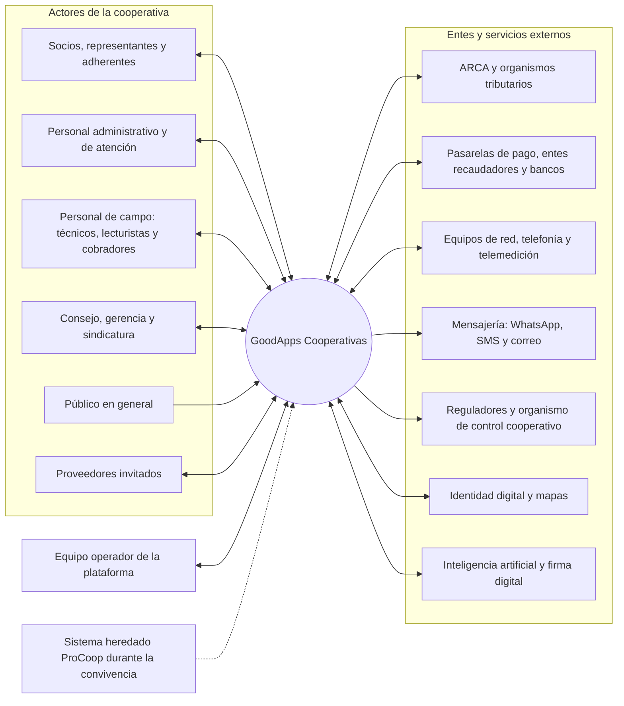
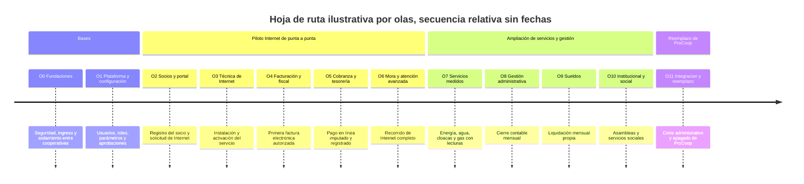

# GoodApps Cooperativas

## Resumen ejecutivo y visión del proyecto

**Entregable de Análisis y Diseño Detallado — Artefacto 1.3 (Visión y alcance)**

| Dato | Valor |
|---|---|
| Producto | GoodApps Cooperativas: plataforma de gestión en la nube (SaaS multi-tenant) para cooperativas de servicios públicos y sociales |
| Documento | Resumen ejecutivo y visión |
| Destinatarios | Consejo de administración, gerencia y responsables de área de la cooperativa |
| Carácter | Documento derivado de la especificación vigente; no la reemplaza. Ante cualquier diferencia prevalecen la especificación maestra (`00`), sus anexos y el registro de decisiones (`01`) |
| Versión | 1.0 |
| Fecha | 05-11-2026 |

### Control de versiones

| Versión | Fecha | Descripción del cambio | Autor |
|---|---|---|---|
| 1.0 | 05-11-2026 | Versión inicial del resumen ejecutivo y visión | |

### Aprobaciones

| Rol | Nombre | Firma | Fecha |
|---|---|---|---|
| Elaboró | | | |
| Revisó | | | |
| Aprobó | | | |

---

## Índice

1. Propósito del documento
2. Contexto y problema
3. Visión y propuesta de valor
4. Objetivos de negocio medibles
5. Alcance
6. Fuera de alcance
7. Usuarios y actores
8. Beneficios esperados por actor
9. Enfoque de implementación
10. Principales decisiones tomadas
11. Riesgos principales y mitigación
12. Supuestos y dependencias
13. Próximos pasos y validaciones pendientes
14. Documentos de referencia

---

## 1. Propósito del documento

Este documento presenta, en lenguaje de negocio, **qué es GoodApps Cooperativas, por qué se construye, qué incluye, cómo se va a implementar y cuáles son sus riesgos y decisiones principales**. Está dirigido a los directivos y a la gerencia de la cooperativa, que necesitan una visión integral para evaluar el proyecto, tomar decisiones y aprobar los próximos pasos sin entrar en el detalle técnico.

Es el artefacto 1.3 del índice de entregables de análisis y diseño (`00-INDICE.md`). Resume y reorganiza el contenido de la especificación del sistema, que está compuesta por un documento maestro, 31 anexos funcionales y técnicos, un registro de decisiones, un registro de preguntas abiertas, un plan de construcción por olas, una matriz de trazabilidad y un registro de huecos de cobertura. Este resumen **no agrega requisitos nuevos**: cuando se cita un dato, se indica su fuente; cuando un valor no figura en la especificación, se marca expresamente como **"a definir"**.

El documento sirve para:

- alinear a la conducción de la cooperativa sobre la visión y el alcance del producto;
- dar a conocer las decisiones ya tomadas y las que quedan pendientes de validación;
- identificar los riesgos principales y su tratamiento;
- acordar los próximos pasos, en particular la formalización con Laguna Larga como cooperativa piloto y las validaciones legales.

---

## 2. Contexto y problema

Las cooperativas de servicios públicos de la Argentina prestan, en muchos casos, varios servicios a la vez: electricidad, agua, cloacas, gas, Internet, telefonía, televisión, sepelio, salud, vivienda y otros servicios sociales. Hoy gran parte de ellas opera con **ProCoop**, un sistema de gestión de escritorio. El relevamiento de ese sistema (documentado en la base funcional y en la especificación maestra §1.1 y §4.4) muestra un conjunto de limitaciones que, traducidas a términos de negocio, son las siguientes.

| Limitación del sistema actual | Consecuencia para la cooperativa |
|---|---|
| Instalación local en cada computadora y actualizaciones manuales | Costos y tiempos de mantenimiento propios; versiones desparejas entre puestos; dependencia de personal técnico para cada actualización. |
| Una base de datos separada por cooperativa, administrada localmente | La cooperativa debe ocuparse de servidores, copias de seguridad y recuperación ante fallas; el riesgo de pérdida de información queda a su cargo. |
| Seguridad débil: contraseñas que pueden descifrarse, un usuario de base de datos compartido y credenciales escritas dentro del programa | Exposición de datos de socios y de credenciales fiscales y bancarias; dificultad para saber quién hizo cada operación. |
| Más de 1.500 parámetros (1.536) identificados con números sin significado | La configuración depende de pocas personas que conocen los códigos; cualquier cambio de tarifa, concepto o política es riesgoso y difícil de auditar. |
| Integraciones frágiles con organismos, bancos, entes recaudadores y equipos de red | Errores en cobranzas, rendiciones y autorizaciones fiscales; tareas manuales de corrección y conciliación. |
| Portal del socio que funciona sobre una copia sincronizada de los datos | Información desactualizada para el socio, experiencia digital limitada y doble mantenimiento. |
| Experiencia digital casi nula para el socio y para el personal de campo | Mayor carga en mostrador y teléfono; trabajo de campo en papel o con herramientas aisladas; menor velocidad para cobrar, atender y resolver. |

Además, las cooperativas enfrentan un entorno cada vez más exigente: facturación electrónica obligatoria, múltiples regímenes impositivos nacionales, provinciales y municipales, informes a entes reguladores, protección de datos personales (Ley 25.326) y socios que esperan resolver sus trámites desde el celular. El sistema actual no fue concebido para ese escenario.

---

## 3. Visión y propuesta de valor

### 3.1 Visión

> Brindar a cada cooperativa una plataforma única, segura y configurable que le permita administrar de punta a punta todos sus servicios, su relación con los socios y su gestión interna, con información confiable, trazable y disponible en cualquier momento y lugar.
>
> *(Documento de alcance funcional, §2.1)*

### 3.2 Propuesta de valor

GoodApps Cooperativas es una **plataforma en la nube** que se usa desde el navegador y desde el celular, sin instalar programas, sin administrar servidores y sin realizar copias de seguridad manuales. Todas las cooperativas usan la misma plataforma, siempre actualizada, y cada una conserva sus datos completamente aislados, su marca, su vocabulario y su configuración.

La propuesta de valor se resume en seis ideas:

1. **Una sola herramienta para toda la cooperativa**: gestión comercial y administrativa, atención al socio, operación técnica y de campo, autogestión del socio, comunidad e integración con terceros, sobre la misma información.
2. **Todo lo que hace ProCoop, mejorado**: no se pierde ninguna función del sistema actual; lo único que no se replica son sus debilidades técnicas y de seguridad (DEC-007).
3. **Configuración, no programación**: servicios, tarifas, conceptos, impuestos, textos y circuitos se definen desde pantallas, con fechas de vigencia e historial de cambios.
4. **El socio en el centro**: sitio y aplicación con la marca de la cooperativa para consultar, pagar, reclamar y contratar desde el celular.
5. **Control y trazabilidad**: cada operación queda registrada con su autor, fecha y motivo; los documentos económicos nunca se borran, se anulan o revierten.
6. **Seguridad y continuidad profesionales**: aislamiento verificable de los datos de cada cooperativa, doble factor de autenticación para el personal, cifrado, copias automáticas y niveles de servicio comprometidos.

### 3.3 Principios del producto

| Principio | Qué significa para la cooperativa |
|---|---|
| Una sola plataforma | Cada cooperativa habilita solo los servicios y módulos que contrata y necesita. |
| Configuración, no programación | Los cambios de negocio se hacen por configuración versionada, no con desarrollos a medida. |
| Vocabulario propio | La cooperativa elige cómo llamar a las cosas (socio, usuario o asociado; suministro o conexión). |
| Factura a medida | Factura separada por servicio o agrupada multiservicio, ambas modalidades completas. |
| Nada se borra | Los documentos económicos se anulan o revierten con su respaldo. |
| Inteligencia artificial que asiste | La IA propone, resume y clasifica; nunca ejecuta sin la confirmación de una persona autorizada. |
| El socio primero | Autogestión pensada para el celular, con una tarea principal clara por pantalla. |
| Seguridad desde el diseño | Datos aislados, credenciales protegidas, doble factor y mínimo privilegio. |

*(Especificación maestra §1.3; documento de alcance funcional §3)*

---

## 4. Objetivos de negocio medibles

Los objetivos se agrupan en compromisos de servicio (ya definidos en la especificación), objetivos de calidad de la transición (definidos en el plan de migración) y objetivos de impacto en el negocio de la cooperativa (que la especificación no cuantifica y deben acordarse con la cooperativa piloto).

### 4.1 Compromisos de servicio y calidad (definidos en la especificación)

| N.º | Objetivo | Meta | Fuente |
|---|---|---|---|
| OBJ-01 | Disponibilidad del servicio | 99,5 % mensual (excluye mantenimientos programados) | DEC-063; T08 RNF-NFR-030 |
| OBJ-02 | Pérdida máxima de datos ante un incidente grave | Hasta 15 minutos | DEC-063; T08 RNF-NFR-035 |
| OBJ-03 | Tiempo máximo de recuperación | 4 horas por cooperativa; 8 horas para la plataforma completa | DEC-063; T08 RNF-NFR-036 y 037 |
| OBJ-04 | Tiempo de respuesta de las pantallas | 800 milisegundos o menos en el 95 % de las operaciones interactivas | DEC-063; maestra §14 |
| OBJ-05 | Facturación masiva | 50.000 suministros en 60 minutos o menos, con progreso visible y reanudación; autorización fiscal del lote en 2 horas o menos cuando el organismo fiscal responde normalmente | T08 RNF-NFR-010 y 011 (PA-NFR-04, asumida) |
| OBJ-06 | Capacidad | Cooperativas de hasta 150.000 suministros; plataforma diseñada para 100 cooperativas y ampliable a 300 sin rediseño | DEC-075 |
| OBJ-07 | Exactitud económica | Cero diferencias de centavos entre comprobante, cuenta corriente y contabilidad | Maestra §14 |
| OBJ-08 | Soporte | Lunes a viernes de 8 a 18 horas; incidentes críticos las 24 horas, todos los días | DEC-063 |
| OBJ-09 | Cobertura funcional respecto de ProCoop | Todas las funciones de ProCoop en alcance; la matriz de trazabilidad asigna destino al 97,9 % de las unidades de fuente relevadas, y las brechas restantes tienen corrección propuesta | DEC-007; `04-matriz-trazabilidad.md` (maestra §19) |
| OBJ-10 | Seguridad y aislamiento | Pruebas automáticas de aislamiento entre cooperativas que bloquean toda actualización que no las supere; doble factor para el personal | Maestra §14; T08 |

### 4.2 Objetivos de calidad de la transición (definidos en el plan de migración)

| N.º | Objetivo | Meta | Fuente |
|---|---|---|---|
| OBJ-11 | Corrida paralela de facturación aprobada antes del reemplazo | 2 ciclos consecutivos aprobados por servicio, con 0 diferencias sin explicar | T07 §17.4 (PRM-MIG-041 y 042; PA-MIG-02, asumida) |
| OBJ-12 | Emparejamiento de facturas entre sistemas en el paralelo | 99,9 % o más, con los casos no emparejados justificados | T07 §17.4 |
| OBJ-13 | Conciliación de saldos al corte | Deuda por titular y servicio, saldos a favor, fondos, stock y contabilidad conciliados y aprobados antes de cada corte | T07 §9.8 y §9.9 |
| OBJ-14 | Histórico disponible en el nuevo sistema | Ejercicio en curso más 24 meses en estructura completa; el resto en consulta histórica; copia del origen conservada 10 años | DEC-070 |

### 4.3 Objetivos de impacto en el negocio (a acordar con la cooperativa)

La especificación no fija metas cuantitativas de impacto comercial u operativo. Se proponen los siguientes indicadores para que la cooperativa piloto establezca su línea de base y su meta.

| N.º | Indicador | Meta |
|---|---|---|
| OBJ-15 | Proporción de socios registrados en el portal o la aplicación | a definir |
| OBJ-16 | Proporción de cobros realizados por canales digitales (pasarelas, débito, QR) | a definir |
| OBJ-17 | Reducción del tiempo de resolución de reclamos y solicitudes | a definir |
| OBJ-18 | Reducción de la morosidad o del plazo promedio de cobro | a definir |
| OBJ-19 | Reducción del tiempo del ciclo de facturación (desde el cierre de lecturas hasta la distribución) | a definir |
| OBJ-20 | Nivel de satisfacción del socio y del personal | a definir |
| OBJ-21 | Costo total de operación del sistema frente al esquema actual | a definir (depende del modelo de costos, artefacto 10.3) |
| OBJ-22 | Plazo total del proyecto y de cada ola | a definir (la planificación es por olas sin fechas, DEC-006) |

---

## 5. Alcance

### 5.1 Soluciones que integra la plataforma

| Solución | Qué resuelve |
|---|---|
| Gestión comercial y administrativa (ERP) | Personas y cuentas, catálogo de servicios, medición, tarifas, facturación, fiscal, cuenta corriente, cobranza, mora y financiación, ventas, compras, stock, tesorería, contabilidad, sueldos, institucional y servicios sociales. |
| Atención y relación con el socio (CRM) | Solicitudes, reclamos, mesa de entradas, turnero, canales digitales, asistente virtual e inteligencia artificial supervisada, operación técnica en campo. |
| Sitio web y autogestión | Sitio público con la marca de la cooperativa, registro, portal y aplicación del socio, pago en línea y comunidad. |
| Plataforma | Alta y ciclo de vida de cada cooperativa, licencias por módulo, ambientes de prueba, soporte controlado y monitoreo. |
| Cobranza y medios de pago | Cajas, cobradores, entes recaudadores, débitos automáticos, pasarelas de pago, códigos QR y conciliación. |
| Liquidación de impuestos | Facturación electrónica, IVA, Ingresos Brutos, percepciones, retenciones, tasas de terceros y regímenes informativos. |
| Información e integración | Reportes, tableros, inteligencia de negocio e interfaz de integración para sistemas de terceros. |

*(Maestra §4.1; alcance funcional §4.1)*

### 5.2 Servicios cubiertos

Cada cooperativa habilita solo los servicios que presta; cada servicio tiene su configuración, sus planes, categorías y reglas, y puede convivir con los demás en la misma cuenta del socio.

| Familia | Servicios | Particularidades principales |
|---|---|---|
| Tecnologías de la información y las comunicaciones | Internet (fibra, inalámbrico, cable), telefonía fija e IP, televisión (cable e IPTV), correo electrónico y paquetes de mensajes | Factibilidad técnica, equipos en comodato, activación y corte automáticos en los equipos de red, tasación de llamadas, botón de baja |
| Servicios medidos | Electricidad, agua, cloacas, gas (natural por red, propano por red y envasado) | Medidores, rutas y lecturas, telemedición y prepago, tramos y escalones, generación distribuida, grandes usuarios, informes a reguladores |
| Servicios por cuenta de terceros y obras | Alumbrado público, tasas municipales y fondos, obras y contribución por mejoras | Exhibición separada en la factura, rendición al tercero, padrón de beneficiarios y planes de cuotas |
| Servicios sociales y abonos | Sepelio, cementerio parque, salud y ambulancias, banco de sangre (solo administrativo, por convenio), seguros y adhesiones | Grupo familiar, adherentes, carencias y protección reforzada de datos sensibles |
| Otros servicios | Vivienda, ventas de productos, fabricación propia (postes, bloques u otros), traslados y flota, banco ortopédico y cualquier prestación que la cooperativa defina | Contratos, cuotas, órdenes de producción |
| Institucional | Capital social y cuotas sociales | Renglón identificado en la factura, con registro propio separado de la deuda por servicios (DEC-061) |

*(Maestra §4.2; alcance funcional §5; fichas verticales T12, DEC-073)*

### 5.3 Módulos funcionales agrupados por área

| Área | Módulos que la componen |
|---|---|
| Socios y servicios | Personas, titulares y cuentas; catálogo de servicios y contratos; medición y consumos |
| Facturación y fiscal | Tarifas y motor de cálculo; facturación (separada y multiservicio); fiscal e impuestos |
| Cobranza y mora | Cuenta corriente y cobranza; mora, corte, reconexión y financiación |
| Atención y operación técnica | Atención al socio (solicitudes, reclamos, mesa de entradas, turnero, canales, IA); técnica, campo y redes (factibilidad, órdenes de trabajo, cuadrillas, mapas, aprovisionamiento) |
| Gestión administrativa | Ventas y presupuestos; compras y proveedores; stock, bienes de uso y fabricación; tesorería y bancos; contabilidad |
| Personas de la organización | Personal y sueldos, con portal del empleado |
| Institucional y social | Gestión institucional (asociados, capital, asambleas, consejo, informes al organismo de control); servicios sociales y flota |
| Canales y comunidad | Sitio público y portal del socio; comunidad y comunicaciones (muro editorial, novedades, encuestas, campañas, notificaciones) |
| Transversales | Plataforma; identidad, roles y auditoría; marca, vocabulario y experiencia de uso; configuración y parámetros; integraciones; reportes, tableros e interfaz para terceros; trámites, aprobaciones y documentos; migración desde ProCoop; requisitos de calidad y seguridad |

### 5.4 Aplicaciones

| Aplicación | Quiénes la usan | Qué ofrece |
|---|---|---|
| Sistema de gestión web (admin) | Personal administrativo, comercial, técnico y directivo | Todos los módulos de gestión, configuración, reportes y tableros, con el menú adaptado a los permisos de cada usuario |
| Portal y aplicación del socio (PWA) | Socios titulares, representantes, adherentes y visitantes registrados | Cuentas, servicios, facturas, pagos, consumos, reclamos, solicitudes, turnos, comunidad y perfil; se instala en el celular con el nombre, el ícono y los colores de la cooperativa |
| Espacio del empleado | Personal de la cooperativa | En la misma aplicación del celular: recibos de sueldo y su firma, tareas, aprobaciones y comunicaciones internas |
| Aplicación de campo (PWA) | Técnicos, lecturistas y cobradores | Agenda del día, órdenes de trabajo, rutas de lectura, cartera de cobranza, materiales en el vehículo, fotos y firma; funciona sin conexión |
| Sitio público | Público en general | Información institucional, noticias, servicios, cuadros tarifarios, registro, consulta y pago sin ingresar, solicitudes, reclamos y botón de baja |
| Tótem de autogestión | Socios en las oficinas | Turnos, consulta y pago presencial en modo kiosco |
| Consola de plataforma | Equipo operador de GoodApps | Alta y seguimiento de cooperativas, licencias, soporte y salud del servicio |
| Interfaz de integración | Sistemas de terceros autorizados | Acceso controlado a datos y operaciones (inteligencia de negocio, municipios, federaciones, otros sistemas) |

*(Maestra §8; alcance funcional §7)*

### 5.5 Integraciones externas principales

| Ámbito | Integraciones |
|---|---|
| Fiscal | ARCA (autorización de comprobantes, padrones, constancias, regímenes informativos); organismos tributarios provinciales y municipales |
| Cobranza | Pagos360, Mercado Pago, SIRO y Red Link en la primera etapa (DEC-015); otras pasarelas, entes recaudadores y débitos automáticos bancarios y de tarjetas |
| Bancos | Extractos, banca electrónica empresarial, archivos de pago de haberes y proveedores, cheques electrónicos |
| Redes de Internet y televisión | MikroTik, Radius y SmartOLT para el servicio piloto (DEC-042); otras plataformas de gestión de red |
| Telefonía | Registros de llamadas de centrales y operadoras |
| Medición | Telemedición y medidores prepagos |
| Mensajería | WhatsApp Business (Meta Cloud API por defecto, DEC-055), SMS, correo electrónico y notificaciones en el celular |
| Identidad | Ingreso con cuentas de Google y corporativas; Ciudadano Digital de Córdoba habilitable por cooperativa (DEC-067) |
| Mapas | Servicio oficial de georreferenciación para normalizar domicilios y mapas con autocompletado de direcciones (DEC-046) |
| Inteligencia artificial y firma | Proveedores de IA para atención, moderación y lectura de documentos; proveedor licenciado de firma digital para recibos de sueldo y actas (DEC-078) |
| Reguladores y control | Entes de energía, gas y comunicaciones; organismo de control cooperativo; federaciones |
| Equipamiento local | Impresoras fiscales y de tickets, lectores, balanzas, pantallas y tótems, mediante un agente local |

### 5.6 Diagrama de contexto de negocio

El siguiente diagrama muestra, de manera simplificada, quiénes interactúan con GoodApps Cooperativas y con qué entes externos se intercambia información.

---

## 6. Fuera de alcance

La especificación **no establece exclusiones funcionales**: todo lo que hace ProCoop está en alcance, mejorado, y las funciones de menor prioridad se ubican en olas tardías, pero no se excluyen (DEC-007; maestra §4.4).

Lo que **no se replica** del sistema actual son sus deudas técnicas y de seguridad, que se reemplazan por la solución indicada en la especificación:

| No se replica | Se reemplaza por |
|---|---|
| Contraseñas que pueden descifrarse | Contraseñas protegidas con algoritmos no reversibles y doble factor para el personal |
| Usuario de base de datos compartido | Identidad individual por usuario, con permisos y auditoría |
| Claves y credenciales escritas dentro del programa | Bóveda cifrada de credenciales por cooperativa (DEC-074) |
| Una base de datos por cooperativa | Plataforma única con datos aislados por cooperativa (DEC-002) |
| Portal del socio con copia sincronizada en otra base | Portal nativo sobre la misma información (M19) |
| Instalación local y actualizaciones manuales | Servicio en la nube con actualizaciones automáticas |
| Menú armado automáticamente a partir del código del programa | Menú, mapa del sitio y permisos generados desde una única declaración verificable |
| Parámetros numéricos sin significado | Parámetros con nombre, tipo, vigencia e historial |

Además, la especificación fija **límites de responsabilidad** que conviene tener presentes (alcance funcional §6.1):

- La presentación de declaraciones fiscales y la responsabilidad fiscal siguen siendo de la cooperativa y de su profesional contable; el sistema calcula, prepara, valida y concilia.
- El sistema no certifica la validez legal de los actos institucionales ni reemplaza a los órganos sociales.
- En salud y servicios sociales se gestionan solo aspectos administrativos: no hay historias clínicas, decisiones clínicas ni despacho de emergencias.
- La inteligencia artificial nunca ejecuta acciones con efecto sin confirmación humana y permanece apagada hasta que la cooperativa la acepta (DEC-056).
- Los plazos y criterios con contenido jurídico vienen precargados con valores de referencia y deben ser validados por la asesoría legal de la cooperativa antes de su primera aplicación productiva.

---

## 7. Usuarios y actores

La plataforma reconoce cuatro grandes grupos de usuarios, con un catálogo de **40 roles** predefinidos que cada cooperativa puede usar tal cual, copiar y ajustar; los nombres visibles se adaptan al vocabulario de la cooperativa (maestra §7.2; T02).

| Grupo | Actores principales | Interacción con el sistema |
|---|---|---|
| Conducción de la cooperativa | Consejeros, gerente, síndico o auditor | Tableros, aprobaciones de alto nivel, lectura institucional y auditoría sin modificar información |
| Personal administrativo | Facturación, cajeros, tesorería, contaduría, compras, depósito, recursos humanos, secretaría institucional, servicios sociales | Sistema de gestión web, cada uno con su alcance de datos (sucursal, zona, servicio, depósito) |
| Personal comercial y de atención | Atención al socio, supervisión de atención, editores y moderadores de comunidad | Sistema de gestión web, canales digitales y muro editorial |
| Personal técnico y de campo | Supervisor técnico, supervisor de consumos, técnicos, lecturistas, cobradores | Sistema de gestión web y aplicación de campo sin conexión |
| Administración del sistema en la cooperativa | Administrador de la cooperativa y administrador de usuarios | Configuración, usuarios, roles, políticas y publicación |
| Comunidad | Socios titulares, representantes autorizados, adherentes, visitantes registrados, empleados en el portal, proveedores invitados | Portal y aplicación del socio, sitio público, tótem |
| Equipo de la plataforma | Superadministración, operación de cooperativas, comercial, soporte, seguridad, operaciones técnicas | Consola de plataforma; acceso a datos de una cooperativa solo temporal, consentido y auditado |
| Dispositivos y sistemas | Procesos automáticos, sistemas externos integrados, asistente virtual, tótems y agentes de equipamiento local | Permisos propios y acotados; el asistente nunca tiene más permisos que el usuario en cuyo nombre actúa |

Lo que cada usuario puede ver y hacer resulta de cuatro filtros verificados en cada operación: **licencia** contratada, **activación** del módulo por la cooperativa, **rol** del usuario y **alcance de datos**. Se suman la denegación por defecto, la separación de funciones (quien solicita no aprueba, quien aprueba no paga), la autorización de supervisor y la franja horaria por perfil.

---

## 8. Beneficios esperados por actor

| Actor | Beneficios esperados |
|---|---|
| Consejo de administración y sindicatura | Información confiable y trazable para decidir; auditoría inmutable de todas las operaciones; separación de funciones y circuitos de aprobación; cumplimiento normativo con evidencia; menor riesgo de seguridad sobre los datos de los socios. |
| Gerencia | Tableros por rol con indicadores definidos; visión integrada de todos los servicios en un solo sistema; capacidad de adaptar tarifas, conceptos y políticas por configuración; niveles de servicio comprometidos por el proveedor. |
| Facturación, fiscal y contaduría | Facturación masiva con controles previos, simulación y comparación con el período anterior; autorización fiscal electrónica con contingencias; cero diferencias entre factura, cuenta corriente y contabilidad; asientos automáticos desde el primer evento económico (DEC-009). |
| Cobranza y tesorería | Cobro por todos los canales con imputación automática; conciliación de pasarelas, entes y bancos; reconexión automática al pagar en servicios remotos (DEC-014); reconocimiento de los códigos de pago de facturas emitidas por ProCoop hasta su vencimiento (DEC-050). |
| Atención al socio | Expediente único con número de seguimiento, plazos de respuesta y avisos automáticos; canales digitales y WhatsApp integrados; asistencia de IA para clasificar y resumir, siempre bajo control humano. |
| Personal técnico y de campo | Agenda y órdenes en el celular, aun sin conexión; fotos, firma del socio y materiales del vehículo registrados en el momento; activación automática del servicio en los equipos de red. |
| Administración y recursos humanos | Compras, stock, tesorería, contabilidad y sueldos integrados con el resto de la operación; recibos de sueldo digitales con firma. |
| Socios y comunidad | Autogestión desde el celular con la marca de su cooperativa: consultar, pagar, reclamar, contratar y seguir sus gestiones; avisos por el canal preferido; comunidad con novedades y encuestas; información siempre actualizada. |
| Equipo de sistemas de la cooperativa | Sin servidores ni copias de seguridad propias que administrar; actualizaciones automáticas; ambiente de prueba con datos anonimizados para validar cambios. |

---

## 9. Enfoque de implementación

### 9.1 Construcción por olas

El sistema se construye en **doce olas sucesivas (O0 a O11)**. Cada ola entrega funciones completas y utilizables, y tiene un hito de salida verificable. Por decisión del solicitante, las olas **no tienen fechas** comprometidas: solo orden y dependencias (DEC-006). El plan detallado contiene 172 instrucciones de construcción que cubren los 4.203 requisitos funcionales y los 292 requisitos no funcionales de la especificación (`03-plan-de-olas-y-prompts.md`).

El primer recorrido completo de punta a punta es el del **servicio de Internet** (DEC-005): contratación, factibilidad, instalación, equipo en comodato, activación, facturación, pago, reclamo, mora y baja. Las olas O2 a O6 lo completan; los servicios medidos llegan en O7 y la gestión administrativa e institucional completa en las olas siguientes.

| Ola | Qué entrega, en términos de negocio | Hito de salida |
|---|---|---|
| O0 | Fundaciones: seguridad, ingreso, aislamiento entre cooperativas, auditoría, marca y vocabulario básicos; entidades jurídicas y sucursales de la cooperativa | Una cooperativa de demostración con ingreso seguro y aislamiento verificado |
| O1 | Plataforma y configuración: usuarios, roles, permisos, parámetros, tablas maestras, geografía, circuitos de aprobación y repositorio documental | Alta asistida de una cooperativa con su configuración publicada |
| O2 | Socios, servicios y portal: personas y cuentas, catálogo de servicios, sitio público, registro, portal, solicitudes y comunidad | Un socio se registra y solicita Internet desde el sitio |
| O3 | Técnica de Internet: factibilidad, agenda, órdenes de trabajo, instalación, comodato, stock de equipos, aplicación de campo y activación en la red | El servicio queda instalado y activo |
| O4 | Tarifas, facturación y fiscal: motor tarifario, facturación, autorización fiscal electrónica, impuestos básicos y adherentes | Primera factura electrónica autorizada |
| O5 | Cobranza y tesorería operativa: cuenta corriente, caja, pasarelas prioritarias, débitos, conciliación, contabilidad inicial y capital social mínimo | Pago en línea imputado y registrado contablemente |
| O6 | Mora y atención avanzada: suspensión, corte y reconexión, convenios, incobrables, inteligencia artificial y atención omnicanal | Recorrido de Internet completo de punta a punta |
| O7 | Servicios medidos: electricidad, agua, cloacas, gas y alumbrado; lecturas, telemedición, tarifas medidas, reguladores y obras; corrida paralela y corte comercial por servicio (DEC-089) | Facturación de energía con lecturas; corte comercial de electricidad, gas y prepago de Laguna Larga al cerrar la ola (DEC-089) |
| O8 | Gestión administrativa: compras, stock completo, tesorería, contabilidad completa, regímenes informativos; importación de sueldos de un liquidador externo | Cierre contable mensual |
| O9 | Personal y sueldos: liquidación propia con sus obligaciones | Liquidación mensual con sus declaraciones |
| O10 | Institucional y servicios sociales: asociados, asambleas, sepelio, cementerio, salud, vivienda, flota, telefonía, televisión, fabricación, turnero y actividades | Asamblea y servicios sociales operativos |
| O11 | Información, integración y reemplazo: inteligencia de negocio, generador de reportes, interfaz para terceros, pasarelas restantes, migración repetible y reemplazo del área administrativa (DEC-089; antes incluía la corrida paralela, que pasa a O7) | Reemplazo del área administrativa y apagado de ProCoop (DEC-089; antes "por etapas en una cooperativa: primero el área comercial y luego la administrativa") |

*(Maestra §15; alcance funcional §14)*

### 9.2 Hoja de ruta ilustrativa

El siguiente diagrama es **ilustrativo**: muestra la secuencia relativa de las olas, sin fechas ni duraciones reales.

### 9.3 Cooperativa piloto

La cooperativa piloto (comercial y de migración) es **Laguna Larga** (sigla `LAG`) (DEC-088, que reemplaza a DEC-081). Su base de ProCoop es además la base relevada de referencia para el mapeo de datos, las pruebas de corrida paralela y las verificaciones de reglas heredadas; de ella se toma solo configuración, nunca datos personales.

Laguna Larga opera servicios medidos (electricidad, gas y prepago; T07 CTR-MIG-07). Por eso, según la opción asumida para el orden de migración (PA-MIG-17, DEC-072), la herramienta de migración se valida primero con datos sintéticos de Internet y la **primera migración real de Laguna Larga se realiza después de la ola O7**, cuando los servicios medidos están completos. El corte avanza luego por etapas y por dominio hasta la ola O11 (DEC-068). Las cooperativas siguientes reutilizan el mismo conjunto de mapeo y solo agregan sus particularidades.

### 9.4 Migración desde ProCoop

La migración se trata como un proyecto por cooperativa, organizado por dominio funcional, con trazabilidad completa (T07):

- **Herramienta desde el inicio**: la herramienta de migración se construye en las olas O0 y O1, y cada módulo incorpora su cargador de datos en la ola en que se construye, probado con datos anonimizados.
- **Fases controladas**: inventario, diagnóstico de calidad de datos, mapeo, limpieza, extracción, transformación, carga, validación, conciliación, corrida paralela, convivencia, corte definitivo y, si hiciera falta, vuelta atrás. Cada fase tiene una salida verificable y un responsable.
- **Calidad de datos**: se detectan documentos inválidos, personas duplicadas, domicilios sin normalizar y registros huérfanos; los casos se resuelven en una cola de saneamiento con aprobación humana.
- **Histórico**: ejercicio en curso más 24 meses en estructura completa; el resto queda disponible para consulta histórica, y la copia del origen se conserva 10 años (DEC-070).
- **Corrida paralela**: antes de reemplazar la facturación se compara factura por factura lo que emite ProCoop con lo que simula GoodApps, en cantidades, importes por concepto, impuestos y vencimientos, hasta aprobar 2 ciclos consecutivos por servicio sin diferencias sin explicar.
- **Continuidad para el socio**: los códigos de pago de las facturas emitidas por ProCoop se siguen reconociendo hasta su vencimiento (DEC-050) y los usuarios del portal anterior se incorporan sin nuevo registro.
- **Vuelta atrás**: existe un plan de retorno a ProCoop que puede aplicarse hasta la primera emisión fiscal real o el primer cobro por entes en GoodApps; después, solo se corrige hacia adelante. Toda decisión de vuelta atrás requiere doble aprobación.

### 9.5 Corte por etapas (DEC-068)

El reemplazo de ProCoop se hace **por etapas**, con un único sistema responsable de cada dominio en cada momento:

| Etapa | GoodApps es el sistema de registro de | ProCoop sigue siendo el sistema de registro de |
|---|---|---|
| Ensayos | Ninguno (pruebas en un ambiente de ensayo) | Todo |
| Paralelo comercial | Ninguno (GoodApps simula y compara) | Todo |
| Corte comercial | Personas, cuentas, contratos, catálogo, tarifas, medición, facturación, fiscal de ventas, cuenta corriente, cobranza, mora, financiación, atención, técnica, portal y comunicaciones | Compras, stock no serializado, tesorería, contabilidad oficial, sueldos, institucional y social |
| Corte administrativo | Además: compras, stock, tesorería, contabilidad y retenciones | Sueldos, institucional y social, si todavía no fueron cortados |
| Apagado | Todo | Solo consulta hasta el cierre del ejercicio; luego, archivo |

Durante la convivencia, la contabilidad oficial sigue en ProCoop; GoodApps registra en un plan contable marcado como no oficial, lo concilia contra ProCoop y se oficializa en el corte administrativo (DEC-069). Una vez cortado un dominio, ProCoop queda en solo lectura para ese dominio.

---

## 10. Principales decisiones tomadas

La especificación registra 87 decisiones del solicitante (DEC-001 a DEC-087). De las 516 preguntas del cuestionario, 93 fueron respondidas por el solicitante y 423 se asumieron con la opción recomendada, que puede revisarse en cualquier momento (DEC-047, DEC-072). Las más relevantes para la conducción de la cooperativa son las siguientes.

**Producto y alcance**

- Todo lo que hace ProCoop está en alcance, incluidas telefonía, televisión, vivienda, salud, sepelio, fabricación, flota y turnero; las funciones menos prioritarias van a olas tardías (DEC-007).
- El servicio piloto es Internet, que se completa de punta a punta antes de incorporar los servicios medidos (DEC-005).
- La planificación es por olas sin fechas; solo hay orden y dependencias (DEC-006).
- Cada servicio queda especificado de punta a punta en una ficha vertical, que sirve como control de cobertura (DEC-073).

**Plataforma, seguridad y datos**

- Una única plataforma compartida, con los datos de cada cooperativa aislados por un identificador propio y verificados con pruebas automáticas (DEC-002).
- Alojamiento en la nube en la región de San Pablo, con cláusulas contractuales de transferencia internacional conformes a la autoridad argentina de protección de datos, y diseño independiente del proveedor de nube (DEC-004, DEC-062).
- Niveles de servicio: 99,5 % de disponibilidad mensual, pérdida máxima de datos de 15 minutos, recuperación en 4 horas por cooperativa y soporte en días hábiles con atención de incidentes críticos las 24 horas (DEC-063).
- GoodApps actúa como prestador de servicios de tratamiento de datos por cuenta de la cooperativa, con contrato de encargo (DEC-076).
- Las credenciales de ARCA, bancos y pasarelas se guardan en una bóveda cifrada; nunca se transcriben ni se registran (DEC-074).
- Una cooperativa puede administrar varias personas jurídicas, con emisión, contabilidad y sueldos por entidad (DEC-064).

**Facturación, cobranza y mora**

- La factura es separada por servicio por defecto; la factura agrupada multiservicio se habilita por grupo (DEC-034).
- Ante caídas del organismo fiscal, se emite y se encola la autorización, con contingencia cuando está habilitada (DEC-018, DEC-038).
- Pagos360, Mercado Pago, SIRO y Red Link se integran en la primera etapa de cobranza; el resto más adelante (DEC-015).
- Los pagos se imputan por antigüedad, primero recargos e intereses, respetando la elección explícita del socio o del cajero (DEC-048).
- La reconexión es automática al confirmarse el pago en servicios remotos; si requiere técnico, se genera la orden de trabajo (DEC-014).
- La deuda queda en el titular que la generó; el cambio de titularidad no la traslada salvo convenio (DEC-045). La deuda previa en un domicilio genera advertencia, nunca bloqueo (DEC-029).
- Los plazos de prescripción se diferencian por tipo de obligación (24 meses para facturas periódicas de servicios y 60 meses para el resto) y requieren validación legal antes de su primera aplicación (DEC-052).

**Atención, comunidad y socio**

- La comunidad es un muro editorial: publica la cooperativa; los socios reaccionan y comentan con moderación (DEC-008).
- La inteligencia artificial en atención clasifica, resume y sugiere, y permanece apagada hasta que la cooperativa la acepta (DEC-056).
- El socio ingresa con contraseña o con un código de un solo uso, según lo que habilite la cooperativa (DEC-066).
- Firma electrónica con código de un solo uso por defecto; firma digital con proveedor licenciado para recibos de sueldo y actas (DEC-078).

**Gestión administrativa y transición**

- La contabilidad tiene un núcleo temprano (ola O5) y se completa en la ola O8 (DEC-009).
- Sueldos: primero importación desde un liquidador externo (O8) y luego liquidación propia con dos períodos en paralelo (O9) (DEC-058).
- El reemplazo de ProCoop es por etapas: primero el área comercial y luego la administrativa (DEC-068), con contabilidad oficial en ProCoop durante la convivencia (DEC-069).
- Histórico migrado: ejercicio en curso más 24 meses, con copia del origen por 10 años (DEC-070).
- Modelo comercial: paquetes por tamaño con complementos y cupos según contratos activos (DEC-065).
- La cooperativa piloto es Laguna Larga (DEC-088) y facilitará la información y los accesos que requiera el proyecto.

---

## 11. Riesgos principales y mitigación

| N.º | Riesgo | Impacto | Mitigación |
|---|---|---|---|
| R-01 | **Migración de datos**: calidad deficiente de los datos heredados (documentos inválidos, duplicados, domicilios sin normalizar, registros huérfanos) o diferencias en saldos y facturación | Alto: errores en facturas y deudas, pérdida de confianza del socio, demoras en el corte | Herramienta de migración desde O0–O1; diagnóstico de calidad y cola de saneamiento con aprobación humana; conciliaciones por dominio; corrida paralela con 2 ciclos aprobados y 0 diferencias sin explicar; plan de vuelta atrás con doble aprobación (T07) |
| R-02 | **Validaciones legales pendientes**: 8 parámetros con valor por defecto propuesto que requieren validación legal (tratamiento fiscal del aporte de capital en la factura; tiempos de respuesta ante emergencias de gas; suspensión de cobertura de sepelio por cuotas impagas y carencia de rehabilitación; modo de mora en telefonía con emergencias siempre habilitadas; grilla mínima de televisión en mora; plazos de respuesta de reclamos de servicios TIC; caudal mínimo vital de agua; ventanas de corte de energía por jurisdicción), además de los plazos de prescripción (DEC-052) y los de conservación de datos (PA-NFR-06) | Alto: incumplimientos normativos, reclamos o sanciones si se aplican valores no validados | Los valores vienen como parámetros editables y marcados para validación; la especificación exige validación legal antes de la primera aplicación productiva; ningún administrador puede desactivar restricciones normativas (`05-registro-huecos.md`; alcance funcional §6.1) |
| R-03 | **Datos heredados marcados [VERIFICAR]**: reglas y valores tomados de ProCoop y de la base relevada de referencia que deben confirmarse con la cooperativa piloto | Medio: comportamientos distintos de los esperados en la cooperativa real | Verificación en las fases de inventario y mapeo de la cooperativa piloto; corrida paralela factura por factura; diferencias intencionales documentadas como regla |
| R-04 | **Dependencia de servicios externos**: indisponibilidad o cambios del organismo fiscal, pasarelas, bancos, entes recaudadores, mensajería, mapas o equipos de red | Alto: demoras en autorización fiscal, cobros o activaciones | Conectores con reintentos controlados y prevención de duplicados; operación degradada sin bloquear pantallas; contingencias fiscales; tablero de conectores degradados; credenciales en bóveda con aviso de vencimiento (T06; T08 RNF-NFR-047) |
| R-05 | **Adopción de usuarios**: resistencia al cambio del personal, curva de aprendizaje y baja adopción digital de los socios | Alto: subutilización del sistema y menor retorno de la inversión | Ayuda contextual en cada pantalla; vocabulario propio de la cooperativa; ambiente de prueba; incorporación de usuarios del portal anterior sin nuevo registro; plan de capacitación y gestión del cambio (artefacto 8.4, pendiente) |
| R-06 | **Alcance amplio**: más de 4.200 requisitos funcionales en 12 olas, con riesgo de demoras o de pérdida de foco | Alto: retrasos en el reemplazo y en los beneficios | Construcción por olas con hitos de salida verificables; piloto Internet de punta a punta primero; prioridades que ubican lo marginal en olas tardías; trazabilidad de cada requisito a una instrucción de construcción |
| R-07 | **Piloto con servicios medidos**: Laguna Larga opera electricidad, gas y prepago, mientras que el primer servicio construido de punta a punta es Internet (DEC-005) | Medio: la primera migración real no puede hacerse antes de completar la ola O7 | Validar la herramienta con datos sintéticos de Internet; ensayos de migración con la base de Laguna Larga desde las olas tempranas; primera migración real después de O7 (PA-MIG-17) |
| R-08 | **Decisiones asumidas** (423 preguntas con opción recomendada) que la cooperativa podría querer cambiar | Medio: retrabajo si una decisión cambia tarde | Las opciones asumidas se implementan detrás de parámetros cambiables; revisión priorizada de las de mayor impacto antes de la ola correspondiente |
| R-09 | **Convivencia de dos sistemas** durante el corte por etapas | Medio: doble carga, inconsistencias entre sistemas | Un único sistema de registro por dominio; ProCoop en solo lectura para lo cortado; sincronizaciones definidas; contabilidad no oficial conciliada (DEC-068, DEC-069) |
| R-10 | **Privacidad y alojamiento fuera del país** | Medio: observaciones de la autoridad de protección de datos o de los socios | Cláusulas contractuales de transferencia (DEC-062); rol de prestador de servicios de tratamiento con contrato de encargo (DEC-076); consentimientos, derechos y retención gestionados (T08) |
| R-11 | **Metas de rendimiento asumidas** sin medición real (facturación masiva y procesos por lotes) | Medio: tiempos de proceso superiores a los esperados en cooperativas grandes | Pruebas de carga con datos de referencia antes de cerrar las olas clave; recalibración con las mediciones de la cooperativa piloto (T08 §7.1) |

---

## 12. Supuestos y dependencias

### 12.1 Supuestos

1. Las preguntas no consultadas rigen con su opción recomendada hasta que la cooperativa las revise (DEC-047, DEC-072).
2. El perfil de capacidad de referencia (cooperativa estándar de 25.000 suministros y grande de 150.000) es representativo y se recalibrará con las mediciones de la cooperativa piloto (DEC-075; T08 §7.1).
3. La cooperativa piloto facilitará acceso de solo lectura a su base de ProCoop y a sus adjuntos para el inventario y la migración (T07 §9.2).
4. La cooperativa dispone de asesoría legal y contable para validar los parámetros con contenido jurídico y fiscal antes de su uso productivo.
5. El personal clave de la cooperativa (facturación, cobranza, contaduría, técnica) participará en el mapeo, las conciliaciones y la aprobación de la corrida paralela.
6. Los usuarios cuentan con conexión a Internet, salvo la aplicación de campo, que opera sin conexión y sincroniza al recuperarla.

### 12.2 Dependencias externas

1. **Convenios de la cooperativa con terceros**: entes recaudadores, pasarelas de pago, bancos, proveedores de mensajería y operadores de red; el sistema se conecta, pero los convenios son de la cooperativa.
2. **Organismo fiscal**: certificados de facturación electrónica de la cooperativa (la plataforma puede generar la solicitud de certificado, DEC-053) y disponibilidad de sus servicios.
3. **Proveedor de firma digital**: debe elegirse antes de la ola O3 (DEC-078).
4. **Proveedores de mapas e inteligencia artificial**: provistos por la plataforma, con opción de claves propias de la cooperativa (DEC-020).
5. **Reguladores**: formatos de informes y resoluciones tarifarias vigentes en cada jurisdicción.
6. **Infraestructura en la nube** en la región elegida (DEC-062).
7. **ProCoop** como fuente de datos y como sistema de registro de los dominios no cortados durante la convivencia (DEC-068).

---

## 13. Próximos pasos y validaciones pendientes

| N.º | Próximo paso | Responsable sugerido |
|---|---|---|
| 1 | Revisar y aprobar este resumen ejecutivo | Consejo y gerencia |
| 2 | Formalizar con Laguna Larga su participación como cooperativa piloto (DEC-088) y confirmar los servicios que presta y el orden de migración (PA-MIG-17) | Solicitante y conducción de la cooperativa |
| 3 | Validar con la asesoría legal los 8 parámetros con valor por defecto propuesto, los plazos de prescripción (DEC-052) y los plazos de conservación de datos (PA-NFR-06) | Asesoría legal y contable de la cooperativa |
| 4 | Revisar las decisiones asumidas de mayor impacto, empezando por las que afectan a las primeras olas | Solicitante con el equipo de análisis |
| 5 | Establecer la línea de base y las metas de los objetivos de impacto marcados "a definir" (sección 4.3) | Gerencia de la cooperativa piloto |
| 6 | Elegir el proveedor de firma digital antes de la ola O3 (DEC-078) | Solicitante |
| 7 | Confirmar los convenios vigentes con entes recaudadores, pasarelas y bancos de la cooperativa piloto | Tesorería de la cooperativa piloto |
| 8 | Elaborar el plan de validación con el cliente (artefacto 1.7), el plan de capacitación y gestión del cambio (artefacto 8.4), la estimación de esfuerzo por ola (artefacto 10.1) y el modelo de costos de operación (artefacto 10.3) | Equipo del proyecto |
| 9 | Iniciar la ola O0 y, en paralelo, el inventario y el diagnóstico de calidad de datos de la cooperativa piloto | Equipo del proyecto |

---

## 14. Documentos de referencia

Rutas relativas a esta carpeta (`docs/entregables-analisis-diseno/`).

| Documento | Ruta |
|---|---|
| Índice de entregables de análisis y diseño | [`00-INDICE.md`](00-INDICE.md) |
| Especificación maestra | [`../especificacion/00-ESPECIFICACION-MAESTRA.md`](../especificacion/00-ESPECIFICACION-MAESTRA.md) |
| Registro de decisiones | [`../especificacion/01-registro-decisiones.md`](../especificacion/01-registro-decisiones.md) |
| Preguntas abiertas | [`../especificacion/02-preguntas-abiertas.md`](../especificacion/02-preguntas-abiertas.md) |
| Plan de olas y prompts | [`../especificacion/03-plan-de-olas-y-prompts.md`](../especificacion/03-plan-de-olas-y-prompts.md) |
| Matriz de trazabilidad | [`../especificacion/04-matriz-trazabilidad.md`](../especificacion/04-matriz-trazabilidad.md) |
| Registro de huecos | [`../especificacion/05-registro-huecos.md`](../especificacion/05-registro-huecos.md) |
| Documento de alcance funcional | [`../alcance-funcional/GoodApps-Cooperativas-Alcance-Funcional.md`](../alcance-funcional/GoodApps-Cooperativas-Alcance-Funcional.md) |
| T02 — Identidad, roles y auditoría | [`../especificacion/anexos/T02-IAM-identidad-roles-auditoria.md`](../especificacion/anexos/T02-IAM-identidad-roles-auditoria.md) |
| T06 — Integraciones | [`../especificacion/anexos/T06-INT-integraciones.md`](../especificacion/anexos/T06-INT-integraciones.md) |
| T07 — Migración desde ProCoop | [`../especificacion/anexos/T07-MIG-migracion-procoop.md`](../especificacion/anexos/T07-MIG-migracion-procoop.md) |
| T08 — Requisitos no funcionales y seguridad | [`../especificacion/anexos/T08-NFR-no-funcionales-seguridad.md`](../especificacion/anexos/T08-NFR-no-funcionales-seguridad.md) |
| T12 — Fichas verticales por servicio (partes 1 y 2) | [`../especificacion/anexos/T12-SRV-fichas-verticales-servicios-parte1.md`](../especificacion/anexos/T12-SRV-fichas-verticales-servicios-parte1.md) y [`../especificacion/anexos/T12-SRV-fichas-verticales-servicios-parte2.md`](../especificacion/anexos/T12-SRV-fichas-verticales-servicios-parte2.md) |
