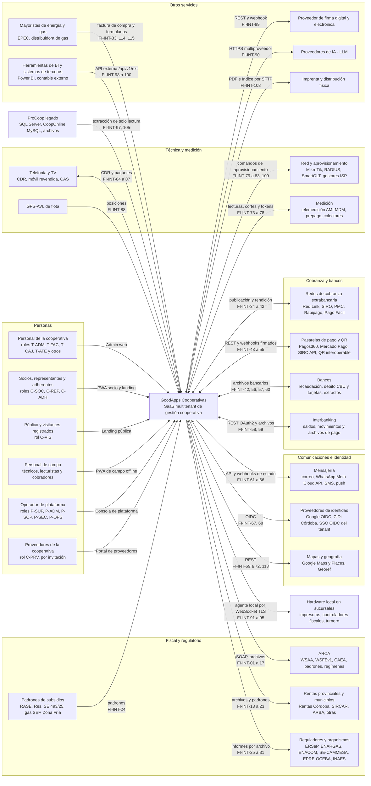
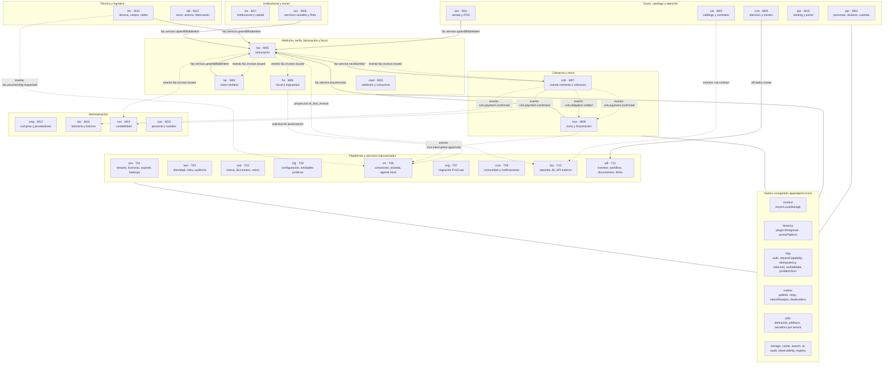
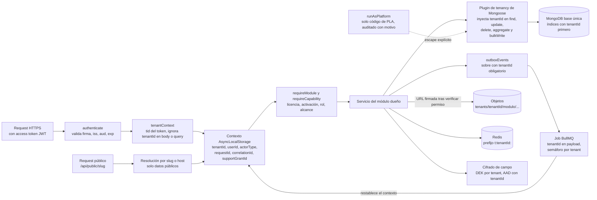
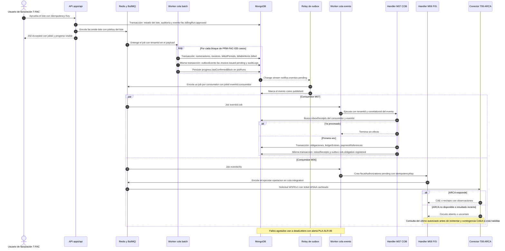
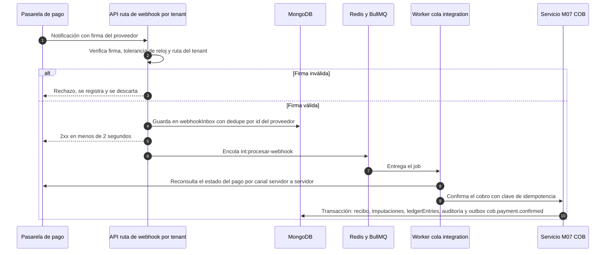
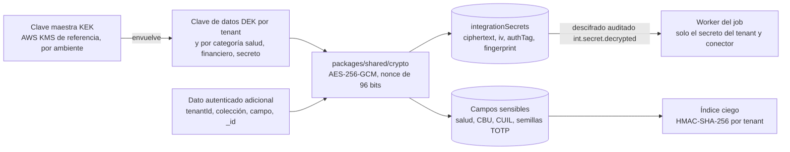
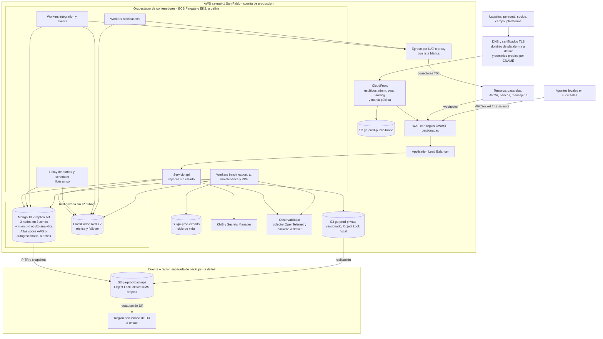

# Documento de arquitectura — GoodApps Cooperativas

**Vistas C4 (contexto, contenedores, componentes) y vista de despliegue e infraestructura**

| Campo | Valor |
|---|---|
| Producto | GoodApps Cooperativas — plataforma SaaS multitenant de gestión para cooperativas de servicios, reemplazo de ProCoop |
| Entregable | Análisis y Diseño Detallado — Diseño de arquitectura |
| Artefactos cubiertos | 5.1 Documento de arquitectura (C4); 5.2 Diagrama de contexto del sistema; 5.5 Diagrama de despliegue e infraestructura (índice `00-INDICE.md`) |
| Versión | 1.0 |
| Fecha | 05-11-2026 |
| Estado | Borrador para revisión |
| Fuente normativa | `docs/especificacion/` (maestra `00`, anexos y registro de decisiones `01`). Este documento **deriva** de la especificación y no la reemplaza: ante cualquier diferencia prevalece la especificación. |

> **Norma stack CoopApps (C-10, DEC-111–113, DEC-110).** Diagramas que muestran MongoDB, Redis, Node o AWS describen la **vista de análisis Connectia** al cerrarse este C4. La **vista objetivo GoodApps** es: API y workers **.NET** en **Azure Container Apps**, datos en **Azure SQL** multitenant, Blob/Queue/Key Vault/Insights según maestro `00` §5 y anexo T01. Actualizar contenedores en revisiones mayores; hasta entonces las figuras sirven de contexto lógico, no de stack de entrega. Impacto: `06` §12.3.

## Control de versiones

| Versión | Fecha | Autor | Cambios |
|---|---|---|---|
| 1.0 | 05-11-2026 | Equipo de análisis y diseño (a definir nominalmente) | Versión inicial: vistas C4 niveles 1 a 3, multitenancy, comunicación y consistencia, seguridad, despliegue, decisiones, riesgos y glosario. |

## Aprobaciones

| Rol | Nombre | Fecha | Firma |
|---|---|---|---|
| Responsable de arquitectura | A definir | — | — |
| Responsable de seguridad (P-SEC) | A definir | — | — |
| Responsable de operaciones (P-OPS) | A definir | — | — |
| Representante del solicitante | A definir | — | — |

## Convenciones de este documento

- Los identificadores (`DEC-`, `RF-`, `RNF-`, `RN-`, `FI-INT-`, `EVT-`, `JOB-`, `PA-`, `CTR-`) son los de la especificación y permiten rastrear cada afirmación a su fuente.
- **A definir** marca un dato que las fuentes no fijan (proveedor, dimensionamiento, nombre de dominio, etc.). No se completa con supuestos.
- Los diagramas están en Mermaid. Las vistas C4 se representan con `flowchart` siguiendo la semántica de C4 (persona, sistema, contenedor, componente) sin depender de la extensión C4 de Mermaid.

## Índice

1. Introducción y objetivos de calidad
2. Restricciones
3. Contexto del sistema — C4 nivel 1
4. Vista de contenedores — C4 nivel 2
5. Vista de componentes del backend — C4 nivel 3
6. Multitenancy y aislamiento
7. Comunicación y consistencia
8. Seguridad
9. Vista de despliegue e infraestructura
10. Decisiones de arquitectura
11. Riesgos y deuda técnica
12. Glosario técnico
13. Referencias

---

## 1. Introducción y objetivos de calidad

### 1.1 Propósito

GoodApps Cooperativas es un SaaS multitenant que reemplaza a ProCoop (aplicación .NET de escritorio sobre SQL Server, con el portal CoopOnline sobre MySQL; T07 §1). Cubre la gestión comercial, técnica, económica, administrativa, institucional y social de cooperativas de servicios (Internet, telefonía, TV, electricidad, agua, cloacas, gas, alumbrado, sepelio, cementerio, salud, vivienda, tasas, capital y otros; maestra §4.2), con autogestión del socio, aplicación de campo sin conexión y una plataforma de operación para el proveedor del SaaS.

Este documento describe la arquitectura de referencia: qué sistema se construye, con qué se relaciona, cómo se divide en contenedores y componentes, cómo se aíslan los tenants, cómo se garantiza la consistencia, cómo se protege y cómo se despliega.

### 1.2 Alcance arquitectónico

- **Estilo**: monolito modular (DEC-003) con un proceso API y N procesos worker que ejecutan el mismo código de módulos (ARQ-PLA-01).
- **Datos**: una sola base MongoDB 7 compartida, con `tenantId` obligatorio en todo documento de negocio (DEC-002).
- **Asincronía**: outbox transaccional (`outboxEvents`) más BullMQ sobre Redis; consumidores idempotentes (`inboxReceipts`) y corridas con progreso (`jobRuns`) (T01 §7.6).
- **Nube**: agnóstico con Docker, AWS como referencia (DEC-004), región AWS sa-east-1 (DEC-062).

### 1.3 Objetivos de calidad (los cinco atributos prioritarios)

| Prioridad | Atributo | Objetivo | Requisitos de T08 que lo miden |
|---|---|---|---|
| 1 | **Aislamiento multitenant y seguridad** | Ningún tenant puede ver, modificar ni inferir datos de otro, en ninguna superficie (API, jobs, archivos, caché, búsqueda, IA, logs). Seguridad verificable según OWASP ASVS 5.0 nivel 2. | RNF-NFR-148 (suite de aislamiento en CI, 100 % de rutas y jobs), RNF-NFR-149 (plugin de tenancy e índices), RNF-NFR-090 (autorización en servidor, denegación por defecto), RNF-NFR-056 (cifrado por sobre con clave de datos por tenant), RNF-NFR-050 (lista ASVS nivel 2) |
| 2 | **Exactitud económica y consistencia** | Cero diferencias de centavos entre comprobante, cuenta corriente y contabilidad; ninguna operación económica se duplica ni se pierde ante reintentos o caídas. | RN-NFR-005 y RN-NFR-006 (`Decimal128`/`decimal.js`, suma de partes igual al total), RN-NFR-007 (idempotencia por `Idempotency-Key`), RNF-NFR-111 (auditoría en la misma transacción), RNF-NFR-151 (pruebas de interrupción y doble envío), RNF-NFR-152 (pruebas basadas en propiedades) |
| 3 | **Disponibilidad y recuperabilidad** | 99,5 % mensual; RPO ≤ 15 min; RTO ≤ 4 h por tenant y ≤ 8 h plataforma completa (DEC-063). | RNF-NFR-030 (SLO 99,5 %), RNF-NFR-035 (RPO), RNF-NFR-036 (RTO de plataforma), RNF-NFR-037 (restauración selectiva por tenant), RNF-NFR-041 (Redis no es fuente de verdad), RNF-NFR-048 (replica set de 3 nodos en 3 zonas) |
| 4 | **Rendimiento y aislamiento de carga** | p95 interactivo ≤ 800 ms en operaciones económicas; facturación masiva de 50.000 suministros ≤ 60 min; un tenant no degrada a otro. | RNF-NFR-005 (operación económica p95 ≤ 800 ms), RNF-NFR-010 (facturación masiva), RNF-NFR-014 (latencia de outbox p95 ≤ 5 s), RNF-NFR-020 (cuotas por tenant), RNF-NFR-021 (separación API/workers y colas por prioridad) |
| 5 | **Trazabilidad y observabilidad** | Todo cambio queda auditado e íntegro; una operación se sigue de punta a punta desde el clic hasta ARCA y el asiento. | RNF-NFR-110 (cobertura de auditoría 100 %), RNF-NFR-113 (cadena de hash y anclaje WORM), RNF-NFR-119 (correlación extremo a extremo), RNF-NFR-123 (W3C Trace Context hasta jobs y conectores), RNF-NFR-132 (catálogo de alertas técnicas) |

Otros atributos relevantes, no priorizados en el top 5 pero obligatorios: operación sin conexión de la PWA de campo (RNF-NFR-017, RNF-NFR-156), accesibilidad WCAG 2.2 AA (RNF-NFR-155), compatibilidad de versiones de API y eventos (RNF-NFR-174 a RNF-NFR-179), y mantenibilidad y portabilidad (RNF-NFR-240 a RNF-NFR-259).

### 1.4 Partes interesadas de la arquitectura

| Parte interesada | Interés principal |
|---|---|
| Cooperativas (tenants) y sus administradores (T-ADM) | Continuidad operativa, exactitud económica, cumplimiento fiscal y regulatorio, control de sus datos. |
| Socios y usuarios del portal | Autogestión simple y segura, pago en línea, disponibilidad en días de vencimiento. |
| Operador de la plataforma (roles P-*) | Operación de muchos tenants con un solo código, aislamiento, soporte auditado, costos acotados. |
| Equipo de desarrollo (asistido por Cursor IA, maestra §16) | Fronteras de módulo claras, convenciones verificables en CI, prompts por ola. |
| Organismos y terceros (ARCA, reguladores, pasarelas, bancos) | Interfaces conformes a sus especificaciones y trazables. |

---

## 2. Restricciones

### 2.1 Restricciones técnicas

| ID | Restricción | Fuente |
|---|---|---|
| RT-01 | Stack obligatorio: Node.js 20 LTS (ESM) con Express; MongoDB 7 en replica set con Mongoose 8; Vue 3.5 + Vite + Pinia + Vue Router + Tailwind; `vite-plugin-pwa` e IndexedDB; Zod para validación compartida; Redis + BullMQ para colas. | DEC-001; maestra §5.1; RF-PLA-002 |
| RT-02 | Una única base de datos compartida; `tenantId` obligatorio; índices compuestos con `tenantId` primero; tenant tomado del token, nunca de un header manipulable. | DEC-002; RF-PLA-017 a RF-PLA-019 |
| RT-03 | Monolito modular: cada módulo escribe solo en sus colecciones y se comunica por su API pública (`index.js`) o por eventos; grafo de dependencias acíclico. | DEC-003; ARQ-01; RF-PLA-004, RF-PLA-007 |
| RT-04 | Despliegue con contenedores Docker, agnóstico de nube, AWS como referencia, sin servicios propietarios no sustituibles. | DEC-004; RF-PLA-013 |
| RT-05 | Dinero en `Decimal128` + `decimal.js`; prohibido `Number` para importes. | Maestra §13; RN-NFR-005 |
| RT-06 | Toda operación económica: transacción Mongo + evento outbox + `Idempotency-Key` + auditoría. Ningún proceso masivo en el request HTTP. | ARQ-02; ARQ-03 |
| RT-07 | Errores RFC 9457 (`application/problem+json`) con `requestId`; paginación `{items,total,page,size}`. | Maestra §13; RF-PLA-015 |
| RT-08 | Integraciones solo vía conectores (T06) con credenciales en la bóveda `integrationSecrets`. | ARQ-06; DEC-074 |
| RT-09 | Configuración tipada y versionada (T04); UI sin textos fijos (diccionario T03). | ARQ-05; ARQ-07 |
| RT-10 | La IA solo propone; toda acción con efecto requiere confirmación humana y auditoría. | ARQ-08; RN-NFR-012 |
| RT-11 | PDF con HTML + CSS renderizado por Chromium sin interfaz en workers dedicados, con validación PDF/A posterior. | DEC-080 |
| RT-12 | Sin librerías de componentes UI de terceros, de íconos, de gráficos ni de i18n: design system propio. | T01 §7.1 |

### 2.2 Restricciones organizativas

| ID | Restricción | Fuente |
|---|---|---|
| RO-01 | Construcción por olas O0–O11 sin fechas comprometidas. | DEC-006; maestra §15 |
| RO-02 | El piloto es el servicio Internet, cerrado de punta a punta entre O2 y O6. | DEC-005 |
| RO-03 | La cooperativa piloto es Laguna Larga (`LAG`), que además es la base relevada de referencia; opera servicios medidos y su primera migración real ocurre después de O7. | DEC-088 (reemplaza DEC-081) |
| RO-04 | Reemplazo de ProCoop por etapas: primero corte comercial (M01–M09); contabilidad, compras, stock, tesorería y sueldos siguen en ProCoop hasta el corte administrativo; contabilidad no oficial en GoodApps durante la convivencia. | DEC-068; DEC-069 |
| RO-05 | Política de preguntas: solo se consultan las de alto impacto; el resto adopta la opción recomendada y queda revisable. | DEC-047; DEC-072 |
| RO-06 | Desarrollo asistido por Cursor IA a partir de prompts por ola; cada RF está asignado a un único prompt. | Maestra §15, §16; `03-plan-de-olas-y-prompts.md` |
| RO-07 | Soporte lunes a viernes de 8 a 18, con P1 24×7. | DEC-063 |

### 2.3 Restricciones legales y regulatorias

| ID | Restricción | Fuente |
|---|---|---|
| RL-01 | Ley 25.326 de protección de datos personales: GoodApps actúa como prestador de servicios de tratamiento por cuenta de la cooperativa (art. 25), con contrato de encargo, registro de subencargados y devolución o destrucción al finalizar. | DEC-076; T08 §10 |
| RL-02 | Alojamiento en AWS sa-east-1 (San Pablo) con cláusulas contractuales de transferencia internacional según la AAIP. | DEC-062 |
| RL-03 | Facturación electrónica y regímenes de ARCA (WSAA, WSFEv1, CAEA, padrones, regímenes informativos). | T06 §12.4 (FI-INT-01 a FI-INT-17); DEC-018, DEC-035, DEC-038, DEC-053 |
| RL-04 | Regímenes provinciales y municipales de ingresos brutos y tasas; Córdoba en O4 y el resto en O8. | DEC-054; FI-INT-18 a FI-INT-23 |
| RL-05 | Prescripción de deudas según el Código Civil y Comercial (arts. 2560 y 2562), con validación legal previa a la primera corrida. | DEC-052 |
| RL-06 | Generación distribuida por compensación monetaria (Ley 27.424) como valor por defecto. | DEC-060 |
| RL-07 | Informes a reguladores (ERSeP, ENARGAS, ENACOM, Secretaría de Energía, entes provinciales) e INAES. | FI-INT-25 a FI-INT-30 |
| RL-08 | Datos de tarjeta: nunca se almacenan número completo, código de seguridad ni vencimiento; tokenización del proveedor. Alcance PCI DSS con cada pasarela: a definir (marcado [VERIFICAR] en la fuente). | RN-NFR-009 |
| RL-09 | Firma electrónica con OTP por defecto; firma digital con proveedor licenciado para recibos de sueldo y actas. | DEC-078 |

---

## 3. Contexto del sistema — C4 nivel 1

### 3.1 Diagrama de contexto

El diagrama agrupa los sistemas externos por familia. Cada familia corresponde a una o más fichas `FI-INT` de T06 (detalle en la tabla 3.3). Solo se incluyen sistemas que figuran en T06.

### 3.2 Actores

| Actor | Roles (maestra §7.2) | Canal | Uso principal |
|---|---|---|---|
| Personal de la cooperativa | T-ADM, T-USR, T-GER, T-FAC, T-CAJ, T-TES, T-CON, T-CMP, T-DEP, T-STE, T-SCM, T-ATE, T-SAT, T-RRHH, T-SEC, T-COM, T-SOC, T-CJO, T-SIN | Admin web (`/api/admin/*`); PWA empleado | Gestión de todos los módulos M01–M18, configuración, reportes. |
| Socios, representantes y adherentes | C-SOC, C-REP, C-ADH | PWA socio (`/api/*`), landing | Cuentas, facturas, pagos, consumos, reclamos, solicitudes, turnos, comunidad. |
| Público y visitantes | C-VIS | Landing (`/api/public/<slug>/*`) | Institucional, noticias, registro, consulta y pago sin login, solicitudes, baja pública. |
| Personal de campo | T-TEC, T-LEC, T-CBR | PWA de campo offline-first | Órdenes de trabajo, lecturas, cobranza domiciliaria, stock en vehículo. |
| Empleados en portal | C-EMP | PWA | Recibos de sueldo, firma de recibo, novedades de RRHH. |
| Proveedores de la cooperativa | C-PRV | Portal de proveedores | Órdenes de compra, carga de facturas y remitos, estado de pagos. |
| Operador de plataforma | P-SUP, P-ADM, P-COM, P-SOP1, P-SOP2, P-SEC, P-OPS | Admin en modo plataforma (`/api/platform/*`) | Tenants, licencias, soporte con acceso temporal auditado, salud, backups. |
| Actores técnicos | S-SYS, S-API, S-BOT, S-KSK, S-AGT | Workers, API externa, kiosco, agente local | Jobs internos, integraciones de terceros, asistente IA, tótems y periféricos. |

### 3.3 Tabla de interfaces externas

Dirección vista desde GoodApps. Ola y prioridad según cada ficha de T06 §12.

| Sistema externo | Interfaz | Dirección | Protocolo / formato | Ficha | Módulo dueño | Ola / prioridad |
|---|---|---|---|---|---|---|
| ARCA | WSAA (ticket de acceso) | Saliente | SOAP `loginCms` firmado CMS con certificado X.509 del tenant | FI-INT-01 | T06 | O4 / Núcleo |
| ARCA | WSFEv1: autorización CAE | Saliente | SOAP WSFEv1 | FI-INT-02 | M06 y M05 | O4 / Núcleo |
| ARCA | WSFEv1: CAEA y CESP (contingencia) | Saliente | SOAP WSFEv1 | FI-INT-03 | M06 | O4 / Núcleo si el tenant usa CAEA |
| ARCA | WSFEX, FCE MiPyME, constatación, Mis Comprobantes | Saliente y entrante | SOAP; CSV/Excel | FI-INT-04, 05, 11, 12 | M06, M12, M15 | O8 |
| ARCA | Padrones A13, A5, A4; padrón offline | Saliente; entrante | SOAP; archivo de ancho fijo | FI-INT-06 a 10 | M01, M06, M12 | O4 |
| ARCA | Libro IVA Digital, SICORE, SIRE, LSD/SICOSS | Saliente | TXT por layout versionado | FI-INT-13 a 16 | M06, M16 | O8 / O9 |
| Rentas Córdoba | Padrón IIBB y código de validación provincial | Entrante | Archivo; alta manual | FI-INT-18, 19 | M06 | O4 / Núcleo |
| Comisión Arbitral, ARBA, otras jurisdicciones, municipios | Convenio Multilateral, padrones, DDJJ, tasas | Entrante y saliente | Archivos por layout | FI-INT-20 a 23 | M06 | O8 |
| Secretaría de Energía y otros | Padrones de subsidios y segmentación | Entrante | Archivos con reglas de cruce | FI-INT-24 | M06, M04 | O7 / Núcleo |
| ERSeP, ENARGAS, ENACOM, SE-CAMMESA, EPRE/OCEBA | Informes regulatorios | Saliente | Archivos y planillas por layout | FI-INT-25 a 29 | M06 (motor de T10) | O7 / Estándar o Extensión |
| INAES, FECESCOR | Informes institucionales | Saliente | Planillas exportables | FI-INT-30, 31 | M17 | O10 / Extensión |
| Terceros con tasas y cargos | Padrón de importes y rendición | Entrante y saliente | Planillas por tercero | FI-INT-32 | M06, M05, M07, M14 | O5 / Estándar |
| EPEC y distribuidora de gas | Factura de compra mayorista; formularios | Entrante; bidireccional | Archivo o carga manual; PDF desde plantillas | FI-INT-33, 114, 115 | M12, M03, M02, M10 | O7–O8 |
| Red Link | Publicación de deuda y rendición | Saliente y entrante | Archivos `redlink.*` | FI-INT-35 | M07 | O5 / Núcleo |
| SIRO (Banco Roela) | Publicación y rendición; botón de pago y QR | Bidireccional | Archivos; REST JSON con webhook y reconsulta | FI-INT-36, 37 | M07, M19 | O5 / Núcleo |
| PMC, Rapipago, Pago Fácil, otros entes | Rendiciones | Entrante (y publicación) | Archivos por layout | FI-INT-38 a 41 | M07 | O5 |
| Bancos recaudadores | Recaudación, débito directo CBU, débito con tarjetas | Bidireccional | Layouts por banco o procesadora; tarjeta solo tokenizada | FI-INT-42, 56, 57 | M07, M01 | O5 / Estándar |
| Pagos360, Mercado Pago | Intención de pago, QR, webhooks | Bidireccional | REST JSON; webhooks firmados | FI-INT-43, 44 | M07, M19, M11 | O5 / Estándar (DEC-015) |
| QR interoperable, DEBIN y otras pasarelas | Cobro inmediato | Bidireccional | QR EMVCo, REST, webhooks | FI-INT-45 a 54 | M07 | O5 o Extensión bajo demanda (O11) |
| Cupón offline | Contingencia de pasarelas | Interna | PDF con código de barras | FI-INT-55 | M07, M19 | O5 / Núcleo |
| Interbanking | Saldos y movimientos; pagos a proveedores y sueldos | Entrante; saliente | REST OAuth2; archivos | FI-INT-58, 59 | M14, M16 | O8 / Estándar |
| Bancos | Extractos para conciliación | Entrante | Layout por banco | FI-INT-60 | M14 | O5 / Núcleo |
| Proveedor de correo | Email transaccional y masivo | Saliente + webhooks | API del proveedor o SMTP con TLS del tenant | FI-INT-61 | T09, T06 | O0–O2 / Núcleo |
| Meta WhatsApp Cloud API (adaptador Trii) | Mensajería bidireccional | Bidireccional | REST Graph; webhooks con `X-Hub-Signature-256` | FI-INT-63 | T09, M09 | O2 / Estándar (DEC-055) |
| Proveedor de SMS | Mensajes y OTP | Saliente + estados | REST del proveedor | FI-INT-64 | T09, T02 | O2 / Estándar |
| Web Push | Notificaciones push | Saliente | Web Push VAPID | FI-INT-65 | T09 | O2 / Estándar |
| IVR / telefonía de atención | Consulta y registro | Bidireccional | Webhooks/API del proveedor | FI-INT-66 | M09 | O10 / Extensión |
| Google | Login OIDC | Bidireccional | OpenID Connect con PKCE | FI-INT-67 | T02 | O1 / Estándar |
| CiDi Córdoba | Login federado | Bidireccional | Integración oficial de CiDi (mecanismo a verificar) | FI-INT-68 | T02, M19 | O1–O2 (DEC-067) |
| Google Maps, Places; Georef | Mapa, autocompletado; normalización geográfica | Saliente | Maps JavaScript y Static Maps; REST pública | FI-INT-69 a 71 | T03, M01, T04 | O1–O3 (DEC-046) |
| GIS / KML; GIS externo y catastro | Redes y parcelas | Bidireccional | KML, GeoJSON, Shapefile | FI-INT-72, 113 | M10, M01, M03 | O3 / Extensión |
| Colectores, telemedición AMI/MDM, Discar, prepago, Mi Medidor | Lecturas, corte remoto, tokens | Bidireccional | Archivos vía agente; adaptadores REST/SOAP/archivo | FI-INT-73, 75 a 78 | M03, M08, M10 | O7 |
| MikroTik, RADIUS, SmartOLT, Wispro y otros ISP | Aprovisionamiento | Saliente | API RouterOS; API RADIUS; REST con API key | FI-INT-79 a 83 | M10 | O3 / Núcleo o Estándar (DEC-041, DEC-042) |
| Monitoreo de red | Alertas de red | Entrante | Webhook al endpoint de T06 | FI-INT-109 | M10, M09 | O10 / Extensión |
| Centrales telefónicas, telefonía móvil, CAS de TV, SITSA | CDR y paquetes | Entrante; saliente | Archivos CDR; API del CAS | FI-INT-84 a 87 | M10, M05 | O10 / Extensión |
| GPS / AVL | Posiciones de flota | Entrante | API REST/webhook del proveedor | FI-INT-88 | M18, M10 | O10 / Extensión |
| Proveedor de firma | Firma digital y electrónica | Bidireccional | REST; documento por URL firmada; webhook + reconsulta | FI-INT-89 | T11 | O3 en adelante (DEC-078) |
| Proveedores de IA | Clasificar, resumir, sugerir | Saliente | API HTTPS con abstracción multiproveedor | FI-INT-90 | T06 (consumidores M09, M12, T10) | O6 / O10 (DEC-056) |
| Agente local GoodApps y periféricos | Impresoras, controladores fiscales, lectores, turnero, balanzas | Bidireccional | WebSocket TLS iniciado por el agente; comandos firmados | FI-INT-91 a 95 | T06 (consumidores M07, M09, M11, M03, M10) | O10 (O5 si una sucursal lo exige) |
| Planillas y archivos | Importación | Entrante | XLSX/CSV; DBF y MDB en servidor aislado | FI-INT-96 | T06 | O1 / Núcleo |
| ProCoop | Migración y convivencia | Entrante | SQL Server por TDS de solo lectura o backup restaurado; MySQL del portal; archivos | FI-INT-97, 105 | T07 | O0–O11 / Núcleo |
| Power BI y herramientas de análisis; terceros | Lectura de datos; API para terceros | Entrante (consulta) | `/api/v1/ext` con token por cliente, alcance y límites | FI-INT-98, 100 | T10 | O11 |
| Sistema contable externo | Exportación contable | Saliente | Archivo por layout | FI-INT-99 | M15 | O8 / Extensión |
| Almacenamiento, SFTP | Objetos y transferencia de archivos | Bidireccional | S3-compatible; SFTP con huella fijada | FI-INT-102 | T01, T06 | O0 / Núcleo |
| Fuente de feriados nacionales | Calendario | Entrante | Fuente pública oficial (API a verificar) o carga manual | FI-INT-106 | T04 | O1 / Estándar |
| Imprenta | Distribución física de facturas | Bidireccional | PDF + índice CSV por SFTP o descarga | FI-INT-108 | M05, T09 | O5 / Estándar |
| Registro de electrodependientes | Marca de suministro | Entrante | Carga manual o planilla | FI-INT-110 | M01, M03, M08 | O7 / Estándar |
| Correo provisto a socios | Casillas | Saliente | API del panel de hosting (proveedor a verificar) | FI-INT-112 | M10 | O10 / Extensión |

Interfaces de ProCoop **reemplazadas o descartadas** (no forman parte del contexto): PUC nivel 3 (FI-INT-09), Doppler (FI-INT-62), PMovil/Captor (FI-INT-74), CoopOnline (FI-INT-101), servicios del proveedor de ProCoop (FI-INT-103), Office interop (FI-INT-104).

---

## 4. Vista de contenedores — C4 nivel 2

### 4.1 Diagrama de contenedores

```mermaid
flowchart TB
    STAFF["Personal de la cooperativa"]
    SOCIO["Socios y público"]
    CAMPO["Personal de campo"]
    PLAT["Operador de plataforma"]
    TERC["Clientes de API y BI"]

    subgraph gac["GoodApps Cooperativas"]
        EDGE["Borde de red<br/>CDN, balanceador y WAF"]
        ADMIN["Admin web<br/>apps/admin<br/>Vue 3.5, Vite, Pinia, Tailwind"]
        PWA["PWA socio, empleado y campo<br/>apps/pwa<br/>Vue 3.5, vite-plugin-pwa, IndexedDB"]
        LAND["Landing por tenant<br/>apps/landing<br/>Vue 3.5, Vite, prerender opcional"]
        API["API<br/>apps/api<br/>Node 20 ESM, Express, Zod, Mongoose 8"]
        WRK["Workers BullMQ<br/>apps/worker<br/>colas por clase de carga"]
        RELAY["Relay de outbox y scheduler<br/>instancia líder por lock en Redis"]
        PDF["Workers de PDF<br/>Chromium sin interfaz, PDF/A"]
        AV["Antivirus de archivos<br/>motor en contenedor"]
        REDIS[("Redis 7<br/>BullMQ, caché, rate limit,<br/>locks, circuit breaker")]
        MONGO[("MongoDB 7 replica set<br/>base única con tenantId")]
        ANALYT[("Almacén analítico bi_*<br/>miembro con etiqueta analytics")]
        S3[("Almacenamiento de objetos<br/>S3-compatible privado")]
        KMS["KMS y gestor de secretos<br/>claves maestras por ambiente"]
        OBS["Observabilidad<br/>logs pino, OpenTelemetry, colector"]
    end

    AGT["Agente local GoodApps<br/>en sucursales"]
    EXT["Sistemas externos<br/>ARCA, pasarelas, bancos, mensajería"]

    STAFF --> EDGE
    SOCIO --> EDGE
    CAMPO --> EDGE
    PLAT --> EDGE
    TERC -->|"/api/v1/ext"| EDGE
    EDGE --> ADMIN
    EDGE --> PWA
    EDGE --> LAND
    EDGE -->|"/api, /api/admin, /api/platform,<br/>/api/public, /api/v1/ext"| API
    ADMIN -->|"HTTPS JSON"| API
    PWA -->|"HTTPS JSON y sincronización offline"| API
    LAND -->|"/api/public/slug"| API
    API -->|"lectura y escritura<br/>transacciones"| MONGO
    API -->|"encola jobs, caché, rate limit"| REDIS
    API -->|"URL firmadas"| S3
    API -->|"descifra claves de datos"| KMS
    RELAY -->|"change stream de outboxEvents"| MONGO
    RELAY -->|"encola eventos por consumidor"| REDIS
    WRK -->|"consume colas"| REDIS
    WRK --> MONGO
    WRK --> S3
    WRK -->|"conectores T06"| EXT
    WRK --> PDF
    WRK --> AV
    WRK -->|"proyección de eventos"| ANALYT
    EXT -->|"webhooks firmados"| API
    AGT -->|"WebSocket TLS saliente"| API
    API --> OBS
    WRK --> OBS
```

### 4.2 Responsabilidades y tecnología de cada contenedor

| Contenedor | Responsabilidad | Tecnología | Fuente |
|---|---|---|---|
| Admin web (`apps/admin`) | SPA de gestión con AdminShell; menú declarativo `siteMapGroups` filtrado por capability; rutas `meta.platformOnly` para la consola de plataforma. | Vue 3.5, Vite, Pinia, Vue Router, Tailwind, axios; design system propio (`packages/ui`) | Maestra §5.1, §8, §10; T01 §7.3 |
| PWA (`apps/pwa`) | Una sola PWA con experiencia por rol: socio, empleado y campo (técnico, lecturista, cobrador). Modo kiosco/tótem y pantalla de turnero. Cola offline única e idempotente. Branding del tenant en tiempo de ejecución y manifest dinámico. | Vue 3.5, Vite, `vite-plugin-pwa` (Workbox `autoUpdate`), IndexedDB | Maestra §8; RF-PLA-150; RNF-NFR-017; FI-INT-93, 94 |
| Landing (`apps/landing`) | Sitio público por tenant: institucional, noticias, servicios publicados, registro, consulta y pago sin login, baja pública. | Vue 3.5/Vite con prerender o SSR opcional | Maestra §5.1, §8 |
| API (`apps/api`) | Expone las familias de rutas `/api`, `/api/admin`, `/api/platform`, `/api/public/<tenantSlug>`, `/api/v1/ext`. Aloja los módulos de dominio y el núcleo `core/*` (contexto, tenancy, auth, auditoría, outbox, idempotencia, rate limit, almacenamiento, IA). Sin estado en memoria; no ejecuta schedulers. Endpoints de salud. | Node.js 20 ESM, Express 4, Zod, Mongoose 8, pino, OpenTelemetry | T01 §7.3, §7.5; RNF-NFR-023 |
| Workers (`apps/worker`) | Consumidores BullMQ que reutilizan los módulos de `apps/api`; cada réplica atiende las colas indicadas en `WORKER_QUEUES`. Ejecutan lotes, integraciones, consumidores de eventos, notificaciones, exportaciones, IA y mantenimiento. | Node.js 20, BullMQ 5 | T01 §7.6; RF-PLA-010, RF-PLA-130 |
| Relay de outbox y scheduler | Lee `outboxEvents` por change stream con sondeo de respaldo y encola un job por consumidor; ejecuta los job schedulers declarados en manifiestos. Instancia única por elección de líder. | Proceso del worker (`outbox-relay.js`, `scheduler.js`) | T01 §7.3, §7.6 |
| Workers de PDF | Render de facturas, recibos, certificados y actas desde plantillas HTML + CSS; validación PDF/A. | Chromium sin interfaz en workers dedicados | DEC-080; T11 §5.12 |
| Antivirus | Análisis de todo archivo subido antes de habilitar su descarga; cuarentena de infectados. | Motor antivirus en contenedor (ClamAV en el compose local; producto en producción a definir) | RNF-NFR-079; T01 §7.10 |
| MongoDB 7 replica set | Base operativa única con `tenantId`; transacciones multi-documento; colecciones de plataforma globales en lista blanca. | MongoDB 7, replica set de 3 nodos en 3 zonas, `writeConcern: majority` | DEC-001, DEC-002; RNF-NFR-048; RF-PLA-023 |
| Almacén analítico `bi_*` | Base lógica `<db>_analytics` con dimensiones y hechos proyectados desde eventos; lecturas de BI y exportaciones pesadas fuera del primario. | Miembro del replica set con etiqueta `analytics` (opción recomendada de PA-BIA-01) | T10 §7.15; RF-PLA-035; RNF-NFR-022 |
| Redis 7 | Colas BullMQ, caché con prefijos `t:<tenantId>:` y `p:`, rate limiting, locks del relay, estado de circuit breaker, caché de tokens de integración. No es fuente de verdad. | Redis 7 con réplica y failover | T01 §7.1; RF-PLA-026; RNF-NFR-041 |
| Almacenamiento de objetos | Buckets privados por ambiente (`private`, `public-brand`, `exports`, `backups`); claves `tenants/<tenantId>/<modulo>/...`; URL firmadas de vida corta; versionado y bloqueo WORM para documentos fiscales y backups. | S3 o S3-compatible (MinIO en local) | T01 §7.7; RF-PLA-012, RF-PLA-120 |
| KMS y gestor de secretos | Claves maestras para cifrado por sobre de la bóveda y de campos sensibles; secretos de plataforma por ambiente. | AWS KMS y AWS Secrets Manager de referencia, detrás de interfaz agnóstica | DEC-074; RNF-PLA-001; RNF-NFR-067 |
| Observabilidad | Logs JSON con `tenantId` y `requestId`, métricas RED/USE, trazas distribuidas, RUM del front, alertas y tableros. | pino, OpenTelemetry SDK y colector; backend Prometheus/Grafana o CloudWatch (elección a definir) | T01 §7.1; RNF-NFR-120 a RNF-NFR-135 |
| Borde de red | Terminación TLS, distribución de estáticos, balanceo y filtrado OWASP. | ALB + WAF y S3 + CloudFront de referencia | T01 §7.1; RNF-NFR-096 |
| Agente local GoodApps | Servicio en puestos con hardware: impresoras térmicas y fiscales, lectores, turnero, balanzas, colectores. Canal saliente, comandos firmados con expiración, latido y cola local. Credencial de dispositivo enrolado. | Agente propio (opción recomendada de PA-INT-09); tecnología de implementación a definir | FI-INT-91; RF-IAM-049; T06 §7.15 |

### 4.3 Rutas públicas por dominio

Según T01 §7.10: `<slug>.<dominio-plataforma>` sirve `/` landing, `/app/` PWA, `/admin/` admin y `/api` API; la consola de plataforma vive en `plataforma.<dominio-plataforma>/admin/`; cada cooperativa puede usar un dominio propio por CNAME verificado con TLS automático (PA-PLA-11). El dominio de plataforma es **a definir**.

---

## 5. Vista de componentes del backend — C4 nivel 3

### 5.1 Organización interna

El backend es un único código desplegado como API y como workers. Cada módulo de dominio vive en `apps/api/src/modules/<cod>/` con una plantilla fija (RF-PLA-006): `index.js` (API pública), `manifest.js` (colecciones, capabilities, eventos emitidos y consumidos, jobs, parámetros, menú, ganchos de checklist, restauración, exportación y purga), `model/`, `domain/` (lógica pura), `service/` (casos de uso, transacciones, outbox), `adapters/`, `routes/`, `schemas/`, `events/`, `jobs/`, `seeds/`, `migrations/` y `tests/`.

Reglas que hacen cumplir las fronteras:

- `check:boundaries` (dependency-cruiser) falla si un módulo importa `model/` o `service/` internos de otro, o si hay ciclos (RF-PLA-004, RF-PLA-007).
- Comunicación: comandos síncronos por `index.js` (dentro de la transacción del llamador si se pasa `session`) o eventos asíncronos por outbox (ARQ-PLA-03).
- Lecturas cruzadas por proyecciones o por el servicio dueño; nunca `$lookup` a colecciones de otro módulo (ARQ-PLA-04).
- Un evento emitido sin declarar en el manifiesto falla en pruebas (RF-PLA-005).

### 5.2 Diagrama de componentes

Líneas continuas: llamadas síncronas a la API pública del módulo (`index.js`). Líneas punteadas: eventos de dominio por outbox o encolado de operaciones de integración.

### 5.3 Catálogo de componentes por área

| Área | Componente (código · anexo) | Responsabilidad principal | Colecciones principales (dueño) | Ola inicial |
|---|---|---|---|---|
| Plataforma | `pla` · T01 | Tenants y ciclo de vida, `moduleCatalog`, licencias y activaciones, contrato SaaS y medición de uso, soporte con acceso temporal, alertas, backups y restauración, exportación de salida; infraestructura de eventos. | `tenants`, `tenantLicenses`, `tenantModuleActivations`, `supportAccessGrants`, `backupRuns`, `outboxEvents`, `inboxReceipts`, `jobRuns` | O0–O1 |
| Plataforma | `iam` · T02 | Identidad común con pertenencias por tenant, autenticación, MFA, sesiones, roles, perfiles de pantallas, alcance de datos, separación de funciones, autorización de supervisor, clientes API, auditoría. | `identities`, `memberships`, `roles`, `sessions`, `auditLogs`, `auditAccess`, `auditReads`, `auditMessages`, `auditAi` | O0–O1 |
| Plataforma | `uxd` · T03 | Marca por tenant, diccionario versionado, menú y mapa del sitio. | `tenantBrandings`, `dictionaryEntries` | O0 |
| Plataforma | `cfg` · T04 | Parámetros tipados y versionados, tablas maestras, geografía, calendarios, entidades jurídicas y sucursales. | `parameterValues`, `configVersions`, `legalEntities`, `branches` | O0–O1 |
| Transversal | `int` · T06 | Catálogo de proveedores y conexiones por tenant, bóveda, certificados, operaciones de integración con reintentos y circuit breaker, bitácora saneada, webhooks entrantes, archivos, conciliación, contingencias, agente local, IA. | `integrationProviders`, `integrationConnections`, `integrationSecrets`, `integrationOperations`, `webhookInbox`, `localAgents`, `localAgentCommands` | O1 |
| Transversal | `mig` · T07 | Extracción de solo lectura de ProCoop, transformación, carga, conciliación, paralelo y convivencia. | `migrationRuns`, `migrationMappings`, `legacyRecords` | O11 (ensayos desde O2) |
| Transversal | `com` · T09 | Muro, novedades, encuestas, campañas, plantillas, audiencias, notificaciones y preferencias. | `posts`, `notifications`, `templates`, `audiences` | O0 (notificaciones) / O2 |
| Transversal | `bia` · T10 | Catálogo de reportes, corridas y exportaciones, indicadores, tableros, almacén analítico, API externa `/api/v1/ext`. | `reportDefinitions`, `reportRuns`, `dashboards`, `apiClients`, `bi_*` | O1 (tableros base) / O11 |
| Transversal | `wfl` · T11 | Catálogo de eventos (658 IDs) y jobs (506 IDs), operaciones sensibles, workflows, aprobaciones, tareas y bandeja, documentos, plantillas y PDF, numeración, firma, expediente. | `eventTypes`, `workflows`, `approvalRequests`, `tasks`, `documents`, `documentTemplates` | O0–O2 |
| Socio y atención | `per` · M01 | Personas, titulares, cuentas, inmuebles, domicilios, relaciones. | `persons`, `accounts`, `properties` | O2 |
| Socio y atención | `cat` · M02 | Servicios, productos, planes versionados, categorías, contratos y conexiones. | `services`, `plans`, `serviceContracts` | O2 |
| Socio y atención | `crm` · M09 | Solicitudes, reclamos, tickets, mesa de entradas, turnero, canales, bot e IA de atención. | `requests`, `claims`, `tickets` | O2–O3, O6 |
| Socio y atención | `por` · M19 | Landing y portal del socio sobre la misma API (reemplaza CoopOnline sin réplica). | `sitePages`, `portalConfig` | O2 |
| Socio y atención | `ven` · M11 | Presupuestos, ventas y POS. | `quotes`, `sales` | O4–O8 |
| Ciclo de facturación | `med` · M03 | Medidores, rutas, lecturas, validación, telemedición y prepago. | `meters`, `readings`, `consumptions` | O7 |
| Ciclo de facturación | `tar` · M04 | Motor tarifario puro con efectos diferidos que se confirman al emitir. | `tariffs`, `tariffVersions` | O4, O7 |
| Ciclo de facturación | `fac` · M05 | Ciclos, lotes, comprobantes inmutables, ítems facturables (única colección de lo pendiente de facturar), numeración, distribución. | `billingCycles`, `billingBatches`, `invoices`, `billableItems` | O4 |
| Ciclo de facturación | `fis` · M06 | Reglas impositivas, padrones, puntos de venta, autorización fiscal, regímenes. | `taxRules`, `fiscalAuthorizations`, `pointsOfSale` | O4, O8 |
| Cobranza | `cob` · M07 | Cuenta corriente (única fuente del saldo), obligaciones, imputación, caja, entes, débitos, pasarelas, conciliación. | `ledgerEntries`, `payments`, `receipts`, `paymentReferences` | O5 |
| Cobranza | `mor` · M08 | Instancias de mora, intereses, corte y reconexión, convenios, gestión judicial. | `arrearsCases`, `agreements` | O6 |
| Técnica | `tec` · M10 | Agenda, órdenes de trabajo, cuadrillas, redes/GIS, obras, aprovisionamiento, telefonía. | `workOrders`, `crews`, `networkAssets` | O3, O10 |
| Técnica | `stk` · M13 | Stock, equipos serializados, activos fijos, fabricación. | `items`, `stockMoves`, `serialUnits` | O3 (serializado), O8, O10 |
| Administración | `cmp` · M12 | Proveedores, solicitudes y órdenes de compra, facturas de proveedor (incluye mayoristas). | `suppliers`, `purchaseOrders`, `supplierInvoices` | O3 (soporte), O8 |
| Administración | `tes` · M14 | Cuentas bancarias, movimientos, valores, conciliación. | `bankAccounts`, `treasuryMoves` | O5, O8 |
| Administración | `con` · M15 | Plan de cuentas, ejercicios, centros de costo, asientos automáticos desde eventos. | `chartOfAccounts`, `journalEntries`, `accountingEvents` | O5 (núcleo), O8 |
| Administración | `sue` · M16 | Legajos, conceptos, liquidaciones, recibos. | `employees`, `payrollRuns` | O3, O8, O9 |
| Institucional y social | `ins` · M17 | Asociados, capital social, asambleas, consejo. | `members`, `capitalMovements` | O5 (capital mínimo), O10 |
| Institucional y social | `soc` · M18 | Sepelio, cementerio, salud y ambulancias, banco de sangre (administrativo), vivienda, flota, adherentes y beneficiarios. | `socialPlans`, `serviceDependents`, `serviceBeneficiaries`, `vehicles` | O4 (adherentes), O10 |

T05 (modelo de datos canónico), T08 (no funcionales), T12 (fichas verticales) y el núcleo `core/*` no son módulos de negocio con colecciones propias: T05 consolida 1.104 filas de colecciones con su dueño, de las que se crean 1.053 (39 en la base analítica); ante diferencias de nombre o dueño prevalece T05 (maestra §12).

### 5.4 Servicios internos principales (comandos síncronos)

| Servicio | Proveedor | Consumidores | Propósito |
|---|---|---|---|
| `fac.service.upsertBillableItem` / `fac.service.cancelBillableItem` | M05 | M04, M08, M10, M11, M13, M18 | Alta idempotente por `{sourceModule, sourceRef.id}` de ítems a facturar en la próxima corrida (CTR-DAT-38). |
| `fac.service.issueInvoice` | M05 | M08 (intereses), M11 (ventas) | Emisión por el mismo motor con su origen. |
| `fac.service.nextNumber` | M05 | M07 (recibos) | Numeración por entidad jurídica, tipo y punto de venta con `idempotencyKey`. |
| `fac.service.getInvoiceForPayment` | M05 | M07, M19 | Resolución de comprobante desde código de pago. |
| `fac.service.isPeriodBilled` | M05 | M03, M04 | Control de períodos ya facturados. |
| `getEffectiveModules(tenantId)` | T01 | Todos, IAM | Módulos licenciados y activos, con caché en Redis e invalidación por `modulesVersion`. |
| `wfl.operations.request` / `wfl.services.requestApproval` | T11 | Todos | Operaciones sensibles y aprobaciones. |
| `wfl.templates.render` | T11 | M05, M07, M16, M17 y otros | Generación de PDF (sincrónica para uno, job para lotes). |
| `wfl.numbering.next` | T11 | Todos | Numeración documental dentro de la transacción del llamador. |
| `wfl.signatures.request` | T11 | M01, M08, M16, M17 | Firma electrónica o digital (DEC-078). |
| `wfl.tasks.create` | T11 | Todos | Tareas humanas en la bandeja unificada. |

### 5.5 Dependencias principales por eventos

| Evento | Productor | Consumidores relevantes | Efecto |
|---|---|---|---|
| `fac.invoice.issued` (EVT-FAC-07) | M05 | M06, M07, M03, M04, M08, M11, M13, M15, M17, M18, M19, M09 | M06 crea la autorización fiscal; M07 registra obligaciones; M04 confirma efectos diferidos; M15 genera asiento; T10 proyecta `bi_fact_invoice`. |
| `cob.obligation.registered` (EVT-COB-01) | M07 | M07 (publicación a entes), M19 | Publicación de deuda y visibilidad en el portal. |
| `cob.obligation.settled` (EVT-COB-02) | M07 | M08, M05, M07, M10 | Reconexión automática y cierre de instancias de mora (DEC-014). |
| `cob.payment.confirmed` (EVT-COB-04) | M07 | M15, M08, M10, M19, M14, M18 | Asiento por entidad jurídica, mora, avisos, caja virtual. |
| `mor.interruption.approved` (EVT-MOR-12) | M08 | M10, T06, M09, M19 | M10 ejecuta el modo de servicio; T06 transporta el comando remoto de corte o reconexión. |
| `tec.provisioning.requested` (EVT-TEC-33) | M10 | T06 | Aprovisionamiento asíncrono con respaldo manual (DEC-041). |
| `tec.workOrder.closed` (EVT-TEC-07) | M10 | M11 y otros | Cierre de OT y facturación de instalación (DEC-016). |
| `con.entry.posted` (EVT-CON-01) | M15 | T10 | Proyección `bi_fact_journalLine`. |

El catálogo completo (658 eventos y 506 jobs, con alias y conciliación de nombres) está en T11 §12.

---

## 6. Multitenancy y aislamiento

### 6.1 Modelo

- **Tenant = cooperativa**, más el tenant especial `PLATFORM` para el operador del SaaS (maestra §6; RF-PLA-036).
- **Base única compartida** con `tenantId` en todo documento de negocio; colecciones globales solo en lista blanca (`tenants`, `moduleCatalog`, `platformPlans`, `releases`, `featureFlags`, `backupPolicies`, `alertRules` de plataforma, `schemaMigrations`) (RF-PLA-023).
- **Identidad común con pertenencias privadas por tenant**: una persona puede ser empleada en la cooperativa A y socia en la B; la selección de ámbito es explícita (maestra §6; T02 §2.1).
- **Licenciamiento en capas**: licencia → activación → rol → alcance de datos (maestra §6, §7.1).
- **Personas jurídicas por tenant** (`legalEntities`, DEC-064): `legalEntityId` en documentos económicos desde O0.

### 6.2 Diagrama de aislamiento

### 6.3 Superficies aisladas y prueba obligatoria

| Superficie | Mecanismo | Prueba obligatoria (T01 §17.2; RNF-NFR-148) |
|---|---|---|
| Token | Claims `tid`, `tcode`, `mv` (versión de módulos), `act` (tipo de actor), `sgid` (acceso de soporte). | Token alterado → 401. |
| Request | El tenant sale del token; `tenantId` en body o query se ignora salvo en `/api/platform`, donde es objeto de gestión. | Body con `tenantId` ajeno ignorado. |
| Rutas públicas | Resolución por slug o host; solo datos de clase pública. | Slug inexistente → 404 genérico. |
| Consultas y agregaciones | Plugin de tenancy; `$lookup` y `$unionWith` deben incluir `tenantId` (lint). | Consulta sin contexto → `TenantContextMissingError`. |
| Índices | Primer campo `tenantId` (`check:indexes`). | Script de CI. |
| Transacciones | Una sesión no puede mezclar tenants. | Escritura de dos tenants en una sesión → error. |
| Eventos y jobs | `tenantId` obligatorio en el sobre y en el payload; el worker restablece el contexto. | Job de A no lee documentos de B. |
| Archivos | Prefijo por tenant + `storedFiles.tenantId`; URL firmada de un solo objeto. | URL de B con token de A → 404. |
| Caché y rate limit | Prefijos `t:<tenantId>:` / `p:`; límites por IP, tenant y token. | Colisión de ids entre tenants. |
| Búsquedas e IA | Helper tenant-scoped; contexto de IA solo con datos del tenant, sin caché compartida. | Búsqueda "Pérez" cruzada; inspección del prompt. |
| Cifrado de campo | Clave de datos por tenant y dato autenticado adicional con `tenantId`, colección, campo e `_id`. | Un cifrado de TEN-001 copiado a TEN-002 no descifra (RNF-NFR-056). |
| Webhooks | Ruta firmada por tenant; firma de A en ruta de B rechazada. | RF-PLA-031. |
| Backups | Backup lógico y restauración por `tenantId`. | Hash de B inalterado tras restaurar A (RF-PLA-122). |
| Logs y métricas | `tenantId` en cada línea, sin datos personales. | Escáner de logs en CI. |

Respuesta ante acceso cruzado: 404 (no 403) para no revelar existencia (RF-PLA-033); cada intento se audita y genera alerta SEV2 (RNF-NFR-115, RNF-NFR-133).

### 6.4 Aislamiento de carga

Un tenant no debe degradar a otro (RN-NFR-025): colas por clase de carga con concurrencia global y por tenant, rate limiting por tenant y token, cuotas de exportación y de IA, y lecturas analíticas en el miembro `analytics` del replica set (RF-PLA-129 a RF-PLA-135; RNF-NFR-020 a RNF-NFR-022).

### 6.5 Plataforma y soporte

Los usuarios de `PLATFORM` no ven datos de negocio de los tenants por pertenecer a la plataforma: solo mediante un acceso temporal de soporte vinculado a un caso, con alcance mínimo, modo observar u operar, aprobación del tenant para operar, vencimiento y revocación (RF-PLA-101 a RF-PLA-106). Las acciones conservan `actorType: 'support'` y `supportGrantId` en la auditoría.

---

## 7. Comunicación y consistencia

### 7.1 Patrones

| Patrón | Regla | Fuente |
|---|---|---|
| Transacción + outbox | El cambio de negocio, su evento (`outboxEvents`, `status: pending`) y su auditoría se escriben en la misma transacción Mongo. Si falla la inserción del evento o de la auditoría, no se persiste el cambio. | RF-PLA-008, RF-PLA-009; RNF-NFR-111 |
| Relay | Instancia única por elección de líder con lock en Redis; escucha el change stream de `outboxEvents` y sondea de respaldo cada `PRM-PLA-029` ms; encola un job por consumidor con `jobId = <eventId>:<consumer>` y marca el evento `published`. | T01 §7.6 |
| Inbox idempotente | El handler del consumidor aplica su efecto e inserta `inboxReceipts {consumer, eventId}` en la misma transacción; si ya existe, termina sin efecto. | T01 §7.6; RN-COB-008 |
| Reintentos | Backoff exponencial con jitter (`PRM-PLA-027`); agotados → `deadLetters` y alerta `PLA-ALR-06`; bandeja técnica con reintento manual o descarte justificado. | T01 §7.6; RF-PLA-141 |
| `Idempotency-Key` | Toda operación económica o de integración es idempotente por `Idempotency-Key` o clave natural única; un reintento devuelve el mismo resultado. | RN-NFR-007; maestra §13 |
| Jobs | Nombre `<modulo>:<proceso>`; idempotencia por `jobKey` de negocio (p. ej. `fac:emitir-lote:<batchId>`); progreso y cursor en `jobRuns`; cancelación cooperativa; reanudación desde el cursor; jobs programados por tenant mediante fan-out. | T01 §7.6; RF-PLA-011 |
| Offline | La PWA de campo envía lotes con `clientMutationId` por mutación; tres reintentos del mismo lote producen un solo efecto. | RNF-NFR-017; FI-INT-107 |
| Webhooks entrantes | Firma verificada, dedupe por identificador del proveedor, acuse ≤ 2 s y procesamiento asíncrono; confirmación de pago verificada contra la API del proveedor. | RNF-NFR-018, RNF-NFR-088; RN-NFR-008 |
| Estados observables | `operationStatus`: Pendiente, Confirmado, Fallido, Resultado incierto. Un resultado incierto se concilia antes de reintentar. | RF-PLA-142; ARQ-PLA-07 |
| Lecturas cruzadas | Por proyecciones o por el servicio dueño; sin event sourcing completo (estado actual + auditoría + outbox). | ARQ-PLA-04, ARQ-PLA-06 |

### 7.2 Sobre de evento

Campos del sobre estándar (T11 §12.1): `eventId` (UUIDv7), `type` (`<mod>.<entidad>.<hecho>`), `schemaVersion`, `tenantId`, `occurredAt` y `recordedAt`, `aggregateType`/`aggregateId`/`aggregateVersion`, `correlationId`/`causationId`, `actor`, `sourceModule`, `requestId` e `idempotencyKey` (si el origen fue HTTP), `piiLevel` y `visibility`, y `payload` mínimo con importes como cadena decimal y `currency`. Los eventos se versionan con `schemaVersion`; un cambio incompatible crea un tipo nuevo o una versión mayor con doble publicación (RNF-NFR-178).

### 7.3 Colas y prioridades

| Cola | Contenido | Prioridad | Concurrencia global / por tenant (por defecto) |
|---|---|---|---|
| `interactive` | Trabajos cortos de usuario: PDF individual, validación de padrón, propuesta de IA. | 1 | 20 / 4 |
| `integration` | Pasarelas, ARCA, redes de cobro, aprovisionamiento; workers reservados. | 1–2 | 20 / 4 |
| `events` | Consumidores de eventos de dominio. | 2 | 30 / 6 |
| `notifications` | Correo, push, WhatsApp, SMS. | 3 | 20 / 5 |
| `batch` | Lotes de facturación, mora, recálculos, importaciones. | 4 | 8 / `PRM-PLA-023` (2) |
| `export` | Exportaciones, reportes pesados, BI programado, exportación de salida. | 5 | 4 / `PRM-PLA-025` (1) |
| `ai` | Llamadas de IA no interactivas. | 5 | 6 / 2 |
| `maintenance` | Backups lógicos, purgas, ensayos de restauración, medición de uso. | 6 | 2 / 1 |

Fuente: T01 §7.6. T08 (RNF-NFR-021) nombra clases distintas (`critical`, `interactive`, `batch`, `bulk`) y T08 RNF-NFR-020 fija por defecto 4 jobs batch concurrentes por tenant; la conciliación queda registrada como deuda en la sección 11.

### 7.4 Secuencia de ejemplo: emisión de un lote y registro en cuenta corriente

Ejemplo real de la especificación: M05 emite comprobantes en bloques (JOB-FAC-03, M05 §9), publica `fac.invoice.issued` (EVT-FAC-07) en la misma transacción, y M07 registra las obligaciones (P-COB-01, M07 §9.1) de forma idempotente. En paralelo, M06 crea la autorización fiscal y T06 la transporta a ARCA (FI-INT-02).

Puntos de consistencia del ejemplo:

- El comprobante y su evento nacen juntos o no nacen (RF-FAC-051: "cada comprobante emitido tiene su evento en el outbox en la misma transacción").
- Matar el worker a mitad del lote y reanudar no repite bloques confirmados (cursor en `jobRuns`; RNF-NFR-013).
- M07 es la única fuente del saldo (AGR-011, citado en M05 §2.2); recibir dos veces el mismo evento crea una sola obligación (RN-COB-008). El mismo principio aplica a M15 (RF-CON-051: un solo asiento).
- ARCA caída no bloquea la emisión: se emite y se encola, se pausa solo la autorización (DEC-038); el lote nunca queda marcado como autorizado sin CAE.

### 7.5 Secuencia de ejemplo: webhook de pago entrante

Fuentes: JOB-INT-03 (T06 §9.3), RNF-NFR-018, RNF-NFR-088, RN-NFR-008, DEC-048 (imputación).

---

## 8. Seguridad

Resumen de T02 (identidad y auditoría) y T08 §9–§11 (seguridad, privacidad, auditoría). Marco: OWASP ASVS 5.0 nivel 2 como mínimo y nivel 3 para bóveda, firma de tokens, auditoría y datos de salud (T08 §9).

### 8.1 Autenticación

| Aspecto | Diseño | Fuente |
|---|---|---|
| Pre-login | Resolución del tenant por subdominio o código; devuelve marca y métodos habilitados sin revelar usuarios. | RF-IAM-020 |
| Staff | Usuario o correo + contraseña (Argon2id o bcrypt ≥ 12), luego segundo factor (OTP por correo o SMS, TOTP; passkeys como opción). MFA obligatoria para plataforma, T-ADM, T-USR y capabilities sensibles; SMS no admitido para roles de plataforma ni T-ADM. | RF-IAM-021, RF-IAM-022, RF-IAM-043, RF-IAM-044; RNF-NFR-060 |
| Socio | DNI o CUIT + contraseña dentro del tenant; OTP de 6 dígitos por correo o SMS habilitable por tenant, sin enlace mágico. | RF-IAM-024, RF-IAM-026; DEC-066 |
| Federado | Google OIDC con vínculo explícito (sin fusión por correo); SSO OIDC por tenant para staff; CiDi Córdoba con nivel mínimo 2 para vincular cuentas. | RF-IAM-025, RF-IAM-027, RF-IAM-028; DEC-067 |
| Sesión | Access JWT de 15 min firmado con EdDSA o ES256 y `kid`; refresh opaco de 30 días rotativo, guardado hasheado, en cookie `HttpOnly; Secure; SameSite=Strict`; reutilización de un refresh revoca la familia; revocación efectiva ≤ 60 s. | RF-IAM-035, RF-IAM-036; RNF-NFR-062 a RNF-NFR-064 |
| Dispositivos | Kioscos, tótems y agentes de hardware como dispositivos enrolados con credencial revocable. | RF-IAM-049 |
| API externa | Clientes con credenciales, scopes `apiExposable` y límites; formato de token según PA-BIA-02 (recomendada: JWT de 15 min con revocación). | T10 §11.2; PA-BIA-02 |

### 8.2 Autorización

- Capability `modulo.recurso.accion` con acciones estándar (`ver`, `crear`, `editar`, `anular`, `aprobar`, `exportar`, `configurar`) y propias (maestra §7.1).
- Acceso efectivo = intersección de licencia del tenant, activación del módulo, rol y alcance de datos (sucursal, punto de venta, zona, servicio, cuadrilla, depósito, propios).
- Denegación por defecto, separación de funciones, autorización de supervisor en el momento o diferida, franja horaria por perfil, verificación reforzada (step-up) para acciones sensibles (RF-IAM-042).
- Verificación en servidor en cada request; toda búsqueda por `_id` incluye `tenantId` y filtro de alcance (RNF-NFR-090).
- 40 roles en cuatro espacios (plataforma, tenant, comunidad, técnicos) (maestra §7.2).

### 8.3 Auditoría

| Registro | Contenido | Fuente |
|---|---|---|
| `auditLogs` | Cambios con actor humano y técnico, origen, entidad, valores antes y después (secretos redactados), motivo, resultado; cadena `prevHash`/`hash`. | T02 §7.17 |
| `auditAccess` | Login, MFA, sesiones, recuperación, accesos de soporte. | T02 §7.17 |
| `auditReads` | Lecturas sensibles, reportes, exportaciones, descargas masivas. | T02 §7.17; RNF-NFR-114 |
| `auditMessages` | Mensajes enviados por canal con destinatario enmascarado. | T02 §7.17 |
| `auditAi` | Función, proveedor, modelo, entrada minimizada, salida, decisión humana. | T02 §7.17; RNF-NFR-098 |

Reglas: escritura en la misma transacción que el cambio (RNF-NFR-111); la identidad de base de la aplicación solo puede insertar y leer (RNF-NFR-112); encadenamiento de hash por tenant con anclaje diario en almacenamiento WORM fuera de la base (RNF-NFR-113); una restauración no revierte la auditoría (RF-PLA-124).

### 8.4 Cifrado y bóveda

| Aspecto | Diseño | Fuente |
|---|---|---|
| En tránsito | TLS 1.3 preferido, 1.2 mínimo con suites AEAD; HSTS; TLS interno hacia MongoDB, Redis, almacenamiento y KMS; sin `rejectUnauthorized: false`. | RNF-NFR-052, RNF-NFR-053 |
| En reposo | Volúmenes, bases, snapshots y backups con KMS (AES-256); claves de backup distintas de las de producción; SSE-KMS en objetos. | RNF-NFR-054; RNF-NFR-040; T01 §7.7 |
| De campo | Cifrado por sobre por tenant para salud, electrodependencia, CBU/CVU, CUIL y familiares, documentos escaneados, notas confidenciales, secretos y semillas TOTP. DNI y CUIT no se cifran a nivel de campo (son claves de búsqueda) pero se enmascaran. | RNF-NFR-055 a RNF-NFR-057 |
| Bóveda | `integrationSecrets`: API de solo escritura (el valor nunca se devuelve; solo huella y últimos 4), "probar conexión", rotación y vencimientos, auditoría de cada uso. Certificado ARCA: la plataforma genera clave y CSR, o admite PFX existente. | DEC-074; DEC-053; RNF-NFR-068; T06 §7.3 |
| Rotación | Claves de firma de tokens cada 90 días; DEK por tenant anual y ante incidente; KEK anual automática; rotación de emergencia ≤ 4 h. | RNF-NFR-069 |
| Secretos de plataforma | Gestor de secretos por ambiente (AWS Secrets Manager de referencia) con identidad de servicio por componente; el proceso no arranca en producción si falta un secreto o si es un valor de ejemplo. | RNF-PLA-001; RNF-NFR-067, RNF-NFR-070 |

### 8.5 Seguridad de aplicación e infraestructura

- **Entrada y salida**: Zod `.strict()` en toda ruta; DTO de salida por rol; Mongoose con `sanitizeFilter` y `strictQuery`, sin `$where` ni JavaScript del lado del servidor (RNF-NFR-082 a RNF-NFR-084).
- **Navegador**: CSP estricta sin `unsafe-inline` ni `unsafe-eval`, headers de seguridad, CORS con lista blanca obligatoria, protección CSRF en rutas con cookie (RNF-NFR-065, RNF-NFR-072 a RNF-NFR-074).
- **Abuso**: rate limiting por IP, usuario, tenant y token; CAPTCHA progresivo en formularios públicos; anti-enumeración (RNF-NFR-075 a RNF-NFR-077).
- **Archivos**: lista blanca por firma de contenido, cuarentena y antivirus, reencodificación de imágenes, URL firmadas de ≤ 5 min (RNF-NFR-078 a RNF-NFR-081).
- **Egreso y SSRF**: cliente HTTP único con lista blanca de hosts por conector, bloqueo de rangos privados y del servicio de metadatos de la nube (RNF-NFR-087).
- **Cadena de suministro**: SAST, SCA, secret scanning, SBOM CycloneDX, firma de imágenes, DAST y pruebas de penetración antes del go-live del piloto (RNF-NFR-092 a RNF-NFR-095).
- **Infraestructura**: contenedores no root con sistema de archivos de solo lectura, segmentación de red, WAF, acceso administrativo por SSO + MFA sin SSH directo, usuarios de base por componente con mínimo privilegio (RNF-NFR-096, RNF-NFR-097; RNF-PLA-005).
- **IA**: finalidad declarada por función, redacción de identificadores, contenido no confiable tratado como datos, salidas validadas por esquema, decisión humana registrada (RNF-NFR-098; RN-NFR-010 a RN-NFR-012).
- **Ambientes**: cuentas de nube separadas para producción; credenciales productivas inaccesibles desde no producción; la precarga de demostración se niega a ejecutar en producción (RNF-NFR-099; RF-PLA-110).

### 8.6 Privacidad

GoodApps es prestador de servicios de tratamiento por cuenta de la cooperativa (art. 25 Ley 25.326, DEC-076). Se aplican consentimientos, finalidad, derechos de acceso, rectificación y supresión, conservación por categoría y anonimización (T08 §10). Los documentos económicos nunca se borran: se anulan, revierten o anonimizan en sus campos no obligatorios (RN-NFR-017). Las supresiones posteriores a un punto de restauración se reaplican antes de habilitar el acceso (RNF-NFR-045).

---

## 9. Vista de despliegue e infraestructura

### 9.1 Principios

- Imágenes Docker inmutables desde un Dockerfile multi-stage; el mismo digest se promueve entre ambientes (RF-PLA-013; RNF-NFR-167).
- Agnóstico de nube: cualquier orquestador de contenedores, MongoDB 7 en replica set, Redis 7 y almacenamiento S3-compatible. AWS es la referencia (DEC-004) y la región de producción es sa-east-1 (DEC-062).
- Infraestructura como código para todo recurso, con detección de deriva semanal (RNF-NFR-171). Herramienta: Terraform o CDK (T01 §7.3 menciona ambas; elección a definir).

### 9.2 Imágenes

| Imagen | Base | Contenido | Puerto | Escalado |
|---|---|---|---|---|
| `api` | `node:20-alpine`, usuario no root | `apps/api` + `packages/*` | 4000 | Horizontal sin afinidad de sesión; autoescalado por CPU, latencia y colas (2 a 6 réplicas ≤ 5 min ante pico, RNF-NFR-023) |
| `worker` | Igual a `api` | `apps/worker` + módulos; `WORKER_QUEUES` define las colas de cada réplica | — | Por cola; réplicas `batch` separadas de `integration` y `notifications` (RF-PLA-130) |
| `admin` | Build Vite → `nginx:alpine` (o S3 + CloudFront) | `apps/admin` | 8080 | Estático |
| `pwa` | Build Vite → `nginx:alpine` (o S3 + CloudFront) | `apps/pwa`; manifest dinámico servido por la API | 8080 | Estático |
| `landing` | Build Vite o prerender → `nginx:alpine` | `apps/landing` | 8080 | Estático |

Workers de PDF con Chromium sin interfaz (DEC-080): imagen y dimensionamiento específicos a definir (T01 §7.10 no los lista como target separado).

### 9.3 Diagrama de despliegue de producción (referencia AWS)

Correspondencia con servicios de AWS de referencia (T01 §7.1): ECS Fargate o EKS, MongoDB Atlas sobre AWS o replica set autogestionado, ElastiCache Redis, S3 + CloudFront, Secrets Manager + KMS, SES, ALB + WAF, CloudWatch u OpenTelemetry. Ninguno es obligatorio: cada pieza debe ser sustituible (DEC-004).

### 9.4 Ambientes

| Ambiente | Propósito | Datos | Integraciones | Despliegue |
|---|---|---|---|---|
| `local` | Desarrollo en la máquina | Juego canónico ficticio | Mocks | `docker compose up` (mongo replica set, redis, minio, mailpit, clamav opcional, api, worker, admin, pwa, landing, nginx) |
| `ci` | Pruebas automáticas efímeras por PR | Juego canónico | Mocks | Pipeline |
| `dev` | Integración continua del equipo | Canónico + datos de desarrollo | Mocks u homologación | Automático desde la rama principal |
| `staging` | Preproducción, aceptación y carga | Canónico + volumen sintético del perfil de referencia | Homologación | Promoción del digest |
| `sandbox` | Pruebas de configuración de cada cooperativa (tenant gemelo) | Ficticios o copia anonimizada aprobada (PA-PLA-07) | Solo homologación | Misma versión que `prod` |
| `demo` | Demostraciones comerciales | Precarga de demostración | Mocks | Misma versión que `prod` |
| `prod` | Producción | Reales | Producción | Promoción del digest con gates y anillos |

Fuente: T01 §7.10 y RF-PLA-109. Producción y no producción usan cuentas de nube separadas sin rutas de red entre ellas (RNF-NFR-099, RNF-NFR-170). Los nombres concretos de cuentas, VPC y subredes son a definir.

### 9.5 Pipeline de entrega

```mermaid
flowchart LR
    PR["Pull request"]
    LINT["Lint y chequeos<br/>check:structure, check:boundaries,<br/>check:indexes"]
    TEST["Unitarias e integración<br/>Mongo y Redis reales"]
    ISO["Aislamiento multitenant<br/>y permisos negativos"]
    CON["Contrato OpenAPI<br/>y esquemas de eventos"]
    SEC["SAST, SCA, secretos,<br/>SBOM y escaneo de imágenes"]
    BUILD["Build de imágenes<br/>firmadas por digest"]
    DEV["Deploy dev"]
    STG["Deploy staging<br/>migraciones, humo, e2e, carga"]
    APR["Aprobación con evidencia"]
    PROD["Deploy sandbox, demo y prod<br/>por anillos, expandir y contraer"]
    SMOKE["Humo y notas de versión"]

    PR --> LINT --> TEST --> ISO --> CON --> SEC --> BUILD --> DEV --> STG --> APR --> PROD --> SMOKE
```

Fuente: T01 §7.10; RNF-NFR-164 a RNF-NFR-169. Despliegues sin corte (rolling o blue-green) con migraciones compatibles hacia adelante y atrás; rollback ≤ 15 min (RF-PLA-148; RNF-NFR-033, RNF-NFR-167). Congelamiento en días críticos de los tenants (RNF-NFR-034, a validar en PA-NFR-12). Plataforma de CI: GitHub Actions según T01 §7.3 (`.github/workflows/`).

### 9.6 Respaldo y recuperación

| Elemento | Política | Fuente |
|---|---|---|
| MongoDB | PITR continuo por oplog + snapshots: PITR 7 días; diarios 35 días; semanales 12 semanas; mensuales 13 meses; anuales 10 años solo si PA-NFR-06 lo confirma. | RNF-NFR-038; RF-PLA-118 |
| Backup lógico por tenant | Diario, cifrado y con checksum, para restauración selectiva y portabilidad. | RF-PLA-119 |
| Objetos | Versionado, replicación a otra región o cuenta, Object Lock (WORM) ≥ 35 días para comprobantes y documentos firmados. | RF-PLA-120; RNF-NFR-039 |
| Protección | Backups con claves KMS distintas, cuenta separada con escritura sin borrado desde producción, lectura solo por rol de restauración con doble aprobación. | RNF-NFR-040 |
| Restauración por tenant | En cluster aislado, extracción del tenant, diferencia contra el estado actual y aplicación controlada; conciliación con ARCA, pasarelas y mensajería antes de reanudar; doble aprobación. | RF-PLA-122, RF-PLA-123, RF-PLA-125; RNF-NFR-044 |
| Objetivos | RPO ≤ 15 min; RTO ≤ 4 h por tenant, ≤ 8 h plataforma completa; DR regional con RPO ≤ 1 h y RTO ≤ 24 h. | DEC-063; RNF-NFR-035 a RNF-NFR-037, RNF-NFR-046 |
| Ensayos | Mensual automático de plataforma; trimestral por tenant piloto; anual completo; simulacro anual de DR regional y de rotación de claves. | RNF-NFR-043; RNF-NFR-046; RNF-NFR-049 |
| Redis | No es fuente de verdad; ante pérdida total se reencola desde Mongo en ≤ 15 min sin duplicar efectos. | RNF-NFR-041 |

La región secundaria de DR, la cuenta de backups y el proveedor de backups de Mongo (API de Atlas o `mongodump`, T01 §7.3) son a definir.

### 9.7 Observabilidad y operación

| Señal | Diseño | Fuente |
|---|---|---|
| Logs | JSON en una línea (pino) con `tenantId`, `requestId`, `traceId`, actor, ruta, duración; redacción automática de secretos y datos personales; sin `console.log`. | RNF-NFR-120 a RNF-NFR-122; RF-PLA-136 |
| Métricas | RED por ruta y USE por recurso; lag de outbox (`outbox_lag_seconds`), profundidad y edad de colas, lag de replicación; métricas de negocio por tenant; control de cardinalidad. | RNF-NFR-014, RNF-NFR-124 a RNF-NFR-126 |
| Trazas | OpenTelemetry con W3C Trace Context desde el front hasta outbox, jobs y conectores; muestreo de cola (100 % de errores y lotes, 10 % del resto). | RNF-NFR-123, RNF-NFR-127, RNF-NFR-128 |
| RUM | Web Vitals, errores JS y tiempos de API del front, sin datos personales. | RNF-NFR-129 |
| Salud | Endpoints de vida, preparación y versión para el orquestador. | RF-PLA-139; RNF-NFR-130 |
| Disponibilidad | Sondas sintéticas desde 2 ubicaciones cada 60 s; recorridos críticos cada 5 min con tenant de prueba aislado. | RNF-NFR-031, RNF-NFR-137 |
| Alertas y guardia | Burn rate de SLO, catálogo de alertas técnicas y de seguridad con runbook; SEV1 reconocida ≤ 15 min 24×7. | RNF-NFR-131 a RNF-NFR-134 |
| Tableros | Salud de plataforma (sin datos personales ni contables) y salud del tenant. | RNF-NFR-135, RNF-NFR-136 |
| Página de estado | Incidentes de plataforma con mensaje público por tenant afectado. | RF-PLA-144; PA-NFR-15 |

Backend de observabilidad (Prometheus/Grafana o CloudWatch), proveedor de página de estado y herramienta de ChatOps: a definir. Los proveedores de observabilidad son subencargados y solo reciben datos redactados (RNF-NFR-139).

### 9.8 Capacidad de referencia

Perfil de ingeniería de T08 §7.1 (DEC-075): tenant estándar 25.000 suministros, tenant grande 150.000; diseño para 100 tenants (3.000.000 de suministros, 300 req/s sostenidas y 1.000 pico) y escala hasta 300 tenants sin rediseño (900 req/s sostenidas y 3.000 pico). El dimensionamiento de instancias (CPU, memoria, tamaño de nodos Mongo, cantidad de réplicas por cola) es a definir y se calibra con pruebas de carga k6 (RNF-NFR-145) y mediciones del piloto.

---

## 10. Decisiones de arquitectura

Registro tipo ADR de las decisiones técnicas vigentes de `01-registro-decisiones.md`. El registro de decisiones es la fuente; esta tabla resume su efecto en la arquitectura.

| ID | Decisión | Contexto | Consecuencias arquitectónicas | Estado |
|---|---|---|---|---|
| DEC-001 | Stack Node + Mongo + Vue (Connectia) | Reemplazo de .NET/Azure/SQL Server de DFA; reutilizar patrones de Connectia con mejoras. | Monorepo JavaScript ESM; Mongo en replica set para transacciones; esquemas Zod compartidos. | Vigente |
| DEC-002 | Base única compartida con identificador de cooperativa | Pedido explícito del solicitante ("multitenant tradicional"). | `tenantId` obligatorio, índices con `tenantId` primero, plugin de filtro forzado, tenant del token; suite de aislamiento en CI; cifrado de campo por tenant como compensación (CTR-NFR-02). | Vigente |
| DEC-003 | Monolito modular | Simplicidad operativa con fronteras estrictas. | Outbox + BullMQ; manifiestos por módulo; `check:boundaries`; posibilidad de extraer un worker o cola sin reescribir consumidores (ARQ-PLA-12). | Vigente |
| DEC-004 | Agnóstico de nube con Docker | Evitar dependencia de un proveedor. | AWS de referencia sin servicios no sustituibles; imágenes inmutables; IaC. | Vigente |
| DEC-062 | Región AWS sa-east-1 (San Pablo) | Residencia de datos (PA-PLA-01). | Cláusulas de transferencia internacional según la AAIP; región declarada por tenant (RF-PLA-157). | Vigente |
| DEC-063 | Continuidad y niveles de servicio | PA-PLA-02/03. | 99,5 % mensual; RPO ≤ 15 min; RTO ≤ 4 h por tenant y ≤ 8 h plataforma; p95 interactivo ≤ 800 ms; soporte con P1 24×7. Determina replica set multizona, PITR y restauración por tenant. | Vigente |
| DEC-074 | Bóveda con cifrado por sobre en MongoDB y KMS | PA-INT-02. | `integrationSecrets` con interfaz agnóstica; claves maestras en AWS KMS; nunca se transcriben ni registran valores. | Vigente |
| DEC-075 | Perfil de capacidad | PA-NFR-03. | Dimensionamiento y pruebas de carga sobre 25.000 / 150.000 suministros y 100 a 300 tenants. | Vigente |
| DEC-076 | Rol ante la Ley 25.326 | PA-NFR-07. | Contrato de encargo, registro de subencargados (incluye proveedores de observabilidad e IA), devolución o destrucción al fin del encargo (exportación y purga de T01). | Vigente |
| DEC-080 | Motor de PDF | PA-WFL-05. | Workers dedicados con Chromium sin interfaz y validación PDF/A. | Vigente |
| DEC-078 | Firma de documentos | PA-INT-22, PA-WFL-06. | Interfaz de firma propia; OTP por defecto; proveedor licenciado para recibos y actas; proveedor elegido antes de O3. | Vigente |
| DEC-020 | Claves de mapas e IA | PA-CFG-P1-03. | Claves provistas por la plataforma con opción de clave propia del tenant, en la bóveda. | Vigente |
| DEC-046 | Proveedor geográfico | PA-PER-13. | Georef para normalizar y geocodificar; Google Maps para mapa y autocompletado. | Vigente |
| DEC-055 | Proveedor de WhatsApp | PA-CRM-06. | Meta Cloud API por defecto con adaptador para Trii. | Vigente |
| DEC-077 | Contratación de mensajería | PA-COM-04. | Conector propio del tenant o proveedor de plataforma revendido con consumo medido (cupos de T01). | Vigente |
| DEC-015 | Pasarelas en O5 | PA-CFG-P3-05. | Pagos360, Mercado Pago, SIRO y Red Link primero; el resto como adaptadores de extensión. | Vigente |
| DEC-018 / DEC-038 | Contingencia ante ARCA | PA-CFG-P2-06, PA-FAC-19. | Espera con tope en mostrador; en masiva se emite y encola, se pausa solo la autorización; CAEA si está habilitado. Exige estados "incierto" y circuit breaker. | Vigente |
| DEC-053 | Certificado ARCA | PA-FIS-03. | La plataforma genera clave privada (en bóveda) y CSR, o admite PFX. | Vigente |
| DEC-041 / DEC-042 | Aprovisionamiento | PA-TEC-09, PA-TEC-10. | Automático asíncrono vía conector con respaldo manual; MikroTik, RADIUS y SmartOLT en O3. | Vigente |
| DEC-064 | Varias personas jurídicas por tenant | PA-PLA-14. | `legalEntities` en T04 y `legalEntityId` en documentos económicos desde O0; conexión ARCA por entidad. | Vigente |
| DEC-065 | Modelo comercial y facturación del SaaS | PA-PLA-08/09. | Packs y complementos con cupos; el tenant `PLATFORM` factura con M05 desde O5. | Vigente |
| DEC-066 / DEC-067 | Ingreso del socio y CiDi | PA-IAM-01/02. | OTP de 6 dígitos sin enlace mágico; mecanismo federado genérico en O1 y CiDi en O2. | Vigente |
| DEC-068 / DEC-069 | Reemplazo por etapas y contabilidad en convivencia | PA-MIG-04, PA-CON-03. | Convivencia con ProCoop entre corte comercial y administrativo; plan contable no oficial en GoodApps conciliado contra ProCoop. | Vigente |
| DEC-070 | Profundidad del histórico | PA-MIG-01. | Ejercicio en curso + 24 meses tipados; resto en `legacyRecords`; copia del origen 10 años. | Vigente |
| DEC-087 | Cuenta corriente por titular y entidad; archivo de detalle | PA-DAT-01/02. | Detalle de más de 36 meses archivado con consulta diferida; facturas, recibos y asientos siempre en línea. | Vigente |

---

## 11. Riesgos y deuda técnica

### 11.1 Riesgos arquitectónicos

| ID | Riesgo | Impacto | Mitigación prevista en la especificación |
|---|---|---|---|
| RA-01 | Fuga de datos entre tenants por la base compartida. | Crítico (legal y reputacional). | Plugin de tenancy que lanza error sin contexto, `check:indexes`, suite de aislamiento que bloquea el merge, cifrado de campo con AAD por tenant, 404 uniforme y alerta SEV2 (RNF-NFR-148, RNF-NFR-149, RNF-NFR-056). |
| RA-02 | Erosión de las fronteras del monolito modular. | Alto: acoplamiento, dificultad para escalar o extraer. | Manifiestos, `check:boundaries`, prohibición de `$lookup` cruzado, eventos versionados (RF-PLA-004 a RF-PLA-007). |
| RA-03 | Indisponibilidad o lentitud de ARCA en facturación masiva o en caja. | Alto: comprobantes sin CAE. | Emitir y encolar, circuito por conector, consulta del último autorizado, contingencia CAEA (DEC-018, DEC-038; RNF-NFR-011, RNF-NFR-047). |
| RA-04 | Vecino ruidoso: un tenant grande satura colas o base. | Alto: incumplimiento de SLO de otros. | Colas por clase con concurrencia por tenant, cuotas, lecturas analíticas en secundarios, load shedding (RNF-NFR-020 a RNF-NFR-029). |
| RA-05 | Retraso o pérdida de eventos en el relay único. | Alto: saldos o fiscal desactualizados. | Change stream + sondeo de respaldo, elección de líder, alerta de lag > 60 s, reprocesamiento desde `outboxEvents` (RNF-NFR-014; T01 §7.6). |
| RA-06 | Pérdida de Redis. | Medio. | Redis no es fuente de verdad; reencolado desde Mongo (RNF-NFR-041). |
| RA-07 | Dependencia de servicios de AWS (KMS, Secrets Manager) frente al objetivo agnóstico. | Medio: costo de portabilidad. | Interfaces agnósticas de bóveda y secretos (DEC-074; DEC-004). |
| RA-08 | Proveedores aún no elegidos (SMS, correo, firma, IVR, telemedición, SIRO por archivo o API). | Medio: bloqueos de ola. | Adaptadores detrás de contratos canónicos de T06; preguntas PA-INT-06, PA-INT-07, PA-INT-11, PA-INT-14, PA-INT-23 y DEC-078. |
| RA-09 | Transferencia internacional de datos por alojamiento en San Pablo. | Medio (legal). | Cláusulas contractuales según la AAIP (DEC-062); registro de subencargados (DEC-076). |
| RA-10 | Convivencia prolongada con ProCoop y doble fuente de verdad contable. | Alto: diferencias de saldos. | Corte por etapas, conciliación contra ProCoop, contabilidad no oficial hasta el corte (DEC-068, DEC-069; T07). |
| RA-11 | Restauración que repite efectos externos (CAE, cobros, mensajes). | Alto. | Conciliación posrestauración obligatoria antes de reanudar (RF-PLA-123; RNF-NFR-044). |
| RA-12 | Inyección de instrucciones en funciones de IA. | Medio. | Contenido no confiable como datos, herramientas limitadas al permiso del usuario, batería adversarial en CI (RNF-NFR-098). |

### 11.2 Deuda técnica e inconsistencias documentales detectadas

Estas diferencias entre anexos no cambian la arquitectura, pero deben resolverse en la especificación (que prevalece) antes de las olas que las implementan.

| ID | Tema | Diferencia observada | Recomendación |
|---|---|---|---|
| DT-01 | Clases de colas | T01 §7.6 define `interactive`, `integration`, `events`, `notifications`, `batch`, `export`, `ai`, `maintenance`; T08 RNF-NFR-021 nombra `critical`, `interactive`, `batch`, `bulk`. T01 fija concurrencia batch por tenant 2 (`PRM-PLA-023`) y T08 RNF-NFR-020 fija 4. | Unificar en T01 y mapear las clases de T08. |
| DT-02 | Endpoints de salud | T01 RF-PLA-139 usa `/health/live` y `/health/ready`; T08 RNF-NFR-130 usa `/livez`, `/readyz` y `/version`. | Elegir una convención. |
| DT-03 | Ambientes | T01 define siete (`local`, `ci`, `dev`, `staging`, `sandbox`, `demo`, `prod`); T08 RNF-NFR-170 enumera cinco. | Alinear T08 con T01. |
| DT-04 | Colección de usuarios | T01 §7.4.1 lista `users` para `iam`; la maestra §12 indica que no existe colección `users` (el staff es `memberships.staff`). | Corregir T01 según T05 y T02. |
| DT-05 | Mapas | T01 §7.1 lista Leaflet (OSM); DEC-046 fija Google Maps para mapa y autocompletado. | Confirmar si Leaflet se usa como visor con teselas de Google o se descarta. |
| DT-06 | SMS | T01 §7.1 menciona Twilio (heredado de Connectia); FI-INT-64 deja el proveedor en PA-INT-06. | Tratar Twilio como referencia hasta resolver PA-INT-06. |
| DT-07 | Pruebas unitarias del backend | T01 §7.1 indica Vitest + Supertest; T08 RNF-NFR-141 indica `node --test` con c8 para el backend. | Unificar herramienta. |
| DT-08 | Nombres de eventos | La maestra fija `<mod>.<entidad>.<pasado>`; T06 cita eventos con guiones y sustantivos (`cob.payment-intent.requested`, `fis.regime-file.requested`). | Normalizar en el catálogo de T11 §12.4. |
| DT-09 | Referencia cruzada | DEC-062 cita "diseño agnóstico de nube (DEC-008)", pero la decisión agnóstica es DEC-004 (DEC-008 trata el muro). | Corregir la referencia en `01-registro-decisiones.md`. |
| DT-10 | Workers de PDF | DEC-080 exige workers dedicados con Chromium, pero T01 §7.10 no los declara como imagen ni como cola propia. | Definir imagen y cola (o asignarlos a `interactive` y `batch`). |

---

## 12. Glosario técnico

| Término | Definición |
|---|---|
| AAD (dato autenticado adicional) | Datos no cifrados que AES-GCM autentica junto al texto cifrado; aquí incluye `tenantId`, colección, campo e `_id` para impedir mover cifrados entre tenants. |
| ADR | Registro de decisión de arquitectura. En este proyecto, las decisiones viven en `01-registro-decisiones.md` (DEC-xxx). |
| AsyncLocalStorage | Mecanismo de Node.js para propagar el contexto de ejecución (tenant, usuario, correlación) a lo largo de una operación asíncrona. |
| BullMQ | Biblioteca de colas de trabajos sobre Redis usada para jobs y consumidores de eventos. |
| C4 | Modelo de vistas de arquitectura en niveles: contexto, contenedores, componentes y código. |
| CAE / CAEA | Código de autorización electrónico de ARCA, por comprobante (CAE) o anticipado por período para contingencia (CAEA). |
| Capability | Permiso atómico `modulo.recurso.accion`, asignado por rol. |
| Change stream | Flujo de cambios de MongoDB usado por el relay para detectar eventos nuevos en `outboxEvents`. |
| Circuit breaker | Mecanismo que deja de llamar a un tercero tras fallas repetidas y lo reintenta luego, para no saturarlo ni bloquear el sistema. |
| Cifrado por sobre (envelope encryption) | Los datos se cifran con una clave de datos (DEK) que a su vez se cifra con una clave maestra (KEK) en un KMS. |
| `deadLetters` | Bandeja técnica de eventos o jobs que agotaron sus reintentos. |
| `Decimal128` | Tipo decimal de 128 bits de MongoDB, usado para importes junto con `decimal.js`. |
| Fan-out | Expansión de un job programado de plataforma en un job por tenant. |
| `Idempotency-Key` | Encabezado HTTP que identifica una operación para que su reintento no repita efectos. |
| `inboxReceipts` | Registro de eventos ya procesados por cada consumidor, para idempotencia. |
| `jobRuns` | Registro persistente de cada corrida de job con estado, progreso y cursor. |
| KMS | Servicio de gestión de claves criptográficas (AWS KMS de referencia). |
| Manifiesto de módulo | Archivo `manifest.js` que declara colecciones, capabilities, eventos, jobs, parámetros y ganchos de un módulo. |
| Monolito modular | Un único despliegue con módulos de dominio de fronteras estrictas. |
| Outbox transaccional | Patrón que guarda el evento en la misma transacción que el cambio de negocio y lo entrega después, garantizando consistencia. |
| PITR | Recuperación a un punto en el tiempo a partir de snapshots y oplog. |
| `PLATFORM` | Tenant especial que representa al operador del SaaS. |
| Relay de outbox | Proceso que lee `outboxEvents` pendientes y los encola para cada consumidor. |
| Replica set | Conjunto de nodos MongoDB con un primario y secundarios replicados; requerido para transacciones. |
| RFC 9457 | Formato estándar de errores HTTP (`application/problem+json`). |
| RPO / RTO | Pérdida máxima de datos tolerada / tiempo máximo de recuperación. |
| `runAsPlatform` | Escape explícito y auditado para ejecutar operaciones globales sin contexto de tenant. |
| Tenant | Cooperativa cliente del SaaS, con datos aislados por `tenantId`. |
| URL firmada | Enlace temporal a un objeto privado, emitido tras verificar permiso. |
| WORM / Object Lock | Almacenamiento que impide modificar o borrar objetos durante un plazo de retención. |

---

## 13. Referencias

| Documento | Secciones usadas |
|---|---|
| `docs/especificacion/00-ESPECIFICACION-MAESTRA.md` | §4.2 servicios; §5 arquitectura y stack (§5.1 stack, §5.2 monorepo, §5.3 reglas ARQ-01 a ARQ-08); §6 multitenancy; §7 roles y permisos; §8 aplicaciones; §12 módulos y dueños; §13 convenciones; §14 RNF; §15 olas |
| `docs/especificacion/01-registro-decisiones.md` | DEC-001 a DEC-006, DEC-015, DEC-018, DEC-020, DEC-038, DEC-041, DEC-042, DEC-046, DEC-047, DEC-052 a DEC-055, DEC-060, DEC-062 a DEC-070, DEC-072, DEC-074 a DEC-081, DEC-087, DEC-088 |
| `anexos/T01-PLA-plataforma-saas.md` | §5.A–§5.Q (RF-PLA y RNF-PLA); §7.1 stack; §7.2 principios; §7.3 monorepo; §7.4 módulos; §7.5 núcleo; §7.6 outbox y colas; §7.7 almacenamiento; §7.8 multitenancy técnico; §7.10 Docker, ambientes y pipeline |
| `anexos/T02-IAM-identidad-roles-auditoria.md` | §1–§2 alcance y principios; §5.2 autenticación (RF-IAM-020 a RF-IAM-049); §7.17 auditoría |
| `anexos/T05-DAT-modelo-datos.md` | Catálogo canónico de colecciones y dueños (vía maestra §12) |
| `anexos/T06-INT-integraciones.md` | §7.3 bóveda; §7.15 agente local; §9 flujos; §12 fichas FI-INT-01 a FI-INT-115; §21 preguntas abiertas |
| `anexos/T07-MIG-migracion-procoop.md` | §1 objetivo y fuentes de ProCoop; extracción de solo lectura |
| `anexos/T08-NFR-no-funcionales-seguridad.md` | §5.2 mapa de RNF; §6 reglas RN-NFR; §7 rendimiento; §8 disponibilidad y backups; §9 seguridad; §11 auditoría y observabilidad; §12 pruebas y CI/CD |
| `anexos/T10-BIA-reportes-bi-apis.md` | §7.15 almacén analítico; §11.2 API externa; PA-BIA-01, PA-BIA-02, PA-BIA-07 |
| `anexos/T11-WFL-workflow-eventos-documentos.md` | §2.3 API interna; §12.1 sobre de evento; §12.3 catálogo de eventos (EVT-FAC-07); §12.10 totales |
| `anexos/M05-FAC-facturacion.md` | §2.2 límites; §9 emisión por bloques (JOB-FAC-03); servicios `fac.service.*` |
| `anexos/M07-COB-cuenta-corriente-cobranza.md` | §9.1 P-COB-01; RN-COB-008; eventos EVT-COB-01 a EVT-COB-04 |
| `anexos/M06-FIS-fiscal-impuestos.md`, `M15-CON-contabilidad.md` | Consumo de `fac.invoice.issued` (autorización fiscal y asientos) |
| `docs/entregables-analisis-diseno/00-INDICE.md` | Artefactos 5.1, 5.2 y 5.5 |
