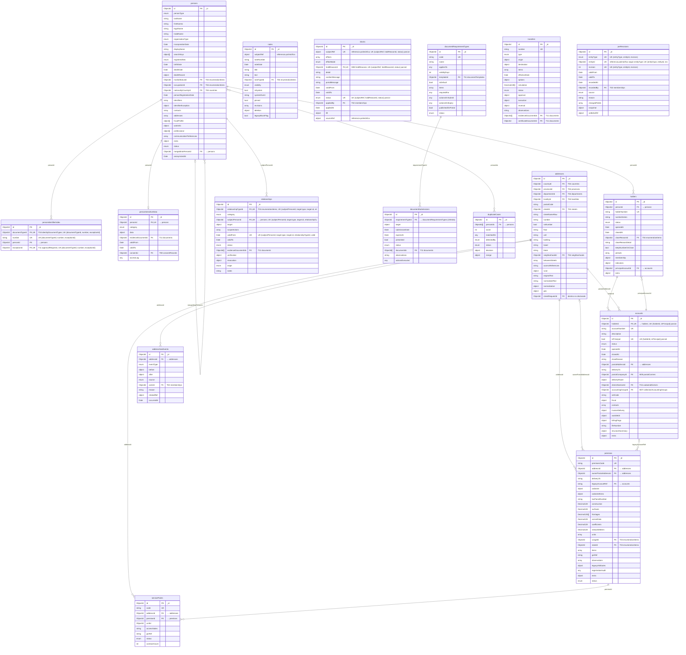

# Modelo entidad-relación — M01 PER Personas, titulares y cuentas

| Campo | Valor |
|---|---|
| Artefacto | 6.1 Modelo entidad-relación completo, vista por módulo (índice: [`03-modelo-entidad-relacion.md`](../03-modelo-entidad-relacion.md)) |
| Anexo dueño | [`M01-PER-personas-titulares-cuentas.md`](../../especificacion/anexos/M01-PER-personas-titulares-cuentas.md), §7 |
| Catálogo canónico | [`T05-DAT-modelo-datos.md`](../../especificacion/anexos/T05-DAT-modelo-datos.md), filas `COL-PER-NN` |
| Vista por dominio | [`03a-er-plataforma-personas-catalogo.md` §5](../03a-er-plataforma-personas-catalogo.md) |
| Versión | 2.1 (05-11-2026) |
| Generado con | [`_trabajo/generar_er_completo.py`](../_trabajo/generar_er_completo.py), revisado a mano |

## 1. Resumen

T05 registra 21 filas con dueño M01: **17 colecciones a crear** y 4 absorbidas en otras colecciones. Las 17 colecciones a crear se dibujan en 1 diagrama, uno por subdominio.

Convenciones: las del índice (secciones 1.3 y 2). Cada entidad lleva `id PK "_id"` y los campos de su ficha del §7; se omiten los campos transversales (`tenantId`, auditoría, `version`, baja lógica, `legacy`). El comentario de una `FK` indica el destino: `→ colección` si es del mismo módulo, `MXX colección` si es de otro; "(inferido)" cuando ni el anexo ni T05 §7.2 y §7.2.1 nombran el destino para esa colección y el nombre del campo no coincide literalmente con el de la colección (se dedujo por rol, sufijo, versión o por el contexto de §7.2.1; a confirmar); "destino no declarado" cuando no se puede fijar. Una referencia polimórfica (`entityType` + `entityId`, `resourceType` + `resourceId`, `targetRef`, `subjectRef`…) no lleva `FK` ni relación: el comentario "referencia polimórfica según <discriminador>" la señala, porque el destino depende del discriminador. Los campos que T05 §7.2.1 declara "no es referencia" no llevan `FK`. Los nombres que el anexo o T05 citan solo en notas "antes …", "Reemplazado por" o "alias" no se toman como campos ni como destinos. `UK` marca los únicos mínimos de T05; "según T05" señala un campo que figura en el catálogo pero no en la ficha del anexo. El tipo `any` indica que el anexo no declara el tipo.

## 2. Colecciones del módulo

| COL-ID | Colección | Diagrama | Ola | Clasificación | Alcance | Volumen o TTL (T05 §7.8) | Ficha en el anexo |
|---|---|---|---|---|---|---|---|
| COL-PER-01 | `persons` | 1 | O2 | ID/CT | T | — | §7.1 |
| COL-PER-02 | `personIdentifierIndex` | 1 | O2 | ID | T | — | §7.1.1 |
| COL-PER-03 | `personSensitiveData` | 1 | O2 | SE | T | — | §7.2 |
| COL-PER-04 | `holders` | 1 | O2 | ID/FI | T | — | §7.3 |
| COL-PER-05 | `accounts` | 1 | O2 | OP/CT | T | — | §7.4 |
| COL-PER-06 | `addresses` | 1 | O2 | UB/CT | T | — | §7.5 |
| COL-PER-07 | `addressGeoEvents` | 1 | O2 | UB | T | — | §7.6 |
| COL-PER-08 | `premises` | 1 | O2 | UB | T | — | §7.7 |
| COL-PER-09 | `servicePoints` | 1 | O2 | UB | T | — | §7.8 |
| COL-PER-10 | `relationships` | 1 | O2 | ID | T | — | §7.9 |
| COL-PER-12 | `notes` | 1 | O2 | OP | T | — | §7.11 |
| COL-PER-13 | `blocks` | 1 | O2 | OP | T | — | §7.12 |
| COL-PER-14 | `documentRequirementTypes` | 1 | O2 | CF | T | — | §7.13 |
| COL-PER-15 | `documentSubmissions` | 1 | O2 | ID | T | — | §7.13 |
| COL-PER-16 | `transfers` | 1 | O2 | ID/FI | T | — | §7.14 |
| COL-PER-17 | `duplicateCases` | 1 | O2 | ID | T | — | §7.15 |
| COL-PER-18 | `perRevisions` | 1 | O2 | ID | T | — | §7.16 |

## 3. Diagrama 1: Personas, titulares, cuentas, domicilios e inmuebles

17 colecciones (ver tabla de la sección 2). Ficha en el anexo: §7.1, §7.1.1, §7.2, §7.3, §7.4, §7.5, §7.6, §7.7 ….

**Índices principales del diagrama 1**

| Colección | Índices declarados en el anexo | Únicos mínimos (T05) |
|---|---|---|
| `persons` | — | — (ver COL-PER-02) |
| `personIdentifierIndex` | — | `{documentTypeId, number, exceptionId}` |
| `personSensitiveData` | `{ tenantId, personId, category }`. | `personId` |
| `holders` | `{ tenantId, holderNumber }` único; `{ tenantId, personId }` único parcial sobre `status ≠ closed` (una titularidad abierta por persona; ver CTR-PER-01); `{ tenantId, status }`; `{ tenantId, "legacy.table", "legacy.key" … | `holderNumber` (DEC-017) |
| `accounts` | `{ tenantId, accountNumber }` único; `{ tenantId, holderId, status }`; `{ tenantId, holderId, isPrincipal }` único parcial sobre `isPrincipal = true AND status = active` (garantiza una principal); `{ tenantId, … | `accountNumber`; `{holderId, isPrincipal: true}` p. |
| `addresses` | `{ tenantId, localityId, streetId, number }`; `{ tenantId, "geo.status" }`; geoespacial 2dsphere `{ tenantId, geoPoint }` (campo derivado GeoJSON); `{ tenantId, normalizedText }` texto. | — |
| `addressGeoEvents` | `{ tenantId, addressId, occurredAt }`. | — |
| `premises` | `{ tenantId, "cadastre.normalizedKey" }` único parcial sobre `status = active` (RN-PER-073); `{ tenantId, taxParcelNumber }`; `{ tenantId, addressId }`; `{ tenantId, premisesCode }` único. | `{cadastre.normalizedKey}` p. (`status = active`, RN-PER-073); `premisesCode` () |
| `servicePoints` | `{ tenantId, addressId }`; `{ tenantId, premiseId }`; `{ tenantId, code }` único. No hay índice único por dirección + servicio (RN-PER-060). | `code` |
| `relationships` | `{ tenantId, subjectPersonId, status }`; `{ tenantId, "target.type", "target.id", status }`; `{ tenantId, validTo, status }` (vencimientos). | `{subjectPersonId, target.type, target.id, relationshipTypeId, validFrom}` () |
| `notes` | `{ tenantId, "subjectRef.type", "subjectRef.id", noteDate }`; `{ tenantId, noteNumber }` único. | — |
| `blocks` | `{ tenantId, "subjectRef.type", "subjectRef.id", status }`; `{ tenantId, effects, status }`; `{ tenantId, validTo, status }`. | `{subjectRef, holdReasonId, status: active}` p. |
| `documentRequirementTypes` | — | `code` |
| `documentSubmissions` | `{ tenantId, "target.type", "target.id", requirementTypeId, status }`; `{ tenantId, expiresAt, status }`. | — |
| `transfers` | `{ tenantId, number }` único; `{ tenantId, "origin.holderId" }`; `{ tenantId, "destination.holderId" }`; `{ tenantId, status }`; `{ tenantId, "execution.idempotencyKey" }` único parcial. | `number` |
| `duplicateCases` | `{ tenantId, personIds }` único; `{ tenantId, status, score }`. | — |
| `perRevisions` | `{ tenantId, entityType, entityId, revision }` único; `{ tenantId, entityType, entityId, validFrom }`; `{ tenantId, entityType, entityId, recordedAt }`. | `{entityType, entityId, revision}` () |

## 4. Relaciones con otros módulos y entre diagramas

Referencias que salen de una colección de este módulo hacia una entidad de otro módulo o de otro diagrama del mismo módulo (no se dibujan para mantener cada diagrama dentro de su módulo y subdominio).

| Colección origen | Campo | Cardinalidad (destino a origen) | Destino | COL-ID destino | Módulo destino |
|---|---|---|---|---|---|
| `persons` | `maritalStatusId`, `occupationId` | 0..1 a N | `enumerationItems` | COL-CFG-06 | T04 |
| `persons` | `nationalityCountryId` | 0..1 a N | `countries` | COL-CFG-07 | T04 |
| `personIdentifierIndex` | `documentTypeId` | 1 a N | `identityDocumentTypes` | COL-CFG-28 | T04 |
| `personIdentifierIndex` | `exceptionId` | 0..1 a N | `approvalRequests` | COL-WFL-24 | T11 |
| `personSensitiveData` | `evidenceDocumentId` | 0..1 a N | `documents` | COL-WFL-34 | T11 |
| `personSensitiveData` | `consentId` | 1 a N | `consentRecords` | COL-NFR-04 | T08 |
| `holders` | `closeReasonId` | 1 a N | `enumerationItems` | COL-CFG-06 | T04 |
| `accounts` | `postalCompanyId` | 1 a N | `postalCarriers` | COL-FAC-41 | M05 |
| `accounts` | `districtSectionId` | 1 a N | `cadastralDistricts` | COL-CFG-17 | T04 |
| `accounts` | `accountingGroupId` | 1 a N | `collectionAccountingGroups` | COL-COB-47 | M07 |
| `addresses` | `countryId` | 1 a N | `countries` | COL-CFG-07 | T04 |
| `addresses` | `provinceId` | 1 a N | `provinces` | COL-CFG-08 | T04 |
| `addresses` | `departmentId` | 1 a N | `departments` | COL-CFG-09 | T04 |
| `addresses` | `localityId` | 1 a N | `localities` | COL-CFG-10 | T04 |
| `addresses` | `streetId` | 0..1 a N | `streets` | COL-CFG-12 | T04 |
| `addresses` | `neighborhoodId` | 0..1 a N | `neighborhoods` | COL-CFG-15 | T04 |
| `addressGeoEvents` | `actorId` | 0..1 a N | `memberships` | COL-IAM-04 | T02 |
| `premises` | `usageId`, `stateId` | 0..1 a N | `enumerationItems` | COL-CFG-06 | T04 |
| `relationships` | `relationshipTypeId` | 1 a N | `enumerationItems` | COL-CFG-06 | T04 |
| `relationships` | `evidenceDocumentIds` | N a N | `documents` | COL-WFL-34 | T11 |
| `notes` | `noteTypeId` | 0..1 a N | `enumerationItems` | COL-CFG-06 | T04 |
| `blocks` | `holdReasonId` | 1 a N | `holdReasons` | COL-MOR-11 | M08 |
| `blocks` | `appliedBy` | 1 a N | `memberships` | COL-IAM-04 | T02 |
| `documentRequirementTypes` | `templateId` | 0..1 a N | `documentTemplates` | COL-WFL-41 | T11 |
| `documentSubmissions` | `documentIds` | N a N | `documents` | COL-WFL-34 | T11 |
| `transfers` | `evidenceDocumentIds` | N a N | `documents` | COL-WFL-34 | T11 |
| `transfers` | `certificateDocumentId` | 0..1 a N | `documents` | COL-WFL-34 | T11 |
| `perRevisions` | `recordedBy` | 1 a N | `memberships` | COL-IAM-04 | T02 |

## 5. Colecciones absorbidas y renombradas

| COL-ID | Colección declarada | Destino (no se crea) | Detalle en T05 |
|---|---|---|---|
| COL-PER-11 | `adherents` | `serviceDependents` (COL-SOC-01, M18) | (adherentes y beneficiarios: DEC-071; `ADHSOC` → COL-SOC-01 y `BENSOC` → COL-SOC-02, DEC-086. **Reemplaza** el destino único anterior "A→COL-SOC-01") |
| COL-PER-19 | `consents` | `consentRecords` (COL-NFR-04, T08) | (duplicada con T08) |
| COL-PER-20 | `dataSubjectRequests` | `dataSubjectRequests` (COL-NFR-05, T08) | (duplicada con T08) |
| COL-PER-21 | `personUserLinks` | `memberships` (COL-IAM-04, T02) | (vínculo persona–usuario: `memberships.personId` + evidencia) |

## 6. Observaciones e inconsistencias detectadas

- Referencias sin colección destino declarada (ni en el anexo ni en T05 §7.2 y §7.2.1; quedan como `FK` "destino no declarado"): `addresses.streetRequestId`.
