# Modelo entidad-relación — M02 CAT Catálogo de servicios y contratos

| Campo | Valor |
|---|---|
| Artefacto | 6.1 Modelo entidad-relación completo, vista por módulo (índice: [`03-modelo-entidad-relacion.md`](../03-modelo-entidad-relacion.md)) |
| Anexo dueño | [`M02-CAT-catalogo-servicios.md`](../../especificacion/anexos/M02-CAT-catalogo-servicios.md), §7 |
| Catálogo canónico | [`T05-DAT-modelo-datos.md`](../../especificacion/anexos/T05-DAT-modelo-datos.md), filas `COL-CAT-NN` |
| Vista por dominio | [`03a-er-plataforma-personas-catalogo.md` §6](../03a-er-plataforma-personas-catalogo.md) |
| Versión | 2.1 (05-11-2026) |
| Generado con | [`_trabajo/generar_er_completo.py`](../_trabajo/generar_er_completo.py), revisado a mano |

## 1. Resumen

T05 registra 29 filas con dueño M02: **25 colecciones a crear** y 4 absorbidas en otras colecciones. Las 25 colecciones a crear se dibujan en 1 diagrama, uno por subdominio.

Convenciones: las del índice (secciones 1.3 y 2). Cada entidad lleva `id PK "_id"` y los campos de su ficha del §7; se omiten los campos transversales (`tenantId`, auditoría, `version`, baja lógica, `legacy`). El comentario de una `FK` indica el destino: `→ colección` si es del mismo módulo, `MXX colección` si es de otro; "(inferido)" cuando ni el anexo ni T05 §7.2 y §7.2.1 nombran el destino para esa colección y el nombre del campo no coincide literalmente con el de la colección (se dedujo por rol, sufijo, versión o por el contexto de §7.2.1; a confirmar); "destino no declarado" cuando no se puede fijar. Una referencia polimórfica (`entityType` + `entityId`, `resourceType` + `resourceId`, `targetRef`, `subjectRef`…) no lleva `FK` ni relación: el comentario "referencia polimórfica según <discriminador>" la señala, porque el destino depende del discriminador. Los campos que T05 §7.2.1 declara "no es referencia" no llevan `FK`. Los nombres que el anexo o T05 citan solo en notas "antes …", "Reemplazado por" o "alias" no se toman como campos ni como destinos. `UK` marca los únicos mínimos de T05; "según T05" señala un campo que figura en el catálogo pero no en la ficha del anexo. El tipo `any` indica que el anexo no declara el tipo.

## 2. Colecciones del módulo

| COL-ID | Colección | Diagrama | Ola | Clasificación | Alcance | Volumen o TTL (T05 §7.8) | Ficha en el anexo |
|---|---|---|---|---|---|---|---|
| COL-CAT-01 | `serviceCapabilities` | 1 | O2 | CF | P | — | §7.1 |
| COL-CAT-02 | `tenantServices` | 1 | O2 | CF | T | — | §7.2 |
| COL-CAT-03 | `serviceConfigVersions` | 1 | O2 | CF | T | — | §7.3 |
| COL-CAT-04 | `serviceConcessions` | 1 | O2 | CF | T | — | §7.4 |
| COL-CAT-05 | `serviceProducts` | 1 | O2 | CF | T | — | §7.5 |
| COL-CAT-06 | `billableConcepts` | 1 | O2 | CF | T | — | §7.6 |
| COL-CAT-07 | `servicePlans` | 1 | O2 | CF | T | — | §7.7 |
| COL-CAT-08 | `servicePlanVersions` | 1 | O2 | CF | T | — | §7.7 |
| COL-CAT-09 | `serviceBundles` | 1 | O2 | CF | T | — | §7.9 |
| COL-CAT-10 | `serviceCategories` | 1 | O2 | CF | T | — | §7.10 |
| COL-CAT-11 | `serviceCategoryGroups` | 1 | O2 | CF | T | — | §7.11 |
| COL-CAT-12 | `serviceClasses` | 1 | O2 | CF | T | — | §7.12 |
| COL-CAT-13 | `serviceProperties` | 1 | O2 | CF | T | — | §7.13 |
| COL-CAT-14 | `serviceStatuses` | 1 | O2 | CF | T | — | §7.14 |
| COL-CAT-17 | `autoServiceRules` | 1 | O2 | CF | T | — | §7.17 |
| COL-CAT-18 | `serviceContracts` | 1 | O2 | OP/UB | T | — | §7.18 |
| COL-CAT-19 | `serviceContractHistory` | 1 | O2 | OP | T | — | §7.19 |
| COL-CAT-20 | `contractEquipmentAssignments` | 1 | O3 | OP | T | — | §7.20 |
| COL-CAT-21 | `applianceTypes` | 1 | O7 | CF | T | — | §7.21 |
| COL-CAT-22 | `contractDeclaredAppliances` | 1 | O7 | OP | T | — | §7.21 |
| COL-CAT-25 | `contractSpecialConditions` | 1 | O7 | FI | T | — | §7.24 |
| COL-CAT-26 | `serviceCopyRuns` | 1 | O2 | CF | T | — | §7.25 |
| COL-CAT-27 | `bulkContractOperations` | 1 | O2 | OP | T | — | §7.26 |
| COL-CAT-28 | `serviceTemplates` | 1 | O2 | CF | P | — | §7.27 |
| COL-CAT-29 | `bundleSubscriptions` | 1 | O4 | OP | T | — | §7.29 |

## 3. Diagrama 1: Servicios, productos, planes, categorías, contratos y suscripciones a combos

25 colecciones (ver tabla de la sección 2). Ficha en el anexo: §7.1, §7.2, §7.3, §7.4, §7.5, §7.6, §7.7, §7.9 ….

```mermaid
erDiagram
  serviceCapabilities {
    ObjectId id PK "_id"
    string code UK
    enum domain
    string labelKey
    string descriptionKey
    enum status
    enum maturity
    enum[] registrationProfiles
    int[] calculationTypes
    enum[] unitKinds
    object domainAttributeSchema
    object domainSheet
    string[] requiredPlatformModules
    bool sensitiveData
    string[] insumosPendientes
  }
  tenantServices {
    ObjectId id PK "_id"
    ObjectId capabilityId FK "→ serviceCapabilities"
    string code UK
    string labelKey
    string serviceTypeCode
    bool isPrincipal
    object enablement
    enum offerStatus
    enum operationStatus
    ObjectId currentConfigVersionId FK "→ serviceConfigVersions (inferido)"
    object profile
    enum registrationProfile
    int calculationType
    int calculationTypeLargeCustomers
    object flags
    object requirements
    object relatedService
    enum consumptionSplitMode
    object members
    object registrations
    ObjectId legalEntityId FK "T04 legalEntities"
    object defaultOperationalStatus
    object workOrderTypes
    object transfer
    ObjectId defaultBillingGroupId FK "M05 billingGroups"
    enum phoneMobileType
    object uniqueness
    object addressDebtCheck
    object holderRules
    object lifecycle
    object documents
    object channels
    object mappings
    object[] integrations
    object copiedFrom
  }
  serviceConfigVersions {
    ObjectId id PK "_id"
    ObjectId serviceId FK, UK "→ tenantServices; UK {serviceId, number}"
    int number UK "UK {serviceId, number}"
    enum status
    enum[] changeKinds
    object snapshot
    object diffFromPrevious
    object[] validations
    ObjectId[] simulationRunIds FK "M04 simulationRuns"
    Date effectiveFrom
    Date recordedAt
    ObjectId submittedBy FK "T02 memberships"
    ObjectId approvedBy FK "T02 memberships"
    Date approvedAt
    Date publishedAt
    ObjectId workflowInstanceId FK "T11 workflowInstances"
  }
  serviceConcessions {
    ObjectId id PK "_id"
    string code UK
    string name
    any grantor
    ObjectId[] authorityIds FK "M01 persons"
    any jurisdiction
    any instrumentRef
    Date validFrom
    Date validTo
    ObjectId[] serviceIds FK "→ tenantServices"
    array documents
  }
  serviceProducts {
    ObjectId id PK "_id"
    ObjectId serviceId FK, UK "→ tenantServices; UK {serviceId, code}"
    string code UK "UK {serviceId, code}"
    string labelKey
    enum kind
    bool tvMinimumLineup
    object attributes
    ObjectId[] requiresProductIds FK "→ serviceProducts"
    ObjectId[] excludesProductIds FK "→ serviceProducts"
    ObjectId inventoryItemId FK "M13 inventoryItems"
    enum status
    Date validFrom
    Date validTo
  }
  billableConcepts {
    ObjectId id PK "_id"
    ObjectId serviceId FK "→ tenantServices"
    string code UK
    string labelKey
    string invoiceLabelKey
    enum kind
    enum trigger
    enum[] eventTypes
    string unitOfMeasure
    ObjectId fiscalClassId FK "M06 fiscalClasses"
    ObjectId accountingRubricId FK "M15 accountRubrics"
    ObjectId costCenterId FK "M15 costCenters"
    ObjectId thirdPartyId FK "M01 persons"
    bool isInternalCost
    object rounding
    enum status
    Date validFrom
    Date validTo
  }
  servicePlans {
    ObjectId id PK "_id"
    ObjectId serviceId FK, UK "→ tenantServices; UK {serviceId, code}"
    ObjectId serviceProductId FK "→ serviceProducts"
    string code UK "UK {serviceId, code}"
    string labelKey
    enum status
    ObjectId currentVersionId FK "→ servicePlanVersions"
    array offerChannels
    any publicVisibility
  }
  servicePlanVersions {
    ObjectId id PK "_id"
    ObjectId planId FK, UK "→ servicePlans; UK {planId, number}"
    int number UK "UK {planId, number}"
    object attributes
    enum periodicity
    ObjectId[] allowedCategoryIds FK "→ serviceCategories"
    object[] components
    object[] promotions
    object[] financingOptions
    object[] equipment
    object requirements
    object tariffBinding
    Date effectiveFrom
    Date effectiveTo
    Date recordedAt
    ObjectId configVersionId FK "→ serviceConfigVersions (inferido)"
  }
  serviceBundles {
    ObjectId id PK "_id"
    string code UK
    string labelKey
    ObjectId[] planVersionIds FK "→ servicePlanVersions"
    object rules
    enum status
    Date validFrom
    Date validTo
  }
  serviceCategories {
    ObjectId id PK "_id"
    ObjectId serviceId FK, UK "→ tenantServices; UK {serviceId, code}"
    string code UK "UK {serviceId, code}"
    string labelKey
    ObjectId groupId FK "→ serviceCategoryGroups"
    bool isSocial
    bool isPrepaid
    bool isResidential
    bool isGenerator
    ObjectId subsidizedCategoryId FK "→ serviceCategories"
    ObjectId sefCategoryId FK "→ serviceCategories"
    object regulatoryCodes
    string networkProfileCode
    int adherentCount
    bool allowsProportionalChange
    object housingMinimums
    bool consumeMinimumOnTermination
    enum status
    Date validFrom
    Date validTo
  }
  serviceCategoryGroups {
    ObjectId id PK "_id"
    string code UK "UK {serviceId, code}"
    string labelKey
    string regulatoryCode
    ObjectId serviceId FK, UK "→ tenantServices; UK {serviceId, code}"
  }
  serviceClasses {
    ObjectId id PK "_id"
    ObjectId serviceId FK, UK "→ tenantServices; UK {serviceId, code}"
    string code UK "UK {serviceId, code}"
    string labelKey
    any value1
    Decimal128 value2
    ObjectId thirdPartyConceptId FK "→ billableConcepts"
    string notes
  }
  serviceProperties {
    ObjectId id PK "_id"
    ObjectId serviceId FK, UK "→ tenantServices; UK {serviceId, code}"
    string code UK "UK {serviceId, code}"
    string labelKey
    any valueType
    array listValues
    any tension
    object linkedConcepts
  }
  serviceStatuses {
    ObjectId id PK "_id"
    ObjectId serviceId FK, UK "→ tenantServices; UK {serviceId, code}"
    string code UK "UK {serviceId, code}"
    string labelKey
    enum canonicalStatus
    bool impliesDisconnection
    bool isPrincipal
    bool visibleToMember
    any color
    any order
  }
  autoServiceRules {
    ObjectId id PK "_id"
    string labelKey
    enum triggerEvent
    ObjectId sourceServiceId FK "→ tenantServices"
    ObjectId targetServiceId FK "→ tenantServices"
    ObjectId targetCategoryId FK "→ serviceCategories"
    object filters
    enum billingGroupMode
    enum mode
    string legalBasis
    enum status
    Date validFrom
    Date validTo
    string code UK
  }
  serviceContracts {
    ObjectId id PK "_id"
    string number UK
    ObjectId serviceId FK, UK "→ tenantServices; UK {serviceId, supplyCode} parcial"
    ObjectId holderId FK "M01 holders"
    ObjectId legalEntityId FK "T04 legalEntities"
    ObjectId accountId FK "M01 accounts"
    ObjectId payerAccountId FK "M01 accounts"
    ObjectId planId FK "→ servicePlans"
    ObjectId planVersionId FK "→ servicePlanVersions"
    ObjectId categoryId FK "→ serviceCategories"
    object[] categoryHistory
    ObjectId serviceClassId FK "→ serviceClasses"
    object[] propertyValues
    ObjectId activityId FK "M06 normativeTables"
    Decimal128 quantity
    object serviceAddress
    ObjectId servicePointId FK "M01 servicePoints"
    ObjectId premiseId FK "M01 premises"
    object[] addressHistory
    object route
    string supplyCode UK "UK {serviceId, supplyCode} parcial"
    ObjectId meteringPointId FK "M03 meteringPoints"
    ObjectId externalClientId FK "M01 persons"
    ObjectId feasibilityRef FK "M10 feasibilityRequests"
    ObjectId declaredAffidavitRef FK "T11 documents"
    ObjectId guarantorPersonId FK "M01 persons"
    object installer
    Date dueDate
    ObjectId billingGroupId FK "M05 billingGroups"
    string lastBilledPeriod
    enum lifecycleStatus
    ObjectId operationalStatusId FK "→ serviceStatuses"
    Date statusChangedAt
    ObjectId statusChangedBy FK "T02 memberships"
    any statusReason
    object suspension
    object dates
    object flags
    object origin
    object[] agreedConditions
    object domainAttributes
    Decimal128 capitalAmountAtActivation
    ObjectId parentContractId FK "→ serviceContracts"
    ObjectId bundleSubscriptionId FK "→ bundleSubscriptions"
    string observations
    ObjectId supersededByContractId FK "→ serviceContracts"
  }
  serviceContractHistory {
    ObjectId id PK "_id"
    ObjectId contractId FK "→ serviceContracts"
    enum eventType
    object from
    object to
    Date effectiveAt
    Date recordedAt
    object actor
    object sourceRef "referencia polimórfica"
  }
  contractEquipmentAssignments {
    ObjectId id PK "_id"
    ObjectId contractId FK "→ serviceContracts"
    ObjectId accountId FK "M01 accounts"
    ObjectId premiseId FK "M01 premises"
    ObjectId serviceId FK "→ tenantServices"
    ObjectId inventoryItemId FK "M13 inventoryItems"
    Decimal128 quantity
    ObjectId serialUnitId FK, UK "M13 serialUnits; UK parcial"
    string serialNumber
    ObjectId warehouseId FK "M13 warehouses"
    enum mode
    enum status
    enum returnCondition
    ObjectId chargeProposalId FK "T11 approvalRequests"
    object saleDocumentRef FK "T11 documents"
    Date deliveredAt
    Date expectedReturnAt
    Date returnedAt
    Decimal128 referencePrice
    ObjectId deliveryEvidenceDocId FK "T11 documents"
    ObjectId returnEvidenceDocId FK "T11 documents"
    ObjectId workOrderId FK "M10 workOrders"
    ObjectId retrievalWorkOrderId FK "M10 workOrders"
    string notes
    any assigned UK "UK parcial; según T05"
    any delivered UK "UK parcial; según T05"
    any returnPending UK "UK parcial; según T05"
  }
  applianceTypes {
    ObjectId id PK "_id"
    string code UK
    string labelKey
    bool isObservation
    ObjectId[] serviceIds FK "→ tenantServices"
    enum kind
    any powerUnit
  }
  contractDeclaredAppliances {
    ObjectId id PK "_id"
    ObjectId contractId FK "→ serviceContracts"
    any templateRef FK "→ serviceTemplates (inferido)"
    ObjectId applianceTypeId FK "→ applianceTypes"
    any quantity
    any power
    any brand
    int serialNumber
    any model
    Date declaredDate
    any use
    enum status
    string notes
    ObjectId declarationDocId FK "T11 documents"
    any[] history
    Date recordedAt
    any powerUnit
  }
  contractSpecialConditions {
    ObjectId id PK "_id"
    ObjectId contractId FK, UK "→ serviceContracts"
    any priceTermsRef
    int termMonths
    array penalties
    bool requiresInvoicePreReview
    ObjectId approvedBy FK "T02 memberships"
    Date approvedAt
    Date validFrom
    Date validTo
    enum status
  }
  serviceCopyRuns {
    ObjectId id PK "_id"
    ObjectId sourceTenantId FK "T01 tenants"
    ObjectId sourceServiceId FK "→ tenantServices"
    ObjectId sourceConfigVersionId FK "→ serviceConfigVersions (inferido)"
    ObjectId targetTenantId FK "T01 tenants"
    ObjectId targetServiceId FK "→ tenantServices"
    enum targetMode
    object components
    object[] dependencies
    string[] excluded
    enum status
    object authorization
    string idempotencyKey UK
    object result
  }
  bulkContractOperations {
    ObjectId id PK "_id"
    any operation
    any criteria
    ObjectId[] contractIds FK "→ serviceContracts"
    bool alsoUnbilledConsumption
    ObjectId requestedBy FK "T02 memberships"
    any originModule
    enum status
    any revertibleUntil
    ObjectId jobId
  }
  serviceTemplates {
    ObjectId id PK "_id"
    ObjectId capabilityId FK "→ serviceCapabilities"
    string code UK
    string labelKey
    any snapshot
    enum status
  }
  bundleSubscriptions {
    ObjectId id PK "_id"
    ObjectId bundleId FK, UK "→ serviceBundles; UK {accountId, bundleId, validFrom}"
    int bundleVersion
    ObjectId holderId FK "M01 holders"
    ObjectId accountId FK, UK "M01 accounts; UK {accountId, bundleId, validFrom}"
    ObjectId[] contractIds FK "→ serviceContracts"
    Date validFrom UK "UK {accountId, bundleId, validFrom}"
    Date validTo
    enum status
  }
  serviceCapabilities ||--o{ tenantServices : "capabilityId"
  serviceConfigVersions |o--o{ tenantServices : "currentConfigVersionId"
  tenantServices ||--o{ serviceConfigVersions : "serviceId"
  tenantServices }o--o{ serviceConcessions : "serviceIds"
  tenantServices ||--o{ serviceProducts : "serviceId"
  serviceProducts }o--o{ serviceProducts : "requiresProductIds"
  serviceProducts }o--o{ serviceProducts : "excludesProductIds"
  tenantServices |o--o{ billableConcepts : "serviceId"
  tenantServices ||--o{ servicePlans : "serviceId"
  serviceProducts ||--o{ servicePlans : "serviceProductId"
  servicePlanVersions ||--o{ servicePlans : "currentVersionId"
  servicePlans ||--o{ servicePlanVersions : "planId"
  serviceCategories }o--o{ servicePlanVersions : "allowedCategoryIds"
  serviceConfigVersions ||--o{ servicePlanVersions : "configVersionId"
  servicePlanVersions }o--o{ serviceBundles : "planVersionIds"
  tenantServices ||--o{ serviceCategories : "serviceId"
  serviceCategoryGroups |o--o{ serviceCategories : "groupId"
  serviceCategories |o--o{ serviceCategories : "subsidizedCategoryId"
  serviceCategories |o--o{ serviceCategories : "sefCategoryId"
  tenantServices ||--o{ serviceCategoryGroups : "serviceId"
  tenantServices ||--o{ serviceClasses : "serviceId"
  billableConcepts ||--o{ serviceClasses : "thirdPartyConceptId"
  tenantServices ||--o{ serviceProperties : "serviceId"
  tenantServices ||--o{ serviceStatuses : "serviceId"
  tenantServices ||--o{ autoServiceRules : "sourceServiceId"
  tenantServices ||--o{ autoServiceRules : "targetServiceId"
  serviceCategories ||--o{ autoServiceRules : "targetCategoryId"
  tenantServices ||--o{ serviceContracts : "serviceId"
  servicePlans |o--o{ serviceContracts : "planId"
  servicePlanVersions |o--o{ serviceContracts : "planVersionId"
  serviceCategories ||--o{ serviceContracts : "categoryId"
  serviceClasses |o--o{ serviceContracts : "serviceClassId"
  serviceStatuses ||--o{ serviceContracts : "operationalStatusId"
  serviceContracts |o--o{ serviceContracts : "parentContractId"
  bundleSubscriptions |o--o{ serviceContracts : "bundleSubscriptionId"
  serviceContracts |o--o{ serviceContracts : "supersededByContractId"
  serviceContracts ||--o{ serviceContractHistory : "contractId"
  serviceContracts ||--o{ contractEquipmentAssignments : "contractId"
  tenantServices ||--o{ contractEquipmentAssignments : "serviceId"
  tenantServices }o--o{ applianceTypes : "serviceIds"
  serviceContracts ||--o{ contractDeclaredAppliances : "contractId"
  serviceTemplates ||--o{ contractDeclaredAppliances : "templateRef"
  applianceTypes ||--o{ contractDeclaredAppliances : "applianceTypeId"
  serviceContracts ||--o| contractSpecialConditions : "contractId"
  tenantServices ||--o{ serviceCopyRuns : "sourceServiceId"
  serviceConfigVersions ||--o{ serviceCopyRuns : "sourceConfigVersionId"
  tenantServices |o--o{ serviceCopyRuns : "targetServiceId"
  serviceContracts }o--o{ bulkContractOperations : "contractIds"
  serviceCapabilities ||--o{ serviceTemplates : "capabilityId"
  serviceBundles ||--o{ bundleSubscriptions : "bundleId"
  serviceContracts }o--o{ bundleSubscriptions : "contractIds"
```

**Índices principales del diagrama 1**

| Colección | Índices declarados en el anexo | Únicos mínimos (T05) |
|---|---|---|
| `serviceCapabilities` | `{tenantId, code}` único. | `code` |
| `tenantServices` | `{tenantId, code}` único; `{tenantId, capabilityId}`; `{tenantId, offerStatus}`. | `code` |
| `serviceConfigVersions` | `{tenantId, serviceId, number}` único; `{tenantId, serviceId, status, effectiveFrom}`. | `{serviceId, number}` |
| `serviceConcessions` | `{tenantId, code}` único. | `code` |
| `serviceProducts` | `{tenantId, serviceId, code}` único. | `{serviceId, code}` |
| `billableConcepts` | `{tenantId, code}` único; `{tenantId, serviceId, kind}`. | `code` |
| `servicePlans` | — | `{serviceId, code}` |
| `servicePlanVersions` | `{tenantId, planId, number}` único; `{tenantId, planId, effectiveFrom}`. | `{planId, number}` |
| `serviceBundles` | — | `code` |
| `serviceCategories` | `{tenantId, serviceId, code}` único. | `{serviceId, code}` |
| `serviceCategoryGroups` | — | `{serviceId, code}` |
| `serviceClasses` | — | `{serviceId, code}` |
| `serviceProperties` | — | `{serviceId, code}` |
| `serviceStatuses` | `{tenantId, serviceId, code}` único. | `{serviceId, code}` |
| `autoServiceRules` | — | `code` |
| `serviceContracts` | `{tenantId, number}` único; `{tenantId, accountId, serviceId, lifecycleStatus}`; `{tenantId, holderPersonId}` (pasa a `{tenantId, holderId}`, CTR-DAT-67); `{tenantId, servicePointId, serviceId}` (reemplaza al de … | `number`; `{serviceId, supplyCode}` p. (estado vigente) |
| `serviceContractHistory` | `{tenantId, contractId, effectiveAt}`; colección append-only. | — |
| `contractEquipmentAssignments` | `{tenantId, contractId, status}`; `{tenantId, serialUnitId}` () único parcial con `status in [assigned, delivered, returnPending, chargeProposed]`; `{tenantId, status, expectedReturnAt}` (seguimiento de devolución de … | `serialUnitId` p. (`assigned`/`delivered`/`returnPending`) |
| `applianceTypes` | — | `code` |
| `contractDeclaredAppliances` | — | — |
| `contractSpecialConditions` | — | `{contractId, version}` |
| `serviceCopyRuns` | `{tenantId, idempotencyKey}` único. | `idempotencyKey` |
| `bulkContractOperations` | — | — |
| `serviceTemplates` | — | `{code, version}` |
| `bundleSubscriptions` | `{tenantId, accountId, bundleId, validFrom}`. | — (índice `{accountId, bundleId, validFrom}`) |

## 4. Relaciones con otros módulos y entre diagramas

Referencias que salen de una colección de este módulo hacia una entidad de otro módulo o de otro diagrama del mismo módulo (no se dibujan para mantener cada diagrama dentro de su módulo y subdominio).

| Colección origen | Campo | Cardinalidad (destino a origen) | Destino | COL-ID destino | Módulo destino |
|---|---|---|---|---|---|
| `tenantServices` | `legalEntityId` | 1 a N | `legalEntities` | COL-CFG-41 | T04 |
| `tenantServices` | `defaultBillingGroupId` | 1 a N | `billingGroups` | COL-FAC-23 | M05 |
| `serviceConfigVersions` | `simulationRunIds` | N a N | `simulationRuns` | COL-TAR-31 | M04 |
| `serviceConfigVersions` | `submittedBy`, `approvedBy` | 0..1 a N | `memberships` | COL-IAM-04 | T02 |
| `serviceConfigVersions` | `workflowInstanceId` | 0..1 a N | `workflowInstances` | COL-WFL-14 | T11 |
| `serviceConcessions` | `authorityIds` | N a N | `persons` | COL-PER-01 | M01 |
| `serviceProducts` | `inventoryItemId` | 0..1 a N | `inventoryItems` | COL-STK-05 | M13 |
| `billableConcepts` | `fiscalClassId` | 1 a N | `fiscalClasses` | COL-FIS-47 | M06 |
| `billableConcepts` | `accountingRubricId` | 0..1 a N | `accountRubrics` | COL-CON-03 | M15 |
| `billableConcepts` | `costCenterId` | 0..1 a N | `costCenters` | COL-CON-16 | M15 |
| `billableConcepts` | `thirdPartyId` | 0..1 a N | `persons` | COL-PER-01 | M01 |
| `serviceContracts` | `holderId` | 1 a N | `holders` | COL-PER-04 | M01 |
| `serviceContracts` | `legalEntityId` | 0..1 a N | `legalEntities` | COL-CFG-41 | T04 |
| `serviceContracts` | `accountId` | 1 a N | `accounts` | COL-PER-05 | M01 |
| `serviceContracts` | `payerAccountId` | 0..1 a N | `accounts` | COL-PER-05 | M01 |
| `serviceContracts` | `activityId` | 0..1 a N | `normativeTables` | COL-FIS-01 | M06 |
| `serviceContracts` | `servicePointId` | 1 a N | `servicePoints` | COL-PER-09 | M01 |
| `serviceContracts` | `premiseId` | 0..1 a N | `premises` | COL-PER-08 | M01 |
| `serviceContracts` | `meteringPointId` | 0..1 a N | `meteringPoints` | COL-MED-08 | M03 |
| `serviceContracts` | `externalClientId`, `guarantorPersonId` | 0..1 a N | `persons` | COL-PER-01 | M01 |
| `serviceContracts` | `feasibilityRef` | 0..1 a N | `feasibilityRequests` | COL-TEC-01 | M10 |
| `serviceContracts` | `declaredAffidavitRef` | 0..1 a N | `documents` | COL-WFL-34 | T11 |
| `serviceContracts` | `billingGroupId` | 1 a N | `billingGroups` | COL-FAC-23 | M05 |
| `serviceContracts` | `statusChangedBy` | 1 a N | `memberships` | COL-IAM-04 | T02 |
| `contractEquipmentAssignments` | `accountId` | 1 a N | `accounts` | COL-PER-05 | M01 |
| `contractEquipmentAssignments` | `premiseId` | 1 a N | `premises` | COL-PER-08 | M01 |
| `contractEquipmentAssignments` | `inventoryItemId` | 1 a N | `inventoryItems` | COL-STK-05 | M13 |
| `contractEquipmentAssignments` | `serialUnitId` | 0..1 a N | `serialUnits` | COL-STK-13 | M13 |
| `contractEquipmentAssignments` | `warehouseId` | 1 a N | `warehouses` | COL-STK-07 | M13 |
| `contractEquipmentAssignments` | `chargeProposalId` | 0..1 a N | `approvalRequests` | COL-WFL-24 | T11 |
| `contractEquipmentAssignments` | `saleDocumentRef`, `deliveryEvidenceDocId`, `returnEvidenceDocId` | 0..1 a N | `documents` | COL-WFL-34 | T11 |
| `contractEquipmentAssignments` | `workOrderId`, `retrievalWorkOrderId` | 0..1 a N | `workOrders` | COL-TEC-12 | M10 |
| `contractDeclaredAppliances` | `declarationDocId` | 1 a N | `documents` | COL-WFL-34 | T11 |
| `contractSpecialConditions` | `approvedBy` | 1 a N | `memberships` | COL-IAM-04 | T02 |
| `serviceCopyRuns` | `sourceTenantId`, `targetTenantId` | 1 a N | `tenants` | COL-PLA-01 | T01 |
| `bulkContractOperations` | `requestedBy` | 1 a N | `memberships` | COL-IAM-04 | T02 |
| `bundleSubscriptions` | `holderId` | 1 a N | `holders` | COL-PER-04 | M01 |
| `bundleSubscriptions` | `accountId` | 1 a N | `accounts` | COL-PER-05 | M01 |

## 5. Colecciones absorbidas y renombradas

| COL-ID | Colección declarada | Destino (no se crea) | Detalle en T05 |
|---|---|---|---|
| COL-CAT-15 | `eventChargeRules` | `eventCharges` (COL-TAR-07, M04) | (duplicada con `eventCharges` de M04) |
| COL-CAT-16 | `eventChargeWaivers` | `eventChargeBonuses` (COL-TAR-08, M04) | (duplicada con `eventChargeBonuses` de M04) |
| COL-CAT-23 | `contractMembers` | `serviceDependents` (COL-SOC-01, M18) | (**reemplazada** en M02 por DEC-071 y HUECO-TRV-01: adherentes en COL-SOC-01 y beneficiarios en COL-SOC-02, destino único de `BENSOC` por DEC-086; no se crea) |
| COL-CAT-24 | `generationAgreements` | `distributedGenerationContracts` (COL-MED-35, M03) | (duplicada con `distributedGenerationContracts` de M03) |

## 6. Observaciones e inconsistencias detectadas

- Campos que T05 cita en "Claves y referencias" o "Únicos" y que la ficha del anexo no declara con ese nombre (posible diferencia de nombre; a verificar en el anexo): `contractEquipmentAssignments`: `assigned`, `delivered`, `returnPending`.
