# Modelo entidad-relación — M03 MED Medición y consumos

| Campo | Valor |
|---|---|
| Artefacto | 6.1 Modelo entidad-relación completo, vista por módulo (índice: [`03-modelo-entidad-relacion.md`](../03-modelo-entidad-relacion.md)) |
| Anexo dueño | [`M03-MED-medicion-consumos.md`](../../especificacion/anexos/M03-MED-medicion-consumos.md), §7 |
| Catálogo canónico | [`T05-DAT-modelo-datos.md`](../../especificacion/anexos/T05-DAT-modelo-datos.md), filas `COL-MED-NN` |
| Vista por dominio | [`03b-er-medicion-tarifas-facturacion.md` §7](../03b-er-medicion-tarifas-facturacion.md) |
| Versión | 2.1 (05-11-2026) |
| Generado con | [`_trabajo/generar_er_completo.py`](../_trabajo/generar_er_completo.py), revisado a mano |

## 1. Resumen

T05 registra 37 filas con dueño M03: **34 colecciones a crear** y 3 absorbidas en otras colecciones. Las 34 colecciones a crear se dibujan en 2 diagramas, uno por subdominio.

Convenciones: las del índice (secciones 1.3 y 2). Cada entidad lleva `id PK "_id"` y los campos de su ficha del §7; se omiten los campos transversales (`tenantId`, auditoría, `version`, baja lógica, `legacy`). El comentario de una `FK` indica el destino: `→ colección` si es del mismo módulo, `MXX colección` si es de otro; "(inferido)" cuando ni el anexo ni T05 §7.2 y §7.2.1 nombran el destino para esa colección y el nombre del campo no coincide literalmente con el de la colección (se dedujo por rol, sufijo, versión o por el contexto de §7.2.1; a confirmar); "destino no declarado" cuando no se puede fijar. Una referencia polimórfica (`entityType` + `entityId`, `resourceType` + `resourceId`, `targetRef`, `subjectRef`…) no lleva `FK` ni relación: el comentario "referencia polimórfica según <discriminador>" la señala, porque el destino depende del discriminador. Los campos que T05 §7.2.1 declara "no es referencia" no llevan `FK`. Los nombres que el anexo o T05 citan solo en notas "antes …", "Reemplazado por" o "alias" no se toman como campos ni como destinos. `UK` marca los únicos mínimos de T05; "según T05" señala un campo que figura en el catálogo pero no en la ficha del anexo. El tipo `any` indica que el anexo no declara el tipo.

## 2. Colecciones del módulo

| COL-ID | Colección | Diagrama | Ola | Clasificación | Alcance | Volumen o TTL (T05 §7.8) | Ficha en el anexo |
|---|---|---|---|---|---|---|---|
| COL-MED-01 | `meterBrands` | 1 | O7 | CF | T | — | §7.1 |
| COL-MED-02 | `meterTypes` | 1 | O7 | CF | T | — | §7.1 |
| COL-MED-03 | `readingObservationCodes` | 1 | O7 | CF | T | — | §7.1 |
| COL-MED-04 | `readingResultCodes` | 1 | O7 | CF | T | — | §7.1 |
| COL-MED-05 | `readingConditionCodes` | 1 | O7 | CF | T | — | §7.1 |
| COL-MED-06 | `meterObservationCodes` | 1 | O7 | CF | T | — | §7.1 |
| COL-MED-07 | `meters` | 1 | O7 | OP | T | — | §7.2 |
| COL-MED-08 | `meteringPoints` | 1 | O7 | UB/OP | T | — | §7.2 |
| COL-MED-09 | `meteringChannels` | 1 | O7 | OP | T | — | §7.2 |
| COL-MED-10 | `meterInstallations` | 1 | O7 | OP | T | — | §7.2 |
| COL-MED-12 | `meterTests` | 1 | O7 | OP | T | — | §7.2 |
| COL-MED-13 | `readingRoutes` | 1 | O7 | UB | T | — | §7.3 |
| COL-MED-14 | `readingCalendars` | 1 | O7 | CF | T | — | §7.3 |
| COL-MED-15 | `readingBatches` | 1 | O7 | OP | T | — | §7.3 |
| COL-MED-16 | `readingTasks` | 1 | O7 | OP/UB | T | — | §7.3 |
| COL-MED-17 | `readerWorkSessions` | 1 | O7 | OP | T | — | §7.3 |
| COL-MED-18 | `meterReadings` | 1 | O7 | OP/UB | T | 0,3 M / 1,8 M por año | §7.4 |
| COL-MED-19 | `consumptions` | 1 | O7 | OP | T | 0,3 M / 1,8 M por año | §7.4 |
| COL-MED-20 | `consumptionExceptions` | 1 | O7 | OP | T | — | §7.4 |
| COL-MED-21 | `consumptionAdjustments` | 1 | O7 | OP | T | — | §7.4 |
| COL-MED-22 | `consumptionDistributions` | 1 | O7 | OP | T | — | §7.4 |
| COL-MED-23 | `demandDeclarations` | 1 | O7 | OP | T | — | §7.4 |
| COL-MED-24 | `demandTransgressions` | 1 | O7 | OP | T | — | §7.4 |
| COL-MED-26 | `readingImportProfiles` | 2 | O7 | CF | T | — | §7.5 |
| COL-MED-27 | `readingImportJobs` | 2 | O7 | OP | T | — | §7.5 |
| COL-MED-28 | `meteringSystems` | 2 | O7 | CF | T | — | §7.5 |
| COL-MED-29 | `telemetryRegisterMappings` | 2 | O7 | CF | T | — | §7.5 |
| COL-MED-30 | `remoteMeterOperations` | 2 | O7 | OP | T | — | §7.5 |
| COL-MED-32 | `intervalReadings` | 2 | O7 | OP | T | 35 M (1.000 medidores telemedidos, 15 min) / 210 M por año | §7.5 |
| COL-MED-33 | `prepaidAccounts` | 2 | O7 | FI | T | — | §7.6 |
| COL-MED-34 | `prepaidTopUps` | 2 | O7 | FI/SC | T | — | §7.6 |
| COL-MED-35 | `distributedGenerationContracts` | 2 | O7 | OP | T | — | §7.6 |
| COL-MED-36 | `injectionBalances` | 2 | O7 | OP | T | — | §7.6 |
| COL-MED-37 | `consumptionClassReviews` | 2 | O7 | OP | T | — | §7.7 |

## 3. Diagrama 1: Catálogos, medidores, rutas, lecturas y consumos

23 colecciones (ver tabla de la sección 2). Ficha en el anexo: §7.1, §7.2, §7.3, §7.4.

```mermaid
erDiagram
  meterBrands {
    ObjectId id PK "_id"
    string code UK
    string name
    ObjectId[] serviceIds FK "M02 tenantServices"
    enum status
  }
  meterTypes {
    ObjectId id PK "_id"
    string code UK
    string name
    ObjectId serviceId FK "M02 tenantServices"
    ObjectId brandId FK "→ meterBrands"
    string model
    enum phases
    bool multiTariff
    string accuracyClass
    int defaultDigits
    Decimal128 defaultMultiplier
    object[] registers
    bool isPrepaid
    Decimal128 prepaidRounding
    bool isTelemetered
    ObjectId meteringSystemId FK "→ meteringSystems"
    bool isBidirectional
    bool allowsIndicated
    bool availableForInstall
    string supplyType
    ObjectId inventoryItemId FK "M13 inventoryItems"
    enum status
  }
  readingObservationCodes {
    ObjectId id PK "_id"
    string code UK
    string name
    string helpText
    string[] serviceIds FK "M02 tenantServices"
    enum effect
    string workOrderTransactionCode
    bool markEstimated
    bool photoRequired
    bool blocksReading
    enum status
  }
  readingResultCodes {
    ObjectId id PK "_id"
    string code UK
    string name
    bool confirms
    enum status
  }
  readingConditionCodes {
    ObjectId id PK "_id"
    string code UK
    string name
    enum status
  }
  meterObservationCodes {
    ObjectId id PK "_id"
    string code UK
    string name
    string category
    enum status
  }
  meters {
    ObjectId id PK "_id"
    string number UK "UK {serviceId, brandId, number}"
    string factorySerial
    string serviceId FK, UK "M02 tenantServices; UK {serviceId, brandId, number}"
    ObjectId meterTypeId FK "→ meterTypes"
    ObjectId brandId FK, UK "→ meterBrands; UK {serviceId, brandId, number}"
    int manufactureYear
    string class
    int digits
    Decimal128 multiplier
    bool indicated
    bool readingIncludesMultiplier
    string hp
    Decimal128 bonusUnits
    object[] registers
    enum ownership
    bool isPrepaid
    bool isTelemetered
    object[] remoteIds FK "→ remoteMeterOperations (inferido)"
    ObjectId serialUnitId FK, UK "M13 serialUnits; UK parcial"
    enum assetStatus
    ObjectId currentInstallationId FK "→ meterInstallations"
    object[] observations
    object lastTest
    ObjectId[] documents FK "T11 documents"
  }
  meteringPoints {
    ObjectId id PK "_id"
    string code UK
    enum pointType
    string serviceId FK "M02 tenantServices"
    ObjectId contractId FK "M02 serviceContracts"
    ObjectId accountId FK "M01 accounts"
    ObjectId premiseId FK "M01 premises"
    GeoJSON location
    string accessNotes
    ObjectId reading FK "→ readingRoutes"
    enum consumptionMode
    bool isPrepaid
    bool isTelemetered
    bool hasDistributedGeneration
    ObjectId witnessPointId FK "→ meteringPoints"
    bool witnessExcluded
    string description
    enum status
    object[] lastValues
    int consecutiveEstimates
    ObjectId servicePointId FK "M01 servicePoints"
  }
  meteringChannels {
    ObjectId id PK "_id"
    ObjectId meteringPointId FK, UK "→ meteringPoints; UK {meteringPointId, channelType, touBand, validFrom"
    enum channelType UK "UK {meteringPointId, channelType, touBand, validFrom}"
    enum unit
    string touBand UK "UK {meteringPointId, channelType, touBand, validFrom}"
    ObjectId conceptId FK "M02 billableConcepts"
    Decimal128 contractedValue
    int order
    bool isBillable
    Date validFrom UK "UK {meteringPointId, channelType, touBand, validFrom}"
    Date validTo
    enum status
  }
  meterInstallations {
    ObjectId id PK "_id"
    ObjectId meterId FK, UK "→ meters; UK parcial"
    ObjectId meteringPointId FK "→ meteringPoints"
    enum role
    Date installedAt
    Date removedAt
    Date recordedAt
    Date removalRecordedAt
    object[] registerMapping
    ObjectId[] initialReadingIds FK "→ meterReadings"
    ObjectId[] finalReadingIds FK "→ meterReadings"
    enum installReason
    enum removalReason
    object workOrderRefs FK "M10 workOrders (inferido)"
    object categoryChangeRef
    enum status
    string voidReason
    ObjectId installWorkOrderId FK "M10 workOrders; según T05"
    ObjectId removalWorkOrderId FK "M10 workOrders; según T05"
    bool active UK "UK parcial; según T05"
  }
  meterTests {
    ObjectId id PK "_id"
    ObjectId meterId FK "→ meters"
    Date testedAt
    enum testType
    string laboratory
    string responsible
    enum result
    Decimal128[] measuredError
    ObjectId certificateDocId FK "T11 documents"
    ObjectId crmCaseId FK "M09 crmCases"
  }
  readingRoutes {
    ObjectId id PK "_id"
    string code UK
    string name
    string[] serviceIds FK "M02 tenantServices"
    GeoJSON selection
    ObjectId[] categoryIds FK "M02 serviceCategories"
    enum order
    bool includeDisconnectedNotRemoved
    enum telemeteredFilter
    bool includePrepaidForControl
    ObjectId[] defaultReaderIds FK "T02 memberships"
    string[] deviceFields
    enum status
  }
  readingCalendars {
    ObjectId id PK "_id"
    string serviceId FK, UK "M02 tenantServices; UK {serviceId, cycleCode, period}"
    string cycleCode UK "UK {serviceId, cycleCode, period}"
    string period UK "UK {serviceId, cycleCode, period}"
    object[] entries
    bool autoGenerateBatches
    enum status
  }
  readingBatches {
    ObjectId id PK "_id"
    string code
    ObjectId routeId FK, UK "→ readingRoutes (inferido); UK {routeId, period} parcial"
    string period UK "UK {routeId, period} parcial"
    enum source
    object[] assignments
    object counters
    enum status
    object closingReport
    ObjectId[] jobRefs FK "→ readingImportJobs (inferido)"
    any cancelled UK "UK parcial; según T05"
  }
  readingTasks {
    ObjectId id PK "_id"
    ObjectId batchId UK "UK {meteringPointId, batchId}"
    ObjectId meteringPointId FK, UK "→ meteringPoints; UK {meteringPointId, batchId}"
    ObjectId channelId FK "→ meteringChannels (inferido)"
    ObjectId meterId FK "→ meters"
    ObjectId installationId FK "→ meterInstallations (inferido)"
    int sequence
    object snapshot
    object expectedRange
    object flags
    ObjectId assigneeId FK "T02 memberships (inferido)"
    int taskVersion
    Date downloadedAt
    ObjectId deviceId FK "M10 fieldDevices"
    enum status
    ObjectId capturedReadingId FK "→ meterReadings"
    string rejectionReason
  }
  readerWorkSessions {
    ObjectId id PK "_id"
    ObjectId readerId FK, UK "T02 memberships; UK {readerId, date}"
    Date date UK "UK {readerId, date}"
    Date startedAt
    Date endedAt
    ObjectId[] batchIds
    Decimal128 tasksDone
    Decimal128 distanceKm
    enum source
  }
  meterReadings {
    ObjectId id PK "_id"
    ObjectId meteringPointId FK "→ meteringPoints"
    ObjectId channelId FK "→ meteringChannels (inferido)"
    ObjectId meterId FK "→ meters"
    ObjectId installationId FK "→ meterInstallations (inferido)"
    string registerCode
    Decimal128 rawValue
    Decimal128 value
    Date effectiveAt
    Date recordedAt
    Date deviceAt
    enum source
    enum purpose
    ObjectId readingTaskId FK "→ readingTasks"
    ObjectId batchId
    ObjectId importJobId FK "→ readingImportJobs (inferido)"
    ObjectId workOrderId FK "M10 workOrders"
    ObjectId readerId FK "T02 memberships (inferido)"
    ObjectId memberUserId FK "T02 memberships"
    object notRead
    ObjectId[] observationCodeIds FK "→ meterObservationCodes (inferido)"
    ObjectId resultCodeId FK "→ readingResultCodes (inferido)"
    ObjectId conditionCodeId FK "→ readingConditionCodes (inferido)"
    GeoJSON gps
    ObjectId[] photoIds FK "T01 storedFiles"
    string[] deviceWarnings
    bool reentryConfirmed
    enum status
    string[] rejectionReasons
    ObjectId supersedesId FK "→ meterReadings (inferido)"
    ObjectId supersededById FK "→ meterReadings (inferido)"
    string correctionReason
    object rolloverConfirmed
    string clientMutationId UK "UK parcial"
    object externalRef
  }
  consumptions {
    ObjectId id PK "_id"
    ObjectId meteringPointId FK "→ meteringPoints"
    ObjectId channelId FK "→ meteringChannels (inferido)"
    ObjectId contractId FK "M02 serviceContracts"
    string period
    ObjectId categoryId FK "M02 serviceCategories"
    Date fromAt
    Date toAt
    int days
    ObjectId fromReadingId FK "→ meterReadings"
    ObjectId toReadingId FK "→ meterReadings"
    Decimal128 quantity
    Decimal128 netQuantity
    enum unit
    enum origin
    object estimation
    object split
    object distribution
    object gasCorrection
    bool rolloverApplied
    ObjectId[] exceptionIds FK "→ consumptionExceptions (inferido)"
    enum status
    ObjectId approvedBy FK "T02 memberships"
    Date approvedAt
    object billingRef
    string notBillableReason
  }
  consumptionExceptions {
    ObjectId id PK "_id"
    ObjectId consumptionId FK "→ consumptions"
    ObjectId readingId FK "→ consumptions"
    ObjectId meteringPointId FK "→ consumptions"
    enum rule
    enum severity
    object details
    enum status
    object resolution
  }
  consumptionAdjustments {
    ObjectId id PK "_id"
    ObjectId contractId FK "M02 serviceContracts"
    ObjectId meteringPointId FK "→ meteringPoints"
    ObjectId channelId FK "→ meteringChannels (inferido)"
    enum type
    enum method
    string[] periods
    Decimal128 estimatedQuantity
    Decimal128 realQuantity
    Decimal128 differenceQuantity
    enum rounding
    ObjectId[] consumptionIds FK "→ consumptions"
    enum status
    object appliedRef
    object approval
  }
  consumptionDistributions {
    ObjectId id PK "_id"
    ObjectId parentPointId FK "→ meteringPoints"
    enum mode
    Decimal128[] children
    Decimal128 capPerChild
    enum controlBy
    object[] runs
    Date validFrom
    Date validTo
  }
  demandDeclarations {
    ObjectId id PK "_id"
    ObjectId meteringPointId FK "→ meteringPoints"
    ObjectId channelId FK, UK "→ meteringChannels (inferido); UK {channelId, period}"
    string period UK "UK {channelId, period}"
    Decimal128 contractedKw
    Decimal128 declaredKw
    Decimal128 registeredKw
    enum source
  }
  demandTransgressions {
    ObjectId id PK "_id"
    ObjectId meteringPointId FK "→ meteringPoints"
    ObjectId channelId FK, UK "→ meteringChannels (inferido); UK {channelId, period}"
    string period UK "UK {channelId, period}"
    Decimal128 registeredKw
    Decimal128 contractedKw
    Decimal128 transgressionPercent
    Date firstTransgressionAt
    enum status
    object resetAudit
  }
  meterBrands |o--o{ meterTypes : "brandId"
  meterTypes ||--o{ meters : "meterTypeId"
  meterBrands ||--o{ meters : "brandId"
  meterInstallations |o--o{ meters : "currentInstallationId"
  readingRoutes |o--o{ meteringPoints : "reading"
  meteringPoints |o--o{ meteringPoints : "witnessPointId"
  meteringPoints ||--o{ meteringChannels : "meteringPointId"
  meters ||--o{ meterInstallations : "meterId"
  meteringPoints ||--o{ meterInstallations : "meteringPointId"
  meterReadings }o--o{ meterInstallations : "initialReadingIds"
  meterReadings }o--o{ meterInstallations : "finalReadingIds"
  meters ||--o{ meterTests : "meterId"
  readingRoutes |o--o{ readingBatches : "routeId"
  meteringPoints ||--o{ readingTasks : "meteringPointId"
  meteringChannels ||--o{ readingTasks : "channelId"
  meters ||--o{ readingTasks : "meterId"
  meterInstallations ||--o{ readingTasks : "installationId"
  meterReadings |o--o{ readingTasks : "capturedReadingId"
  meteringPoints ||--o{ meterReadings : "meteringPointId"
  meteringChannels ||--o{ meterReadings : "channelId"
  meters ||--o{ meterReadings : "meterId"
  meterInstallations ||--o{ meterReadings : "installationId"
  readingTasks |o--o{ meterReadings : "readingTaskId"
  meterObservationCodes }o--o{ meterReadings : "observationCodeIds"
  readingResultCodes |o--o{ meterReadings : "resultCodeId"
  readingConditionCodes |o--o{ meterReadings : "conditionCodeId"
  meterReadings |o--o{ meterReadings : "supersedesId"
  meterReadings |o--o{ meterReadings : "supersededById"
  meteringPoints ||--o{ consumptions : "meteringPointId"
  meteringChannels ||--o{ consumptions : "channelId"
  meterReadings |o--o{ consumptions : "fromReadingId"
  meterReadings |o--o{ consumptions : "toReadingId"
  consumptionExceptions }o--o{ consumptions : "exceptionIds"
  consumptions ||--o{ consumptionExceptions : "consumptionId"
  consumptions ||--o{ consumptionExceptions : "readingId"
  consumptions ||--o{ consumptionExceptions : "meteringPointId"
  meteringPoints ||--o{ consumptionAdjustments : "meteringPointId"
  meteringChannels ||--o{ consumptionAdjustments : "channelId"
  consumptions }o--o{ consumptionAdjustments : "consumptionIds"
  meteringPoints ||--o{ consumptionDistributions : "parentPointId"
  meteringPoints ||--o{ demandDeclarations : "meteringPointId"
  meteringChannels ||--o{ demandDeclarations : "channelId"
  meteringPoints ||--o{ demandTransgressions : "meteringPointId"
  meteringChannels ||--o{ demandTransgressions : "channelId"
```

**Índices principales del diagrama 1**

| Colección | Índices declarados en el anexo | Únicos mínimos (T05) |
|---|---|---|
| `meterBrands` | `{tenantId, code}` único. | `code` |
| `meterTypes` | `{tenantId, code}` único; `{tenantId, serviceId, status}`. | `code` |
| `readingObservationCodes` | — | `code` |
| `readingResultCodes` | — | `code` |
| `readingConditionCodes` | — | `code` |
| `meterObservationCodes` | — | `code` |
| `meters` | `{tenantId, serviceId, brandId, number}` único (configurable a `{tenantId, serviceId, number}`, PRM-MED-001); `{tenantId, serialUnitId}` único parcial; `{tenantId, assetStatus}`. | `{serviceId, brandId, number}`; `serialUnitId` p. |
| `meteringPoints` | `{tenantId, code}` único; `{tenantId, contractId}`; `{tenantId, serviceId, reading.zone, reading.sector, reading.sequence}`; `{tenantId, location}` 2dsphere; `{tenantId, pointType}`. | `code` |
| `meteringChannels` | `{tenantId, meteringPointId, channelType, touBand, validFrom}` único. | `{meteringPointId, channelType, touBand, validFrom}` |
| `meterInstallations` | `{tenantId, meterId, status}` con único parcial `status = active`; `{tenantId, meteringPointId, installedAt}`. | `meterId` p. (`active`) |
| `meterTests` | — | — |
| `readingRoutes` | — | `code` |
| `readingCalendars` | — | `{serviceId, cycleCode, period}` |
| `readingBatches` | `{tenantId, routeId, period}` único parcial para `status ≠ cancelled`. | `{routeId, period}` p. (≠ `cancelled`) |
| `readingTasks` | `{tenantId, batchId, sequence}`; `{tenantId, assigneeId, status}`; `{tenantId, meteringPointId, batchId}` único. | `{meteringPointId, batchId}` |
| `readerWorkSessions` | — | `{readerId, date}` |
| `meterReadings` | `{tenantId, clientMutationId}` único parcial; `{tenantId, channelId, effectiveAt, status}`; `{tenantId, meterId, registerCode, effectiveAt, source}` (deduplicación); `{tenantId, batchId}`. | `clientMutationId` p. |
| `consumptions` | `{tenantId, contractId, period, channelId}`; `{tenantId, status, period}`; `{tenantId, meteringPointId, toAt}`. | — |
| `consumptionExceptions` | `{tenantId, status, severity, rule}`; `{tenantId, meteringPointId, status}`. | — |
| `consumptionAdjustments` | — | — |
| `consumptionDistributions` | `{tenantId, children.pointId}` con validación de unicidad de hijo vigente. | `children.pointId` vigente (validación) |
| `demandDeclarations` | — | `{channelId, period}` |
| `demandTransgressions` | — | `{channelId, period}` |

## 4. Diagrama 2: Importación, telemedición, prepago y generación distribuida

11 colecciones (ver tabla de la sección 2). Ficha en el anexo: §7.5, §7.6, §7.7.

```mermaid
erDiagram
  readingImportProfiles {
    ObjectId id PK "_id"
    string code UK
    string name
    enum kind
    enum fileFormat
    object[] columns
    enum matchBy
    int meterNumberPadding
    string decimalSeparator
    string allowDecimals
    string dateFormat
    bool headerFix
    object[] conceptMapping
    string defaultServiceId FK "M02 tenantServices"
    bool accessNotesRequired
    enum status
    ObjectId fileLayoutId FK "T06 fileLayouts; según T05"
  }
  readingImportJobs {
    ObjectId id PK "_id"
    ObjectId profileId FK, UK "→ readingImportProfiles; UK {profileId, fileHash}"
    ObjectId storedFileId FK "T01 storedFiles"
    string period
    array rows
    array errors
    ObjectId batchId
    enum status
    ObjectId approvedBy FK "T02 memberships"
    string fileHash UK "UK {profileId, fileHash}"
  }
  meteringSystems {
    ObjectId id PK "_id"
    string code UK
    string name
    enum provider
    enum[] families
    string endpoint
    ObjectId credentialRef FK "T06 integrationSecrets"
    object extra
    string[] supportedOperations
    object retryPolicy
    string[] serviceIds FK "M02 tenantServices"
    object health
    enum status
    ObjectId connectionId FK "T06 integrationConnections"
  }
  telemetryRegisterMappings {
    ObjectId id PK "_id"
    ObjectId meteringSystemId FK, UK "→ meteringSystems; UK {meteringSystemId, meterTypeId, categoryId, chan"
    ObjectId meterTypeId FK, UK "→ meterTypes; UK {meteringSystemId, meterTypeId, categoryId, channelTy"
    ObjectId categoryId FK, UK "M02 serviceCategories; UK {meteringSystemId, meterTypeId, categoryId, "
    enum channelType UK "UK {meteringSystemId, meterTypeId, categoryId, channelType, touBand}"
    enum touBand UK "UK {meteringSystemId, meterTypeId, categoryId, channelType, touBand}"
    ObjectId conceptId FK "M02 billableConcepts"
    string[] remoteRegisterCodes
    enum aggregation
    Decimal128 scale
    bool isGenerator
  }
  remoteMeterOperations {
    ObjectId id PK "_id"
    ObjectId meteringSystemId FK "→ meteringSystems"
    ObjectId meterId FK "→ meters"
    ObjectId meteringPointId FK "→ meteringPoints"
    enum operation
    object requestedBy
    string idempotencyKey UK
    object payload
    object responseSummary
    object[] attempts
    enum status
    Date confirmedAt
    ObjectId integrationOperationId FK "T06 integrationOperations"
  }
  intervalReadings {
    ObjectId id PK "_id"
    any intervalStart
    array intervalMinutes
    Decimal128 value
    enum quality
    any source
  }
  prepaidAccounts {
    ObjectId id PK "_id"
    ObjectId meteringPointId FK, UK "→ meteringPoints; UK parcial"
    ObjectId contractId FK "M02 serviceContracts"
    ObjectId meterId FK "→ meters"
    ObjectId meteringSystemId FK "→ meteringSystems"
    string vendorMeterId FK "→ meters"
    enum mode
    Decimal128 reportedBalance
    object lowBalanceThreshold
    enum status
    bool active UK "UK parcial; según T05"
  }
  prepaidTopUps {
    ObjectId id PK "_id"
    ObjectId prepaidAccountId FK "→ prepaidAccounts"
    enum channel
    object paymentRef
    ObjectId invoiceId FK "M05 invoices"
    Decimal128 amount
    Decimal128 quantity
    object preSaleCheck
    string token
    string vendorTransactionId
    string idempotencyKey UK
    enum status
    object reconciliation
    ObjectId receiptId FK "M07 receipts; según T05"
  }
  distributedGenerationContracts {
    ObjectId id PK "_id"
    ObjectId contractId FK, UK "M02 serviceContracts; UK parcial"
    ObjectId meteringPointId FK "→ meteringPoints"
    string prosumerClass
    enum technology
    Decimal128 installedKw
    Decimal128 authorizedKw
    object equipment
    Date connectedAt
    object installer
    object regime
    ObjectId[] documents FK "T11 documents"
    enum status
    Date validFrom
    Date validTo
  }
  injectionBalances {
    ObjectId id PK "_id"
    ObjectId contractId FK "M02 serviceContracts"
    ObjectId meteringPointId FK, UK "→ meteringPoints; UK {meteringPointId, period}"
    string period UK "UK {meteringPointId, period}"
    Decimal128 importedKwh
    Decimal128 exportedKwh
    Decimal128 netKwh
    object[] byBand
    Decimal128 generationKwh
    ObjectId[] consumptionIds FK "→ consumptions"
    enum status
    ObjectId distributedGenerationContractId FK "→ distributedGenerationContracts"
  }
  consumptionClassReviews {
    ObjectId id PK "_id"
    any ruleSet
    string period
    array candidates
    enum status
    ObjectId approvalRequestId FK "T11 approvalRequests"
  }
  readingImportProfiles ||--o{ readingImportJobs : "profileId"
  meteringSystems ||--o{ telemetryRegisterMappings : "meteringSystemId"
  meteringSystems ||--o{ remoteMeterOperations : "meteringSystemId"
  meteringSystems ||--o{ prepaidAccounts : "meteringSystemId"
  prepaidAccounts ||--o{ prepaidTopUps : "prepaidAccountId"
  distributedGenerationContracts ||--o{ injectionBalances : "distributedGenerationContractId"
```

**Índices principales del diagrama 2**

| Colección | Índices declarados en el anexo | Únicos mínimos (T05) |
|---|---|---|
| `readingImportProfiles` | — | `code` |
| `readingImportJobs` | — | `{profileId, fileHash}` |
| `meteringSystems` | — | `code` |
| `telemetryRegisterMappings` | — | `{meteringSystemId, meterTypeId, categoryId, channelType, touBand}` |
| `remoteMeterOperations` | `{tenantId, idempotencyKey}` único; `{tenantId, meteringPointId, createdAt}`; `{tenantId, status}`. | `idempotencyKey` |
| `intervalReadings` | — | — (time series) |
| `prepaidAccounts` | — | `meteringPointId` p. (`active`) |
| `prepaidTopUps` | — | `idempotencyKey` |
| `distributedGenerationContracts` | — | `contractId` p. (vigente) |
| `injectionBalances` | — | `{meteringPointId, period}` |
| `consumptionClassReviews` | — | — |

## 5. Relaciones con otros módulos y entre diagramas

Referencias que salen de una colección de este módulo hacia una entidad de otro módulo o de otro diagrama del mismo módulo (no se dibujan para mantener cada diagrama dentro de su módulo y subdominio).

| Colección origen | Campo | Cardinalidad (destino a origen) | Destino | COL-ID destino | Módulo destino |
|---|---|---|---|---|---|
| `meterBrands` | `serviceIds` | N a N | `tenantServices` | COL-CAT-02 | M02 |
| `meterTypes` | `serviceId` | 1 a N | `tenantServices` | COL-CAT-02 | M02 |
| `meterTypes` | `meteringSystemId` | 0..1 a N | `meteringSystems` | COL-MED-28 | mismo módulo, diagrama 2 |
| `meterTypes` | `inventoryItemId` | 0..1 a N | `inventoryItems` | COL-STK-05 | M13 |
| `readingObservationCodes` | `serviceIds` | N a N | `tenantServices` | COL-CAT-02 | M02 |
| `meters` | `serviceId` | 1 a N | `tenantServices` | COL-CAT-02 | M02 |
| `meters` | `remoteIds` | N a N | `remoteMeterOperations` | COL-MED-30 | mismo módulo, diagrama 2 |
| `meters` | `serialUnitId` | 0..1 a N | `serialUnits` | COL-STK-13 | M13 |
| `meters` | `documents` | N a N | `documents` | COL-WFL-34 | T11 |
| `meteringPoints` | `serviceId` | 1 a N | `tenantServices` | COL-CAT-02 | M02 |
| `meteringPoints` | `contractId` | 0..1 a N | `serviceContracts` | COL-CAT-18 | M02 |
| `meteringPoints` | `accountId` | 0..1 a N | `accounts` | COL-PER-05 | M01 |
| `meteringPoints` | `premiseId` | 0..1 a N | `premises` | COL-PER-08 | M01 |
| `meteringPoints` | `servicePointId` | 1 a N | `servicePoints` | COL-PER-09 | M01 |
| `meteringChannels` | `conceptId` | 0..1 a N | `billableConcepts` | COL-CAT-06 | M02 |
| `meterInstallations` | `workOrderRefs` | 0..1 a N | `workOrders` | COL-TEC-12 | M10 |
| `meterInstallations` | `installWorkOrderId`, `removalWorkOrderId` | 1 a N | `workOrders` | COL-TEC-12 | M10 |
| `meterTests` | `certificateDocId` | 0..1 a N | `documents` | COL-WFL-34 | T11 |
| `meterTests` | `crmCaseId` | 0..1 a N | `crmCases` | COL-CRM-01 | M09 |
| `readingRoutes` | `serviceIds` | N a N | `tenantServices` | COL-CAT-02 | M02 |
| `readingRoutes` | `categoryIds` | N a N | `serviceCategories` | COL-CAT-10 | M02 |
| `readingRoutes` | `defaultReaderIds` | N a N | `memberships` | COL-IAM-04 | T02 |
| `readingCalendars` | `serviceId` | 1 a N | `tenantServices` | COL-CAT-02 | M02 |
| `readingBatches` | `jobRefs` | N a N | `readingImportJobs` | COL-MED-27 | mismo módulo, diagrama 2 |
| `readingTasks` | `assigneeId` | 0..1 a N | `memberships` | COL-IAM-04 | T02 |
| `readingTasks` | `deviceId` | 0..1 a N | `fieldDevices` | COL-TEC-28 | M10 |
| `readerWorkSessions` | `readerId` | 1 a N | `memberships` | COL-IAM-04 | T02 |
| `meterReadings` | `importJobId` | 0..1 a N | `readingImportJobs` | COL-MED-27 | mismo módulo, diagrama 2 |
| `meterReadings` | `workOrderId` | 0..1 a N | `workOrders` | COL-TEC-12 | M10 |
| `meterReadings` | `readerId`, `memberUserId` | 0..1 a N | `memberships` | COL-IAM-04 | T02 |
| `meterReadings` | `photoIds` | N a N | `storedFiles` | COL-PLA-29 | T01 |
| `consumptions` | `contractId` | 0..1 a N | `serviceContracts` | COL-CAT-18 | M02 |
| `consumptions` | `categoryId` | 0..1 a N | `serviceCategories` | COL-CAT-10 | M02 |
| `consumptions` | `approvedBy` | 0..1 a N | `memberships` | COL-IAM-04 | T02 |
| `consumptionAdjustments` | `contractId` | 1 a N | `serviceContracts` | COL-CAT-18 | M02 |
| `readingImportProfiles` | `defaultServiceId` | 0..1 a N | `tenantServices` | COL-CAT-02 | M02 |
| `readingImportProfiles` | `fileLayoutId` | 1 a N | `fileLayouts` | COL-INT-10 | T06 |
| `readingImportJobs` | `storedFileId` | 1 a N | `storedFiles` | COL-PLA-29 | T01 |
| `readingImportJobs` | `approvedBy` | 1 a N | `memberships` | COL-IAM-04 | T02 |
| `meteringSystems` | `credentialRef` | 0..1 a N | `integrationSecrets` | COL-INT-03 | T06 |
| `meteringSystems` | `serviceIds` | N a N | `tenantServices` | COL-CAT-02 | M02 |
| `meteringSystems` | `connectionId` | 1 a N | `integrationConnections` | COL-INT-02 | T06 |
| `telemetryRegisterMappings` | `meterTypeId` | 1 a N | `meterTypes` | COL-MED-02 | mismo módulo, diagrama 1 |
| `telemetryRegisterMappings` | `categoryId` | 0..1 a N | `serviceCategories` | COL-CAT-10 | M02 |
| `telemetryRegisterMappings` | `conceptId` | 0..1 a N | `billableConcepts` | COL-CAT-06 | M02 |
| `remoteMeterOperations` | `meterId` | 1 a N | `meters` | COL-MED-07 | mismo módulo, diagrama 1 |
| `remoteMeterOperations` | `meteringPointId` | 1 a N | `meteringPoints` | COL-MED-08 | mismo módulo, diagrama 1 |
| `remoteMeterOperations` | `integrationOperationId` | 1 a N | `integrationOperations` | COL-INT-06 | T06 |
| `prepaidAccounts` | `meteringPointId` | 1 a N | `meteringPoints` | COL-MED-08 | mismo módulo, diagrama 1 |
| `prepaidAccounts` | `contractId` | 1 a N | `serviceContracts` | COL-CAT-18 | M02 |
| `prepaidAccounts` | `meterId`, `vendorMeterId` | 1 a N | `meters` | COL-MED-07 | mismo módulo, diagrama 1 |
| `prepaidTopUps` | `invoiceId` | 0..1 a N | `invoices` | COL-FAC-13 | M05 |
| `prepaidTopUps` | `receiptId` | 1 a N | `receipts` | COL-COB-12 | M07 |
| `distributedGenerationContracts` | `contractId` | 1 a N | `serviceContracts` | COL-CAT-18 | M02 |
| `distributedGenerationContracts` | `meteringPointId` | 1 a N | `meteringPoints` | COL-MED-08 | mismo módulo, diagrama 1 |
| `distributedGenerationContracts` | `documents` | N a N | `documents` | COL-WFL-34 | T11 |
| `injectionBalances` | `contractId` | 1 a N | `serviceContracts` | COL-CAT-18 | M02 |
| `injectionBalances` | `meteringPointId` | 1 a N | `meteringPoints` | COL-MED-08 | mismo módulo, diagrama 1 |
| `injectionBalances` | `consumptionIds` | N a N | `consumptions` | COL-MED-19 | mismo módulo, diagrama 1 |
| `consumptionClassReviews` | `approvalRequestId` | 1 a N | `approvalRequests` | COL-WFL-24 | T11 |

## 6. Colecciones absorbidas y renombradas

| COL-ID | Colección declarada | Destino (no se crea) | Detalle en T05 |
|---|---|---|---|
| COL-MED-11 | `meterSeals` | `seals` (COL-TEC-50, M10) | (precintos: canónica `seals` de M10) |
| COL-MED-25 | `gasCorrectionFactors` | `gasCalorificFactors` (COL-TAR-10, M04) | (factores de gas: canónica `gasCalorificFactors` de M04, DEC-085 y HUE-GAS-03 opción A; M03 los lee por API y conserva solo … |
| COL-MED-31 | `meteringConnectorLogs` | `integrationMessages` (COL-INT-07, T06) | (bitácora técnica de llamadas: T06) |

## 7. Observaciones e inconsistencias detectadas

- Campos que T05 cita en "Claves y referencias" o "Únicos" y que la ficha del anexo no declara con ese nombre (posible diferencia de nombre; a verificar en el anexo): `meterInstallations`: `installWorkOrderId`, `removalWorkOrderId`, `active`; `readingBatches`: `cancelled`; `readingImportProfiles`: `fileLayoutId`; `prepaidAccounts`: `active`; `prepaidTopUps`: `receiptId`.
