# Modelo entidad-relación — M04 TAR Tarifas y motor de cálculo

| Campo | Valor |
|---|---|
| Artefacto | 6.1 Modelo entidad-relación completo, vista por módulo (índice: [`03-modelo-entidad-relacion.md`](../03-modelo-entidad-relacion.md)) |
| Anexo dueño | [`M04-TAR-tarifas-motor-calculo.md`](../../especificacion/anexos/M04-TAR-tarifas-motor-calculo.md), §7 |
| Catálogo canónico | [`T05-DAT-modelo-datos.md`](../../especificacion/anexos/T05-DAT-modelo-datos.md), filas `COL-TAR-NN` |
| Vista por dominio | [`03b-er-medicion-tarifas-facturacion.md` §8](../03b-er-medicion-tarifas-facturacion.md) |
| Versión | 2.1 (05-11-2026) |
| Generado con | [`_trabajo/generar_er_completo.py`](../_trabajo/generar_er_completo.py), revisado a mano |

## 1. Resumen

T05 registra 36 filas con dueño M04: **35 colecciones a crear** y 1 absorbida en otras colecciones. Las 35 colecciones a crear se dibujan en 2 diagramas, uno por subdominio.

Convenciones: las del índice (secciones 1.3 y 2). Cada entidad lleva `id PK "_id"` y los campos de su ficha del §7; se omiten los campos transversales (`tenantId`, auditoría, `version`, baja lógica, `legacy`). El comentario de una `FK` indica el destino: `→ colección` si es del mismo módulo, `MXX colección` si es de otro; "(inferido)" cuando ni el anexo ni T05 §7.2 y §7.2.1 nombran el destino para esa colección y el nombre del campo no coincide literalmente con el de la colección (se dedujo por rol, sufijo, versión o por el contexto de §7.2.1; a confirmar); "destino no declarado" cuando no se puede fijar. Una referencia polimórfica (`entityType` + `entityId`, `resourceType` + `resourceId`, `targetRef`, `subjectRef`…) no lleva `FK` ni relación: el comentario "referencia polimórfica según <discriminador>" la señala, porque el destino depende del discriminador. Los campos que T05 §7.2.1 declara "no es referencia" no llevan `FK`. Los nombres que el anexo o T05 citan solo en notas "antes …", "Reemplazado por" o "alias" no se toman como campos ni como destinos. `UK` marca los únicos mínimos de T05; "según T05" señala un campo que figura en el catálogo pero no en la ficha del anexo. El tipo `any` indica que el anexo no declara el tipo.

## 2. Colecciones del módulo

| COL-ID | Colección | Diagrama | Ola | Clasificación | Alcance | Volumen o TTL (T05 §7.8) | Ficha en el anexo |
|---|---|---|---|---|---|---|---|
| COL-TAR-01 | `tariffSchedules` | 1 | O4 | CF | T | — | §7.1 |
| COL-TAR-02 | `tariffServiceSettings` | 1 | O4 | CF | T | — | §7.2 |
| COL-TAR-03 | `tariffCategoryRates` | 1 | O4 | CF | T | — | §7.3 |
| COL-TAR-04 | `tariffRows` | 1 | O4 | CF | T | — | §7.4 |
| COL-TAR-05 | `adherentRates` | 1 | O4 | CF | T | — | §7.5 |
| COL-TAR-06 | `productPrices` | 1 | O4 | CF | T | — | §7.6 |
| COL-TAR-07 | `eventCharges` | 1 | O4 | CF | T | — | §7.7 |
| COL-TAR-08 | `eventChargeBonuses` | 1 | O4 | FI | T | — | §7.8 |
| COL-TAR-09 | `categoryCoefficients` | 1 | O7 | CF | T | — | §7.9 |
| COL-TAR-10 | `gasCalorificFactors` | 1 | O7 | CF | T | — | §7.10 |
| COL-TAR-11 | `chargeRules` | 1 | O4 | CF | T | — | §7.11 |
| COL-TAR-12 | `formulaFunctions` | 1 | O4 | CF | T+P | — | §7.12 |
| COL-TAR-14 | `benefitGroupMembers` | 1 | O7 | FI | T | — | §7.13 |
| COL-TAR-13 | `benefitGroups` | 1 | O7 | CF | T | — | §7.13 |
| COL-TAR-15 | `subsidyRegimes` | 1 | O7 | CF | T | — | §7.14 |
| COL-TAR-16 | `subsidyRollImports` | 1 | O7 | ID | T | — | §7.14 |
| COL-TAR-17 | `subsidyEnrollments` | 1 | O7 | ID/SE | T | — | §7.14 |
| COL-TAR-18 | `promotions` | 1 | O4 | CF | T | — | §7.15 |
| COL-TAR-19 | `promotionAssignments` | 1 | O4 | FI | T | — | §7.15 |
| COL-TAR-20 | `worksInstallmentPlans` | 1 | O7 | FI | T | — | §7.16 |
| COL-TAR-21 | `roundingPolicies` | 1 | O4 | CF | T | — | §7.17 |
| COL-TAR-22 | `roundingCarryEntries` | 1 | O4 | FI | T | — | §7.17 |
| COL-TAR-23 | `phoneRatePlans` | 2 | O10 | CF | T | — | §7.18 |
| COL-TAR-24 | `phoneTimeBands` | 2 | O10 | CF | T | — | §7.18 |
| COL-TAR-25 | `phoneBandAssignments` | 2 | O10 | CF | T | — | §7.18 |
| COL-TAR-26 | `phoneRates` | 2 | O10 | CF | T | — | §7.18 |
| COL-TAR-27 | `phoneDiscountPlans` | 2 | O10 | CF | T | — | §7.18 |
| COL-TAR-28 | `phoneFreeNumbers` | 2 | O10 | CF | T | — | §7.18 |
| COL-TAR-29 | `calculationRuns` | 2 | O4 | OP | T | — | §7.19 |
| COL-TAR-30 | `calculations` | 2 | O4 | FI | T | — | §7.19 |
| COL-TAR-31 | `simulationRuns` | 2 | O4 | OP | T | — | §7.20 |
| COL-TAR-32 | `simulationResults` | 2 | O4 | FI | T | TTL sobre `expiresAt` (Según M04) | §7.20 |
| COL-TAR-33 | `retroactiveDiffRuns` | 2 | O4 | FI | T | — | §7.21 |
| COL-TAR-34 | `normativeDocuments` | 2 | O4 | CF | T | — | §7.22 |
| COL-TAR-36 | `bonusRecalcRuns` | 2 | O7 | OP | T | — | §7.25 |

## 3. Diagrama 1: Cuadros tarifarios, precios, reglas, beneficios, subsidios y redondeo

22 colecciones (ver tabla de la sección 2). Ficha en el anexo: §7.1, §7.2, §7.3, §7.4, §7.5, §7.6, §7.7, §7.8 ….

```mermaid
erDiagram
  tariffSchedules {
    ObjectId id PK "_id"
    string code UK
    string name
    ObjectId serviceId FK "M02 tenantServices"
    object scope
    enum status
    Date validFrom
    Date validTo
    enum referenceDateMode
    string currency
    enum changeKind
    enum origin
    ObjectId sourceScheduleId FK "→ tariffSchedules"
    object massUpdate
    ObjectId simulationRunId FK "→ simulationRuns"
    array approvals
    array normativeRefs FK "→ normativeDocuments (inferido)"
    string contentHash
    ObjectId supersedesId FK "→ tariffSchedules (inferido)"
    Date publishedAt
    ObjectId publishedBy FK "T02 memberships"
    Date activatedAt
  }
  tariffServiceSettings {
    ObjectId id PK "_id"
    ObjectId serviceId FK, UK "M02 tenantServices"
    enum status
    Date validFrom
    Date validTo
    enum calcType
    ObjectId consumptionSourceServiceId FK "M02 tenantServices"
    enum daysFactorMode
    int standardDays
    object fixedCharge
    object proration
    bool proportionalStartEnd
    enum billingTiming
    object minimum
    enum surchargeMode
    enum tierBasis
    enum largeCustomerEnergyMode
    object demandMode
    object powerFactor
    object adherents
    object phone
    enum suspensionBilling
    bool displayOrderByConcept
    object conceptIds FK "M02 billableConcepts"
    object taxDefaults
    array propertyOverrides
  }
  tariffCategoryRates {
    ObjectId id PK "_id"
    ObjectId scheduleId FK "→ tariffSchedules (inferido)"
    ObjectId categoryId FK, UK "M02 serviceCategories; UK {tariffScheduleId, categoryId}"
    object fixedCharge
    object minimum
    Decimal128 bonusQuantity
    object contractedDemand
    object powerFactor
    bool prepaid
    ObjectId[] taxRateIds FK "M06 vatRates"
    ObjectId[] taxIds FK "M06 taxDefinitions"
    array coefficients
    object extras
    enum daysFactorMode
    ObjectId forcedVoucherTypeId FK "M05 voucherTypes"
    bool chargeMinimumWhenDown
    ObjectId tariffScheduleId FK, UK "→ tariffSchedules; UK {tariffScheduleId, categoryId}; según T05"
  }
  tariffRows {
    ObjectId id PK "_id"
    ObjectId scheduleId FK "→ tariffSchedules (inferido)"
    ObjectId categoryId FK, UK "M02 serviceCategories; UK {tariffScheduleId, categoryId, energyType, c"
    enum energyType UK "UK {tariffScheduleId, categoryId, energyType, conceptId, timeBand, ste"
    ObjectId conceptId FK, UK "M02 billableConcepts; UK {tariffScheduleId, categoryId, energyType, co"
    string timeBand UK "UK {tariffScheduleId, categoryId, energyType, conceptId, timeBand, ste"
    Decimal128 stepMin UK "UK {tariffScheduleId, categoryId, energyType, conceptId, timeBand, ste"
    Decimal128 stepMax
    Decimal128 price
    Decimal128 fixedChargeForRange
    ObjectId[] taxRateIds FK "M06 vatRates"
    ObjectId[] taxIds FK "M06 taxDefinitions"
    object subsidy
    int order
    string rowKey
    ObjectId tariffScheduleId FK, UK "→ tariffSchedules; UK {tariffScheduleId, categoryId, energyType, conce"
  }
  adherentRates {
    ObjectId id PK "_id"
    ObjectId scheduleId FK "→ tariffSchedules"
    ObjectId categoryId FK "M02 serviceCategories"
    enum kind
    int minCount
    any maxCount
    any minAge
    any maxAge
    ObjectId relationshipTypeId FK "T04 enumerationItems"
    ObjectId occupationTypeId FK "destino no declarado"
    Decimal128 price
    ObjectId conceptId FK "M02 billableConcepts"
    ObjectId autoCategoryId FK "M02 serviceCategories"
    any franchise
    ObjectId tariffScheduleId FK "→ tariffSchedules; según T05"
  }
  productPrices {
    ObjectId id PK "_id"
    ObjectId serviceProductId FK, UK "M02 serviceProducts; UK {serviceProductId, kind, categoryId, validFrom"
    ObjectId scheduleId FK "→ tariffSchedules"
    enum status
    Date validFrom UK "UK {serviceProductId, kind, categoryId, validFrom}"
    Date validTo
    Decimal128 price
    any currency
    bool priceIncludesVat
    ObjectId[] taxRateIds FK "M06 vatRates"
    ObjectId[] taxIds FK "M06 taxDefinitions"
    Decimal128 perceptionRate
    ObjectId categoryId FK, UK "M02 serviceCategories; UK {serviceProductId, kind, categoryId, validFr"
    enum kind UK "UK {serviceProductId, kind, categoryId, validFrom}"
    ObjectId tariffScheduleId FK "→ tariffSchedules; según T05"
  }
  eventCharges {
    ObjectId id PK "_id"
    string code UK
    string name
    ObjectId[] serviceIds FK "M02 tenantServices"
    enum trigger
    string[] technicalEventCodes
    string[] socialActTypes
    string[] equipmentKinds
    int returnGraceDays
    enum nature
    object pricing
    object tripPricing
    bool once
    bool financeable
    array gratuityConditions
    object legalBasis
    enum status
    Date validFrom
    Date validTo
    ObjectId conceptId FK "M02 billableConcepts; según T05"
  }
  eventChargeBonuses {
    ObjectId id PK "_id"
    ObjectId eventChargeId FK "→ eventCharges"
    ObjectId conceptId FK "M02 billableConcepts"
    ObjectId accountId FK "M01 accounts"
    ObjectId serviceId FK "M02 tenantServices"
    string transactionCode
    ObjectId categoryId FK "M02 serviceCategories"
    any bonifiedQuantity
    any percent
    Decimal128 amount
    Date validFrom
    Date validTo
    string reason
    ObjectId approvedBy FK "T02 memberships"
  }
  categoryCoefficients {
    ObjectId id PK "_id"
    ObjectId scheduleId FK "→ tariffSchedules"
    ObjectId categoryId FK, UK "M02 serviceCategories; UK {tariffScheduleId, categoryId, code, validFr"
    string code UK "UK {tariffScheduleId, categoryId, code, validFrom}"
    Decimal128 value
    Date validFrom UK "UK {tariffScheduleId, categoryId, code, validFrom}"
    Date validTo
    ObjectId tariffScheduleId FK, UK "→ tariffSchedules; UK {tariffScheduleId, categoryId, code, validFrom};"
  }
  gasCalorificFactors {
    ObjectId id PK "_id"
    ObjectId serviceId FK, UK "M02 tenantServices; UK {serviceId, zoneId, categoryId, period}"
    ObjectId zoneId FK, UK "T04 zones; UK {serviceId, zoneId, categoryId, period}"
    string supplyPointCode
    any period UK "UK {serviceId, zoneId, categoryId, period}"
    Decimal128 calorificValue
    Decimal128 pressureFactor
    Decimal128 temperatureFactor
    Decimal128 correctionFactor
    any source
    array normativeRefs FK "→ normativeDocuments (inferido)"
    ObjectId categoryId FK, UK "M02 serviceCategories; UK {serviceId, zoneId, categoryId, period}; seg"
  }
  chargeRules {
    ObjectId id PK "_id"
    string code UK
    string name
    string description
    enum ruleKind
    enum phase
    int priority
    object scope
    object conditions
    object base
    object action
    enum sign
    ObjectId conceptId FK "M02 billableConcepts"
    object taxRef
    object compatibility
    object applyOnce
    enum funding
    object visibility
    object compiled
    enum status
    Date validFrom
    Date validTo
    array approvals
    array normativeRefs FK "→ normativeDocuments (inferido)"
  }
  formulaFunctions {
    ObjectId id PK "_id"
    string name UK
    array aliases
    enum kind
    any signature
    string descriptionKey
    array examples
    bool deterministic
    any costWeight
    any declarativeSpec
    any availableSince
    any deprecated
  }
  benefitGroupMembers {
    ObjectId id PK "_id"
    ObjectId groupId FK "→ benefitGroups"
    ObjectId contractId FK "M02 serviceContracts"
    Date validFrom
    Date validTo
    string reason
    ObjectId[] evidenceDocIds FK "T11 documents"
    enum source
    ObjectId addedBy FK "T02 memberships"
    ObjectId removedBy FK "T02 memberships"
    ObjectId personId FK "M01 persons"
    ObjectId accountId FK "M01 accounts"
  }
  benefitGroups {
    ObjectId id PK "_id"
    string code UK
    string name
    enum kind
    any criteria
    enum scopeLevel
    Date validFrom
    Date validTo
    enum status
  }
  subsidyRegimes {
    ObjectId id PK "_id"
    string code UK
    string name
    any authority
    any jurisdiction
    ObjectId[] serviceIds FK "M02 tenantServices"
    array componentKinds
    any blockLimit
    string benefitRuleCode
    any fundingSource
    array normativeRefs FK "→ normativeDocuments (inferido)"
    enum status
    Date validFrom
    Date validTo
  }
  subsidyRollImports {
    ObjectId id PK "_id"
    ObjectId regimeId FK, UK "→ subsidyRegimes; UK {regimeId, period, fileHash}"
    ObjectId storedFileId FK "T01 storedFiles"
    string period UK "UK {regimeId, period, fileHash}"
    Decimal128 rowsTotal
    any rowsMatched
    any rowsUnmatched
    any rowsConflict
    enum matchKeys
    enum status
    any diffSummary
    ObjectId confirmedBy FK "T02 memberships"
    array errors
    string fileHash UK "UK {regimeId, period, fileHash}"
  }
  subsidyEnrollments {
    ObjectId id PK "_id"
    ObjectId regimeId FK "→ subsidyRegimes"
    ObjectId contractId FK "M02 serviceContracts"
    ObjectId personId FK "M01 persons"
    any level
    Date validFrom
    Date validTo
    enum source
    ObjectId rollImportId FK "→ subsidyRollImports"
    ObjectId[] evidenceDocIds FK "T11 documents"
    enum status
    any consumptionCap
    ObjectId accountId FK "M01 accounts"
  }
  promotions {
    ObjectId id PK "_id"
    string code UK
    string name
    ObjectId[] serviceIds FK "M02 tenantServices"
    ObjectId[] planIds FK "M02 servicePlans"
    enum effect
    Decimal128 value
    array baseKinds
    array durationCycles
    array partialCycleConsumes
    enum onPlanChange
    any stackable
    any eligibility
    Date validFrom
    Date validTo
    ObjectId conceptId FK "M02 billableConcepts"
    any funding
    enum status
  }
  promotionAssignments {
    ObjectId id PK "_id"
    ObjectId promotionId FK "→ promotions"
    int promotionVersion
    ObjectId contractId FK "M02 serviceContracts"
    Date assignedAt
    Date startDate
    Decimal128 cyclesTotal
    any cyclesConsumed
    ObjectId[] consumedInvoiceIds FK "M05 invoices"
    enum status
    string endReason
    Date noticeSentAt
  }
  worksInstallmentPlans {
    ObjectId id PK "_id"
    ObjectId contractId FK, UK "M02 serviceContracts; UK {contractId, workCode}"
    string workCode UK "UK {contractId, workCode}"
    Decimal128 totalAmount
    array installments
    Decimal128 installmentAmount
    string startPeriod
    array billedInstallments
    ObjectId conceptId FK "M02 billableConcepts"
    any indexation
    enum status
    any planKind
    ObjectId workId FK, UK "M10 works; UK {workId, premiseId} parcial"
    ObjectId premiseId FK, UK "M01 premises; UK {workId, premiseId} parcial"
    ObjectId rightId FK "M18 burialRights"
    ObjectId levyEventId
    any unitsPerInstallment
    array totalUnits
    array billedUnits
    any unitKind
    Decimal128 billedAmount
    Decimal128 balanceAmount
    ObjectId lastInvoiceId FK "M05 invoices"
    any pendingContract
    bool active
    any exhausted
    any cancelled
    any right_acquisition "según T05"
  }
  roundingPolicies {
    ObjectId id PK "_id"
    enum scope UK "UK {scope, voucherTypeId}"
    ObjectId voucherTypeId FK, UK "M05 voucherTypes; UK {scope, voucherTypeId}"
    array itemDecimals
    enum totalMode
    any roundingType
    array decimals
    enum carryScope
    any skipWhenIssueEqualsFirstDue
    ObjectId[] conceptIds FK "M02 billableConcepts"
    enum status
    Date validFrom
  }
  roundingCarryEntries {
    ObjectId id PK "_id"
    ObjectId accountId FK "M01 accounts"
    ObjectId voucherTypeId FK "M05 voucherTypes"
    ObjectId invoiceId FK "M05 invoices"
    Decimal128 amount
    any balanceAfter
    ObjectId calculationId FK "→ calculations"
    enum status
  }
  tariffSchedules |o--o{ tariffSchedules : "sourceScheduleId"
  tariffSchedules ||--o{ tariffSchedules : "supersedesId"
  tariffSchedules ||--o{ tariffCategoryRates : "scheduleId"
  tariffSchedules ||--o{ tariffCategoryRates : "tariffScheduleId"
  tariffSchedules ||--o{ tariffRows : "scheduleId"
  tariffSchedules ||--o{ tariffRows : "tariffScheduleId"
  tariffSchedules ||--o{ adherentRates : "scheduleId"
  tariffSchedules ||--o{ adherentRates : "tariffScheduleId"
  tariffSchedules ||--o{ productPrices : "scheduleId"
  tariffSchedules ||--o{ productPrices : "tariffScheduleId"
  eventCharges ||--o{ eventChargeBonuses : "eventChargeId"
  tariffSchedules ||--o{ categoryCoefficients : "scheduleId"
  tariffSchedules ||--o{ categoryCoefficients : "tariffScheduleId"
  benefitGroups ||--o{ benefitGroupMembers : "groupId"
  subsidyRegimes ||--o{ subsidyRollImports : "regimeId"
  subsidyRegimes ||--o{ subsidyEnrollments : "regimeId"
  subsidyRollImports ||--o{ subsidyEnrollments : "rollImportId"
  promotions ||--o{ promotionAssignments : "promotionId"
```

**Índices principales del diagrama 1**

| Colección | Índices declarados en el anexo | Únicos mínimos (T05) |
|---|---|---|
| `tariffSchedules` | `{tenantId, code, version}` único; `{tenantId, serviceId, status, validFrom}`; `{tenantId, status, validFrom}` (activación). Mapeo: `CUADROS`, `HIS_*` (fotos), `CUADRI` (cuadro–servicio). | `{code, version}` |
| `tariffServiceSettings` | `{tenantId, serviceId, version}` único; `{tenantId, serviceId, status, validFrom}`. Mapeo: campos de cálculo de `SERVICIO`, `SERVICIO_EXTRAS`, `HIS_SERVICIO`, `HIS_SERVICIO_EXTRAS`; `PROPIESER` (mínimos y cargo fijo por … | `{serviceId, version}` |
| `tariffCategoryRates` | `{tenantId, scheduleId, categoryId}` único. Mapeo: campos tarifarios de `CATE_SER` (IVA, mínimos `IMP_MINM`/`IMP_CMINM`/`IMP_MINT`/`IMP_CMINT`, trama, GC, prepaga, tipo de comprobante forzado), `CATE_SER_EXTRAS` … | `{tariffScheduleId, categoryId}` |
| `tariffRows` | `{tenantId, scheduleId, categoryId, energyType, conceptId, timeBand, stepMin}` único; validación de no solapamiento de escalones. Mapeo: `CATTARIF` (filas; `PRE_DIU`/`PRE_NOC` → filas con `timeBand`; `XUNID`, `CADHER`, … | `{tariffScheduleId, categoryId, energyType, conceptId, timeBand, stepMin}` |
| `adherentRates` | `{tenantId, scheduleId, categoryId, kind, minCount, minAge}`. Mapeo: `TAR_ADHE`, `HIS_TAR_ADHE`. | — |
| `productPrices` | `{tenantId, serviceProductId, validFrom}`; `{tenantId, kind, categoryId, validFrom}`. Mapeo: precios de `PROD_SER` (`PRE_CSI`, `PRE_VSI`, alícuotas, `PRE_ATRASO`), `HIS_PROD_SER`, `PRECIOSVIV`, `POSTALES` (precio de … | `{serviceProductId, kind, categoryId, validFrom}` |
| `eventCharges` | `{tenantId, code, version}` único; `{tenantId, trigger, status}`. Mapeo: `CONEXION` (conceptos a facturar al conectar por categoría, localidad, propiedad, referencia, clase, transacción; cantidad; desactivación). Los … | `{code, version}` |
| `eventChargeBonuses` | — | — |
| `categoryCoefficients` | — | `{tariffScheduleId, categoryId, code, validFrom}` |
| `gasCalorificFactors` | `{tenantId, serviceId, zoneId, period}` único (). Campos adicionales: `categoryId` (los factores de ProCoop son por período, servicio y categoría). Mapeo: `FACTOR_CAL` (`PERIODO`, `FACTOR`, `COD_SER`, `COD_CATSER`, … | `{serviceId, zoneId, categoryId, period}` |
| `chargeRules` | `{tenantId, code, version}` único; `{tenantId, phase, status, validFrom, priority}`; `{tenantId, 'scope.serviceIds', status}`. Mapeo: `CARGOS_ADICIONALES`, `HIS_CARGOS_ADICIONALES` (reglas con fórmula); `RECARGOS` … | `{code, version}` |
| `formulaFunctions` | `{tenantId, name}` único. Mapeo: funciones registradas de `frmEditorFormulas` y procedimientos almacenados invocados por fórmulas (RN-01 §12.7). | `name` |
| `benefitGroupMembers` | — | — |
| `benefitGroups` | — | `code` |
| `subsidyRegimes` | — | `{code, version}` |
| `subsidyRollImports` | — | `{regimeId, period, fileHash}` |
| `subsidyEnrollments` | — | — |
| `promotions` | — | `{code, version}` |
| `promotionAssignments` | — | — |
| `worksInstallmentPlans` | `{tenantId, workId, premiseId}` único cuando `planKind = works` (idempotencia de RF-TAR-116); `{tenantId, contractId, status}`. Esta colección es la única fuente del plan (RN-TAR-071; HUECO-OBR-05): … | `{contractId, workCode}`; `{workId, premiseId}` p. (`planKind = works`) |
| `roundingPolicies` | — | `{scope, voucherTypeId, version}` |
| `roundingCarryEntries` | — | — |

## 4. Diagrama 2: Telefonía, corridas de cálculo, simulación y retroactivos

13 colecciones (ver tabla de la sección 2). Ficha en el anexo: §7.18, §7.19, §7.20, §7.21, §7.22, §7.25.

```mermaid
erDiagram
  phoneRatePlans {
    ObjectId id PK "_id"
    string code UK
    string name
    ObjectId serviceId FK "M02 tenantServices"
    any prepaid
    any minimumCharge
    array fractionRules
    enum status
    Date validFrom
  }
  phoneTimeBands {
    ObjectId id PK "_id"
    string code UK
    string name
    array segments
  }
  phoneBandAssignments {
    ObjectId id PK "_id"
    ObjectId ratePlanId FK, UK "→ phoneRatePlans; UK {ratePlanId, callTypeCode, bandTypeCode}"
    ObjectId bandId FK "→ phoneTimeBands"
    string callTypeCode UK "UK {ratePlanId, callTypeCode, bandTypeCode}"
    string bandTypeCode UK "UK {ratePlanId, callTypeCode, bandTypeCode}"
  }
  phoneRates {
    ObjectId id PK "_id"
    ObjectId ratePlanId FK, UK "→ phoneRatePlans; UK {ratePlanId, destinationKey, callTypeCode, bandTy"
    string destinationKey UK "UK {ratePlanId, destinationKey, callTypeCode, bandTypeCode, validFrom}"
    string callTypeCode UK "UK {ratePlanId, destinationKey, callTypeCode, bandTypeCode, validFrom}"
    string bandTypeCode UK "UK {ratePlanId, destinationKey, callTypeCode, bandTypeCode, validFrom}"
    any pricePerFraction
    array initialFractionSeconds
    array nextFractionSeconds
    any setupCharge
    any currency
    Date validFrom UK "UK {ratePlanId, destinationKey, callTypeCode, bandTypeCode, validFrom}"
  }
  phoneDiscountPlans {
    ObjectId id PK "_id"
    string code UK
    enum kind
    Decimal128 value
    Date appliesTo
    Date validFrom
  }
  phoneFreeNumbers {
    ObjectId id PK "_id"
    int number UK "UK {number, validFrom}"
    any prefix
    string reason
    Date validFrom UK "UK {number, validFrom}"
    Date validTo
    array clsLlamadas
  }
  calculationRuns {
    ObjectId id PK "_id"
    enum kind
    ObjectId requestedBy FK "T02 memberships"
    ObjectId billingRunId FK "M05 billingRuns"
    string period
    Date referenceDate
    array filters
    any[] scheduleVersionsUsed
    any[] ruleVersionsUsed
    Decimal128 accountsTotal
    any accountsOk
    any accountsExcluded
    any errorThreshold
    enum status
    Date startedAt
    Date finishedAt
    ObjectId jobId UK
  }
  calculations {
    ObjectId id PK "_id"
    ObjectId calculationRunId FK, UK "→ calculationRuns; UK {calculationRunId, accountId}"
    ObjectId accountId FK, UK "M01 accounts; UK {calculationRunId, accountId}"
    ObjectId[] contractIds FK "M02 serviceContracts"
    ObjectId voucherTypeId FK "M05 voucherTypes"
    any period
    any sequence
    Date referenceDate
    object inputSnapshot
    string inputHash
    string resultHash
    string engineVersion
    array lines
    object lines_trace
    object taxRequest
    object taxResult
    object totals
    array proposedEffects
    array warnings
    array errors
    enum status
    ObjectId invoiceId FK "M05 invoices"
    bool requiresReview
  }
  simulationRuns {
    ObjectId id PK "_id"
    enum kind
    any baseline
    any candidate
    any universe
    string period
    Date referenceDate
    enum consumptionSource
    enum status
    any summary
    ObjectId linkedScheduleId FK "→ tariffSchedules"
    ObjectId requestedBy FK "T02 memberships"
    Date expiresAt
  }
  simulationResults {
    ObjectId id PK "_id"
    ObjectId simulationRunId FK, UK "→ simulationRuns; UK {simulationRunId, accountId}"
    ObjectId accountId FK, UK "M01 accounts; UK {simulationRunId, accountId}"
    ObjectId contractId FK "M02 serviceContracts"
    ObjectId categoryId FK "M02 serviceCategories"
    array baselineTotals
    array candidateTotals
    Decimal128 diffAmount
    any diffPercent
    array baselineLines
    array candidateLines
    array errors
  }
  retroactiveDiffRuns {
    ObjectId id PK "_id"
    ObjectId scheduleId FK "→ tariffSchedules"
    ObjectId[] ruleIds FK "→ chargeRules (inferido)"
    Date periodFrom
    Date periodTo
    any universe
    enum status
    array results
    any approval
    ObjectId[] adjustmentRequestIds FK "M05 invoiceAnnulmentRequests"
    array normativeRefs FK "→ normativeDocuments (inferido)"
    ObjectId tariffScheduleId FK "→ tariffSchedules; según T05"
  }
  normativeDocuments {
    ObjectId id PK "_id"
    string title
    enum kind UK "UK {kind, authority, number}"
    any authority UK "UK {kind, authority, number}"
    int number UK "UK {kind, authority, number}"
    Date date
    any publishedIn
    any jurisdiction
    ObjectId storedFileId FK "T01 storedFiles"
    any summary
    array linkedEntities
  }
  bonusRecalcRuns {
    ObjectId id PK "_id"
    array filters
    array rows
    enum status
    ObjectId appliedBy FK "T02 memberships"
    Date appliedAt
    ObjectId[] m02ChangeIds FK "M02 serviceContractHistory"
    any frmTempModifBonif
  }
  phoneRatePlans ||--o{ phoneBandAssignments : "ratePlanId"
  phoneTimeBands ||--o{ phoneBandAssignments : "bandId"
  phoneRatePlans ||--o{ phoneRates : "ratePlanId"
  calculationRuns ||--o{ calculations : "calculationRunId"
  simulationRuns ||--o{ simulationResults : "simulationRunId"
  normativeDocuments ||--o{ retroactiveDiffRuns : "normativeRefs"
```

**Índices principales del diagrama 2**

| Colección | Índices declarados en el anexo | Únicos mínimos (T05) |
|---|---|---|
| `phoneRatePlans` | — | `{code, version}` |
| `phoneTimeBands` | — | `code` |
| `phoneBandAssignments` | — | `{ratePlanId, callTypeCode, bandTypeCode}` |
| `phoneRates` | — | `{ratePlanId, destinationKey, callTypeCode, bandTypeCode, validFrom}` |
| `phoneDiscountPlans` | — | `code` |
| `phoneFreeNumbers` | — | `{number, validFrom}` |
| `calculationRuns` | — | `jobId` |
| `calculations` | `{tenantId, calculationRunId, accountId}` único; `{tenantId, accountId, period, sequence}`; `{tenantId, invoiceId}`; `{tenantId, status, calculationRunId}`. Retención: los cálculos `issued` se conservan con el … | `{calculationRunId, accountId}` |
| `simulationRuns` | — | — |
| `simulationResults` | — | `{simulationRunId, accountId}` |
| `retroactiveDiffRuns` | `{tenantId, status, createdAt}`. | — |
| `normativeDocuments` | `{tenantId, kind, date}`; `{tenantId, 'linkedEntities.id'}`. | `{kind, authority, number}` |
| `bonusRecalcRuns` | — | — |

## 5. Relaciones con otros módulos y entre diagramas

Referencias que salen de una colección de este módulo hacia una entidad de otro módulo o de otro diagrama del mismo módulo (no se dibujan para mantener cada diagrama dentro de su módulo y subdominio).

| Colección origen | Campo | Cardinalidad (destino a origen) | Destino | COL-ID destino | Módulo destino |
|---|---|---|---|---|---|
| `tariffSchedules` | `serviceId` | 1 a N | `tenantServices` | COL-CAT-02 | M02 |
| `tariffSchedules` | `simulationRunId` | 0..1 a N | `simulationRuns` | COL-TAR-31 | mismo módulo, diagrama 2 |
| `tariffSchedules` | `normativeRefs` | 1 a N | `normativeDocuments` | COL-TAR-34 | mismo módulo, diagrama 2 |
| `tariffSchedules` | `publishedBy` | 0..1 a N | `memberships` | COL-IAM-04 | T02 |
| `tariffServiceSettings` | `serviceId` | 1 a 0..1 | `tenantServices` | COL-CAT-02 | M02 |
| `tariffServiceSettings` | `consumptionSourceServiceId` | 0..1 a N | `tenantServices` | COL-CAT-02 | M02 |
| `tariffServiceSettings` | `conceptIds` | N a N | `billableConcepts` | COL-CAT-06 | M02 |
| `tariffCategoryRates` | `categoryId` | 1 a N | `serviceCategories` | COL-CAT-10 | M02 |
| `tariffCategoryRates` | `taxRateIds` | N a N | `vatRates` | COL-FIS-16 | M06 |
| `tariffCategoryRates` | `taxIds` | N a N | `taxDefinitions` | COL-FIS-18 | M06 |
| `tariffCategoryRates` | `forcedVoucherTypeId` | 0..1 a N | `voucherTypes` | COL-FAC-18 | M05 |
| `tariffRows` | `categoryId` | 1 a N | `serviceCategories` | COL-CAT-10 | M02 |
| `tariffRows` | `conceptId` | 1 a N | `billableConcepts` | COL-CAT-06 | M02 |
| `tariffRows` | `taxRateIds` | N a N | `vatRates` | COL-FIS-16 | M06 |
| `tariffRows` | `taxIds` | N a N | `taxDefinitions` | COL-FIS-18 | M06 |
| `adherentRates` | `categoryId`, `autoCategoryId` | 1 a N | `serviceCategories` | COL-CAT-10 | M02 |
| `adherentRates` | `relationshipTypeId` | 1 a N | `enumerationItems` | COL-CFG-06 | T04 |
| `adherentRates` | `conceptId` | 1 a N | `billableConcepts` | COL-CAT-06 | M02 |
| `productPrices` | `serviceProductId` | 1 a N | `serviceProducts` | COL-CAT-05 | M02 |
| `productPrices` | `taxRateIds` | N a N | `vatRates` | COL-FIS-16 | M06 |
| `productPrices` | `taxIds` | N a N | `taxDefinitions` | COL-FIS-18 | M06 |
| `productPrices` | `categoryId` | 1 a N | `serviceCategories` | COL-CAT-10 | M02 |
| `eventCharges` | `serviceIds` | N a N | `tenantServices` | COL-CAT-02 | M02 |
| `eventCharges` | `conceptId` | 1 a N | `billableConcepts` | COL-CAT-06 | M02 |
| `eventChargeBonuses` | `conceptId` | 1 a N | `billableConcepts` | COL-CAT-06 | M02 |
| `eventChargeBonuses` | `accountId` | 1 a N | `accounts` | COL-PER-05 | M01 |
| `eventChargeBonuses` | `serviceId` | 1 a N | `tenantServices` | COL-CAT-02 | M02 |
| `eventChargeBonuses` | `categoryId` | 1 a N | `serviceCategories` | COL-CAT-10 | M02 |
| `eventChargeBonuses` | `approvedBy` | 1 a N | `memberships` | COL-IAM-04 | T02 |
| `categoryCoefficients` | `categoryId` | 1 a N | `serviceCategories` | COL-CAT-10 | M02 |
| `gasCalorificFactors` | `serviceId` | 1 a N | `tenantServices` | COL-CAT-02 | M02 |
| `gasCalorificFactors` | `zoneId` | 1 a N | `zones` | COL-CFG-16 | T04 |
| `gasCalorificFactors` | `normativeRefs` | 1 a N | `normativeDocuments` | COL-TAR-34 | mismo módulo, diagrama 2 |
| `gasCalorificFactors` | `categoryId` | 1 a N | `serviceCategories` | COL-CAT-10 | M02 |
| `chargeRules` | `conceptId` | 1 a N | `billableConcepts` | COL-CAT-06 | M02 |
| `chargeRules` | `normativeRefs` | 1 a N | `normativeDocuments` | COL-TAR-34 | mismo módulo, diagrama 2 |
| `benefitGroupMembers` | `contractId` | 1 a N | `serviceContracts` | COL-CAT-18 | M02 |
| `benefitGroupMembers` | `evidenceDocIds` | N a N | `documents` | COL-WFL-34 | T11 |
| `benefitGroupMembers` | `addedBy`, `removedBy` | 1 a N | `memberships` | COL-IAM-04 | T02 |
| `benefitGroupMembers` | `personId` | 1 a N | `persons` | COL-PER-01 | M01 |
| `benefitGroupMembers` | `accountId` | 1 a N | `accounts` | COL-PER-05 | M01 |
| `subsidyRegimes` | `serviceIds` | N a N | `tenantServices` | COL-CAT-02 | M02 |
| `subsidyRegimes` | `normativeRefs` | 1 a N | `normativeDocuments` | COL-TAR-34 | mismo módulo, diagrama 2 |
| `subsidyRollImports` | `storedFileId` | 1 a N | `storedFiles` | COL-PLA-29 | T01 |
| `subsidyRollImports` | `confirmedBy` | 1 a N | `memberships` | COL-IAM-04 | T02 |
| `subsidyEnrollments` | `contractId` | 1 a N | `serviceContracts` | COL-CAT-18 | M02 |
| `subsidyEnrollments` | `personId` | 1 a N | `persons` | COL-PER-01 | M01 |
| `subsidyEnrollments` | `evidenceDocIds` | N a N | `documents` | COL-WFL-34 | T11 |
| `subsidyEnrollments` | `accountId` | 1 a N | `accounts` | COL-PER-05 | M01 |
| `promotions` | `serviceIds` | N a N | `tenantServices` | COL-CAT-02 | M02 |
| `promotions` | `planIds` | N a N | `servicePlans` | COL-CAT-07 | M02 |
| `promotions` | `conceptId` | 1 a N | `billableConcepts` | COL-CAT-06 | M02 |
| `promotionAssignments` | `contractId` | 1 a N | `serviceContracts` | COL-CAT-18 | M02 |
| `promotionAssignments` | `consumedInvoiceIds` | N a N | `invoices` | COL-FAC-13 | M05 |
| `worksInstallmentPlans` | `contractId` | 1 a N | `serviceContracts` | COL-CAT-18 | M02 |
| `worksInstallmentPlans` | `conceptId` | 1 a N | `billableConcepts` | COL-CAT-06 | M02 |
| `worksInstallmentPlans` | `workId` | 1 a N | `works` | COL-TEC-46 | M10 |
| `worksInstallmentPlans` | `premiseId` | 1 a N | `premises` | COL-PER-08 | M01 |
| `worksInstallmentPlans` | `rightId` | 1 a N | `burialRights` | COL-SOC-22 | M18 |
| `worksInstallmentPlans` | `lastInvoiceId` | 1 a N | `invoices` | COL-FAC-13 | M05 |
| `roundingPolicies` | `voucherTypeId` | 1 a N | `voucherTypes` | COL-FAC-18 | M05 |
| `roundingPolicies` | `conceptIds` | N a N | `billableConcepts` | COL-CAT-06 | M02 |
| `roundingCarryEntries` | `accountId` | 1 a N | `accounts` | COL-PER-05 | M01 |
| `roundingCarryEntries` | `voucherTypeId` | 1 a N | `voucherTypes` | COL-FAC-18 | M05 |
| `roundingCarryEntries` | `invoiceId` | 1 a N | `invoices` | COL-FAC-13 | M05 |
| `roundingCarryEntries` | `calculationId` | 1 a N | `calculations` | COL-TAR-30 | mismo módulo, diagrama 2 |
| `phoneRatePlans` | `serviceId` | 1 a N | `tenantServices` | COL-CAT-02 | M02 |
| `calculationRuns` | `requestedBy` | 1 a N | `memberships` | COL-IAM-04 | T02 |
| `calculationRuns` | `billingRunId` | 1 a N | `billingRuns` | COL-FAC-05 | M05 |
| `calculations` | `accountId` | 1 a N | `accounts` | COL-PER-05 | M01 |
| `calculations` | `contractIds` | N a N | `serviceContracts` | COL-CAT-18 | M02 |
| `calculations` | `voucherTypeId` | 1 a N | `voucherTypes` | COL-FAC-18 | M05 |
| `calculations` | `invoiceId` | 0..1 a N | `invoices` | COL-FAC-13 | M05 |
| `simulationRuns` | `linkedScheduleId` | 1 a N | `tariffSchedules` | COL-TAR-01 | mismo módulo, diagrama 1 |
| `simulationRuns` | `requestedBy` | 1 a N | `memberships` | COL-IAM-04 | T02 |
| `simulationResults` | `accountId` | 1 a N | `accounts` | COL-PER-05 | M01 |
| `simulationResults` | `contractId` | 1 a N | `serviceContracts` | COL-CAT-18 | M02 |
| `simulationResults` | `categoryId` | 1 a N | `serviceCategories` | COL-CAT-10 | M02 |
| `retroactiveDiffRuns` | `scheduleId`, `tariffScheduleId` | 1 a N | `tariffSchedules` | COL-TAR-01 | mismo módulo, diagrama 1 |
| `retroactiveDiffRuns` | `ruleIds` | N a N | `chargeRules` | COL-TAR-11 | mismo módulo, diagrama 1 |
| `retroactiveDiffRuns` | `adjustmentRequestIds` | N a N | `invoiceAnnulmentRequests` | COL-FAC-17 | M05 |
| `normativeDocuments` | `storedFileId` | 1 a N | `storedFiles` | COL-PLA-29 | T01 |
| `bonusRecalcRuns` | `appliedBy` | 1 a N | `memberships` | COL-IAM-04 | T02 |
| `bonusRecalcRuns` | `m02ChangeIds` | N a N | `serviceContractHistory` | COL-CAT-19 | M02 |

## 6. Colecciones absorbidas y renombradas

| COL-ID | Colección declarada | Destino (no se crea) | Detalle en T05 |
|---|---|---|---|
| COL-TAR-35 | `preloadedCharges` | `billableItems` (COL-FAC-11, M05) | (duplicada con `billableItems` de M05) |

## 7. Observaciones e inconsistencias detectadas

- Referencias sin colección destino declarada (ni en el anexo ni en T05 §7.2 y §7.2.1; quedan como `FK` "destino no declarado"): `adherentRates.occupationTypeId`.
- Campos que T05 cita en "Claves y referencias" o "Únicos" y que la ficha del anexo no declara con ese nombre (posible diferencia de nombre; a verificar en el anexo): `tariffCategoryRates`: `tariffScheduleId`; `tariffRows`: `tariffScheduleId`; `adherentRates`: `tariffScheduleId`; `productPrices`: `tariffScheduleId`; `eventCharges`: `conceptId`; `categoryCoefficients`: `tariffScheduleId`; `gasCalorificFactors`: `categoryId`; `worksInstallmentPlans`: `right_acquisition`; `retroactiveDiffRuns`: `tariffScheduleId`.
