# Modelo entidad-relación — M05 FAC Facturación

| Campo | Valor |
|---|---|
| Artefacto | 6.1 Modelo entidad-relación completo, vista por módulo (índice: [`03-modelo-entidad-relacion.md`](../03-modelo-entidad-relacion.md)) |
| Anexo dueño | [`M05-FAC-facturacion.md`](../../especificacion/anexos/M05-FAC-facturacion.md), §7 |
| Catálogo canónico | [`T05-DAT-modelo-datos.md`](../../especificacion/anexos/T05-DAT-modelo-datos.md), filas `COL-FAC-NN` |
| Vista por dominio | [`03b-er-medicion-tarifas-facturacion.md` §9](../03b-er-medicion-tarifas-facturacion.md) |
| Versión | 2.1 (05-11-2026) |
| Generado con | [`_trabajo/generar_er_completo.py`](../_trabajo/generar_er_completo.py), revisado a mano |

## 1. Resumen

T05 registra 42 filas con dueño M05: **38 colecciones a crear** y 4 absorbidas en otras colecciones. Las 38 colecciones a crear se dibujan en 2 diagramas, uno por subdominio.

Convenciones: las del índice (secciones 1.3 y 2). Cada entidad lleva `id PK "_id"` y los campos de su ficha del §7; se omiten los campos transversales (`tenantId`, auditoría, `version`, baja lógica, `legacy`). El comentario de una `FK` indica el destino: `→ colección` si es del mismo módulo, `MXX colección` si es de otro; "(inferido)" cuando ni el anexo ni T05 §7.2 y §7.2.1 nombran el destino para esa colección y el nombre del campo no coincide literalmente con el de la colección (se dedujo por rol, sufijo, versión o por el contexto de §7.2.1; a confirmar); "destino no declarado" cuando no se puede fijar. Una referencia polimórfica (`entityType` + `entityId`, `resourceType` + `resourceId`, `targetRef`, `subjectRef`…) no lleva `FK` ni relación: el comentario "referencia polimórfica según <discriminador>" la señala, porque el destino depende del discriminador. Los campos que T05 §7.2.1 declara "no es referencia" no llevan `FK`. Los nombres que el anexo o T05 citan solo en notas "antes …", "Reemplazado por" o "alias" no se toman como campos ni como destinos. `UK` marca los únicos mínimos de T05; "según T05" señala un campo que figura en el catálogo pero no en la ficha del anexo. El tipo `any` indica que el anexo no declara el tipo.

## 2. Colecciones del módulo

| COL-ID | Colección | Diagrama | Ola | Clasificación | Alcance | Volumen o TTL (T05 §7.8) | Ficha en el anexo |
|---|---|---|---|---|---|---|---|
| COL-FAC-01 | `billingCycles` | 1 | O4 | CF | T | — | §7.1 |
| COL-FAC-02 | `billingUniverses` | 1 | O4 | CF | T | — | §7.1 |
| COL-FAC-03 | `billingTemplates` | 1 | O4 | CF | T | — | §7.1 |
| COL-FAC-05 | `billingRuns` | 1 | O4 | OP | T | — | §7.2 |
| COL-FAC-06 | `billingRunItems` | 1 | O4 | FI | T | — | §7.2 |
| COL-FAC-07 | `billingRunNumberRanges` | 1 | O4 | FI | T | — | §7.2 |
| COL-FAC-08 | `billingExceptions` | 1 | O4 | OP | T | — | §7.2 |
| COL-FAC-09 | `billingExceptionReasons` | 1 | O4 | CF | T+P | — | §7.2 |
| COL-FAC-10 | `billedPeriods` | 1 | O4 | FI | T | — | §7.2 |
| COL-FAC-11 | `billableItems` | 1 | O4 | FI | T | 3 M / 18 M por año | §7.2 |
| COL-FAC-12 | `invoiceDrafts` | 1 | O4 | FI | T | — | §7.3 |
| COL-FAC-13 | `invoices` | 1 | O4 | FI/ID | T | 0,4 M / 2,3 M por año | §7.3 |
| COL-FAC-14 | `invoiceRelations` | 1 | O4 | FI | T | — | §7.3 |
| COL-FAC-17 | `invoiceAnnulmentRequests` | 1 | O4 | FI | T | — | §7.3 |
| COL-FAC-29 | `invoiceExternalData` | 1 | O4 | FI | T | — | §7.3 |
| COL-FAC-18 | `voucherTypes` | 1 | O4 | CF | T+P | — | §7.4 |
| COL-FAC-19 | `voucherResolutionRules` | 1 | O4 | CF | T | — | §7.4 |
| COL-FAC-21 | `numberSequences` | 1 | O4 | FI | T | — | §7.4 |
| COL-FAC-22 | `billingModePolicies` | 1 | O4 | CF | T | — | §7.5 |
| COL-FAC-23 | `billingGroups` | 1 | O4 | FI | T | — | §7.5 |
| COL-FAC-24 | `dueDateSchemes` | 1 | O4 | CF | T | — | §7.5 |
| COL-FAC-25 | `massOperations` | 1 | O4 | OP | T | — | §7.6 |
| COL-FAC-26 | `massOperationItems` | 1 | O4 | OP | T | — | §7.6 |
| COL-FAC-28 | `billingImportRows` | 1 | O4 | FI | T | — | §7.6 |
| COL-FAC-27 | `billingImports` | 1 | O4 | OP | T | — | §7.6 |
| COL-FAC-30 | `invoiceTemplates` | 2 | O4 | CF | T+P | — | §7.7 |
| COL-FAC-31 | `invoiceLineOrders` | 2 | O4 | CF | T | — | §7.7 |
| COL-FAC-32 | `consumptionChartGroups` | 2 | O4 | CF | T | — | §7.7 |
| COL-FAC-33 | `barcodeFormats` | 2 | O4 | CF | T+P | — | §7.7 |
| COL-FAC-34 | `barcodeAssignments` | 2 | O4 | CF | T | — | §7.7 |
| COL-FAC-35 | `paymentSlips` | 2 | O4 | FI | T | — | §7.7 |
| COL-FAC-36 | `invoiceDocuments` | 2 | O4 | FI | T | — | §7.7 |
| COL-FAC-37 | `deliveryPreferences` | 2 | O4 | CT | T | — | §7.8 |
| COL-FAC-38 | `distributionRuns` | 2 | O4 | OP | T | — | §7.8 |
| COL-FAC-39 | `invoiceDeliveries` | 2 | O4 | CT | T | — | §7.8 |
| COL-FAC-40 | `distributionRoutes` | 2 | O4 | UB | T | — | §7.8 |
| COL-FAC-41 | `postalCarriers` | 2 | O4 | CF | T | — | §7.8 |
| COL-FAC-42 | `billingCycleClosures` | 2 | O4 | FI | T | — | §7.9 |

## 3. Diagrama 1: Ciclos, lotes, comprobantes, numeración, grupos y vencimientos

25 colecciones (ver tabla de la sección 2). Ficha en el anexo: §7.1, §7.2, §7.3, §7.4, §7.5, §7.6.

```mermaid
erDiagram
  billingCycles {
    ObjectId id PK "_id"
    string code UK
    string name
    ObjectId serviceId FK "M02 tenantServices"
    ObjectId universeId FK "→ billingUniverses"
    ObjectId templateId FK "→ billingTemplates"
    enum periodicity
    object calendar
    ObjectId dueDateSchemeId FK "→ dueDateSchemes"
    object deliveryDefaults
    object approvalPolicy
    bool autoCreateRun
    enum status
    Date validFrom
    Date validTo
    ObjectId configVersionId FK "T04 configVersions"
  }
  billingUniverses {
    ObjectId id PK "_id"
    string code UK
    string name
    enum kind
    object criteria
    array members
    enum status
    Date validFrom
    Date validTo
    Date recordedAt
  }
  billingTemplates {
    ObjectId id PK "_id"
    string code UK "UK {code, templateVersion}"
    string name
    int templateVersion UK "UK {code, templateVersion}"
    string invoiceClassCode
    enum voucherFamily
    array services
    object installments
    array dueDateRules
    ObjectId dueDateSchemeId FK "→ dueDateSchemes"
    enum orderBy
    object options
    ObjectId printTemplateId FK "→ invoiceTemplates"
    enum status
    ObjectId previousVersionId FK "→ billingTemplates"
  }
  billingRuns {
    ObjectId id PK "_id"
    string code UK
    enum kind
    ObjectId cycleId FK "→ billingCycles (inferido)"
    ObjectId parentRunId FK "→ billingRuns"
    ObjectId templateId FK "→ billingTemplates"
    ObjectId templateVersion FK "→ billingTemplates"
    ObjectId[] serviceIds FK "M02 tenantServices"
    string period
    array servicePeriods
    int sequence
    enum target
    ObjectId[] targetAccounts FK "M01 accounts"
    object filters
    Date issueDate
    array dueDates
    enum orderBy
    object options
    object universe
    object ruleVersions
    enum status
    enum authorizationPhase
    enum distributionPhase
    object counters
    array totals
    object comparison
    object sample
    array approvals
    object progress
    object pause
    string lockKey UK "UK parcial"
    ObjectId[] jobIds
    array overrides
    Date startedAt
    Date finishedAt
  }
  billingRunItems {
    ObjectId id PK "_id"
    ObjectId runId FK, UK "→ billingRuns (inferido); UK {runId, itemCode}"
    string itemCode UK "UK {runId, itemCode}"
    int universeVersion
    ObjectId accountId FK "M17 associateMemberships"
    ObjectId holderId FK "M17 associateMemberships"
    ObjectId associateMembershipId FK "M17 associateMemberships"
    enum billingMode
    ObjectId billingGroupId FK "→ billingGroups"
    ObjectId groupVersion FK "→ billingGroups"
    array contracts
    bool isSample
    enum status
    object exclusion
    ObjectId[] exceptionIds FK "→ billingExceptions (inferido)"
    object prebill
    object comparison
    array warnings
    ObjectId[] invoiceIds FK "→ invoices"
    string idempotencyKey UK
    int attempts
    object lastError
    ObjectId carriedOverToRunId FK "→ billingRunItems"
    object preReview
    array serviceDependencies
  }
  billingRunNumberRanges {
    ObjectId id PK "_id"
    ObjectId runId FK "→ billingRuns"
    ObjectId voucherTypeId FK "→ voucherTypes"
    ObjectId numberingVoucherTypeId FK "→ voucherTypes"
    ObjectId pointOfSaleId FK "M06 pointsOfSale"
    int fromNumber
    int toNumber
    int count
    enum authorizationType
    bool requiresAuthorization
    int blockNo
  }
  billingExceptions {
    ObjectId id PK "_id"
    string code UK
    ObjectId runId FK "→ billingRuns (inferido)"
    ObjectId runItemId FK "→ billingRunItems (inferido)"
    ObjectId accountId FK "M01 accounts"
    ObjectId holderId FK "M01 holders"
    ObjectId contractId FK "M02 serviceContracts"
    ObjectId serviceId FK "M02 tenantServices"
    string period
    string reasonCode
    enum category
    enum stage
    enum severity
    string message
    any missingData
    string externalCode
    enum status
    enum ownerModule
    ObjectId ownerRole
    ObjectId assigneeId FK "T02 roles"
    string nextAction
    string deepLink
    Date dueAt
    object resolution
    ObjectId reprocessRunId FK "→ billingRuns"
    any history
  }
  billingExceptionReasons {
    ObjectId id PK "_id"
    string code UK
    enum category
    enum severity
    any defaultOwnerRole
    any ownerModule
    string nextActionKey
    any deepLinkTemplate
    array slaHours
    bool systemic
    bool active
  }
  billedPeriods {
    ObjectId id PK "_id"
    ObjectId contractId FK, UK "M02 serviceContracts; UK {contractId, serviceId, period, sequence} par"
    ObjectId serviceId FK, UK "M02 tenantServices; UK {contractId, serviceId, period, sequence} parci"
    any period UK "UK {contractId, serviceId, period, sequence} parcial"
    int sequence UK "UK {contractId, serviceId, period, sequence} parcial"
    ObjectId invoiceId FK "→ invoices"
    ObjectId serviceBlockId
    ObjectId runId FK "→ billingRuns"
    enum status
    ObjectId releasedByInvoiceId FK "→ invoices"
    Date releasedAt
    bool active UK "UK parcial; según T05"
  }
  billableItems {
    ObjectId id PK "_id"
    enum sourceModule UK "UK {sourceModule, sourceRef.id} disperso"
    enum sourceType
    object sourceRef "referencia polimórfica según sourceType"
    ObjectId accountId FK "M01 accounts"
    ObjectId contractId FK "M02 serviceContracts"
    ObjectId serviceId FK "M02 tenantServices"
    ObjectId conceptId FK "M02 billableConcepts"
    string description
    any quantity
    any unitPrice
    Decimal128 amount
    string period
    string basePeriod
    ObjectId targetGroupId FK "→ billingGroups"
    string invoiceClassCode
    Date dueDate
    ObjectId thirdPartyAgreementId FK "M06 thirdPartyAgreements"
    enum itemClass
    string currency
    ObjectId approvedBy FK "T02 memberships"
    Date approvedAt
    ObjectId calculationId FK "M04 calculations"
    enum status
    ObjectId reservedByRunId FK "→ billableItems"
    ObjectId invoiceId FK "→ invoices"
  }
  invoiceDrafts {
    ObjectId id PK "_id"
    ObjectId legalEntityId FK "T04 legalEntities"
    any origin
    ObjectId sourceInvoiceId FK "→ invoices"
    enum status
    ObjectId issuedInvoiceId FK "→ invoices"
    any validationResult
  }
  invoices {
    ObjectId id PK "_id"
    ObjectId legalEntityId FK "T04 legalEntities"
    ObjectId voucherTypeId FK "→ voucherTypes"
    enum voucherClass
    int arcaVoucherCode
    enum letter
    enum direction
    ObjectId pointOfSaleId FK "M06 pointsOfSale"
    any posNumber
    int number UK "UK {numberSequenceId, number}"
    string fullNumber
    ObjectId numberSequenceId FK, UK "→ numberSequences; UK {numberSequenceId, number}"
    enum origin
    ObjectId billingRunId FK "→ billingRuns"
    ObjectId billingRunItemId FK "→ billingRunItems"
    ObjectId billingCycleId FK "→ billingCycles"
    string invoiceClassCode
    string period
    enum billingMode
    ObjectId billingGroupId FK "→ billingGroups"
    ObjectId billingGroupVersion FK "destino no declarado"
    object customer
    Date issueDate
    Date servicePeriodFrom
    Date servicePeriodTo
    array dueDates
    Date nextDueDate
    string currency
    string exchangeRate
    ObjectId sellerId FK "T02 memberships"
    ObjectId warehouseId FK "M13 warehouses"
    array serviceBlocks
    array lines
    array taxes
    object totals
    enum commercialStatus
    object fiscal
    object block
    array obligations
    array paymentCodes
    ObjectId[] paymentSlipIds FK "→ paymentSlips"
    ObjectId[] documentIds FK "→ invoiceDocuments"
    object relationsSummary
    string observations
    array printMessages
    object flags
    object calculationTrace
    string idempotencyKey UK
  }
  invoiceRelations {
    ObjectId id PK "_id"
    ObjectId originInvoiceId FK, UK "→ invoices; UK {originInvoiceId, generatedInvoiceId, relationType}"
    ObjectId generatedInvoiceId FK, UK "→ invoices; UK {originInvoiceId, generatedInvoiceId, relationType}"
    enum relationType UK "UK {originInvoiceId, generatedInvoiceId, relationType}"
    ObjectId[] affectedServiceBlockIds
    Decimal128 amount
    bool isAnnulment
    bool reportToTaxAuthority
    any hidden
    any discountsInvoice
    string reason
    ObjectId requestId FK "→ invoiceAnnulmentRequests"
  }
  invoiceAnnulmentRequests {
    ObjectId id PK "_id"
    ObjectId[] invoiceIds FK "→ invoices"
    enum mode
    array options
    string reason
    ObjectId[] evidenceIds FK "T11 documents"
    enum status
    ObjectId workflowInstanceId FK "T11 workflowInstances"
    ObjectId[] resultInvoiceIds FK "→ invoices"
    any fiscalCheck
    array clsAnulacionFacturas
    string number UK
  }
  invoiceExternalData {
    ObjectId id PK "_id"
    ObjectId invoiceId FK, UK "→ invoices; UK {invoiceId, providerCode}"
    ObjectId accountId FK "M01 accounts"
    string providerCode UK "UK {invoiceId, providerCode}"
    object fields
    ObjectId importId FK "→ billingImports"
  }
  voucherTypes {
    ObjectId id PK "_id"
    int code UK
    int arcaCode
    string name
    string shortName
    enum letter
    enum voucherClass
    enum direction
    ObjectId reversalVoucherTypeId FK "→ voucherTypes"
    ObjectId sharesNumberingWithId FK "→ voucherTypes"
    bool manualNumbering
    bool internal
    enum taxConditionRestriction
    bool allowsZeroPointOfSale
    int copies
    int[] copyLegends
    enum defaultForOperation
    string family
    bool isMiPyme
    bool isPublicService
    bool active
  }
  voucherResolutionRules {
    ObjectId id PK "_id"
    any taxCondition UK "UK {taxCondition, matrixVersion}"
    ObjectId invoiceVoucherTypeId FK "→ voucherTypes"
    ObjectId debitNoteVoucherTypeId FK "→ voucherTypes"
    ObjectId creditNoteVoucherTypeId FK "→ voucherTypes"
    ObjectId publicServiceInvoiceVoucherTypeId FK "→ voucherTypes"
    ObjectId publicServiceCreditVoucherTypeId FK "→ voucherTypes"
    any miPymeInvoice
    any miPymeDebit
    ObjectId miPymeCreditVoucherTypeId FK "→ voucherTypes"
    ObjectId ticketVoucherTypeId FK "→ voucherTypes"
    int matrixVersion UK "UK {taxCondition, matrixVersion}"
    Date validFrom
    ObjectId vatConditionSettingId FK "M06 vatConditionSettings"
  }
  numberSequences {
    ObjectId id PK "_id"
    ObjectId legalEntityId FK, UK "T04 legalEntities; UK {legalEntityId, numberingVoucherTypeId, pointOfS"
    ObjectId numberingVoucherTypeId FK, UK "→ voucherTypes; UK {legalEntityId, numberingVoucherTypeId, pointOfSale"
    ObjectId pointOfSaleId FK, UK "M06 pointsOfSale; UK {legalEntityId, numberingVoucherTypeId, pointOfSa"
    int lastNumber
    enum authorizationType
    any cai
    ObjectId billingGroupId FK, UK "→ billingGroups; UK {legalEntityId, numberingVoucherTypeId, pointOfSal"
    any lastSyncedWithArca
    enum status
    string blockedReason
  }
  billingModePolicies {
    ObjectId id PK "_id"
    enum defaultMode
    enum periodicityRule
    any multipleSuppliesRule
    int policyVersion UK
    string validFromPeriod
  }
  billingGroups {
    ObjectId id PK "_id"
    string code UK "UK {holderId, code}"
    string name
    ObjectId holderId FK, UK "M01 holders; UK {holderId, code}"
    ObjectId accountId FK "M01 accounts"
    string taxId
    array members
    ObjectId postalAddressId FK "M01 addresses (inferido)"
    ObjectId deliveryAddressId FK "M01 addresses (inferido)"
    ObjectId pointOfSaleId FK "M06 pointsOfSale"
    ObjectId numberingMode FK "M06 pointsOfSale"
    enum periodicity
    ObjectId dueDateSchemeId FK "→ dueDateSchemes"
    array deliveryChannels
    ObjectId voucherTypeOverrideId FK "→ voucherTypes"
    bool forceDebitNote
    object fiscalValidation
    enum status
    Date validFrom
    Date validTo
    int groupVersion
  }
  dueDateSchemes {
    ObjectId id PK "_id"
    string code UK "UK {code, schemeVersion}"
    string name
    any scope
    any dueCount
    enum mode
    bool compounding
    ObjectId interestConceptId FK "M02 billableConcepts"
    bool isDemo
    enum status
    int schemeVersion UK "UK {code, schemeVersion}"
    Date validFrom
    ObjectId[] serviceIds FK "M02 tenantServices; según T05"
    ObjectId[] cycleIds FK "→ billingCycles (inferido); según T05"
  }
  massOperations {
    ObjectId id PK "_id"
    enum type
    any ownerModule
    object params
    array filters
    enum status
    any preview
    array approvals
    any result
    ObjectId jobId
    any clsRecategorizacion
    array clsRetroactivos
    array clsModificacionFacturas
    array clsModificacionCuotas
  }
  massOperationItems {
    ObjectId id PK "_id"
    ObjectId operationId UK "UK {operationId, targetId}"
    any targetType
    ObjectId targetId UK "referencia polimórfica según targetType; UK {operationId, targetId}"
    object before
    object after
    enum status
    string reason
    ObjectId noteId FK "M01 notes"
  }
  billingImportRows {
    ObjectId id PK "_id"
    ObjectId importId FK, UK "→ billingImports; UK {importId, rowNo}"
    int rowNo UK "UK {importId, rowNo}"
    object raw
    any mapped
    array errors
    any resultRef
  }
  billingImports {
    ObjectId id PK "_id"
    enum format UK "UK {format, fileHash}"
    ObjectId storedFileId FK "T01 storedFiles"
    enum destination
    string period
    ObjectId conceptId FK "M02 billableConcepts"
    enum status
    array counts
    string fileHash UK "UK {format, fileHash}"
  }
  billingUniverses ||--o{ billingCycles : "universeId"
  billingTemplates ||--o{ billingCycles : "templateId"
  dueDateSchemes ||--o{ billingCycles : "dueDateSchemeId"
  dueDateSchemes ||--o{ billingTemplates : "dueDateSchemeId"
  billingTemplates ||--o{ billingTemplates : "previousVersionId"
  billingCycles ||--o{ billingRuns : "cycleId"
  billingRuns ||--o{ billingRuns : "parentRunId"
  billingTemplates ||--o{ billingRuns : "templateId"
  billingTemplates ||--o{ billingRuns : "templateVersion"
  billingRuns ||--o{ billingRunItems : "runId"
  billingGroups ||--o{ billingRunItems : "billingGroupId"
  billingGroups ||--o{ billingRunItems : "groupVersion"
  billingExceptions }o--o{ billingRunItems : "exceptionIds"
  invoices }o--o{ billingRunItems : "invoiceIds"
  billingRunItems ||--o{ billingRunItems : "carriedOverToRunId"
  billingRuns ||--o{ billingRunNumberRanges : "runId"
  voucherTypes ||--o{ billingRunNumberRanges : "voucherTypeId"
  voucherTypes ||--o{ billingRunNumberRanges : "numberingVoucherTypeId"
  billingRuns ||--o{ billingExceptions : "runId"
  billingRunItems ||--o{ billingExceptions : "runItemId"
  billingRuns ||--o{ billingExceptions : "reprocessRunId"
  invoices ||--o{ billedPeriods : "invoiceId"
  billingRuns ||--o{ billedPeriods : "runId"
  invoices ||--o{ billedPeriods : "releasedByInvoiceId"
  billingGroups ||--o{ billableItems : "targetGroupId"
  billableItems ||--o{ billableItems : "reservedByRunId"
  invoices ||--o{ billableItems : "invoiceId"
  invoices ||--o{ invoiceDrafts : "sourceInvoiceId"
  invoices ||--o{ invoiceDrafts : "issuedInvoiceId"
  voucherTypes ||--o{ invoices : "voucherTypeId"
  numberSequences ||--o{ invoices : "numberSequenceId"
  billingRuns ||--o{ invoices : "billingRunId"
  billingRunItems ||--o{ invoices : "billingRunItemId"
  billingCycles ||--o{ invoices : "billingCycleId"
  billingGroups ||--o{ invoices : "billingGroupId"
  invoices ||--o{ invoiceRelations : "originInvoiceId"
  invoices ||--o{ invoiceRelations : "generatedInvoiceId"
  invoiceAnnulmentRequests ||--o{ invoiceRelations : "requestId"
  invoices }o--o{ invoiceAnnulmentRequests : "invoiceIds"
  invoices }o--o{ invoiceAnnulmentRequests : "resultInvoiceIds"
  voucherTypes ||--o{ voucherTypes : "reversalVoucherTypeId"
  voucherTypes ||--o{ voucherTypes : "sharesNumberingWithId"
  voucherTypes ||--o{ voucherResolutionRules : "invoiceVoucherTypeId"
  voucherTypes ||--o{ voucherResolutionRules : "debitNoteVoucherTypeId"
  voucherTypes ||--o{ voucherResolutionRules : "creditNoteVoucherTypeId"
  voucherTypes ||--o{ voucherResolutionRules : "publicServiceInvoiceVoucherTypeId"
  voucherTypes ||--o{ voucherResolutionRules : "publicServiceCreditVoucherTypeId"
  voucherTypes ||--o{ voucherResolutionRules : "miPymeCreditVoucherTypeId"
  voucherTypes ||--o{ voucherResolutionRules : "ticketVoucherTypeId"
  voucherTypes ||--o{ numberSequences : "numberingVoucherTypeId"
  billingGroups ||--o{ numberSequences : "billingGroupId"
  dueDateSchemes ||--o{ billingGroups : "dueDateSchemeId"
  voucherTypes ||--o{ billingGroups : "voucherTypeOverrideId"
  billingCycles }o--o{ dueDateSchemes : "cycleIds"
  billingImports ||--o{ billingImportRows : "importId"
  invoices ||--o{ invoiceExternalData : "invoiceId"
  billingImports ||--o{ invoiceExternalData : "importId"
```

**Índices principales del diagrama 1**

| Colección | Índices declarados en el anexo | Únicos mínimos (T05) |
|---|---|---|
| `billingCycles` | `{tenantId, code}` único; `{tenantId, serviceId, status, validFrom}`. Origen ProCoop: `TIPO_FAC` (parte de calendario), `CALENDARIO`. | `code` |
| `billingUniverses` | `{tenantId, code}` único; `{tenantId, "members.contractId"}`. Origen: `CONJUNTO`, filtros de `FACTMES`. | `code` |
| `billingTemplates` | `{tenantId, code, templateVersion}` único. Origen: `TIPO_FAC`, `PARSERFA`. | `{code, templateVersion}` |
| `billingRuns` | `{tenantId, code}` único; `{tenantId, lockKey}` único parcial sobre estados activos (`preparing, prebilling, issuing`); `{tenantId, cycleId, period, sequence}`; `{tenantId, status}`. Origen: `FACTMES`, `SFACTME`, … | `code`; `lockKey` p. (estados activos) |
| `billingRunItems` | `{tenantId, runId, itemCode}` único; `{tenantId, runId, status}`; `{tenantId, idempotencyKey}` único; `{tenantId, accountId, runId}`; `{tenantId, runId, 'preReview.status'}`. | `{runId, itemCode}`; `idempotencyKey` |
| `billingRunNumberRanges` | `{tenantId, runId}`. Origen: `FACTMES_COMP`. | — |
| `billingExceptions` | `{tenantId, status, ownerRole}`; `{tenantId, runId}`; `{tenantId, assigneeId, status}`; `{tenantId, accountId}`. | `code` |
| `billingExceptionReasons` | — | `code` |
| `billedPeriods` | **único parcial** `{tenantId, contractId, serviceId, period, sequence}` con `status = active` (). Origen: `SERSOC.ULT_FAC`, `SEC_PER`, `CNT_FAC`. | `{contractId, serviceId, period, sequence}` p. (`active`) |
| `billableItems` | único `{tenantId, sourceModule, "sourceRef.id"}` cuando está presente (idempotencia; COL-FAC-11). \|; `{tenantId, accountId, status}`; `{tenantId, contractId, status, period}`; `{tenantId, sourceModule, "sourceRef.id"}` único parcial. Origen: `PRCAGAS` (filas pendientes; CTR-DAT-38, que absorbe `preloadedCharges` de … | `{sourceModule, sourceRef.id}` d. |
| `invoiceDrafts` | `{tenantId, createdBy, status}`. | — |
| `invoices` | **único** `{tenantId, numberSequenceId, number}` (el numerador ya es por entidad jurídica); `{tenantId, legalEntityId, issueDate}`; `{tenantId, "customer.accountId", issueDate}`; `{tenantId, billingRunId}`; `{tenantId, … | `{numberSequenceId, number}`; `idempotencyKey` |
| `invoiceRelations` | `{tenantId, originInvoiceId}`, `{tenantId, generatedInvoiceId}`. Origen: `RELACION_COMP`, `COMPROBANTES_ADM` (tipo `administrative`). | `{originInvoiceId, generatedInvoiceId, relationType}` |
| `invoiceAnnulmentRequests` | — | `number` |
| `invoiceExternalData` | — | `{invoiceId, providerCode}` |
| `voucherTypes` | `{tenantId, code}` único. Origen `COMPROB`, `TIP_COMP`. | `code` |
| `voucherResolutionRules` | — | `{taxCondition, matrixVersion}` |
| `numberSequences` | **único** `{tenantId, legalEntityId, numberingVoucherTypeId, pointOfSaleId, billingGroupId}` (DEC-064; COL-FAC-21; ). Es la numeración fiscal canónica (CTR-DAT-16); la numeración no fiscal es `numberingSequences` de … | `{legalEntityId, numberingVoucherTypeId, pointOfSaleId, billingGroupId}` |
| `billingModePolicies` | — | `policyVersion` |
| `billingGroups` | `{tenantId, holderId, status}`; `{tenantId, "members.contractId", validTo}`. Origen `GRUPOS_FACTURA`. | `{holderId, code}` |
| `dueDateSchemes` | — | `{code, schemeVersion}` |
| `massOperations` | — | — |
| `massOperationItems` | — | `{operationId, targetId}` |
| `billingImportRows` | — | `{importId, rowNo}` |
| `billingImports` | — | `{format, fileHash}` |

## 4. Diagrama 2: Representación, códigos de pago, distribución y cierre de ciclo

13 colecciones (ver tabla de la sección 2). Ficha en el anexo: §7.7, §7.8, §7.9.

```mermaid
erDiagram
  invoiceTemplates {
    ObjectId id PK "_id"
    string code UK "UK {code, templateVersion}"
    string name
    enum engine
    any layout
    array assets
    Date previewedAt
    enum status
    any templateVersion UK "UK {code, templateVersion}"
    array selectionRules
    ObjectId documentTemplateId FK "T11 documentTemplates"
  }
  invoiceLineOrders {
    ObjectId id PK "_id"
    string code UK
    string description
    any footer
    int order
  }
  consumptionChartGroups {
    ObjectId id PK "_id"
    string code UK
    string groupCode
    string description
    ObjectId[] serviceIds FK "M02 tenantServices"
    array periods
  }
  barcodeFormats {
    ObjectId id PK "_id"
    string code UK "UK {code, formatVersion}"
    string name
    enum scope
    int length
    bool alphanumeric
    object documents
    array segments
    array checkDigits
    array decoders
    ObjectId fallbackFormatId FK "→ barcodeFormats"
    array testVectors
    enum status
    enum formatVersion UK "UK {code, formatVersion}"
  }
  barcodeAssignments {
    ObjectId id PK "_id"
    ObjectId formatId FK "→ barcodeFormats"
    string collectorCode UK "UK {collectorCode, documentTypes}"
    array documentTypes UK "UK {collectorCode, documentTypes}"
    string agreementCode
    bool isDefault
    bool printOnInvoice
    bool readAtCounter
    Date validFrom
  }
  paymentSlips {
    ObjectId id PK "_id"
    ObjectId legalEntityId FK "T04 legalEntities"
    int number UK
    enum kind
    ObjectId accountId FK "M01 accounts"
    string slipGroupCode
    ObjectId[] invoiceIds FK "→ invoices"
    int installmentNo
    any installmentCount
    array paymentCodes
    enum status
    ObjectId supersededById FK "→ paymentSlips (inferido)"
    any[] history
  }
  invoiceDocuments {
    ObjectId id PK "_id"
    ObjectId invoiceId FK, UK "→ invoices; UK {invoiceId, kind, templateVersion}"
    enum kind UK "UK {invoiceId, kind, templateVersion}"
    ObjectId storedFileId FK "T01 storedFiles"
    any sha256
    ObjectId templateId FK "T11 documentTemplates"
    int templateVersion UK "UK {invoiceId, kind, templateVersion}"
    Date generatedAt
    array pages
    any passwordProtected
  }
  deliveryPreferences {
    ObjectId id PK "_id"
    ObjectId holderId FK, UK "M01 holders; UK {holderId, accountId, billingGroupId}"
    ObjectId accountId FK, UK "M01 accounts; UK {holderId, accountId, billingGroupId}"
    ObjectId billingGroupId FK, UK "→ billingGroups; UK {holderId, accountId, billingGroupId}"
    enum[] channels
    array emails
    array phones
    any digitalAdhesion
    Date validFrom
  }
  distributionRuns {
    ObjectId id PK "_id"
    string code UK
    ObjectId billingRunId FK "→ billingRuns"
    array channels
    enum grouping
    ObjectId orderBy FK "T02 memberships"
    any batchSize
    array waitSeconds
    array printOptions
    enum status
    array counts
    ObjectId[] outputDocumentIds FK "T11 documents"
  }
  invoiceDeliveries {
    ObjectId id PK "_id"
    ObjectId invoiceId FK "→ invoices"
    ObjectId distributionRunId FK "→ distributionRuns"
    enum channel
    any destination
    ObjectId communicationId FK "T09 communications"
    ObjectId providerMessageId
    enum status
    array attempts
    any lastError
    string idempotencyKey UK
    int postalPieceNo
    ObjectId routeId FK "→ distributionRoutes"
    any routeSequence
    Date deliveredAt
    string returnReason
    ObjectId recordedBy FK "T02 memberships"
    ObjectId clientMutationId UK "UK disperso"
  }
  distributionRoutes {
    ObjectId id PK "_id"
    string code UK
    string name
    ObjectId courierUserId FK "T02 memberships"
    ObjectId postalCarrierId FK "→ postalCarriers"
    array zones
    enum status
  }
  postalCarriers {
    ObjectId id PK "_id"
    string code UK
    string name
    Decimal128 amount
    any provider
  }
  billingCycleClosures {
    ObjectId id PK "_id"
    ObjectId cycleId FK, UK "→ billingCycles (inferido); UK {cycleId, period, sequence, closureVers"
    ObjectId period FK, UK "destino no declarado; UK {cycleId, period, sequence, closureVersion}"
    ObjectId sequence FK, UK "destino no declarado; UK {cycleId, period, sequence, closureVersion}"
    ObjectId[] runIds FK "→ billingRuns (inferido)"
    object reconciliation
    array totals
    object authorizationSummary
    object distributionSummary
    array carriedOverExceptions
    array numberRanges
    enum status
    array approvals
    ObjectId actaDocumentId FK "T11 documents"
    ObjectId closureVersion FK, UK "→ billingCycleClosures; UK {cycleId, period, sequence, closureVersion}"
    ObjectId previousClosureId FK "→ billingCycleClosures"
    object reopen
  }
  barcodeFormats ||--o{ barcodeFormats : "fallbackFormatId"
  barcodeFormats ||--o{ barcodeAssignments : "formatId"
  paymentSlips ||--o{ paymentSlips : "supersededById"
  distributionRuns ||--o{ invoiceDeliveries : "distributionRunId"
  distributionRoutes ||--o{ invoiceDeliveries : "routeId"
  postalCarriers ||--o{ distributionRoutes : "postalCarrierId"
  billingCycleClosures ||--o{ billingCycleClosures : "closureVersion"
  billingCycleClosures ||--o{ billingCycleClosures : "previousClosureId"
```



**Índices principales del diagrama 2**

| Colección | Índices declarados en el anexo | Únicos mínimos (T05) |
|---|---|---|
| `invoiceTemplates` | — | `{code, templateVersion}` |
| `invoiceLineOrders` | — | `code` |
| `consumptionChartGroups` | — | `code` |
| `barcodeFormats` | — | `{code, formatVersion}` |
| `barcodeAssignments` | — | `{collectorCode, documentTypes}` |
| `paymentSlips` | `{tenantId, legalEntityId, number}` único (). Origen `TALONFAC`, `TALONFAC_HST`. | `number` |
| `invoiceDocuments` | `{tenantId, invoiceId, kind}`. | `{invoiceId, kind, templateVersion}` |
| `deliveryPreferences` | `{tenantId, holderId}`. | `{holderId, accountId, billingGroupId}` |
| `distributionRuns` | — | `code` |
| `invoiceDeliveries` | `{tenantId, invoiceId}`, `{tenantId, distributionRunId, status}`, `{tenantId, idempotencyKey}` único. | `idempotencyKey`; `clientMutationId` d. |
| `distributionRoutes` | — | `code` |
| `postalCarriers` | — | `code` |
| `billingCycleClosures` | `{tenantId, legalEntityId, cycleId, period, sequence, closureVersion}` único (); el acta se arma por entidad jurídica (DEC-064), con `legalEntityId` obligatorio. | `{cycleId, period, sequence, closureVersion}` |

## 5. Relaciones con otros módulos y entre diagramas

Referencias que salen de una colección de este módulo hacia una entidad de otro módulo o de otro diagrama del mismo módulo (no se dibujan para mantener cada diagrama dentro de su módulo y subdominio).

| Colección origen | Campo | Cardinalidad (destino a origen) | Destino | COL-ID destino | Módulo destino |
|---|---|---|---|---|---|
| `billingCycles` | `serviceId` | 1 a N | `tenantServices` | COL-CAT-02 | M02 |
| `billingCycles` | `configVersionId` | 1 a N | `configVersions` | COL-CFG-03 | T04 |
| `billingTemplates` | `printTemplateId` | 1 a N | `invoiceTemplates` | COL-FAC-30 | mismo módulo, diagrama 2 |
| `billingRuns` | `serviceIds` | N a N | `tenantServices` | COL-CAT-02 | M02 |
| `billingRuns` | `targetAccounts` | N a N | `accounts` | COL-PER-05 | M01 |
| `billingRunItems` | `accountId`, `holderId`, `associateMembershipId` | 1 a N | `associateMemberships` | COL-INS-01 | M17 |
| `billingRunNumberRanges` | `pointOfSaleId` | 1 a N | `pointsOfSale` | COL-FIS-09 | M06 |
| `billingExceptions` | `accountId` | 1 a N | `accounts` | COL-PER-05 | M01 |
| `billingExceptions` | `holderId` | 1 a N | `holders` | COL-PER-04 | M01 |
| `billingExceptions` | `contractId` | 1 a N | `serviceContracts` | COL-CAT-18 | M02 |
| `billingExceptions` | `serviceId` | 1 a N | `tenantServices` | COL-CAT-02 | M02 |
| `billingExceptions` | `assigneeId` | 1 a N | `roles` | COL-IAM-05 | T02 |
| `billedPeriods` | `contractId` | 1 a N | `serviceContracts` | COL-CAT-18 | M02 |
| `billedPeriods` | `serviceId` | 1 a N | `tenantServices` | COL-CAT-02 | M02 |
| `billableItems` | `accountId` | 1 a N | `accounts` | COL-PER-05 | M01 |
| `billableItems` | `contractId` | 1 a N | `serviceContracts` | COL-CAT-18 | M02 |
| `billableItems` | `serviceId` | 1 a N | `tenantServices` | COL-CAT-02 | M02 |
| `billableItems` | `conceptId` | 1 a N | `billableConcepts` | COL-CAT-06 | M02 |
| `billableItems` | `thirdPartyAgreementId` | 1 a N | `thirdPartyAgreements` | COL-FIS-37 | M06 |
| `billableItems` | `approvedBy` | 1 a N | `memberships` | COL-IAM-04 | T02 |
| `billableItems` | `calculationId` | 1 a N | `calculations` | COL-TAR-30 | M04 |
| `invoiceDrafts` | `legalEntityId` | 1 a N | `legalEntities` | COL-CFG-41 | T04 |
| `invoices` | `legalEntityId` | 1 a N | `legalEntities` | COL-CFG-41 | T04 |
| `invoices` | `pointOfSaleId` | 1 a N | `pointsOfSale` | COL-FIS-09 | M06 |
| `invoices` | `sellerId` | 1 a N | `memberships` | COL-IAM-04 | T02 |
| `invoices` | `warehouseId` | 1 a N | `warehouses` | COL-STK-07 | M13 |
| `invoices` | `paymentSlipIds` | N a N | `paymentSlips` | COL-FAC-35 | mismo módulo, diagrama 2 |
| `invoices` | `documentIds` | N a N | `invoiceDocuments` | COL-FAC-36 | mismo módulo, diagrama 2 |
| `invoiceAnnulmentRequests` | `evidenceIds` | N a N | `documents` | COL-WFL-34 | T11 |
| `invoiceAnnulmentRequests` | `workflowInstanceId` | 1 a N | `workflowInstances` | COL-WFL-14 | T11 |
| `voucherResolutionRules` | `vatConditionSettingId` | 1 a N | `vatConditionSettings` | COL-FIS-15 | M06 |
| `numberSequences` | `legalEntityId` | 1 a N | `legalEntities` | COL-CFG-41 | T04 |
| `numberSequences` | `pointOfSaleId` | 1 a N | `pointsOfSale` | COL-FIS-09 | M06 |
| `billingGroups` | `holderId` | 1 a N | `holders` | COL-PER-04 | M01 |
| `billingGroups` | `accountId` | 1 a N | `accounts` | COL-PER-05 | M01 |
| `billingGroups` | `postalAddressId`, `deliveryAddressId` | 1 a N | `addresses` | COL-PER-06 | M01 |
| `billingGroups` | `pointOfSaleId`, `numberingMode` | 1 a N | `pointsOfSale` | COL-FIS-09 | M06 |
| `dueDateSchemes` | `interestConceptId` | 1 a N | `billableConcepts` | COL-CAT-06 | M02 |
| `dueDateSchemes` | `serviceIds` | N a N | `tenantServices` | COL-CAT-02 | M02 |
| `massOperationItems` | `noteId` | 1 a N | `notes` | COL-PER-12 | M01 |
| `billingImports` | `storedFileId` | 1 a N | `storedFiles` | COL-PLA-29 | T01 |
| `billingImports` | `conceptId` | 1 a N | `billableConcepts` | COL-CAT-06 | M02 |
| `invoiceExternalData` | `accountId` | 1 a N | `accounts` | COL-PER-05 | M01 |
| `invoiceTemplates` | `documentTemplateId` | 1 a N | `documentTemplates` | COL-WFL-41 | T11 |
| `consumptionChartGroups` | `serviceIds` | N a N | `tenantServices` | COL-CAT-02 | M02 |
| `paymentSlips` | `legalEntityId` | 1 a N | `legalEntities` | COL-CFG-41 | T04 |
| `paymentSlips` | `accountId` | 1 a N | `accounts` | COL-PER-05 | M01 |
| `paymentSlips` | `invoiceIds` | N a N | `invoices` | COL-FAC-13 | mismo módulo, diagrama 1 |
| `invoiceDocuments` | `invoiceId` | 1 a N | `invoices` | COL-FAC-13 | mismo módulo, diagrama 1 |
| `invoiceDocuments` | `storedFileId` | 1 a N | `storedFiles` | COL-PLA-29 | T01 |
| `invoiceDocuments` | `templateId` | 1 a N | `documentTemplates` | COL-WFL-41 | T11 |
| `deliveryPreferences` | `holderId` | 1 a N | `holders` | COL-PER-04 | M01 |
| `deliveryPreferences` | `accountId` | 1 a N | `accounts` | COL-PER-05 | M01 |
| `deliveryPreferences` | `billingGroupId` | 1 a N | `billingGroups` | COL-FAC-23 | mismo módulo, diagrama 1 |
| `distributionRuns` | `billingRunId` | 1 a N | `billingRuns` | COL-FAC-05 | mismo módulo, diagrama 1 |
| `distributionRuns` | `orderBy` | 1 a N | `memberships` | COL-IAM-04 | T02 |
| `distributionRuns` | `outputDocumentIds` | N a N | `documents` | COL-WFL-34 | T11 |
| `invoiceDeliveries` | `invoiceId` | 1 a N | `invoices` | COL-FAC-13 | mismo módulo, diagrama 1 |
| `invoiceDeliveries` | `communicationId` | 1 a N | `communications` | COL-COM-39 | T09 |
| `invoiceDeliveries` | `recordedBy` | 1 a N | `memberships` | COL-IAM-04 | T02 |
| `distributionRoutes` | `courierUserId` | 1 a N | `memberships` | COL-IAM-04 | T02 |
| `billingCycleClosures` | `cycleId` | 1 a N | `billingCycles` | COL-FAC-01 | mismo módulo, diagrama 1 |
| `billingCycleClosures` | `runIds` | N a N | `billingRuns` | COL-FAC-05 | mismo módulo, diagrama 1 |
| `billingCycleClosures` | `actaDocumentId` | 1 a N | `documents` | COL-WFL-34 | T11 |

## 6. Colecciones absorbidas y renombradas

| COL-ID | Colección declarada | Destino (no se crea) | Detalle en T05 |
|---|---|---|---|
| COL-FAC-04 | `billingHolds` | `blocks` (COL-PER-13, M01) | (no facturar: canónica `blocks` de M01) |
| COL-FAC-15 | `invoiceBlockReasons` | `holdReasons` (COL-MOR-11, M08) | (motivos de bloqueo: canónica `holdReasons` de M08) |
| COL-FAC-16 | `invoiceBlockHistory` | `documentHolds` (COL-MOR-12, M08) | (historia de bloqueos: canónica `documentHolds` de M08) |
| COL-FAC-20 | `pointsOfSale` | `pointsOfSale` (COL-FIS-09, M06) | (punto de venta único: canónica en M06) |

## 7. Observaciones e inconsistencias detectadas

- Referencias sin colección destino declarada (ni en el anexo ni en T05 §7.2 y §7.2.1; quedan como `FK` "destino no declarado"): `invoices.billingGroupVersion`, `billingCycleClosures.period`, `billingCycleClosures.sequence`.
- Campos que T05 cita en "Claves y referencias" o "Únicos" y que la ficha del anexo no declara con ese nombre (posible diferencia de nombre; a verificar en el anexo): `billedPeriods`: `active`; `dueDateSchemes`: `serviceIds`, `cycleIds`.
