# Modelo entidad-relación — M06 FIS Fiscal e impuestos

| Campo | Valor |
|---|---|
| Artefacto | 6.1 Modelo entidad-relación completo, vista por módulo (índice: [`03-modelo-entidad-relacion.md`](../03-modelo-entidad-relacion.md)) |
| Anexo dueño | [`M06-FIS-fiscal-impuestos.md`](../../especificacion/anexos/M06-FIS-fiscal-impuestos.md), §7 |
| Catálogo canónico | [`T05-DAT-modelo-datos.md`](../../especificacion/anexos/T05-DAT-modelo-datos.md), filas `COL-FIS-NN` |
| Vista por dominio | [`03b-er-medicion-tarifas-facturacion.md` §9](../03b-er-medicion-tarifas-facturacion.md) |
| Versión | 2.1 (05-11-2026) |
| Generado con | [`_trabajo/generar_er_completo.py`](../_trabajo/generar_er_completo.py), revisado a mano |

## 1. Resumen

T05 registra 47 filas con dueño M06: **47 colecciones a crear** y 0 absorbidas en otras colecciones. Las 47 colecciones a crear se dibujan en 2 diagramas, uno por subdominio.

Convenciones: las del índice (secciones 1.3 y 2). Cada entidad lleva `id PK "_id"` y los campos de su ficha del §7; se omiten los campos transversales (`tenantId`, auditoría, `version`, baja lógica, `legacy`). El comentario de una `FK` indica el destino: `→ colección` si es del mismo módulo, `MXX colección` si es de otro; "(inferido)" cuando ni el anexo ni T05 §7.2 y §7.2.1 nombran el destino para esa colección y el nombre del campo no coincide literalmente con el de la colección (se dedujo por rol, sufijo, versión o por el contexto de §7.2.1; a confirmar); "destino no declarado" cuando no se puede fijar. Una referencia polimórfica (`entityType` + `entityId`, `resourceType` + `resourceId`, `targetRef`, `subjectRef`…) no lleva `FK` ni relación: el comentario "referencia polimórfica según <discriminador>" la señala, porque el destino depende del discriminador. Los campos que T05 §7.2.1 declara "no es referencia" no llevan `FK`. Los nombres que el anexo o T05 citan solo en notas "antes …", "Reemplazado por" o "alias" no se toman como campos ni como destinos. `UK` marca los únicos mínimos de T05; "según T05" señala un campo que figura en el catálogo pero no en la ficha del anexo. El tipo `any` indica que el anexo no declara el tipo.

## 2. Colecciones del módulo

| COL-ID | Colección | Diagrama | Ola | Clasificación | Alcance | Volumen o TTL (T05 §7.8) | Ficha en el anexo |
|---|---|---|---|---|---|---|---|
| COL-FIS-01 | `normativeTables` | 1 | O4 | CF | P | — | §7.1 |
| COL-FIS-02 | `normativeTableVersions` | 1 | O4 | CF | P | — | §7.2 |
| COL-FIS-03 | `normativeAdoptions` | 1 | O4 | CF | T | — | §7.3 |
| COL-FIS-04 | `fiscalProfiles` | 1 | O4 | ID/CF | T | — | §7.4 |
| COL-FIS-05 | `fiscalSurveys` | 1 | O4 | CF | T | — | §7.5 |
| COL-FIS-06 | `taxAgentRegistrations` | 1 | O4 | CF | T | — | §7.6 |
| COL-FIS-07 | `arcaCredentials` | 1 | O4 | CF | T | — | §7.7 |
| COL-FIS-08 | `arcaAccessTickets` | 1 | O4 | SC | T | TTL sobre `expirationTime` (Vencimiento del ticket WSAA) | §7.8 |
| COL-FIS-09 | `pointsOfSale` | 1 | O4 | CF | T | — | §7.9 |
| COL-FIS-10 | `fiscalAuthorizations` | 1 | O4 | FI | T | — | §7.10 |
| COL-FIS-11 | `arcaSubmissions` | 1 | O4 | TE | T | — | §7.11 |
| COL-FIS-12 | `caeaPeriods` | 1 | O4 | FI | T | — | §7.12 |
| COL-FIS-13 | `cespAuthorizations` | 1 | O7 | FI | T | — | §7.13 |
| COL-FIS-14 | `provincialValidationCodes` | 1 | O4 | CF | T | — | §7.14 |
| COL-FIS-15 | `vatConditionSettings` | 1 | O4 | CF | T+P | — | §7.15 |
| COL-FIS-16 | `vatRates` | 1 | O4 | CF | T+P | — | §7.16 |
| COL-FIS-17 | `vatRateMatrix` | 1 | O4 | CF | T | — | §7.16 |
| COL-FIS-18 | `taxDefinitions` | 1 | O4 | CF | T+P | — | §7.17 |
| COL-FIS-19 | `grossIncomeSettings` | 1 | O4 | CF | T | — | §7.18 |
| COL-FIS-20 | `taxpayerRegistries` | 1 | O4 | ID | T+P | — | §7.19 |
| COL-FIS-21 | `taxpayerRegistryEntries` | 1 | O4 | ID | T+P | — | §7.19 |
| COL-FIS-22 | `determinedRates` | 1 | O4 | FI | T | — | §7.20 |
| COL-FIS-23 | `taxExemptions` | 1 | O4 | FI | T | — | §7.21 |
| COL-FIS-24 | `taxCalculationTraces` | 1 | O4 | FI | T | — | §7.22 |
| COL-FIS-25 | `withholdingTypes` | 2 | O8 | CF | T | — | §7.23 |
| COL-FIS-26 | `withholdingScales` | 2 | O8 | CF | T | — | §7.23 |
| COL-FIS-27 | `withholdingAssignments` | 2 | O8 | CF | T | — | §7.23 |
| COL-FIS-28 | `withholdingsApplied` | 2 | O8 | FI | T | — | §7.24 |
| COL-FIS-29 | `withholdingSufferedTypes` | 2 | O5 | CF | T | — | §7.25 |
| COL-FIS-30 | `taxObligations` | 2 | O5 | FI | T | — | §7.26 |
| COL-FIS-31 | `vatLedgers` | 2 | O8 | FI | T | — | §7.27 |
| COL-FIS-32 | `vatLedgerLines` | 2 | O8 | FI | T | — | §7.27 |
| COL-FIS-33 | `arcaReceivedImports` | 2 | O8 | FI | T | — | §7.28 |
| COL-FIS-34 | `vatReconciliations` | 2 | O8 | FI | T | — | §7.28 |
| COL-FIS-35 | `informationRegimes` | 2 | O8 | CF | P | — | §7.29 |
| COL-FIS-36 | `regimeFilings` | 2 | O8 | FI | T | — | §7.29 |
| COL-FIS-37 | `thirdPartyAgreements` | 2 | O4 | CF | T | — | §7.30 |
| COL-FIS-38 | `thirdPartyCharges` | 2 | O4 | FI | T | — | §7.31 |
| COL-FIS-39 | `thirdPartyRemittances` | 2 | O5 | FI | T | — | §7.31 |
| COL-FIS-40 | `regulatoryReports` | 2 | O7 | CF | P | — | §7.32 |
| COL-FIS-42 | `regulatoryConceptMaps` | 2 | O7 | CF | T | — | §7.32 |
| COL-FIS-41 | `regulatoryReportRuns` | 2 | O7 | OP | T | — | §7.32 |
| COL-FIS-43 | `publicAdminSelections` | 2 | O5 | FI | T | — | §7.33 |
| COL-FIS-44 | `gatewayDocuments` | 2 | O11 | FI | T | — | §7.34 |
| COL-FIS-45 | `fiscalDeadlines` | 2 | O8 | CF | T | — | §7.35 |
| COL-FIS-46 | `conceptFiscalCases` | 2 | O4 | CF | T | — | §7.37 |
| COL-FIS-47 | `fiscalClasses` | 2 | O2 (antes O4; decisión del coordinador del 5-11-2026 para que `billableConcepts.fiscalClassId` no apunte a una ola posterior) | CF | T | — | §7.38 |

## 3. Diagrama 1: Tablas normativas, perfil fiscal, ARCA, puntos de venta, IVA e IIBB

24 colecciones (ver tabla de la sección 2). Ficha en el anexo: §7.1, §7.2, §7.3, §7.4, §7.5, §7.6, §7.7, §7.8 ….

```mermaid
erDiagram
  normativeTables {
    ObjectId id PK "_id"
    string code UK
    string name
    enum scope
    string jurisdiction
    bool extensibleByTenant
    string schemaRef
    enum syncSource
  }
  normativeTableVersions {
    ObjectId id PK "_id"
    string tableCode UK "UK {tableCode, versionNumber}"
    int versionNumber UK "UK {tableCode, versionNumber}"
    enum status
    Date validFrom
    Date validTo
    object source
    array rows
    object diffFromPrevious
    ObjectId publishedBy FK "T02 memberships"
    Date publishedAt
    enum environment
  }
  normativeAdoptions {
    ObjectId id PK "_id"
    string tableCode UK "UK {tableCode, effectiveFrom}"
    ObjectId platformVersionId FK "→ normativeTableVersions"
    Date effectiveFrom UK "UK {tableCode, effectiveFrom}"
    Date recordedAt
    enum status
    array tenantRows
    ObjectId approvedBy FK "T02 memberships"
    Date approvedAt
    ObjectId simulationId FK "M04 simulationRuns"
  }
  fiscalProfiles {
    ObjectId id PK "_id"
    ObjectId legalEntityId FK, UK "T04 legalEntities; UK {legalEntityId, validFrom}"
    string legalName
    string cuit
    int vatConditionCode
    object grossIncome
    Date activityStartDate
    object fiscalAddress
    array arcaActivities
    ObjectId fiscalLogoStoredFileId FK "T01 storedFiles"
    object mipymeStatus
    any regulatoryMap
    ObjectId surveyId FK "→ fiscalSurveys (inferido)"
    Date validFrom UK "UK {legalEntityId, validFrom}"
    Date validTo
  }
  fiscalSurveys {
    ObjectId id PK "_id"
    ObjectId legalEntityId FK "T04 legalEntities"
    array items
    enum status
    ObjectId approvedBy FK "T02 memberships"
    Date approvedAt
  }
  taxAgentRegistrations {
    ObjectId id PK "_id"
    ObjectId legalEntityId FK, UK "T04 legalEntities; UK {legalEntityId, organism, tax, regime, validFrom"
    enum organism UK "UK {legalEntityId, organism, tax, regime, validFrom}"
    enum tax UK "UK {legalEntityId, organism, tax, regime, validFrom}"
    string regime UK "UK {legalEntityId, organism, tax, regime, validFrom}"
    enum role
    string agentNumber
    string agentName
    string agentAddress
    string agentLocality
    enum filingSystem
    Date validFrom UK "UK {legalEntityId, organism, tax, regime, validFrom}"
    Date validTo
    ObjectId[] evidenceIds FK "T11 documents (inferido)"
    ObjectId[] responsibleUserIds FK "T02 memberships"
  }
  arcaCredentials {
    ObjectId id PK "_id"
    ObjectId legalEntityId FK, UK "T04 legalEntities; UK {legalEntityId, environment, alias}"
    enum environment UK "UK {legalEntityId, environment, alias}"
    string representedCuit
    string certificateCuit
    string alias UK "UK {legalEntityId, environment, alias}"
    ObjectId credentialRef FK "T06 integrationSecrets"
    string issuer
    string serialNumber
    Date notBefore
    Date notAfter
    array authorizedServices
    enum status
    object lastHealthCheck
  }
  arcaAccessTickets {
    ObjectId id PK "_id"
    ObjectId arcaCredentialId FK, UK "→ arcaCredentials; UK {arcaCredentialId, service, environment}"
    any service UK "UK {arcaCredentialId, service, environment}"
    any environment UK "UK {arcaCredentialId, service, environment}"
    any representedCuit
    ObjectId uniqueId FK "destino no declarado"
    any generationTime
    any expirationTime
    any tokenEnc
    any signEnc
    Date obtainedAt
  }
  pointsOfSale {
    ObjectId id PK "_id"
    ObjectId legalEntityId FK, UK "T04 legalEntities; UK {legalEntityId, number}"
    int number UK "UK {legalEntityId, number}"
    string description
    enum emissionSystem
    ObjectId branchId FK "T04 branches"
    ObjectId[] serviceIds FK "M02 tenantServices"
    enum channel
    enum status
    object arcaStatus
    array documentModes
    bool autoAuthorize
    array channels
    any address
    Date validFrom
    Date validTo
    Date arcaEnabledAt
  }
  fiscalAuthorizations {
    ObjectId id PK "_id"
    ObjectId legalEntityId FK "T04 legalEntities"
    ObjectId documentRef "referencia polimórfica"
    enum sourceModule
    int pointOfSale
    int arcaCbteType
    int number
    Date issueDate
    enum authorizationKind
    enum status
    object payload
    string payloadHash
    object prevalidation
    array attempts
    string cae
    string caeExpiresAt
    array observations
    object qrData
    string barcodeData
    object caeaReported
    object reconciliation
    string idempotencyKey UK
    ObjectId pointOfSaleId FK "→ pointsOfSale"
  }
  arcaSubmissions {
    ObjectId id PK "_id"
    any operation
    any environment
    any pointOfSale
    any arcaCbteType
    Date rangeFrom
    Date rangeTo
    int count
    ObjectId[] authorizationIds FK "→ fiscalAuthorizations"
    any requestMaskedRef
    any responseMaskedRef
    any headerResult
    array errors
    array durationMs
    enum status
    ObjectId jobId
    ObjectId correlationId
    ObjectId legalEntityId FK "T04 legalEntities"
    ObjectId integrationOperationId FK "T06 integrationOperations"
  }
  caeaPeriods {
    ObjectId id PK "_id"
    ObjectId legalEntityId FK, UK "T04 legalEntities; UK {legalEntityId, period, order}"
    any period UK "UK {legalEntityId, period, order}"
    any order UK "UK {legalEntityId, period, order}"
    any caea
    Date validFrom
    Date validTo
    any reportDeadline
    any[] pointsOfSale
    enum status
    any obtainedVia
  }
  cespAuthorizations {
    ObjectId id PK "_id"
    ObjectId legalEntityId FK "T04 legalEntities"
    string description
    any cesp
    Date validFrom
    Date validTo
    Date expiresAt
    any pointOfSale
    ObjectId[] voucherTypeIds FK "M05 voucherTypes"
    enum status
    ObjectId pointOfSaleId FK "→ pointsOfSale"
  }
  provincialValidationCodes {
    ObjectId id PK "_id"
    any jurisdiction
    any pointOfSale
    ObjectId voucherTypeId FK, UK "M05 voucherTypes; UK {pointOfSaleId, voucherTypeId, validFrom}"
    Date validFrom UK "UK {pointOfSaleId, voucherTypeId, validFrom}"
    Date validTo
    string code
    any legend
    enum status
    ObjectId pointOfSaleId FK, UK "→ pointsOfSale; UK {pointOfSaleId, voucherTypeId, validFrom}"
  }
  vatConditionSettings {
    ObjectId id PK "_id"
    int arcaConditionId FK, UK "destino no declarado; UK {arcaConditionId, validFrom}"
    string internalCode
    any label
    bool isRegistered
    enum vatLedgerCriterion
    Decimal128 perceptionMinimum
    bool perceptionOnNet
    bool isUncategorized
    string offlineRegistryCode
    string sireCode
    string ledgerCode
    object defaultDocumentTypes
    Date validFrom UK "UK {arcaConditionId, validFrom}"
    Date validTo
  }
  vatRates {
    ObjectId id PK "_id"
    Decimal128 rate
    enum kind
    int arcaVatId UK "UK {arcaVatId, validFrom}"
    Date validFrom UK "UK {arcaVatId, validFrom}"
    Date validTo
    array entityAccountAssignments "según T05"
    ObjectId ledgerAccountId FK "M15 ledgerAccounts; según T05"
  }
  vatRateMatrix {
    ObjectId id PK "_id"
    ObjectId vatRateId FK, UK "→ vatRates; UK {vatRateId, vatConditionSettingId, validFrom}"
    ObjectId vatConditionSettingId FK, UK "→ vatConditionSettings; UK {vatRateId, vatConditionSettingId, validFro"
    Decimal128 vatPct
    any vatPct2
    Decimal128 perceptionPct
    ObjectId perceptionTaxId FK "→ taxDefinitions"
    Date validFrom UK "UK {vatRateId, vatConditionSettingId, validFrom}"
    Date validTo
  }
  taxDefinitions {
    ObjectId id PK "_id"
    string code UK
    string label
    enum level
    enum nature
    object classification
    int arcaTaxId FK "destino no declarado"
    enum ledgerColumn
    object sicoreCodes
    string jurisdiction
    object basis
    bool transferableToMember
    array allowedServices
    array allowedDocumentTypes
    object calculation
    object accountMap
    Date validFrom
    Date validTo
    array entityAccountAssignments "según T05"
    ObjectId ledgerAccountId FK "M15 ledgerAccounts; según T05"
  }
  grossIncomeSettings {
    ObjectId id PK "_id"
    array conditions
    array rates
    any[] matrix
    any[] byDocument
    any minimumTaxable
    Date validFrom UK "UK {jurisdiction, validFrom}"
    Date validTo
    string jurisdiction UK "UK {jurisdiction, validFrom}"
  }
  taxpayerRegistries {
    ObjectId id PK "_id"
    enum kind UK "UK {kind, jurisdiction, regime, validFrom}"
    enum maintainedBy
    ObjectId legalEntityId FK "T04 legalEntities"
    any jurisdiction UK "UK {kind, jurisdiction, regime, validFrom}"
    any regime UK "UK {kind, jurisdiction, regime, validFrom}"
    Date publishedAt
    Date validFrom UK "UK {kind, jurisdiction, regime, validFrom}"
    Date validTo
    ObjectId storedFileId FK "T01 storedFiles"
    string fileHash
    int rowCount
    array errors
    enum status
    ObjectId approvedBy FK "T02 memberships"
  }
  taxpayerRegistryEntries {
    ObjectId id PK "_id"
    ObjectId registryId FK, UK "→ taxpayerRegistries; UK {registryId, cuit}"
    string cuit UK "UK {registryId, cuit}"
    any cuit2
    string name
    ObjectId accountId FK "M01 accounts"
    string vatCode
    string monotributoCode
    string grossIncomeConditionCode
    Decimal128 rate
    enum groupOrType
    Date validFrom
    Date validTo
  }
  determinedRates {
    ObjectId id PK "_id"
    ObjectId accountId FK, UK "M01 accounts; UK {accountId, jurisdiction, regime, validFrom}"
    any jurisdiction UK "UK {accountId, jurisdiction, regime, validFrom}"
    any regime UK "UK {accountId, jurisdiction, regime, validFrom}"
    Decimal128 rate
    string reason
    ObjectId evidenceId FK "T11 documents"
    Date validFrom UK "UK {accountId, jurisdiction, regime, validFrom}"
    Date validTo
    ObjectId approvedBy FK "T02 memberships"
    any frmAlicuotaDeterminada
  }
  taxExemptions {
    ObjectId id PK "_id"
    any partyType
    ObjectId partyId FK, UK "destino no declarado; UK {partyId, tax, regime, validFrom}"
    string cuit
    any tax UK "UK {partyId, tax, regime, validFrom}"
    any regime UK "UK {partyId, tax, regime, validFrom}"
    enum kind
    Decimal128 pct
    int certificateNumber
    Date validFrom UK "UK {partyId, tax, regime, validFrom}"
    Date validTo
    ObjectId evidenceId FK "T11 documents"
    any source
  }
  taxCalculationTraces {
    ObjectId id PK "_id"
    any documentRef "referencia polimórfica"
    array lines
    array totals
    Date computedAt
    int engineVersion
  }
  normativeTableVersions ||--o{ normativeAdoptions : "platformVersionId"
  fiscalSurveys ||--o{ fiscalProfiles : "surveyId"
  arcaCredentials ||--o{ arcaAccessTickets : "arcaCredentialId"
  pointsOfSale ||--o{ fiscalAuthorizations : "pointOfSaleId"
  fiscalAuthorizations }o--o{ arcaSubmissions : "authorizationIds"
  pointsOfSale ||--o{ cespAuthorizations : "pointOfSaleId"
  pointsOfSale ||--o{ provincialValidationCodes : "pointOfSaleId"
  vatRates ||--o{ vatRateMatrix : "vatRateId"
  vatConditionSettings ||--o{ vatRateMatrix : "vatConditionSettingId"
  taxDefinitions |o--o{ vatRateMatrix : "perceptionTaxId"
  taxpayerRegistries ||--o{ taxpayerRegistryEntries : "registryId"
```

**Índices principales del diagrama 1**

| Colección | Índices declarados en el anexo | Únicos mínimos (T05) |
|---|---|---|
| `normativeTables` | `{tenantId, code}` único. | `code` |
| `normativeTableVersions` | `{tenantId, tableCode, versionNumber}` único; `{tenantId, tableCode, status, validFrom}`. | `{tableCode, versionNumber}` |
| `normativeAdoptions` | `{tenantId, tableCode, effectiveFrom}`; `{tenantId, status}`. | `{tableCode, effectiveFrom}` |
| `fiscalProfiles` | `{tenantId, legalEntityId, validFrom}` (DEC-064; COL-FIS-04; ). | `{legalEntityId, validFrom}` |
| `fiscalSurveys` | `{tenantId, status}`. | — |
| `taxAgentRegistrations` | `{tenantId, legalEntityId, organism, tax, regime, validFrom}` (DEC-064; ). | `{legalEntityId, organism, tax, regime, validFrom}` |
| `arcaCredentials` | `{tenantId, legalEntityId, environment, alias}` único (COL-FIS-07); `{tenantId, environment, status}`; `{tenantId, notAfter}`. | `{legalEntityId, environment, alias}` |
| `arcaAccessTickets` | `{tenantId, arcaCredentialId, service, environment}` único; TTL sobre `expirationTime`. | `{arcaCredentialId, service, environment}` |
| `pointsOfSale` | `{tenantId, legalEntityId, number}` único (DEC-064; ); `{tenantId, status}`. Colección única de punto de venta, fiscal y operativo (CTR-DAT-17): M05 la lee y no tiene colección propia. La **numeración** (último número, … | `{legalEntityId, number}` |
| `fiscalAuthorizations` | `{tenantId, idempotencyKey}` único; `{tenantId, legalEntityId, pointOfSale, arcaCbteType, number}` (DEC-064; ); `{tenantId, status, issueDate}`; `{tenantId, documentRef}`. | `idempotencyKey` |
| `arcaSubmissions` | `{tenantId, createdAt}`, `{tenantId, legalEntityId, pointOfSale, arcaCbteType, rangeFrom}`. | — |
| `caeaPeriods` | `{tenantId, legalEntityId, period, order}` único (COL-FIS-12; ). | `{legalEntityId, period, order}` |
| `cespAuthorizations` | `{tenantId, legalEntityId, pointOfSale, validFrom, validTo}`. Origen ProCoop: `CESPAFIP` con `CAEA = 0`. | — (no superposición por validación) |
| `provincialValidationCodes` | `{tenantId, pointOfSale, voucherTypeId, validFrom}` (CTR-DAT-14). Origen `CVPIIBB`. | `{pointOfSaleId, voucherTypeId, validFrom}` |
| `vatConditionSettings` | `{tenantId, arcaConditionId, validFrom}`. | `{arcaConditionId, validFrom}` |
| `vatRates` | — | `{arcaVatId, validFrom}` |
| `vatRateMatrix` | — | `{vatRateId, vatConditionSettingId, validFrom}` |
| `taxDefinitions` | `{tenantId, code}` único; `{tenantId, nature, level}`. Origen `IMPUESTO`, `ALI_IBR`. | `code` |
| `grossIncomeSettings` | `{tenantId, jurisdiction, validFrom}`. | `{jurisdiction, validFrom}` |
| `taxpayerRegistries` | — | `{kind, jurisdiction, regime, validFrom}` |
| `taxpayerRegistryEntries` | — | `{registryId, cuit}` |
| `determinedRates` | — | `{accountId, jurisdiction, regime, validFrom}` |
| `taxExemptions` | `{tenantId, partyId, tax, validFrom}`. Reemplaza `SUMSOC.NO_COBRAR_PERCEPCION` con respaldo. | `{partyId, tax, regime, validFrom}` |
| `taxCalculationTraces` | `{tenantId, documentRef}`. | `documentRef.id` |

## 4. Diagrama 2: Retenciones, libros IVA, regímenes, terceros, informes regulatorios y clases fiscales

23 colecciones (ver tabla de la sección 2). Ficha en el anexo: §7.23, §7.24, §7.25, §7.26, §7.27, §7.28, §7.29, §7.30 ….

```mermaid
erDiagram
  withholdingTypes {
    ObjectId id PK "_id"
    string code UK
    any tax
    string label
    string regimeCode
    any minWithholding
    any minTaxable
    Decimal128 fixedAmount
    Decimal128 fixedPct
    any fixedExcess
    Decimal128 factor
    any onlyFullPayment
    any byItem
    int accumulationMonths
    any calendarAccumulation
    int annualMinimumDiscount
    any ownNumbering
    string baseTypeCode
    ObjectId taxAgentRegistrationId FK "→ taxAgentRegistrations"
    ObjectId ledgerAccountId FK "M15 ledgerAccounts"
    Date validFrom
    Date validTo
  }
  withholdingScales {
    ObjectId id PK "_id"
    ObjectId withholdingTypeId FK, UK "→ withholdingTypes (inferido); UK {withholdingTypeId, from, validFrom}"
    any from UK "UK {withholdingTypeId, from, validFrom}"
    any to
    Decimal128 fixedAmount
    Decimal128 pct
    any excess
    Date validFrom UK "UK {withholdingTypeId, from, validFrom}"
    Date validTo
  }
  withholdingAssignments {
    ObjectId id PK "_id"
    enum targetType UK "UK {targetType, targetId, withholdingTypeId, validFrom}"
    ObjectId targetId UK "referencia polimórfica según targetType; UK {targetType, targetId, wit"
    ObjectId withholdingTypeId FK, UK "→ withholdingTypes (inferido); UK {targetType, targetId, withholdingTy"
    Date validFrom UK "UK {targetType, targetId, withholdingTypeId, validFrom}"
    Date validTo
  }
  withholdingsApplied {
    ObjectId id PK "_id"
    ObjectId legalEntityId FK, UK "T04 legalEntities; UK {legalEntityId, withholdingTypeId, certificate.i"
    ObjectId paymentOrderId FK "M12 paymentOrders"
    ObjectId supplierId FK "M12 suppliers"
    ObjectId supplierCuit FK "M12 suppliers"
    ObjectId withholdingTypeId FK, UK "→ withholdingTypes; UK {legalEntityId, withholdingTypeId, certificate."
    Date date
    string reportingPeriod
    Decimal128 base
    Decimal128 fixedAmount
    Decimal128 pct
    Decimal128 excess
    Decimal128 amount
    object accumulation
    object certificate
    object manualOverride
    enum status
    ObjectId filingId FK "→ regimeFilings"
    ObjectId obligationId FK "→ taxObligations"
  }
  withholdingSufferedTypes {
    ObjectId id PK "_id"
    string code UK
    string label
    any tax
    any regime
    ObjectId ledgerAccountId FK "M15 ledgerAccounts"
    bool requiresCertificate
    Date validFrom
    Date validTo
  }
  taxObligations {
    ObjectId id PK "_id"
    ObjectId legalEntityId FK, UK "T04 legalEntities; UK {legalEntityId, regime, period}"
    ObjectId taxAgentRegistrationId FK "→ taxAgentRegistrations"
    any tax
    any regime UK "UK {legalEntityId, regime, period}"
    string period UK "UK {legalEntityId, regime, period}"
    Date dueDate
    Decimal128 amount
    array sourceRefs "referencia polimórfica"
    enum status
    ObjectId treasuryMovementId FK "M14 treasuryMovements"
    ObjectId journalEntryId FK "M15 journalEntries"
  }
  vatLedgers {
    ObjectId id PK "_id"
    ObjectId legalEntityId FK, UK "T04 legalEntities; UK {legalEntityId, kind, period, rectificationNo}"
    enum kind UK "UK {legalEntityId, kind, period, rectificationNo}"
    string period UK "UK {legalEntityId, kind, period, rectificationNo}"
    enum criterion
    enum dateBasis
    array filters
    any reportType
    enum status
    string snapshotHash
    ObjectId closedBy FK "T02 memberships"
    Date closedAt
    string reopenReason
    int rectificationNo UK "UK {legalEntityId, kind, period, rectificationNo}"
  }
  vatLedgerLines {
    ObjectId id PK "_id"
    ObjectId ledgerId FK, UK "→ vatLedgers; UK {ledgerId, documentRef.id}"
    any documentRef "referencia polimórfica"
    Date date
    any arcaCbteType
    any pointOfSale
    int number
    any counterpartyDocType
    int counterpartyDocNumber
    string counterpartyName
    string vatConditionCode
    any sign
    any untaxed
    any exempt
    array otherTaxes
    Decimal128 total
    string activityCode
    ObjectId serviceId FK "M02 tenantServices"
    ObjectId branchId FK "T04 branches"
    any installmentFinanced
    any lqsp
  }
  arcaReceivedImports {
    ObjectId id PK "_id"
    ObjectId legalEntityId FK, UK "T04 legalEntities; UK {legalEntityId, kind, period, fileHash}"
    enum kind UK "UK {legalEntityId, kind, period, fileHash}"
    string period UK "UK {legalEntityId, kind, period, fileHash}"
    enum format
    ObjectId storedFileId FK "T01 storedFiles"
    array rows
    array errors
    string fileHash UK "UK {legalEntityId, kind, period, fileHash}"
  }
  vatReconciliations {
    ObjectId id PK "_id"
    ObjectId importId FK "→ arcaReceivedImports"
    ObjectId ledgerId FK "→ vatLedgers"
    any tolerance
    array results
    enum status
  }
  informationRegimes {
    ObjectId id PK "_id"
    string code UK "UK {code, formatVersion}"
    any organism
    int formatVersion UK "UK {code, formatVersion}"
    any fileNamePattern
    any encoding
    any periodicity
    ObjectId fileLayoutId FK "T06 fileLayouts"
    Date validFrom
    Date validTo
    any source
  }
  regimeFilings {
    ObjectId id PK "_id"
    ObjectId legalEntityId FK, UK "T04 legalEntities; UK {legalEntityId, regimeCode, period, rectificatio"
    string regimeCode UK "UK {legalEntityId, regimeCode, period, rectificationNumber}"
    int formatVersion
    string period UK "UK {legalEntityId, regimeCode, period, rectificationNumber}"
    any jurisdiction
    ObjectId originalFilingId FK "→ regimeFilings"
    int rectificationNumber UK "UK {legalEntityId, regimeCode, period, rectificationNumber}"
    any universe
    array files
    array controlTotals
    enum status
    Date submittedAt
    ObjectId submittedBy FK "T02 memberships"
  }
  thirdPartyAgreements {
    ObjectId id PK "_id"
    object beneficiary
    object basis
    array concepts
    object collectionFee
    enum partialPaymentPolicy
    object remittance
    ObjectId liabilityLedgerAccountId FK "M15 ledgerAccounts"
    object moraPolicy
    ObjectId legalEntityId FK "T04 legalEntities"
    Date validFrom
    Date validTo
    enum status
    string code UK
  }
  thirdPartyCharges {
    ObjectId id PK "_id"
    ObjectId agreementId FK, UK "→ thirdPartyAgreements; UK {agreementId, invoiceId, conceptIndex}"
    any conceptIndex UK "UK {agreementId, invoiceId, conceptIndex}"
    ObjectId invoiceId FK, UK "M05 invoices; UK {agreementId, invoiceId, conceptIndex}"
    ObjectId accountId FK "M01 accounts"
    string period
    Decimal128 amount
    Decimal128 collectedAmount
    enum status
    ObjectId remittanceId FK "→ thirdPartyRemittances"
  }
  thirdPartyRemittances {
    ObjectId id PK "_id"
    ObjectId agreementId FK, UK "→ thirdPartyAgreements; UK {agreementId, periodFrom}"
    Date periodFrom UK "UK {agreementId, periodFrom}"
    Date periodTo
    Decimal128 billedTotal
    Decimal128 collectedTotal
    any fee
    any netToRemit
    ObjectId reportStoredFileId FK "T01 storedFiles"
    ObjectId paymentOrderId FK "M12 paymentOrders (inferido)"
    enum status
    Date reconciledAt
  }
  regulatoryReports {
    ObjectId id PK "_id"
    string code UK
    any organism
    array services
    array files
    int formatVersion
    any periodicity
    any deadlineRule
    any masterTablesRef
    any source
    Date validFrom
    Date validTo
  }
  regulatoryConceptMaps {
    ObjectId id PK "_id"
    string reportCode UK "UK {reportCode, serviceKind, validFrom}"
    enum serviceKind UK "UK {reportCode, serviceKind, validFrom}"
    array mainServices
    array services
    array products
    array taxes
    bool useMeterRegistration
    Date validFrom UK "UK {reportCode, serviceKind, validFrom}"
    Date validTo
    array frmEnargasConceptos
  }
  regulatoryReportRuns {
    ObjectId id PK "_id"
    string reportCode UK "UK {reportCode, period, rectificationNo}"
    string period UK "UK {reportCode, period, rectificationNo}"
    array files
    any validation
    enum status
    any acknowledgment
    int rectificationNo UK "UK {reportCode, period, rectificationNo}"
  }
  publicAdminSelections {
    ObjectId id PK "_id"
    string selectionKey UK "UK {selectionKey, period, issueDate} parcial"
    string period UK "UK {selectionKey, period, issueDate} parcial"
    Date issueDate UK "UK {selectionKey, period, issueDate} parcial"
    array items
    array filters
    enum status
    ObjectId replacedById FK "→ publicAdminSelections (inferido)"
    bool active UK "UK parcial; según T05"
  }
  gatewayDocuments {
    ObjectId id PK "_id"
    ObjectId externalSystemId FK "T02 apiClients"
    string sourceFileName
    ObjectId apiClientId FK "T02 apiClients"
    any arcaCbteType UK "UK {arcaCbteType, pointOfSale, number}"
    any pointOfSale UK "UK {arcaCbteType, pointOfSale, number}"
    int number UK "UK {arcaCbteType, pointOfSale, number}"
    Date issueDate
    Decimal128 total
    any docType
    int docNumber
    string name
    any concept
    Date serviceFrom
    Date serviceTo
    any currency
    Decimal128 exchangeRate
    any untaxed
    any net
    any exempt
    any vat
    Decimal128 taxesTotal
    Date paymentDueDate
    array taxes
    any cancelled
    any[] related
    ObjectId fiscalAuthorizationId FK "→ fiscalAuthorizations"
    any exportStatus
  }
  fiscalDeadlines {
    ObjectId id PK "_id"
    string regimeCode UK "UK {regimeCode, period}"
    string reportCode
    string period UK "UK {regimeCode, period}"
    Date dueDate
    any source
    enum status
    ObjectId filingId FK "→ regimeFilings"
  }
  conceptFiscalCases {
    ObjectId id PK "_id"
    ObjectId conceptId FK, UK "M02 billableConcepts; UK {conceptId, validFrom}"
    enum caseCode
    enum fiscalClass
    ObjectId vatRateId FK "→ vatRates"
    enum wsfeBucket
    array excludedFromBases
    enum fiscalMoment
    string invoiceSection
    string legendKey
    object basis
    ObjectId normativeVersionId FK "→ normativeTableVersions"
    Date validFrom UK "UK {conceptId, validFrom}"
    Date validTo
    enum status
  }
  fiscalClasses {
    ObjectId id PK "_id"
    string code UK "UK {code, validFrom}"
    string name
    enum status
    Date validFrom UK "UK {code, validFrom}"
    Date validTo
  }
  withholdingTypes ||--o{ withholdingScales : "withholdingTypeId"
  withholdingTypes ||--o{ withholdingAssignments : "withholdingTypeId"
  withholdingTypes ||--o{ withholdingsApplied : "withholdingTypeId"
  regimeFilings |o--o{ withholdingsApplied : "filingId"
  taxObligations |o--o{ withholdingsApplied : "obligationId"
  vatLedgers ||--o{ vatLedgerLines : "ledgerId"
  arcaReceivedImports ||--o{ vatReconciliations : "importId"
  vatLedgers ||--o{ vatReconciliations : "ledgerId"
  regimeFilings ||--o{ regimeFilings : "originalFilingId"
  thirdPartyAgreements ||--o{ thirdPartyCharges : "agreementId"
  thirdPartyRemittances ||--o{ thirdPartyCharges : "remittanceId"
  thirdPartyAgreements ||--o{ thirdPartyRemittances : "agreementId"
  publicAdminSelections ||--o{ publicAdminSelections : "replacedById"
  regimeFilings ||--o{ fiscalDeadlines : "filingId"
```

**Índices principales del diagrama 2**

| Colección | Índices declarados en el anexo | Únicos mínimos (T05) |
|---|---|---|
| `withholdingTypes` | — | `code` |
| `withholdingScales` | — | `{withholdingTypeId, from, validFrom}` |
| `withholdingAssignments` | — | `{targetType, targetId, withholdingTypeId, validFrom}` |
| `withholdingsApplied` | `{tenantId, legalEntityId, withholdingTypeId, "certificate.internalNumber"}` único (COL-FIS-28); `{tenantId, supplierId, date}`; `{tenantId, reportingPeriod, withholdingTypeId}`; `{tenantId, paymentOrderId}`. Origen … | `{legalEntityId, withholdingTypeId, certificate.internalNumber}` |
| `withholdingSufferedTypes` | — | `code` |
| `taxObligations` | `{tenantId, legalEntityId, regime, period}` (COL-FIS-30; ). | `{legalEntityId, regime, period}` |
| `vatLedgers` | — | `{legalEntityId, kind, period, rectificationNo}` |
| `vatLedgerLines` | — | `{ledgerId, documentRef.id}` |
| `arcaReceivedImports` | — | `{legalEntityId, kind, period, fileHash}` |
| `vatReconciliations` | — | — |
| `informationRegimes` | — | `{code, formatVersion}` |
| `regimeFilings` | — | `{legalEntityId, regimeCode, period, rectificationNumber}` |
| `thirdPartyAgreements` | — | `code` |
| `thirdPartyCharges` | — | `{agreementId, invoiceId, conceptIndex}` |
| `thirdPartyRemittances` | — | `{agreementId, periodFrom}` |
| `regulatoryReports` | — | `code` |
| `regulatoryConceptMaps` | — | `{reportCode, serviceKind, validFrom}` |
| `regulatoryReportRuns` | — | `{reportCode, period, rectificationNo}` |
| `publicAdminSelections` | `{tenantId, selectionKey, period, issueDate, status}`. Origen `COMPROBANTES_ADM` (`ID_FAC`, `COD_SER`, `PERIODO`, `FECHA`, `USU_REG`). | `{selectionKey, period, issueDate}` p. (`active`) |
| `gatewayDocuments` | `{tenantId, arcaCbteType, pointOfSale, number}` único. Origen `ELECTRONICA_FC`, `ELECTRONICA_IVA`, `ELECTRONICA_TRIB`, `ELECTRONICA_RELCOMP`. | `{arcaCbteType, pointOfSale, number}` |
| `fiscalDeadlines` | `{tenantId, dueDate}`. | `{regimeCode, period}` |
| `conceptFiscalCases` | `{tenantId, conceptId, validFrom}` único. Sin equivalente en ProCoop. | `{conceptId, validFrom}` |
| `fiscalClasses` | `{tenantId, code, validFrom}` único. | `{code, validFrom}` |

## 5. Relaciones con otros módulos y entre diagramas

Referencias que salen de una colección de este módulo hacia una entidad de otro módulo o de otro diagrama del mismo módulo (no se dibujan para mantener cada diagrama dentro de su módulo y subdominio).

| Colección origen | Campo | Cardinalidad (destino a origen) | Destino | COL-ID destino | Módulo destino |
|---|---|---|---|---|---|
| `normativeTableVersions` | `publishedBy` | 0..1 a N | `memberships` | COL-IAM-04 | T02 |
| `normativeAdoptions` | `approvedBy` | 0..1 a N | `memberships` | COL-IAM-04 | T02 |
| `normativeAdoptions` | `simulationId` | 0..1 a N | `simulationRuns` | COL-TAR-31 | M04 |
| `fiscalProfiles` | `legalEntityId` | 1 a N | `legalEntities` | COL-CFG-41 | T04 |
| `fiscalProfiles` | `fiscalLogoStoredFileId` | 0..1 a N | `storedFiles` | COL-PLA-29 | T01 |
| `fiscalSurveys` | `legalEntityId` | 1 a N | `legalEntities` | COL-CFG-41 | T04 |
| `fiscalSurveys` | `approvedBy` | 1 a N | `memberships` | COL-IAM-04 | T02 |
| `taxAgentRegistrations` | `legalEntityId` | 1 a N | `legalEntities` | COL-CFG-41 | T04 |
| `taxAgentRegistrations` | `evidenceIds` | N a N | `documents` | COL-WFL-34 | T11 |
| `taxAgentRegistrations` | `responsibleUserIds` | N a N | `memberships` | COL-IAM-04 | T02 |
| `arcaCredentials` | `legalEntityId` | 1 a N | `legalEntities` | COL-CFG-41 | T04 |
| `arcaCredentials` | `credentialRef` | 1 a N | `integrationSecrets` | COL-INT-03 | T06 |
| `pointsOfSale` | `legalEntityId` | 1 a N | `legalEntities` | COL-CFG-41 | T04 |
| `pointsOfSale` | `branchId` | 0..1 a N | `branches` | COL-CFG-42 | T04 |
| `pointsOfSale` | `serviceIds` | N a N | `tenantServices` | COL-CAT-02 | M02 |
| `fiscalAuthorizations` | `legalEntityId` | 1 a N | `legalEntities` | COL-CFG-41 | T04 |
| `arcaSubmissions` | `legalEntityId` | 1 a N | `legalEntities` | COL-CFG-41 | T04 |
| `arcaSubmissions` | `integrationOperationId` | 1 a N | `integrationOperations` | COL-INT-06 | T06 |
| `caeaPeriods` | `legalEntityId` | 1 a N | `legalEntities` | COL-CFG-41 | T04 |
| `cespAuthorizations` | `legalEntityId` | 1 a N | `legalEntities` | COL-CFG-41 | T04 |
| `cespAuthorizations` | `voucherTypeIds` | N a N | `voucherTypes` | COL-FAC-18 | M05 |
| `provincialValidationCodes` | `voucherTypeId` | 1 a N | `voucherTypes` | COL-FAC-18 | M05 |
| `vatRates` | `ledgerAccountId` | 1 a N | `ledgerAccounts` | COL-CON-04 | M15 |
| `taxDefinitions` | `ledgerAccountId` | 1 a N | `ledgerAccounts` | COL-CON-04 | M15 |
| `taxpayerRegistries` | `legalEntityId` | 1 a N | `legalEntities` | COL-CFG-41 | T04 |
| `taxpayerRegistries` | `storedFileId` | 1 a N | `storedFiles` | COL-PLA-29 | T01 |
| `taxpayerRegistries` | `approvedBy` | 1 a N | `memberships` | COL-IAM-04 | T02 |
| `taxpayerRegistryEntries` | `accountId` | 1 a N | `accounts` | COL-PER-05 | M01 |
| `determinedRates` | `accountId` | 1 a N | `accounts` | COL-PER-05 | M01 |
| `determinedRates` | `evidenceId` | 1 a N | `documents` | COL-WFL-34 | T11 |
| `determinedRates` | `approvedBy` | 1 a N | `memberships` | COL-IAM-04 | T02 |
| `taxExemptions` | `evidenceId` | 1 a N | `documents` | COL-WFL-34 | T11 |
| `withholdingTypes` | `taxAgentRegistrationId` | 1 a N | `taxAgentRegistrations` | COL-FIS-06 | mismo módulo, diagrama 1 |
| `withholdingTypes` | `ledgerAccountId` | 1 a N | `ledgerAccounts` | COL-CON-04 | M15 |
| `withholdingsApplied` | `legalEntityId` | 1 a N | `legalEntities` | COL-CFG-41 | T04 |
| `withholdingsApplied` | `paymentOrderId` | 1 a N | `paymentOrders` | COL-CMP-15 | M12 |
| `withholdingsApplied` | `supplierId`, `supplierCuit` | 1 a N | `suppliers` | COL-CMP-01 | M12 |
| `withholdingSufferedTypes` | `ledgerAccountId` | 1 a N | `ledgerAccounts` | COL-CON-04 | M15 |
| `taxObligations` | `legalEntityId` | 1 a N | `legalEntities` | COL-CFG-41 | T04 |
| `taxObligations` | `taxAgentRegistrationId` | 1 a N | `taxAgentRegistrations` | COL-FIS-06 | mismo módulo, diagrama 1 |
| `taxObligations` | `treasuryMovementId` | 1 a N | `treasuryMovements` | COL-TES-10 | M14 |
| `taxObligations` | `journalEntryId` | 1 a N | `journalEntries` | COL-CON-08 | M15 |
| `vatLedgers` | `legalEntityId` | 1 a N | `legalEntities` | COL-CFG-41 | T04 |
| `vatLedgers` | `closedBy` | 1 a N | `memberships` | COL-IAM-04 | T02 |
| `vatLedgerLines` | `serviceId` | 1 a N | `tenantServices` | COL-CAT-02 | M02 |
| `vatLedgerLines` | `branchId` | 1 a N | `branches` | COL-CFG-42 | T04 |
| `arcaReceivedImports` | `legalEntityId` | 1 a N | `legalEntities` | COL-CFG-41 | T04 |
| `arcaReceivedImports` | `storedFileId` | 1 a N | `storedFiles` | COL-PLA-29 | T01 |
| `informationRegimes` | `fileLayoutId` | 1 a N | `fileLayouts` | COL-INT-10 | T06 |
| `regimeFilings` | `legalEntityId` | 1 a N | `legalEntities` | COL-CFG-41 | T04 |
| `regimeFilings` | `submittedBy` | 1 a N | `memberships` | COL-IAM-04 | T02 |
| `thirdPartyAgreements` | `liabilityLedgerAccountId` | 1 a N | `ledgerAccounts` | COL-CON-04 | M15 |
| `thirdPartyAgreements` | `legalEntityId` | 1 a N | `legalEntities` | COL-CFG-41 | T04 |
| `thirdPartyCharges` | `invoiceId` | 1 a N | `invoices` | COL-FAC-13 | M05 |
| `thirdPartyCharges` | `accountId` | 1 a N | `accounts` | COL-PER-05 | M01 |
| `thirdPartyRemittances` | `reportStoredFileId` | 1 a N | `storedFiles` | COL-PLA-29 | T01 |
| `thirdPartyRemittances` | `paymentOrderId` | 1 a N | `paymentOrders` | COL-CMP-15 | M12 |
| `gatewayDocuments` | `externalSystemId`, `apiClientId` | 1 a N | `apiClients` | COL-IAM-22 | T02 |
| `gatewayDocuments` | `fiscalAuthorizationId` | 1 a N | `fiscalAuthorizations` | COL-FIS-10 | mismo módulo, diagrama 1 |
| `conceptFiscalCases` | `conceptId` | 1 a N | `billableConcepts` | COL-CAT-06 | M02 |
| `conceptFiscalCases` | `vatRateId` | 0..1 a N | `vatRates` | COL-FIS-16 | mismo módulo, diagrama 1 |
| `conceptFiscalCases` | `normativeVersionId` | 0..1 a N | `normativeTableVersions` | COL-FIS-02 | mismo módulo, diagrama 1 |

## 6. Colecciones absorbidas y renombradas

Ninguna colección del módulo quedó absorbida.

## 7. Observaciones e inconsistencias detectadas

- Referencias sin colección destino declarada (ni en el anexo ni en T05 §7.2 y §7.2.1; quedan como `FK` "destino no declarado"): `arcaAccessTickets.uniqueId`, `vatConditionSettings.arcaConditionId`, `taxDefinitions.arcaTaxId`, `taxExemptions.partyId`.
- Campos que T05 cita en "Claves y referencias" o "Únicos" y que la ficha del anexo no declara con ese nombre (posible diferencia de nombre; a verificar en el anexo): `vatRates`: `entityAccountAssignments`, `ledgerAccountId`; `taxDefinitions`: `entityAccountAssignments`, `ledgerAccountId`; `publicAdminSelections`: `active`.
