# Modelo entidad-relación — M07 COB Cuenta corriente y cobranza

| Campo | Valor |
|---|---|
| Artefacto | 6.1 Modelo entidad-relación completo, vista por módulo (índice: [`03-modelo-entidad-relacion.md`](../03-modelo-entidad-relacion.md)) |
| Anexo dueño | [`M07-COB-cuenta-corriente-cobranza.md`](../../especificacion/anexos/M07-COB-cuenta-corriente-cobranza.md), §7 |
| Catálogo canónico | [`T05-DAT-modelo-datos.md`](../../especificacion/anexos/T05-DAT-modelo-datos.md), filas `COL-COB-NN` |
| Vista por dominio | [`03c-er-cobranza-mora-crm-tecnica.md` §10](../03c-er-cobranza-mora-crm-tecnica.md) |
| Versión | 2.1 (05-11-2026) |
| Generado con | [`_trabajo/generar_er_completo.py`](../_trabajo/generar_er_completo.py), revisado a mano |

## 1. Resumen

T05 registra 47 filas con dueño M07: **45 colecciones a crear** y 2 absorbidas en otras colecciones. Las 45 colecciones a crear se dibujan en 2 diagramas, uno por subdominio.

Convenciones: las del índice (secciones 1.3 y 2). Cada entidad lleva `id PK "_id"` y los campos de su ficha del §7; se omiten los campos transversales (`tenantId`, auditoría, `version`, baja lógica, `legacy`). El comentario de una `FK` indica el destino: `→ colección` si es del mismo módulo, `MXX colección` si es de otro; "(inferido)" cuando ni el anexo ni T05 §7.2 y §7.2.1 nombran el destino para esa colección y el nombre del campo no coincide literalmente con el de la colección (se dedujo por rol, sufijo, versión o por el contexto de §7.2.1; a confirmar); "destino no declarado" cuando no se puede fijar. Una referencia polimórfica (`entityType` + `entityId`, `resourceType` + `resourceId`, `targetRef`, `subjectRef`…) no lleva `FK` ni relación: el comentario "referencia polimórfica según <discriminador>" la señala, porque el destino depende del discriminador. Los campos que T05 §7.2.1 declara "no es referencia" no llevan `FK`. Los nombres que el anexo o T05 citan solo en notas "antes …", "Reemplazado por" o "alias" no se toman como campos ni como destinos. `UK` marca los únicos mínimos de T05; "según T05" señala un campo que figura en el catálogo pero no en la ficha del anexo. El tipo `any` indica que el anexo no declara el tipo.

## 2. Colecciones del módulo

| COL-ID | Colección | Diagrama | Ola | Clasificación | Alcance | Volumen o TTL (T05 §7.8) | Ficha en el anexo |
|---|---|---|---|---|---|---|---|
| COL-COB-01 | `currentAccounts` | 1 | O5 | FI | T | — | §7.1 |
| COL-COB-02 | `obligations` | 1 | O5 | FI | T | 0,5 M / 3 M por año | §7.2 |
| COL-COB-03 | `ledgerEntries` | 1 | O5 | FI | T | 1,5 M / 9 M por año | §7.3 |
| COL-COB-04 | `allocations` | 1 | O5 | FI | T | 1 M / 6 M por año | §7.4 |
| COL-COB-05 | `allocationPolicies` | 1 | O5 | CF | T | — | §7.5 |
| COL-COB-06 | `creditBalances` | 1 | O5 | FI | T | — | §7.6 |
| COL-COB-07 | `unidentifiedReceipts` | 1 | O5 | FI | T | — | §7.7 |
| COL-COB-08 | `accountStatements` | 1 | O5 | FI | T | — | §7.8 |
| COL-COB-09 | `cashRegisters` | 1 | O5 | CF | T | — | §7.9 |
| COL-COB-10 | `cashSessions` | 1 | O5 | FI | T | — | §7.10 |
| COL-COB-11 | `cashOperations` | 1 | O5 | FI | T | — | §7.11 |
| COL-COB-12 | `receipts` | 1 | O5 | FI | T | — | §7.12 |
| COL-COB-13 | `paymentTenders` | 1 | O5 | FI | T | — | §7.13 |
| COL-COB-14 | `paymentMethods` | 1 | O5 | CF | T | — | §7.14 |
| COL-COB-15 | `cardPlans` | 1 | O5 | CF | T | — | §7.15 |
| COL-COB-17 | `staticQrCodes` | 1 | O5 | CF | T | — | §7.17 |
| COL-COB-21 | `collectionAgencies` | 1 | O5 | CF | T | — | §7.19 |
| COL-COB-29 | `agencyNoveltyFiles` | 1 | O5 | FI | T | — | §7.24 |
| COL-COB-34 | `paymentIntents` | 1 | O5 | FI | T | 0,5 M / 3 M por año | §7.27 |
| COL-COB-37 | `paymentCoupons` | 1 | O5 | FI | T | — | §7.29 |
| COL-COB-18 | `collectors` | 2 | O10 | CF | T | — | §7.35.17 |
| COL-COB-19 | `collectionRounds` | 2 | O10 | FI/UB | T | — | §7.35.18 |
| COL-COB-20 | `collectorSettlements` | 2 | O10 | FI | T | — | §7.35.19 |
| COL-COB-23 | `paymentReferences` | 2 | O5 | FI | T | — | §7.35.21 |
| COL-COB-24 | `externalKeyAliases` | 2 | O5 | OP | T | — | §7.35.22 |
| COL-COB-25 | `agencyDebtExports` | 2 | O5 | FI | T | — | §7.35.23 |
| COL-COB-26 | `agencyPublishedDebts` | 2 | O5 | FI | T | — | §7.35.24 |
| COL-COB-27 | `agencySettlements` | 2 | O5 | FI | T | — | §7.35.25 |
| COL-COB-28 | `agencySettlementLines` | 2 | O5 | FI | T | 2 M / 12 M por año | §7.35.26 |
| COL-COB-30 | `directDebitMandates` | 2 | O5 | FI | T | — | §7.35.28 |
| COL-COB-31 | `directDebitBatches` | 2 | O5 | FI | T | — | §7.35.29 |
| COL-COB-32 | `gatewayConnectors` | 2 | O5 | CF | T | — | §7.35.30 |
| COL-COB-33 | `paymentChannels` | 2 | O5 | CF | T | — | §7.35.31 |
| COL-COB-35 | `gatewayTransactions` | 2 | O5 | FI | T | — | §7.35.33 |
| COL-COB-36 | `gatewayWebhookEvents` | 2 | O5 | TE | T | TTL sobre `receivedAt` (18 meses) | §7.35.34 |
| COL-COB-38 | `refundCases` | 2 | O5 | FI | T | — | §7.35.36 |
| COL-COB-39 | `chargebacks` | 2 | O5 | FI | T | — | §7.35.37 |
| COL-COB-40 | `collectionReconciliations` | 2 | O5 | FI | T | — | §7.35.38 |
| COL-COB-41 | `treasuryHandovers` | 2 | O5 | FI | T | — | §7.35.39 |
| COL-COB-42 | `thirdPartyBillers` | 2 | O5 | CF | T | — | §7.35.40 |
| COL-COB-43 | `thirdPartyCollections` | 2 | O5 | FI | T | — | §7.35.41 |
| COL-COB-44 | `externalObligationImports` | 2 | O5 | FI | T | — | §7.35.42 |
| COL-COB-45 | `collectionReportSchemes` | 2 | O5 | CF | T | — | §7.35.43 |
| COL-COB-46 | `collectionExceptions` | 2 | O5 | OP | T | — | §7.35.44 |
| COL-COB-47 | `collectionAccountingGroups` | 2 | O5 | CF | T | — | §7.36 |

## 3. Diagrama 1: Cuenta corriente, imputación, caja, recibos, medios de pago y entes

20 colecciones (ver tabla de la sección 2). Ficha en el anexo: §7.1, §7.2, §7.3, §7.4, §7.5, §7.6, §7.7, §7.8 ….

```mermaid
erDiagram
  currentAccounts {
    ObjectId id PK "_id"
    string code UK
    ObjectId holderId FK "M01 holders"
    ObjectId legalEntityId FK "T04 legalEntities"
    ObjectId[] accountIds FK "M01 accounts"
    ObjectId billingGroupId FK "M05 billingGroups"
    enum mode
    ObjectId serviceId FK "M02 tenantServices"
    ObjectId[] contractIds FK "M02 serviceContracts"
    ObjectId allocationPolicyId FK "→ allocationPolicies"
    object minimumPaymentPolicy
    string electronicPaymentCode
    enum status
    Date validFrom
    Date validTo
  }
  obligations {
    ObjectId id PK "_id"
    ObjectId currentAccountId FK "→ currentAccounts"
    ObjectId holderId FK "M01 holders"
    ObjectId accountId FK "M01 accounts"
    ObjectId legalEntityId FK "T04 legalEntities"
    ObjectId serviceId FK "M02 tenantServices"
    ObjectId contractId FK "M02 serviceContracts"
    ObjectId billingGroupId FK "M05 billingGroups"
    enum sourceType
    ObjectId sourceDocumentId FK, UK "T11 documents; UK {sourceDocumentId, sourceLineKey}"
    object sourceDocument
    string sourceLineKey UK "UK {sourceDocumentId, sourceLineKey}"
    string period
    Date issueDate
    object[] dueSchedule
    Decimal128 amount
    object[] components
    enum itemClass
    Decimal128 openAmount
    object[] openComponents
    enum balanceStatus
    object lifecycle
    object collectionBlock
    ObjectId directDebitMandateId FK "→ directDebitMandates"
    ObjectId[] paymentReferenceIds FK "→ paymentReferences"
    bool generatedInCash
    Date recordedAt
  }
  ledgerEntries {
    ObjectId id PK "_id"
    number entryNo UK
    ObjectId currentAccountId FK "→ currentAccounts"
    ObjectId holderId FK "M01 holders"
    ObjectId serviceId FK "M02 tenantServices"
    enum direction
    enum kind UK "UK {operationId, kind}"
    Decimal128 amount
    ObjectId obligationId FK "→ obligations"
    ObjectId creditBalanceId FK "→ creditBalances"
    ObjectId receiptId FK "→ receipts"
    object sourceRef "referencia polimórfica"
    Date effectiveDate
    Date recordedAt
    ObjectId reversalOf FK "→ ledgerEntries (inferido)"
    string reasonCode
    string reasonText
    ObjectId authorizedBy FK "T02 memberships"
    string operationId UK "UK {operationId, kind}"
  }
  allocations {
    ObjectId id PK "_id"
    ObjectId obligationId FK "→ obligations"
    enum creditType
    object creditRef FK "→ creditBalances"
    enum component
    Decimal128 amount
    Decimal128 prevOpenAmount
    object policy
    int sequence UK "UK {operationId, sequence}"
    Date effectiveDate
    enum status
    ObjectId reversedBy FK "→ allocations (inferido)"
    string reversalReason
    ObjectId authorizedBy FK "T02 memberships"
    string operationId UK "UK {operationId, sequence}"
  }
  allocationPolicies {
    ObjectId id PK "_id"
    string code UK
    string nameKey
    object scope
    enum strategy
    any oldestFirst
    any servicePriority
    any payerChoice
    enum ageReference
    any lastDue
    any componentOrder
    object partialAllowedByChannel
    enum minimumCoverage
    any none
    enum remainderTreatment
    any pendingApplication
    enum crossServiceAllowed
    any policy
    object cashValidations
    enum status
    any published
    any retired
    Date validFrom
  }
  creditBalances {
    ObjectId id PK "_id"
    ObjectId currentAccountId FK "→ currentAccounts"
    ObjectId holderId FK "M01 holders"
    ObjectId serviceId FK "M02 tenantServices"
    enum origin
    string sourceRef "referencia polimórfica"
    Decimal128 amount
    Decimal128 openAmount
    bool autoApplicable
    bool applyOnNextInvoice
    Decimal128 partialApplicationPct
    any dueSchedule
    Date validFrom
    Date validTo
    enum status
    string notes
  }
  unidentifiedReceipts {
    ObjectId id PK "_id"
    enum channel
    any sourceRef "referencia polimórfica"
    Decimal128 amount
    Date receivedAt
    object payerData
    ObjectId[] candidateObligationIds FK "→ obligations"
    ObjectId[] evidenceStoredFileIds FK "T01 storedFiles"
    enum status
    any assignedTo
    Date escalatedAt
    object resolution
  }
  accountStatements {
    ObjectId id PK "_id"
    int number UK
    ObjectId currentAccountId FK "→ currentAccounts"
    ObjectId billingGroupId FK "M05 billingGroups"
    Date cutoffDate
    Date periodFrom
    Date periodTo
    array lines
    any totalsByService
    any totalOpen
    any minimumPayment
    any creditAvailable
    ObjectId couponId FK "→ paymentCoupons (inferido)"
    ObjectId[] paymentReferenceIds FK "→ paymentReferences"
    ObjectId storedFileId FK "T01 storedFiles"
    array deliveryChannels
    enum status
    ObjectId paymentCouponId FK "→ paymentCoupons"
  }
  cashRegisters {
    ObjectId id PK "_id"
    number code UK
    string name
    ObjectId branchId FK "T04 branches"
    enum type
    ObjectId fixedUserId FK "T02 memberships"
    ObjectId agencyId FK "→ collectionAgencies"
    ObjectId collectorId FK "→ collectors"
    ObjectId connectorId FK "T06 integrationConnections"
    array allowedMethods
    object limits
    ObjectId staticQrCodeId FK "→ staticQrCodes"
    any printerProfile
    enum status
    ObjectId workstationId FK "T04 workstations"
  }
  cashSessions {
    ObjectId id PK "_id"
    ObjectId cashRegisterId FK, UK "→ cashRegisters; UK parcial"
    ObjectId userId FK "T02 memberships"
    Date businessDate
    Date openedAt
    Date closedAt
    any openingFloat
    enum status
    any expected
    any declared
    array differences
    array integrityIssues
    ObjectId closeGroupId
    ObjectId handoverId FK "→ treasuryHandovers"
    string notes
    any open UK "UK parcial"
  }
  cashOperations {
    ObjectId id PK "_id"
    int operationNo UK
    ObjectId sessionId
    ObjectId cashRegisterId FK "→ cashRegisters"
    enum type
    enum channel
    ObjectId agencyId FK "→ collectionAgencies"
    ObjectId connectorId FK "T06 integrationConnections"
    Date businessDate
    any time
    any totalsByMethod
    any cashPaid
    any change
    ObjectId[] receiptIds FK "→ receipts"
    any originRef "referencia polimórfica"
    enum status
    object void
    ObjectId operationId UK
    ObjectId cashSessionId FK "→ cashSessions"
  }
  receipts {
    ObjectId id PK "_id"
    ObjectId legalEntityId FK, UK "T04 legalEntities; UK {legalEntityId, number.pointOfSale, number.numbe"
    object number
    ObjectId pointOfSaleId FK "M06 pointsOfSale"
    ObjectId numberSequenceId FK "M05 numberSequences"
    enum type
    ObjectId cashOperationId FK "→ cashOperations"
    ObjectId currentAccountId FK "→ currentAccounts"
    ObjectId holderId FK "M01 holders"
    Date issueDate
    Date paymentDate
    Decimal128 total
    array items
    ObjectId[] creditBalanceIds FK "→ creditBalances"
    any tenderSummary
    object fiscal
    ObjectId storedFileId FK "T01 storedFiles"
    string validationCode UK
    enum status
    string voidRef
    array deliveries
    array reprints
    ObjectId voucherTypeId FK "M05 voucherTypes"
  }
  paymentTenders {
    ObjectId id PK "_id"
    ObjectId cashOperationId FK "→ cashOperations"
    enum method
    any currency
    Decimal128 amount
    Decimal128 exchangeRate
    any amountInBase
    enum status
    ObjectId handoverId FK "→ treasuryHandovers"
    any cash
    array denominations
    any thirdPartyCheque
    string bankCode
    any branch
    string number
    Date chequeDate
    any issuerCuit
    string issuerName
    bool isDeferred
    any portfolioRef
    any ownCheque
    any chequebookRef
    any transfer
    ObjectId treasuryAccountId FK "M14 treasuryAccounts"
    any reference
    Date transferDate
    enum subtype
    any card
    any qr
    any verification
    any debitCard
    any creditCard
    ObjectId cardPlanId FK "→ cardPlans"
    any brand
    any last4
    string authorizationCode
    any voucherNumber
    array installments
    Decimal128 surchargeAmount
    any presentation
    ObjectId intentId FK "→ paymentIntents (inferido)"
    ObjectId gatewayTransactionId FK "→ gatewayTransactions"
    any retention
    any taxType
    any regime
    any certificateNumber
    Date retentionDate
    ObjectId storedFileId FK "T01 storedFiles"
    any presented
    any creditBalance
    ObjectId creditBalanceId FK "→ creditBalances"
    any agency
    any gateway
    any directDebit
    ObjectId settlementId FK "→ agencySettlements"
    ObjectId directDebitBatchId FK "→ directDebitBatches"
    ObjectId thirdPartyCheckId FK "M14 thirdPartyChecks"
  }
  paymentMethods {
    ObjectId id PK "_id"
    string code UK
    string nameKey
    enum kind
    ObjectId ledgerAccountId FK "M15 ledgerAccounts"
    bool requiresManualData
    bool allowsChange
    array allowedChannels
    any currency
    bool isDefaultInCash
    bool active
  }
  cardPlans {
    ObjectId id PK "_id"
    enum brand UK "UK {brand, name}"
    string name UK "UK {brand, name}"
    any processor
    int merchantNumber
    enum cardType
    any credit
    enum presentationMode
    any treasury
    any usableInCash
    object cashSurcharge
    array installmentPlans
    ObjectId surchargeProductId FK "M02 serviceProducts"
    bool active
    string code
    ObjectId processorSupplierId FK "M12 suppliers"
    string fileCode
    any prepaid
    ObjectId settlementTreasuryAccountId FK "M14 treasuryAccounts"
    array settlementDays
    ObjectId surchargeConceptId FK "M02 billableConcepts"
  }
  staticQrCodes {
    ObjectId id PK "_id"
    ObjectId cashRegisterId FK "→ cashRegisters"
    ObjectId connectorId FK "T06 integrationConnections"
    string externalQrId UK
    string payloadRef
    ObjectId imageStoredFileId FK "T01 storedFiles"
    object currentTransaction
    enum status
    ObjectId gatewayConnectorId FK "→ gatewayConnectors"
  }
  collectionAgencies {
    ObjectId id PK "_id"
    string code UK
    string name
    enum type
    string agreementCode
    string conceptCode
    object barcode
    ObjectId cashRegisterId FK "→ cashRegisters"
    ObjectId treasuryAccountId FK "M14 treasuryAccounts"
    ObjectId exportLayoutId FK "T06 fileLayouts"
    ObjectId importLayoutId FK "T06 fileLayouts"
    ObjectId controlLayoutId FK "T06 fileLayouts"
    enum referenceMode
    enum maxAcceptedDue
    bool allowsPartial
    enum surchargeDeferral
    bool chargeAtDue1
    bool chargeMoraAfterLastDue
    bool forceZeroDailyInterest
    object fee
    enum bankPostingMode
    bool autoReconciled
    Decimal128 amountTolerance
    any maxItemsPerAccountPeriod
    any extraDaysLastDue
    any excludeAlreadyInformed
    any settlementDateMode
    object transport
    bool excludeDirectDebitAdhered
    enum status
    ObjectId[] fileLayoutIds FK "T06 fileLayouts"
  }
  agencyNoveltyFiles {
    ObjectId id PK "_id"
    ObjectId agencyId FK, UK "→ collectionAgencies; UK {agencyId, fileHash}"
    enum kind
    any delinquency
    ObjectId storedFileId FK "T01 storedFiles"
    string fileHash UK "UK {agencyId, fileHash}"
    array lines
    enum status
  }
  paymentIntents {
    ObjectId id PK "_id"
    number intentNo UK
    ObjectId connectorId FK "T06 integrationConnections"
    enum type
    enum originChannel
    ObjectId currentAccountId FK "→ currentAccounts"
    ObjectId holderId FK "M01 holders"
    object payer
    object[] items
    object[] amounts
    enum[] allowedMethods
    string concept
    Date expiresAt
    enum status
    string externalId UK "UK {gatewayConnectorId, externalId} disperso"
    object externalRefs
    object metadata
    ObjectId mandateId FK "→ directDebitMandates"
    object[] shares
    ObjectId reusedFromId FK "→ paymentIntents"
    ObjectId[] transactionIds FK "→ gatewayTransactions"
    ObjectId receiptId FK "→ receipts"
    object[] statusHistory
    Date uncertainSince
    string idempotencyKey
    ObjectId gatewayConnectorId FK, UK "→ gatewayConnectors; UK {gatewayConnectorId, externalId} disperso"
  }
  paymentCoupons {
    ObjectId id PK "_id"
    int couponNo
    ObjectId legalEntityId FK "T04 legalEntities"
    ObjectId currentAccountId FK "→ currentAccounts"
    ObjectId statementId FK "→ accountStatements"
    ObjectId[] obligationIds FK "→ obligations"
    any totalsByDue
    ObjectId paymentReferenceId FK "→ paymentReferences"
    enum status
    any validUntil
    string number UK
  }
  allocationPolicies |o--o{ currentAccounts : "allocationPolicyId"
  currentAccounts ||--o{ obligations : "currentAccountId"
  currentAccounts ||--o{ ledgerEntries : "currentAccountId"
  obligations |o--o{ ledgerEntries : "obligationId"
  creditBalances |o--o{ ledgerEntries : "creditBalanceId"
  receipts |o--o{ ledgerEntries : "receiptId"
  ledgerEntries |o--o{ ledgerEntries : "reversalOf"
  obligations ||--o{ allocations : "obligationId"
  creditBalances ||--o{ allocations : "creditRef"
  allocations |o--o{ allocations : "reversedBy"
  currentAccounts ||--o{ creditBalances : "currentAccountId"
  obligations }o--o{ unidentifiedReceipts : "candidateObligationIds"
  currentAccounts ||--o{ accountStatements : "currentAccountId"
  paymentCoupons ||--o{ accountStatements : "couponId"
  paymentCoupons ||--o{ accountStatements : "paymentCouponId"
  collectionAgencies ||--o{ cashRegisters : "agencyId"
  staticQrCodes ||--o{ cashRegisters : "staticQrCodeId"
  cashRegisters ||--o{ cashSessions : "cashRegisterId"
  cashRegisters ||--o{ cashOperations : "cashRegisterId"
  collectionAgencies ||--o{ cashOperations : "agencyId"
  receipts }o--o{ cashOperations : "receiptIds"
  cashSessions ||--o{ cashOperations : "cashSessionId"
  cashOperations ||--o{ receipts : "cashOperationId"
  currentAccounts ||--o{ receipts : "currentAccountId"
  creditBalances }o--o{ receipts : "creditBalanceIds"
  cashOperations ||--o{ paymentTenders : "cashOperationId"
  cardPlans ||--o{ paymentTenders : "cardPlanId"
  paymentIntents ||--o{ paymentTenders : "intentId"
  creditBalances ||--o{ paymentTenders : "creditBalanceId"
  cashRegisters ||--o{ staticQrCodes : "cashRegisterId"
  cashRegisters ||--o{ collectionAgencies : "cashRegisterId"
  collectionAgencies ||--o{ agencyNoveltyFiles : "agencyId"
  currentAccounts |o--o{ paymentIntents : "currentAccountId"
  paymentIntents |o--o{ paymentIntents : "reusedFromId"
  receipts |o--o{ paymentIntents : "receiptId"
  currentAccounts ||--o{ paymentCoupons : "currentAccountId"
  accountStatements ||--o{ paymentCoupons : "statementId"
  obligations }o--o{ paymentCoupons : "obligationIds"
```

**Índices principales del diagrama 1**

| Colección | Índices declarados en el anexo | Únicos mínimos (T05) |
|---|---|---|
| `currentAccounts` | `{tenantId, code}` único; `{tenantId, holderId, legalEntityId, status}`; `{tenantId, holderId, legalEntityId, mode, serviceId}` único parcial para `status = active` (una cuenta unificada por titular y entidad, o una … | `code` |
| `obligations` | `{tenantId, sourceDocumentId, sourceLineKey}` único; `{tenantId, currentAccountId, balanceStatus, 'dueSchedule.0.dueDate'}`; `{tenantId, holderId, balanceStatus}`; `{tenantId, serviceId, period}`; `{tenantId, … | `{sourceDocumentId, sourceLineKey}` |
| `ledgerEntries` | `{tenantId, operationId, kind}` único; `{tenantId, currentAccountId, effectiveDate}`; `{tenantId, obligationId}`; `{tenantId, entryNo}` único. Origen: derivado de `FACTURAS`, `IT_PAGSO`, `ANTICIPOS`, `ANUPAG_SOC`. | `{operationId, kind}`; `entryNo` |
| `allocations` | `{tenantId, operationId, sequence}` único; `{tenantId, obligationId, status}`; `{tenantId, 'creditRef.id', status}`. Origen: `IT_PAGSO` (`ENTREGA`, `SAL_ACT`, `INT_234`, `INT_MOR`, `INT_FIN`, `FACTOR`, `FEC_ACRED`, … | `{operationId, sequence}` |
| `allocationPolicies` | `{tenantId, code, version}` único. Origen: V2 321, 324, 375, 462, 2263, 2355. | `{code, version}` |
| `creditBalances` | `{tenantId, currentAccountId, status}`; `{tenantId, 'sourceRef.id'}`. Origen: `ANTICIPOS` (`IMP_ANT`, `SDO_ANT`), `ANTIFACTU`, `CREDITOS_NOAUTOMATICOS`. | — |
| `unidentifiedReceipts` | `{tenantId, status, receivedAt}`; `{tenantId, 'sourceRef.id'}` único. Origen: no existe en ProCoop (registros con "Comprobante no encontrado"). | `sourceRef.id` |
| `accountStatements` | `{tenantId, currentAccountId, cutoffDate}`. Origen: resumen / talón sumado. | `number` |
| `cashRegisters` | `{tenantId, code}` único. Origen: `CAJASJP`, `BANCOS.CAJA`, `USERS.COD_CAJ`. | `code` |
| `cashSessions` | `{tenantId, cashRegisterId, status}` (único parcial para `open`); `{tenantId, userId, businessDate}`. Origen: `CAJAS` (`APERTURA`, `CIERRE`, `TOT_EFE`, `TOT_CHE`, `TOT_RET`, `TOT_TAR`, `TOT_DIF`, `TOTAL`, `OBS_CAJ`), … | `cashRegisterId` p. (`open`) |
| `cashOperations` | `{tenantId, operationId}` único; `{tenantId, sessionId}`; `{tenantId, businessDate, cashRegisterId}`. Origen: `PLAN_CAJ` (`TP_PLA`, `NUM_CAJ`, `COD_OPER`, `ENT_EFE`, `ENT_CHE`, `ENT_RET`, `ENT_TAR`, `ENT_TRA`, `SAL_*`, … | `operationId`; `operationNo` |
| `receipts` | `{tenantId, legalEntityId, 'number.pointOfSale', 'number.number', 'number.voucherTypeId'}` único (CTR-DAT-74; ); `{tenantId, cashOperationId, legalEntityId}`; `{tenantId, currentAccountId, issueDate}`; `{tenantId, … | `{legalEntityId, number.pointOfSale, number.number, number.voucherTypeId}` (CTR-DAT-74); `validationCode` |
| `paymentTenders` | `{tenantId, cashOperationId}`; `{tenantId, method, status}`; `{tenantId, 'thirdPartyCheque.bankCode', 'thirdPartyCheque.number'}` (control de repetidos V2 2725). Origen: `EFEC_OP`, `TRAN_OP`, `VALORES`, `RETENCIO`, … | — |
| `paymentMethods` | — | `code` |
| `cardPlans` | — | `{brand, name}` |
| `staticQrCodes` | — | `externalQrId` |
| `collectionAgencies` | `{tenantId, code}` único. Origen adicional: `ENTIDADES`, `ENTIDACOL*`, `ENTIDACON`, `ENTIDACOU`, `ENTIDACRIT`, `ENTIDADCIR`, `ENTIDAEST`, `ENTIDAGRUP`, `ENTIDAMEN`, `ENTIDA_ESTADOS` (DFA M10; configuración de entidades: … | `code` |
| `agencyNoveltyFiles` | — | `{agencyId, fileHash}` |
| `paymentIntents` | `{tenantId, intentNo}` único; `{tenantId, connectorId, externalId}` único disperso; `{tenantId, status, expiresAt}`; `{tenantId, 'items.obligationId', status}`. Origen: `PAGOS360`, `PAGOS360_ITEMS`, `PAGOS360_EXTRAS`. | `intentNo`; `{gatewayConnectorId, externalId}` d. (5-11-2026, sincronización: M07 §7.37; ) |
| `paymentCoupons` | — | `number` |

## 4. Diagrama 2: Cobradores, rendiciones de entes, débito directo, pasarelas, devoluciones, conciliación y grupos contables

25 colecciones (ver tabla de la sección 2). Ficha en el anexo: §7.35.17, §7.35.18, §7.35.19, §7.35.21, §7.35.22, §7.35.23, §7.35.24, §7.35.25 ….

```mermaid
erDiagram
  collectors {
    ObjectId id PK "_id"
    string code UK
    ObjectId personId FK "M01 persons"
    ObjectId cashRegisterId FK "→ cashRegisters"
    array zones
    object limits
    array allowedMethods
    object commission
    ObjectId[] deviceIds FK "M10 fieldDevices"
    array receiptSeries
    enum status
  }
  collectionRounds {
    ObjectId id PK "_id"
    ObjectId collectorId FK "→ collectors"
    Date plannedDate
    array items
    enum status
  }
  collectorSettlements {
    ObjectId id PK "_id"
    ObjectId collectorId FK "→ collectors"
    ObjectId[] roundIds FK "→ collectionRounds"
    Decimal128 collectedTotal
    Decimal128 handedOverTotal
    any difference
    any justification
    ObjectId cashSessionId FK "→ cashSessions"
    any commissionBase
    enum status
    ObjectId sessionId
  }
  paymentReferences {
    ObjectId id PK "_id"
    enum kind
    ObjectId targetId "referencia polimórfica"
    string code UK
    any checkDigit
    array barcodes
    string electronicCode
    any qrPayload
    any validUntil
    enum status
  }
  externalKeyAliases {
    ObjectId id PK "_id"
    enum source UK "UK {source, agencyId, externalKey}"
    ObjectId agencyId FK, UK "→ collectionAgencies; UK {source, agencyId, externalKey}"
    string externalKey UK "UK {source, agencyId, externalKey}"
    ObjectId currentAccountId FK "→ currentAccounts"
    ObjectId accountId FK "M01 accounts"
    ObjectId serviceId FK "M02 tenantServices"
    Date validFrom
    Date validTo
  }
  agencyDebtExports {
    ObjectId id PK "_id"
    ObjectId agencyId FK, UK "→ collectionAgencies; UK {agencyId, period, sequence}"
    object layout
    enum operation
    array filters
    any period UK "UK {agencyId, period, sequence}"
    ObjectId storedFileId FK "T01 storedFiles"
    ObjectId controlStoredFileId FK "T01 storedFiles"
    string fileName
    int recordCount
    object totals
    object api
    enum status
    any sentVia
    ObjectId operationId
    any sequence UK "UK {agencyId, period, sequence}"
  }
  agencyPublishedDebts {
    ObjectId id PK "_id"
    ObjectId agencyId FK, UK "→ collectionAgencies; UK {agencyId, period, concept, identifier}"
    ObjectId exportId FK "→ agencyDebtExports"
    string targetRef "referencia polimórfica"
    any period UK "UK {agencyId, period, concept, identifier}"
    any concept UK "UK {agencyId, period, concept, identifier}"
    any identifier UK "UK {agencyId, period, concept, identifier}"
    any index
    array dueAmounts
    enum status
  }
  agencySettlements {
    ObjectId id PK "_id"
    ObjectId agencyId FK, UK "→ collectionAgencies; UK {agencyId, fileHash}"
    enum source
    ObjectId storedFileId FK "T01 storedFiles"
    string fileHash UK "UK {agencyId, fileHash}"
    Date presentationDate
    object header
    object footer
    object read
    array warnings
    enum status
    ObjectId confirmedBy FK "T02 memberships"
    Date confirmedAt
    ObjectId cashOperationId FK "→ cashOperations"
    Decimal128 feeTotal
    object expectedCredit
  }
  agencySettlementLines {
    ObjectId id PK "_id"
    ObjectId settlementId FK, UK "→ agencySettlements; UK {settlementId, lineNo}"
    int lineNo UK "UK {settlementId, lineNo}"
    any rawMasked
    object parsed
    object resolution
    Decimal128 expectedAmount
    enum result
    array messages
    bool selected
    enum action
    ObjectId receiptId FK "→ receipts"
    ObjectId unidentifiedId FK "→ unidentifiedReceipts"
  }
  directDebitMandates {
    ObjectId id PK "_id"
    ObjectId currentAccountId FK, UK "→ currentAccounts; UK {currentAccountId, channel, status} parcial"
    ObjectId accountId FK "M01 accounts"
    ObjectId[] serviceIds FK "M02 tenantServices"
    enum channel UK "UK {currentAccountId, channel, status} parcial"
    ObjectId agencyId FK "→ collectionAgencies"
    ObjectId gatewayConnectorId FK "→ gatewayConnectors"
    enum mediumType
    Binary cbuEncrypted
    string cbuMasked
    Binary cardToken
    enum cardTokenType
    enum brand
    string last4
    string holderName
    string holderCuit
    Period periodFrom
    Date signedAt
    enum status UK "UK {currentAccountId, channel, status} parcial"
    string externalId
    array exclusions
    int consecutiveRejections
    string lastRejectCode
    Date cancelledAt
    enum source
    any card
    ObjectId processorAdherentId FK "destino no declarado"
  }
  directDebitBatches {
    ObjectId id PK "_id"
    ObjectId agencyId FK, UK "→ collectionAgencies; UK {agencyId, presentationDate, sequence}"
    ObjectId exportId FK "→ agencyDebtExports"
    Date debitDate
    array items
    array totals
    enum status
    Date presentationDate UK "UK {agencyId, presentationDate, sequence}"
    any sequence UK "UK {agencyId, presentationDate, sequence}"
    ObjectId connectorId FK "T06 integrationConnections"
  }
  gatewayConnectors {
    ObjectId id PK "_id"
    enum provider UK "UK {provider, environment, name}"
    string name UK "UK {provider, environment, name}"
    enum environment UK "UK {provider, environment, name}"
    array baseUrls
    string credentialRef FK "T06 integrationSecrets"
    array capabilities
    array channels
    array allowedMethods
    array excludedMethods
    enum cardDataMode
    string[] excludedCardBrands
    array excludedInstallments
    Decimal128 minAmount
    int reuseWindowMinutes
    int reconciliationWindowDays
    object qrMerchantData
    ObjectId settlementAgencyId FK "→ collectionAgencies"
    any feeSchedule
    any directDebitCutoffDay
    string webhookTokenRef
    object health
    enum status
    ObjectId connectionId FK "T06 integrationConnections"
    any production
    any redirect
    any terminal
    any none
  }
  paymentChannels {
    ObjectId id PK "_id"
    string code UK
    string nameKey
    ObjectId iconStoredFileId FK "T01 storedFiles"
    ObjectId gatewayConnectorId FK "→ gatewayConnectors"
    array methods
    any visibleIn
    int order
    bool active
    ObjectId connectorId FK "T06 integrationConnections"
  }
  gatewayTransactions {
    ObjectId id PK "_id"
    ObjectId connectorId FK, UK "T06 integrationConnections; UK {connectorId, externalPaymentId, type}"
    ObjectId intentId FK "→ paymentIntents"
    string externalPaymentId UK "UK {connectorId, externalPaymentId, type}"
    enum type UK "UK {connectorId, externalPaymentId, type}"
    enum status
    enum channel
    Decimal128 grossAmount
    Decimal128 grossFee
    Decimal128 netFee
    any feeVat
    Decimal128 netAmount
    bool feeEstimated
    Date paidAt
    Date availableAt
    object payerMasked
    ObjectId evidenceStoredFileId FK "T01 storedFiles"
    enum receivedVia
    ObjectId cashOperationId FK "→ cashOperations"
  }
  gatewayWebhookEvents {
    ObjectId id PK "_id"
    ObjectId connectorId FK, UK "T06 integrationConnections; UK {connectorId, dedupeKey}"
    Date receivedAt
    any headersFiltered
    any signatureValid
    string payloadRef
    string dedupeKey UK "UK {connectorId, dedupeKey}"
    enum status
    array attempts
    any lastError
    ObjectId relatedIntentId FK "→ paymentIntents"
  }
  refundCases {
    ObjectId id PK "_id"
    int caseNo
    ObjectId currentAccountId FK "→ currentAccounts"
    ObjectId holderId FK "M01 holders"
    string sourceRef "referencia polimórfica"
    any cause
    Decimal128 amount
    ObjectId correctiveDocumentId FK "T11 documents"
    object destination
    ObjectId requestedBy FK "T02 memberships"
    ObjectId approvedBy FK "T02 memberships"
    ObjectId workflowInstanceId FK "T11 workflowInstances"
    enum status
    object execution
    ObjectId reconciliationId FK "→ collectionReconciliations"
    ObjectId paymentOrderId FK "M12 paymentOrders"
    string number UK
  }
  chargebacks {
    ObjectId id PK "_id"
    ObjectId connectorId FK, UK "T06 integrationConnections; UK {connectorId, externalId}"
    ObjectId gatewayTransactionId FK "→ gatewayTransactions"
    ObjectId intentId FK "→ paymentIntents"
    ObjectId receiptId FK "→ receipts"
    Decimal128 amount
    string reason
    Date notifiedAt
    enum status
    ObjectId[] reversalAllocationIds FK "→ allocations"
    ObjectId[] chargeObligationIds FK "→ obligations"
    ObjectId[] blockedAccountIds FK "M01 accounts"
    ObjectId[] evidenceStoredFileIds FK "T01 storedFiles"
    ObjectId externalId UK "UK {connectorId, externalId}"
    ObjectId transactionId FK "→ gatewayTransactions (inferido)"
  }
  collectionReconciliations {
    ObjectId id PK "_id"
    Date date
    object scope
    any gross
    array fees
    any feeVat
    array retentions
    any expectedNet
    any bankCredited
    any difference
    array items
    enum status
    ObjectId closedBy FK "T02 memberships"
    ObjectId minutesStoredFileId FK "T01 storedFiles"
    ObjectId agencyId FK "→ collectionAgencies"
    ObjectId[] treasuryMovementIds FK "M14 treasuryMovements"
  }
  treasuryHandovers {
    ObjectId id PK "_id"
    ObjectId[] sessionIds
    ObjectId legalEntityId FK "T04 legalEntities"
    ObjectId deliveredBy FK "T02 memberships"
    ObjectId receivedBy FK "T02 memberships"
    object contents
    ObjectId reportStoredFileId FK "T01 storedFiles"
    enum status
    Date deliveredAt
    Date receivedAt
    string observations
    ObjectId[] cashSessionIds FK "→ cashSessions"
    string number UK
    ObjectId collectorSettlementId FK "→ collectorSettlements"
    ObjectId treasuryHandoverId FK "→ treasuryHandovers"
  }
  thirdPartyBillers {
    ObjectId id PK "_id"
    string code UK
    string name
    ObjectId linkedAccountId FK "M01 accounts"
    any barcodeType
    int thirdPartyNumber
    ObjectId voucherTypeId FK "M05 voucherTypes"
    ObjectId productId FK "M02 serviceProducts"
    object fee
    ObjectId billingTypeId FK "M05 voucherTypes"
    bool allowsPartial
    bool allowsOverdue
    bool allowsMultiple
    bool allowsRefund
    Decimal128 minAmount
    bool isDonationEntity
    ObjectId summaryServiceConnectorId FK "→ gatewayConnectors"
    bool active
  }
  thirdPartyCollections {
    ObjectId id PK "_id"
    ObjectId thirdPartyBillerId FK "→ thirdPartyBillers"
    ObjectId obligationId FK "→ obligations"
    string barcode
    string documentRef "referencia polimórfica"
    Date dueDate
    Decimal128 amount
    Decimal128 fee
    ObjectId receiptId FK "→ receipts"
    int summaryNumber
    Date renderedToThirdPartyAt
    enum status
    ObjectId cashOperationId FK "→ cashOperations"
    ObjectId billerId FK "→ thirdPartyBillers (inferido)"
  }
  externalObligationImports {
    ObjectId id PK "_id"
    enum format
    ObjectId storedFileId FK "T01 storedFiles"
    array lines
    enum status
    any source UK "UK {source, fileHash}"
    string fileHash UK "UK {source, fileHash}"
  }
  collectionReportSchemes {
    ObjectId id PK "_id"
    string name
    ObjectId[] productIds FK "M02 serviceProducts"
    ObjectId[] serviceIds FK "M02 tenantServices"
    ObjectId[] taxIds FK "M06 taxDefinitions"
    string reportCode
    string code UK
  }
  collectionExceptions {
    ObjectId id PK "_id"
    enum type
    string sourceRef "referencia polimórfica"
    enum severity
    any assignedTo
    enum status
    any resolution
    Date dueAt
  }
  collectionAccountingGroups {
    ObjectId id PK "_id"
    string code UK
    string name
    enum status
  }
  collectors ||--o{ collectionRounds : "collectorId"
  collectors ||--o{ collectorSettlements : "collectorId"
  collectionRounds }o--o{ collectorSettlements : "roundIds"
  agencyDebtExports ||--o{ agencyPublishedDebts : "exportId"
  agencySettlements ||--o{ agencySettlementLines : "settlementId"
  gatewayConnectors ||--o{ directDebitMandates : "gatewayConnectorId"
  agencyDebtExports ||--o{ directDebitBatches : "exportId"
  gatewayConnectors ||--o{ paymentChannels : "gatewayConnectorId"
  collectionReconciliations ||--o{ refundCases : "reconciliationId"
  gatewayTransactions ||--o{ chargebacks : "gatewayTransactionId"
  gatewayTransactions ||--o{ chargebacks : "transactionId"
  collectorSettlements ||--o{ treasuryHandovers : "collectorSettlementId"
  treasuryHandovers ||--o{ treasuryHandovers : "treasuryHandoverId"
  gatewayConnectors ||--o{ thirdPartyBillers : "summaryServiceConnectorId"
  thirdPartyBillers ||--o{ thirdPartyCollections : "thirdPartyBillerId"
  thirdPartyBillers ||--o{ thirdPartyCollections : "billerId"
```

**Índices principales del diagrama 2**

| Colección | Índices declarados en el anexo | Únicos mínimos (T05) |
|---|---|---|
| `collectors` | — | `code` |
| `collectionRounds` | — | `items.clientMutationId` d. |
| `collectorSettlements` | — | — |
| `paymentReferences` | — | `code` |
| `externalKeyAliases` | — | `{source, agencyId, externalKey}` |
| `agencyDebtExports` | — | `{agencyId, period, sequence}` |
| `agencyPublishedDebts` | — | `{agencyId, period, concept, identifier}` |
| `agencySettlements` | — | `{agencyId, fileHash}` |
| `agencySettlementLines` | — | `{settlementId, lineNo}` |
| `directDebitMandates` | — | `{currentAccountId, channel, status: active}` p. |
| `directDebitBatches` | — | `{agencyId, presentationDate, sequence}` |
| `gatewayConnectors` | — | `{provider, environment, name}` |
| `paymentChannels` | — | `code` |
| `gatewayTransactions` | — | `{connectorId, externalPaymentId, type}` |
| `gatewayWebhookEvents` | — | `{connectorId, dedupeKey}` |
| `refundCases` | — | `number` |
| `chargebacks` | — | `{connectorId, externalId}` |
| `collectionReconciliations` | — | — |
| `treasuryHandovers` | — | `number` |
| `thirdPartyBillers` | — | `code` |
| `thirdPartyCollections` | — | — |
| `externalObligationImports` | — | `{source, fileHash}` |
| `collectionReportSchemes` | — | `code` |
| `collectionExceptions` | — | — |
| `collectionAccountingGroups` | `{tenantId, code}` único. Las cuentas se resuelven en M15 por `entityAccountAssignments` (`entityType = collectionAccountingGroup`). | `code` |

## 5. Relaciones con otros módulos y entre diagramas

Referencias que salen de una colección de este módulo hacia una entidad de otro módulo o de otro diagrama del mismo módulo (no se dibujan para mantener cada diagrama dentro de su módulo y subdominio).

| Colección origen | Campo | Cardinalidad (destino a origen) | Destino | COL-ID destino | Módulo destino |
|---|---|---|---|---|---|
| `currentAccounts` | `holderId` | 1 a N | `holders` | COL-PER-04 | M01 |
| `currentAccounts` | `legalEntityId` | 1 a N | `legalEntities` | COL-CFG-41 | T04 |
| `currentAccounts` | `accountIds` | N a N | `accounts` | COL-PER-05 | M01 |
| `currentAccounts` | `billingGroupId` | 0..1 a N | `billingGroups` | COL-FAC-23 | M05 |
| `currentAccounts` | `serviceId` | 0..1 a N | `tenantServices` | COL-CAT-02 | M02 |
| `currentAccounts` | `contractIds` | N a N | `serviceContracts` | COL-CAT-18 | M02 |
| `obligations` | `holderId` | 1 a N | `holders` | COL-PER-04 | M01 |
| `obligations` | `accountId` | 1 a N | `accounts` | COL-PER-05 | M01 |
| `obligations` | `legalEntityId` | 1 a N | `legalEntities` | COL-CFG-41 | T04 |
| `obligations` | `serviceId` | 1 a N | `tenantServices` | COL-CAT-02 | M02 |
| `obligations` | `contractId` | 1 a N | `serviceContracts` | COL-CAT-18 | M02 |
| `obligations` | `billingGroupId` | 0..1 a N | `billingGroups` | COL-FAC-23 | M05 |
| `obligations` | `sourceDocumentId` | 1 a N | `documents` | COL-WFL-34 | T11 |
| `obligations` | `directDebitMandateId` | 0..1 a N | `directDebitMandates` | COL-COB-30 | mismo módulo, diagrama 2 |
| `obligations` | `paymentReferenceIds` | N a N | `paymentReferences` | COL-COB-23 | mismo módulo, diagrama 2 |
| `ledgerEntries` | `holderId` | 1 a N | `holders` | COL-PER-04 | M01 |
| `ledgerEntries` | `serviceId` | 1 a N | `tenantServices` | COL-CAT-02 | M02 |
| `ledgerEntries` | `authorizedBy` | 0..1 a N | `memberships` | COL-IAM-04 | T02 |
| `allocations` | `authorizedBy` | 0..1 a N | `memberships` | COL-IAM-04 | T02 |
| `creditBalances` | `holderId` | 1 a N | `holders` | COL-PER-04 | M01 |
| `creditBalances` | `serviceId` | 1 a N | `tenantServices` | COL-CAT-02 | M02 |
| `unidentifiedReceipts` | `evidenceStoredFileIds` | N a N | `storedFiles` | COL-PLA-29 | T01 |
| `accountStatements` | `billingGroupId` | 1 a N | `billingGroups` | COL-FAC-23 | M05 |
| `accountStatements` | `paymentReferenceIds` | N a N | `paymentReferences` | COL-COB-23 | mismo módulo, diagrama 2 |
| `accountStatements` | `storedFileId` | 1 a N | `storedFiles` | COL-PLA-29 | T01 |
| `cashRegisters` | `branchId` | 1 a N | `branches` | COL-CFG-42 | T04 |
| `cashRegisters` | `fixedUserId` | 1 a N | `memberships` | COL-IAM-04 | T02 |
| `cashRegisters` | `collectorId` | 1 a N | `collectors` | COL-COB-18 | mismo módulo, diagrama 2 |
| `cashRegisters` | `connectorId` | 1 a N | `integrationConnections` | COL-INT-02 | T06 |
| `cashRegisters` | `workstationId` | 1 a N | `workstations` | COL-CFG-43 | T04 |
| `cashSessions` | `userId` | 1 a N | `memberships` | COL-IAM-04 | T02 |
| `cashSessions` | `handoverId` | 1 a N | `treasuryHandovers` | COL-COB-41 | mismo módulo, diagrama 2 |
| `cashOperations` | `connectorId` | 1 a N | `integrationConnections` | COL-INT-02 | T06 |
| `receipts` | `legalEntityId` | 1 a N | `legalEntities` | COL-CFG-41 | T04 |
| `receipts` | `pointOfSaleId` | 1 a N | `pointsOfSale` | COL-FIS-09 | M06 |
| `receipts` | `numberSequenceId` | 1 a N | `numberSequences` | COL-FAC-21 | M05 |
| `receipts` | `holderId` | 1 a N | `holders` | COL-PER-04 | M01 |
| `receipts` | `storedFileId` | 1 a N | `storedFiles` | COL-PLA-29 | T01 |
| `receipts` | `voucherTypeId` | 1 a N | `voucherTypes` | COL-FAC-18 | M05 |
| `paymentTenders` | `handoverId` | 1 a N | `treasuryHandovers` | COL-COB-41 | mismo módulo, diagrama 2 |
| `paymentTenders` | `treasuryAccountId` | 1 a N | `treasuryAccounts` | COL-TES-03 | M14 |
| `paymentTenders` | `gatewayTransactionId` | 1 a N | `gatewayTransactions` | COL-COB-35 | mismo módulo, diagrama 2 |
| `paymentTenders` | `storedFileId` | 1 a N | `storedFiles` | COL-PLA-29 | T01 |
| `paymentTenders` | `settlementId` | 1 a N | `agencySettlements` | COL-COB-27 | mismo módulo, diagrama 2 |
| `paymentTenders` | `directDebitBatchId` | 1 a N | `directDebitBatches` | COL-COB-31 | mismo módulo, diagrama 2 |
| `paymentTenders` | `thirdPartyCheckId` | 1 a N | `thirdPartyChecks` | COL-TES-22 | M14 |
| `paymentMethods` | `ledgerAccountId` | 1 a N | `ledgerAccounts` | COL-CON-04 | M15 |
| `cardPlans` | `surchargeProductId` | 1 a N | `serviceProducts` | COL-CAT-05 | M02 |
| `cardPlans` | `processorSupplierId` | 1 a N | `suppliers` | COL-CMP-01 | M12 |
| `cardPlans` | `settlementTreasuryAccountId` | 1 a N | `treasuryAccounts` | COL-TES-03 | M14 |
| `cardPlans` | `surchargeConceptId` | 1 a N | `billableConcepts` | COL-CAT-06 | M02 |
| `staticQrCodes` | `connectorId` | 1 a N | `integrationConnections` | COL-INT-02 | T06 |
| `staticQrCodes` | `imageStoredFileId` | 1 a N | `storedFiles` | COL-PLA-29 | T01 |
| `staticQrCodes` | `gatewayConnectorId` | 1 a N | `gatewayConnectors` | COL-COB-32 | mismo módulo, diagrama 2 |
| `collectors` | `personId` | 1 a N | `persons` | COL-PER-01 | M01 |
| `collectors` | `cashRegisterId` | 1 a N | `cashRegisters` | COL-COB-09 | mismo módulo, diagrama 1 |
| `collectors` | `deviceIds` | N a N | `fieldDevices` | COL-TEC-28 | M10 |
| `collectorSettlements` | `cashSessionId` | 1 a N | `cashSessions` | COL-COB-10 | mismo módulo, diagrama 1 |
| `collectionAgencies` | `treasuryAccountId` | 1 a N | `treasuryAccounts` | COL-TES-03 | M14 |
| `collectionAgencies` | `exportLayoutId`, `importLayoutId`, `controlLayoutId` | 1 a N | `fileLayouts` | COL-INT-10 | T06 |
| `collectionAgencies` | `fileLayoutIds` | N a N | `fileLayouts` | COL-INT-10 | T06 |
| `externalKeyAliases` | `agencyId` | 1 a N | `collectionAgencies` | COL-COB-21 | mismo módulo, diagrama 1 |
| `externalKeyAliases` | `currentAccountId` | 1 a N | `currentAccounts` | COL-COB-01 | mismo módulo, diagrama 1 |
| `externalKeyAliases` | `accountId` | 1 a N | `accounts` | COL-PER-05 | M01 |
| `externalKeyAliases` | `serviceId` | 1 a N | `tenantServices` | COL-CAT-02 | M02 |
| `agencyDebtExports` | `agencyId` | 1 a N | `collectionAgencies` | COL-COB-21 | mismo módulo, diagrama 1 |
| `agencyDebtExports` | `storedFileId`, `controlStoredFileId` | 1 a N | `storedFiles` | COL-PLA-29 | T01 |
| `agencyPublishedDebts` | `agencyId` | 1 a N | `collectionAgencies` | COL-COB-21 | mismo módulo, diagrama 1 |
| `agencySettlements` | `agencyId` | 1 a N | `collectionAgencies` | COL-COB-21 | mismo módulo, diagrama 1 |
| `agencySettlements` | `storedFileId` | 1 a N | `storedFiles` | COL-PLA-29 | T01 |
| `agencySettlements` | `confirmedBy` | 1 a N | `memberships` | COL-IAM-04 | T02 |
| `agencySettlements` | `cashOperationId` | 1 a N | `cashOperations` | COL-COB-11 | mismo módulo, diagrama 1 |
| `agencySettlementLines` | `receiptId` | 1 a N | `receipts` | COL-COB-12 | mismo módulo, diagrama 1 |
| `agencySettlementLines` | `unidentifiedId` | 1 a N | `unidentifiedReceipts` | COL-COB-07 | mismo módulo, diagrama 1 |
| `agencyNoveltyFiles` | `storedFileId` | 1 a N | `storedFiles` | COL-PLA-29 | T01 |
| `directDebitMandates` | `currentAccountId` | 1 a N | `currentAccounts` | COL-COB-01 | mismo módulo, diagrama 1 |
| `directDebitMandates` | `accountId` | 1 a N | `accounts` | COL-PER-05 | M01 |
| `directDebitMandates` | `serviceIds` | N a N | `tenantServices` | COL-CAT-02 | M02 |
| `directDebitMandates` | `agencyId` | 1 a N | `collectionAgencies` | COL-COB-21 | mismo módulo, diagrama 1 |
| `directDebitBatches` | `agencyId` | 1 a N | `collectionAgencies` | COL-COB-21 | mismo módulo, diagrama 1 |
| `directDebitBatches` | `connectorId` | 1 a N | `integrationConnections` | COL-INT-02 | T06 |
| `gatewayConnectors` | `credentialRef` | 1 a N | `integrationSecrets` | COL-INT-03 | T06 |
| `gatewayConnectors` | `settlementAgencyId` | 1 a N | `collectionAgencies` | COL-COB-21 | mismo módulo, diagrama 1 |
| `gatewayConnectors` | `connectionId` | 1 a N | `integrationConnections` | COL-INT-02 | T06 |
| `paymentChannels` | `iconStoredFileId` | 1 a N | `storedFiles` | COL-PLA-29 | T01 |
| `paymentChannels` | `connectorId` | 1 a N | `integrationConnections` | COL-INT-02 | T06 |
| `paymentIntents` | `connectorId` | 1 a N | `integrationConnections` | COL-INT-02 | T06 |
| `paymentIntents` | `holderId` | 0..1 a N | `holders` | COL-PER-04 | M01 |
| `paymentIntents` | `mandateId` | 0..1 a N | `directDebitMandates` | COL-COB-30 | mismo módulo, diagrama 2 |
| `paymentIntents` | `transactionIds` | N a N | `gatewayTransactions` | COL-COB-35 | mismo módulo, diagrama 2 |
| `paymentIntents` | `gatewayConnectorId` | 1 a N | `gatewayConnectors` | COL-COB-32 | mismo módulo, diagrama 2 |
| `gatewayTransactions` | `connectorId` | 1 a N | `integrationConnections` | COL-INT-02 | T06 |
| `gatewayTransactions` | `intentId` | 1 a N | `paymentIntents` | COL-COB-34 | mismo módulo, diagrama 1 |
| `gatewayTransactions` | `evidenceStoredFileId` | 1 a N | `storedFiles` | COL-PLA-29 | T01 |
| `gatewayTransactions` | `cashOperationId` | 1 a N | `cashOperations` | COL-COB-11 | mismo módulo, diagrama 1 |
| `gatewayWebhookEvents` | `connectorId` | 1 a N | `integrationConnections` | COL-INT-02 | T06 |
| `gatewayWebhookEvents` | `relatedIntentId` | 1 a N | `paymentIntents` | COL-COB-34 | mismo módulo, diagrama 1 |
| `paymentCoupons` | `legalEntityId` | 1 a N | `legalEntities` | COL-CFG-41 | T04 |
| `paymentCoupons` | `paymentReferenceId` | 1 a N | `paymentReferences` | COL-COB-23 | mismo módulo, diagrama 2 |
| `refundCases` | `currentAccountId` | 1 a N | `currentAccounts` | COL-COB-01 | mismo módulo, diagrama 1 |
| `refundCases` | `holderId` | 1 a N | `holders` | COL-PER-04 | M01 |
| `refundCases` | `correctiveDocumentId` | 1 a N | `documents` | COL-WFL-34 | T11 |
| `refundCases` | `requestedBy`, `approvedBy` | 1 a N | `memberships` | COL-IAM-04 | T02 |
| `refundCases` | `workflowInstanceId` | 1 a N | `workflowInstances` | COL-WFL-14 | T11 |
| `refundCases` | `paymentOrderId` | 1 a N | `paymentOrders` | COL-CMP-15 | M12 |
| `chargebacks` | `connectorId` | 1 a N | `integrationConnections` | COL-INT-02 | T06 |
| `chargebacks` | `intentId` | 1 a N | `paymentIntents` | COL-COB-34 | mismo módulo, diagrama 1 |
| `chargebacks` | `receiptId` | 1 a N | `receipts` | COL-COB-12 | mismo módulo, diagrama 1 |
| `chargebacks` | `reversalAllocationIds` | N a N | `allocations` | COL-COB-04 | mismo módulo, diagrama 1 |
| `chargebacks` | `chargeObligationIds` | N a N | `obligations` | COL-COB-02 | mismo módulo, diagrama 1 |
| `chargebacks` | `blockedAccountIds` | N a N | `accounts` | COL-PER-05 | M01 |
| `chargebacks` | `evidenceStoredFileIds` | N a N | `storedFiles` | COL-PLA-29 | T01 |
| `collectionReconciliations` | `closedBy` | 1 a N | `memberships` | COL-IAM-04 | T02 |
| `collectionReconciliations` | `minutesStoredFileId` | 1 a N | `storedFiles` | COL-PLA-29 | T01 |
| `collectionReconciliations` | `agencyId` | 1 a N | `collectionAgencies` | COL-COB-21 | mismo módulo, diagrama 1 |
| `collectionReconciliations` | `treasuryMovementIds` | N a N | `treasuryMovements` | COL-TES-10 | M14 |
| `treasuryHandovers` | `legalEntityId` | 1 a N | `legalEntities` | COL-CFG-41 | T04 |
| `treasuryHandovers` | `deliveredBy`, `receivedBy` | 1 a N | `memberships` | COL-IAM-04 | T02 |
| `treasuryHandovers` | `reportStoredFileId` | 1 a N | `storedFiles` | COL-PLA-29 | T01 |
| `treasuryHandovers` | `cashSessionIds` | N a N | `cashSessions` | COL-COB-10 | mismo módulo, diagrama 1 |
| `thirdPartyBillers` | `linkedAccountId` | 1 a N | `accounts` | COL-PER-05 | M01 |
| `thirdPartyBillers` | `voucherTypeId`, `billingTypeId` | 1 a N | `voucherTypes` | COL-FAC-18 | M05 |
| `thirdPartyBillers` | `productId` | 1 a N | `serviceProducts` | COL-CAT-05 | M02 |
| `thirdPartyCollections` | `obligationId` | 1 a N | `obligations` | COL-COB-02 | mismo módulo, diagrama 1 |
| `thirdPartyCollections` | `receiptId` | 1 a N | `receipts` | COL-COB-12 | mismo módulo, diagrama 1 |
| `thirdPartyCollections` | `cashOperationId` | 1 a N | `cashOperations` | COL-COB-11 | mismo módulo, diagrama 1 |
| `externalObligationImports` | `storedFileId` | 1 a N | `storedFiles` | COL-PLA-29 | T01 |
| `collectionReportSchemes` | `productIds` | N a N | `serviceProducts` | COL-CAT-05 | M02 |
| `collectionReportSchemes` | `serviceIds` | N a N | `tenantServices` | COL-CAT-02 | M02 |
| `collectionReportSchemes` | `taxIds` | N a N | `taxDefinitions` | COL-FIS-18 | M06 |

## 6. Colecciones absorbidas y renombradas

| COL-ID | Colección declarada | Destino (no se crea) | Detalle en T05 |
|---|---|---|---|
| COL-COB-16 | `cashDiscountRules` | `earlyPaymentDiscountRules` (COL-MOR-06, M08) | (descuento por pronto pago: canónica en M08) |
| COL-COB-22 | `fileLayouts` | `fileLayouts` (COL-INT-10, T06) | (duplicada con T06) |

## 7. Observaciones e inconsistencias detectadas

- Referencias sin colección destino declarada (ni en el anexo ni en T05 §7.2 y §7.2.1; quedan como `FK` "destino no declarado"): `directDebitMandates.processorAdherentId`.
