# Modelo entidad-relación — M08 MOR Mora y financiación

| Campo | Valor |
|---|---|
| Artefacto | 6.1 Modelo entidad-relación completo, vista por módulo (índice: [`03-modelo-entidad-relacion.md`](../03-modelo-entidad-relacion.md)) |
| Anexo dueño | [`M08-MOR-mora-financiacion.md`](../../especificacion/anexos/M08-MOR-mora-financiacion.md), §7 |
| Catálogo canónico | [`T05-DAT-modelo-datos.md`](../../especificacion/anexos/T05-DAT-modelo-datos.md), filas `COL-MOR-NN` |
| Vista por dominio | [`03c-er-cobranza-mora-crm-tecnica.md` §11](../03c-er-cobranza-mora-crm-tecnica.md) |
| Versión | 2.1 (05-11-2026) |
| Generado con | [`_trabajo/generar_er_completo.py`](../_trabajo/generar_er_completo.py), revisado a mano |

## 1. Resumen

T05 registra 39 filas con dueño M08: **39 colecciones a crear** y 0 absorbidas en otras colecciones. Las 39 colecciones a crear se dibujan en 2 diagramas, uno por subdominio.

Convenciones: las del índice (secciones 1.3 y 2). Cada entidad lleva `id PK "_id"` y los campos de su ficha del §7; se omiten los campos transversales (`tenantId`, auditoría, `version`, baja lógica, `legacy`). El comentario de una `FK` indica el destino: `→ colección` si es del mismo módulo, `MXX colección` si es de otro; "(inferido)" cuando ni el anexo ni T05 §7.2 y §7.2.1 nombran el destino para esa colección y el nombre del campo no coincide literalmente con el de la colección (se dedujo por rol, sufijo, versión o por el contexto de §7.2.1; a confirmar); "destino no declarado" cuando no se puede fijar. Una referencia polimórfica (`entityType` + `entityId`, `resourceType` + `resourceId`, `targetRef`, `subjectRef`…) no lleva `FK` ni relación: el comentario "referencia polimórfica según <discriminador>" la señala, porque el destino depende del discriminador. Los campos que T05 §7.2.1 declara "no es referencia" no llevan `FK`. Los nombres que el anexo o T05 citan solo en notas "antes …", "Reemplazado por" o "alias" no se toman como campos ni como destinos. `UK` marca los únicos mínimos de T05; "según T05" señala un campo que figura en el catálogo pero no en la ficha del anexo. El tipo `any` indica que el anexo no declara el tipo.

## 2. Colecciones del módulo

| COL-ID | Colección | Diagrama | Ola | Clasificación | Alcance | Volumen o TTL (T05 §7.8) | Ficha en el anexo |
|---|---|---|---|---|---|---|---|
| COL-MOR-01 | `interestPolicies` | 1 | O5 | CF | T | — | §7.1 |
| COL-MOR-02 | `interestRateTables` | 1 | O5 | CF | T | — | §7.2 |
| COL-MOR-05 | `dueDateSurchargeSchemes` | 1 | O4 | CF | T | — | §7.4 |
| COL-MOR-06 | `earlyPaymentDiscountRules` | 1 | O5 | CF | T | — | §7.5 |
| COL-MOR-07 | `interestCalculations` | 1 | O5 | FI | T | — | §7.6 |
| COL-MOR-08 | `deferredInterests` | 1 | O5 | FI | T | — | §7.7 |
| COL-MOR-13 | `delinquencyPolicies` | 1 | O6 | CF | T | — | §7.10 |
| COL-MOR-14 | `delinquencyStages` | 1 | O6 | CF | T | — | §7.11 |
| COL-MOR-15 | `delinquencyNoticeModels` | 1 | O6 | CF | T | — | §7.12 |
| COL-MOR-16 | `delinquencyBatches` | 1 | O6 | OP | T | — | §7.13 |
| COL-MOR-17 | `delinquencyNotices` | 1 | O6 | FI/CT | T | — | §7.14 |
| COL-MOR-18 | `delinquencyNoticeEvents` | 1 | O6 | AU | T | — | §7.15 |
| COL-MOR-19 | `delinquencyExceptions` | 1 | O6 | OP | T | — | §7.16 |
| COL-MOR-20 | `serviceProtections` | 1 | O6 | SE | T | — | §7.17 |
| COL-MOR-21 | `suspensionRestrictionRules` | 1 | O6 | CF | T | — | §7.18 |
| COL-MOR-22 | `delinquencyReasons` | 1 | O6 | CF | T | — | §7.19 |
| COL-MOR-23 | `delinquencyEvaluations` | 1 | O6 | FI | T | — | §7.20 |
| COL-MOR-24 | `interruptionCases` | 1 | O6 | OP | T | — | §7.21 |
| COL-MOR-25 | `interruptionChargeRules` | 1 | O6 | CF | T | — | §7.22 |
| COL-MOR-26 | `paymentPlans` | 1 | O6 | CF | T | — | §7.23 |
| COL-MOR-27 | `financingInstitutionPlans` | 1 | O6 | CF | T | — | §7.24 |
| COL-MOR-28 | `agreementSimulations` | 1 | O6 | FI | T | — | §7.25 |
| COL-MOR-29 | `agreements` | 1 | O6 | FI | T | — | §7.26 |
| COL-MOR-30 | `agreementObligations` | 1 | O6 | FI | T | — | §7.27 |
| COL-MOR-31 | `agreementInstallments` | 1 | O6 | FI | T | — | §7.28 |
| COL-MOR-32 | `guarantees` | 2 | O6 | ID/FI | T | — | §7.29 |
| COL-MOR-33 | `guaranteeRequirementRules` | 2 | O6 | CF | T | — | §7.30 |
| COL-MOR-34 | `debtCollectionAgencies` | 2 | O6 | CF | T | — | §7.31 |
| COL-MOR-35 | `collectionCases` | 2 | O6 | SE/FI | T | — | §7.32 |
| COL-MOR-36 | `writeOffs` | 2 | O6 | FI | T | — | §7.33 |
| COL-MOR-39 | `collectionFollowUps` | 2 | O6 | FI | T | — | §7.35 |
| COL-MOR-03 | `interestIndexTables` | 2 | O5 | CF | T | — | §7.37.3 |
| COL-MOR-04 | `interestIndexValues` | 2 | O5 | CF | T | — | §7.37.4 |
| COL-MOR-09 | `interestBillingRuns` | 2 | O6 | FI | T | — | §7.37.9 |
| COL-MOR-10 | `interestBillingRunItems` | 2 | O6 | FI | T | — | §7.37.10 |
| COL-MOR-11 | `holdReasons` | 2 | O5 | CF | T | — | §7.37.11 |
| COL-MOR-12 | `documentHolds` | 2 | O5 | FI | T | — | §7.37.12 |
| COL-MOR-37 | `prescriptionRules` | 2 | O6 | CF | T | — | §7.37.34 |
| COL-MOR-38 | `prescriptionRuns` | 2 | O6 | FI | T | — | §7.37.35 |

## 3. Diagrama 1: Intereses, recargos, bloqueos, avisos de mora e interrupción

25 colecciones (ver tabla de la sección 2). Ficha en el anexo: §7.1, §7.2, §7.4, §7.5, §7.6, §7.7, §7.10, §7.11 ….

```mermaid
erDiagram
  interestPolicies {
    ObjectId id PK "_id"
    string code UK
    string name
    ObjectId scope_serviceId FK "M02 tenantServices"
    ObjectId[] scope_categoryIds FK "M02 serviceCategories"
    ObjectId[] scope_voucherTypeIds FK "M05 voucherTypes"
    int priority
    Date validFrom
    Date validTo
    enum status
    enum lateInterest_method
    Decimal128 lateInterest_fixedDailyRate
    ObjectId lateInterest_rateTableId FK "→ interestRateTables"
    ObjectId lateInterest_indexTableId FK "→ interestIndexTables"
    enum lateInterest_compounding
    bool lateInterest_fromLastDueDate
    bool lateInterest_separateBetweenDueDates
    enum base_mode
    ObjectId[] base_conceptIds FK "M02 billableConcepts"
    ObjectId[] base_taxIds FK "M06 taxDefinitions"
    ObjectId[] base_excludedTaxIds FK "M06 taxDefinitions"
    bool base_excludePreviouslyBilledInterest
    bool betweenDueDates_proportionalToBalance
    bool betweenDueDates_iibbSeparate
    bool exemptions_respectAccountNoSurcharge
    object[] exemptions_exemptConditions
    bool exemptions_interestOnCredits
    Decimal128 minimum_amount
    enum minimum_mode
    ObjectId adminFee_amount FK "destino no declarado"
    ObjectId adminFee_conceptId FK "M02 billableConcepts"
    ObjectId adminFee_admissibilityRef FK "destino no declarado"
    Decimal128 rounding
    bool earlyPaymentDiscountEnabled
    ObjectId fiscal_lateInterestConceptId FK "M02 billableConcepts"
    ObjectId fiscal_betweenDueDatesConceptId FK "M02 billableConcepts"
    ObjectId fiscal_financingModeLateConceptId FK "M02 billableConcepts"
    ObjectId fiscal_defaultVatSituationId FK "M06 vatConditionSettings"
    enum deferral_mode
    bool deferral_relateToService
    enum settlement_documentKind
    bool settlement_groupByDocumentType
    ObjectId settlement_forcedDocumentTypeId FK "T04 identityDocumentTypes"
    string settlement_originCode
    bool waiver_requiresApproval
    Decimal128 reversal_dailyRate
    ObjectId values_dailyRate FK "destino no declarado"
    ObjectId values_conceptId FK "M02 billableConcepts"
    bool prepaid_retainInterest
    object servicePunitive
    ObjectId publishedVersionId FK "T04 configVersions"
  }
  interestRateTables {
    ObjectId id PK "_id"
    string code UK
    string name
    ObjectId serviceId FK "M02 tenantServices"
    ObjectId voucherTypeId FK "M05 voucherTypes"
    array rates
    ObjectId rates_rateId FK "destino no declarado"
    Date rates_from UK
    Date rates_to
    Decimal128 rates_dailyRate
    ObjectId[] rates_categoryIds FK "M02 serviceCategories"
    string rates_sourceRef
    enum status
  }
  dueDateSurchargeSchemes {
    ObjectId id PK "_id"
    string code UK "UK {code, validFrom}"
    string name
    ObjectId scope_serviceId FK "M02 tenantServices"
    ObjectId scope_cycleIds FK "M05 billingCycles"
    ObjectId scope_voucherTypeIds FK "M05 voucherTypes"
    enum type
    Decimal128 value
    enum trameMode
    array trames
    bool fixedAmountVatApplies
    ObjectId conceptId FK "M02 billableConcepts"
    ObjectId changeOfTrameConceptId FK "M02 billableConcepts"
    Date validFrom UK "UK {code, validFrom}"
    Date validTo
    enum status
  }
  earlyPaymentDiscountRules {
    ObjectId id PK "_id"
    ObjectId voucherTypeId FK, UK "M05 voucherTypes; UK {voucherTypeId, dayFrom, validFrom}"
    int dayFrom UK "UK {voucherTypeId, dayFrom, validFrom}"
    int dayTo
    Decimal128 percent
    bool membersOnly
    ObjectId conceptId FK "M02 billableConcepts"
    Date validFrom UK "UK {voucherTypeId, dayFrom, validFrom}"
    Date validTo
    enum status
  }
  interestCalculations {
    ObjectId id PK "_id"
    enum purpose
    object documentRef "referencia polimórfica"
    ObjectId accountId FK "M01 accounts"
    Date calculationDate
    Date baseDate
    ObjectId policyId FK "→ interestPolicies"
    ObjectId policyVersion
    object parameters
    Decimal128 components_lateInterest
    Decimal128 components_betweenDueDates
    Decimal128 components_adminFee
    Decimal128 components_discount
    object[] tranches
    Date settledUntilBefore
    Date settledUntilAfter
    object operationRef FK "T11 operations"
    object waived
    object overriddenRate
  }
  deferredInterests {
    ObjectId id PK "_id"
    ObjectId accountId FK "M01 accounts"
    ObjectId contractId FK "M02 serviceContracts"
    any sourceReceiptRef FK "M07 receipts"
    array sourceDocumentRefs "referencia polimórfica"
    ObjectId calculationId FK "→ interestCalculations"
    Decimal128 netAmount
    any direction
    ObjectId billableItemId FK "M05 billableItems"
    any billedDocumentRef FK "T11 documents"
    enum status
  }
  delinquencyPolicies {
    ObjectId id PK "_id"
    string code UK
    string name
    ObjectId scope_serviceId FK "M02 tenantServices"
    ObjectId[] scope_categoryIds FK "M02 serviceCategories"
    enum accountMode
    object eligibleBalance
    Decimal128 candidate
    object minimumPayment
    object[] stages
    object finalAction
    bool crossServiceAffectation
    object reactivation
    object exceptionsHonored
    object promise
    Date validFrom
    Date validTo
    enum status
  }
  delinquencyStages {
    ObjectId id PK "_id"
    string code UK "UK {policyId, code}"
    string name
    int order
    int days
    enum kind
    object flags
    string regulatoryCode
    enum status
    bool isCandidates
    bool isCut
    ObjectId policyId FK, UK "→ delinquencyPolicies; UK {policyId, code}"
  }
  delinquencyNoticeModels {
    ObjectId id PK "_id"
    string code UK
    string name
    ObjectId[] serviceIds FK "M02 tenantServices"
    ObjectId[] stageIds FK "→ delinquencyStages"
    any minDebtType
    any minDebt
    array includeAdherents
    object signatures
    bool serviceDetail
    object[] channels
    string[] variables
    any ignoreNullServiceInfo
    any includeSummary
    Decimal128 costAmount
    string legalText
    enum status
    ObjectId templateVersionId FK "T11 templateVersions"
  }
  delinquencyBatches {
    ObjectId id PK "_id"
    int number UK
    any operation
    ObjectId stageId FK "→ delinquencyStages"
    ObjectId policyId FK "→ delinquencyPolicies"
    object filters
    int noticeCount
    Decimal128 totalDebt
    enum status
    object[] exclusions
    ObjectId[] previousBatchIds FK "destino no declarado"
    ObjectId jobId FK "T01 jobRuns"
    string idempotencyKey
  }
  delinquencyNotices {
    ObjectId id PK "_id"
    ObjectId delinquencyBatchId FK "→ delinquencyBatches"
    any batchNumber
    ObjectId accountId FK "M01 accounts"
    ObjectId holderId FK "M01 holders"
    ObjectId[] contractIds FK "M02 serviceContracts"
    ObjectId stageId FK "→ delinquencyStages"
    Date date
    Date dueDate
    ObjectId noticeModelId FK "→ delinquencyNoticeModels"
    ObjectId noticeModelVersion
    enum channel
    object[] recipients
    object[] items
    Decimal128 debt
    Decimal128 debtUpdated
    object[] delivery
    bool evidenceSatisfied
    object promise
    enum rating
    object resolution
    ObjectId previousNoticeId FK "→ delinquencyNotices"
    ObjectId nextNoticeId FK "→ delinquencyNotices"
    ObjectId costChargeRequestId FK "M05 billableItems"
    object debtDocumentRef FK "T11 documents"
    ObjectId[] holdIds FK "→ documentHolds"
    ObjectId[] interruptionCaseIds FK "→ interruptionCases"
    object[] warnings
    string observation
    string cooperativeNoticeRef
  }
  delinquencyNoticeEvents {
    ObjectId id PK "_id"
    ObjectId noticeId FK "→ delinquencyNotices"
    any at
    ObjectId userId FK "T02 memberships"
    any process
    enum fromStatus
    enum toStatus
    any observation
    object data
  }
  delinquencyExceptions {
    ObjectId id PK "_id"
    object scope
    ObjectId reasonId FK "→ holdReasons (inferido)"
    ObjectId reasonText FK "destino no declarado"
    bool doNotClaim
    bool doNotChargeInterest
    Date validUntil
    Date debtBefore
    object authorization
    Date cancelledAt
    ObjectId cancelledBy FK "T02 memberships"
    ObjectId registeredBy FK "T02 memberships"
    Date registeredAt
    ObjectId noteId FK "M01 notes"
  }
  serviceProtections {
    ObjectId id PK "_id"
    enum type
    enum effect
    object scope
    object[] evidence
    Date validFrom
    Date validTo
    object verification
    string normativeRef
    int alertDaysBefore
    ObjectId personSensitiveDataId FK "M01 personSensitiveData"
  }
  suspensionRestrictionRules {
    ObjectId id PK "_id"
    enum origin
    string code UK
    object jurisdiction
    enum serviceKind
    enum restriction
    object params
    enum effect
    string templateId
    string normativeRef
    string validationStatus
    Date validFrom
    Date validTo
  }
  delinquencyReasons {
    ObjectId id PK "_id"
    string code UK
    string name
    enum type
    bool requiresNote
    enum status
  }
  delinquencyEvaluations {
    ObjectId id PK "_id"
    ObjectId accountId FK "M01 accounts"
    Date evaluationDate
    object[] policyVersions
    object[] obligations
    array confirmedPayments
    object minimumPayment
    object[] perService
    array resultingActions
    enum status
  }
  interruptionCases {
    ObjectId id PK "_id"
    int number UK
    enum type
    ObjectId contractId FK "M02 serviceContracts"
    ObjectId accountId FK "M01 accounts"
    ObjectId holderId FK "M01 holders"
    object origin
    enum serviceMode
    enum restrictionProfile
    ObjectId parentCaseId FK "→ interruptionCases"
    Date requestedAt
    Date requestedEffectiveDate
    Date durationDays
    object[] evaluation
    object approval
    object schedule
    object execution
    object[] charges
    object proration
    object[] communications
    object acceptance
    enum status
    object cancellation
    string idempotencyKey
  }
  interruptionChargeRules {
    ObjectId id PK "_id"
    string code UK
    string name
    any caseType
    ObjectId serviceId FK "M02 tenantServices"
    object filters
    ObjectId conceptId FK "M02 billableConcepts"
    any timing
    bool oncePerCase
    bool free
    object admissibility
    enum status
    any productionEnabled
    ObjectId eventChargeId FK "M04 eventCharges"
  }
  paymentPlans {
    ObjectId id PK "_id"
    string code UK
    string name
    enum purpose
    enum paymentType
    int periodMonths
    object installments
    object rate
    bool rateIncludesVat
    enum amortizationMethod
    object financeableAmount
    object downPayment
    Decimal128 stampTaxPerMille
    object discounts
    object ownLateRate
    object indexAdjustment
    bool noCapitalizeLateInterest
    object templates
    object defaultRule
    enum installmentMode
    bool allowPortal
    bool requiresGuarantor
    object requiresApprovalAbove
    Date validFrom
    Date validTo
    enum status
    ObjectId financialInstitutionId FK "M14 financialInstitutions; según T05"
  }
  financingInstitutionPlans {
    ObjectId id PK "_id"
    ObjectId financialInstitutionId FK "M14 financialInstitutions"
    object[] plans
    ObjectId collectionEntityId FK "M07 collectionAgencies"
    Date validFrom
    Date validTo
    enum status
  }
  agreementSimulations {
    ObjectId id PK "_id"
    ObjectId accountId FK "M01 accounts"
    ObjectId requestedBy FK "T02 memberships"
    enum channel
    ObjectId planId FK "M02 servicePlans"
    array obligations
    object inputs
    object[] result
    ObjectId[] calculationIds FK "→ interestCalculations"
    Date expiresAt
    ObjectId convertedAgreementId FK "→ agreements"
  }
  agreements {
    ObjectId id PK "_id"
    int number UK
    enum kind
    ObjectId accountId FK "M01 accounts"
    ObjectId targetAccountId FK "M01 accounts"
    ObjectId holderId FK "M01 holders"
    ObjectId personId FK "M01 persons"
    ObjectId planId FK "M02 servicePlans"
    ObjectId planSnapshot
    Date date
    object amounts
    object rates
    enum installmentMode
    int installmentCount
    int periodMonths
    int firstDueDate
    ObjectId templateId FK "T11 documentTemplates"
    ObjectId documentStoredFileId FK "T01 storedFiles"
    string documentHash
    object[] signers
    object[] signatures
    ObjectId signatureRequestId FK "T11 signatureRequests"
    ObjectId[] guaranteeIds FK "→ guarantees"
    object[] approval
    enum status
    object default
    ObjectId refinancedByAgreementId FK "→ agreements"
    ObjectId[] refinancesAgreementIds FK "→ agreements"
    object[] earlyCancellations
    object annulment
    object capitalSocialRef
    string idempotencyKey
  }
  agreementObligations {
    ObjectId id PK "_id"
    ObjectId agreementId FK, UK "→ agreements; UK {agreementId, obligationId}"
    string documentRef "referencia polimórfica"
    any sign
    Date dueDate
    any capital
    any recharge
    any total
    any betweenDueDateInterest
    any lateInterest
    object isInstallmentOf
    object installmentBreakdown
    Decimal128 originalBalance
    Date originalBalanceDate
    enum status
    ObjectId obligationId FK, UK "M07 obligations; UK {agreementId, obligationId}"
  }
  agreementInstallments {
    ObjectId id PK "_id"
    ObjectId agreementId FK, UK "→ agreements; UK {agreementId, number}"
    string number UK "UK {agreementId, number}"
    any of
    Date dueDate
    object components
    Decimal128 total
    any remainingPlanBalance
    enum mode
    ObjectId billableItemId FK "M05 billableItems"
    any documentRef "referencia polimórfica"
    Date billedAt
    enum status
    Date paidAt
  }
  interestRateTables ||--o{ interestPolicies : "lateInterest_rateTableId"
  interestPolicies ||--o{ interestCalculations : "policyId"
  interestCalculations ||--o{ deferredInterests : "calculationId"
  delinquencyPolicies ||--o{ delinquencyStages : "policyId"
  delinquencyStages }o--o{ delinquencyNoticeModels : "stageIds"
  delinquencyStages ||--o{ delinquencyBatches : "stageId"
  delinquencyPolicies ||--o{ delinquencyBatches : "policyId"
  delinquencyBatches ||--o{ delinquencyNotices : "delinquencyBatchId"
  delinquencyStages ||--o{ delinquencyNotices : "stageId"
  delinquencyNoticeModels ||--o{ delinquencyNotices : "noticeModelId"
  delinquencyNotices ||--o{ delinquencyNotices : "previousNoticeId"
  delinquencyNotices ||--o{ delinquencyNotices : "nextNoticeId"
  interruptionCases }o--o{ delinquencyNotices : "interruptionCaseIds"
  delinquencyNotices ||--o{ delinquencyNoticeEvents : "noticeId"
  interruptionCases ||--o{ interruptionCases : "parentCaseId"
  interestCalculations }o--o{ agreementSimulations : "calculationIds"
  agreements ||--o{ agreementSimulations : "convertedAgreementId"
  agreements ||--o{ agreements : "refinancedByAgreementId"
  agreements }o--o{ agreements : "refinancesAgreementIds"
  agreements ||--o{ agreementObligations : "agreementId"
  agreements ||--o{ agreementInstallments : "agreementId"
```

**Índices principales del diagrama 1**

| Colección | Índices declarados en el anexo | Únicos mínimos (T05) |
|---|---|---|
| `interestPolicies` | `{tenantId, code}` único; `{tenantId, status, scope.serviceId, validFrom}`. | `code` |
| `interestRateTables` | `{tenantId, code}` único; `{tenantId, serviceId, voucherTypeId}`. | `code` (5-11-2026, sincronización: M08 §7.2: la vigencia es por tramo `rates[].from`, sin superposición por RN-MOR-010; ) |
| `dueDateSurchargeSchemes` | — | `{code, validFrom}` |
| `earlyPaymentDiscountRules` | `{tenantId, voucherTypeId, dayFrom}`. | `{voucherTypeId, dayFrom, validFrom}` |
| `interestCalculations` | `{tenantId, documentRef.id, calculationDate}`; `{tenantId, operationRef.id}`. | — |
| `deferredInterests` | `{tenantId, accountId, status}`. | — |
| `delinquencyPolicies` | — | `{code, version}` |
| `delinquencyStages` | — | `{policyId, code}` |
| `delinquencyNoticeModels` | — | `code` |
| `delinquencyBatches` | `{tenantId, number}` único. | `number` |
| `delinquencyNotices` | `{tenantId, accountId, resolution.status}`; `{tenantId, delinquencyBatchId}` (); `{tenantId, stageId, resolution.status, dueDate}`; `{tenantId, items.documentRef.id}`. | — |
| `delinquencyNoticeEvents` | `{tenantId, noticeId, at}`. | — |
| `delinquencyExceptions` | — | — |
| `serviceProtections` | — | — |
| `suspensionRestrictionRules` | — | `code` |
| `delinquencyReasons` | — | `code` |
| `delinquencyEvaluations` | `{tenantId, accountId, evaluationDate}`. | — |
| `interruptionCases` | `{tenantId, contractId, status}`; `{tenantId, number}` único; `{tenantId, origin.noticeId}`. | `number` |
| `interruptionChargeRules` | — | `code` |
| `paymentPlans` | — | `code` |
| `financingInstitutionPlans` | — | — |
| `agreementSimulations` | — | — |
| `agreements` | `{tenantId, number}` único; `{tenantId, accountId, status}`. | `number` |
| `agreementObligations` | — | `{agreementId, obligationId}` |
| `agreementInstallments` | — | `{agreementId, number}` |

## 4. Diagrama 2: Planes de pago, convenios, garantías, gestión externa, incobrables y prescripción

14 colecciones (ver tabla de la sección 2). Ficha en el anexo: §7.29, §7.30, §7.31, §7.32, §7.33, §7.35, §7.37.3, §7.37.4 ….

```mermaid
erDiagram
  guarantees {
    ObjectId id PK "_id"
    enum kind
    ObjectId guarantorPersonId FK "M01 persons"
    object securedRef
    Decimal128 amount
    any currency
    ObjectId economicIndexSeriesId FK "T04 economicIndexSeries"
    Date validFrom
    Date validTo
    enum status
    object liquidation
    ObjectId requirementRuleId FK "→ guaranteeRequirementRules"
    object sourceRef "referencia polimórfica"
    array documents
    ObjectId agreementId FK "→ agreements"
    ObjectId personId FK "M01 persons"
  }
  guaranteeRequirementRules {
    ObjectId id PK "_id"
    ObjectId serviceId FK "M02 tenantServices"
    ObjectId[] categoryIds FK "M02 serviceCategories"
    any condition
    enum kind
    any amountFormula
    Decimal128 value
    enum status
    string code UK
  }
  debtCollectionAgencies {
    ObjectId id PK "_id"
    string name
    enum kind
    string taxId
    array contacts
    Decimal128 commissionPercent
    ObjectId apiClientId FK "T02 apiClients"
    enum status
    ObjectId supplierId FK "M12 suppliers"
    string code UK
  }
  collectionCases {
    ObjectId id PK "_id"
    int number UK
    enum kind
    ObjectId accountId FK "M01 accounts"
    ObjectId holderId FK "M01 holders"
    ObjectId agencyId FK "→ debtCollectionAgencies (inferido)"
    object[] documents
    Date assignedAt
    object court
    enum status
    object[] events
    object[] costs
    object[] recoveries
    object closure
    ObjectId debtCollectionAgencyId FK "→ debtCollectionAgencies"
    ObjectId dossierId FK "T11 dossiers"
  }
  writeOffs {
    ObjectId id PK "_id"
    int number UK
    ObjectId accountId FK "M01 accounts"
    object[] documents
    any criteria
    object proposal
    object approval
    enum status
    ObjectId[] accountingEventIds FK "M15 accountingEvents"
    array recoveries
    ObjectId[] obligationIds FK "M07 obligations"
    ObjectId journalEntryId FK "M15 journalEntries"
  }
  collectionFollowUps {
    ObjectId id PK "_id"
    ObjectId accountId FK "M01 accounts"
    object segment
    ObjectId assignedToUserId FK "T02 memberships"
    object[] contacts
    object nextStep
    bool requiresHumanReview
    enum status
    ObjectId crmCaseId FK "M09 crmCases"
  }
  interestIndexTables {
    ObjectId id PK "_id"
    string code UK
    string name
    enum purpose
    enum periodicity
    ObjectId[] voucherTypeIds FK "M05 voucherTypes"
    string sourceRef "referencia polimórfica"
    enum status
  }
  interestIndexValues {
    ObjectId id PK "_id"
    ObjectId tableId FK, UK "→ interestIndexTables; UK {tableId, date}"
    Date date UK "UK {tableId, date}"
    Decimal128 value
    ObjectId importBatchId FK "T04 masterImportJobs"
  }
  interestBillingRuns {
    ObjectId id PK "_id"
    int number UK
    object filters
    enum variant
    enum status
    object progress
    object totals
    ObjectId approvedBy FK "T02 memberships"
    ObjectId jobId FK "T01 jobRuns"
    string idempotencyKey UK
  }
  interestBillingRunItems {
    ObjectId id PK "_id"
    ObjectId runId FK, UK "→ interestBillingRuns; UK {runId, documentRef.id}"
    ObjectId accountId FK "M01 accounts"
    string documentRef "referencia polimórfica"
    array tranches
    bool selected
    any interestNet
    any interestVat
    int days
    ObjectId chargeRequestId FK "M05 billableItems"
    enum status
    any error
  }
  holdReasons {
    ObjectId id PK "_id"
    string code UK
    string name
    enum type
    enum effect
    enum blocksChannels
    object unlockInterest
    enum status
    any appliesTo
  }
  documentHolds {
    ObjectId id PK "_id"
    string documentRef "referencia polimórfica"
    ObjectId reasonId FK "→ holdReasons"
    enum origin
    string originRef "referencia polimórfica"
    Date appliedAt
    ObjectId appliedBy FK "T02 memberships"
    Date releasedAt
    ObjectId releasedBy FK "T02 memberships"
    ObjectId releaseCalculationId FK "→ interestCalculations"
    enum status UK "UK {documentRef.id, status} parcial"
    ObjectId holdReasonId FK "→ holdReasons"
  }
  prescriptionRules {
    ObjectId id PK "_id"
    object obligationType UK "UK {obligationType, validFrom}"
    array termMonths
    enum computeFrom
    array interruptionEvents
    ObjectId conceptId FK "M02 billableConcepts"
    ObjectId ledgerAccountId FK "M15 ledgerAccounts"
    any alertDaysBefore
    string normativeRef
    any validationStatus
    enum status
    ObjectId serviceId FK "M02 tenantServices"
    Date validFrom UK "UK {obligationType, validFrom}"
  }
  prescriptionRuns {
    ObjectId id PK "_id"
    Date cutoffDate
    ObjectId[] prescriptionRuleIds FK "→ prescriptionRules"
    array items
    any proposal
    any approval
    enum status
    array executionRefs
    string number UK
    ObjectId[] ruleIds FK "→ prescriptionRules (inferido)"
  }
  interestIndexTables ||--o{ interestIndexValues : "tableId"
  interestBillingRuns ||--o{ interestBillingRunItems : "runId"
  holdReasons ||--o{ documentHolds : "reasonId"
  holdReasons ||--o{ documentHolds : "holdReasonId"
  guaranteeRequirementRules ||--o{ guarantees : "requirementRuleId"
  debtCollectionAgencies ||--o{ collectionCases : "agencyId"
  debtCollectionAgencies ||--o{ collectionCases : "debtCollectionAgencyId"
  prescriptionRules }o--o{ prescriptionRuns : "prescriptionRuleIds"
  prescriptionRules }o--o{ prescriptionRuns : "ruleIds"
```

**Índices principales del diagrama 2**

| Colección | Índices declarados en el anexo | Únicos mínimos (T05) |
|---|---|---|
| `guarantees` | — | — |
| `guaranteeRequirementRules` | — | `code` |
| `debtCollectionAgencies` | — | `code` |
| `collectionCases` | — | `number` |
| `writeOffs` | — | `number` |
| `collectionFollowUps` | — | — |
| `interestIndexTables` | — | `code` |
| `interestIndexValues` | único `{tenantId, tableId, date}` \| → T04 `masterImportJobs` (importación de índices desde planilla; T05 §7.2.1) (PA-MOR-22; ) \| | `{tableId, date}` |
| `interestBillingRuns` | — | `number`; `idempotencyKey` |
| `interestBillingRunItems` | — | `{runId, documentRef.id}` |
| `holdReasons` | — | `code` |
| `documentHolds` | — | `{documentRef.id, status: active}` p. |
| `prescriptionRules` | — | `{obligationType, validFrom}` |
| `prescriptionRuns` | — | `number` |

## 5. Relaciones con otros módulos y entre diagramas

Referencias que salen de una colección de este módulo hacia una entidad de otro módulo o de otro diagrama del mismo módulo (no se dibujan para mantener cada diagrama dentro de su módulo y subdominio).

| Colección origen | Campo | Cardinalidad (destino a origen) | Destino | COL-ID destino | Módulo destino |
|---|---|---|---|---|---|
| `interestPolicies` | `scope.serviceId` | 1 a N | `tenantServices` | COL-CAT-02 | M02 |
| `interestPolicies` | `scope.categoryIds` | N a N | `serviceCategories` | COL-CAT-10 | M02 |
| `interestPolicies` | `scope.voucherTypeIds` | N a N | `voucherTypes` | COL-FAC-18 | M05 |
| `interestPolicies` | `lateInterest.indexTableId` | 1 a N | `interestIndexTables` | COL-MOR-03 | mismo módulo, diagrama 2 |
| `interestPolicies` | `base.conceptIds` | N a N | `billableConcepts` | COL-CAT-06 | M02 |
| `interestPolicies` | `base.taxIds`, `base.excludedTaxIds` | N a N | `taxDefinitions` | COL-FIS-18 | M06 |
| `interestPolicies` | `adminFee.conceptId`, `fiscal.lateInterestConceptId`, `fiscal.betweenDueDatesConceptId`, `fiscal.financingModeLateConceptId`, `values.conceptId` | 1 a N | `billableConcepts` | COL-CAT-06 | M02 |
| `interestPolicies` | `fiscal.defaultVatSituationId` | 1 a N | `vatConditionSettings` | COL-FIS-15 | M06 |
| `interestPolicies` | `settlement.forcedDocumentTypeId` | 1 a N | `identityDocumentTypes` | COL-CFG-28 | T04 |
| `interestPolicies` | `publishedVersionId` | 1 a N | `configVersions` | COL-CFG-03 | T04 |
| `interestRateTables` | `serviceId` | 1 a N | `tenantServices` | COL-CAT-02 | M02 |
| `interestRateTables` | `voucherTypeId` | 1 a N | `voucherTypes` | COL-FAC-18 | M05 |
| `interestRateTables` | `rates[].categoryIds` | N a N | `serviceCategories` | COL-CAT-10 | M02 |
| `interestIndexTables` | `voucherTypeIds` | N a N | `voucherTypes` | COL-FAC-18 | M05 |
| `interestIndexValues` | `importBatchId` | 0..1 a N | `masterImportJobs` | COL-CFG-36 | T04 |
| `dueDateSurchargeSchemes` | `scope.serviceId` | 1 a N | `tenantServices` | COL-CAT-02 | M02 |
| `dueDateSurchargeSchemes` | `scope.cycleIds` | N a N | `billingCycles` | COL-FAC-01 | M05 |
| `dueDateSurchargeSchemes` | `scope.voucherTypeIds` | N a N | `voucherTypes` | COL-FAC-18 | M05 |
| `dueDateSurchargeSchemes` | `conceptId`, `changeOfTrameConceptId` | 1 a N | `billableConcepts` | COL-CAT-06 | M02 |
| `earlyPaymentDiscountRules` | `voucherTypeId` | 1 a N | `voucherTypes` | COL-FAC-18 | M05 |
| `earlyPaymentDiscountRules` | `conceptId` | 1 a N | `billableConcepts` | COL-CAT-06 | M02 |
| `interestCalculations` | `accountId` | 1 a N | `accounts` | COL-PER-05 | M01 |
| `interestCalculations` | `operationRef` | 1 a N | `operations` | COL-WFL-09 | T11 |
| `deferredInterests` | `accountId` | 1 a N | `accounts` | COL-PER-05 | M01 |
| `deferredInterests` | `contractId` | 1 a N | `serviceContracts` | COL-CAT-18 | M02 |
| `deferredInterests` | `sourceReceiptRef` | 1 a N | `receipts` | COL-COB-12 | M07 |
| `deferredInterests` | `billableItemId` | 1 a N | `billableItems` | COL-FAC-11 | M05 |
| `deferredInterests` | `billedDocumentRef` | 1 a N | `documents` | COL-WFL-34 | T11 |
| `interestBillingRuns` | `approvedBy` | 1 a N | `memberships` | COL-IAM-04 | T02 |
| `interestBillingRuns` | `jobId` | 1 a N | `jobRuns` | COL-PLA-27 | T01 |
| `interestBillingRunItems` | `accountId` | 1 a N | `accounts` | COL-PER-05 | M01 |
| `interestBillingRunItems` | `chargeRequestId` | 1 a N | `billableItems` | COL-FAC-11 | M05 |
| `documentHolds` | `appliedBy`, `releasedBy` | 1 a N | `memberships` | COL-IAM-04 | T02 |
| `documentHolds` | `releaseCalculationId` | 1 a N | `interestCalculations` | COL-MOR-07 | mismo módulo, diagrama 1 |
| `delinquencyPolicies` | `scope.serviceId` | 1 a N | `tenantServices` | COL-CAT-02 | M02 |
| `delinquencyPolicies` | `scope.categoryIds` | N a N | `serviceCategories` | COL-CAT-10 | M02 |
| `delinquencyNoticeModels` | `serviceIds` | N a N | `tenantServices` | COL-CAT-02 | M02 |
| `delinquencyNoticeModels` | `templateVersionId` | 1 a N | `templateVersions` | COL-WFL-42 | T11 |
| `delinquencyBatches` | `jobId` | 1 a N | `jobRuns` | COL-PLA-27 | T01 |
| `delinquencyNotices` | `accountId` | 1 a N | `accounts` | COL-PER-05 | M01 |
| `delinquencyNotices` | `holderId` | 1 a N | `holders` | COL-PER-04 | M01 |
| `delinquencyNotices` | `contractIds` | N a N | `serviceContracts` | COL-CAT-18 | M02 |
| `delinquencyNotices` | `costChargeRequestId` | 1 a N | `billableItems` | COL-FAC-11 | M05 |
| `delinquencyNotices` | `debtDocumentRef` | 1 a N | `documents` | COL-WFL-34 | T11 |
| `delinquencyNotices` | `holdIds` | N a N | `documentHolds` | COL-MOR-12 | mismo módulo, diagrama 2 |
| `delinquencyNoticeEvents` | `userId` | 1 a N | `memberships` | COL-IAM-04 | T02 |
| `delinquencyExceptions` | `reasonId` | 1 a N | `holdReasons` | COL-MOR-11 | mismo módulo, diagrama 2 |
| `delinquencyExceptions` | `cancelledBy`, `registeredBy` | 1 a N | `memberships` | COL-IAM-04 | T02 |
| `delinquencyExceptions` | `noteId` | 1 a N | `notes` | COL-PER-12 | M01 |
| `serviceProtections` | `personSensitiveDataId` | 1 a N | `personSensitiveData` | COL-PER-03 | M01 |
| `delinquencyEvaluations` | `accountId` | 1 a N | `accounts` | COL-PER-05 | M01 |
| `interruptionCases` | `contractId` | 1 a N | `serviceContracts` | COL-CAT-18 | M02 |
| `interruptionCases` | `accountId` | 1 a N | `accounts` | COL-PER-05 | M01 |
| `interruptionCases` | `holderId` | 1 a N | `holders` | COL-PER-04 | M01 |
| `interruptionChargeRules` | `serviceId` | 1 a N | `tenantServices` | COL-CAT-02 | M02 |
| `interruptionChargeRules` | `conceptId` | 1 a N | `billableConcepts` | COL-CAT-06 | M02 |
| `interruptionChargeRules` | `eventChargeId` | 1 a N | `eventCharges` | COL-TAR-07 | M04 |
| `paymentPlans` | `financialInstitutionId` | 1 a N | `financialInstitutions` | COL-TES-01 | M14 |
| `financingInstitutionPlans` | `financialInstitutionId` | 1 a N | `financialInstitutions` | COL-TES-01 | M14 |
| `financingInstitutionPlans` | `collectionEntityId` | 1 a N | `collectionAgencies` | COL-COB-21 | M07 |
| `agreementSimulations` | `accountId` | 1 a N | `accounts` | COL-PER-05 | M01 |
| `agreementSimulations` | `requestedBy` | 1 a N | `memberships` | COL-IAM-04 | T02 |
| `agreementSimulations` | `planId` | 1 a N | `servicePlans` | COL-CAT-07 | M02 |
| `agreements` | `accountId`, `targetAccountId` | 1 a N | `accounts` | COL-PER-05 | M01 |
| `agreements` | `holderId` | 1 a N | `holders` | COL-PER-04 | M01 |
| `agreements` | `personId` | 1 a N | `persons` | COL-PER-01 | M01 |
| `agreements` | `planId` | 1 a N | `servicePlans` | COL-CAT-07 | M02 |
| `agreements` | `templateId` | 1 a N | `documentTemplates` | COL-WFL-41 | T11 |
| `agreements` | `documentStoredFileId` | 1 a N | `storedFiles` | COL-PLA-29 | T01 |
| `agreements` | `signatureRequestId` | 1 a N | `signatureRequests` | COL-WFL-48 | T11 |
| `agreements` | `guaranteeIds` | N a N | `guarantees` | COL-MOR-32 | mismo módulo, diagrama 2 |
| `agreementObligations` | `obligationId` | 1 a N | `obligations` | COL-COB-02 | M07 |
| `agreementInstallments` | `billableItemId` | 1 a N | `billableItems` | COL-FAC-11 | M05 |
| `guarantees` | `guarantorPersonId`, `personId` | 1 a N | `persons` | COL-PER-01 | M01 |
| `guarantees` | `economicIndexSeriesId` | 1 a N | `economicIndexSeries` | COL-CFG-21 | T04 |
| `guarantees` | `agreementId` | 1 a N | `agreements` | COL-MOR-29 | mismo módulo, diagrama 1 |
| `guaranteeRequirementRules` | `serviceId` | 1 a N | `tenantServices` | COL-CAT-02 | M02 |
| `guaranteeRequirementRules` | `categoryIds` | N a N | `serviceCategories` | COL-CAT-10 | M02 |
| `debtCollectionAgencies` | `apiClientId` | 1 a N | `apiClients` | COL-IAM-22 | T02 |
| `debtCollectionAgencies` | `supplierId` | 1 a N | `suppliers` | COL-CMP-01 | M12 |
| `collectionCases` | `accountId` | 1 a N | `accounts` | COL-PER-05 | M01 |
| `collectionCases` | `holderId` | 1 a N | `holders` | COL-PER-04 | M01 |
| `collectionCases` | `dossierId` | 1 a N | `dossiers` | COL-WFL-51 | T11 |
| `writeOffs` | `accountId` | 1 a N | `accounts` | COL-PER-05 | M01 |
| `writeOffs` | `accountingEventIds` | N a N | `accountingEvents` | COL-CON-07 | M15 |
| `writeOffs` | `obligationIds` | N a N | `obligations` | COL-COB-02 | M07 |
| `writeOffs` | `journalEntryId` | 1 a N | `journalEntries` | COL-CON-08 | M15 |
| `prescriptionRules` | `conceptId` | 1 a N | `billableConcepts` | COL-CAT-06 | M02 |
| `prescriptionRules` | `ledgerAccountId` | 1 a N | `ledgerAccounts` | COL-CON-04 | M15 |
| `prescriptionRules` | `serviceId` | 1 a N | `tenantServices` | COL-CAT-02 | M02 |
| `collectionFollowUps` | `accountId` | 1 a N | `accounts` | COL-PER-05 | M01 |
| `collectionFollowUps` | `assignedToUserId` | 1 a N | `memberships` | COL-IAM-04 | T02 |
| `collectionFollowUps` | `crmCaseId` | 1 a N | `crmCases` | COL-CRM-01 | M09 |

## 6. Colecciones absorbidas y renombradas

Ninguna colección del módulo quedó absorbida.

## 7. Observaciones e inconsistencias detectadas

- Referencias sin colección destino declarada (ni en el anexo ni en T05 §7.2 y §7.2.1; quedan como `FK` "destino no declarado"): `interestPolicies.adminFee.amount`, `interestPolicies.adminFee.admissibilityRef`, `interestPolicies.values.dailyRate`, `interestRateTables.rates[].rateId`, `delinquencyBatches.previousBatchIds`, `delinquencyExceptions.reasonText`.
- Campos que T05 cita en "Claves y referencias" o "Únicos" y que la ficha del anexo no declara con ese nombre (posible diferencia de nombre; a verificar en el anexo): `paymentPlans`: `financialInstitutionId`.
