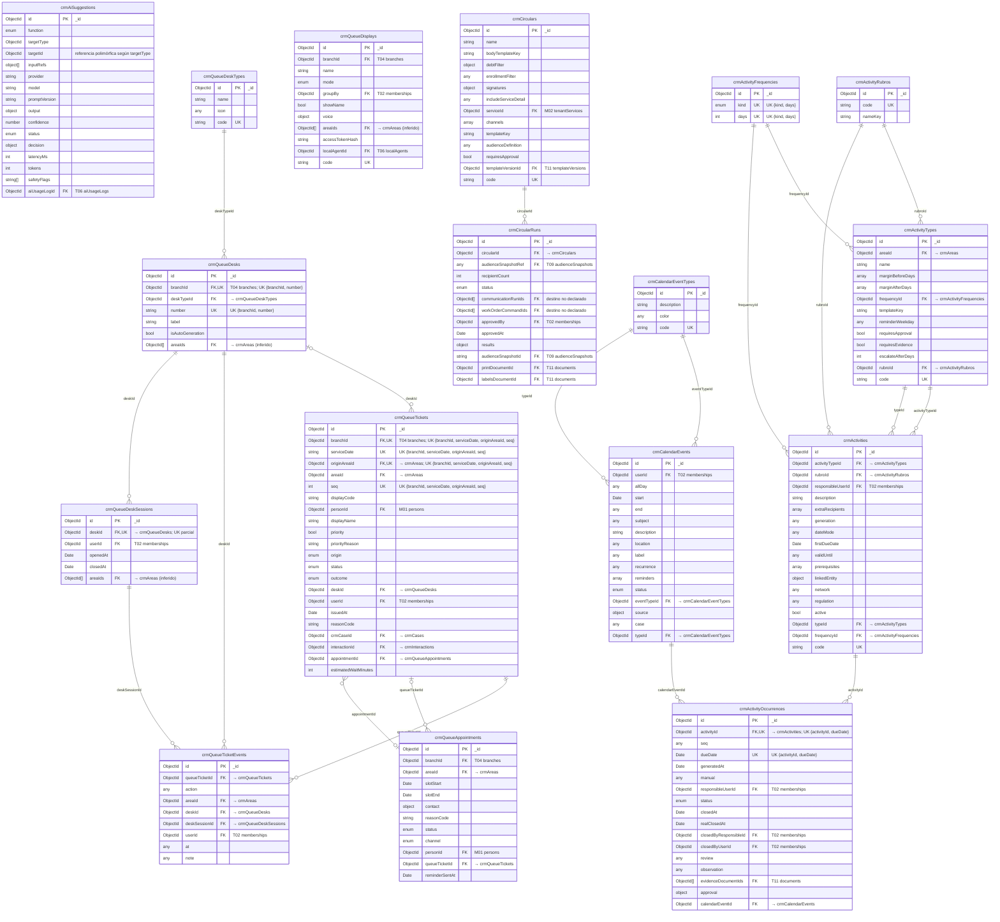

# Modelo entidad-relación — M09 CRM Atención (CRM)

| Campo | Valor |
|---|---|
| Artefacto | 6.1 Modelo entidad-relación completo, vista por módulo (índice: [`03-modelo-entidad-relacion.md`](../03-modelo-entidad-relacion.md)) |
| Anexo dueño | [`M09-CRM-atencion.md`](../../especificacion/anexos/M09-CRM-atencion.md), §7 |
| Catálogo canónico | [`T05-DAT-modelo-datos.md`](../../especificacion/anexos/T05-DAT-modelo-datos.md), filas `COL-CRM-NN` |
| Vista por dominio | [`03c-er-cobranza-mora-crm-tecnica.md` §12](../03c-er-cobranza-mora-crm-tecnica.md) |
| Versión | 2.1 (05-11-2026) |
| Generado con | [`_trabajo/generar_er_completo.py`](../_trabajo/generar_er_completo.py), revisado a mano |

## 1. Resumen

T05 registra 42 filas con dueño M09: **42 colecciones a crear** y 0 absorbidas en otras colecciones. Las 42 colecciones a crear se dibujan en 2 diagramas, uno por subdominio.

Convenciones: las del índice (secciones 1.3 y 2). Cada entidad lleva `id PK "_id"` y los campos de su ficha del §7; se omiten los campos transversales (`tenantId`, auditoría, `version`, baja lógica, `legacy`). El comentario de una `FK` indica el destino: `→ colección` si es del mismo módulo, `MXX colección` si es de otro; "(inferido)" cuando ni el anexo ni T05 §7.2 y §7.2.1 nombran el destino para esa colección y el nombre del campo no coincide literalmente con el de la colección (se dedujo por rol, sufijo, versión o por el contexto de §7.2.1; a confirmar); "destino no declarado" cuando no se puede fijar. Una referencia polimórfica (`entityType` + `entityId`, `resourceType` + `resourceId`, `targetRef`, `subjectRef`…) no lleva `FK` ni relación: el comentario "referencia polimórfica según <discriminador>" la señala, porque el destino depende del discriminador. Los campos que T05 §7.2.1 declara "no es referencia" no llevan `FK`. Los nombres que el anexo o T05 citan solo en notas "antes …", "Reemplazado por" o "alias" no se toman como campos ni como destinos. `UK` marca los únicos mínimos de T05; "según T05" señala un campo que figura en el catálogo pero no en la ficha del anexo. El tipo `any` indica que el anexo no declara el tipo.

## 2. Colecciones del módulo

| COL-ID | Colección | Diagrama | Ola | Clasificación | Alcance | Volumen o TTL (T05 §7.8) | Ficha en el anexo |
|---|---|---|---|---|---|---|---|
| COL-CRM-01 | `crmCases` | 1 | O2 | OP/CT | T | — | §7.1 |
| COL-CRM-02 | `crmCaseEvents` | 1 | O2 | AU | T | — | §7.2 |
| COL-CRM-03 | `crmConversations` | 1 | O6 | CT | T | — | §7.3 |
| COL-CRM-04 | `crmMessages` | 1 | O2 | CT | T | — | §7.4 |
| COL-CRM-05 | `crmInteractions` | 1 | O2 | CT | T | — | §7.5 |
| COL-CRM-06 | `crmCaseTypes` | 1 | O2 | CF | T | — | §7.6 |
| COL-CRM-07 | `crmCaseSubtypes` | 1 | O2 | CF | T | — | §7.7 |
| COL-CRM-08 | `crmStatusSets` | 1 | O2 | CF | T | — | §7.8 |
| COL-CRM-09 | `crmAreas` | 1 | O2 | CF | T | — | §7.9 |
| COL-CRM-10 | `crmSlaPolicies` | 1 | O2 | CF | T+P | — | §7.10 |
| COL-CRM-11 | `crmRoutingRules` | 1 | O2 | CF | T | — | §7.11 |
| COL-CRM-12 | `crmCommandRequests` | 1 | O2 | OP | T | — | §7.12 |
| COL-CRM-13 | `crmContacts` | 1 | O2 | ID/CT | T | — | §7.13 |
| COL-CRM-14 | `crmIncidents` | 1 | O3 | OP | T | — | §7.14 |
| COL-CRM-15 | `crmIncidentClasses` | 1 | O3 | CF | T | — | §7.15 |
| COL-CRM-16 | `crmProcedureTypes` | 1 | O7 | CF | T | — | §7.16 |
| COL-CRM-17 | `crmProcedureRecords` | 1 | O7 | OP | T | — | §7.17 |
| COL-CRM-18 | `crmProjects` | 1 | O10 | OP | T | — | §7.18 |
| COL-CRM-19 | `crmWorkLogs` | 1 | O10 | OP | T | — | §7.19 |
| COL-CRM-20 | `crmHourBanks` | 1 | O10 | OP | T | — | §7.20 |
| COL-CRM-21 | `crmAccountAssignments` | 1 | O2 | OP | T | — | §7.21 |
| COL-CRM-22 | `crmQuickReplies` | 1 | O2 | CF | T | — | §7.22 |
| COL-CRM-23 | `crmChannels` | 1 | O2 | CF | T | — | §7.23 |
| COL-CRM-24 | `crmBotFlows` | 1 | O6 | CF | T | — | §7.24 |
| COL-CRM-25 | `crmBotSessions` | 1 | O6 | CT | T | TTL sobre `expiresAt` (Según M09) | §7.25 |
| COL-CRM-26 | `crmAiSuggestions` | 2 | O6 | OP | T | — | §7.26 |
| COL-CRM-27 | `crmQueueTickets` | 2 | O10 | OP | T | — | §7.27 |
| COL-CRM-28 | `crmQueueTicketEvents` | 2 | O10 | OP | T | — | §7.28 |
| COL-CRM-29 | `crmQueueDeskTypes` | 2 | O10 | CF | T | — | §7.29 |
| COL-CRM-30 | `crmQueueDesks` | 2 | O10 | CF | T | — | §7.30 |
| COL-CRM-31 | `crmQueueDeskSessions` | 2 | O10 | OP | T | — | §7.31 |
| COL-CRM-32 | `crmQueueDisplays` | 2 | O10 | CF | T | — | §7.32 |
| COL-CRM-33 | `crmQueueAppointments` | 2 | O10 | CT | T | — | §7.33 |
| COL-CRM-34 | `crmActivityFrequencies` | 2 | O10 | CF | T | — | §7.34 |
| COL-CRM-35 | `crmActivityRubros` | 2 | O10 | CF | T | — | §7.35 |
| COL-CRM-36 | `crmActivityTypes` | 2 | O10 | CF | T | — | §7.36 |
| COL-CRM-37 | `crmActivities` | 2 | O10 | OP | T | — | §7.37 |
| COL-CRM-38 | `crmActivityOccurrences` | 2 | O10 | OP | T | — | §7.38 |
| COL-CRM-39 | `crmCalendarEventTypes` | 2 | O10 | CF | T | — | §7.39 |
| COL-CRM-40 | `crmCalendarEvents` | 2 | O10 | OP | T | — | §7.40 |
| COL-CRM-41 | `crmCirculars` | 2 | O6 | CF | T | — | §7.41 |
| COL-CRM-42 | `crmCircularRuns` | 2 | O6 | OP | T | — | §7.42 |

## 3. Diagrama 1: Casos, conversaciones, tipos, SLA, comandos, proyectos, canales y bot

25 colecciones (ver tabla de la sección 2). Ficha en el anexo: §7.1, §7.2, §7.3, §7.4, §7.5, §7.6, §7.7, §7.8 ….

```mermaid
erDiagram
  crmCases {
    ObjectId id PK "_id"
    string number UK
    string numberingKey
    enum kind
    ObjectId caseTypeId FK "→ crmCaseTypes"
    ObjectId caseSubtypeId FK "→ crmCaseSubtypes"
    ObjectId statusSetId FK "→ crmStatusSets"
    string status
    enum baseStatus
    int priority
    bool urgentSafety
    bool sensitive
    string subject
    string description
    object origin
    object requester
    object context
    ObjectId[] contactIds FK "→ crmContacts"
    ObjectId areaId FK "→ crmAreas"
    ObjectId assigneeUserId FK "T02 memberships"
    ObjectId supervisorUserId FK "T02 memberships"
    object takenBy
    int queueOrder
    Date dueAt
    object sla
    Date requestedDate
    Date effectiveDate
    object[] requirements
    object[] acceptedTerms
    object customFields
    string[] tags
    object[] links
    ObjectId incidentId FK "→ crmIncidents"
    ObjectId projectId FK "→ crmProjects"
    string componentCode
    ObjectId quoteId FK "M11 salesQuotes"
    object aiClassification
    object resolution
    Date closedAt
    ObjectId closedBy FK "T02 memberships"
    object cancellation
    int reopenCount
    ObjectId mergedIntoCaseId FK "→ crmCases"
    object survey
    object deskEntry
    object cancellationRequest
    object regulatory
    object metrics
    Date lastActivityAt
    object migratedFrom
  }
  crmCaseEvents {
    ObjectId id PK "_id"
    ObjectId crmCaseId FK, UK "→ crmCases; UK {crmCaseId, seq}"
    int seq UK "UK {crmCaseId, seq}"
    enum type
    Date at
    object actor
    object from
    object to
    string reason
    object refs
    bool visibleToCustomer
  }
  crmConversations {
    ObjectId id PK "_id"
    ObjectId channelId FK, UK "→ crmChannels; UK {channelId, externalThreadId}"
    enum channelKind
    string externalThreadId UK "UK {channelId, externalThreadId}"
    object participant
    enum status
    ObjectId assignedUserId FK "T02 memberships"
    ObjectId[] caseIds FK "→ crmCases"
    Date windowExpiresAt
    ObjectId botSessionId FK "→ crmBotSessions"
    bool optOut
    Date lastMessageAt
  }
  crmMessages {
    ObjectId id PK "_id"
    ObjectId conversationId FK "→ crmConversations"
    ObjectId crmCaseId FK "→ crmCases"
    enum direction
    enum visibility
    enum authorKind
    ObjectId authorUserId FK "T02 memberships"
    string body
    enum format
    object templateRef
    object[] attachments
    string providerMessageId UK "UK parcial"
    object delivery
    bool isAutomatic
    ObjectId workLogId FK "→ crmWorkLogs"
    object flags
    ObjectId aiSuggestionId FK "→ crmAiSuggestions"
  }
  crmInteractions {
    ObjectId id PK "_id"
    ObjectId personId FK "M01 persons"
    ObjectId accountId FK "M01 accounts"
    ObjectId contractId FK "M02 serviceContracts"
    enum channelKind
    enum direction
    enum kind
    Date startedAt
    Date endedAt
    string reasonCode
    enum outcome
    ObjectId crmCaseId FK "→ crmCases"
    ObjectId conversationId FK "→ crmConversations"
    ObjectId queueTicketId FK "→ crmQueueTickets"
    ObjectId communicationId FK "T09 communications"
    ObjectId userId FK "T02 memberships"
    string summary
    object call
  }
  crmCaseTypes {
    ObjectId id PK "_id"
    enum kind
    enum requestAction
    ObjectId[] serviceIds FK "M02 tenantServices"
    ObjectId statusSetId FK "→ crmStatusSets"
    ObjectId workflowDefinitionId FK "T11 workflowDefinitions"
    object[] requirementsTemplate
    object customFieldsSchema
    object[] commandsOnApproval
    ObjectId defaultAreaId FK "→ crmAreas"
    int defaultPriority
    ObjectId slaPolicyId FK "→ crmSlaPolicies"
    object numberingPolicy
    bool publicIntake
    bool customerVisible
    bool requiresAccount
    bool allowsAnonymous
    ObjectId surveyTemplateId FK "T09 surveyTemplates"
    int autoCloseDays
    int reopenWindowDays
    string regulatorCode
    bool sensitive
    object templateKeys
    enum billingMode
    ObjectId projectId FK "→ crmProjects"
    string code UK "según T05"
  }
  crmCaseSubtypes {
    ObjectId id PK "_id"
    ObjectId caseTypeId FK, UK "→ crmCaseTypes; UK {caseTypeId, code}"
    string defaultStatus
    int defaultPriority
    bool urgentSafety
    ObjectId slaPolicyId FK "→ crmSlaPolicies"
    bool registersCause
    string[] causeCodes
    bool blockClosure
    bool isDefault
    ObjectId productId FK "M02 serviceProducts"
    ObjectId incidentCategoryId FK "M10 incidentCategories"
    string workOrderOperationCode
    ObjectId[] quickReplyIds FK "→ crmQuickReplies"
    int duplicateWindowDays
    object incidentDetection
    string claimTypeKey
    object externalDerivation
    string regulatoryReasonCode
    string code UK "UK {caseTypeId, code}; según T05"
  }
  crmStatusSets {
    ObjectId id PK "_id"
    object[] states
    object[] transitions
    ObjectId workflowRef FK "T11 workflowDefinitions"
    string code UK "según T05"
  }
  crmAreas {
    ObjectId id PK "_id"
    enum[] roles
    ObjectId[] branchIds FK "T04 branches"
    ObjectId[] serviceIds FK "M02 tenantServices"
    ObjectId managerUserId FK "T02 memberships"
    object[] members
    object[] extraRecipients
    int reminderWeekday
    ObjectId businessCalendarId FK "T04 calendars (inferido)"
    object queue
    object[] onCallSchedule
    string code UK "según T05"
  }
  crmSlaPolicies {
    ObjectId id PK "_id"
    object scope
    object[] targets
    enum[] pauseOnBaseStatuses
    int warnAtPercent
    object[] escalation
    ObjectId businessCalendarId FK "T04 calendars"
    bool regulatory
    int policyVersion
    string templateCode
    object legalValidation
    bool continuous
    string code UK "según T05"
  }
  crmRoutingRules {
    ObjectId id PK "_id"
    enum purpose
    object conditions
    enum trigger
    object target
    int priority
    string code UK "según T05"
  }
  crmCommandRequests {
    ObjectId id PK "_id"
    ObjectId crmCaseId FK "→ crmCases"
    enum targetModule
    string command
    object payload
    string idempotencyKey UK
    enum status
    object result
    int attempts
    ObjectId dependsOnCommandId FK "→ crmCommandRequests"
    Date requestedAt
    Date resolvedAt
  }
  crmContacts {
    ObjectId id PK "_id"
    string displayName
    ObjectId personId FK "M01 persons"
    ObjectId[] relatedAccountIds FK "M01 accounts"
    enum relation
    string phone
    string mobile
    string email
    string notes
    bool doNotNotify
    ObjectId mergedInto FK "→ crmContacts"
  }
  crmIncidents {
    ObjectId id PK "_id"
    string number UK
    ObjectId incidentClassId FK "→ crmIncidentClasses"
    ObjectId incidentCategoryId FK "M10 incidentCategories"
    ObjectId failureTypeId FK "M10 incidentCategories"
    ObjectId serviceId FK "M02 tenantServices"
    string title
    string description
    enum status
    bool scheduled
    object scope
    object affected
    Date startedAt
    Date detectedAt
    Date restoredAt
    Date closedAt
    Date estimatedRestoreAt
    ObjectId[] workOrderIds FK "M10 workOrders"
    object[] participants
    int caseCount
    object[] communications
    string resolutionCode
    bool regulatoryReportable
  }
  crmIncidentClasses {
    ObjectId id PK "_id"
    string prefix
    string counterKey
    ObjectId[] serviceIds FK "M02 tenantServices"
    string code UK "según T05"
  }
  crmProcedureTypes {
    ObjectId id PK "_id"
    enum entityLevel
    int expiryDays
    string kind
    bool isDefault
    string templateKey
    object[] actions
    ObjectId[] requiredForServiceIds FK "M02 tenantServices"
    string[] intakeRouteCodes
    ObjectId[] documentRequirementTypeIds FK "M01 documentRequirementTypes; según T05"
    string code UK "según T05"
  }
  crmProcedureRecords {
    ObjectId id PK "_id"
    ObjectId procedureTypeId FK "→ crmProcedureTypes"
    ObjectId associateMembershipId FK "M17 associateMemberships"
    ObjectId accountId FK "M01 accounts"
    ObjectId contractId FK "M02 serviceContracts"
    ObjectId personId FK "M01 persons"
    Date date
    Date expiresAt
    bool presented
    enum status
    string notes
    ObjectId[] documentIds FK "T11 documents"
    object[] actionsExecuted
    ObjectId crmCaseId FK "→ crmCases"
    Date recordedAt
    ObjectId recordedBy FK "T02 memberships"
  }
  crmProjects {
    ObjectId id PK "_id"
    ObjectId accountId FK "M01 accounts"
    object[] components
    enum status
    ObjectId ownerUserId FK "T02 memberships"
    string code UK "según T05"
  }
  crmWorkLogs {
    ObjectId id PK "_id"
    ObjectId crmCaseId FK "→ crmCases"
    ObjectId userId FK "T02 memberships"
    Date startedAt
    Date endedAt
    int minutes
    int billableMinutes
    enum kind
    bool autoPaused
    enum billingStatus
    ObjectId hourBankId FK "→ crmHourBanks (inferido)"
    ObjectId invoiceRef FK "M05 invoices"
  }
  crmHourBanks {
    ObjectId id PK "_id"
    ObjectId accountId FK "M01 accounts"
    enum kind
    int minutesGranted
    string period
    ObjectId saleRef FK "M05 invoices"
    int minutesUsed
    Decimal128 hourlyRate
  }
  crmAccountAssignments {
    ObjectId id PK "_id"
    ObjectId accountId FK, UK "M01 accounts; UK {accountId, role}"
    ObjectId userId FK "T02 memberships"
    ObjectId projectId FK "→ crmProjects"
    enum role UK "UK {accountId, role}"
  }
  crmQuickReplies {
    ObjectId id PK "_id"
    string title
    any body
    array channelKinds
    ObjectId[] caseTypeIds FK "→ crmCaseTypes (inferido)"
    ObjectId[] caseSubtypeIds FK "→ crmCaseSubtypes (inferido)"
    any visibility
    ObjectId ownerUserId FK "T02 memberships"
    ObjectId areaId FK "→ crmAreas"
    string code UK
  }
  crmChannels {
    ObjectId id PK "_id"
    enum kind UK "UK {kind, address}"
    string intakeRouteCode
    bool validatePhone
    bool validateEmail
    ObjectId providerConnectionId FK "T06 integrationConnections"
    string address UK "UK {kind, address}"
    object businessHours
    ObjectId botFlowId FK "→ crmBotFlows"
    ObjectId defaultAreaId FK "→ crmAreas"
    enum status
    Date templatesSyncedAt
  }
  crmBotFlows {
    ObjectId id PK "_id"
    object[] intents
    string greetingKey
    string outOfHoursKey
    string fallbackKey
    object handoff
    object[] faq
    enum status
    string code UK "según T05"
  }
  crmBotSessions {
    ObjectId id PK "_id"
    ObjectId conversationId FK "→ crmConversations"
    ObjectId flowId FK "→ crmBotFlows"
    any flowVersion
    any currentIntent
    any step
    object verification
    any otp
    Date startedAt
    Date endedAt
    any outcome
    ObjectId crmCaseId FK "→ crmCases"
  }
  crmCaseTypes ||--o{ crmCases : "caseTypeId"
  crmCaseSubtypes |o--o{ crmCases : "caseSubtypeId"
  crmStatusSets ||--o{ crmCases : "statusSetId"
  crmContacts }o--o{ crmCases : "contactIds"
  crmAreas |o--o{ crmCases : "areaId"
  crmIncidents |o--o{ crmCases : "incidentId"
  crmProjects |o--o{ crmCases : "projectId"
  crmCases |o--o{ crmCases : "mergedIntoCaseId"
  crmCases ||--o{ crmCaseEvents : "crmCaseId"
  crmChannels ||--o{ crmConversations : "channelId"
  crmCases }o--o{ crmConversations : "caseIds"
  crmBotSessions |o--o{ crmConversations : "botSessionId"
  crmConversations |o--o{ crmMessages : "conversationId"
  crmCases |o--o{ crmMessages : "crmCaseId"
  crmWorkLogs |o--o{ crmMessages : "workLogId"
  crmCases |o--o{ crmInteractions : "crmCaseId"
  crmConversations |o--o{ crmInteractions : "conversationId"
  crmStatusSets ||--o{ crmCaseTypes : "statusSetId"
  crmAreas |o--o{ crmCaseTypes : "defaultAreaId"
  crmSlaPolicies |o--o{ crmCaseTypes : "slaPolicyId"
  crmProjects |o--o{ crmCaseTypes : "projectId"
  crmCaseTypes ||--o{ crmCaseSubtypes : "caseTypeId"
  crmSlaPolicies |o--o{ crmCaseSubtypes : "slaPolicyId"
  crmQuickReplies }o--o{ crmCaseSubtypes : "quickReplyIds"
  crmCases ||--o{ crmCommandRequests : "crmCaseId"
  crmCommandRequests |o--o{ crmCommandRequests : "dependsOnCommandId"
  crmContacts |o--o{ crmContacts : "mergedInto"
  crmIncidentClasses ||--o{ crmIncidents : "incidentClassId"
  crmProcedureTypes ||--o{ crmProcedureRecords : "procedureTypeId"
  crmCases |o--o{ crmProcedureRecords : "crmCaseId"
  crmCases ||--o{ crmWorkLogs : "crmCaseId"
  crmHourBanks |o--o{ crmWorkLogs : "hourBankId"
  crmProjects |o--o{ crmAccountAssignments : "projectId"
  crmCaseTypes }o--o{ crmQuickReplies : "caseTypeIds"
  crmCaseSubtypes }o--o{ crmQuickReplies : "caseSubtypeIds"
  crmAreas |o--o{ crmQuickReplies : "areaId"
  crmBotFlows |o--o{ crmChannels : "botFlowId"
  crmAreas |o--o{ crmChannels : "defaultAreaId"
  crmConversations ||--o{ crmBotSessions : "conversationId"
  crmBotFlows ||--o{ crmBotSessions : "flowId"
  crmCases |o--o{ crmBotSessions : "crmCaseId"
```

**Índices principales del diagrama 1**

| Colección | Índices declarados en el anexo | Únicos mínimos (T05) |
|---|---|---|
| `crmCases` | `{tenantId, number}` único; `{tenantId, baseStatus, areaId, priority, dueAt}`; `{tenantId, assigneeUserId, baseStatus, queueOrder}`; `{tenantId, 'requester.personId', createdAt}`; `{tenantId, 'context.accountId', … | `number`; `deskEntry.registerNumber` p.; `cancellationRequest.receiptCode` p. |
| `crmCaseEvents` | `{tenantId, crmCaseId, seq}` único; `{tenantId, type, at}`. Mapeo: `RECLAMOS_HIST` (FECHA, ESTADO, USUARIO, OBSERVA), `TICKETS_ASIGNACIONES` (USER_ASIGNA, USER_ASIGNADO, FECHA_ASIGNACION). | `{crmCaseId, seq}` (5-11-2026, residuales: alineado a M09 §7; ) |
| `crmConversations` | `{tenantId, channelId, externalThreadId}` único; `{tenantId, status, channelKind, lastMessageAt}`; `{tenantId, 'participant.personId'}`. | `{channelId, externalThreadId}` |
| `crmMessages` | `{tenantId, crmCaseId, createdAt}`; `{tenantId, conversationId, createdAt}`; `{tenantId, providerMessageId}` único parcial. Mapeo: `TICKETS_NOTAS` (DESCRIPCION, INTERNA, ELIMINADA → evento, FECHAADD/FECHAMOD, RECLAMO → … | `providerMessageId` p. |
| `crmInteractions` | `{tenantId, personId, startedAt}`; `{tenantId, accountId, startedAt}`; `{tenantId, channelKind, startedAt}`. | — |
| `crmCaseTypes` | — | `code` |
| `crmCaseSubtypes` | — | `{caseTypeId, code}` |
| `crmStatusSets` | — | `code` |
| `crmAreas` | — | `code` |
| `crmSlaPolicies` | — | `code` |
| `crmRoutingRules` | — | `code` |
| `crmCommandRequests` | `{tenantId, idempotencyKey}` único; `{tenantId, crmCaseId}`; `{tenantId, status, requestedAt}`. Reemplaza `TRAMITES_ACCIONES.SCRIPT_ACCION` y las acciones masivas de `clsTramites`. | `idempotencyKey` |
| `crmContacts` | — | — |
| `crmIncidents` | `{tenantId, number}` único; `{tenantId, status, serviceId}`; `{tenantId, 'scope.zoneIds'}`. | `number` |
| `crmIncidentClasses` | — | `code` |
| `crmProcedureTypes` | — | `code` |
| `crmProcedureRecords` | `{tenantId, procedureTypeId, accountId, expiresAt}`; `{tenantId, status, expiresAt}`. Mapeo: `PTRAMITES` (TMT_SOC, COD_TMT, COD_SOC, COD_SUM, ID_SERSOC, FECHA, OBSERVA, FEC_REG, USU_REG, FECHA_VTO, PRESENTADO, COD_PROV … | — |
| `crmProjects` | — | `code` |
| `crmWorkLogs` | — | — |
| `crmHourBanks` | — | — |
| `crmAccountAssignments` | — | `{accountId, role}` |
| `crmQuickReplies` | — | `code` |
| `crmChannels` | `{tenantId, kind, address}` único; para webhooks: `{kind, address}` único global (resuelve el tenant, RN-CRM-095). Mapeo: `TICKETS_MEDIOSATENCION` (DES_MEDIO), `VIAINGTE` (DES_VIA, VALIDAR_CELULAR, VALIDAR_MAIL). | `{kind, address}`; global `{kind, address}` |
| `crmBotFlows` | — | `{code, version}` |
| `crmBotSessions` | `{tenantId, conversationId, startedAt}`. Expira por inactividad (PRM-CRM-063). | — |

## 4. Diagrama 2: IA, turnero, actividades, calendario y circulares

17 colecciones (ver tabla de la sección 2). Ficha en el anexo: §7.26, §7.27, §7.28, §7.29, §7.30, §7.31, §7.32, §7.33 ….

**Índices principales del diagrama 2**

| Colección | Índices declarados en el anexo | Únicos mínimos (T05) |
|---|---|---|
| `crmAiSuggestions` | `{tenantId, targetType, targetId, createdAt}`; `{tenantId, function, status, createdAt}`. Mapeo: `AUDIT_IA` (TIPO_CONSULTA, FEC_REG, COMANDO, RESPUESTA, TOKENS, USUARIO). | — |
| `crmQueueTickets` | `{tenantId, branchId, serviceDate, originAreaId, seq}` único; `{tenantId, branchId, areaId, status, priority, issuedAt}` (llamado). | `{branchId, serviceDate, originAreaId, seq}` |
| `crmQueueTicketEvents` | `{tenantId, queueTicketId, at}`. Mapeo: `TURNOS_HISTORIAL` (COD_TUR, COD_AREA, TIP_ACCION 1–8, COD_USER, COD_BHIS, INICIO, OBSERVA). | — |
| `crmQueueDeskTypes` | — | `code` |
| `crmQueueDesks` | `{tenantId, branchId, number}` único. Mapeo `TUR_BOX`. | `{branchId, number}` |
| `crmQueueDeskSessions` | único parcial `{tenantId, deskId}` donde `closedAt = null` (impide doble apertura). Mapeo `TUR_BOX_HISTORIAL`. | `deskId` p. (`isOpen: true`) |
| `crmQueueDisplays` | — | `code` |
| `crmQueueAppointments` | `{tenantId, areaId, slotStart}`; cupos por `crmAreas.queue.slots` (PRM-CRM-110). | — |
| `crmActivityFrequencies` | único `{tenantId, kind, days}`. Mapeo `ACT_FREC` (TIPO_FREC, DIAS_FREC). | `{kind, days}` |
| `crmActivityRubros` | — | `code` |
| `crmActivityTypes` | — | `code` |
| `crmActivities` | — | `code` |
| `crmActivityOccurrences` | `{tenantId, activityId, dueDate}` único; `{tenantId, status, dueDate}`. Mapeo `ACTIV_SEG`. | `{activityId, dueDate}` |
| `crmCalendarEventTypes` | — | `code` |
| `crmCalendarEvents` | `{tenantId, userId, start}`. Mapeo `CALENDARIO`. | — |
| `crmCirculars` | — | `code` |
| `crmCircularRuns` | — | — |

## 5. Relaciones con otros módulos y entre diagramas

Referencias que salen de una colección de este módulo hacia una entidad de otro módulo o de otro diagrama del mismo módulo (no se dibujan para mantener cada diagrama dentro de su módulo y subdominio).

| Colección origen | Campo | Cardinalidad (destino a origen) | Destino | COL-ID destino | Módulo destino |
|---|---|---|---|---|---|
| `crmCases` | `assigneeUserId`, `supervisorUserId`, `closedBy` | 0..1 a N | `memberships` | COL-IAM-04 | T02 |
| `crmCases` | `quoteId` | 0..1 a N | `salesQuotes` | COL-VEN-03 | M11 |
| `crmConversations` | `assignedUserId` | 0..1 a N | `memberships` | COL-IAM-04 | T02 |
| `crmMessages` | `authorUserId` | 0..1 a N | `memberships` | COL-IAM-04 | T02 |
| `crmMessages` | `aiSuggestionId` | 0..1 a N | `crmAiSuggestions` | COL-CRM-26 | mismo módulo, diagrama 2 |
| `crmInteractions` | `personId` | 0..1 a N | `persons` | COL-PER-01 | M01 |
| `crmInteractions` | `accountId` | 0..1 a N | `accounts` | COL-PER-05 | M01 |
| `crmInteractions` | `contractId` | 0..1 a N | `serviceContracts` | COL-CAT-18 | M02 |
| `crmInteractions` | `queueTicketId` | 0..1 a N | `crmQueueTickets` | COL-CRM-27 | mismo módulo, diagrama 2 |
| `crmInteractions` | `communicationId` | 0..1 a N | `communications` | COL-COM-39 | T09 |
| `crmInteractions` | `userId` | 0..1 a N | `memberships` | COL-IAM-04 | T02 |
| `crmCaseTypes` | `serviceIds` | N a N | `tenantServices` | COL-CAT-02 | M02 |
| `crmCaseTypes` | `workflowDefinitionId` | 0..1 a N | `workflowDefinitions` | COL-WFL-12 | T11 |
| `crmCaseTypes` | `surveyTemplateId` | 0..1 a N | `surveyTemplates` | COL-COM-23 | T09 |
| `crmCaseSubtypes` | `productId` | 0..1 a N | `serviceProducts` | COL-CAT-05 | M02 |
| `crmCaseSubtypes` | `incidentCategoryId` | 0..1 a N | `incidentCategories` | COL-TEC-06 | M10 |
| `crmStatusSets` | `workflowRef` | 0..1 a N | `workflowDefinitions` | COL-WFL-12 | T11 |
| `crmAreas` | `branchIds` | N a N | `branches` | COL-CFG-42 | T04 |
| `crmAreas` | `serviceIds` | N a N | `tenantServices` | COL-CAT-02 | M02 |
| `crmAreas` | `managerUserId` | 0..1 a N | `memberships` | COL-IAM-04 | T02 |
| `crmAreas` | `businessCalendarId` | 0..1 a N | `calendars` | COL-CFG-19 | T04 |
| `crmSlaPolicies` | `businessCalendarId` | 0..1 a N | `calendars` | COL-CFG-19 | T04 |
| `crmContacts` | `personId` | 0..1 a N | `persons` | COL-PER-01 | M01 |
| `crmContacts` | `relatedAccountIds` | N a N | `accounts` | COL-PER-05 | M01 |
| `crmIncidents` | `incidentCategoryId`, `failureTypeId` | 0..1 a N | `incidentCategories` | COL-TEC-06 | M10 |
| `crmIncidents` | `serviceId` | 1 a N | `tenantServices` | COL-CAT-02 | M02 |
| `crmIncidents` | `workOrderIds` | N a N | `workOrders` | COL-TEC-12 | M10 |
| `crmIncidentClasses` | `serviceIds` | N a N | `tenantServices` | COL-CAT-02 | M02 |
| `crmProcedureTypes` | `requiredForServiceIds` | N a N | `tenantServices` | COL-CAT-02 | M02 |
| `crmProcedureTypes` | `documentRequirementTypeIds` | N a N | `documentRequirementTypes` | COL-PER-14 | M01 |
| `crmProcedureRecords` | `associateMembershipId` | 1 a N | `associateMemberships` | COL-INS-01 | M17 |
| `crmProcedureRecords` | `accountId` | 1 a N | `accounts` | COL-PER-05 | M01 |
| `crmProcedureRecords` | `contractId` | 1 a N | `serviceContracts` | COL-CAT-18 | M02 |
| `crmProcedureRecords` | `personId` | 1 a N | `persons` | COL-PER-01 | M01 |
| `crmProcedureRecords` | `documentIds` | N a N | `documents` | COL-WFL-34 | T11 |
| `crmProcedureRecords` | `recordedBy` | 1 a N | `memberships` | COL-IAM-04 | T02 |
| `crmProjects` | `accountId` | 0..1 a N | `accounts` | COL-PER-05 | M01 |
| `crmProjects` | `ownerUserId` | 0..1 a N | `memberships` | COL-IAM-04 | T02 |
| `crmWorkLogs` | `userId` | 1 a N | `memberships` | COL-IAM-04 | T02 |
| `crmWorkLogs` | `invoiceRef` | 0..1 a N | `invoices` | COL-FAC-13 | M05 |
| `crmHourBanks` | `accountId` | 1 a N | `accounts` | COL-PER-05 | M01 |
| `crmHourBanks` | `saleRef` | 0..1 a N | `invoices` | COL-FAC-13 | M05 |
| `crmAccountAssignments` | `accountId` | 1 a N | `accounts` | COL-PER-05 | M01 |
| `crmAccountAssignments` | `userId` | 1 a N | `memberships` | COL-IAM-04 | T02 |
| `crmQuickReplies` | `ownerUserId` | 0..1 a N | `memberships` | COL-IAM-04 | T02 |
| `crmChannels` | `providerConnectionId` | 0..1 a N | `integrationConnections` | COL-INT-02 | T06 |
| `crmAiSuggestions` | `aiUsageLogId` | 1 a N | `aiUsageLogs` | COL-INT-18 | T06 |
| `crmQueueTickets` | `branchId` | 1 a N | `branches` | COL-CFG-42 | T04 |
| `crmQueueTickets` | `originAreaId`, `areaId` | 1 a N | `crmAreas` | COL-CRM-09 | mismo módulo, diagrama 1 |
| `crmQueueTickets` | `personId` | 0..1 a N | `persons` | COL-PER-01 | M01 |
| `crmQueueTickets` | `userId` | 0..1 a N | `memberships` | COL-IAM-04 | T02 |
| `crmQueueTickets` | `crmCaseId` | 0..1 a N | `crmCases` | COL-CRM-01 | mismo módulo, diagrama 1 |
| `crmQueueTickets` | `interactionId` | 0..1 a N | `crmInteractions` | COL-CRM-05 | mismo módulo, diagrama 1 |
| `crmQueueTicketEvents` | `areaId` | 1 a N | `crmAreas` | COL-CRM-09 | mismo módulo, diagrama 1 |
| `crmQueueTicketEvents` | `userId` | 1 a N | `memberships` | COL-IAM-04 | T02 |
| `crmQueueDesks` | `branchId` | 1 a N | `branches` | COL-CFG-42 | T04 |
| `crmQueueDesks` | `areaIds` | N a N | `crmAreas` | COL-CRM-09 | mismo módulo, diagrama 1 |
| `crmQueueDeskSessions` | `userId` | 1 a N | `memberships` | COL-IAM-04 | T02 |
| `crmQueueDeskSessions` | `areaIds` | N a N | `crmAreas` | COL-CRM-09 | mismo módulo, diagrama 1 |
| `crmQueueDisplays` | `branchId` | 1 a N | `branches` | COL-CFG-42 | T04 |
| `crmQueueDisplays` | `groupBy` | 1 a N | `memberships` | COL-IAM-04 | T02 |
| `crmQueueDisplays` | `areaIds` | N a N | `crmAreas` | COL-CRM-09 | mismo módulo, diagrama 1 |
| `crmQueueDisplays` | `localAgentId` | 0..1 a N | `localAgents` | COL-INT-16 | T06 |
| `crmQueueAppointments` | `branchId` | 1 a N | `branches` | COL-CFG-42 | T04 |
| `crmQueueAppointments` | `areaId` | 1 a N | `crmAreas` | COL-CRM-09 | mismo módulo, diagrama 1 |
| `crmQueueAppointments` | `personId` | 0..1 a N | `persons` | COL-PER-01 | M01 |
| `crmActivityTypes` | `areaId` | 1 a N | `crmAreas` | COL-CRM-09 | mismo módulo, diagrama 1 |
| `crmActivities` | `responsibleUserId` | 1 a N | `memberships` | COL-IAM-04 | T02 |
| `crmActivityOccurrences` | `responsibleUserId`, `closedByResponsibleId`, `closedByUserId` | 1 a N | `memberships` | COL-IAM-04 | T02 |
| `crmActivityOccurrences` | `evidenceDocumentIds` | N a N | `documents` | COL-WFL-34 | T11 |
| `crmCalendarEvents` | `userId` | 1 a N | `memberships` | COL-IAM-04 | T02 |
| `crmCirculars` | `serviceId` | 1 a N | `tenantServices` | COL-CAT-02 | M02 |
| `crmCirculars` | `templateVersionId` | 1 a N | `templateVersions` | COL-WFL-42 | T11 |
| `crmCircularRuns` | `audienceSnapshotRef`, `audienceSnapshotId` | 1 a N | `audienceSnapshots` | COL-COM-33 | T09 |
| `crmCircularRuns` | `approvedBy` | 1 a N | `memberships` | COL-IAM-04 | T02 |
| `crmCircularRuns` | `printDocumentId`, `labelsDocumentId` | 0..1 a N | `documents` | COL-WFL-34 | T11 |

## 6. Colecciones absorbidas y renombradas

Ninguna colección del módulo quedó absorbida.

## 7. Observaciones e inconsistencias detectadas

- Referencias sin colección destino declarada (ni en el anexo ni en T05 §7.2 y §7.2.1; quedan como `FK` "destino no declarado"): `crmCircularRuns.communicationRunIds`, `crmCircularRuns.workOrderCommandIds`.
- Campos que T05 cita en "Claves y referencias" o "Únicos" y que la ficha del anexo no declara con ese nombre (posible diferencia de nombre; a verificar en el anexo): `crmCaseTypes`: `code`; `crmCaseSubtypes`: `code`; `crmStatusSets`: `code`; `crmAreas`: `code`; `crmSlaPolicies`: `code`; `crmRoutingRules`: `code`; `crmIncidentClasses`: `code`; `crmProcedureTypes`: `documentRequirementTypeIds`, `code`; `crmProjects`: `code`; `crmBotFlows`: `code`.
