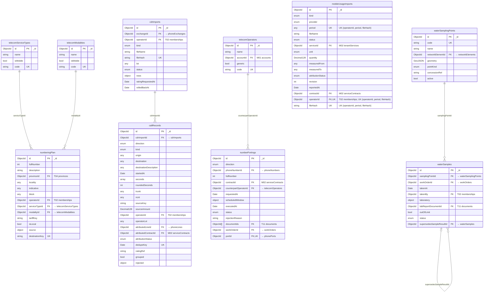

# Modelo entidad-relación — M10 TEC Técnica, campo y redes

| Campo | Valor |
|---|---|
| Artefacto | 6.1 Modelo entidad-relación completo, vista por módulo (índice: [`03-modelo-entidad-relacion.md`](../03-modelo-entidad-relacion.md)) |
| Anexo dueño | [`M10-TEC-tecnica-campo-redes.md`](../../especificacion/anexos/M10-TEC-tecnica-campo-redes.md), §7 |
| Catálogo canónico | [`T05-DAT-modelo-datos.md`](../../especificacion/anexos/T05-DAT-modelo-datos.md), filas `COL-TEC-NN` |
| Vista por dominio | [`03c-er-cobranza-mora-crm-tecnica.md` §13](../03c-er-cobranza-mora-crm-tecnica.md) |
| Versión | 2.1 (05-11-2026) |
| Generado con | [`_trabajo/generar_er_completo.py`](../_trabajo/generar_er_completo.py), revisado a mano |

Este módulo se reparte en 2 archivos: [`M10-TEC-tecnica-campo-redes.md`](M10-TEC-tecnica-campo-redes.md), [`M10-TEC-tecnica-campo-redes-parte2.md`](M10-TEC-tecnica-campo-redes-parte2.md).

## 1. Resumen

T05 registra 76 filas con dueño M10: **75 colecciones a crear** y 1 absorbida en otras colecciones. Las 75 colecciones a crear se dibujan en 4 diagramas, uno por subdominio.

Convenciones: las del índice (secciones 1.3 y 2). Cada entidad lleva `id PK "_id"` y los campos de su ficha del §7; se omiten los campos transversales (`tenantId`, auditoría, `version`, baja lógica, `legacy`). El comentario de una `FK` indica el destino: `→ colección` si es del mismo módulo, `MXX colección` si es de otro; "(inferido)" cuando ni el anexo ni T05 §7.2 y §7.2.1 nombran el destino para esa colección y el nombre del campo no coincide literalmente con el de la colección (se dedujo por rol, sufijo, versión o por el contexto de §7.2.1; a confirmar); "destino no declarado" cuando no se puede fijar. Una referencia polimórfica (`entityType` + `entityId`, `resourceType` + `resourceId`, `targetRef`, `subjectRef`…) no lleva `FK` ni relación: el comentario "referencia polimórfica según <discriminador>" la señala, porque el destino depende del discriminador. Los campos que T05 §7.2.1 declara "no es referencia" no llevan `FK`. Los nombres que el anexo o T05 citan solo en notas "antes …", "Reemplazado por" o "alias" no se toman como campos ni como destinos. `UK` marca los únicos mínimos de T05; "según T05" señala un campo que figura en el catálogo pero no en la ficha del anexo. El tipo `any` indica que el anexo no declara el tipo.

## 2. Colecciones del módulo

| COL-ID | Colección | Diagrama | Ola | Clasificación | Alcance | Volumen o TTL (T05 §7.8) | Ficha en el anexo |
|---|---|---|---|---|---|---|---|
| COL-TEC-01 | `feasibilityRequests` | 1 | O3 | UB | T | — | §7.1 |
| COL-TEC-02 | `connectionEstimates` | 1 | O3 | FI | T | — | §7.2 |
| COL-TEC-03 | `technicalNotes` | 1 | O3 | OP | T | — | §7.3 |
| COL-TEC-04 | `workOrderOperationTypes` | 1 | O3 | CF | T | — | §7.4 |
| COL-TEC-12 | `workOrders` | 1 | O3 | OP/UB | T | — | §7.5 |
| COL-TEC-13 | `workOrderMaterials` | 1 | O3 | OP | T | — | §7.7 |
| COL-TEC-14 | `fieldEvidence` | 1 | O3 | UB | T | — | §7.8 |
| COL-TEC-15 | `serviceConformities` | 1 | O3 | ID | T | — | §7.9 |
| COL-TEC-16 | `damageAssessments` | 1 | O7 | FI | T | — | §7.10 |
| COL-TEC-17 | `technicalProcedures` | 1 | O7 | OP | T | — | §7.11 |
| COL-TEC-20 | `resourceCalendars` | 1 | O3 | OP | T | — | §7.12 |
| COL-TEC-21 | `visitBookings` | 1 | O3 | OP | T | — | §7.12 |
| COL-TEC-22 | `visits` | 1 | O3 | UB | T | — | §7.12 |
| COL-TEC-28 | `fieldDevices` | 1 | O3 | TE | T | — | §7.14 |
| COL-TEC-29 | `syncMutations` | 1 | O3 | TE | T | — | §7.14 |
| COL-TEC-05 | `workTypes` | 2 | O3 | CF | T | — | §7.22.5 |
| COL-TEC-06 | `incidentCategories` | 2 | O3 | CF | T | — | §7.22.6 |
| COL-TEC-07 | `resolutionCodes` | 2 | O3 | CF | T | — | §7.22.7 |
| COL-TEC-08 | `taskCatalog` | 2 | O3 | CF | T | — | §7.22.8 |
| COL-TEC-09 | `taskGroups` | 2 | O3 | CF | T | — | §7.22.9 |
| COL-TEC-10 | `workOrderPrintTemplates` | 2 | O3 | CF | T | — | §7.22.10 |
| COL-TEC-11 | `chainedOrderRules` | 2 | O3 | CF | T | — | §7.22.11 |
| COL-TEC-18 | `visitTypes` | 2 | O3 | CF | T | — | §7.22.18 |
| COL-TEC-19 | `schedulingZones` | 2 | O3 | UB | T | — | §7.22.19 |
| COL-TEC-70 | `slotCounters` | 2 | O3 | TE | T | — | §7.22.22 |
| COL-TEC-23 | `crews` | 2 | O3 | CF | T | — | §7.22.24 |
| COL-TEC-24 | `fieldResources` | 2 | O3 | CF | T | — | §7.22.25 |
| COL-TEC-25 | `responsibleNotificationRules` | 2 | O3 | CF | T | — | §7.22.26 |
| COL-TEC-26 | `certifiedInstallers` | 2 | O7 | ID | T | — | §7.22.27 |
| COL-TEC-71 | `onCallShifts` | 2 | O3 | OP/CT | T | — | §7.22.28 |
| COL-TEC-72 | `emergencyProtocols` | 2 | O7 | CF | T+P | — | §7.22.29 |
| COL-TEC-27 | `fieldForms` | 2 | O3 | CF | T | — | §7.22.30 |
| COL-TEC-30 | `syncConflicts` | 2 | O3 | TE | T | — | §7.22.33 |
| COL-TEC-31 | `maintenancePlans` | 2 | O7 | OP | T | — | §7.22.34 |
| COL-TEC-32 | `outagePlans` | 2 | O7 | OP | T | — | §7.22.35 |
| COL-TEC-33 | `networks` | 2 | O7 | CF | T | — | §7.22.36 |
| COL-TEC-34 | `networkLayers` | 2 | O7 | CF | T | — | §7.22.37 |
| COL-TEC-35 | `networkComponentTypes` | 2 | O7 | CF | T | — | §7.22.38 |
| COL-TEC-36 | `networkComponentRelations` | 2 | O7 | CF | T | — | §7.22.39 |
| COL-TEC-37 | `networkAttributeDefs` | 2 | O7 | CF | T | — | §7.22.40 |
| COL-TEC-38 | `networkElements` | 3 | O7 | UB | T | — | §7.22.41 |
| COL-TEC-39 | `serviceNetworkConnections` | 3 | O3 | OP | T | — | §7.22.42 |
| COL-TEC-40 | `gisExportTemplates` | 3 | O7 | CF | T | — | §7.22.43 |
| COL-TEC-41 | `networkDevices` | 3 | O3 | OP | T | — | §7.22.44 |
| COL-TEC-42 | `provisioningSystems` | 3 | O3 | CF | T | — | §7.22.45 |
| COL-TEC-43 | `provisioningProfiles` | 3 | O3 | CF | T | — | §7.22.46 |
| COL-TEC-44 | `serviceTechnicalProfiles` | 3 | O3 | TE | T | — | §7.22.47 |
| COL-TEC-45 | `provisioningCommands` | 3 | O3 | OP | T | — | §7.22.48 |
| COL-TEC-69 | `providedMailboxes` | 3 | O10 | CT | T | — | §7.22.49 |
| COL-TEC-46 | `works` | 3 | O7 | OP | T | — | §7.22.50 |
| COL-TEC-47 | `workGroups` | 3 | O7 | OP | T | — | §7.22.51 |
| COL-TEC-48 | `workBeneficiaries` | 3 | O7 | FI | T | — | §7.22.52 |
| COL-TEC-49 | `inspectionCases` | 3 | O7 | OP | T | — | §7.22.53 |
| COL-TEC-50 | `seals` | 3 | O7 | OP | T | — | §7.22.54 |
| COL-TEC-51 | `phoneExchanges` | 3 | O10 | CF | T | — | §7.22.55 |
| COL-TEC-58 | `phonePorts` | 3 | O10 | OP | T | — | §7.22.56 |
| COL-TEC-52 | `phoneFrames` | 3 | O10 | CF | T | — | §7.22.57 |
| COL-TEC-53 | `phoneFrameGroups` | 3 | O10 | CF | T | — | §7.22.58 |
| COL-TEC-54 | `phoneStrips` | 3 | O10 | CF | T | — | §7.22.59 |
| COL-TEC-55 | `phoneStripPositions` | 3 | O10 | OP | T | — | §7.22.60 |
| COL-TEC-56 | `phoneBoxes` | 3 | O10 | UB | T | — | §7.22.61 |
| COL-TEC-57 | `dslams` | 3 | O10 | CF | T | — | §7.22.62 |
| COL-TEC-59 | `phonePrefixes` | 3 | O10 | CF | T | — | §7.22.63 |
| COL-TEC-60 | `phoneNumbers` | 3 | O10 | OP | T | — | §7.22.64 |
| COL-TEC-61 | `phoneLines` | 3 | O10 | OP | T | — | §7.22.65 |
| COL-TEC-62 | `numberingPlan` | 4 | O10 | CF | T+P | — | §7.22.66 |
| COL-TEC-63 | `telecomOperators` | 4 | O10 | CF | T+P | — | §7.22.67 |
| COL-TEC-64 | `telecomServiceTypes` | 4 | O10 | CF | T | — | §7.22.68 |
| COL-TEC-65 | `telecomModalities` | 4 | O10 | CF | T | — | §7.22.69 |
| COL-TEC-66 | `cdrImports` | 4 | O10 | OP | T | — | §7.22.70 |
| COL-TEC-67 | `callRecords` | 4 | O10 | CT | T | 4 M (3.000 líneas) / 24 M por año | §7.22.71 |
| COL-TEC-68 | `mobileUsageImports` | 4 | O10 | OP | T | — | §7.22.72 |
| COL-TEC-73 | `numberPortings` | 4 | O10 | OP | T | — | §7.22.73 |
| COL-TEC-74 | `waterSamplingPoints` | 4 | O7 | CF/UB | T | — | §7.22.74 |
| COL-TEC-75 | `waterSamples` | 4 | O7 | OP | T | — | §7.22.75 |

## 3. Diagrama 1: Factibilidad, catálogos de OT, órdenes de trabajo, evidencias y agenda

15 colecciones (ver tabla de la sección 2). Ficha en el anexo: §7.1, §7.2, §7.3, §7.4, §7.5, §7.7, §7.8, §7.9 ….

```mermaid
erDiagram
  feasibilityRequests {
    ObjectId id PK "_id"
    string number UK
    object documentRef "referencia polimórfica"
    ObjectId serviceId FK "M02 tenantServices"
    ObjectId operationTypeId FK "→ workOrderOperationTypes"
    Date requestedAt
    ObjectId personId FK "M01 persons"
    ObjectId prospect
    ObjectId accountId FK "M01 accounts"
    ObjectId crmCaseId FK "M09 crmCases"
    object address
    object servicePoint
    object cadastre
    object adjacentStreets
    object readingRoute
    object properties
    object observations
    enum status
    enum adminStatus
    enum techStatus
    enum verdict
    string verdictReasonCode
    string technicalObservation
    ObjectId technicalResponsibleId FK "→ fieldResources"
    string substatus
    ObjectId[] inspectionWorkOrderIds FK "→ workOrders"
    object resourceProposal
    ObjectId estimateId FK "→ connectionEstimates"
    ObjectId quoteRef FK "→ connectionEstimates"
    Date validUntil
    ObjectId usedByContractId FK "M02 serviceContracts"
    Date closedAt
    ObjectId closedBy FK "T02 memberships"
    Date cancelledAt
    ObjectId cancelledBy FK "T02 memberships"
    ObjectId cancelReason
    array attachments
  }
  connectionEstimates {
    ObjectId id PK "_id"
    ObjectId feasibilityRequestId FK "→ feasibilityRequests"
    ObjectId templateId FK "T11 documentTemplates"
    Decimal128 lines
    enum status
    object quoteRef
    string notes
  }
  technicalNotes {
    ObjectId id PK "_id"
    any entityType
    ObjectId entityId "referencia polimórfica según entityType"
    string title
    string text
    Date occurredAt
    ObjectId authorUserId FK "T02 memberships"
    ObjectId responsibleId FK "T02 memberships"
    any visibility
    any source
    string subjectRef "referencia polimórfica"
  }
  workOrderOperationTypes {
    ObjectId id PK "_id"
    string code UK "UK {serviceId, code}"
    string name
    ObjectId serviceId FK, UK "M02 tenantServices; UK {serviceId, code}"
    enum effect
    enum kind
    bool isClaim
    bool modifiesRegistration
    ObjectId resultingServiceStatusId FK "M02 serviceStatuses"
    bool addCashierNote
    bool recordsReading
    object[] memberNotification
    bool excludeFromWeb
    bool availableInFieldApp
    bool requiresFeasibility
    bool requiresNetworkPoint
    bool requiresDevice
    bool requiresSerializedEquipment
    bool triggersProvisioning
    bool provisioningAction
    bool twoStepClose
    ObjectId defaultWorkTypeId FK "→ workTypes"
    ObjectId[] defaultResolutionIds FK "→ workTypes"
    ObjectId[] requiredTaskIds FK "→ workTypes"
    ObjectId[] checklistFormIds FK "→ workTypes"
    ObjectId visitTypeId FK "→ workTypes"
    object closeRequirements
    bool active
  }
  workOrders {
    ObjectId id PK "_id"
    enum kind
    string number UK
    object visibleNumber
    object documentRef "referencia polimórfica"
    ObjectId operationTypeId FK "→ workOrderOperationTypes"
    ObjectId serviceId FK "M02 tenantServices"
    ObjectId contractId FK "M02 serviceContracts"
    ObjectId accountId FK "M01 accounts"
    ObjectId personId FK "M01 persons"
    object assetRef
    ObjectId crmCaseId FK "M09 crmCases"
    ObjectId feasibilityRequestId FK "→ feasibilityRequests"
    ObjectId inspectionCaseId FK "→ inspectionCases"
    enum origin
    ObjectId intakeChannelId FK "M09 crmChannels"
    object dunningOrigin
    object snapshot
    object newData
    string description
    object observations
    enum priority
    object emergency
    Date dueAt
    enum status
    string substatus
    bool conflictOpen
    object dispatch
    object[] assignment
    ObjectId[] visitIds FK "→ visits"
    Decimal128 participants
    array tasks
    object closing
    any effectsApplied
    object[] chained
    array charges
    ObjectId[] provisioningCommandIds FK "→ provisioningCommands"
    object installation
    object extraFields
    object networkPoint
    bool provisional
    string registration
    Date requestedAt
    Date recordedAt
    Date cancelledAt
    ObjectId cancelledBy FK "T02 memberships"
    any cancelReason
    any reopenHistory
  }
  workOrderMaterials {
    ObjectId id PK "_id"
    ObjectId workOrderId FK "→ workOrders"
    ObjectId workId FK "→ works"
    ObjectId inventoryItemId FK "M13 inventoryItems"
    ObjectId serial FK "M13 serialUnits"
    ObjectId serialUnitId FK "M13 serialUnits"
    object source
    enum status
    Decimal128 quantities
    array steps
    object withdrawalSlipRef
    ObjectId[] stockMovementIds FK "M13 stockMovements"
    Decimal128 referencePrice
    bool billable
    string clientMutationId UK "UK parcial"
    enum reviewFlag
  }
  fieldEvidence {
    ObjectId id PK "_id"
    ObjectId entityType
    ObjectId entityId "referencia polimórfica según entityType"
    enum kind
    string stepCode
    ObjectId storedFileId FK "T01 storedFiles"
    string sha256
    Date capturedAt
    Date recordedAt
    any geo
    ObjectId capturedBy FK "T02 memberships"
    ObjectId deviceId
    string clientMutationId UK "UK parcial"
    ObjectId documentId FK "T11 documents"
    ObjectId supersededBy FK "T02 memberships"
  }
  serviceConformities {
    ObjectId id PK "_id"
    ObjectId workOrderId FK, UK "→ workOrders"
    ObjectId visitId FK "→ visits"
    int detailVersion
    int detailHash
    object detailSnapshot
    object receiver
    enum result
    enum mechanism
    ObjectId signatureEvidenceId FK "→ fieldEvidence"
    ObjectId signatureRequestId FK "T11 signatureRequests"
    object otpRef
    string observations
    Date signedAt
    Date recordedAt
    ObjectId installerId FK "→ certifiedInstallers"
    ObjectId supersedesId FK "→ serviceConformities (inferido)"
  }
  damageAssessments {
    ObjectId id PK "_id"
    ObjectId workOrderId FK "→ workOrders"
    ObjectId crmCaseId FK "M09 crmCases"
    Date paymentDate
    any transferCenter
    int bookNumber
    int folioNumber
    Decimal128 claimedAmount
    Decimal128 approvedAmount
    bool previousDamages
    bool accepted
    object regulatorClaim
    any cause
    any extra
    enum status
    any settlementRef
  }
  technicalProcedures {
    ObjectId id PK "_id"
    int number UK
    ObjectId installerId FK "→ certifiedInstallers"
    any address
    any contact
    ObjectId serviceId FK "M02 tenantServices"
    Date openedAt
    enum status
    any externalUserRef FK "T02 memberships"
    ObjectId dossierId FK "T11 dossiers"
  }
  resourceCalendars {
    ObjectId id PK "_id"
    any resourceType
    ObjectId resourceId "referencia polimórfica según resourceType"
    any ausencia
    ObjectId[] zoneIds FK "→ schedulingZones (inferido)"
    ObjectId[] visitTypeIds FK "→ visitTypes"
    Date validFrom
    Date validTo
  }
  visitBookings {
    ObjectId id PK "_id"
    string slotKey
    ObjectId resourceId "referencia polimórfica"
    int capacityUnits
    enum status
    Date holdExpiresAt
    object ownerRef "referencia polimórfica"
    object targetRef "referencia polimórfica"
    string idempotencyKey
  }
  visits {
    ObjectId id PK "_id"
    string number
    ObjectId workOrderId FK "→ workOrders"
    ObjectId bookingId FK "→ visitBookings"
    ObjectId visitTypeId FK "→ visitTypes"
    ObjectId zoneId FK "→ schedulingZones"
    object window
    ObjectId assignedCrewId FK "→ crews"
    ObjectId[] assignedResourceIds FK "→ crews"
    enum status
    any timeline
    object[] failure
    ObjectId rescheduledToVisitId FK "→ visits"
    ObjectId rescheduledFromVisitId FK "→ visits"
    bool memberVisible
    array reminders
  }
  fieldDevices {
    ObjectId id PK "_id"
    ObjectId deviceId UK
    ObjectId userId FK "T02 memberships"
    any model
    array os
    any appVersion
    Date lastSyncAt
    enum status
    Date revokedAt
    ObjectId revokedBy FK "T02 memberships"
  }
  syncMutations {
    ObjectId id PK "_id"
    string clientMutationId UK
    ObjectId deviceId FK "→ fieldDevices"
    ObjectId userId FK "T02 memberships"
    any profile
    enum domain
    string action
    ObjectId entityId "referencia polimórfica"
    int baseVersion
    object payload
    Date occurredAt
    Date recordedAt
    int clockSkewMs
    enum result
    object resultDetail
  }
  workOrderOperationTypes ||--o{ feasibilityRequests : "operationTypeId"
  workOrders }o--o{ feasibilityRequests : "inspectionWorkOrderIds"
  connectionEstimates |o--o{ feasibilityRequests : "estimateId"
  connectionEstimates |o--o{ feasibilityRequests : "quoteRef"
  feasibilityRequests ||--o{ connectionEstimates : "feasibilityRequestId"
  workOrderOperationTypes ||--o{ workOrders : "operationTypeId"
  feasibilityRequests |o--o{ workOrders : "feasibilityRequestId"
  visits }o--o{ workOrders : "visitIds"
  workOrders ||--o{ workOrderMaterials : "workOrderId"
  workOrders ||--o| serviceConformities : "workOrderId"
  visits ||--o{ serviceConformities : "visitId"
  fieldEvidence ||--o{ serviceConformities : "signatureEvidenceId"
  serviceConformities |o--o{ serviceConformities : "supersedesId"
  workOrders ||--o{ damageAssessments : "workOrderId"
  workOrders ||--o{ visits : "workOrderId"
  visitBookings ||--o{ visits : "bookingId"
  visits |o--o{ visits : "rescheduledToVisitId"
  visits |o--o{ visits : "rescheduledFromVisitId"
  fieldDevices ||--o{ syncMutations : "deviceId"
```

**Índices principales del diagrama 1**

| Colección | Índices declarados en el anexo | Únicos mínimos (T05) |
|---|---|---|
| `feasibilityRequests` | `{tenantId, number}` único; `{tenantId, status, serviceId, requestedAt}`; `{tenantId, personId}`; `{tenantId, 'servicePoint.geo'}` 2dsphere; `{tenantId, usedByContractId}`. | `number` |
| `connectionEstimates` | `{tenantId, feasibilityRequestId}`. | — |
| `technicalNotes` | `{tenantId, entityType, entityId, occurredAt}`. Sin edición ni borrado. | — |
| `workOrderOperationTypes` | `{tenantId, serviceId, code}` único; `{tenantId, effect}`. | `{serviceId, code}` |
| `workOrders` | `{tenantId, number}` único; `{tenantId, status, serviceId, operationTypeId}`; `{tenantId, contractId, operationTypeId, status}` (duplicados); `{tenantId, 'assignment.crewId', status}`; `{tenantId, … | `number` |
| `workOrderMaterials` | `{tenantId, workOrderId}`; `{tenantId, workId}`; `{tenantId, status, 'source.custodianId'}`; `{tenantId, clientMutationId}` único parcial. | `clientMutationId` p. |
| `fieldEvidence` | `{tenantId, entityType, entityId}`; `{tenantId, clientMutationId}` único parcial. | `clientMutationId` p. |
| `serviceConformities` | — | `workOrderId` |
| `damageAssessments` | — | — |
| `technicalProcedures` | — | `number` |
| `resourceCalendars` | — | — |
| `visitBookings` | `{tenantId, slotKey, status}`; `{tenantId, holdExpiresAt}` TTL lógico (job libera); contador atómico en `slotCounters` (`{tenantId, slotKey}` único, `capacity`, `used`) actualizado con `findOneAndUpdate` condicional … | — |
| `visits` | `{tenantId, workOrderId}`; `{tenantId, 'window.date', assignedCrewId}`; `{tenantId, status, 'window.date'}`. | — |
| `fieldDevices` | — | `deviceId` |
| `syncMutations` | único `{tenantId, clientMutationId}`; `{tenantId, deviceId, recordedAt}`. | `clientMutationId` |

## 4. Diagrama 2: Cuadrillas, recursos, app de campo y mantenimiento

25 colecciones (ver tabla de la sección 2). Ficha en el anexo: §7.22.5, §7.22.6, §7.22.7, §7.22.8, §7.22.9, §7.22.10, §7.22.11, §7.22.18 ….

```mermaid
erDiagram
  workTypes {
    ObjectId id PK "_id"
    string code UK
    string name
    enum kind
    ObjectId printTemplateId FK "→ workOrderPrintTemplates"
    bool active
  }
  incidentCategories {
    ObjectId id PK "_id"
    string code UK
    string name
    any rubric
    ObjectId serviceId FK "M02 tenantServices"
    ObjectId defaultOperationTypeId FK "→ workOrderOperationTypes"
    ObjectId debitAccountId FK "M15 ledgerAccounts"
    ObjectId creditAccountId FK "M15 ledgerAccounts"
    string classCode
    string regulatorCode
    bool active
  }
  resolutionCodes {
    ObjectId id PK "_id"
    string code UK
    string name
    ObjectId serviceId FK "M02 tenantServices"
    ObjectId operationTypeId FK "T11 operationTypes"
    enum outcome
    bool active
  }
  taskCatalog {
    ObjectId id PK "_id"
    string code UK
    string name
    ObjectId taskGroupId FK "→ taskGroups"
    ObjectId serviceId FK "M02 tenantServices"
    int standardMinutes
    bool active
    ObjectId groupId FK "→ taskGroups (inferido)"
  }
  taskGroups {
    ObjectId id PK "_id"
    string code UK
    string name
  }
  workOrderPrintTemplates {
    ObjectId id PK "_id"
    ObjectId serviceId FK, UK "M02 tenantServices; UK {serviceId, operationTypeId}"
    ObjectId operationTypeId FK, UK "→ workOrderOperationTypes; UK {serviceId, operationTypeId}"
    string templateKey
    bool includeMap
    bool includeWithdrawalSlips
    bool includeIncidentReport
    array maxMaterialLines
    ObjectId templateVersionId FK "T11 templateVersions"
  }
  chainedOrderRules {
    ObjectId id PK "_id"
    string name
    ObjectId sourceServiceId FK "M02 tenantServices"
    ObjectId sourceOperationTypeId FK "→ workOrderOperationTypes"
    ObjectId targetServiceId FK "M02 tenantServices"
    ObjectId targetOperationTypeId FK "→ workOrderOperationTypes"
    ObjectId targetIntakeChannelId FK "M09 crmChannels"
    enum confirmOrder
    bool active
    ObjectId operationTypeId FK "→ workOrderOperationTypes"
    string code UK
  }
  visitTypes {
    ObjectId id PK "_id"
    string code UK
    string name
    ObjectId[] serviceIds FK "M02 tenantServices"
    int durationMinutes
    any slotTemplate
    array requiredSkills
    bool requiresCrew
    bool requiresVehicle
    bool requiresEquipment
    bool memberBookable
    int minLeadHours
    int maxHorizonDays
    string failedVisitChargeRuleRef
    bool active
  }
  schedulingZones {
    ObjectId id PK "_id"
    string code UK
    string name
    any geometry
    ObjectId[] crewIds FK "→ crews"
    bool active
    ObjectId[] zoneIds FK "T04 zones"
    ObjectId[] localityIds FK "T04 localities"
    ObjectId[] neighborhoodIds FK "T04 neighborhoods"
  }
  slotCounters {
    ObjectId id PK "_id"
    string slotKey UK
  }
  crews {
    ObjectId id PK "_id"
    string code UK
    string name
    ObjectId leaderId FK "→ fieldResources"
    ObjectId[] zoneIds FK "→ schedulingZones"
    ObjectId[] serviceIds FK "M02 tenantServices"
    array skills
    ObjectId defaultVehicleId FK "M18 fleetVehicles"
    ObjectId custodyWarehouseId FK "M13 warehouses"
    array dailyCapacityUnits
    bool active
    ObjectId[] employeeIds FK "M16 employees"
    ObjectId warehouseId FK "M13 warehouses"
  }
  fieldResources {
    ObjectId id PK "_id"
    string code UK
    string name
    enum activity
    ObjectId userId FK "T02 memberships"
    any email
    any phone
    ObjectId custodyWarehouseId FK "M13 warehouses"
    any assignToFieldApp
    ObjectId[] serviceIds FK "M02 tenantServices"
    ObjectId[] operationTypeIds FK "→ workOrderOperationTypes"
    array skills
    ObjectId employeeId FK "M16 employees"
    Decimal128 defaultHourRate
    any inactive
    ObjectId vehicleId FK "M18 fleetVehicles"
  }
  responsibleNotificationRules {
    ObjectId id PK "_id"
    ObjectId serviceId FK "M02 tenantServices"
    any orderKind
    ObjectId[] operationTypeIds FK "→ workOrderOperationTypes"
    ObjectId fieldResourceId FK "→ fieldResources"
    any daysOfWeek
    Date from
    Date to
    bool includeHolidays
    enum notifyAt
    enum channel
    string templateKey
    bool active
    string code UK
  }
  certifiedInstallers {
    ObjectId id PK "_id"
    string name
    int registrationNumber
    int documentNumber
    ObjectId[] serviceIds FK "M02 tenantServices"
    any installerCategory
    any phone
    any email
    any whatsapp
    any address
    bool active
    any jurisdiction
    ObjectId personId FK "M01 persons"
    int licenseNumber UK
  }
  onCallShifts {
    ObjectId id PK "_id"
    ObjectId[] serviceIds FK "M02 tenantServices"
    ObjectId[] zoneIds FK "→ schedulingZones"
    Date date
    Date from
    Date to
    enum holidayRule
    ObjectId primaryResourceId FK "→ fieldResources"
    ObjectId backupResourceId FK "→ fieldResources"
    ObjectId chiefResourceId FK "→ fieldResources"
    any publicPhone
    enum status
    array serviceCodes
  }
  emergencyProtocols {
    ObjectId id PK "_id"
    string code UK
    enum kind
    ObjectId[] serviceIds FK "M02 tenantServices"
    enum preventiveCutoff
    string noticeTemplateKey
    object targets
    bool active
    array serviceCodes
  }
  fieldForms {
    ObjectId id PK "_id"
    string code UK
    string name
    ObjectId[] serviceIds FK "M02 tenantServices"
    ObjectId[] operationTypeIds FK "→ workOrderOperationTypes"
    array geofenceMeters
    enum status
    ObjectId formVersionId FK "T11 formVersions"
  }
  syncConflicts {
    ObjectId id PK "_id"
    ObjectId workOrderId FK "→ workOrders"
    ObjectId[] mutationIds FK "→ syncMutations"
    enum type
    any serverStateSnapshot
    any fieldStateSnapshot
    ObjectId[] evidenceIds FK "T11 documents"
    enum status
    ObjectId assigneeId FK "T02 memberships"
    Date dueAt
    enum resolution
    array resolutionNotes
    ObjectId resolvedBy FK "T02 memberships"
    Date resolvedAt
    ObjectId followUpWorkOrderId FK "→ workOrders"
    ObjectId syncMutationId FK "→ syncMutations"
    any entityRef "referencia polimórfica"
  }
  maintenancePlans {
    ObjectId id PK "_id"
    string name
    object target
    ObjectId operationTypeId FK "→ workOrderOperationTypes"
    enum frequency
    int everyNDays
    int marginBeforeDays
    int marginAfterDays
    Date nextDueAt
    ObjectId lastGeneratedWorkOrderId FK "→ workOrders"
    ObjectId[] checklistFormIds FK "→ fieldForms"
    ObjectId responsibleId FK "T02 memberships"
    any validUntil
    bool active
    ObjectId[] networkElementIds FK "→ networkElements"
    string code UK
    ObjectId crewId FK "→ crews"
  }
  outagePlans {
    ObjectId id PK "_id"
    int number UK
    ObjectId[] networkElementIds FK "→ networkElements"
    any zoneGeometry
    string reason
    Date plannedStart
    Date plannedEnd
    Date actualStart
    Date actualEnd
    enum status
    object impactSnapshot
    string notificationCampaignRef
    ObjectId approvedBy FK "T02 memberships"
    ObjectId[] workOrderIds FK "→ workOrders"
    array regulatorReportRefs
    ObjectId outageNoticeId FK "T09 outageNotices"
  }
  networks {
    ObjectId id PK "_id"
    string code UK
    string name
    string observations
    enum networkKind
    ObjectId[] serviceIds FK "M02 tenantServices"
    bool active
    ObjectId serviceId FK "M02 tenantServices"
  }
  networkLayers {
    ObjectId id PK "_id"
    ObjectId networkId FK, UK "→ networks; UK {networkId, code}"
    string name
    int order
    any style
    string code UK "UK {networkId, code}"
  }
  networkComponentTypes {
    ObjectId id PK "_id"
    ObjectId networkId FK, UK "→ networks; UK {networkId, code}"
    ObjectId layerId FK "→ networkLayers"
    string name
    any icon
    bool allowsServiceConnection
    array multipleConnections
    array multipleElements
    string elementsName
    any distributesToChildren
    enum geometryType
    bool isCritical
    string code UK "UK {networkId, code}"
  }
  networkComponentRelations {
    ObjectId id PK "_id"
    ObjectId networkId FK, UK "→ networks; UK {networkId, layerId, parentTypeId, childTypeId}"
    ObjectId layerId FK, UK "→ networkLayers; UK {networkId, layerId, parentTypeId, childTypeId}"
    ObjectId parentTypeId FK, UK "→ networkComponentTypes; UK {networkId, layerId, parentTypeId, childTy"
    ObjectId childTypeId FK, UK "→ networkComponentTypes; UK {networkId, layerId, parentTypeId, childTy"
  }
  networkAttributeDefs {
    ObjectId id PK "_id"
    ObjectId componentTypeId FK, UK "→ networkComponentTypes; UK {componentTypeId, code}"
    string label
    enum type
    any maxLength
    array decimals
    object catalogRef
    array options
    any visible
    any required
    string code UK "UK {componentTypeId, code}"
  }
  workOrderPrintTemplates ||--o{ workTypes : "printTemplateId"
  taskGroups ||--o{ taskCatalog : "taskGroupId"
  taskGroups ||--o{ taskCatalog : "groupId"
  crews }o--o{ schedulingZones : "crewIds"
  fieldResources ||--o{ crews : "leaderId"
  schedulingZones }o--o{ crews : "zoneIds"
  fieldResources ||--o{ responsibleNotificationRules : "fieldResourceId"
  fieldForms }o--o{ maintenancePlans : "checklistFormIds"
  crews ||--o{ maintenancePlans : "crewId"
  networks ||--o{ networkLayers : "networkId"
  networks ||--o{ networkComponentTypes : "networkId"
  networkLayers |o--o{ networkComponentTypes : "layerId"
  networks ||--o{ networkComponentRelations : "networkId"
  networkLayers |o--o{ networkComponentRelations : "layerId"
  networkComponentTypes ||--o{ networkComponentRelations : "parentTypeId"
  networkComponentTypes ||--o{ networkComponentRelations : "childTypeId"
  networkComponentTypes ||--o{ networkAttributeDefs : "componentTypeId"
  schedulingZones }o--o{ onCallShifts : "zoneIds"
  fieldResources ||--o{ onCallShifts : "primaryResourceId"
  fieldResources ||--o{ onCallShifts : "backupResourceId"
  fieldResources ||--o{ onCallShifts : "chiefResourceId"
```

**Índices principales del diagrama 2**

| Colección | Índices declarados en el anexo | Únicos mínimos (T05) |
|---|---|---|
| `workTypes` | — | `code` |
| `incidentCategories` | — | `code` |
| `resolutionCodes` | — | `code` |
| `taskCatalog` | — | `code` |
| `taskGroups` | — | `code` |
| `workOrderPrintTemplates` | — | `{serviceId, operationTypeId}` |
| `chainedOrderRules` | — | `code` |
| `visitTypes` | — | `code` |
| `schedulingZones` | — | `code` |
| `slotCounters` | — | `slotKey` |
| `crews` | — | `code` |
| `fieldResources` | — | `code` |
| `responsibleNotificationRules` | — | `code` |
| `certifiedInstallers` | — | `licenseNumber` |
| `onCallShifts` | — | — |
| `emergencyProtocols` | — | `code` [VERIFICAR] |
| `fieldForms` | — | `code` |
| `syncConflicts` | — | — |
| `maintenancePlans` | — | `code` |
| `outagePlans` | — | `number` |
| `networks` | — | `code` |
| `networkLayers` | — | `{networkId, code}` |
| `networkComponentTypes` | — | `{networkId, code}` |
| `networkComponentRelations` | — | `{networkId, layerId, parentTypeId, childTypeId}` |
| `networkAttributeDefs` | — | `{componentTypeId, code}` |

## 5. Diagrama 3: Red y GIS, equipos de red, aprovisionamiento, obras e inspecciones

25 colecciones (ver tabla de la sección 2). Ficha en el anexo: §7.22.41, §7.22.42, §7.22.43, §7.22.44, §7.22.45, §7.22.46, §7.22.47, §7.22.48 ….

```mermaid
erDiagram
  networkElements {
    ObjectId id PK "_id"
    ObjectId networkId FK "→ networks"
    ObjectId layerId FK "→ networkLayers"
    ObjectId componentTypeId FK "→ networkComponentTypes"
    ObjectId parentId FK "→ networkElements (inferido)"
    ObjectId[] ancestorIds FK "→ networkElements"
    string code UK
    string description
    int number
    Date rangeStart
    GeoJSON geometry
    any address
    enum status
    bool active
    object attributes
    object equipment
    any reference
    ObjectId networkDeviceId FK "→ networkDevices"
    array documents
    any warrantyUntil
  }
  serviceNetworkConnections {
    ObjectId id PK "_id"
    ObjectId contractId FK "M02 serviceContracts"
    ObjectId networkElementId FK, UK "→ networkElements; UK {networkElementId, position} parcial"
    any position UK "UK {networkElementId, position} parcial"
    Date connectedAt
    Date disconnectedAt
    enum status
    string observations
    ObjectId workOrderId FK "→ workOrders"
    any connected UK "UK parcial"
  }
  gisExportTemplates {
    ObjectId id PK "_id"
    string name
    enum target
    object mappings
    ObjectId serviceId FK "M02 tenantServices"
    enum dateMode
    string distributorCode
    string code UK
  }
  networkDevices {
    ObjectId id PK "_id"
    enum kind UK "UK {kind, serial}"
    string name
    any brand
    any model
    any serial UK "UK {kind, serial}"
    any firmware
    any managementIp
    any port
    ObjectId networkElementId FK "→ networkElements"
    ObjectId provisioningSystemId FK "→ provisioningSystems"
    string credentialRef FK "T06 integrationSecrets"
    bool bmu
    object monitoring
    bool active
    ObjectId serialUnitId FK "M13 serialUnits"
  }
  provisioningSystems {
    ObjectId id PK "_id"
    enum type
    string name
    ObjectId[] serviceIds FK "M02 tenantServices"
    any endpoint
    string credentialRef FK "T06 integrationSecrets"
    object options
    ObjectId connectorId FK "T06 integrationConnections"
    enum status
    Date lastHealthAt
    ObjectId connectionId FK "T06 integrationConnections"
    string code UK
    array integrationConnections "según T05"
  }
  provisioningProfiles {
    ObjectId id PK "_id"
    ObjectId provisioningSystemId FK, UK "→ provisioningSystems; UK {provisioningSystemId, planId, validFrom}"
    ObjectId planId FK, UK "M02 servicePlans; UK {provisioningSystemId, planId, validFrom}"
    any externalProfile
    array downMbps
    array upMbps
    any vlan
    any ipPool
    any onuProfile
    Date validFrom UK "UK {provisioningSystemId, planId, validFrom}"
    Date validTo
    string channelLineupRef
    ObjectId[] casPackageIds
    array includedDecoders
    array maxDecoders
    bool complementary
  }
  serviceTechnicalProfiles {
    ObjectId id PK "_id"
    ObjectId contractId FK, UK "M02 serviceContracts"
    ObjectId serviceId FK "M02 tenantServices"
    enum technology
    any accessUser
    string credentialRef FK "T06 integrationSecrets"
    any mac
    any ip
    enum ipMode
    any accessPoint
    any ldCon
    any olt
    any slot
    any port
    any vport
    any onuSerial
    any cpeSerial
    any terminal
    any position
    any partnerData
    array others
    enum provisioningStatus
    ObjectId lastCommandId FK "→ provisioningCommands"
    Date registeredAt
    ObjectId registeredBy FK "T02 memberships"
  }
  provisioningCommands {
    ObjectId id PK "_id"
    ObjectId commandId UK
    ObjectId provisioningSystemId FK "→ provisioningSystems"
    ObjectId contractId FK "M02 serviceContracts"
    enum action
    any payload
    object origin
    ObjectId workOrderId FK "→ workOrders"
    enum status
    array attempts
    Date nextAttemptAt
    any lastError
    any response
    Date confirmedAt
    Date effectiveAt
    string manualTaskRef
    ObjectId compensatesCommandId FK "→ provisioningCommands"
  }
  providedMailboxes {
    ObjectId id PK "_id"
    ObjectId contractId FK "M02 serviceContracts"
    ObjectId userId FK "T02 memberships"
    any domain
    string credentialRef FK "T06 integrationSecrets"
    array others
    enum status
    Date registeredAt
    ObjectId registeredBy FK "T02 memberships"
    any address UK
  }
  works {
    ObjectId id PK "_id"
    string code UK
    string name
    ObjectId serviceId FK "M02 tenantServices"
    enum type
    ObjectId groupId FK "→ workGroups"
    Date startAt
    Date endAt
    bool hidden
    object budget
    object progress
    ObjectId costCenterId FK "M15 costCenters"
    object approvalBasis
    object levy
    enum status
  }
  workGroups {
    ObjectId id PK "_id"
    string code UK
    string name
    ObjectId debitAccountId FK "M15 ledgerAccounts"
    ObjectId creditAccountId FK "M15 ledgerAccounts"
    ObjectId workId FK "→ works"
  }
  workBeneficiaries {
    ObjectId id PK "_id"
    ObjectId workId FK, UK "→ works; UK {workId, premiseId}"
    ObjectId premiseId FK, UK "M01 premises; UK {workId, premiseId}"
    ObjectId accountId FK "M01 accounts"
    ObjectId holderId FK "M01 holders"
    Decimal128 frontMeters
    any surfaceM2
    array units
    Decimal128 share
    Decimal128 amount
    bool exempt
    string billingRef
  }
  inspectionCases {
    ObjectId id PK "_id"
    int number UK
    ObjectId contractId FK "M02 serviceContracts"
    ObjectId serviceId FK "M02 tenantServices"
    enum origin
    string alertRef FK "T01 alerts"
    enum status
    ObjectId[] workOrderIds FK "→ workOrders"
    object act
    ObjectId[] sealIds FK "→ seals"
    object notification
    object defense
    object recoveryProposal
    object approval
    string billingRef
    Date closedAt
    any outcome
    ObjectId meteringPointId FK "M03 meteringPoints"
  }
  seals {
    ObjectId id PK "_id"
    int number UK
    any batch
    enum status
    any assignedTo
    object placement
    object removal
  }
  phoneExchanges {
    ObjectId id PK "_id"
    string code UK
    string name
    any cdrModality
    int importSeconds
    string importKey
    any lastDisk
    any geo
    ObjectId prefixId FK "→ phonePrefixes"
    any currency
    ObjectId externalId
    ObjectId networkDeviceId FK "→ networkDevices"
    any onlineSource
    object readerOptions
  }
  phonePorts {
    ObjectId id PK "_id"
    enum ownerType
    ObjectId ownerId "referencia polimórfica según ownerType"
    int number
    ObjectId linkedDslamPortId FK "→ phonePorts"
    any outgoingConnected
    any incomingConnected
    enum status
    ObjectId dslamId FK, UK "→ dslams; UK {dslamId, port}"
    any port UK "UK {dslamId, port}"
  }
  phoneFrames {
    ObjectId id PK "_id"
    string name
    ObjectId exchangeId FK, UK "→ phoneExchanges; UK {exchangeId, code}"
    any geo
    string code UK "UK {exchangeId, code}"
  }
  phoneFrameGroups {
    ObjectId id PK "_id"
    ObjectId frameId FK, UK "→ phoneFrames; UK {frameId, code}"
    string name
    any direction
    string code UK "UK {frameId, code}"
  }
  phoneStrips {
    ObjectId id PK "_id"
    enum ownerType
    ObjectId ownerId "referencia polimórfica según ownerType"
    string name
    ObjectId frameGroupId FK, UK "→ phoneFrameGroups; UK {frameGroupId, code}"
    string code UK "UK {frameGroupId, code}"
  }
  phoneStripPositions {
    ObjectId id PK "_id"
    ObjectId stripId FK, UK "→ phoneStrips; UK {stripId, position}"
    any ownerType
    string name
    int number
    any terminal
    any trm
    any color
    ObjectId previousPositionId FK "→ phoneStripPositions"
    ObjectId dslamPortId FK "→ phonePorts"
    ObjectId exchangePortId FK "→ phonePorts"
    ObjectId groupPositionId FK "→ phoneStripPositions"
    any outgoingConnected
    any incomingConnected
    enum status
    ObjectId contractId FK "M02 serviceContracts"
    any position UK "UK {stripId, position}"
  }
  phoneBoxes {
    ObjectId id PK "_id"
    string name
    ObjectId frameId FK "→ phoneFrames"
    any address
    any geo
    ObjectId networkElementId FK "→ networkElements"
    string code UK
  }
  dslams {
    ObjectId id PK "_id"
    string name
    any brand
    any model
    any serial
    string observations
    ObjectId networkDeviceId FK "→ networkDevices"
    ObjectId exchangeId FK "→ phoneExchanges"
    string code UK
  }
  phonePrefixes {
    ObjectId id PK "_id"
    string code UK
    string name
  }
  phoneNumbers {
    ObjectId id PK "_id"
    ObjectId prefixId FK, UK "→ phonePrefixes; UK {prefixId, number}"
    int number UK "UK {prefixId, number}"
    enum status
    any createdOn
    ObjectId reservedByWorkOrderId FK "→ workOrders"
  }
  phoneLines {
    ObjectId id PK "_id"
    ObjectId contractId FK "M02 serviceContracts"
    ObjectId phoneNumberId FK, UK "→ phoneNumbers; UK parcial"
    ObjectId tariffPlanId FK "M02 servicePlans"
    Date validFrom
    Date validTo
    any observation
    ObjectId workOrderId FK "→ workOrders"
    bool active UK "UK parcial"
  }
  networkElements ||--o{ networkElements : "parentId"
  networkElements }o--o{ networkElements : "ancestorIds"
  networkDevices |o--o{ networkElements : "networkDeviceId"
  networkElements ||--o{ serviceNetworkConnections : "networkElementId"
  networkElements ||--o{ networkDevices : "networkElementId"
  provisioningSystems |o--o{ networkDevices : "provisioningSystemId"
  provisioningSystems ||--o{ provisioningProfiles : "provisioningSystemId"
  provisioningCommands ||--o{ serviceTechnicalProfiles : "lastCommandId"
  provisioningSystems ||--o{ provisioningCommands : "provisioningSystemId"
  provisioningCommands |o--o{ provisioningCommands : "compensatesCommandId"
  workGroups ||--o{ works : "groupId"
  works ||--o{ workGroups : "workId"
  works ||--o{ workBeneficiaries : "workId"
  seals }o--o{ inspectionCases : "sealIds"
  phonePrefixes ||--o{ phoneExchanges : "prefixId"
  networkDevices ||--o{ phoneExchanges : "networkDeviceId"
  phoneExchanges ||--o{ phoneFrames : "exchangeId"
  phoneFrames ||--o{ phoneFrameGroups : "frameId"
  phoneFrameGroups ||--o{ phoneStrips : "frameGroupId"
  phoneStrips ||--o{ phoneStripPositions : "stripId"
  phoneStripPositions ||--o{ phoneStripPositions : "previousPositionId"
  phonePorts ||--o{ phoneStripPositions : "dslamPortId"
  phonePorts ||--o{ phoneStripPositions : "exchangePortId"
  phoneStripPositions ||--o{ phoneStripPositions : "groupPositionId"
  phoneFrames ||--o{ phoneBoxes : "frameId"
  networkElements ||--o{ phoneBoxes : "networkElementId"
  networkDevices ||--o{ dslams : "networkDeviceId"
  phoneExchanges ||--o{ dslams : "exchangeId"
  phonePorts ||--o{ phonePorts : "linkedDslamPortId"
  dslams ||--o{ phonePorts : "dslamId"
  phonePrefixes ||--o{ phoneNumbers : "prefixId"
  phoneNumbers |o--o{ phoneLines : "phoneNumberId"
```

**Índices principales del diagrama 3**

| Colección | Índices declarados en el anexo | Únicos mínimos (T05) |
|---|---|---|
| `networkElements` | — | `code` |
| `serviceNetworkConnections` | — | `{networkElementId, position}` p. (`connected`) |
| `gisExportTemplates` | — | `code` |
| `networkDevices` | — | `{kind, serial}` |
| `provisioningSystems` | — | `code` |
| `provisioningProfiles` | — | `{provisioningSystemId, planId, validFrom}` |
| `serviceTechnicalProfiles` | — | `contractId` |
| `provisioningCommands` | — | `commandId` |
| `providedMailboxes` | — | `address` |
| `works` | — | `code` |
| `workGroups` | — | `code` |
| `workBeneficiaries` | — | `{workId, premiseId}` |
| `inspectionCases` | — | `number` |
| `seals` | — | `number` |
| `phoneExchanges` | — | `code` |
| `phonePorts` | — | `{dslamId, port}` |
| `phoneFrames` | — | `{exchangeId, code}` |
| `phoneFrameGroups` | — | `{frameId, code}` |
| `phoneStrips` | — | `{frameGroupId, code}` |
| `phoneStripPositions` | — | `{stripId, position}` |
| `phoneBoxes` | — | `code` |
| `dslams` | — | `code` |
| `phonePrefixes` | — | `code` |
| `phoneNumbers` | — | `{prefixId, number}` |
| `phoneLines` | — | `phoneNumberId` p. (`active`) |

## 6. Diagrama 4: Telefonía: red, numeración, líneas y CDR

10 colecciones (ver tabla de la sección 2). Ficha en el anexo: §7.22.66, §7.22.67, §7.22.68, §7.22.69, §7.22.70, §7.22.71, §7.22.72, §7.22.73 ….

**Índices principales del diagrama 4**

| Colección | Índices declarados en el anexo | Únicos mínimos (T05) |
|---|---|---|
| `numberingPlan` | — | `destinationKey` |
| `telecomOperators` | — | `code` |
| `telecomServiceTypes` | — | `code` |
| `telecomModalities` | — | `code` |
| `cdrImports` | único `{tenantId, fileHash}` \| — \| | `fileHash` |
| `callRecords` | — | `dedupeKey` |
| `mobileUsageImports` | — | `{operatorId, period, fileHash}` |
| `numberPortings` | único `{tenantId, portId}` \| `workOrders` (M10) \| | `portId` |
| `waterSamplingPoints` | — | `code` [VERIFICAR] |
| `waterSamples` | — | — |
