# Modelo entidad-relación — M11 VEN Ventas y presupuestos

| Campo | Valor |
|---|---|
| Artefacto | 6.1 Modelo entidad-relación completo, vista por módulo (índice: [`03-modelo-entidad-relacion.md`](../03-modelo-entidad-relacion.md)) |
| Anexo dueño | [`M11-VEN-ventas-presupuestos.md`](../../especificacion/anexos/M11-VEN-ventas-presupuestos.md), §7 |
| Catálogo canónico | [`T05-DAT-modelo-datos.md`](../../especificacion/anexos/T05-DAT-modelo-datos.md), filas `COL-VEN-NN` |
| Vista por dominio | [`03d-er-erp-administrativo.md` §14](../03d-er-erp-administrativo.md) |
| Versión | 2.1 (05-11-2026) |
| Generado con | [`_trabajo/generar_er_completo.py`](../_trabajo/generar_er_completo.py), revisado a mano |

## 1. Resumen

T05 registra 15 filas con dueño M11: **14 colecciones a crear** y 1 absorbida en otras colecciones. Las 14 colecciones a crear se dibujan en 1 diagrama, uno por subdominio.

Convenciones: las del índice (secciones 1.3 y 2). Cada entidad lleva `id PK "_id"` y los campos de su ficha del §7; se omiten los campos transversales (`tenantId`, auditoría, `version`, baja lógica, `legacy`). El comentario de una `FK` indica el destino: `→ colección` si es del mismo módulo, `MXX colección` si es de otro; "(inferido)" cuando ni el anexo ni T05 §7.2 y §7.2.1 nombran el destino para esa colección y el nombre del campo no coincide literalmente con el de la colección (se dedujo por rol, sufijo, versión o por el contexto de §7.2.1; a confirmar); "destino no declarado" cuando no se puede fijar. Una referencia polimórfica (`entityType` + `entityId`, `resourceType` + `resourceId`, `targetRef`, `subjectRef`…) no lleva `FK` ni relación: el comentario "referencia polimórfica según <discriminador>" la señala, porque el destino depende del discriminador. Los campos que T05 §7.2.1 declara "no es referencia" no llevan `FK`. Los nombres que el anexo o T05 citan solo en notas "antes …", "Reemplazado por" o "alias" no se toman como campos ni como destinos. `UK` marca los únicos mínimos de T05; "según T05" señala un campo que figura en el catálogo pero no en la ficha del anexo. El tipo `any` indica que el anexo no declara el tipo.

## 2. Colecciones del módulo

| COL-ID | Colección | Diagrama | Ola | Clasificación | Alcance | Volumen o TTL (T05 §7.8) | Ficha en el anexo |
|---|---|---|---|---|---|---|---|
| COL-VEN-01 | `operationCharges` | 1 | O4 | FI | T | — | §7.1 |
| COL-VEN-02 | `salesConditions` | 1 | O8 | CF | T | — | §7.2 |
| COL-VEN-03 | `salesQuotes` | 1 | O8 | FI | T | — | §7.3 |
| COL-VEN-04 | `salesQuoteAcceptances` | 1 | O8 | ID | T | — | §7.4 |
| COL-VEN-05 | `salesOrders` | 1 | O4 | FI | T | — | §7.5 |
| COL-VEN-08 | `salesFinancingPlans` | 1 | O4 | CF | T | — | §7.7 |
| COL-VEN-09 | `salesInstallments` | 1 | O4 | FI | T | — | §7.8 |
| COL-VEN-10 | `salesReps` | 1 | O8 | CT | T | — | §7.9 |
| COL-VEN-06 | `salesDeliveries` | 1 | O8 | OP | T | — | §7.14.5 |
| COL-VEN-07 | `salesReturns` | 1 | O8 | FI | T | — | §7.14.6 |
| COL-VEN-11 | `salesPriceLists` | 1 | O8 | CF | T | — | §7.14.9 |
| COL-VEN-12 | `salesDiscountRules` | 1 | O8 | CF | T | — | §7.14.10 |
| COL-VEN-13 | `posTerminals` | 1 | O8 | CF | T | — | §7.14.11 |
| COL-VEN-14 | `posSessions` | 1 | O8 | OP | T | — | §7.14.12 |

## 3. Diagrama 1: Cargos por operación, presupuestos, ventas, cuotas y puntos de venta

14 colecciones (ver tabla de la sección 2). Ficha en el anexo: §7.1, §7.2, §7.3, §7.4, §7.5, §7.7, §7.8, §7.9 ….

```mermaid
erDiagram
  operationCharges {
    ObjectId id PK "_id"
    string number
    ObjectId accountId FK "M01 accounts"
    ObjectId holderId FK "M01 holders"
    ObjectId contractId FK "M02 serviceContracts"
    ObjectId serviceId FK "M02 tenantServices"
    ObjectId conceptId FK "M02 billableConcepts"
    ObjectId conceptVersionId FK "M02 billableConcepts"
    enum chargeType
    enum trigger
    ObjectId sourceType
    ObjectId sourceId "referencia polimórfica según sourceType"
    string idempotencyKey UK
    Date effectiveDate
    Decimal128 quantity
    Decimal128 unitPrice
    Decimal128 amount
    object tariffSnapshot
    ObjectId discountAmount
    ObjectId discountReason
    ObjectId discountApprovalId FK "T11 approvalRequests"
    enum billingMode
    bool includeInServiceInvoice
    ObjectId financingPlanId FK "→ salesFinancingPlans"
    ObjectId[] installmentIds FK "→ salesInstallments (inferido)"
    object[] invoiceRefs FK "M05 invoices (inferido)"
    enum status
    string cancelReason
    string cancelledAt
    Date recordedAt
  }
  salesConditions {
    ObjectId id PK "_id"
    string code UK
    string name
    string text
    enum kind
    bool active
  }
  salesQuotes {
    ObjectId id PK "_id"
    string number UK
    ObjectId pointOfSaleId FK "M06 pointsOfSale"
    object customer
    ObjectId contractId FK "M02 serviceContracts"
    string serviceCode
    ObjectId premiseAddressId FK "M02 serviceContracts"
    ObjectId salesRepId FK "→ salesReps"
    ObjectId[] conditionIds FK "→ salesConditions (inferido)"
    Decimal128 currency
    Decimal128 exchangeRate
    bool pricesIncludeVat
    string reference
    ObjectId workOrderId FK "M10 workOrders"
    ObjectId projectId FK "M09 crmProjects"
    ObjectId crmCaseId FK "M09 crmCases"
    ObjectId feasibilityId FK "M10 feasibilityRequests"
    enum channel
    Decimal128 fieldBulk
    Decimal128 fieldBulkCoefficient
    number currentVersion
    array versions
    string[] notes
    array advancePayments
    array generatedDocuments
    ObjectId[] stockReservationIds FK "M13 stockReservations"
    enum status
    Date sentAt
    Date acceptedAt
    Date rejectedAt
    Date rejectReason
    Date cancelledAt
    Date cancelReason
    Date toInvoiceAt
    Date validUntil
  }
  salesQuoteAcceptances {
    ObjectId id PK "_id"
    ObjectId quoteId FK "→ salesQuotes"
    ObjectId quoteVersion
    enum decision
    string reason
    object actor
    enum channel
    string pdfHash
    string ip
    string userAgent
    string at
    ObjectId signatureFileId FK "T01 storedFiles"
  }
  salesOrders {
    ObjectId id PK "_id"
    string number UK
    ObjectId pointOfSaleId FK "M06 pointsOfSale"
    ObjectId branchId FK "M06 pointsOfSale"
    ObjectId legalEntityId FK "T04 legalEntities"
    enum kind
    ObjectId accountId FK "M01 accounts"
    ObjectId holderId FK "M01 holders"
    ObjectId personId FK "M01 persons"
    ObjectId contractId FK "M02 serviceContracts"
    string serviceCode
    ObjectId salesRepId FK "→ salesReps"
    ObjectId quoteId FK "→ salesQuotes"
    ObjectId workOrderId FK "M10 workOrders"
    ObjectId posSessionId FK "→ posSessions"
    ObjectId importBatchId FK "T07 migrationBatches"
    ObjectId priceListId FK "→ salesPriceLists"
    any currency
    any exchangeRate
    object paymentTerms
    array items
    object transport
    object totals
    object creditRiskCheck
    array fiscalDocuments
    ObjectId[] installmentIds FK "→ salesInstallments (inferido)"
    enum deliveryStatus
    enum status
    any[] soldEquipment
    Date recordedAt
    Date operationDate
  }
  salesFinancingPlans {
    ObjectId id PK "_id"
    string code UK
    string name
    Decimal128 installmentsCount
    Decimal128 minDownPaymentPct
    Decimal128 maxInstallmentAmount
    enum method
    Decimal128 nominalRate
    Decimal128 periodicity
    ObjectId interestConceptId FK "M02 billableConcepts"
    ObjectId stampTaxConceptId FK "M02 billableConcepts"
    any stampTaxPct
    string installmentType
    enum fiscalModel
    enum earlyPayoffPolicy
    object appliesTo
    Date validFrom
    Date validTo
  }
  salesInstallments {
    ObjectId id PK "_id"
    ObjectId originType UK "UK {originType, originId, number}"
    ObjectId originId UK "referencia polimórfica según originType; UK {originType, originId, num"
    ObjectId accountId FK "M01 accounts"
    ObjectId contractId FK "M02 serviceContracts"
    string serviceCode
    number number UK "UK {originType, originId, number}"
    number of
    enum kind
    Date dueDate
    Decimal128 principal
    Decimal128 interest
    Decimal128 vat
    Decimal128 surchargeVat
    Decimal128 interestVat
    Decimal128[] perceptions
    Decimal128 total
    Decimal128 remainingPrincipal
    ObjectId installmentType
    ObjectId billingGroupId FK "M05 billingGroups"
    bool includeInServiceInvoice
    ObjectId invoiceId FK "M05 invoices"
    Date billedAt
    Decimal128 paidAmount
    Decimal128 paymentStatus
    enum status
    array adjustments
  }
  salesReps {
    ObjectId id PK "_id"
    string code UK
    string name
    object address
    any phone
    any fax
    any mobile
    any email
    ObjectId userId FK "T02 memberships"
    ObjectId employeeId FK "M16 employees"
    ObjectId[] branchIds FK "T04 branches"
    bool active
  }
  salesDeliveries {
    ObjectId id PK "_id"
    ObjectId salesOrderId FK "→ salesOrders"
    int number UK
    Date deliveredAt
    ObjectId warehouseId FK "M13 warehouses"
    array items
    string receiverName
    any receiverDocument
    ObjectId signatureFileId FK "T01 storedFiles"
    ObjectId[] stockMovementIds FK "M13 stockMovements"
    ObjectId freightSettlementId FK "M18 tripSettlements"
    enum status
  }
  salesReturns {
    ObjectId id PK "_id"
    ObjectId salesOrderId FK "→ salesOrders"
    int number UK
    Date returnedAt
    string reason
    array items
    ObjectId creditNoteRequestId FK "M05 invoiceAnnulmentRequests"
    array installmentActions
    ObjectId[] stockReceiptIds FK "M13 stockDocuments"
    enum status
    ObjectId approvalId FK "T11 approvalRequests"
  }
  salesPriceLists {
    ObjectId id PK "_id"
    string code UK
    string name
    any currency
    array channels
    Date validFrom
    Date validTo
    array items
  }
  salesDiscountRules {
    ObjectId id PK "_id"
    string code UK
    ObjectId productId FK "M02 serviceProducts"
    enum type
    Decimal128 valuePct
    Decimal128 valueAmount
    ObjectId bonusProductId FK "M02 serviceProducts"
    object conditions
    Date validFrom
    Date validTo
    bool active
  }
  posTerminals {
    ObjectId id PK "_id"
    string code UK
    string name
    ObjectId branchId FK "T04 branches"
    ObjectId pointOfSaleId FK "M06 pointsOfSale"
    ObjectId warehouseId FK "M13 warehouses"
    ObjectId priceListId FK "→ salesPriceLists"
    ObjectId cashRegisterId FK "M07 cashRegisters"
    object printer
    ObjectId defaultAccountId FK "M01 accounts"
    ObjectId defaultSalesRepId FK "→ salesReps"
    bool active
  }
  posSessions {
    ObjectId id PK "_id"
    ObjectId posTerminalId FK, UK "→ posTerminals; UK parcial"
    Date openedAt
    ObjectId openedBy FK "T02 memberships"
    any openingFloat
    Date closedAt
    ObjectId closedBy FK "T02 memberships"
    any totalsBySalesType
    any totalsByPaymentMethod
    array invoices
    any countedCash
    any difference
    enum status
    ObjectId cashSessionId FK "M07 cashSessions"
    any open UK "UK parcial"
    ObjectId terminalId FK "→ posTerminals (inferido)"
  }
  salesFinancingPlans ||--o{ operationCharges : "financingPlanId"
  salesInstallments }o--o{ operationCharges : "installmentIds"
  salesReps ||--o{ salesQuotes : "salesRepId"
  salesConditions }o--o{ salesQuotes : "conditionIds"
  salesQuotes ||--o{ salesQuoteAcceptances : "quoteId"
  salesReps ||--o{ salesOrders : "salesRepId"
  salesQuotes |o--o{ salesOrders : "quoteId"
  posSessions |o--o{ salesOrders : "posSessionId"
  salesPriceLists ||--o{ salesOrders : "priceListId"
  salesInstallments }o--o{ salesOrders : "installmentIds"
  salesOrders ||--o{ salesDeliveries : "salesOrderId"
  salesOrders ||--o{ salesReturns : "salesOrderId"
  salesPriceLists ||--o{ posTerminals : "priceListId"
  salesReps ||--o{ posTerminals : "defaultSalesRepId"
  posTerminals ||--o{ posSessions : "posTerminalId"
  posTerminals ||--o{ posSessions : "terminalId"
```

**Índices principales del diagrama 1**

| Colección | Índices declarados en el anexo | Únicos mínimos (T05) |
|---|---|---|
| `operationCharges` | `{tenantId, idempotencyKey}` único; `{tenantId, accountId, status}`; `{tenantId, contractId, effectiveDate}`; `{tenantId, status, billingMode}`. Origen ProCoop: `PRCAGAS` (cargos adicionales pendientes) y comprobantes … | `idempotencyKey` |
| `salesConditions` | `{tenantId, code}` único. Origen: `PRESUPU_CONDICION` (`COD_COND`, `CONDICION`). | `code` |
| `salesQuotes` | `{tenantId, number}` único; `{tenantId, "customer.accountId", status}`; `{tenantId, status, validUntil}`; `{tenantId, salesRepId, createdAt}`; `{tenantId, "versions.items.productId", status}` (para RN-VEN-007). Origen: … | `number` |
| `salesQuoteAcceptances` | `{tenantId, quoteId, quoteVersion}`. Sin equivalente ProCoop. | — |
| `salesOrders` | `{tenantId, number}` único; `{tenantId, accountId, operationDate}`; `{tenantId, status}`; `{tenantId, salesRepId, operationDate}`; `{tenantId, workOrderId}`; `{tenantId, "items.serials"}`. Origen: `COMP_VEN` … | `number` |
| `salesFinancingPlans` | — | `code` |
| `salesInstallments` | `{tenantId, accountId, status, dueDate}`; `{tenantId, originType, originId, number}` único; `{tenantId, status, dueDate}`. Origen: `DEUDAVTA` (`COD_CVC`, `NRO_CUO`, `DE_CUO`, `FEC_VTO`, `CAP_CUO`, `INT_CUO`, `CAP_RES`, … | `{originType, originId, number}` |
| `salesReps` | `{tenantId, code}` único. Origen: `VENDEDOR` (`COD_VEN`, `NOM_RAZ`, `COD_CAL`, `DOM_NUM`, `DOM_DPT`, `DOM_PIS`, `COD_BAR`, `COD_PRO`, `COD_LOC`, `DOM_COD`, `DOM_TEL`, `DOM_FAX`, `CELULAR` y 4 más). | `code` |
| `salesDeliveries` | — | `number` |
| `salesReturns` | `{tenantId, salesOrderId \| `approvalRequests` (T11) \| | `number` |
| `salesPriceLists` | `{tenantId, code}` único; `{tenantId, "it… \| — \| | `code` |
| `salesDiscountRules` | — | `code` |
| `posTerminals` | — | `code` |
| `posSessions` | `{tenantId, terminalId, status \| `cashSessions` (M07); \| | `posTerminalId` p. (`open`) |

## 4. Relaciones con otros módulos y entre diagramas

Referencias que salen de una colección de este módulo hacia una entidad de otro módulo o de otro diagrama del mismo módulo (no se dibujan para mantener cada diagrama dentro de su módulo y subdominio).

| Colección origen | Campo | Cardinalidad (destino a origen) | Destino | COL-ID destino | Módulo destino |
|---|---|---|---|---|---|
| `operationCharges` | `accountId` | 1 a N | `accounts` | COL-PER-05 | M01 |
| `operationCharges` | `holderId` | 1 a N | `holders` | COL-PER-04 | M01 |
| `operationCharges` | `contractId` | 1 a N | `serviceContracts` | COL-CAT-18 | M02 |
| `operationCharges` | `serviceId` | 1 a N | `tenantServices` | COL-CAT-02 | M02 |
| `operationCharges` | `conceptId`, `conceptVersionId` | 1 a N | `billableConcepts` | COL-CAT-06 | M02 |
| `operationCharges` | `discountApprovalId` | 0..1 a N | `approvalRequests` | COL-WFL-24 | T11 |
| `operationCharges` | `invoiceRefs` | N a N | `invoices` | COL-FAC-13 | M05 |
| `salesQuotes` | `pointOfSaleId` | 1 a N | `pointsOfSale` | COL-FIS-09 | M06 |
| `salesQuotes` | `contractId`, `premiseAddressId` | 0..1 a N | `serviceContracts` | COL-CAT-18 | M02 |
| `salesQuotes` | `workOrderId` | 0..1 a N | `workOrders` | COL-TEC-12 | M10 |
| `salesQuotes` | `projectId` | 0..1 a N | `crmProjects` | COL-CRM-18 | M09 |
| `salesQuotes` | `crmCaseId` | 0..1 a N | `crmCases` | COL-CRM-01 | M09 |
| `salesQuotes` | `feasibilityId` | 0..1 a N | `feasibilityRequests` | COL-TEC-01 | M10 |
| `salesQuotes` | `stockReservationIds` | N a N | `stockReservations` | COL-STK-17 | M13 |
| `salesQuoteAcceptances` | `signatureFileId` | 0..1 a N | `storedFiles` | COL-PLA-29 | T01 |
| `salesOrders` | `pointOfSaleId`, `branchId` | 1 a N | `pointsOfSale` | COL-FIS-09 | M06 |
| `salesOrders` | `legalEntityId` | 1 a N | `legalEntities` | COL-CFG-41 | T04 |
| `salesOrders` | `accountId` | 1 a N | `accounts` | COL-PER-05 | M01 |
| `salesOrders` | `holderId` | 1 a N | `holders` | COL-PER-04 | M01 |
| `salesOrders` | `personId` | 1 a N | `persons` | COL-PER-01 | M01 |
| `salesOrders` | `contractId` | 0..1 a N | `serviceContracts` | COL-CAT-18 | M02 |
| `salesOrders` | `workOrderId` | 0..1 a N | `workOrders` | COL-TEC-12 | M10 |
| `salesOrders` | `importBatchId` | 0..1 a N | `migrationBatches` | COL-MIG-07 | T07 |
| `salesDeliveries` | `warehouseId` | 1 a N | `warehouses` | COL-STK-07 | M13 |
| `salesDeliveries` | `signatureFileId` | 0..1 a N | `storedFiles` | COL-PLA-29 | T01 |
| `salesDeliveries` | `stockMovementIds` | N a N | `stockMovements` | COL-STK-11 | M13 |
| `salesDeliveries` | `freightSettlementId` | 0..1 a N | `tripSettlements` | COL-SOC-50 | M18 |
| `salesReturns` | `creditNoteRequestId` | 0..1 a N | `invoiceAnnulmentRequests` | COL-FAC-17 | M05 |
| `salesReturns` | `stockReceiptIds` | N a N | `stockDocuments` | COL-STK-10 | M13 |
| `salesReturns` | `approvalId` | 0..1 a N | `approvalRequests` | COL-WFL-24 | T11 |
| `salesFinancingPlans` | `interestConceptId` | 1 a N | `billableConcepts` | COL-CAT-06 | M02 |
| `salesFinancingPlans` | `stampTaxConceptId` | 0..1 a N | `billableConcepts` | COL-CAT-06 | M02 |
| `salesInstallments` | `accountId` | 1 a N | `accounts` | COL-PER-05 | M01 |
| `salesInstallments` | `contractId` | 1 a N | `serviceContracts` | COL-CAT-18 | M02 |
| `salesInstallments` | `billingGroupId` | 1 a N | `billingGroups` | COL-FAC-23 | M05 |
| `salesInstallments` | `invoiceId` | 0..1 a N | `invoices` | COL-FAC-13 | M05 |
| `salesReps` | `userId` | 0..1 a N | `memberships` | COL-IAM-04 | T02 |
| `salesReps` | `employeeId` | 0..1 a N | `employees` | COL-SUE-02 | M16 |
| `salesReps` | `branchIds` | N a N | `branches` | COL-CFG-42 | T04 |
| `salesDiscountRules` | `productId` | 1 a N | `serviceProducts` | COL-CAT-05 | M02 |
| `salesDiscountRules` | `bonusProductId` | 0..1 a N | `serviceProducts` | COL-CAT-05 | M02 |
| `posTerminals` | `branchId` | 1 a N | `branches` | COL-CFG-42 | T04 |
| `posTerminals` | `pointOfSaleId` | 1 a N | `pointsOfSale` | COL-FIS-09 | M06 |
| `posTerminals` | `warehouseId` | 1 a N | `warehouses` | COL-STK-07 | M13 |
| `posTerminals` | `cashRegisterId` | 1 a N | `cashRegisters` | COL-COB-09 | M07 |
| `posTerminals` | `defaultAccountId` | 1 a N | `accounts` | COL-PER-05 | M01 |
| `posSessions` | `openedBy`, `closedBy` | 1 a N | `memberships` | COL-IAM-04 | T02 |
| `posSessions` | `cashSessionId` | 1 a N | `cashSessions` | COL-COB-10 | M07 |

## 5. Colecciones absorbidas y renombradas

| COL-ID | Colección declarada | Destino (no se crea) | Detalle en T05 |
|---|---|---|---|
| COL-VEN-15 | `freightSettlements` | `tripSettlements` (COL-SOC-50, M18) | (rendición de viaje de una venta: canónica `tripSettlements` de M18, con `source.kind = salesDocument`) |

## 6. Observaciones e inconsistencias detectadas

- Sin observaciones.
