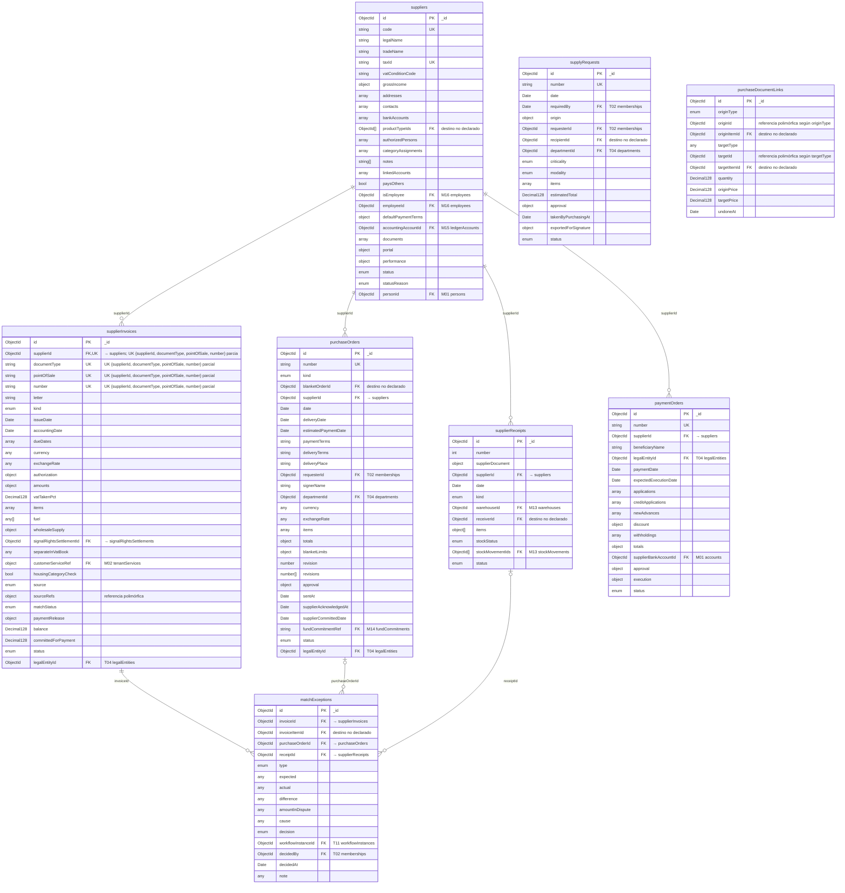

# Modelo entidad-relación — M12 CMP Compras y proveedores

| Campo | Valor |
|---|---|
| Artefacto | 6.1 Modelo entidad-relación completo, vista por módulo (índice: [`03-modelo-entidad-relacion.md`](../03-modelo-entidad-relacion.md)) |
| Anexo dueño | [`M12-CMP-compras-proveedores.md`](../../especificacion/anexos/M12-CMP-compras-proveedores.md), §7 |
| Catálogo canónico | [`T05-DAT-modelo-datos.md`](../../especificacion/anexos/T05-DAT-modelo-datos.md), filas `COL-CMP-NN` |
| Vista por dominio | [`03d-er-erp-administrativo.md` §15](../03d-er-erp-administrativo.md) |
| Versión | 2.1 (05-11-2026) |
| Generado con | [`_trabajo/generar_er_completo.py`](../_trabajo/generar_er_completo.py), revisado a mano |

## 1. Resumen

T05 registra 23 filas con dueño M12: **23 colecciones a crear** y 0 absorbidas en otras colecciones. Las 23 colecciones a crear se dibujan en 2 diagramas, uno por subdominio.

Convenciones: las del índice (secciones 1.3 y 2). Cada entidad lleva `id PK "_id"` y los campos de su ficha del §7; se omiten los campos transversales (`tenantId`, auditoría, `version`, baja lógica, `legacy`). El comentario de una `FK` indica el destino: `→ colección` si es del mismo módulo, `MXX colección` si es de otro; "(inferido)" cuando ni el anexo ni T05 §7.2 y §7.2.1 nombran el destino para esa colección y el nombre del campo no coincide literalmente con el de la colección (se dedujo por rol, sufijo, versión o por el contexto de §7.2.1; a confirmar); "destino no declarado" cuando no se puede fijar. Una referencia polimórfica (`entityType` + `entityId`, `resourceType` + `resourceId`, `targetRef`, `subjectRef`…) no lleva `FK` ni relación: el comentario "referencia polimórfica según <discriminador>" la señala, porque el destino depende del discriminador. Los campos que T05 §7.2.1 declara "no es referencia" no llevan `FK`. Los nombres que el anexo o T05 citan solo en notas "antes …", "Reemplazado por" o "alias" no se toman como campos ni como destinos. `UK` marca los únicos mínimos de T05; "según T05" señala un campo que figura en el catálogo pero no en la ficha del anexo. El tipo `any` indica que el anexo no declara el tipo.

## 2. Colecciones del módulo

| COL-ID | Colección | Diagrama | Ola | Clasificación | Alcance | Volumen o TTL (T05 §7.8) | Ficha en el anexo |
|---|---|---|---|---|---|---|---|
| COL-CMP-01 | `suppliers` | 1 | O3 | ID/FI | T | — | §7.1 |
| COL-CMP-07 | `supplyRequests` | 1 | O8 | OP | T | — | §7.3 |
| COL-CMP-10 | `purchaseOrders` | 1 | O8 | FI | T | — | §7.5 |
| COL-CMP-11 | `supplierReceipts` | 1 | O8 | OP | T | — | §7.6 |
| COL-CMP-12 | `supplierInvoices` | 1 | O8 | FI | T | — | §7.7 |
| COL-CMP-13 | `purchaseDocumentLinks` | 1 | O8 | OP | T | — | §7.8 |
| COL-CMP-14 | `matchExceptions` | 1 | O8 | OP | T | — | §7.9 |
| COL-CMP-15 | `paymentOrders` | 1 | O8 | FI | T | — | §7.10 |
| COL-CMP-02 | `supplierCategories` | 2 | O8 | CF | T | — | §7.13.2 |
| COL-CMP-05 | `purchaseConcepts` | 2 | O8 | CF | T | — | §7.13.3 |
| COL-CMP-06 | `purchaseLookups` | 2 | O8 | CF | T | — | §7.13.4 |
| COL-CMP-03 | `supplierEvaluations` | 2 | O8 | OP | T | — | §7.13.5 |
| COL-CMP-04 | `supplierCorrespondence` | 2 | O8 | CT | T | — | §7.13.6 |
| COL-CMP-17 | `purchaseForecasts` | 2 | O8 | FI | T | — | §7.13.7 |
| COL-CMP-08 | `quoteRequests` | 2 | O8 | OP | T | — | §7.13.9 |
| COL-CMP-09 | `sourcingEvents` | 2 | O8 | OP | T | — | §7.13.10 |
| COL-CMP-16 | `supplierAdvances` | 2 | O8 | FI | T | — | §7.13.16 |
| COL-CMP-18 | `supplierPortalSubmissions` | 2 | O8 | FI | T | — | §7.13.17 |
| COL-CMP-19 | `aiInvoiceExtractions` | 2 | O11 | TE | T | — | §7.13.18 |
| COL-CMP-20 | `supplierLedgerEntries` | 2 | O8 | FI | T | — | §7.13.19 |
| COL-CMP-21 | `supplyBalances` | 2 | O8 | FI | T | — | §7.13.20 |
| COL-CMP-22 | `signalRightsContracts` | 2 | O10 | CF | T | — | §7.13.21 |
| COL-CMP-23 | `signalRightsSettlements` | 2 | O10 | FI | T | — | §7.13.22 |

## 3. Diagrama 1: Proveedores, solicitudes, cotizaciones, órdenes, comprobantes y pagos

8 colecciones (ver tabla de la sección 2). Ficha en el anexo: §7.1, §7.3, §7.5, §7.6, §7.7, §7.8, §7.9, §7.10.

**Índices principales del diagrama 1**

| Colección | Índices declarados en el anexo | Únicos mínimos (T05) |
|---|---|---|
| `suppliers` | `{tenantId, taxId}` único; `{tenantId, code}` único; `{tenantId, legalName}` (texto); `{tenantId, "categoryAssignments.categoryId"}`; `{tenantId, "bankAccounts.cbu"}`. Origen: `PROVEED` (67 columnas: `COD_EMP`, … | `taxId`; `code` |
| `supplyRequests` | `{tenantId, number}` único; `{tenantId, status, date}`; `{tenantId, "items.productId", status}`; `{tenantId, requesterId}`. Origen `SAPROV` (`FECHA`, `HORA`, `COD_COM`, `SUC_COM`, `NUM_COM`, `OBSE`, `AUTORIZADO`, … | `number` |
| `purchaseOrders` | `{tenantId, number}` único; `{tenantId, supplierId, status}`; `{tenantId, status, deliveryDate}`; `{tenantId, "items.allocation.serviceCode"}`. Origen `OCOMPRA` (`FECHA`, `HORA`, `COD_COM`, `SUC_COM`, `NUM_COM`, … | `number` |
| `supplierReceipts` | `{tenantId, supplierId, date}`; `{tenantId, status}`; `{tenantId, "items.purchaseOrderItemRef"}`. Origen `COMP_COM` (`COD_EMP`, `FECHA`, `HORA`, `FEC_CON`, `COD_COM`, `SUC_COM`, `NUM_COM`, `COD_PROV`, `IMP_GRA`, … | — |
| `supplierInvoices` | `{tenantId, supplierId, documentType, pointOfSale, number}` único parcial (`status != voided`); `{tenantId, status, "paymentRelease.status"}`; `{tenantId, accountingDate}`; `{tenantId, supplierId, balance}`. Origen … | `{supplierId, documentType, pointOfSale, number}` p. (`status ≠ voided`) |
| `purchaseDocumentLinks` | `{tenantId, originType, originId}`; `{tenantId, targetType, targetId}`. Origen `COMPRAS_RELACION` (`TIPO_ORI` 1–5, `ID_ORI`, `TIPO_DES`, `ID_DES`, `CANTIDAD`). | — |
| `matchExceptions` | `{tenantId, invoiceId}`; `{tenantId, decision}`. | — |
| `paymentOrders` | `{tenantId, number}` único; `{tenantId, supplierId, paymentDate}`; `{tenantId, status}`; `{tenantId, "applications.invoiceId"}`. Origen `PPAGOS` (cabecera: `FEC_PAG`, `COD_PROV`, `COD_COM`, `SUC_COM`, `NUM_COM`, … | `number` |

## 4. Diagrama 2: Tablas de campos normalizadas y referencias declaradas

15 colecciones (ver tabla de la sección 2). Ficha en el anexo: §7.13.2, §7.13.3, §7.13.4, §7.13.5, §7.13.6, §7.13.7, §7.13.9, §7.13.10 ….

```mermaid
erDiagram
  supplierCategories {
    ObjectId id PK "_id"
    string code UK "UK {kind, code}"
    string name
    string shortName
    string bankCode
    bool allowsDeferredPayment
    enum kind UK "UK {kind, code}"
  }
  purchaseConcepts {
    ObjectId id PK "_id"
    string code UK
    string name
    string printName
    any unit
    ObjectId accountingCategoryId FK "M02 serviceCategories"
    string vatRateCode
    any nonTaxed
    enum type
    any vatType
    string grossIncomeCode
    bool active
    ObjectId vatRateId FK "M06 vatRates"
  }
  purchaseLookups {
    ObjectId id PK "_id"
    enum kind UK "UK {kind, code}"
    string code UK "UK {kind, code}"
    string name
    string notes
    array thresholds
  }
  supplierEvaluations {
    ObjectId id PK "_id"
    ObjectId supplierId FK "→ suppliers"
    ObjectId userId FK "T02 memberships"
    Date date
    any quality
    any score
    any note
    any sourceDocument
  }
  supplierCorrespondence {
    ObjectId id PK "_id"
    ObjectId[] supplierIds FK "→ suppliers"
    enum kind
    ObjectId templateId FK "T09 messageTemplates"
    string subject
    any body
    Date sentAt
    array deliveries
    ObjectId communicationId FK "T09 communications"
  }
  purchaseForecasts {
    ObjectId id PK "_id"
    ObjectId supplierId FK "→ suppliers"
    ObjectId conceptId FK "M02 billableConcepts"
    ObjectId productId FK "M13 inventoryItems"
    Date from
    Date to
    enum periodicity
    Decimal128 amount
    any currency
    string serviceCode
    ObjectId costCenterId FK "M15 costCenters"
  }
  quoteRequests {
    ObjectId id PK "_id"
    int number UK
    ObjectId groupId FK "destino no declarado"
    ObjectId sourcingEventId FK "→ sourcingEvents"
    ObjectId supplierId FK "→ suppliers"
    Date date
    Date dueDate
    any currency
    Decimal128 exchangeRate
    Date sentAt
    any sentChannel
    enum status
    string rejectReason
    array items
    ObjectId[] supplierIds FK "→ suppliers"
  }
  sourcingEvents {
    ObjectId id PK "_id"
    int number UK
    any modality
    string title
    ObjectId[] specStoredFileIds FK "T01 storedFiles"
    ObjectId[] invitedSupplierIds FK "→ suppliers"
    ObjectId invitationTemplateId FK "T11 documentTemplates"
    Date offersDueAt
    Date openedAt
    object openingAct
    object awardSheet
    ObjectId dossierCoverStoredFileId FK "T01 storedFiles"
    enum status
    ObjectId quoteRequestId FK "→ quoteRequests"
  }
  supplierAdvances {
    ObjectId id PK "_id"
    ObjectId supplierId FK "→ suppliers"
    ObjectId paymentOrderId FK "→ paymentOrders"
    ObjectId conceptId FK "M02 billableConcepts"
    Decimal128 amount
    Decimal128 appliedAmount
    array installments
    enum status
  }
  supplierPortalSubmissions {
    ObjectId id PK "_id"
    string taxId UK "UK {taxId, documentType, pointOfSale, number}"
    string legalName
    ObjectId supplierId FK "→ suppliers"
    any documentType UK "UK {taxId, documentType, pointOfSale, number}"
    any pointOfSale UK "UK {taxId, documentType, pointOfSale, number}"
    int number UK "UK {taxId, documentType, pointOfSale, number}"
    Date issueDate
    Date dueDate
    Decimal128 amount
    ObjectId storedFileId FK "T01 storedFiles"
    ObjectId submittedBy FK "T02 memberships"
    Date submittedAt
    object review
  }
  aiInvoiceExtractions {
    ObjectId id PK "_id"
    ObjectId storedFileId FK "T01 storedFiles"
    any model
    ObjectId requestedBy FK "T02 memberships"
    Date requestedAt
    object fields
    ObjectId proposedSupplierId FK "→ suppliers"
    array proposedItems
    array tokens
    enum outcome
    ObjectId invoiceId FK "→ supplierInvoices"
    array corrections
    ObjectId aiUsageLogId FK "T06 aiUsageLogs"
  }
  supplierLedgerEntries {
    ObjectId id PK "_id"
    ObjectId supplierId FK "→ suppliers"
    Date date
    any documentType
    ObjectId documentId FK "T11 documents"
    any debit
    any credit
    any balanceAfter
    Date dueDate
  }
  supplyBalances {
    ObjectId id PK "_id"
    enum kind UK "UK {kind, serviceId, zoneId, period}"
    ObjectId serviceId FK, UK "M02 tenantServices; UK {kind, serviceId, zoneId, period}"
    ObjectId zoneId FK, UK "T04 zones; UK {kind, serviceId, zoneId, period}"
    any period UK "UK {kind, serviceId, zoneId, period}"
    Decimal128 purchasedQty
    Decimal128 boundaryMeasuredQty
    Decimal128 billedToUsersQty
    Decimal128 lossQty
    Decimal128 lossPct
    ObjectId[] invoiceIds FK "→ supplierInvoices (inferido)"
    enum status
    ObjectId approvedBy FK "T02 memberships"
    Date approvedAt
  }
  signalRightsContracts {
    ObjectId id PK "_id"
    ObjectId supplierId FK "→ suppliers"
    array signals
    ObjectId[] packageIds FK "M02 serviceProducts"
    any pricePerSubscriber
    any currency
    any minimumGuaranteed
    enum countBasis
    Date validFrom
    Date validTo
    enum status
  }
  signalRightsSettlements {
    ObjectId id PK "_id"
    ObjectId contractId FK, UK "M02 serviceContracts; UK {contractId, period, adjustsSettlementId}"
    ObjectId supplierId FK "→ suppliers"
    any period UK "UK {contractId, period, adjustsSettlementId}"
    Date cutoffDate
    array lines
    any minimumApplied
    Decimal128 total
    ObjectId adjustsSettlementId FK, UK "destino no declarado; UK {contractId, period, adjustsSettlementId}"
    string reportRef
    ObjectId declarationStoredFileId FK "T01 storedFiles"
    ObjectId invoiceId FK "→ supplierInvoices"
    enum status
    ObjectId approvedBy FK "T02 memberships"
    Date approvedAt
  }
  sourcingEvents |o--o{ quoteRequests : "sourcingEventId"
  quoteRequests ||--o{ sourcingEvents : "quoteRequestId"
```

**Índices principales del diagrama 2**

| Colección | Índices declarados en el anexo | Únicos mínimos (T05) |
|---|---|---|
| `supplierCategories` | — | `{kind, code}` |
| `purchaseConcepts` | — | `code` |
| `purchaseLookups` | — | `{kind, code}` |
| `supplierEvaluations` | — | — |
| `supplierCorrespondence` | — | — |
| `purchaseForecasts` | — | — |
| `quoteRequests` | — | `number` |
| `sourcingEvents` | — | `number` |
| `supplierAdvances` | — | — |
| `supplierPortalSubmissions` | único `{tenantId, taxId, documentType, pointOfSale, number \| — \| | `{taxId, documentType, pointOfSale, number}` |
| `aiInvoiceExtractions` | — | — |
| `supplierLedgerEntries` | — | — |
| `supplyBalances` | único `{tenantId, kind, serviceId, zoneId, period \| — \| | `{kind, serviceId, zoneId, period}` |
| `signalRightsContracts` | — | — |
| `signalRightsSettlements` | único `{tenantId, contractId, period, adjustsSettlementId \| — \| | `{contractId, period, adjustsSettlementId}` |

## 5. Relaciones con otros módulos y entre diagramas

Referencias que salen de una colección de este módulo hacia una entidad de otro módulo o de otro diagrama del mismo módulo (no se dibujan para mantener cada diagrama dentro de su módulo y subdominio).

| Colección origen | Campo | Cardinalidad (destino a origen) | Destino | COL-ID destino | Módulo destino |
|---|---|---|---|---|---|
| `suppliers` | `isEmployee`, `employeeId` | 0..1 a N | `employees` | COL-SUE-02 | M16 |
| `suppliers` | `accountingAccountId` | 1 a N | `ledgerAccounts` | COL-CON-04 | M15 |
| `suppliers` | `personId` | 1 a N | `persons` | COL-PER-01 | M01 |
| `supplierEvaluations` | `supplierId` | 1 a N | `suppliers` | COL-CMP-01 | mismo módulo, diagrama 1 |
| `supplierEvaluations` | `userId` | 1 a N | `memberships` | COL-IAM-04 | T02 |
| `supplierCorrespondence` | `supplierIds` | N a N | `suppliers` | COL-CMP-01 | mismo módulo, diagrama 1 |
| `supplierCorrespondence` | `templateId` | 1 a N | `messageTemplates` | COL-COM-36 | T09 |
| `supplierCorrespondence` | `communicationId` | 1 a N | `communications` | COL-COM-39 | T09 |
| `purchaseConcepts` | `accountingCategoryId` | 1 a N | `serviceCategories` | COL-CAT-10 | M02 |
| `purchaseConcepts` | `vatRateId` | 1 a N | `vatRates` | COL-FIS-16 | M06 |
| `supplyRequests` | `requiredBy`, `requesterId` | 1 a N | `memberships` | COL-IAM-04 | T02 |
| `supplyRequests` | `departmentId` | 1 a N | `departments` | COL-CFG-09 | T04 |
| `quoteRequests` | `supplierId` | 1 a N | `suppliers` | COL-CMP-01 | mismo módulo, diagrama 1 |
| `quoteRequests` | `supplierIds` | N a N | `suppliers` | COL-CMP-01 | mismo módulo, diagrama 1 |
| `sourcingEvents` | `specStoredFileIds` | N a N | `storedFiles` | COL-PLA-29 | T01 |
| `sourcingEvents` | `invitedSupplierIds` | N a N | `suppliers` | COL-CMP-01 | mismo módulo, diagrama 1 |
| `sourcingEvents` | `invitationTemplateId` | 1 a N | `documentTemplates` | COL-WFL-41 | T11 |
| `sourcingEvents` | `dossierCoverStoredFileId` | 1 a N | `storedFiles` | COL-PLA-29 | T01 |
| `purchaseOrders` | `requesterId` | 0..1 a N | `memberships` | COL-IAM-04 | T02 |
| `purchaseOrders` | `departmentId` | 0..1 a N | `departments` | COL-CFG-09 | T04 |
| `purchaseOrders` | `fundCommitmentRef` | 0..1 a N | `fundCommitments` | COL-TES-39 | M14 |
| `purchaseOrders` | `legalEntityId` | 1 a N | `legalEntities` | COL-CFG-41 | T04 |
| `supplierReceipts` | `warehouseId` | 0..1 a N | `warehouses` | COL-STK-07 | M13 |
| `supplierReceipts` | `stockMovementIds` | N a N | `stockMovements` | COL-STK-11 | M13 |
| `supplierInvoices` | `signalRightsSettlementId` | 0..1 a N | `signalRightsSettlements` | COL-CMP-23 | mismo módulo, diagrama 2 |
| `supplierInvoices` | `customerServiceRef` | 0..1 a N | `tenantServices` | COL-CAT-02 | M02 |
| `supplierInvoices` | `legalEntityId` | 1 a N | `legalEntities` | COL-CFG-41 | T04 |
| `matchExceptions` | `workflowInstanceId` | 1 a N | `workflowInstances` | COL-WFL-14 | T11 |
| `matchExceptions` | `decidedBy` | 1 a N | `memberships` | COL-IAM-04 | T02 |
| `paymentOrders` | `legalEntityId` | 1 a N | `legalEntities` | COL-CFG-41 | T04 |
| `paymentOrders` | `supplierBankAccountId` | 0..1 a N | `accounts` | COL-PER-05 | M01 |
| `supplierAdvances` | `supplierId` | 1 a N | `suppliers` | COL-CMP-01 | mismo módulo, diagrama 1 |
| `supplierAdvances` | `paymentOrderId` | 1 a N | `paymentOrders` | COL-CMP-15 | mismo módulo, diagrama 1 |
| `supplierAdvances` | `conceptId` | 1 a N | `billableConcepts` | COL-CAT-06 | M02 |
| `purchaseForecasts` | `supplierId` | 1 a N | `suppliers` | COL-CMP-01 | mismo módulo, diagrama 1 |
| `purchaseForecasts` | `conceptId` | 0..1 a N | `billableConcepts` | COL-CAT-06 | M02 |
| `purchaseForecasts` | `productId` | 0..1 a N | `inventoryItems` | COL-STK-05 | M13 |
| `purchaseForecasts` | `costCenterId` | 0..1 a N | `costCenters` | COL-CON-16 | M15 |
| `supplierPortalSubmissions` | `supplierId` | 0..1 a N | `suppliers` | COL-CMP-01 | mismo módulo, diagrama 1 |
| `supplierPortalSubmissions` | `storedFileId` | 1 a N | `storedFiles` | COL-PLA-29 | T01 |
| `supplierPortalSubmissions` | `submittedBy` | 1 a N | `memberships` | COL-IAM-04 | T02 |
| `aiInvoiceExtractions` | `storedFileId` | 1 a N | `storedFiles` | COL-PLA-29 | T01 |
| `aiInvoiceExtractions` | `requestedBy` | 1 a N | `memberships` | COL-IAM-04 | T02 |
| `aiInvoiceExtractions` | `proposedSupplierId` | 1 a N | `suppliers` | COL-CMP-01 | mismo módulo, diagrama 1 |
| `aiInvoiceExtractions` | `invoiceId` | 0..1 a N | `supplierInvoices` | COL-CMP-12 | mismo módulo, diagrama 1 |
| `aiInvoiceExtractions` | `aiUsageLogId` | 1 a N | `aiUsageLogs` | COL-INT-18 | T06 |
| `supplierLedgerEntries` | `supplierId` | 1 a N | `suppliers` | COL-CMP-01 | mismo módulo, diagrama 1 |
| `supplierLedgerEntries` | `documentId` | 1 a N | `documents` | COL-WFL-34 | T11 |
| `supplyBalances` | `serviceId` | 1 a N | `tenantServices` | COL-CAT-02 | M02 |
| `supplyBalances` | `zoneId` | 0..1 a N | `zones` | COL-CFG-16 | T04 |
| `supplyBalances` | `invoiceIds` | N a N | `supplierInvoices` | COL-CMP-12 | mismo módulo, diagrama 1 |
| `supplyBalances` | `approvedBy` | 1 a N | `memberships` | COL-IAM-04 | T02 |
| `signalRightsContracts` | `supplierId` | 1 a N | `suppliers` | COL-CMP-01 | mismo módulo, diagrama 1 |
| `signalRightsContracts` | `packageIds` | N a N | `serviceProducts` | COL-CAT-05 | M02 |
| `signalRightsSettlements` | `contractId` | 1 a N | `serviceContracts` | COL-CAT-18 | M02 |
| `signalRightsSettlements` | `supplierId` | 1 a N | `suppliers` | COL-CMP-01 | mismo módulo, diagrama 1 |
| `signalRightsSettlements` | `declarationStoredFileId` | 1 a N | `storedFiles` | COL-PLA-29 | T01 |
| `signalRightsSettlements` | `invoiceId` | 0..1 a N | `supplierInvoices` | COL-CMP-12 | mismo módulo, diagrama 1 |
| `signalRightsSettlements` | `approvedBy` | 1 a N | `memberships` | COL-IAM-04 | T02 |

## 6. Colecciones absorbidas y renombradas

Ninguna colección del módulo quedó absorbida.

## 7. Observaciones e inconsistencias detectadas

- Referencias sin colección destino declarada (ni en el anexo ni en T05 §7.2 y §7.2.1; quedan como `FK` "destino no declarado"): `suppliers.productTypeIds`, `supplyRequests.recipientId`, `quoteRequests.groupId`, `purchaseOrders.blanketOrderId`, `supplierReceipts.receiverId`, `purchaseDocumentLinks.originItemId`, `purchaseDocumentLinks.targetItemId`, `matchExceptions.invoiceItemId`, `signalRightsSettlements.adjustsSettlementId`.
