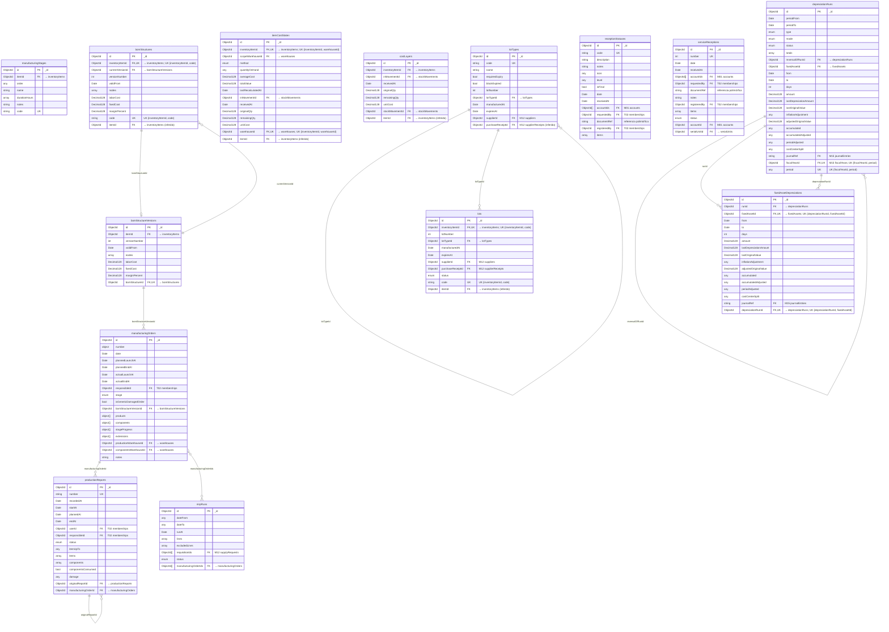

# Modelo entidad-relación — M13 STK Stock, bienes de uso y fabricación

| Campo | Valor |
|---|---|
| Artefacto | 6.1 Modelo entidad-relación completo, vista por módulo (índice: [`03-modelo-entidad-relacion.md`](../03-modelo-entidad-relacion.md)) |
| Anexo dueño | [`M13-STK-stock-activos-fabricacion.md`](../../especificacion/anexos/M13-STK-stock-activos-fabricacion.md), §7 |
| Catálogo canónico | [`T05-DAT-modelo-datos.md`](../../especificacion/anexos/T05-DAT-modelo-datos.md), filas `COL-STK-NN` |
| Vista por dominio | [`03d-er-erp-administrativo.md` §16](../03d-er-erp-administrativo.md) |
| Versión | 2.1 (05-11-2026) |
| Generado con | [`_trabajo/generar_er_completo.py`](../_trabajo/generar_er_completo.py), revisado a mano |

## 1. Resumen

T05 registra 40 filas con dueño M13: **39 colecciones a crear** y 1 absorbida en otras colecciones. Las 39 colecciones a crear se dibujan en 2 diagramas, uno por subdominio.

Convenciones: las del índice (secciones 1.3 y 2). Cada entidad lleva `id PK "_id"` y los campos de su ficha del §7; se omiten los campos transversales (`tenantId`, auditoría, `version`, baja lógica, `legacy`). El comentario de una `FK` indica el destino: `→ colección` si es del mismo módulo, `MXX colección` si es de otro; "(inferido)" cuando ni el anexo ni T05 §7.2 y §7.2.1 nombran el destino para esa colección y el nombre del campo no coincide literalmente con el de la colección (se dedujo por rol, sufijo, versión o por el contexto de §7.2.1; a confirmar); "destino no declarado" cuando no se puede fijar. Una referencia polimórfica (`entityType` + `entityId`, `resourceType` + `resourceId`, `targetRef`, `subjectRef`…) no lleva `FK` ni relación: el comentario "referencia polimórfica según <discriminador>" la señala, porque el destino depende del discriminador. Los campos que T05 §7.2.1 declara "no es referencia" no llevan `FK`. Los nombres que el anexo o T05 citan solo en notas "antes …", "Reemplazado por" o "alias" no se toman como campos ni como destinos. `UK` marca los únicos mínimos de T05; "según T05" señala un campo que figura en el catálogo pero no en la ficha del anexo. El tipo `any` indica que el anexo no declara el tipo.

## 2. Colecciones del módulo

| COL-ID | Colección | Diagrama | Ola | Clasificación | Alcance | Volumen o TTL (T05 §7.8) | Ficha en el anexo |
|---|---|---|---|---|---|---|---|
| COL-STK-01 | `itemTypes` | 1 | O3 | CF | T | — | §7.1 |
| COL-STK-02 | `itemClassifications` | 1 | O3 | CF | T | — | §7.2 |
| COL-STK-03 | `itemGroups` | 1 | O3 | CF | T | — | §7.3 |
| COL-STK-04 | `itemDepartments` | 1 | O3 | CF | T | — | §7.4 |
| COL-STK-05 | `inventoryItems` | 1 | O3 | CF | T | — | §7.5 |
| COL-STK-06 | `itemKits` | 1 | O3 | CF | T | — | §7.6 |
| COL-STK-07 | `warehouses` | 1 | O3 | CF | T | — | §7.7 |
| COL-STK-08 | `warehouseLocations` | 1 | O3 | CF | T | — | §7.8 |
| COL-STK-09 | `itemLocationDefaults` | 1 | O3 | CF | T | — | §7.9 |
| COL-STK-10 | `stockDocuments` | 1 | O3 | OP | T | — | §7.10 |
| COL-STK-11 | `stockMovements` | 1 | O3 | OP | T | 0,1 M / 0,5 M por año | §7.11 |
| COL-STK-12 | `stockBalances` | 1 | O3 | OP | T | — | §7.12 |
| COL-STK-13 | `serialUnits` | 1 | O3 | OP | T | — | §7.13 |
| COL-STK-14 | `serialUnitEvents` | 1 | O3 | OP | T | — | §7.14 |
| COL-STK-17 | `stockReservations` | 1 | O3 | OP | T | — | §7.16 |
| COL-STK-19 | `crewSettlements` | 1 | O3 | OP | T | — | §7.18 |
| COL-STK-20 | `physicalCounts` | 1 | O8 | OP | T | — | §7.19 |
| COL-STK-23 | `revaluations` | 1 | O8 | FI | T | — | §7.21 |
| COL-STK-24 | `reorderSuggestions` | 1 | O8 | OP | T | — | §7.22 |
| COL-STK-25 | `expenseUnits` | 1 | O8 | CF | T | — | §7.23 |
| COL-STK-26 | `fixedAssets` | 1 | O8 | FI | T | — | §7.24 |
| COL-STK-27 | `fixedAssetHistory` | 1 | O8 | OP | T | — | §7.25 |
| COL-STK-28 | `fixedAssetValueChanges` | 1 | O8 | FI | T | — | §7.26 |
| COL-STK-31 | `rmaCases` | 1 | O8 | OP | T | — | §7.28 |
| COL-STK-36 | `productDivisions` | 1 | O10 | CF | T | — | §7.31 |
| COL-STK-37 | `manufacturingStages` | 2 | O10 | CF | T | — | §7.32 |
| COL-STK-38 | `manufacturingOrders` | 2 | O10 | OP | T | — | §7.33 |
| COL-STK-39 | `productionReports` | 2 | O10 | OP | T | — | §7.34 |
| COL-STK-40 | `mrpRuns` | 2 | O10 | OP | T | — | §7.35 |
| COL-STK-15 | `lotTypes` | 2 | O3 | CF | T | — | §7.37.14 |
| COL-STK-16 | `lots` | 2 | O3 | OP | T | — | §7.37.15 |
| COL-STK-21 | `itemCostStates` | 2 | O8 | FI | T | — | §7.37.19 |
| COL-STK-22 | `costLayers` | 2 | O8 | FI | T | — | §7.37.20 |
| COL-STK-29 | `depreciationRuns` | 2 | O8 | FI | T | — | §7.37.27 |
| COL-STK-30 | `fixedAssetDepreciations` | 2 | O8 | FI | T | — | §7.37.28 |
| COL-STK-32 | `receptionStatuses` | 2 | O10 | CF | T | — | §7.37.30 |
| COL-STK-33 | `serviceReceptions` | 2 | O10 | OP | T | — | §7.37.31 |
| COL-STK-34 | `bomStructures` | 2 | O10 | CF | T | — | §7.37.32 |
| COL-STK-35 | `bomStructureVersions` | 2 | O10 | CF | T | — | §7.37.33 |

## 3. Diagrama 1: Artículos, depósitos, documentos y movimientos de stock, series, costeo y bienes de uso

25 colecciones (ver tabla de la sección 2). Ficha en el anexo: §7.1, §7.2, §7.3, §7.4, §7.5, §7.6, §7.7, §7.8 ….

```mermaid
erDiagram
  itemTypes {
    ObjectId id PK "_id"
    string code UK
    string name
    enum kind
    object defaultFlags
  }
  itemClassifications {
    ObjectId id PK "_id"
    string code UK
    string name
    ObjectId parentId FK "→ itemClassifications (inferido)"
    ObjectId[] path FK "→ itemClassifications"
    Decimal128 laborCoefficient
  }
  itemGroups {
    ObjectId id PK "_id"
    string code UK
    string name
    ObjectId parentId FK "→ itemGroups (inferido)"
    ObjectId level FK "destino no declarado"
    ObjectId path FK "→ itemGroups"
    string accountingProfileKey
    bool isIndirect
    Decimal128 defaultUsefulLifeYears
    bool inflationAdjustable
    string revaluationIndexKey
    string classKey
  }
  itemDepartments {
    ObjectId id PK "_id"
    string code UK
    string name
  }
  inventoryItems {
    ObjectId id PK "_id"
    string code UK
    string name
    string shortName
    string[] barcodes
    ObjectId itemTypeId FK "→ itemTypes"
    ObjectId classificationId FK "→ itemClassifications"
    ObjectId itemGroupId FK "→ itemGroups"
    ObjectId departmentId FK "→ itemDepartments"
    string brand
    string model
    string manufacturer
    string registrationNumber UK "UK parcial"
    string uom
    object[] alternateUoms
    Decimal128 packSize
    object flags
    enum[] moduleAvailability
    ObjectId catalogProductId FK "M02 serviceProducts"
    ObjectId[] serviceIds FK "M02 tenantServices"
    ObjectId[] defaultServiceId FK "M02 tenantServices"
    enum defaultDeliveryMode
    enum[] secondaryIdTypes
    object[] compatibility
    object[] extendedProperties
    object costing
    object[] reorder
    int warrantyMonthsSupplier
    int warrantyMonthsSale
    object inspectionPolicy
    array attachments
  }
  itemKits {
    ObjectId id PK "_id"
    ObjectId kitItemId FK, UK "→ inventoryItems; UK {kitItemId, componentItemId}"
    array components
    ObjectId inventoryItemId FK "→ inventoryItems"
    ObjectId componentItemId FK, UK "→ inventoryItems; UK {kitItemId, componentItemId}"
  }
  warehouses {
    ObjectId id PK "_id"
    string code UK
    string name
    enum type
    ObjectId branchId FK "T04 branches"
    object address
    object geo
    ObjectId crewId FK "M10 crews"
    ObjectId employeeId FK "M16 employees"
    ObjectId vehicleId FK "M18 fleetVehicles"
    ObjectId supplierId FK "M12 suppliers"
    ObjectId custodianUserId FK "T02 memberships"
    ObjectId[] serviceIds FK "M02 tenantServices"
    bool ownStock
    bool allowsNegative
    bool usesLocations
  }
  warehouseLocations {
    ObjectId id PK "_id"
    ObjectId warehouseId FK, UK "→ warehouses; UK {warehouseId, code}"
    string code UK "UK {warehouseId, code}"
    string name
    ObjectId parentId FK "→ warehouseLocations (inferido)"
    any path
    bool assignable
    bool isDefault
    any icon
  }
  itemLocationDefaults {
    ObjectId id PK "_id"
    ObjectId itemId FK "→ inventoryItems (inferido)"
    ObjectId locationId FK "→ warehouseLocations (inferido)"
    Decimal128 capacity
    ObjectId inventoryItemId FK, UK "→ inventoryItems; UK {inventoryItemId, warehouseId}"
    ObjectId warehouseLocationId FK "→ warehouseLocations"
    ObjectId warehouseId FK, UK "→ warehouses; UK {inventoryItemId, warehouseId}"
  }
  stockDocuments {
    ObjectId id PK "_id"
    enum docType UK "UK {docType, number.display}"
    object number
    Date effectiveDate
    Date recordedAt
    enum status
    ObjectId sourceWarehouseId FK "→ warehouses"
    ObjectId targetWarehouseId FK "→ warehouses"
    object destination
    object[] serviceAllocation
    object[] lines
    object[] pendingQuantities
    object origin
    string clientMutationId UK "UK parcial"
    string idempotencyKey
    object receivedBy
    enum reason
    object approval
    any evidence
    object cancellation
    object conflict
  }
  stockMovements {
    ObjectId id PK "_id"
    ObjectId stockDocumentId FK "→ stockDocuments"
    ObjectId lineId
    enum operation
    enum kind
    enum direction
    Date effectiveDate
    Date recordedAt
    ObjectId inventoryItemId FK "→ inventoryItems"
    ObjectId warehouseId FK "→ warehouses"
    ObjectId locationId FK "→ warehouseLocations"
    ObjectId lotId FK "→ lots"
    ObjectId serialUnitId FK "→ serialUnits"
    ObjectId contractId FK "M02 serviceContracts"
    enum stockState
    Decimal128 quantity
    Decimal128 unitCost
    Decimal128 amount
    bool costProvisional
    ObjectId destination FK "destino no declarado"
    ObjectId serviceId FK "M02 tenantServices"
    ObjectId costCenterId FK "M15 costCenters"
    ObjectId projectId FK "M10 works"
    ObjectId expenseUnitId FK "→ expenseUnits"
    ObjectId supplierId FK "M12 suppliers"
    ObjectId accountId FK "M01 accounts"
    ObjectId reversalOf FK "→ stockMovements (inferido)"
    string periodKey
  }
  stockBalances {
    ObjectId id PK "_id"
    ObjectId inventoryItemId FK, UK "→ inventoryItems; UK {inventoryItemId, warehouseId, locationId, lotId}"
    ObjectId warehouseId FK, UK "→ warehouses; UK {inventoryItemId, warehouseId, locationId, lotId}"
    ObjectId locationId FK, UK "→ warehouseLocations; UK {inventoryItemId, warehouseId, locationId, lo"
    ObjectId lotId FK, UK "→ lots; UK {inventoryItemId, warehouseId, locationId, lotId}"
    ObjectId contractId FK "M02 serviceContracts"
    any stockState
    any quantity
    any reservedQuantity
    Decimal128 value
    Date lastMovementAt
  }
  serialUnits {
    ObjectId id PK "_id"
    ObjectId inventoryItemId FK, UK "→ inventoryItems; UK {inventoryItemId, serialNumber}"
    string serialNumber UK "UK {inventoryItemId, serialNumber}"
    object[] secondaryIds FK "destino no declarado"
    enum status
    enum ownership
    ObjectId currentWarehouseId FK "→ warehouses"
    ObjectId currentLocationId FK "→ warehouseLocations"
    ObjectId currentContractId FK "M02 serviceContracts"
    object currentCustodian
    ObjectId lotId FK "→ lots"
    Decimal128 unitCost
    Date receivedAt
    ObjectId supplierId FK "M12 suppliers"
    ObjectId purchaseReceiptId FK "M12 supplierReceipts (inferido)"
    object warranty
    object extendedProperties
    object[] accessories
    object[] seals
    object[] inspections
    enum condition
    ObjectId replacesSerialUnitId FK "→ serialUnits"
    ObjectId replacedBySerialUnitId FK "→ serialUnits"
    ObjectId fixedAssetId FK "→ fixedAssets"
    string notes
  }
  serialUnitEvents {
    ObjectId id PK "_id"
    ObjectId serialUnitId FK "→ serialUnits"
    any eventType
    Date effectiveDate
    Date recordedAt
    enum fromStatus
    enum toStatus
    any fromCustodian
    any toCustodian
    ObjectId documentId FK "T11 documents"
    ObjectId movementId FK "→ stockMovements"
    ObjectId workOrderId FK "M10 workOrders"
    ObjectId contractId FK "M02 serviceContracts"
    ObjectId rmaCaseId FK "→ rmaCases"
    ObjectId actorId FK "T02 memberships"
    array attachments
    string notes
  }
  stockReservations {
    ObjectId id PK "_id"
    ObjectId itemId FK "→ inventoryItems (inferido)"
    ObjectId serialUnitId FK "→ serialUnits"
    any quantity
    ObjectId warehouseId FK "→ warehouses"
    object target
    enum mode
    enum status
    Date expiresAt
    Decimal128 consumedQuantity
    Decimal128 releasedQuantity
    string releaseReason
    string idempotencyKey
    ObjectId inventoryItemId FK "→ inventoryItems"
    string sourceRef "referencia polimórfica"
  }
  crewSettlements {
    ObjectId id PK "_id"
    ObjectId warehouseId FK "→ warehouses"
    Date periodFrom
    any periodTo
    Date snapshotAt
    array lines
    enum status
    ObjectId supervisorId FK "T02 memberships"
    any evidence
    Date closedAt
    ObjectId crewId FK "M10 crews"
    string number UK
  }
  physicalCounts {
    ObjectId id PK "_id"
    object scope
    enum type
    bool blind
    Date snapshotAt
    enum mode
    array lines
    enum status
    ObjectId adjustmentDocumentId FK "T11 documents"
    ObjectId warehouseId FK "→ warehouses"
    string number UK
  }
  revaluations {
    ObjectId id PK "_id"
    enum mode
    any dateFrom
    any dateTo
    string indexKey
    array lines
    ObjectId projectId FK "M10 works"
    ObjectId responsibleId FK "T02 memberships"
    enum status
    ObjectId documentId FK "T11 documents"
    ObjectId[] inventoryItemIds FK "→ inventoryItems"
    string number UK
  }
  reorderSuggestions {
    ObjectId id PK "_id"
    ObjectId itemId FK "→ inventoryItems (inferido)"
    ObjectId warehouseId FK "→ warehouses"
    ObjectId serviceId FK "M02 tenantServices"
    Date computedAt
    any available
    any inTransit
    array pendingPurchaseOrders
    any reserved
    any min
    any max
    Decimal128 suggestedQty
    ObjectId preferredSupplierId FK "M12 suppliers"
    array lastPurchases
    enum status
    ObjectId requisitionId FK "M12 supplyRequests"
    ObjectId inventoryItemId FK "→ inventoryItems"
    ObjectId supplyRequestId FK "M12 supplyRequests"
  }
  expenseUnits {
    ObjectId id PK "_id"
    string code UK
    string name
    ObjectId costCenterId FK "M15 costCenters"
    ObjectId serviceId FK "M02 tenantServices"
    string notes
  }
  fixedAssets {
    ObjectId id PK "_id"
    string assetNumber UK
    string description
    string notes
    ObjectId itemId FK "→ inventoryItems"
    ObjectId serialUnitId FK "→ serialUnits"
    any serialNumber
    ObjectId itemGroupId FK "→ itemGroups"
    Date registeredAt
    ObjectId registeredBy FK "T02 memberships"
    Date purchasedAt
    Date supplierInvoiceRef FK "M12 supplierInvoices"
    Date inServiceAt
    Date disposedAt
    Date disposal
    Decimal128 originalValue
    Decimal128 historicalOriginalValue
    Decimal128 usefulLifeYears
    Decimal128 depreciablePercent
    Decimal128 residualValue
    Decimal128 accumulatedDepreciation
    Decimal128 accumulatedDepreciationHistorical
    Decimal128 accumulatedDepreciationAdjusted
    ObjectId isImprovement FK "destino no declarado"
    ObjectId parentAssetId FK "→ fixedAssets"
    object[] costCenterAllocation
    ObjectId costCenterId FK "M15 costCenters"
    ObjectId branchId FK "T04 branches"
    any physicalLocation
    ObjectId responsibleEmployeeId FK "M16 employees"
    enum status
  }
  fixedAssetHistory {
    ObjectId id PK "_id"
    ObjectId fixedAssetId FK "→ fixedAssets"
    int versionNumber
    any snapshot
    array changedFields
    Date changedAt
    ObjectId changedBy FK "T02 memberships"
    string reason
  }
  fixedAssetValueChanges {
    ObjectId id PK "_id"
    ObjectId fixedAssetId FK "→ fixedAssets"
    enum type
    Date date
    Decimal128 amount
    string reason
    enum status
    ObjectId eventId
    ObjectId journalEntryId FK "M15 journalEntries"
  }
  rmaCases {
    ObjectId id PK "_id"
    string number UK
    Date openedAt
    ObjectId receivedBy FK "T02 memberships"
    ObjectId contractId FK "M02 serviceContracts"
    object contact
    ObjectId itemId FK "→ inventoryItems"
    any model
    ObjectId serialUnitId FK "→ serialUnits"
    any serialNumber
    ObjectId supplierId FK "M12 suppliers"
    any supplierRmaNumber
    string receptionNotes
    string reportedProblem
    string diagnosis
    object warranty
    enum type
    enum resolution
    ObjectId replacementSerialUnitId FK "→ serialUnits"
    Date shippedAt
    Date returnedAt
    object costs
    ObjectId statusId FK "→ receptionStatuses"
    object[] history
    ObjectId[] documentIds FK "T11 documents"
  }
  productDivisions {
    ObjectId id PK "_id"
    any operationType
    any operationRef FK "T11 operations"
    any quantity
    any measure
    any decompositionCoefficient
    any history
    ObjectId bomStructureId FK "→ bomStructures"
    string code UK
  }
  itemClassifications ||--o{ itemClassifications : "parentId"
  itemClassifications }o--o{ itemClassifications : "path"
  itemGroups ||--o{ itemGroups : "parentId"
  itemGroups ||--o{ itemGroups : "path"
  itemTypes |o--o{ inventoryItems : "itemTypeId"
  itemClassifications |o--o{ inventoryItems : "classificationId"
  itemGroups |o--o{ inventoryItems : "itemGroupId"
  itemDepartments |o--o{ inventoryItems : "departmentId"
  inventoryItems ||--o{ itemKits : "kitItemId"
  inventoryItems ||--o{ itemKits : "inventoryItemId"
  inventoryItems ||--o{ itemKits : "componentItemId"
  warehouses ||--o{ warehouseLocations : "warehouseId"
  warehouseLocations ||--o{ warehouseLocations : "parentId"
  inventoryItems ||--o{ itemLocationDefaults : "itemId"
  warehouseLocations ||--o{ itemLocationDefaults : "locationId"
  inventoryItems ||--o{ itemLocationDefaults : "inventoryItemId"
  warehouseLocations ||--o{ itemLocationDefaults : "warehouseLocationId"
  warehouses ||--o{ itemLocationDefaults : "warehouseId"
  warehouses ||--o{ stockDocuments : "sourceWarehouseId"
  warehouses ||--o{ stockDocuments : "targetWarehouseId"
  stockDocuments ||--o{ stockMovements : "stockDocumentId"
  inventoryItems ||--o{ stockMovements : "inventoryItemId"
  warehouses ||--o{ stockMovements : "warehouseId"
  warehouseLocations ||--o{ stockMovements : "locationId"
  serialUnits ||--o{ stockMovements : "serialUnitId"
  expenseUnits ||--o{ stockMovements : "expenseUnitId"
  stockMovements ||--o{ stockMovements : "reversalOf"
  inventoryItems ||--o{ stockBalances : "inventoryItemId"
  warehouses ||--o{ stockBalances : "warehouseId"
  warehouseLocations ||--o{ stockBalances : "locationId"
  inventoryItems ||--o{ serialUnits : "inventoryItemId"
  warehouses ||--o{ serialUnits : "currentWarehouseId"
  warehouseLocations ||--o{ serialUnits : "currentLocationId"
  serialUnits ||--o{ serialUnits : "replacesSerialUnitId"
  serialUnits ||--o{ serialUnits : "replacedBySerialUnitId"
  fixedAssets ||--o{ serialUnits : "fixedAssetId"
  serialUnits ||--o{ serialUnitEvents : "serialUnitId"
  stockMovements ||--o{ serialUnitEvents : "movementId"
  rmaCases ||--o{ serialUnitEvents : "rmaCaseId"
  inventoryItems ||--o{ stockReservations : "itemId"
  serialUnits ||--o{ stockReservations : "serialUnitId"
  warehouses ||--o{ stockReservations : "warehouseId"
  inventoryItems ||--o{ stockReservations : "inventoryItemId"
  warehouses ||--o{ crewSettlements : "warehouseId"
  warehouses ||--o{ physicalCounts : "warehouseId"
  inventoryItems }o--o{ revaluations : "inventoryItemIds"
  inventoryItems ||--o{ reorderSuggestions : "itemId"
  warehouses ||--o{ reorderSuggestions : "warehouseId"
  inventoryItems ||--o{ reorderSuggestions : "inventoryItemId"
  inventoryItems ||--o{ fixedAssets : "itemId"
  serialUnits ||--o{ fixedAssets : "serialUnitId"
  itemGroups ||--o{ fixedAssets : "itemGroupId"
  fixedAssets ||--o{ fixedAssets : "parentAssetId"
  fixedAssets ||--o{ fixedAssetHistory : "fixedAssetId"
  fixedAssets ||--o{ fixedAssetValueChanges : "fixedAssetId"
  inventoryItems |o--o{ rmaCases : "itemId"
  serialUnits |o--o{ rmaCases : "serialUnitId"
  serialUnits ||--o{ rmaCases : "replacementSerialUnitId"
```

**Índices principales del diagrama 1**

| Colección | Índices declarados en el anexo | Únicos mínimos (T05) |
|---|---|---|
| `itemTypes` | `{tenantId, code}` único. | `code` |
| `itemClassifications` | `{tenantId, code}` único; `{tenantId, path}`. | `code` |
| `itemGroups` | `{tenantId, code}` único. | `code` |
| `itemDepartments` | `{tenantId, code}` único. El vínculo con el artículo está en `inventoryItems.departmentId` (en ProCoop `DEPAPROD` lleva `COD_PRO`; se normaliza). | `code` |
| `inventoryItems` | `{tenantId, code}` único; `{tenantId, registrationNumber}` único parcial; `{tenantId, barcodes}`; `{tenantId, itemGroupId}`; `{tenantId, serviceIds}`; texto en `name`. | `code`; `registrationNumber` p. |
| `itemKits` | `{tenantId, kitItemId}` único. | `{kitItemId, componentItemId}` |
| `warehouses` | `{tenantId, code}` único; `{tenantId, type}`; `{tenantId, crewId}`; `{tenantId, employeeId}`. Existe **un único** depósito lógico `customerPremisesPool` por tenant; la ubicación concreta de cada equipo en un domicilio … | `code` |
| `warehouseLocations` | `{tenantId, warehouseId, code}` único. | `{warehouseId, code}` |
| `itemLocationDefaults` | `{tenantId, itemId, locationId}` único. | `{inventoryItemId, warehouseId}` |
| `stockDocuments` | `{tenantId, docType, number.display}` único; `{tenantId, clientMutationId}` único parcial; `{tenantId, origin.refType, origin.refId}`; `{tenantId, destination.type, destination.refId}`; `{tenantId, status, … | `{docType, number.display}`; `clientMutationId` p. |
| `stockMovements` | `{tenantId, inventoryItemId, warehouseId, effectiveDate}`; `{tenantId, serialUnitId, effectiveDate}`; `{tenantId, stockDocumentId}` (); `{tenantId, contractId}`; `{tenantId, periodKey, operation}`. Inmutable (sin … | — |
| `stockBalances` | único `{tenantId, inventoryItemId, warehouseId, locationId, lotId, contractId, stockState}` (). Se actualiza con `$inc` dentro de la transacción del movimiento, con `version` (RN-STK-025). | `{inventoryItemId, warehouseId, locationId, lotId}` |
| `serialUnits` | `{tenantId, itemId, serialNumber}` único; `{tenantId, "secondaryIds.type", "secondaryIds.value"}` único (multikey con valor no nulo); `{tenantId, status}`; `{tenantId, currentServiceContractId}`; `{tenantId, … | `{inventoryItemId, serialNumber}`; `{secondaryIds.type, secondaryIds.value}` |
| `serialUnitEvents` | `{tenantId, serialUnitId, effectiveDate}`. Inmutable. | — |
| `stockReservations` | `{tenantId, target.type, target.refId}`; `{tenantId, serialUnitId, status}` único parcial con `status ∈ {active}`; `{tenantId, status, expiresAt}`. | — |
| `crewSettlements` | `{tenantId, warehouseId, periodTo}`. | `number` |
| `physicalCounts` | `{tenantId, status}`. | `number` |
| `revaluations` | `{tenantId, status, dateTo}`. | `number` |
| `reorderSuggestions` | `{tenantId, status, itemId}`. | — |
| `expenseUnits` | `{tenantId, code}` único. Colección canónica (COL-STK-25 y CTR-DAT-54 de T05): absorbe el tipo `spendingUnit` de `purchaseLookups` de M12, que ya no lista unidades de gasto. | `code` |
| `fixedAssets` | `{tenantId, assetNumber}` único; `{tenantId, status}`; `{tenantId, itemGroupId}`; `{tenantId, serialUnitId}`. | `assetNumber` |
| `fixedAssetHistory` | `{tenantId, fixedAssetId, versionNumber}` único. | — |
| `fixedAssetValueChanges` | `{tenantId, fixedAssetId, date}`. | — |
| `rmaCases` | `{tenantId, number}` único; `{tenantId, serialUnitId}`; `{tenantId, statusId}`. | `number` |
| `productDivisions` | `{tenantId, operationType, operationRef}`. | `code` |

## 4. Diagrama 2: Historia de bienes de uso, amortización, RMA, servicio técnico y fabricación

14 colecciones (ver tabla de la sección 2). Ficha en el anexo: §7.32, §7.33, §7.34, §7.35, §7.37.14, §7.37.15, §7.37.19, §7.37.20 ….

**Índices principales del diagrama 2**

| Colección | Índices declarados en el anexo | Únicos mínimos (T05) |
|---|---|---|
| `manufacturingStages` | `{tenantId, itemId, order}` único. | `code` |
| `manufacturingOrders` | `{tenantId, number.display}` único; `{tenantId, stage}`; `{tenantId, "products.itemId"}`. | `number.display` |
| `productionReports` | `{tenantId, number.display}` único; `{tenantId, status}`. | `number` |
| `mrpRuns` | — | — |
| `lotTypes` | — | `code` |
| `lots` | — | `{inventoryItemId, code}` |
| `itemCostStates` | único `{tenantId, itemId, scopeWarehouseId}`. `costLayers` (solo PEPS): `itemId` \| — \| | `{inventoryItemId, warehouseId}` |
| `costLayers` | — | — |
| `depreciationRuns` | — | `{fiscalYearId, period}` |
| `fixedAssetDepreciations` | — | `{depreciationRunId, fixedAssetId}` |
| `receptionStatuses` | — | `code` |
| `serviceReceptions` | — | `number` |
| `bomStructures` | — | `{inventoryItemId, code}` |
| `bomStructureVersions` | — | `{bomStructureId, version}` |

## 5. Relaciones con otros módulos y entre diagramas

Referencias que salen de una colección de este módulo hacia una entidad de otro módulo o de otro diagrama del mismo módulo (no se dibujan para mantener cada diagrama dentro de su módulo y subdominio).

| Colección origen | Campo | Cardinalidad (destino a origen) | Destino | COL-ID destino | Módulo destino |
|---|---|---|---|---|---|
| `inventoryItems` | `catalogProductId` | 1 a N | `serviceProducts` | COL-CAT-05 | M02 |
| `inventoryItems` | `serviceIds`, `defaultServiceId` | N a N | `tenantServices` | COL-CAT-02 | M02 |
| `warehouses` | `branchId` | 1 a N | `branches` | COL-CFG-42 | T04 |
| `warehouses` | `crewId` | 1 a N | `crews` | COL-TEC-23 | M10 |
| `warehouses` | `employeeId` | 1 a N | `employees` | COL-SUE-02 | M16 |
| `warehouses` | `vehicleId` | 1 a N | `fleetVehicles` | COL-SOC-43 | M18 |
| `warehouses` | `supplierId` | 1 a N | `suppliers` | COL-CMP-01 | M12 |
| `warehouses` | `custodianUserId` | 1 a N | `memberships` | COL-IAM-04 | T02 |
| `warehouses` | `serviceIds` | N a N | `tenantServices` | COL-CAT-02 | M02 |
| `stockMovements` | `lotId` | 1 a N | `lots` | COL-STK-16 | mismo módulo, diagrama 2 |
| `stockMovements` | `contractId` | 1 a N | `serviceContracts` | COL-CAT-18 | M02 |
| `stockMovements` | `serviceId` | 1 a N | `tenantServices` | COL-CAT-02 | M02 |
| `stockMovements` | `costCenterId` | 1 a N | `costCenters` | COL-CON-16 | M15 |
| `stockMovements` | `projectId` | 1 a N | `works` | COL-TEC-46 | M10 |
| `stockMovements` | `supplierId` | 1 a N | `suppliers` | COL-CMP-01 | M12 |
| `stockMovements` | `accountId` | 1 a N | `accounts` | COL-PER-05 | M01 |
| `stockBalances` | `lotId` | 1 a N | `lots` | COL-STK-16 | mismo módulo, diagrama 2 |
| `stockBalances` | `contractId` | 1 a N | `serviceContracts` | COL-CAT-18 | M02 |
| `serialUnits` | `currentContractId` | 1 a N | `serviceContracts` | COL-CAT-18 | M02 |
| `serialUnits` | `lotId` | 1 a N | `lots` | COL-STK-16 | mismo módulo, diagrama 2 |
| `serialUnits` | `supplierId` | 1 a N | `suppliers` | COL-CMP-01 | M12 |
| `serialUnits` | `purchaseReceiptId` | 1 a N | `supplierReceipts` | COL-CMP-11 | M12 |
| `serialUnitEvents` | `documentId` | 1 a N | `documents` | COL-WFL-34 | T11 |
| `serialUnitEvents` | `workOrderId` | 1 a N | `workOrders` | COL-TEC-12 | M10 |
| `serialUnitEvents` | `contractId` | 1 a N | `serviceContracts` | COL-CAT-18 | M02 |
| `serialUnitEvents` | `actorId` | 1 a N | `memberships` | COL-IAM-04 | T02 |
| `lotTypes` | `supplierId` | 1 a N | `suppliers` | COL-CMP-01 | M12 |
| `lotTypes` | `purchaseReceiptId` | 1 a N | `supplierReceipts` | COL-CMP-11 | M12 |
| `lots` | `inventoryItemId`, `itemId` | 1 a N | `inventoryItems` | COL-STK-05 | mismo módulo, diagrama 1 |
| `lots` | `supplierId` | 1 a N | `suppliers` | COL-CMP-01 | M12 |
| `lots` | `purchaseReceiptId` | 1 a N | `supplierReceipts` | COL-CMP-11 | M12 |
| `crewSettlements` | `supervisorId` | 1 a N | `memberships` | COL-IAM-04 | T02 |
| `crewSettlements` | `crewId` | 1 a N | `crews` | COL-TEC-23 | M10 |
| `physicalCounts` | `adjustmentDocumentId` | 1 a N | `documents` | COL-WFL-34 | T11 |
| `itemCostStates` | `inventoryItemId`, `itemId` | 1 a N | `inventoryItems` | COL-STK-05 | mismo módulo, diagrama 1 |
| `itemCostStates` | `scopeWarehouseId`, `warehouseId` | 1 a N | `warehouses` | COL-STK-07 | mismo módulo, diagrama 1 |
| `itemCostStates` | `inMovementId` | 1 a N | `stockMovements` | COL-STK-11 | mismo módulo, diagrama 1 |
| `costLayers` | `inventoryItemId`, `itemId` | 1 a N | `inventoryItems` | COL-STK-05 | mismo módulo, diagrama 1 |
| `costLayers` | `inMovementId`, `stockMovementId` | 1 a N | `stockMovements` | COL-STK-11 | mismo módulo, diagrama 1 |
| `revaluations` | `projectId` | 1 a N | `works` | COL-TEC-46 | M10 |
| `revaluations` | `responsibleId` | 1 a N | `memberships` | COL-IAM-04 | T02 |
| `revaluations` | `documentId` | 1 a N | `documents` | COL-WFL-34 | T11 |
| `reorderSuggestions` | `serviceId` | 1 a N | `tenantServices` | COL-CAT-02 | M02 |
| `reorderSuggestions` | `preferredSupplierId` | 1 a N | `suppliers` | COL-CMP-01 | M12 |
| `reorderSuggestions` | `requisitionId`, `supplyRequestId` | 1 a N | `supplyRequests` | COL-CMP-07 | M12 |
| `expenseUnits` | `costCenterId` | 1 a N | `costCenters` | COL-CON-16 | M15 |
| `expenseUnits` | `serviceId` | 1 a N | `tenantServices` | COL-CAT-02 | M02 |
| `fixedAssets` | `registeredBy` | 1 a N | `memberships` | COL-IAM-04 | T02 |
| `fixedAssets` | `supplierInvoiceRef` | 1 a N | `supplierInvoices` | COL-CMP-12 | M12 |
| `fixedAssets` | `costCenterId` | 1 a N | `costCenters` | COL-CON-16 | M15 |
| `fixedAssets` | `branchId` | 1 a N | `branches` | COL-CFG-42 | T04 |
| `fixedAssets` | `responsibleEmployeeId` | 1 a N | `employees` | COL-SUE-02 | M16 |
| `fixedAssetHistory` | `changedBy` | 1 a N | `memberships` | COL-IAM-04 | T02 |
| `fixedAssetValueChanges` | `journalEntryId` | 1 a N | `journalEntries` | COL-CON-08 | M15 |
| `depreciationRuns` | `fixedAssetId` | 1 a N | `fixedAssets` | COL-STK-26 | mismo módulo, diagrama 1 |
| `depreciationRuns` | `journalRef` | 1 a N | `journalEntries` | COL-CON-08 | M15 |
| `depreciationRuns` | `fiscalYearId` | 1 a N | `fiscalYears` | COL-CON-12 | M15 |
| `fixedAssetDepreciations` | `fixedAssetId` | 1 a N | `fixedAssets` | COL-STK-26 | mismo módulo, diagrama 1 |
| `fixedAssetDepreciations` | `journalRef` | 1 a N | `journalEntries` | COL-CON-08 | M15 |
| `rmaCases` | `receivedBy` | 1 a N | `memberships` | COL-IAM-04 | T02 |
| `rmaCases` | `contractId` | 1 a N | `serviceContracts` | COL-CAT-18 | M02 |
| `rmaCases` | `supplierId` | 1 a N | `suppliers` | COL-CMP-01 | M12 |
| `rmaCases` | `statusId` | 1 a N | `receptionStatuses` | COL-STK-32 | mismo módulo, diagrama 2 |
| `rmaCases` | `documentIds` | N a N | `documents` | COL-WFL-34 | T11 |
| `receptionStatuses` | `accountIds` | N a N | `accounts` | COL-PER-05 | M01 |
| `receptionStatuses` | `requestedBy`, `registeredBy` | 1 a N | `memberships` | COL-IAM-04 | T02 |
| `serviceReceptions` | `accountIds` | N a N | `accounts` | COL-PER-05 | M01 |
| `serviceReceptions` | `requestedBy`, `registeredBy` | 1 a N | `memberships` | COL-IAM-04 | T02 |
| `serviceReceptions` | `accountId` | 1 a N | `accounts` | COL-PER-05 | M01 |
| `serviceReceptions` | `serialUnitId` | 1 a N | `serialUnits` | COL-STK-13 | mismo módulo, diagrama 1 |
| `bomStructures` | `inventoryItemId`, `itemId` | 1 a N | `inventoryItems` | COL-STK-05 | mismo módulo, diagrama 1 |
| `bomStructureVersions` | `itemId` | 1 a N | `inventoryItems` | COL-STK-05 | mismo módulo, diagrama 1 |
| `productDivisions` | `operationRef` | 1 a N | `operations` | COL-WFL-09 | T11 |
| `productDivisions` | `bomStructureId` | 1 a N | `bomStructures` | COL-STK-34 | mismo módulo, diagrama 2 |
| `manufacturingStages` | `itemId` | 1 a N | `inventoryItems` | COL-STK-05 | mismo módulo, diagrama 1 |
| `manufacturingOrders` | `responsibleId` | 1 a N | `memberships` | COL-IAM-04 | T02 |
| `manufacturingOrders` | `productionWarehouseId`, `componentsWarehouseId` | 1 a N | `warehouses` | COL-STK-07 | mismo módulo, diagrama 1 |
| `productionReports` | `userId`, `responsibleId` | 1 a N | `memberships` | COL-IAM-04 | T02 |
| `mrpRuns` | `requisitionIds` | N a N | `supplyRequests` | COL-CMP-07 | M12 |

## 6. Colecciones absorbidas y renombradas

| COL-ID | Colección declarada | Destino (no se crea) | Detalle en T05 |
|---|---|---|---|
| COL-STK-18 | `equipmentAssignments` | `contractEquipmentAssignments` (COL-CAT-20, M02) | (equipos en contratos: canónica `contractEquipmentAssignments` de M02) |

## 7. Observaciones e inconsistencias detectadas

- Referencias sin colección destino declarada (ni en el anexo ni en T05 §7.2 y §7.2.1; quedan como `FK` "destino no declarado"): `itemGroups.level`, `stockMovements.destination`, `serialUnits.secondaryIds`, `fixedAssets.isImprovement`.
