# Modelo entidad-relación — M14 TES Tesorería y bancos

| Campo | Valor |
|---|---|
| Artefacto | 6.1 Modelo entidad-relación completo, vista por módulo (índice: [`03-modelo-entidad-relacion.md`](../03-modelo-entidad-relacion.md)) |
| Anexo dueño | [`M14-TES-tesoreria-bancos.md`](../../especificacion/anexos/M14-TES-tesoreria-bancos.md), §7 |
| Catálogo canónico | [`T05-DAT-modelo-datos.md`](../../especificacion/anexos/T05-DAT-modelo-datos.md), filas `COL-TES-NN` |
| Vista por dominio | [`03d-er-erp-administrativo.md` §17](../03d-er-erp-administrativo.md) |
| Versión | 2.1 (05-11-2026) |
| Generado con | [`_trabajo/generar_er_completo.py`](../_trabajo/generar_er_completo.py), revisado a mano |

## 1. Resumen

T05 registra 43 filas con dueño M14: **42 colecciones a crear** y 1 absorbida en otras colecciones. Las 42 colecciones a crear se dibujan en 2 diagramas, uno por subdominio.

Convenciones: las del índice (secciones 1.3 y 2). Cada entidad lleva `id PK "_id"` y los campos de su ficha del §7; se omiten los campos transversales (`tenantId`, auditoría, `version`, baja lógica, `legacy`). El comentario de una `FK` indica el destino: `→ colección` si es del mismo módulo, `MXX colección` si es de otro; "(inferido)" cuando ni el anexo ni T05 §7.2 y §7.2.1 nombran el destino para esa colección y el nombre del campo no coincide literalmente con el de la colección (se dedujo por rol, sufijo, versión o por el contexto de §7.2.1; a confirmar); "destino no declarado" cuando no se puede fijar. Una referencia polimórfica (`entityType` + `entityId`, `resourceType` + `resourceId`, `targetRef`, `subjectRef`…) no lleva `FK` ni relación: el comentario "referencia polimórfica según <discriminador>" la señala, porque el destino depende del discriminador. Los campos que T05 §7.2.1 declara "no es referencia" no llevan `FK`. Los nombres que el anexo o T05 citan solo en notas "antes …", "Reemplazado por" o "alias" no se toman como campos ni como destinos. `UK` marca los únicos mínimos de T05; "según T05" señala un campo que figura en el catálogo pero no en la ficha del anexo. El tipo `any` indica que el anexo no declara el tipo.

## 2. Colecciones del módulo

| COL-ID | Colección | Diagrama | Ola | Clasificación | Alcance | Volumen o TTL (T05 §7.8) | Ficha en el anexo |
|---|---|---|---|---|---|---|---|
| COL-TES-01 | `financialInstitutions` | 1 | O5 | CF | T+P | — | §7.1 |
| COL-TES-02 | `bankBranches` | 1 | O5 | CF | T+P | — | §7.2 |
| COL-TES-03 | `treasuryAccounts` | 1 | O5 | FI | T | — | §7.3 |
| COL-TES-04 | `treasuryAccountSigners` | 1 | O5 | ID | T | — | §7.4 |
| COL-TES-05 | `treasuryCategories` | 1 | O5 | CF | T | — | §7.5 |
| COL-TES-06 | `treasuryConcepts` | 1 | O5 | CF | T | — | §7.6 |
| COL-TES-07 | `instrumentTypes` | 1 | O5 | CF | T | — | §7.7 |
| COL-TES-08 | `checkDrawerAccounts` | 1 | O8 | FI | T | — | §7.8 |
| COL-TES-09 | `treasuryOperations` | 1 | O5 | FI | T | — | §7.9 |
| COL-TES-10 | `treasuryMovements` | 1 | O5 | FI | T | 0,3 M / 1,5 M por año | §7.11 |
| COL-TES-11 | `bankDeposits` | 1 | O5 | FI | T | — | §7.12 |
| COL-TES-12 | `statementImportProfiles` | 1 | O5 | CF | T | — | §7.13 |
| COL-TES-13 | `bankStatementImports` | 1 | O5 | FI | T | — | §7.14 |
| COL-TES-14 | `bankStatementLines` | 1 | O5 | FI | T | 0,3 M / 1,5 M por año | §7.15 |
| COL-TES-15 | `reconciliations` | 1 | O5 | FI | T | — | §7.16 |
| COL-TES-16 | `reconciliationMatches` | 1 | O5 | FI | T | — | §7.17 |
| COL-TES-17 | `reconciliationRules` | 1 | O5 | CF | T | — | §7.18 |
| COL-TES-18 | `interbankingConnections` | 1 | O8 | CF | T | — | §7.19 |
| COL-TES-19 | `interbankingSyncRuns` | 1 | O8 | TE | T | — | §7.20 |
| COL-TES-20 | `interbankingBalanceSnapshots` | 1 | O8 | FI | T | — | §7.21 |
| COL-TES-21 | `paymentFiles` | 1 | O8 | FI | T | — | §7.22 |
| COL-TES-22 | `thirdPartyChecks` | 1 | O8 | FI | T | — | §7.23 |
| COL-TES-23 | `checkEvents` | 1 | O8 | FI | T | — | §7.24 |
| COL-TES-24 | `checkbooks` | 1 | O8 | FI | T | — | §7.25 |
| COL-TES-25 | `ownChecks` | 1 | O8 | FI | T | — | §7.26 |
| COL-TES-27 | `cardVouchers` | 2 | O8 | FI | T | — | §7.28 |
| COL-TES-28 | `cardPresentations` | 2 | O8 | FI | T | — | §7.29 |
| COL-TES-29 | `cardSettlements` | 2 | O8 | FI | T | — | §7.30 |
| COL-TES-30 | `receivedWithholdings` | 2 | O8 | FI | T | — | §7.31 |
| COL-TES-31 | `withholdingPresentations` | 2 | O8 | FI | T | — | §7.32 |
| COL-TES-32 | `paymentCashSessions` | 2 | O8 | FI | T | — | §7.33 |
| COL-TES-33 | `cashRemittances` | 2 | O5 | FI | T | — | §7.34 |
| COL-TES-34 | `treasuryCashClosings` | 2 | O5 | FI | T | — | §7.35 |
| COL-TES-35 | `paymentExecutions` | 2 | O8 | FI | T | — | §7.36 |
| COL-TES-36 | `tenantCurrencySettings` | 2 | O5 | CF | T | — | §7.37 |
| COL-TES-37 | `exchangeRates` | 2 | O5 | CF | T+P | — | §7.38 |
| COL-TES-38 | `plannedCashItems` | 2 | O8 | FI | T | — | §7.39 |
| COL-TES-39 | `fundCommitments` | 2 | O8 | FI | T | — | §7.40 |
| COL-TES-40 | `cashFlowScenarios` | 2 | O8 | FI | T | — | §7.41 |
| COL-TES-41 | `cashFlowSnapshots` | 2 | O8 | FI | T | — | §7.41 |
| COL-TES-42 | `payrollPaymentBatches` | 2 | O9 | FI | T | — | §7.42 |
| COL-TES-43 | `treasurySettings` | 2 | O5 | CF | T | — | §7.43 |

## 3. Diagrama 1: Entidades, cuentas, movimientos, extractos, conciliación, Interbanking y cheques

25 colecciones (ver tabla de la sección 2). Ficha en el anexo: §7.1, §7.2, §7.3, §7.4, §7.5, §7.6, §7.7, §7.8 ….

```mermaid
erDiagram
  financialInstitutions {
    ObjectId id PK "_id"
    enum scope
    string bcraCode UK
    string name
    string shortName
    string cuit
    string interbankingBankNumber
    bool supportsEcheq
    bool active
  }
  bankBranches {
    ObjectId id PK "_id"
    ObjectId institutionId FK, UK "→ financialInstitutions; UK {institutionId, branchCode}"
    string branchCode UK "UK {institutionId, branchCode}"
    string name
    string locality
    string province
    string address
    string notes
  }
  treasuryAccounts {
    ObjectId id PK "_id"
    string code UK
    string name
    enum kind
    string currency
    ObjectId institutionId FK "→ financialInstitutions"
    ObjectId bankBranchId FK "→ bankBranches"
    string accountNumber
    string cbu UK "UK parcial"
    string alias
    string holderCuit
    Decimal128 openingDate
    Decimal128 openingBalance
    object accountingRef
    ObjectId branchId FK "T04 branches"
    ObjectId legalEntityId FK "T04 legalEntities"
    object defaultDimensions
    array enabledInstruments
    string checkPrintTemplateKey
    bool includeInAvailability
    ObjectId bankAsSupplierId FK "M12 suppliers"
    object interbanking
    enum movementAccountRole
    object[] treasuryCashConfig
    Decimal128 minBalanceAlert
    object balance
    enum status
  }
  treasuryAccountSigners {
    ObjectId id PK "_id"
    ObjectId treasuryAccountId FK, UK "→ treasuryAccounts; UK {treasuryAccountId, personId, validFrom}"
    ObjectId userId FK "T02 memberships"
    ObjectId employeeId FK "M16 employees"
    ObjectId personId FK, UK "M01 persons; UK {treasuryAccountId, personId, validFrom}"
    ObjectId legalEntityId FK "T04 legalEntities"
    Date validFrom UK "UK {treasuryAccountId, personId, validFrom}"
    Date validTo
    Decimal128 maxAmountPerSignature
    enum signatureGroup
    enum status
  }
  treasuryCategories {
    ObjectId id PK "_id"
    string code UK
    string name
    string shortName
    string documentTypeKey
    string accountingRuleKey
    array allowedMovementTypes
    enum financialChargeClass
    bool system
    bool active
  }
  treasuryConcepts {
    ObjectId id PK "_id"
    string code UK
    string name
    string shortName
    any direction
    bool system
    any defaultText
    array defaultNotes
    bool operational
    enum closingType
    bool active
  }
  instrumentTypes {
    ObjectId id PK "_id"
    string code UK
    string name
    enum instrumentClass
    string accountingRuleKey
    bool manualDataEntry
    bool allowsChange
    bool enabledInCollection
    bool active
  }
  checkDrawerAccounts {
    ObjectId id PK "_id"
    ObjectId institutionId FK, UK "→ financialInstitutions; UK {institutionId, bankBranchId, accountNumbe"
    ObjectId bankBranchId FK, UK "→ bankBranches; UK {institutionId, bankBranchId, accountNumber}"
    string accountNumber UK "UK {institutionId, bankBranchId, accountNumber}"
    string holderName
    any holderCuit
    bool blocked
    string blockedReason
    Date blockedAt
    ObjectId blockedBy FK "T02 memberships"
  }
  treasuryOperations {
    ObjectId id PK "_id"
    string number UK
    enum operationType
    Date issueDate
    ObjectId branchId FK "T04 branches"
    ObjectId legalEntityId FK "T04 legalEntities"
    ObjectId conceptId FK "M02 billableConcepts"
    string description
    string notes
    object origin
    Decimal128 totals
    object approval
    object printed
    enum status
    object reversal
    string idempotencyKey UK "UK parcial"
  }
  treasuryMovements {
    ObjectId id PK "_id"
    ObjectId operationId
    ObjectId treasuryAccountId FK "→ treasuryAccounts"
    ObjectId legalEntityId FK "T04 legalEntities"
    enum book
    enum movementType
    ObjectId categoryId FK "M02 serviceCategories"
    ObjectId conceptId FK "M02 billableConcepts"
    enum direction
    enum instrument
    Decimal128 amount
    Decimal128 currency
    Decimal128 exchangeRate
    Decimal128 amountArs
    Decimal128 historicalAmount
    Date issueDate
    Date valueDate
    Date expectedCreditDate
    string documentNumber
    object counterparty
    object[] refs
    object dimensions
    bool pendingCashOut
    object reconciliation
    ObjectId journalEntryId FK "M15 journalEntries"
    enum status
    object reversal
    string notes
  }
  bankDeposits {
    ObjectId id PK "_id"
    string number UK
    ObjectId accountId FK "M01 accounts"
    ObjectId sourceAccountId FK "→ treasuryAccounts"
    Date depositDate
    Date expectedCreditDate
    Decimal128 cashAmount
    array checks
    Decimal128 total
    ObjectId operationId
    enum status
    Date creditedAt
    ObjectId[] statementLineIds FK "→ bankStatementLines (inferido)"
    ObjectId treasuryAccountId FK "→ treasuryAccounts"
  }
  statementImportProfiles {
    ObjectId id PK "_id"
    string name UK
    ObjectId institutionId FK "→ financialInstitutions"
    any format
    string delimiter
    string encoding
    int headerRows
    int footerRows
    enum dateFormat
    string decimalSeparator
    object[] columns
    enum signConvention
    bool active
  }
  bankStatementImports {
    ObjectId id PK "_id"
    ObjectId accountId FK "M01 accounts"
    any source
    ObjectId profileId FK "→ statementImportProfiles"
    any fileRef FK "→ paymentFiles (inferido)"
    Date periodFrom
    Date periodTo
    Decimal128 openingBalance
    Decimal128 closingBalance
    int lineCount
    Decimal128 totalDebits
    Decimal128 totalCredits
    int duplicatesSkipped
    any continuity
    ObjectId syncRunId FK "→ interbankingSyncRuns"
    enum status
    Date importedAt
    ObjectId importedBy FK "T02 memberships"
    ObjectId treasuryAccountId FK "→ treasuryAccounts"
    ObjectId storedFileId FK, UK "T01 storedFiles; UK parcial"
    any sha256 UK "UK parcial; según T05"
    array storedFiles UK "UK parcial; según T05"
  }
  bankStatementLines {
    ObjectId id PK "_id"
    ObjectId importId FK "→ bankStatementImports"
    ObjectId treasuryAccountId FK, UK "→ treasuryAccounts; UK {treasuryAccountId, fingerprint}"
    enum source
    Date bookingDate
    Date valueDate
    string description
    string reference
    string voucherNumber
    string bankSequence
    enum direction
    enum amount
    enum currency
    Decimal128 runningBalance
    string operationCodeBank
    string operationCodeIb
    string codeDescriptionBank
    string codeDescriptionIb
    string groupingCodeIb
    string depositorCode
    string depositorDescription
    string customerCuit
    string fingerprint UK "UK {treasuryAccountId, fingerprint}"
    ObjectId suggestedCategoryId FK "→ treasuryCategories"
    object reconciliation
    ObjectId unidentifiedCaseId FK "destino no declarado"
  }
  reconciliations {
    ObjectId id PK "_id"
    ObjectId accountId FK, UK "M01 accounts; UK {accountId, cutoffDate}"
    Date cutoffDate UK "UK {accountId, cutoffDate}"
    Date periodFrom
    Decimal128 statementClosingBalance
    Decimal128 bookBalance
    array items
    any unexplainedDifference
    enum status
    Date closedAt
    ObjectId closedBy FK "T02 memberships"
    ObjectId approvedBy FK "T02 memberships"
    string reopenReason
    ObjectId reportRef FK "destino no declarado"
    ObjectId treasuryAccountId FK "→ treasuryAccounts"
  }
  reconciliationMatches {
    ObjectId id PK "_id"
    ObjectId accountId FK "M01 accounts"
    ObjectId reconciliationId FK "→ reconciliations"
    ObjectId[] statementLineIds FK "→ bankStatementLines (inferido)"
    ObjectId[] movementIds FK "→ treasuryMovements (inferido)"
    Decimal128 statementTotal
    Decimal128 bookTotal
    ObjectId differenceMovementId FK "→ treasuryMovements"
    any method
    ObjectId ruleId FK "→ reconciliationRules"
    Decimal128 score
    enum status
    Date undoneAt
    ObjectId undoneBy FK "T02 memberships"
    string undoReason
    ObjectId treasuryAccountId FK "→ treasuryAccounts"
  }
  reconciliationRules {
    ObjectId id PK "_id"
    string name
    ObjectId[] accountIds FK "M01 accounts"
    int priority
    array conditions
    any action
    ObjectId categoryId FK "M02 serviceCategories"
    ObjectId conceptId FK "M02 billableConcepts"
    bool autoConfirm
    bool active
    Date lastTestedAt
    string code UK
  }
  interbankingConnections {
    ObjectId id PK "_id"
    ObjectId customerId FK "destino no declarado"
    any vaultSecretRef
    any scope
    any environment
    enum status
    Date lastTokenAt
    any lastError
    bool paymentApiEnabled
    string credentialRef FK "T06 integrationSecrets"
    ObjectId connectionId FK "T06 integrationConnections"
    ObjectId legalEntityId FK, UK "T04 legalEntities"
  }
  interbankingSyncRuns {
    ObjectId id PK "_id"
    ObjectId connectionId FK "T06 integrationConnections"
    enum kind
    ObjectId accountId FK "M01 accounts"
    Date dateSince
    object[] pages
    enum status
    Date startedAt
    Date finishedAt
    string error
    ObjectId treasuryAccountId FK "→ treasuryAccounts"
  }
  interbankingBalanceSnapshots {
    ObjectId id PK "_id"
    ObjectId accountId FK, UK "M01 accounts; UK {accountId, at}"
    Date takenAt
    Decimal128 bankBalance
    Decimal128 bookBalance
    Decimal128 difference
    any availableBalance
    ObjectId treasuryAccountId FK "→ treasuryAccounts"
    Date at UK "UK {accountId, at}"
  }
  paymentFiles {
    ObjectId id PK "_id"
    enum purpose
    string format
    ObjectId originTreasuryAccountId FK, UK "→ treasuryAccounts; UK {originTreasuryAccountId, sequence}"
    Date executionDate
    object lines
    object totals
    ObjectId storedFileId FK "T01 storedFiles"
    object transmission
    enum status
    ObjectId originAccountId FK "→ treasuryAccounts; según T05"
    any sequence UK "UK {originTreasuryAccountId, sequence}; según T05"
  }
  thirdPartyChecks {
    ObjectId id PK "_id"
    enum format
    ObjectId instrumentTypeId FK "→ instrumentTypes"
    ObjectId institutionId FK, UK "→ financialInstitutions; UK {institutionId, bankBranchId, accountNumbe"
    ObjectId bankBranchId FK, UK "→ bankBranches; UK {institutionId, bankBranchId, accountNumber, checkN"
    any accountNumber UK "UK {institutionId, bankBranchId, accountNumber, checkNumber} parcial"
    any checkNumber UK "UK {institutionId, bankBranchId, accountNumber, checkNumber} parcial"
    string echeqId UK "UK parcial"
    string cmc7
    object drawer
    Date issueDate
    Date paymentDate
    bool deferred
    Decimal128 amount
    Decimal128 currency
    object[] endorsements
    object echeqFlags
    object origin
    ObjectId custodyAccountId FK "→ treasuryAccounts"
    enum state
    object availableForPayments
    ObjectId depositId FK "→ bankDeposits"
    ObjectId deliveredPaymentExecutionId FK "→ paymentExecutions"
    any rejection
    ObjectId[] treasuryMovementIds FK "→ treasuryMovements"
  }
  checkEvents {
    ObjectId id PK "_id"
    any checkKind
    ObjectId checkId FK "→ checkDrawerAccounts (inferido)"
    enum fromState
    enum toState
    Date at
    ObjectId userId FK "T02 memberships"
    ObjectId accountId FK "M01 accounts"
    ObjectId movementId FK "→ treasuryMovements"
    any externalRef
    string notes
    ObjectId treasuryAccountId FK "→ treasuryAccounts"
  }
  checkbooks {
    ObjectId id PK "_id"
    ObjectId accountId FK, UK "M01 accounts; UK {accountId, code}"
    any format
    string description
    int fromNumber
    int quantity
    string printTemplateKey
    enum status
    ObjectId treasuryAccountId FK "→ treasuryAccounts"
    string code UK "UK {accountId, code}"
  }
  ownChecks {
    ObjectId id PK "_id"
    ObjectId checkbookId FK "→ checkbooks"
    ObjectId accountId FK, UK "M01 accounts; UK {accountId, number} parcial"
    enum format
    string number UK "UK {accountId, number} parcial"
    any state
    Date stateAt
    Date issueDate
    Date paymentDate
    Decimal128 amount
    object beneficiary
    array flags
    ObjectId paymentExecutionId FK "→ paymentExecutions"
    ObjectId movementId FK "→ treasuryMovements"
    object printed
    string echeqId
    ObjectId generatedBy FK "T02 memberships"
    ObjectId treasuryAccountId FK "→ treasuryAccounts"
    string notes
  }
  financialInstitutions ||--o{ bankBranches : "institutionId"
  financialInstitutions |o--o{ treasuryAccounts : "institutionId"
  bankBranches |o--o{ treasuryAccounts : "bankBranchId"
  treasuryAccounts ||--o{ treasuryAccountSigners : "treasuryAccountId"
  financialInstitutions ||--o{ checkDrawerAccounts : "institutionId"
  bankBranches ||--o{ checkDrawerAccounts : "bankBranchId"
  treasuryAccounts ||--o{ treasuryMovements : "treasuryAccountId"
  treasuryAccounts ||--o{ bankDeposits : "sourceAccountId"
  bankStatementLines }o--o{ bankDeposits : "statementLineIds"
  treasuryAccounts ||--o{ bankDeposits : "treasuryAccountId"
  financialInstitutions ||--o{ statementImportProfiles : "institutionId"
  statementImportProfiles ||--o{ bankStatementImports : "profileId"
  paymentFiles ||--o{ bankStatementImports : "fileRef"
  interbankingSyncRuns ||--o{ bankStatementImports : "syncRunId"
  treasuryAccounts ||--o{ bankStatementImports : "treasuryAccountId"
  bankStatementImports ||--o{ bankStatementLines : "importId"
  treasuryAccounts ||--o{ bankStatementLines : "treasuryAccountId"
  treasuryCategories |o--o{ bankStatementLines : "suggestedCategoryId"
  treasuryAccounts ||--o{ reconciliations : "treasuryAccountId"
  reconciliations ||--o{ reconciliationMatches : "reconciliationId"
  bankStatementLines }o--o{ reconciliationMatches : "statementLineIds"
  treasuryMovements }o--o{ reconciliationMatches : "movementIds"
  treasuryMovements ||--o{ reconciliationMatches : "differenceMovementId"
  reconciliationRules ||--o{ reconciliationMatches : "ruleId"
  treasuryAccounts ||--o{ reconciliationMatches : "treasuryAccountId"
  treasuryAccounts ||--o{ interbankingSyncRuns : "treasuryAccountId"
  treasuryAccounts ||--o{ interbankingBalanceSnapshots : "treasuryAccountId"
  treasuryAccounts ||--o{ paymentFiles : "originTreasuryAccountId"
  treasuryAccounts ||--o{ paymentFiles : "originAccountId"
  instrumentTypes ||--o{ thirdPartyChecks : "instrumentTypeId"
  financialInstitutions ||--o{ thirdPartyChecks : "institutionId"
  bankBranches ||--o{ thirdPartyChecks : "bankBranchId"
  treasuryAccounts ||--o{ thirdPartyChecks : "custodyAccountId"
  bankDeposits |o--o{ thirdPartyChecks : "depositId"
  treasuryMovements }o--o{ thirdPartyChecks : "treasuryMovementIds"
  checkDrawerAccounts ||--o{ checkEvents : "checkId"
  treasuryMovements ||--o{ checkEvents : "movementId"
  treasuryAccounts ||--o{ checkEvents : "treasuryAccountId"
  treasuryAccounts ||--o{ checkbooks : "treasuryAccountId"
  checkbooks ||--o{ ownChecks : "checkbookId"
  treasuryMovements ||--o{ ownChecks : "movementId"
  treasuryAccounts ||--o{ ownChecks : "treasuryAccountId"
```

**Índices principales del diagrama 1**

| Colección | Índices declarados en el anexo | Únicos mínimos (T05) |
|---|---|---|
| `financialInstitutions` | `{tenantId, bcraCode}` único. Origen: `ENTFIN` (`COD_BAN`, `NOM_BAN`). | `bcraCode` |
| `bankBranches` | `{tenantId, institutionId, branchCode}` único. Origen: `SUCENT` (`COD_SUC`, `COD_BAN`, `NOM_SUC`, `DES_LOC`, `DES_PRV`, `DIRECCION`, `OBSERVA`). | `{institutionId, branchCode}` |
| `treasuryAccounts` | `{tenantId, code}` único; `{tenantId, cbu}` único parcial (`status != closed`); `{tenantId, kind, status}`. Origen: `BANKOS` (`COD_BAN`, `COD_CTA`, `NOM_BAN`, `SAL_INI`, `FECHA`, `CHEQUE`, `IMP_SYS`, `ULT_NUM`, … | `code`; `cbu` p. (`status ≠ closed`) |
| `treasuryAccountSigners` | — | `{treasuryAccountId, personId, validFrom}` |
| `treasuryCategories` | `{tenantId, code}` único. Origen: `CAT_BANC`, `CATB_MOVS` (`COD_CATMOV`, `COD_CATC`, `COD_MOV`). | `code` |
| `treasuryConcepts` | `{tenantId, code}` único. Origen: `CONTES` (`COD_MOV`, `DES_MOV`, `DES_MOVR`, `ING_EGR`, `SISTEMA`, `USUARIO`, `FEC_REG`, `HOR_REG`, `CON_DEFA`, `OBS_DEFA`, `OPERATIVO`, `TIP_CIERRE`). | `code` |
| `instrumentTypes` | `{tenantId, code}` único. Origen: `TIP_VAL` (`COD_TIP`, `DES_TIP`, `CTA_CONTA`, `DATO_MANUAL`, `VUELTO`). | `code` |
| `checkDrawerAccounts` | `{tenantId, institutionId, bankBranchId, accountNumber}` único (). Origen: `CTASUCE` (`ID_CTA`, `COD_BAN`, `COD_SUC`, `CTA_BAN`, `NOM_CTA`, `RECIBIR`, `CUIT_CTA`). | `{institutionId, bankBranchId, accountNumber}` (CTR-DAT-80; ) |
| `treasuryOperations` | `{tenantId, number}` único; `{tenantId, origin.module, origin.docId}`; `{tenantId, issueDate}`; `{tenantId, idempotencyKey}` único parcial. | `number`; `idempotencyKey` p. |
| `treasuryMovements` | `{tenantId, accountId, valueDate}`; `{tenantId, accountId, issueDate}`; `{tenantId, operationId}`; `{tenantId, accountId, reconciliation.status, valueDate}`; `{tenantId, refs.paymentExecutionId}`. Origen: `TESORE` … | — |
| `bankDeposits` | `{tenantId, accountId, depositDate}`, `{tenantId, status, expectedCreditDate}`. Origen: tipos 1/2 de `RESBAN`/`TESORE`, `TRAN_OP.FEC_DEP`/`NUM_DEP`. | `number` |
| `statementImportProfiles` | `{tenantId, name}` único. | `name` |
| `bankStatementImports` | `{tenantId, accountId, periodFrom}`; `{tenantId, fileRef.hash}` único parcial. | `storedFileId` p. (el duplicado se controla por el `sha256` de `storedFiles`, T01, antes del alta) (5-11-2026, sincronización: M14 PA-TES-19; ) |
| `bankStatementLines` | `{tenantId, accountId, fingerprint}` único; `{tenantId, accountId, reconciliation.status, valueDate}`. Inmutable salvo `reconciliation`, `suggestedCategoryId` y `unidentifiedCaseId` (RN-TES-082). Origen: … | `{treasuryAccountId, fingerprint}` (5-11-2026, residuales: alineado a M14 §7; ) |
| `reconciliations` | `{tenantId, accountId, cutoffDate}` único. | `{accountId, cutoffDate}` |
| `reconciliationMatches` | `{tenantId, accountId, status}`. Origen: `RESBAN_MOVINT` (`COD_REL`, `COD_RESBAN`, `COD_MOVINT`, `FEC_CONC`, `COD_CONC`). | — |
| `reconciliationRules` | `{tenantId, priority}`. | `code` |
| `interbankingConnections` | — | `{legalEntityId}` |
| `interbankingSyncRuns` | `{tenantId, connectionId, startedAt}`. | — |
| `interbankingBalanceSnapshots` | `{tenantId, accountId, takenAt}`. | `{accountId, at}` |
| `paymentFiles` | `{tenantId, purpose, executionDate}`; `{tenantId, status}`. Origen: `SU_AUDIT_TRA_INTERBANKING` (`COD_TRA`, `DESC_TRA`, `TOTAL`, `COD_BAN`, `ESTADO`, `JSON_ENVIO`, `JSON_RESPUESTA`, `FEC_REG`, `USUARIO`), … | `{originTreasuryAccountId, sequence}` (5-11-2026, residuales: alineado a M14 §7; ) |
| `thirdPartyChecks` | `{tenantId, institutionId, bankBranchId, accountNumber, checkNumber}` único parcial (`state != voided`); `{tenantId, state, paymentDate}`; `{tenantId, echeqId}` único parcial. Origen: `VALORES` (`INTERNO`, `ID_PLA`, … | `{institutionId, bankBranchId, accountNumber, checkNumber}` p.; `echeqId` p. (5-11-2026, residuales: alineado a M14 §7; ) |
| `checkEvents` | `{tenantId, checkKind, checkId, at}`. Origen: `VAL_MVTO` (`ID_MVTO`, `INTERNO`, `FECHA`, `HORA`, `COD_USER`, `ID_ESTA`, `OBSE`, `COD_BAN`, `ID_TESO`). | — |
| `checkbooks` | `{tenantId, accountId, format}`. Origen: `CHEQUERAS.ID_CHEQUERA`, `DES_CHEQ`. | `{accountId, code}` |
| `ownChecks` | `{tenantId, accountId, number}` único parcial (`number > 0`); `{tenantId, state, paymentDate}`. Origen: `CHEQUERAS` (`ID_CHEQUE`, `ID_CHEQUERA`, `DES_CHEQ`, `COD_BAN`, `NUMERO`, `ESTADO`, `FESTADO`, `USU_GEN`, `FECHA`, … | `{accountId, number}` p. (`number > 0`) |

## 4. Diagrama 2: Tarjetas, retenciones sufridas, caja de pagos, monedas y flujo de fondos

17 colecciones (ver tabla de la sección 2). Ficha en el anexo: §7.28, §7.29, §7.30, §7.31, §7.32, §7.33, §7.34, §7.35 ….

```mermaid
erDiagram
  cardVouchers {
    ObjectId id PK "_id"
    ObjectId cardPlanId FK, UK "M07 cardPlans; UK {cardPlanId, voucherNumber, authorizationCode}"
    any voucherNumber UK "UK {cardPlanId, voucherNumber, authorizationCode}"
    string authorizationCode UK "UK {cardPlanId, voucherNumber, authorizationCode}"
    int installments
    Decimal128 amount
    string currency
    Date collectionDate
    object origin
    Date treasuryDate
    any state
    ObjectId presentationId FK "→ cardPresentations"
    ObjectId settlementId FK "→ cardSettlements"
    object rejection
  }
  cardPresentations {
    ObjectId id PK "_id"
    ObjectId cardPlanId FK "M07 cardPlans"
    Date presentedAt
    ObjectId[] voucherIds FK "→ cardVouchers (inferido)"
    Decimal128 total
    ObjectId movementId FK "→ treasuryMovements"
    bool automatic
    enum status
    string number UK
  }
  cardSettlements {
    ObjectId id PK "_id"
    ObjectId cardPlanId FK, UK "M07 cardPlans; UK {cardPlanId, settlementNumber}"
    Date settlementDate
    string settlementNumber UK "UK {cardPlanId, settlementNumber}"
    ObjectId[] voucherIds FK "→ cardVouchers (inferido)"
    Decimal128 grossAmount
    Decimal128 netAmount
    any commission
    any commissionVat
    Decimal128 commissionDiffVat
    Decimal128 exemptAmount
    Decimal128 taxes
    object[] withholdings
    ObjectId treasuryAccountId FK "→ treasuryAccounts"
    any expenseDocumentRef FK "M12 supplierInvoices"
    ObjectId movementId FK "→ treasuryMovements (inferido)"
    enum status
    ObjectId treasuryMovementId FK "→ treasuryMovements"
  }
  receivedWithholdings {
    ObjectId id PK "_id"
    any withholdingType UK "UK {agent.cuit, withholdingType, certificateNumber} parcial"
    ObjectId regimeId FK "destino no declarado"
    string jurisdiction
    object agent
    any certificateNumber UK "UK {agent.cuit, withholdingType, certificateNumber} parcial"
    Date certificateDate
    Decimal128 amount
    Decimal128 taxBase
    ObjectId attachmentRef FK "destino no declarado"
    object origin
    any state
    ObjectId presentationId FK "→ withholdingPresentations"
    object out
    object fiscalComputation
    ObjectId withholdingSufferedTypeId FK "M06 withholdingSufferedTypes"
  }
  withholdingPresentations {
    ObjectId id PK "_id"
    enum kind
    Date date
    ObjectId[] withholdingIds FK "→ receivedWithholdings (inferido)"
    Decimal128 total
    ObjectId movementId FK "→ treasuryMovements"
    bool automatic
    enum status
    string number UK
    ObjectId[] receivedWithholdingIds FK "→ receivedWithholdings"
  }
  paymentCashSessions {
    ObjectId id PK "_id"
    ObjectId accountId FK, UK "M01 accounts; UK {accountId, date}"
    Date date UK "UK {accountId, date}"
    ObjectId branchId FK "T04 branches"
    ObjectId responsibleUserId FK "T02 memberships"
    Date openedAt
    Date closedAt
    any maxCash
    object allowed
    bool autoOpened
    any cashPaidToday
    object count
    enum status
    ObjectId treasuryAccountId FK "→ treasuryAccounts"
    ObjectId userId FK "T02 memberships"
  }
  cashRemittances {
    ObjectId id PK "_id"
    ObjectId cashSessionId FK, UK "M07 cashSessions"
    ObjectId treasuryHandoverId FK "M07 treasuryHandovers"
    object[] legalEntityTotals
    any cashSessionNumber
    Date sessionDate
    ObjectId cashierUserId FK "T02 memberships"
    ObjectId branchId FK "T04 branches"
    object[] multiDay
    object[] declared
    any theoretical
    object[] counted
    object[] differences
    ObjectId treasuryAccountId FK "→ treasuryAccounts"
    ObjectId operationId
    ObjectId shortageMovementId FK "→ treasuryMovements"
    object observation
    enum status
    bool zeroCash
  }
  treasuryCashClosings {
    ObjectId id PK "_id"
    ObjectId accountId FK, UK "M01 accounts; UK {accountId, date}"
    Date date UK "UK {accountId, date}"
    any openingBalance
    Decimal128 totalIn
    Decimal128 totalOut
    object theoretical
    any counted
    Decimal128 difference
    ObjectId shortageMovementId FK "→ treasuryMovements"
    Date closedAt
    ObjectId closedBy FK "T02 memberships"
    ObjectId approvedBy FK "T02 memberships"
    enum status
    object reopen
    ObjectId treasuryAccountId FK "→ treasuryAccounts"
  }
  paymentExecutions {
    ObjectId id PK "_id"
    enum kind
    object sourceRef "referencia polimórfica"
    object payee
    Decimal128 grossAmount
    Decimal128 withholdingsAmount
    Decimal128 netAmount
    Decimal128 currency
    Date dueDate
    Date scheduledDate
    object[] instruments
    object[] signatures
    int requiredSignatures
    object delivery
    enum status
    ObjectId operationId
    string idempotencyKey
  }
  tenantCurrencySettings {
    ObjectId id PK "_id"
    string currency UK
    bool enabled
    string name
    string shortName
    string symbol
    bool divisible
    Decimal128 perceptionPercent
    enum roundingRule
    bool allowsChange
    bool allowedInCash
    bool system
    bool defaultInCash
  }
  exchangeRates {
    ObjectId id PK "_id"
    string currency UK "UK {currency, source, quotedAt}"
    Date quotedAt UK "UK {currency, source, quotedAt}"
    Decimal128 buyRate
    any sellRate
    any source UK "UK {currency, source, quotedAt}"
    string sourceRef "referencia polimórfica"
    ObjectId approvedBy FK "T02 memberships"
  }
  plannedCashItems {
    ObjectId id PK "_id"
    enum direction
    object counterparty
    any conceptRef FK "→ treasuryConcepts"
    Decimal128 amount
    string currency
    any periodicity
    Date startDate
    Date endDate
    ObjectId accountId FK "M01 accounts"
    object dimensions
    ObjectId scenarioId FK "→ cashFlowScenarios"
    bool active
    ObjectId treasuryAccountId FK "→ treasuryAccounts"
    object sourceRef "referencia polimórfica"
  }
  fundCommitments {
    ObjectId id PK "_id"
    object sourceRef "referencia polimórfica"
    any commitmentRef FK "M15 commitments"
    Decimal128 amount
    string currency
    Date expectedPaymentDate
    ObjectId accountId FK "M01 accounts"
    array dimensions
    object consumed
    any remaining
    enum status
    ObjectId treasuryAccountId FK "→ treasuryAccounts"
    object[] releases
  }
  cashFlowScenarios {
    ObjectId id PK "_id"
    string name
    string description
    Date baseDate
    int horizonDays
    object assumptions
    ObjectId ownerUserId FK "T02 memberships"
    bool isSimulation
    enum status
    string code UK
  }
  cashFlowSnapshots {
    ObjectId id PK "_id"
    ObjectId scenarioId FK "→ cashFlowScenarios"
    Date takenAt
    enum granularity
    object[] rows
    string parametersHash
  }
  payrollPaymentBatches {
    ObjectId id PK "_id"
    any payrollRunRef FK "M16 payrollRuns"
    string period
    any companyRef
    ObjectId originTreasuryAccountId FK "→ treasuryAccounts"
    Date transferDate
    object[] items
    object totals
    ObjectId[] paymentFileIds FK "T01 storedFiles"
    ObjectId[] movementIds FK "→ treasuryMovements (inferido)"
    enum status
    ObjectId payrollRunId FK, UK "M16 payrollRuns"
    ObjectId legalEntityId FK "T04 legalEntities"
    bool confidential
  }
  treasurySettings {
    ObjectId id PK "_id"
    array signatureRules
    object approvalThresholds
    object jobSchedules
    object[] ibCodeMappings
    object parameters
  }
  cardPresentations ||--o{ cardVouchers : "presentationId"
  cardSettlements ||--o{ cardVouchers : "settlementId"
  cardVouchers }o--o{ cardPresentations : "voucherIds"
  cardVouchers }o--o{ cardSettlements : "voucherIds"
  withholdingPresentations ||--o{ receivedWithholdings : "presentationId"
  receivedWithholdings }o--o{ withholdingPresentations : "withholdingIds"
  receivedWithholdings }o--o{ withholdingPresentations : "receivedWithholdingIds"
  cashFlowScenarios ||--o{ plannedCashItems : "scenarioId"
  cashFlowScenarios ||--o{ cashFlowSnapshots : "scenarioId"
```

**Índices principales del diagrama 2**

| Colección | Índices declarados en el anexo | Únicos mínimos (T05) |
|---|---|---|
| `cardVouchers` | `{tenantId, cardPlanId, voucherNumber, authorizationCode}` único; `{tenantId, state}`. **No** se guardan número de tarjeta, vencimiento ni código de seguridad (RN-13 §17). Origen: `CUPONTAR`. | `{cardPlanId, voucherNumber, authorizationCode}` |
| `cardPresentations` | — | `number` |
| `cardSettlements` | — | `{cardPlanId, settlementNumber}` |
| `receivedWithholdings` | `{tenantId, agent.cuit, withholdingType, certificateNumber}` único parcial; `{tenantId, state}`. Origen: `RETENCIO` (`ID_RETEN`, `TIP_RETE`, `NUM_RETE`, `FEC_RETE`, `IMPORTE`, `PRESENTADO`, `FEC_SALIDA` y restantes), … | `{agent.cuit, withholdingType, certificateNumber}` p. |
| `withholdingPresentations` | — | `number` |
| `paymentCashSessions` | `{tenantId, accountId, date}` único. Origen: `CAJAPAGO` (`FECHA`, `USUARIO`, `APERTURA`, `CIERRE`, `PAGACHEQ`, `PAGAVALO`, `PAGAEFEC`, `MAXEFEC`, `PAGATRANSF`). | `{accountId, date}` |
| `cashRemittances` | `{tenantId, cashSessionId}` único; `{tenantId, status, sessionDate}`. Origen: `CAJAS` (`ID_CAJ`, `FECHA`, `NUM_CAJ`, `USUARIO`, `OBS_CAJ`, `TOT_EFE`, `TOT_CHE`, `TOT_RET`, `TOT_TAR`, `TOT_DIF`, `TOTAL`, `FEC_REG`, … | `cashSessionId` |
| `treasuryCashClosings` | `{tenantId, accountId, date}` único. | `{accountId, date}` |
| `paymentExecutions` | `{tenantId, sourceRef.module, sourceRef.docId}` único parcial (`status != voided`); `{tenantId, status, scheduledDate}`. Origen: `PPAGOS` (`ID_PPAGO`, `FEC_PAG`, `COD_PROV`, `COD_COM`, `SUC_COM`, `NUM_COM`, `COD_VEN`, … | `{sourceRef.module, sourceRef.docId}` p. (`status ≠ voided`) |
| `tenantCurrencySettings` | — | `currency` |
| `exchangeRates` | `{tenantId, currency, source, quotedAt}` único. Origen: `COT_DOL` (`COD_COT`, `FEC_COT`, `HOR_COT`, `COT_DOLAR`, `COD_MON`, `COTIZACION_VENTA`), `TIP_MON.COT_PES` (cotización vigente). | `{currency, source, quotedAt}` |
| `plannedCashItems` | — | — |
| `fundCommitments` | `{tenantId, sourceRef.module, sourceRef.docId}` único; `{tenantId, status, expectedPaymentDate}`. | `{sourceRef.module, sourceRef.docId}` |
| `cashFlowScenarios` | — | `code` |
| `cashFlowSnapshots` | — | — |
| `payrollPaymentBatches` | `{tenantId, payrollRunRef}` único. | `payrollRunId` (5-11-2026, sincronización: M14 PA-TES-19; ) |
| `treasurySettings` | — | `{}` (uno por tenant) |

## 5. Relaciones con otros módulos y entre diagramas

Referencias que salen de una colección de este módulo hacia una entidad de otro módulo o de otro diagrama del mismo módulo (no se dibujan para mantener cada diagrama dentro de su módulo y subdominio).

| Colección origen | Campo | Cardinalidad (destino a origen) | Destino | COL-ID destino | Módulo destino |
|---|---|---|---|---|---|
| `treasuryAccounts` | `branchId` | 0..1 a N | `branches` | COL-CFG-42 | T04 |
| `treasuryAccounts` | `legalEntityId` | 1 a N | `legalEntities` | COL-CFG-41 | T04 |
| `treasuryAccounts` | `bankAsSupplierId` | 0..1 a N | `suppliers` | COL-CMP-01 | M12 |
| `treasuryAccountSigners` | `userId` | 1 a N | `memberships` | COL-IAM-04 | T02 |
| `treasuryAccountSigners` | `employeeId` | 0..1 a N | `employees` | COL-SUE-02 | M16 |
| `treasuryAccountSigners` | `personId` | 1 a N | `persons` | COL-PER-01 | M01 |
| `treasuryAccountSigners` | `legalEntityId` | 1 a N | `legalEntities` | COL-CFG-41 | T04 |
| `checkDrawerAccounts` | `blockedBy` | 1 a N | `memberships` | COL-IAM-04 | T02 |
| `treasuryOperations` | `branchId` | 1 a N | `branches` | COL-CFG-42 | T04 |
| `treasuryOperations` | `legalEntityId` | 1 a N | `legalEntities` | COL-CFG-41 | T04 |
| `treasuryOperations` | `conceptId` | 0..1 a N | `billableConcepts` | COL-CAT-06 | M02 |
| `treasuryMovements` | `legalEntityId` | 1 a N | `legalEntities` | COL-CFG-41 | T04 |
| `treasuryMovements` | `categoryId` | 1 a N | `serviceCategories` | COL-CAT-10 | M02 |
| `treasuryMovements` | `conceptId` | 0..1 a N | `billableConcepts` | COL-CAT-06 | M02 |
| `treasuryMovements` | `journalEntryId` | 0..1 a N | `journalEntries` | COL-CON-08 | M15 |
| `bankDeposits` | `accountId` | 1 a N | `accounts` | COL-PER-05 | M01 |
| `bankStatementImports` | `accountId` | 1 a N | `accounts` | COL-PER-05 | M01 |
| `bankStatementImports` | `importedBy` | 1 a N | `memberships` | COL-IAM-04 | T02 |
| `bankStatementImports` | `storedFileId` | 1 a N | `storedFiles` | COL-PLA-29 | T01 |
| `reconciliations` | `accountId` | 1 a N | `accounts` | COL-PER-05 | M01 |
| `reconciliations` | `closedBy`, `approvedBy` | 1 a N | `memberships` | COL-IAM-04 | T02 |
| `reconciliationMatches` | `accountId` | 1 a N | `accounts` | COL-PER-05 | M01 |
| `reconciliationMatches` | `undoneBy` | 1 a N | `memberships` | COL-IAM-04 | T02 |
| `reconciliationRules` | `accountIds` | N a N | `accounts` | COL-PER-05 | M01 |
| `reconciliationRules` | `categoryId` | 1 a N | `serviceCategories` | COL-CAT-10 | M02 |
| `reconciliationRules` | `conceptId` | 1 a N | `billableConcepts` | COL-CAT-06 | M02 |
| `interbankingConnections` | `credentialRef` | 1 a N | `integrationSecrets` | COL-INT-03 | T06 |
| `interbankingConnections` | `connectionId` | 1 a N | `integrationConnections` | COL-INT-02 | T06 |
| `interbankingConnections` | `legalEntityId` | 1 a 0..1 | `legalEntities` | COL-CFG-41 | T04 |
| `interbankingSyncRuns` | `connectionId` | 1 a N | `integrationConnections` | COL-INT-02 | T06 |
| `interbankingSyncRuns` | `accountId` | 1 a N | `accounts` | COL-PER-05 | M01 |
| `interbankingBalanceSnapshots` | `accountId` | 1 a N | `accounts` | COL-PER-05 | M01 |
| `paymentFiles` | `storedFileId` | 1 a N | `storedFiles` | COL-PLA-29 | T01 |
| `thirdPartyChecks` | `deliveredPaymentExecutionId` | 0..1 a N | `paymentExecutions` | COL-TES-35 | mismo módulo, diagrama 2 |
| `checkEvents` | `userId` | 1 a N | `memberships` | COL-IAM-04 | T02 |
| `checkEvents` | `accountId` | 1 a N | `accounts` | COL-PER-05 | M01 |
| `checkbooks` | `accountId` | 1 a N | `accounts` | COL-PER-05 | M01 |
| `ownChecks` | `accountId` | 1 a N | `accounts` | COL-PER-05 | M01 |
| `ownChecks` | `paymentExecutionId` | 1 a N | `paymentExecutions` | COL-TES-35 | mismo módulo, diagrama 2 |
| `ownChecks` | `generatedBy` | 1 a N | `memberships` | COL-IAM-04 | T02 |
| `cardVouchers` | `cardPlanId` | 1 a N | `cardPlans` | COL-COB-15 | M07 |
| `cardPresentations` | `cardPlanId` | 1 a N | `cardPlans` | COL-COB-15 | M07 |
| `cardPresentations` | `movementId` | 1 a N | `treasuryMovements` | COL-TES-10 | mismo módulo, diagrama 1 |
| `cardSettlements` | `cardPlanId` | 1 a N | `cardPlans` | COL-COB-15 | M07 |
| `cardSettlements` | `treasuryAccountId` | 1 a N | `treasuryAccounts` | COL-TES-03 | mismo módulo, diagrama 1 |
| `cardSettlements` | `expenseDocumentRef` | 1 a N | `supplierInvoices` | COL-CMP-12 | M12 |
| `cardSettlements` | `movementId`, `treasuryMovementId` | 1 a N | `treasuryMovements` | COL-TES-10 | mismo módulo, diagrama 1 |
| `receivedWithholdings` | `withholdingSufferedTypeId` | 1 a N | `withholdingSufferedTypes` | COL-FIS-29 | M06 |
| `withholdingPresentations` | `movementId` | 1 a N | `treasuryMovements` | COL-TES-10 | mismo módulo, diagrama 1 |
| `paymentCashSessions` | `accountId` | 1 a N | `accounts` | COL-PER-05 | M01 |
| `paymentCashSessions` | `branchId` | 1 a N | `branches` | COL-CFG-42 | T04 |
| `paymentCashSessions` | `responsibleUserId`, `userId` | 1 a N | `memberships` | COL-IAM-04 | T02 |
| `paymentCashSessions` | `treasuryAccountId` | 1 a N | `treasuryAccounts` | COL-TES-03 | mismo módulo, diagrama 1 |
| `cashRemittances` | `cashSessionId` | 1 a 0..1 | `cashSessions` | COL-COB-10 | M07 |
| `cashRemittances` | `treasuryHandoverId` | 1 a N | `treasuryHandovers` | COL-COB-41 | M07 |
| `cashRemittances` | `cashierUserId` | 1 a N | `memberships` | COL-IAM-04 | T02 |
| `cashRemittances` | `branchId` | 1 a N | `branches` | COL-CFG-42 | T04 |
| `cashRemittances` | `treasuryAccountId` | 1 a N | `treasuryAccounts` | COL-TES-03 | mismo módulo, diagrama 1 |
| `cashRemittances` | `shortageMovementId` | 0..1 a N | `treasuryMovements` | COL-TES-10 | mismo módulo, diagrama 1 |
| `treasuryCashClosings` | `accountId` | 1 a N | `accounts` | COL-PER-05 | M01 |
| `treasuryCashClosings` | `shortageMovementId` | 1 a N | `treasuryMovements` | COL-TES-10 | mismo módulo, diagrama 1 |
| `treasuryCashClosings` | `closedBy`, `approvedBy` | 1 a N | `memberships` | COL-IAM-04 | T02 |
| `treasuryCashClosings` | `treasuryAccountId` | 1 a N | `treasuryAccounts` | COL-TES-03 | mismo módulo, diagrama 1 |
| `exchangeRates` | `approvedBy` | 1 a N | `memberships` | COL-IAM-04 | T02 |
| `plannedCashItems` | `conceptRef` | 1 a N | `treasuryConcepts` | COL-TES-06 | mismo módulo, diagrama 1 |
| `plannedCashItems` | `accountId` | 1 a N | `accounts` | COL-PER-05 | M01 |
| `plannedCashItems` | `treasuryAccountId` | 1 a N | `treasuryAccounts` | COL-TES-03 | mismo módulo, diagrama 1 |
| `fundCommitments` | `commitmentRef` | 1 a N | `commitments` | COL-CON-28 | M15 |
| `fundCommitments` | `accountId` | 1 a N | `accounts` | COL-PER-05 | M01 |
| `fundCommitments` | `treasuryAccountId` | 1 a N | `treasuryAccounts` | COL-TES-03 | mismo módulo, diagrama 1 |
| `cashFlowScenarios` | `ownerUserId` | 1 a N | `memberships` | COL-IAM-04 | T02 |
| `payrollPaymentBatches` | `payrollRunRef` | 1 a N | `payrollRuns` | COL-SUE-39 | M16 |
| `payrollPaymentBatches` | `originTreasuryAccountId` | 1 a N | `treasuryAccounts` | COL-TES-03 | mismo módulo, diagrama 1 |
| `payrollPaymentBatches` | `paymentFileIds` | N a N | `storedFiles` | COL-PLA-29 | T01 |
| `payrollPaymentBatches` | `movementIds` | N a N | `treasuryMovements` | COL-TES-10 | mismo módulo, diagrama 1 |
| `payrollPaymentBatches` | `payrollRunId` | 1 a 0..1 | `payrollRuns` | COL-SUE-39 | M16 |
| `payrollPaymentBatches` | `legalEntityId` | 1 a N | `legalEntities` | COL-CFG-41 | T04 |

## 6. Colecciones absorbidas y renombradas

| COL-ID | Colección declarada | Destino (no se crea) | Detalle en T05 |
|---|---|---|---|
| COL-TES-26 | `cardPlans` | `cardPlans` (COL-COB-15, M07) | (duplicada con M07) |

## 7. Observaciones e inconsistencias detectadas

- Referencias sin colección destino declarada (ni en el anexo ni en T05 §7.2 y §7.2.1; quedan como `FK` "destino no declarado"): `bankStatementLines.unidentifiedCaseId`, `reconciliations.reportRef`, `interbankingConnections.customerId`, `receivedWithholdings.regimeId`, `receivedWithholdings.attachmentRef`.
- Campos que T05 cita en "Claves y referencias" o "Únicos" y que la ficha del anexo no declara con ese nombre (posible diferencia de nombre; a verificar en el anexo): `bankStatementImports`: `sha256`, `storedFiles`; `paymentFiles`: `originAccountId`, `sequence`.
