# Modelo entidad-relación — M15 CON Contabilidad

| Campo | Valor |
|---|---|
| Artefacto | 6.1 Modelo entidad-relación completo, vista por módulo (índice: [`03-modelo-entidad-relacion.md`](../03-modelo-entidad-relacion.md)) |
| Anexo dueño | [`M15-CON-contabilidad.md`](../../especificacion/anexos/M15-CON-contabilidad.md), §7 |
| Catálogo canónico | [`T05-DAT-modelo-datos.md`](../../especificacion/anexos/T05-DAT-modelo-datos.md), filas `COL-CON-NN` |
| Vista por dominio | [`03d-er-erp-administrativo.md` §18](../03d-er-erp-administrativo.md) |
| Versión | 2.1 (05-11-2026) |
| Generado con | [`_trabajo/generar_er_completo.py`](../_trabajo/generar_er_completo.py), revisado a mano |

## 1. Resumen

T05 registra 39 filas con dueño M15: **36 colecciones a crear** y 3 absorbidas en otras colecciones. Las 36 colecciones a crear se dibujan en 2 diagramas, uno por subdominio.

Convenciones: las del índice (secciones 1.3 y 2). Cada entidad lleva `id PK "_id"` y los campos de su ficha del §7; se omiten los campos transversales (`tenantId`, auditoría, `version`, baja lógica, `legacy`). El comentario de una `FK` indica el destino: `→ colección` si es del mismo módulo, `MXX colección` si es de otro; "(inferido)" cuando ni el anexo ni T05 §7.2 y §7.2.1 nombran el destino para esa colección y el nombre del campo no coincide literalmente con el de la colección (se dedujo por rol, sufijo, versión o por el contexto de §7.2.1; a confirmar); "destino no declarado" cuando no se puede fijar. Una referencia polimórfica (`entityType` + `entityId`, `resourceType` + `resourceId`, `targetRef`, `subjectRef`…) no lleva `FK` ni relación: el comentario "referencia polimórfica según <discriminador>" la señala, porque el destino depende del discriminador. Los campos que T05 §7.2.1 declara "no es referencia" no llevan `FK`. Los nombres que el anexo o T05 citan solo en notas "antes …", "Reemplazado por" o "alias" no se toman como campos ni como destinos. `UK` marca los únicos mínimos de T05; "según T05" señala un campo que figura en el catálogo pero no en la ficha del anexo. El tipo `any` indica que el anexo no declara el tipo.

## 2. Colecciones del módulo

| COL-ID | Colección | Diagrama | Ola | Clasificación | Alcance | Volumen o TTL (T05 §7.8) | Ficha en el anexo |
|---|---|---|---|---|---|---|---|
| COL-CON-01 | `accountingSettings` | 1 | O5 | CF | T | — | §7.1 |
| COL-CON-02 | `chartOfAccounts` | 1 | O5 | CF | T | — | §7.2 |
| COL-CON-03 | `accountRubrics` | 1 | O5 | CF | T | — | §7.3 |
| COL-CON-04 | `ledgerAccounts` | 1 | O5 | CF | T | — | §7.4 |
| COL-CON-05 | `accountRoles` | 1 | O5 | CF | T | — | §7.5 |
| COL-CON-06 | `postingRules` | 1 | O5 | CF | T | — | §7.6 |
| COL-CON-07 | `accountingEvents` | 1 | O5 | FI | T | — | §7.7 |
| COL-CON-08 | `journalEntries` | 1 | O5 | FI | T | — | §7.8 |
| COL-CON-09 | `journalLines` | 1 | O5 | FI | T | 3 M / 18 M por año | §7.9 |
| COL-CON-10 | `entryTemplates` | 1 | O5 | CF | T | — | §7.10 |
| COL-CON-11 | `postingBatches` | 1 | O5 | OP | T | — | §7.11 |
| COL-CON-12 | `fiscalYears` | 1 | O5 | CF | T | — | §7.12 |
| COL-CON-13 | `accountingPeriods` | 1 | O5 | CF | T | — | §7.13 |
| COL-CON-14 | `resultTargets` | 1 | O8 | CF | T | — | §7.14 |
| COL-CON-16 | `costCenters` | 1 | O5 | CF | T | — | §7.16 |
| COL-CON-17 | `costCenterGroups` | 1 | O5 | CF | T | — | §7.17 |
| COL-CON-18 | `costAllocationRules` | 1 | O8 | CF | T | — | §7.18 |
| COL-CON-19 | `distributionModels` | 1 | O8 | CF | T | — | §7.19 |
| COL-CON-39 | `costCenterModels` | 1 | O5 | CF | T | — | §7.19.1 |
| COL-CON-20 | `costDistributionRuns` | 1 | O8 | FI | T | — | §7.20 |
| COL-CON-21 | `accountMappings` | 1 | O8 | CF | T | — | §7.21 |
| COL-CON-22 | `simulationScenarios` | 1 | O8 | FI | T | — | §7.22 |
| COL-CON-23 | `simulatedJournalLines` | 1 | O8 | FI | T | — | §7.23 |
| COL-CON-24 | `ledgerProjections` | 1 | O8 | FI | T | — | §7.24 |
| COL-CON-25 | `ledgerBalances` | 1 | O5 | FI | T | — | §7.25 |
| COL-CON-26 | `budgets` | 2 | O8 | FI | T | — | §7.26 |
| COL-CON-27 | `budgetLines` | 2 | O8 | FI | T | — | §7.26 |
| COL-CON-28 | `commitments` | 2 | O8 | FI | T | — | §7.28 |
| COL-CON-31 | `inflationAdjustmentRuns` | 2 | O8 | FI | T | — | §7.31 |
| COL-CON-32 | `reconciliationRuns` | 2 | O5 | FI | T | — | §7.32 |
| COL-CON-33 | `rubricatedBooks` | 2 | O8 | FI | T | — | §7.33 |
| COL-CON-34 | `statementTemplates` | 2 | O8 | CF | T+P | — | §7.34 |
| COL-CON-35 | `financialStatementRuns` | 2 | O8 | FI | T | — | §7.34 |
| COL-CON-36 | `externalLedgerMappings` | 2 | O5 | CF | T | — | §7.36 |
| COL-CON-37 | `externalLedgerTransfers` | 2 | O5 | FI | T | — | §7.36 |
| COL-CON-38 | `entityAccountAssignments` | 2 | O5 | CF | T | — | §7.39 |

## 3. Diagrama 1: Plan de cuentas, eventos, asientos, ejercicios, centros de costo y simulación

25 colecciones (ver tabla de la sección 2). Ficha en el anexo: §7.1, §7.2, §7.3, §7.4, §7.5, §7.6, §7.7, §7.8 ….

```mermaid
erDiagram
  accountingSettings {
    ObjectId id PK "_id"
    any operativeChartByFiscalYear
    string functionalCurrency
    object entryNumberFormat
    Decimal128 costCenters
    Decimal128 rounding
    array postingModes
    enum receivableGrouping
    bool useCollectionAccountingGroups
    bool splitRefinancingDebtorsByType
    enum unpostablePolicy
    enum cashPostingTrigger
    enum voidPolicy
    Decimal128 manualEntryApproval
    object periodCloseChecklist
    object closing
    object inflation
    object budgetControl
    object externalLedger
    enum lateEventPolicy
    object fxRevaluation
    enum publicationPolicyOnMissingRule
    Decimal128 suspenseTolerance
    string healthCheckSchedule
    ObjectId configVersionId FK "T04 configVersions"
  }
  chartOfAccounts {
    ObjectId id PK "_id"
    string code UK "UK {code, versionNumber}"
    string name
    ObjectId legalEntityId FK "T04 legalEntities"
    ObjectId[] sharedWithLegalEntityIds FK "T04 legalEntities"
    enum purpose
    enum status
    int versionNumber UK "UK {code, versionNumber}"
    ObjectId copiedFromChartId FK "→ chartOfAccounts"
    string codeMask
    Date validFrom
    Date validTo
    enum regulatoryTarget
    ObjectId scenarioId FK "→ simulationScenarios"
    ObjectId approvedBy FK "T02 memberships"
    Date approvedAt
  }
  accountRubrics {
    ObjectId id PK "_id"
    ObjectId chartId FK, UK "→ chartOfAccounts; UK {chartId, kind, code}"
    enum kind UK "UK {chartId, kind, code}"
    ObjectId parentRubricId FK "→ accountRubrics"
    string code UK "UK {chartId, kind, code}"
    string name
    enum rubricType
    string statementLine
    enum currentNonCurrent
  }
  ledgerAccounts {
    ObjectId id PK "_id"
    ObjectId chartId FK, UK "→ chartOfAccounts; UK {chartId, code}"
    string code UK "UK {chartId, code}"
    any codeHistory
    string name
    ObjectId parentId FK "→ ledgerAccounts (inferido)"
    ObjectId[] path FK "→ ledgerAccounts"
    int level
    bool postable
    enum nature
    enum normalBalance
    ObjectId rubricId FK "→ accountRubrics"
    ObjectId subrubricId FK "→ ledgerAccounts"
    bool inflationAdjustable
    bool monetary
    string currency
    enum costCenterPolicy
    ObjectId[] allowedCostCenterIds FK "→ costCenters"
    object defaultAllocation
    enum[] requiredDimensions
    enum controlAccountOf
    string subaccountCode
    string checkDigit
    array statementLines
    ObjectId inaesCategoryId FK "M17 inaesCategories"
    ObjectId mergedIntoAccountId FK "destino no declarado"
    enum status
    Date validFrom
    Date validTo
  }
  accountRoles {
    ObjectId id PK "_id"
    ObjectId chartId FK, UK "→ chartOfAccounts; UK {chartId, roleKey, validFrom}"
    string roleKey UK "UK {chartId, roleKey, validFrom}"
    ObjectId ledgerAccountId FK "→ ledgerAccounts"
    ObjectId costCenterModelId FK "→ costCenterModels"
    array overrides
    int legacyVariable
    string prmId
    Date validFrom UK "UK {chartId, roleKey, validFrom}"
  }
  postingRules {
    ObjectId id PK "_id"
    ObjectId chartId FK "→ chartOfAccounts"
    string code UK
    string name
    string eventType
    string amountRole
    enum side
    object conditions
    ObjectId ledgerAccountId FK "→ ledgerAccounts"
    ObjectId costCenterModelId FK "→ costCenterModels"
    ObjectId costCenterId FK "→ costCenters"
    int priority
    Date validFrom
    Date validTo
    enum status
    int ruleVersion
    object legacySource
  }
  accountingEvents {
    ObjectId id PK "_id"
    string eventType
    enum sourceModule
    object sourceDocument
    Date accountingDate
    Decimal128 currency
    Decimal128 fxRate
    Decimal128 lines
    string reversesEventId FK "destino no declarado"
    Date originalAccountingDate
    enum status
    array issues
    ObjectId journalEntryId FK "→ journalEntries"
    ObjectId journalLineIds FK "→ journalLines"
    ObjectId postingBatchId FK "→ postingBatches"
    int attempts
    Date receivedAt
    Date postedAt
  }
  journalEntries {
    ObjectId id PK "_id"
    ObjectId legalEntityId FK "T04 legalEntities"
    ObjectId chartId FK "→ chartOfAccounts"
    ObjectId fiscalYearId FK, UK "→ fiscalYears; UK {fiscalYearId, entryNumber} parcial"
    ObjectId periodId FK "→ accountingPeriods"
    number internalNumber UK
    int entryNumber UK "UK {fiscalYearId, entryNumber} parcial"
    Date entryDate
    Date recordedAt
    string description
    enum type
    enum sourceType
    enum status
    Decimal128 totalDebit
    Decimal128 totalCredit
    string[] sourceEventIds FK "T01 outboxEvents"
    array sourceDocuments
    ObjectId postingBatchId FK "→ postingBatches"
    ObjectId templateId FK "→ entryTemplates"
    ObjectId reversesEntryId FK "→ journalEntries"
    ObjectId reversedByEntryId FK "→ journalEntries"
    Date autoReverseOn
    Date originalAccountingDate
    ObjectId recordedBy FK "T02 memberships"
    ObjectId reviewedBy FK "T02 memberships"
    ObjectId approvedBy FK "T02 memberships"
    ObjectId approvalRequestId FK "T11 approvalRequests"
    ObjectId[] attachments FK "destino no declarado"
    ObjectId rubricatedBookId FK "→ rubricatedBooks"
    int folio
    string voidReason
    ObjectId configVersionId FK "T04 configVersions"
    any exported
    object importSource
  }
  journalLines {
    ObjectId id PK "_id"
    ObjectId entryId FK, UK "→ journalEntries; UK {entryId, lineNo}"
    int lineNo UK "UK {entryId, lineNo}"
    ObjectId chartId FK "→ chartOfAccounts"
    ObjectId ledgerAccountId FK "→ ledgerAccounts"
    ObjectId legalEntityId FK "T04 legalEntities"
    Date entryDate
    ObjectId fiscalYearId FK "→ fiscalYears"
    ObjectId periodId FK "→ accountingPeriods"
    any entryStatus
    Decimal128 debit
    Decimal128 credit
    any currency
    any fxRate
    any amountCurrency
    string memo
    object dimensions
    Decimal128 costAllocations
    object resolution
    string[] sourceEventIds FK "T01 outboxEvents"
    array sourceDocumentRefs "referencia polimórfica"
  }
  entryTemplates {
    ObjectId id PK "_id"
    ObjectId chartId FK "→ chartOfAccounts"
    string code UK
    string name
    string description
    enum usage
    array lines
    object recurrence
    enum status
  }
  postingBatches {
    ObjectId id PK "_id"
    int number UK
    Date dateFrom
    Date dateTo
    enum[] modules
    ObjectId options FK "destino no declarado"
    enum status
    object progress
    ObjectId[] draftEntryIds FK "→ journalEntries"
    ObjectId[] postedEntryIds FK "→ journalEntries"
    array warnings
    ObjectId requestedBy FK "T02 memberships"
    ObjectId confirmedBy FK "T02 memberships"
  }
  fiscalYears {
    ObjectId id PK "_id"
    ObjectId legalEntityId FK "T04 legalEntities"
    int number UK
    Date startDate
    Date endDate
    enum status
    bool irregular
    object closingEntries
    Date closedAt
    ObjectId closedBy FK "T02 memberships"
    any history
    int nextEntryNumber
  }
  accountingPeriods {
    ObjectId id PK "_id"
    ObjectId legalEntityId FK "T04 legalEntities"
    ObjectId fiscalYearId FK "→ fiscalYears"
    string period
    int sequence
    Date startDate
    Date endDate
    enum status
    array moduleLocks
    any checklist
    any history
    any year UK "UK {year, month}; según T05"
    any month UK "UK {year, month}; según T05"
  }
  resultTargets {
    ObjectId id PK "_id"
    ObjectId chartId FK "→ chartOfAccounts"
    string name
    object match
    ObjectId ledgerAccountId FK "→ ledgerAccounts"
    enum appliesTo
    ObjectId targetAccountId FK "→ ledgerAccounts; según T05"
  }
  costCenters {
    ObjectId id PK "_id"
    string code UK
    string name
    ObjectId parentId FK "→ costCenters (inferido)"
    enum kind
    ObjectId[] relatedServiceIds FK "M02 tenantServices"
    ObjectId[] branchIds FK "T04 branches"
    ObjectId[] areaIds FK "M09 crmAreas"
    ObjectId[] zoneIds FK "T04 zones"
    Decimal128 vatCreditablePct
    ObjectId[] groupIds FK "→ costCenterGroups"
    enum status
    enum validFrom
    enum validTo
  }
  costCenterGroups {
    ObjectId id PK "_id"
    string code UK
    string name
    ObjectId[] costCenterIds FK "→ costCenters"
    enum status
  }
  costAllocationRules {
    ObjectId id PK "_id"
    enum operationType UK "UK {operationType, elementType, elementId, validFrom}"
    enum elementType UK "UK {operationType, elementType, elementId, validFrom}"
    ObjectId elementId FK, UK "M10 networkElements; UK {operationType, elementType, elementId, validF"
    ObjectId modelId FK "→ distributionModels"
    array splits
    int legacyVariable
    Date validFrom UK "UK {operationType, elementType, elementId, validFrom}"
    Date validTo
  }
  distributionModels {
    ObjectId id PK "_id"
    string code UK
    string name
    object[] splits
    object driver
    enum status
  }
  costCenterModels {
    ObjectId id PK "_id"
    string code UK
    string name
    array splits
    ObjectId distributionModelId FK "→ distributionModels"
    Date validFrom
    Date validTo
    enum status
  }
  costDistributionRuns {
    ObjectId id PK "_id"
    int number UK
    ObjectId distributionModelId FK "→ distributionModels"
    Date periodFrom
    Date periodTo
    enum scope
    ObjectId scenarioId FK "→ simulationScenarios"
    array rules
    array results
    any unallocated
    object totals
    enum status
    ObjectId reclassificationEntryId FK "→ journalEntries"
  }
  accountMappings {
    ObjectId id PK "_id"
    ObjectId sourceChartId FK, UK "→ chartOfAccounts; UK {sourceChartId, targetChartId, sourceAccountId, "
    ObjectId targetChartId FK, UK "→ chartOfAccounts; UK {sourceChartId, targetChartId, sourceAccountId, "
    ObjectId sourceAccountId FK, UK "→ ledgerAccounts; UK {sourceChartId, targetChartId, sourceAccountId, v"
    array targets
    object conditions
    Date validFrom UK "UK {sourceChartId, targetChartId, sourceAccountId, validFrom}"
    Date validTo
  }
  simulationScenarios {
    ObjectId id PK "_id"
    string code UK
    string name
    enum kind
    ObjectId chartId FK "→ chartOfAccounts"
    ObjectId baseScenarioId FK "destino no declarado"
    object universe
    array assumptions
    enum status
    bool comparable
    array checks
    object results
    string runHash
  }
  simulatedJournalLines {
    ObjectId id PK "_id"
    ObjectId scenarioId FK "→ simulationScenarios"
    string simulatedEntryKey
    ObjectId originRealLineId FK "→ journalLines"
  }
  ledgerProjections {
    ObjectId id PK "_id"
    ObjectId targetChartId FK "→ chartOfAccounts"
    ObjectId sourceLineId FK "→ journalLines"
    ObjectId ledgerAccountId FK "→ ledgerAccounts"
    any debit
    any credit
    Date entryDate
    Decimal128 costAllocations
    ObjectId mappingId FK "→ accountMappings"
    ObjectId chartId FK "→ chartOfAccounts"
  }
  ledgerBalances {
    ObjectId id PK "_id"
    ObjectId chartId FK, UK "→ chartOfAccounts; UK {chartId, ledgerAccountId, periodId, costCenterI"
    ObjectId ledgerAccountId FK, UK "→ ledgerAccounts; UK {chartId, ledgerAccountId, periodId, costCenterId"
    ObjectId fiscalYearId FK "→ fiscalYears"
    ObjectId periodId FK, UK "→ accountingPeriods; UK {chartId, ledgerAccountId, periodId, costCente"
    ObjectId costCenterId FK, UK "→ costCenters; UK {chartId, ledgerAccountId, periodId, costCenterId, s"
    ObjectId serviceId FK, UK "M02 tenantServices; UK {chartId, ledgerAccountId, periodId, costCenter"
    any openingDebit
    any openingCredit
    string periodDebit
    string periodCredit
    Decimal128 closingBalance
    Date rebuiltAt
  }
  chartOfAccounts |o--o{ chartOfAccounts : "copiedFromChartId"
  simulationScenarios |o--o{ chartOfAccounts : "scenarioId"
  chartOfAccounts ||--o{ accountRubrics : "chartId"
  accountRubrics |o--o{ accountRubrics : "parentRubricId"
  chartOfAccounts ||--o{ ledgerAccounts : "chartId"
  ledgerAccounts |o--o{ ledgerAccounts : "parentId"
  ledgerAccounts }o--o{ ledgerAccounts : "path"
  accountRubrics |o--o{ ledgerAccounts : "rubricId"
  ledgerAccounts |o--o{ ledgerAccounts : "subrubricId"
  costCenters }o--o{ ledgerAccounts : "allowedCostCenterIds"
  chartOfAccounts ||--o{ accountRoles : "chartId"
  ledgerAccounts |o--o{ accountRoles : "ledgerAccountId"
  costCenterModels |o--o{ accountRoles : "costCenterModelId"
  chartOfAccounts ||--o{ postingRules : "chartId"
  ledgerAccounts ||--o{ postingRules : "ledgerAccountId"
  costCenterModels |o--o{ postingRules : "costCenterModelId"
  costCenters |o--o{ postingRules : "costCenterId"
  journalEntries |o--o{ accountingEvents : "journalEntryId"
  journalLines }o--o{ accountingEvents : "journalLineIds"
  postingBatches |o--o{ accountingEvents : "postingBatchId"
  chartOfAccounts ||--o{ journalEntries : "chartId"
  fiscalYears ||--o{ journalEntries : "fiscalYearId"
  accountingPeriods ||--o{ journalEntries : "periodId"
  postingBatches |o--o{ journalEntries : "postingBatchId"
  entryTemplates |o--o{ journalEntries : "templateId"
  journalEntries |o--o{ journalEntries : "reversesEntryId"
  journalEntries |o--o{ journalEntries : "reversedByEntryId"
  journalEntries ||--o{ journalLines : "entryId"
  chartOfAccounts ||--o{ journalLines : "chartId"
  ledgerAccounts ||--o{ journalLines : "ledgerAccountId"
  fiscalYears ||--o{ journalLines : "fiscalYearId"
  accountingPeriods ||--o{ journalLines : "periodId"
  chartOfAccounts ||--o{ entryTemplates : "chartId"
  journalEntries }o--o{ postingBatches : "draftEntryIds"
  journalEntries }o--o{ postingBatches : "postedEntryIds"
  fiscalYears ||--o{ accountingPeriods : "fiscalYearId"
  chartOfAccounts ||--o{ resultTargets : "chartId"
  ledgerAccounts ||--o{ resultTargets : "ledgerAccountId"
  ledgerAccounts ||--o{ resultTargets : "targetAccountId"
  costCenters |o--o{ costCenters : "parentId"
  costCenterGroups }o--o{ costCenters : "groupIds"
  costCenters }o--o{ costCenterGroups : "costCenterIds"
  distributionModels |o--o{ costAllocationRules : "modelId"
  distributionModels |o--o{ costDistributionRuns : "distributionModelId"
  simulationScenarios |o--o{ costDistributionRuns : "scenarioId"
  journalEntries |o--o{ costDistributionRuns : "reclassificationEntryId"
  chartOfAccounts ||--o{ accountMappings : "sourceChartId"
  chartOfAccounts ||--o{ accountMappings : "targetChartId"
  ledgerAccounts ||--o{ accountMappings : "sourceAccountId"
  chartOfAccounts ||--o{ simulationScenarios : "chartId"
  simulationScenarios ||--o{ simulatedJournalLines : "scenarioId"
  journalLines ||--o{ simulatedJournalLines : "originRealLineId"
  chartOfAccounts ||--o{ ledgerProjections : "targetChartId"
  journalLines ||--o{ ledgerProjections : "sourceLineId"
  ledgerAccounts ||--o{ ledgerProjections : "ledgerAccountId"
  accountMappings ||--o{ ledgerProjections : "mappingId"
  chartOfAccounts ||--o{ ledgerProjections : "chartId"
  chartOfAccounts ||--o{ ledgerBalances : "chartId"
  ledgerAccounts ||--o{ ledgerBalances : "ledgerAccountId"
  fiscalYears ||--o{ ledgerBalances : "fiscalYearId"
  accountingPeriods ||--o{ ledgerBalances : "periodId"
  costCenters ||--o{ ledgerBalances : "costCenterId"
  distributionModels |o--o{ costCenterModels : "distributionModelId"
```

**Índices principales del diagrama 1**

| Colección | Índices declarados en el anexo | Únicos mínimos (T05) |
|---|---|---|
| `accountingSettings` | `{ tenantId: 1 }` único. | `{}` (uno por tenant) |
| `chartOfAccounts` | `{ tenantId, code, versionNumber }` único; `{ tenantId, status }`; `{ tenantId, legalEntityId, purpose, status }`. | `{code, versionNumber}` |
| `accountRubrics` | `{ tenantId, chartId, kind, code }` único. | `{chartId, kind, code}` |
| `ledgerAccounts` | `{ tenantId, chartId, code }` único; `{ tenantId, chartId, parentId }`; `{ tenantId, chartId, nature, postable }`. No guarda saldos (RN-CON-092). | `{chartId, code}` |
| `accountRoles` | `{ tenantId, chartId, roleKey, validFrom }` único. | `{chartId, roleKey, validFrom}` |
| `postingRules` | `{ tenantId, chartId, eventType, amountRole, status }`; `{ tenantId, code }` único. | `code` |
| `accountingEvents` | `{ tenantId, sourceEventId }` único; `{ tenantId, status, accountingDate }`; `{ tenantId, sourceModule, accountingDate }`; `{ tenantId, 'sourceDocument.type', 'sourceDocument.id' }`. | `sourceEventId` |
| `journalEntries` | `{ tenantId, legalEntityId, fiscalYearId, entryNumber }` único parcial (status posted/voided/reversed; ); `{ tenantId, internalNumber }` único; `{ tenantId, entryDate, status }`; `{ tenantId, type }`; `{ tenantId, … | `{fiscalYearId, entryNumber}` p.; `internalNumber` |
| `journalLines` | `{ tenantId, ledgerAccountId, entryDate }`; `{ tenantId, entryId, lineNo }` único; `{ tenantId, 'costAllocations.costCenterId', entryDate }`; `{ tenantId, 'dimensions.serviceId', ledgerAccountId, entryDate }`. | `{entryId, lineNo}` |
| `entryTemplates` | — | `code` |
| `postingBatches` | — | `number` |
| `fiscalYears` | `{ tenantId, legalEntityId, number }` único (); `{ tenantId, legalEntityId, startDate, endDate }`. | `number` |
| `accountingPeriods` | `{ tenantId, legalEntityId, period }` único; `{ tenantId, fiscalYearId, sequence }` único (). | `{year, month}` |
| `resultTargets` | — | s/d |
| `costCenters` | `{ tenantId, code }` único. | `code` |
| `costCenterGroups` | `{ tenantId, code }` único. | `code` |
| `costAllocationRules` | `{ tenantId, operationType, elementType, elementId, validFrom }` único. | `{operationType, elementType, elementId, validFrom}` |
| `distributionModels` | `{ tenantId, code, version }` único. | `{code, version}` |
| `costCenterModels` | `{ tenantId, code, version }` único. | `{code, version}` |
| `costDistributionRuns` | — | `number` |
| `accountMappings` | `{ tenantId, sourceChartId, targetChartId, sourceAccountId, validFrom }` único. N:1 se obtiene con varias filas al mismo destino. | `{sourceChartId, targetChartId, sourceAccountId, validFrom}` |
| `simulationScenarios` | — | `code` |
| `simulatedJournalLines` | `{ tenantId, scenarioId, ledgerAccountId }`. **Nunca** consultada por reportes oficiales. | — |
| `ledgerProjections` | `{ tenantId, targetChartId, ledgerAccountId, entryDate }`. | — |
| `ledgerBalances` | `{ tenantId, chartId, ledgerAccountId, periodId, costCenterId, serviceId }` único. | `{chartId, ledgerAccountId, periodId, costCenterId, serviceId}` (5-11-2026, residuales: alineado a M15 §7; ) |

## 4. Diagrama 2: Presupuestos, ajuste por inflación, libros, estados contables y contabilidad externa

11 colecciones (ver tabla de la sección 2). Ficha en el anexo: §7.26, §7.28, §7.31, §7.32, §7.33, §7.34, §7.36, §7.39.

```mermaid
erDiagram
  budgets {
    ObjectId id PK "_id"
    ObjectId fiscalYearId FK, UK "→ fiscalYears; UK {fiscalYearId, code, versionNumber}"
    string code UK "UK {fiscalYearId, code, versionNumber}"
    string name
    string versionNumber UK "UK {fiscalYearId, code, versionNumber}"
    enum versionKind
    ObjectId baseBudgetId FK "→ budgets"
    Decimal128 adjustmentPct
    enum status
    ObjectId approvedBy FK "T02 memberships"
    Date approvedAt
    string currency
  }
  budgetLines {
    ObjectId id PK "_id"
    ObjectId budgetId FK, UK "→ budgets; UK {budgetId, ledgerAccountId, costCenterId, serviceId, mon"
    ObjectId ledgerAccountId FK, UK "→ ledgerAccounts; UK {budgetId, ledgerAccountId, costCenterId, service"
    ObjectId costCenterId FK, UK "→ costCenters; UK {budgetId, ledgerAccountId, costCenterId, serviceId,"
    ObjectId serviceId FK, UK "M02 tenantServices; UK {budgetId, ledgerAccountId, costCenterId, servi"
    int month UK "UK {budgetId, ledgerAccountId, costCenterId, serviceId, month}"
    Decimal128 amount
    string seasonalityKey
    string notes
    enum source
  }
  commitments {
    ObjectId id PK "_id"
    object sourceDocument
    ObjectId budgetId FK "→ budgets"
    array lines
    enum status
    object exceedAuthorization
  }
  inflationAdjustmentRuns {
    ObjectId id PK "_id"
    ObjectId fiscalYearId FK, UK "→ fiscalYears"
    Date periodTo
    ObjectId seriesId FK "T04 economicIndexSeries"
    enum method
    enum status
    object[] lines
    Decimal128 recpamTotal
    ObjectId entryId FK "→ journalEntries"
  }
  reconciliationRuns {
    ObjectId id PK "_id"
    ObjectId fiscalYearId FK "→ fiscalYears"
    enum kind
    Date cutoffAt
    enum dimensionBreakdown
    array subledgerTotals
    array ledgerTotals
    array differences
    enum status
  }
  rubricatedBooks {
    ObjectId id PK "_id"
    enum bookType UK "UK {bookType, fiscalYearId, volume}"
    string registry
    string rubricNumber
    string rubricDate
    int sheetFrom
    int sheetTo
    int lastUsedSheet
    int linesPerSheet
    ObjectId fiscalYearId FK, UK "→ fiscalYears; UK {bookType, fiscalYearId, volume}"
    int volume UK "UK {bookType, fiscalYearId, volume}"
    ObjectId storedFileId FK "T01 storedFiles"
    enum format
    array transcriptions
    enum status
  }
  statementTemplates {
    ObjectId id PK "_id"
    string code UK
    string name
    enum framework
    enum statement
    object[] lines
    Date validFrom
  }
  financialStatementRuns {
    ObjectId id PK "_id"
    ObjectId fiscalYearId FK "→ fiscalYears"
    ObjectId[] templateIds FK "→ statementTemplates"
    ObjectId comparativeFiscalYearId FK "→ fiscalYears"
    enum status
    object snapshot
    ObjectId[] storedFileIds FK "T01 storedFiles"
    ObjectId approvedBy FK "T02 memberships"
    Date issuedAt
    string hash
  }
  externalLedgerMappings {
    ObjectId id PK "_id"
    any externalSystem UK "UK {externalSystem, operationCode}"
    string operationCode UK "UK {externalSystem, operationCode}"
    string operationName
    ObjectId ledgerAccountId FK "→ ledgerAccounts"
    int externalAccountCode
    any externalRubric
    string notes
  }
  externalLedgerTransfers {
    ObjectId id PK "_id"
    enum direction
    Date dateFrom
    Date dateTo
    ObjectId fileLayoutId FK "T06 fileLayouts"
    ObjectId storedFileId FK "T01 storedFiles"
    ObjectId[] entryIds FK "→ journalEntries"
    enum status
    object[] errors
    string idempotencyKey UK
    ObjectId layoutId FK "destino no declarado"
  }
  entityAccountAssignments {
    ObjectId id PK "_id"
    ObjectId chartId FK, UK "→ chartOfAccounts; UK {chartId, entityType, entityId, usage, validFrom"
    enum entityType UK "UK {chartId, entityType, entityId, usage, validFrom}"
    ObjectId entityId UK "referencia polimórfica según entityType; UK {chartId, entityType, enti"
    enum usage UK "UK {chartId, entityType, entityId, usage, validFrom}"
    ObjectId ledgerAccountId FK "→ ledgerAccounts"
    Date validFrom UK "UK {chartId, entityType, entityId, usage, validFrom}"
    Date validTo
    any taxDefinition FK "M06 taxDefinitions; según T05"
  }
  budgets ||--o{ budgets : "baseBudgetId"
  budgets ||--o{ budgetLines : "budgetId"
  budgets ||--o{ commitments : "budgetId"
  statementTemplates }o--o{ financialStatementRuns : "templateIds"
```

**Índices principales del diagrama 2**

| Colección | Índices declarados en el anexo | Únicos mínimos (T05) |
|---|---|---|
| `budgets` | — | `{fiscalYearId, code, versionNumber}` |
| `budgetLines` | — | `{budgetId, ledgerAccountId, costCenterId, serviceId, month}` (5-11-2026, residuales: alineado a M15 §7; ) |
| `commitments` | `{ tenantId, 'sourceDocument.type', 'sourceDocument.id' }` único. | `{sourceDocument.type, sourceDocument.id}` |
| `inflationAdjustmentRuns` | — | `{fiscalYearId, version}` |
| `reconciliationRuns` | — | — |
| `rubricatedBooks` | — | `{bookType, fiscalYearId, volume}` |
| `statementTemplates` | — | `{code, version}` |
| `financialStatementRuns` | — | — |
| `externalLedgerMappings` | — | `{externalSystem, operationCode}` |
| `externalLedgerTransfers` | — | `idempotencyKey` |
| `entityAccountAssignments` | `{tenantId, chartId, entityType, entityId, usage, validFrom}` único. Origen (columna de cuenta de cada tabla ProCoop): `PROVEED.CTA_CONTA`; `BANKOS.COD_CTA`, `CTA_PENDEB`; `ALI_IVA.CTA_COMPRAS`, `CTA_VENTAS`, … | `{chartId, entityType, entityId, usage, validFrom}` |

## 5. Relaciones con otros módulos y entre diagramas

Referencias que salen de una colección de este módulo hacia una entidad de otro módulo o de otro diagrama del mismo módulo (no se dibujan para mantener cada diagrama dentro de su módulo y subdominio).

| Colección origen | Campo | Cardinalidad (destino a origen) | Destino | COL-ID destino | Módulo destino |
|---|---|---|---|---|---|
| `accountingSettings` | `configVersionId` | 1 a N | `configVersions` | COL-CFG-03 | T04 |
| `chartOfAccounts` | `legalEntityId` | 1 a N | `legalEntities` | COL-CFG-41 | T04 |
| `chartOfAccounts` | `sharedWithLegalEntityIds` | N a N | `legalEntities` | COL-CFG-41 | T04 |
| `chartOfAccounts` | `approvedBy` | 0..1 a N | `memberships` | COL-IAM-04 | T02 |
| `ledgerAccounts` | `inaesCategoryId` | 0..1 a N | `inaesCategories` | COL-INS-32 | M17 |
| `journalEntries` | `legalEntityId` | 1 a N | `legalEntities` | COL-CFG-41 | T04 |
| `journalEntries` | `sourceEventIds` | N a N | `outboxEvents` | COL-PLA-24 | T01 |
| `journalEntries` | `recordedBy`, `reviewedBy`, `approvedBy` | 1 a N | `memberships` | COL-IAM-04 | T02 |
| `journalEntries` | `approvalRequestId` | 0..1 a N | `approvalRequests` | COL-WFL-24 | T11 |
| `journalEntries` | `rubricatedBookId` | 0..1 a N | `rubricatedBooks` | COL-CON-33 | mismo módulo, diagrama 2 |
| `journalEntries` | `configVersionId` | 1 a N | `configVersions` | COL-CFG-03 | T04 |
| `journalLines` | `legalEntityId` | 1 a N | `legalEntities` | COL-CFG-41 | T04 |
| `journalLines` | `sourceEventIds` | N a N | `outboxEvents` | COL-PLA-24 | T01 |
| `postingBatches` | `requestedBy`, `confirmedBy` | 1 a N | `memberships` | COL-IAM-04 | T02 |
| `fiscalYears` | `legalEntityId` | 1 a N | `legalEntities` | COL-CFG-41 | T04 |
| `fiscalYears` | `closedBy` | 0..1 a N | `memberships` | COL-IAM-04 | T02 |
| `accountingPeriods` | `legalEntityId` | 1 a N | `legalEntities` | COL-CFG-41 | T04 |
| `costCenters` | `relatedServiceIds` | N a N | `tenantServices` | COL-CAT-02 | M02 |
| `costCenters` | `branchIds` | N a N | `branches` | COL-CFG-42 | T04 |
| `costCenters` | `areaIds` | N a N | `crmAreas` | COL-CRM-09 | M09 |
| `costCenters` | `zoneIds` | N a N | `zones` | COL-CFG-16 | T04 |
| `costAllocationRules` | `elementId` | 1 a N | `networkElements` | COL-TEC-38 | M10 |
| `ledgerBalances` | `serviceId` | 1 a N | `tenantServices` | COL-CAT-02 | M02 |
| `budgets` | `fiscalYearId` | 1 a N | `fiscalYears` | COL-CON-12 | mismo módulo, diagrama 1 |
| `budgets` | `approvedBy` | 0..1 a N | `memberships` | COL-IAM-04 | T02 |
| `budgetLines` | `ledgerAccountId` | 1 a N | `ledgerAccounts` | COL-CON-04 | mismo módulo, diagrama 1 |
| `budgetLines` | `costCenterId` | 1 a N | `costCenters` | COL-CON-16 | mismo módulo, diagrama 1 |
| `budgetLines` | `serviceId` | 1 a N | `tenantServices` | COL-CAT-02 | M02 |
| `inflationAdjustmentRuns` | `fiscalYearId` | 1 a 0..1 | `fiscalYears` | COL-CON-12 | mismo módulo, diagrama 1 |
| `inflationAdjustmentRuns` | `seriesId` | 1 a N | `economicIndexSeries` | COL-CFG-21 | T04 |
| `inflationAdjustmentRuns` | `entryId` | 1 a N | `journalEntries` | COL-CON-08 | mismo módulo, diagrama 1 |
| `reconciliationRuns` | `fiscalYearId` | 1 a N | `fiscalYears` | COL-CON-12 | mismo módulo, diagrama 1 |
| `rubricatedBooks` | `fiscalYearId` | 1 a N | `fiscalYears` | COL-CON-12 | mismo módulo, diagrama 1 |
| `rubricatedBooks` | `storedFileId` | 0..1 a N | `storedFiles` | COL-PLA-29 | T01 |
| `financialStatementRuns` | `fiscalYearId`, `comparativeFiscalYearId` | 1 a N | `fiscalYears` | COL-CON-12 | mismo módulo, diagrama 1 |
| `financialStatementRuns` | `storedFileIds` | N a N | `storedFiles` | COL-PLA-29 | T01 |
| `financialStatementRuns` | `approvedBy` | 0..1 a N | `memberships` | COL-IAM-04 | T02 |
| `externalLedgerMappings` | `ledgerAccountId` | 1 a N | `ledgerAccounts` | COL-CON-04 | mismo módulo, diagrama 1 |
| `externalLedgerTransfers` | `fileLayoutId` | 1 a N | `fileLayouts` | COL-INT-10 | T06 |
| `externalLedgerTransfers` | `storedFileId` | 1 a N | `storedFiles` | COL-PLA-29 | T01 |
| `externalLedgerTransfers` | `entryIds` | N a N | `journalEntries` | COL-CON-08 | mismo módulo, diagrama 1 |
| `entityAccountAssignments` | `chartId` | 1 a N | `chartOfAccounts` | COL-CON-02 | mismo módulo, diagrama 1 |
| `entityAccountAssignments` | `ledgerAccountId` | 1 a N | `ledgerAccounts` | COL-CON-04 | mismo módulo, diagrama 1 |
| `entityAccountAssignments` | `taxDefinition` | 1 a N | `taxDefinitions` | COL-FIS-18 | M06 |

## 6. Colecciones absorbidas y renombradas

| COL-ID | Colección declarada | Destino (no se crea) | Detalle en T05 |
|---|---|---|---|
| COL-CON-15 | `capitalRubricAccounts` | `entityAccountAssignments` (COL-CON-38, M15) | (cuentas de rubros de capital: van a `entityAccountAssignments` con `entityType: capitalRubric`; el rubro es `capitalItems` de M17) |
| COL-CON-29 | `inflationIndexSeries` | `economicIndexSeries` (COL-CFG-21, T04) | (series de inflación: canónica en T04) |
| COL-CON-30 | `inflationIndexValues` | `economicIndexValues` (COL-CFG-22, T04) | (valores de inflación: canónica en T04) |

## 7. Observaciones e inconsistencias detectadas

- Referencias sin colección destino declarada (ni en el anexo ni en T05 §7.2 y §7.2.1; quedan como `FK` "destino no declarado"): `ledgerAccounts.mergedIntoAccountId`, `accountingEvents.reversesEventId`, `journalEntries.attachments`, `postingBatches.options`, `simulationScenarios.baseScenarioId`, `externalLedgerTransfers.layoutId`.
- Campos que T05 cita en "Claves y referencias" o "Únicos" y que la ficha del anexo no declara con ese nombre (posible diferencia de nombre; a verificar en el anexo): `accountingPeriods`: `year`, `month`; `resultTargets`: `targetAccountId`; `entityAccountAssignments`: `taxDefinition`.
