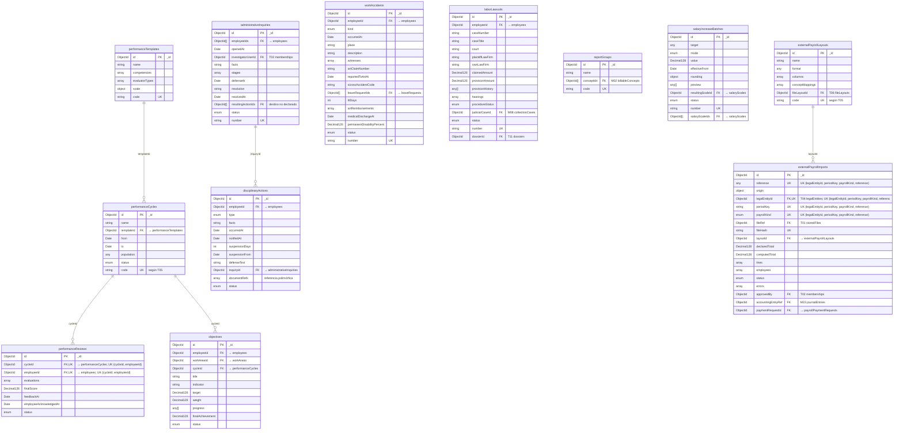

# Modelo entidad-relación — M16 SUE Personal y sueldos

| Campo | Valor |
|---|---|
| Artefacto | 6.1 Modelo entidad-relación completo, vista por módulo (índice: [`03-modelo-entidad-relacion.md`](../03-modelo-entidad-relacion.md)) |
| Anexo dueño | [`M16-SUE-personal-sueldos.md`](../../especificacion/anexos/M16-SUE-personal-sueldos.md), §7 |
| Catálogo canónico | [`T05-DAT-modelo-datos.md`](../../especificacion/anexos/T05-DAT-modelo-datos.md), filas `COL-SUE-NN` |
| Vista por dominio | [`03d-er-erp-administrativo.md` §19](../03d-er-erp-administrativo.md) |
| Versión | 2.1 (05-11-2026) |
| Generado con | [`_trabajo/generar_er_completo.py`](../_trabajo/generar_er_completo.py), revisado a mano |

## 1. Resumen

T05 registra 61 filas con dueño M16: **59 colecciones a crear** y 2 absorbidas en otras colecciones. Las 59 colecciones a crear se dibujan en 3 diagramas, uno por subdominio.

Convenciones: las del índice (secciones 1.3 y 2). Cada entidad lleva `id PK "_id"` y los campos de su ficha del §7; se omiten los campos transversales (`tenantId`, auditoría, `version`, baja lógica, `legacy`). El comentario de una `FK` indica el destino: `→ colección` si es del mismo módulo, `MXX colección` si es de otro; "(inferido)" cuando ni el anexo ni T05 §7.2 y §7.2.1 nombran el destino para esa colección y el nombre del campo no coincide literalmente con el de la colección (se dedujo por rol, sufijo, versión o por el contexto de §7.2.1; a confirmar); "destino no declarado" cuando no se puede fijar. Una referencia polimórfica (`entityType` + `entityId`, `resourceType` + `resourceId`, `targetRef`, `subjectRef`…) no lleva `FK` ni relación: el comentario "referencia polimórfica según <discriminador>" la señala, porque el destino depende del discriminador. Los campos que T05 §7.2.1 declara "no es referencia" no llevan `FK`. Los nombres que el anexo o T05 citan solo en notas "antes …", "Reemplazado por" o "alias" no se toman como campos ni como destinos. `UK` marca los únicos mínimos de T05; "según T05" señala un campo que figura en el catálogo pero no en la ficha del anexo. El tipo `any` indica que el anexo no declara el tipo.

## 2. Colecciones del módulo

| COL-ID | Colección | Diagrama | Ola | Clasificación | Alcance | Volumen o TTL (T05 §7.8) | Ficha en el anexo |
|---|---|---|---|---|---|---|---|
| COL-SUE-02 | `employees` | 1 | O3 | ID/FI | T | — | §7.2 |
| COL-SUE-03 | `employeeAssignments` | 1 | O3 | FI | T | — | §7.3 |
| COL-SUE-04 | `employeeCostAllocations` | 1 | O9 | FI | T | — | §7.4 |
| COL-SUE-05 | `employeeFamilyMembers` | 1 | O9 | ID/SE | T | — | §7.5 |
| COL-SUE-06 | `employeePayAccounts` | 1 | O9 | FI | T | — | §7.6 |
| COL-SUE-07 | `employeeDocuments` | 1 | O9 | ID/SE | T | — | §7.7 |
| COL-SUE-08 | `employeeNotes` | 1 | O9 | OP | T | — | §7.8 |
| COL-SUE-09 | `supervisionLinks` | 1 | O9 | OP | T | — | §7.9 |
| COL-SUE-10 | `shifts` | 1 | O9 | CF | T | — | §7.10 |
| COL-SUE-11 | `employeeShiftAssignments` | 1 | O9 | OP | T | — | §7.10 |
| COL-SUE-12 | `employmentStatusPeriods` | 1 | O9 | FI | T | — | §7.11 |
| COL-SUE-13 | `extraGroups` | 1 | O9 | CF | T | — | §7.12 |
| COL-SUE-14 | `extraItems` | 1 | O9 | CF | T | — | §7.12 |
| COL-SUE-15 | `employeeExtras` | 1 | O9 | FI | T | — | §7.12 |
| COL-SUE-16 | `deductionPlans` | 1 | O9 | FI/SE | T | — | §7.13 |
| COL-SUE-17 | `unions` | 1 | O9 | CF | T+P | — | §7.14 |
| COL-SUE-18 | `laborAgreements` | 1 | O9 | CF | T+P | — | §7.15 |
| COL-SUE-19 | `salaryCategories` | 1 | O9 | CF | T | — | §7.16 |
| COL-SUE-20 | `salaryScales` | 1 | O9 | CF | T | — | §7.16 |
| COL-SUE-21 | `seniorityScales` | 1 | O9 | CF | T | — | §7.17 |
| COL-SUE-22 | `positions` | 1 | O9 | CF | T | — | §7.18 |
| COL-SUE-23 | `workAreas` | 1 | O3 | CF | T | — | §7.18 |
| COL-SUE-24 | `healthInsurerAdoptions` | 1 | O9 | CF | T | — | §7.19 |
| COL-SUE-25 | `terminationReasons` | 1 | O9 | CF | T | — | §7.20 |
| COL-SUE-26 | `payrollVariables` | 1 | O9 | CF | T | — | §7.21 |
| COL-SUE-27 | `payrollConcepts` | 2 | O9 | CF | T | — | §7.22 |
| COL-SUE-28 | `payrollTypes` | 2 | O9 | CF | T | — | §7.23 |
| COL-SUE-29 | `payrollConfigVersions` | 2 | O9 | CF | T | — | §7.24 |
| COL-SUE-30 | `noveltyTypes` | 2 | O9 | CF | T | — | §7.25 |
| COL-SUE-31 | `novelties` | 2 | O9 | FI | T | — | §7.26 |
| COL-SUE-32 | `noveltyImportBatches` | 2 | O9 | OP | T | — | §7.27 |
| COL-SUE-33 | `timePunches` | 2 | O9 | OP/SE | T | — | §7.28 |
| COL-SUE-34 | `extraTasks` | 2 | O9 | OP | T | — | §7.29 |
| COL-SUE-35 | `leaveCauses` | 2 | O9 | CF | T | — | §7.30 |
| COL-SUE-36 | `leaveRequests` | 2 | O9 | SE | T | — | §7.30 |
| COL-SUE-37 | `vacationBalances` | 2 | O9 | FI | T | — | §7.31 |
| COL-SUE-38 | `payPeriods` | 2 | O9 | CF | T | — | §7.32 |
| COL-SUE-39 | `payrollRuns` | 2 | O9 | FI | T | — | §7.33 |
| COL-SUE-40 | `payslips` | 2 | O9 | FI | T | — | §7.34 |
| COL-SUE-41 | `incomeTaxCalculations` | 2 | O9 | FI | T | — | §7.35 |
| COL-SUE-42 | `incomeTaxDeclarations` | 2 | O9 | FI/SE | T | — | §7.36 |
| COL-SUE-43 | `statutoryFilings` | 2 | O9 | FI | T | — | §7.37 |
| COL-SUE-44 | `payrollPaymentRequests` | 2 | O9 | FI | T | — | §7.38 |
| COL-SUE-45 | `payrollAccountingRules` | 2 | O9 | CF | T | — | §7.39 |
| COL-SUE-46 | `terminations` | 2 | O9 | FI | T | — | §7.40 |
| COL-SUE-47 | `employmentCertificates` | 2 | O9 | FI | T | — | §7.41 |
| COL-SUE-48 | `payslipNotifications` | 2 | O9 | OP | T | — | §7.42 |
| COL-SUE-49 | `performanceTemplates` | 3 | O9 | CF | T | — | §7.43 |
| COL-SUE-50 | `performanceCycles` | 3 | O9 | OP | T | — | §7.43 |
| COL-SUE-51 | `performanceReviews` | 3 | O9 | SE | T | — | §7.43 |
| COL-SUE-52 | `objectives` | 3 | O9 | OP | T | — | §7.43 |
| COL-SUE-53 | `disciplinaryActions` | 3 | O9 | SE | T | — | §7.43 |
| COL-SUE-54 | `administrativeInquiries` | 3 | O9 | SE | T | — | §7.43 |
| COL-SUE-55 | `workAccidents` | 3 | O9 | SE | T | — | §7.43 |
| COL-SUE-56 | `laborLawsuits` | 3 | O9 | SE | T | — | §7.43 |
| COL-SUE-57 | `reportGroups` | 3 | O9 | CF | T | — | §7.44 |
| COL-SUE-58 | `salaryIncreaseBatches` | 3 | O9 | FI | T | — | §7.44 |
| COL-SUE-59 | `externalPayrollImports` | 3 | O8 | FI | T | — | §7.44 |
| COL-SUE-60 | `externalPayrollLayouts` | 3 | O8 | CF | T | — | §7.44 |

## 3. Diagrama 1: Legajos, historial laboral, convenios, escalas y variables

25 colecciones (ver tabla de la sección 2). Ficha en el anexo: §7.2, §7.3, §7.4, §7.5, §7.6, §7.7, §7.8, §7.9 ….

```mermaid
erDiagram
  employees {
    ObjectId id PK "_id"
    ObjectId personId FK "M01 persons"
    ObjectId legalEntityId FK, UK "T04 legalEntities; UK {legalEntityId, fileNumber}"
    string fileNumber UK "UK {legalEntityId, fileNumber}"
    string cuil
    Date hireDate
    Date seniorityDate
    Date probationEndDate
    Date contractEndDate
    Date terminationDate
    ObjectId terminationId FK "→ terminations"
    enum status
    object current
    object socialSecurity
    object incomeTax
    object registration
    object[] serviceAccountLinks
    ObjectId userAccountId FK "destino no declarado"
    object disability
  }
  employeeAssignments {
    ObjectId id PK "_id"
    ObjectId employeeId FK, UK "→ employees; UK {employeeId, validFrom}"
    Date validFrom UK "UK {employeeId, validFrom}"
    Date validTo
    Date recordedAt
    enum reason
    ObjectId previousCategoryId FK "M02 serviceCategories"
    ObjectId approvalId FK "T11 approvalRequests"
    string notes
  }
  employeeCostAllocations {
    ObjectId id PK "_id"
    ObjectId employeeId FK, UK "→ employees; UK {employeeId, validFrom}"
    Date validFrom UK "UK {employeeId, validFrom}"
    Date validTo
    array allocations
    Date recordedAt
    ObjectId costCenterId FK "M15 costCenters"
  }
  employeeFamilyMembers {
    ObjectId id PK "_id"
    ObjectId employeeId FK, UK "→ employees; UK {employeeId, personId}"
    ObjectId personId FK, UK "M01 persons; UK {employeeId, personId}"
    enum relationship
    Date birthDate
    Date dependentFrom
    Date dependentTo
    bool healthInsuranceDependent
    any[] yearly
  }
  employeePayAccounts {
    ObjectId id PK "_id"
    ObjectId employeeId FK, UK "→ employees; UK {employeeId, cbuHmac}"
    string bankCode
    string branchCode
    any accountType
    int accountNumber
    any cbu
    string holderName
    bool isPayrollAccount
    string originBankCode
    Decimal128 splitPercent
    Decimal128 splitAmount
    bool isRemainder
    int priority
    Date validFrom
    Date validTo
    enum status
    any cbuHmac UK "UK {employeeId, cbuHmac}"
  }
  employeeDocuments {
    ObjectId id PK "_id"
    ObjectId employeeId FK "→ employees"
    string documentTypeCode
    array fileRefs
    ObjectId uploadedBy FK "T02 memberships"
    Date registeredAt
    Date expiresAt
    enum status
    ObjectId reviewedBy FK "T02 memberships"
    Date reviewedAt
    string rejectionReason
    bool sensitive
    ObjectId documentRefId FK "T11 documents"
  }
  employeeNotes {
    ObjectId id PK "_id"
    ObjectId employeeId FK "→ employees"
    Date date
    string text
    enum category
    ObjectId authorId FK "T02 memberships"
  }
  supervisionLinks {
    ObjectId id PK "_id"
    ObjectId supervisorEmployeeId FK, UK "→ employees; UK {supervisorEmployeeId, employeeId, validFrom}"
    ObjectId employeeId FK, UK "→ employees; UK {supervisorEmployeeId, employeeId, validFrom}"
    any[] scope
    Date validFrom UK "UK {supervisorEmployeeId, employeeId, validFrom}"
    Date validTo
  }
  shifts {
    ObjectId id PK "_id"
    string code UK
    string name
    string notes
    object[] items
    Decimal128 weeklyHours
    enum status
  }
  employeeShiftAssignments {
    ObjectId id PK "_id"
    ObjectId employeeId FK, UK "→ employees; UK {employeeId, validFrom}"
    ObjectId shiftId FK "→ shifts"
    Date validFrom UK "UK {employeeId, validFrom}"
    Date validTo
  }
  employmentStatusPeriods {
    ObjectId id PK "_id"
    ObjectId employeeId FK, UK "→ employees; UK {employeeId, validFrom}"
    string statusCode
    Date validFrom UK "UK {employeeId, validFrom}"
    Date validTo
    any source
    ObjectId sourceRef "referencia polimórfica"
  }
  extraGroups {
    ObjectId id PK "_id"
    string name
    string code UK
    bool unique
    bool deductibleForIncomeTax
  }
  extraItems {
    ObjectId id PK "_id"
    string name
    string code UK
    ObjectId groupId FK "→ extraGroups"
    Decimal128 defaultAmount
    ObjectId conceptId FK "M02 billableConcepts"
    Date validFrom
  }
  employeeExtras {
    ObjectId id PK "_id"
    ObjectId employeeId FK, UK "→ employees; UK {employeeId, extraItemId, validFrom}"
    ObjectId extraItemId FK, UK "→ extraItems; UK {employeeId, extraItemId, validFrom}"
    Decimal128 amount
    Date validFrom UK "UK {employeeId, extraItemId, validFrom}"
    Date validTo
    object origin
    ObjectId terminationId FK "→ terminations"
  }
  deductionPlans {
    ObjectId id PK "_id"
    ObjectId employeeId FK "→ employees"
    enum type
    object legal
    object beneficiary
    any calculation
    Decimal128 percent
    Decimal128 installmentAmount
    Decimal128 totalAmount
    Decimal128 balance
    Decimal128 installmentsTotal
    int installmentsPaid
    Date priority
    string startPeriod
    enum status
    any treasuryPaymentRef FK "M14 treasuryMovements"
    array movements
  }
  unions {
    ObjectId id PK "_id"
    string name
    string cuit
    Decimal128 retentionPercent
    Decimal128 retentionAmount
    Decimal128 employerContributionPercent
    Decimal128 employerContributionAmount
    array categoryReviewMonths
    ObjectId generalAccountId FK "M01 accounts"
    ObjectId chargesAccountId FK "M15 ledgerAccounts"
    object depositInfo
    ObjectId fileLayoutId FK "T06 fileLayouts"
    Date validFrom
    enum status
    string code UK
  }
  laborAgreements {
    ObjectId id PK "_id"
    string code UK
    string name
    ObjectId unionId FK "→ unions"
    enum scope
    Decimal128 normalWeeklyHours
    any seniorityRule
    ObjectId seniorityScaleId FK "→ seniorityScales"
    array onCallRegimes
    array specialLeaves
    object severanceCap
    object validation
    Date validFrom
    Date validTo
    enum status
  }
  salaryCategories {
    ObjectId id PK "_id"
    ObjectId laborAgreementId FK, UK "→ laborAgreements; UK {laborAgreementId, code}"
    string code UK "UK {laborAgreementId, code}"
    string name
    enum type
    Decimal128 workHours
    Decimal128 minHours
    Decimal128 minDays
    int order
    enum status
  }
  salaryScales {
    ObjectId id PK "_id"
    ObjectId laborAgreementId FK "→ laborAgreements"
    ObjectId salaryCategoryId FK, UK "→ salaryCategories; UK {salaryCategoryId, validFrom}"
    string name
    Date validFrom UK "UK {salaryCategoryId, validFrom}"
    Date recordedAt
    string agreementReference
    enum status
    object[] items
    object origin
    ObjectId increaseBatchId FK "→ salaryIncreaseBatches"
    ObjectId approvalId FK "T11 approvalRequests"
  }
  seniorityScales {
    ObjectId id PK "_id"
    ObjectId laborAgreementId FK, UK "→ laborAgreements; UK {laborAgreementId, validFrom}"
    ObjectId unionId FK "→ unions"
    ObjectId categoryId FK "M02 serviceCategories"
    array rows
    Date validFrom UK "UK {laborAgreementId, validFrom}"
  }
  positions {
    ObjectId id PK "_id"
    string code UK
    string name
    string description
    string professionalQualification
  }
  workAreas {
    ObjectId id PK "_id"
    string code UK
    string name
    ObjectId costCenterId FK "M15 costCenters"
    ObjectId[] serviceIds FK "M02 tenantServices"
    ObjectId managerEmployeeId FK "→ employees"
    ObjectId parentId FK "→ workAreas (inferido)"
  }
  healthInsurerAdoptions {
    ObjectId id PK "_id"
    string officialCode UK
    string name
    array rates
    enum status
  }
  terminationReasons {
    ObjectId id PK "_id"
    string code UK
    string name
    enum category
    string officialCode
    any[] conceptTemplate
    bool requiresNotice
  }
  payrollVariables {
    ObjectId id PK "_id"
    string name UK "UK {configVersionId, name}"
    string description
    any resultType
    string formula
    any compiledAst
    array dependencies
    ObjectId configVersionId FK, UK "→ payrollConfigVersions; UK {configVersionId, name}"
    enum status
  }
  employees ||--o{ employeeAssignments : "employeeId"
  employees ||--o{ employeeCostAllocations : "employeeId"
  employees ||--o{ employeeFamilyMembers : "employeeId"
  employees ||--o{ employeePayAccounts : "employeeId"
  employees ||--o{ employeeDocuments : "employeeId"
  employees ||--o{ employeeNotes : "employeeId"
  employees ||--o{ supervisionLinks : "supervisorEmployeeId"
  employees ||--o{ supervisionLinks : "employeeId"
  employees ||--o{ employeeShiftAssignments : "employeeId"
  shifts ||--o{ employeeShiftAssignments : "shiftId"
  employees ||--o{ employmentStatusPeriods : "employeeId"
  extraGroups ||--o{ extraItems : "groupId"
  employees ||--o{ employeeExtras : "employeeId"
  extraItems ||--o{ employeeExtras : "extraItemId"
  employees ||--o{ deductionPlans : "employeeId"
  unions ||--o{ laborAgreements : "unionId"
  seniorityScales ||--o{ laborAgreements : "seniorityScaleId"
  laborAgreements ||--o{ salaryCategories : "laborAgreementId"
  laborAgreements ||--o{ salaryScales : "laborAgreementId"
  salaryCategories ||--o{ salaryScales : "salaryCategoryId"
  laborAgreements ||--o{ seniorityScales : "laborAgreementId"
  unions ||--o{ seniorityScales : "unionId"
  employees ||--o{ workAreas : "managerEmployeeId"
  workAreas ||--o{ workAreas : "parentId"
```

**Índices principales del diagrama 1**

| Colección | Índices declarados en el anexo | Únicos mínimos (T05) |
|---|---|---|
| `employees` | `{tenantId, legalEntityId, fileNumber}` único; `{tenantId, personId, legalEntityId}`; `{tenantId, status}`; `{tenantId, "current.workAreaId"}`. | `{legalEntityId, fileNumber}` |
| `employeeAssignments` | `{tenantId, employeeId, validFrom}` único. Migración: `COD_CAT_ANT`, `DES_CAT_ANT`, `COD_CAT_NEW`, `DES_CAT_NEW`, `FEC_CAT_ANT`, `FEC_CAT_NEW`, `FEC_REG`, `USU_REG`. | `{employeeId, validFrom}` |
| `employeeCostAllocations` | `{tenantId, employeeId, validFrom}` único. | `{employeeId, validFrom}` |
| `employeeFamilyMembers` | `{tenantId, employeeId, personId}` único. Migración: `TIP_REL`, `ESTUDIANTE`, `DISCAPACITADO`, `ADHERENTE`, `FORM_572`, `PORC_DEDUCIR`, `AÑO`. | `{employeeId, personId}` |
| `employeePayAccounts` | `{tenantId, employeeId, cbuHmac}` único (). | `{employeeId, cbuHmac}` (5-11-2026, pendientes de la sincronización: sin cambio de clave: M16 §7 declara `cbuHmac` y el índice `{tenantId, employeeId, cbuHmac}` (); ) |
| `employeeDocuments` | `{tenantId, employeeId, documentTypeCode, status}`. | — |
| `employeeNotes` | `{tenantId, employeeId, date}`. | — |
| `supervisionLinks` | `{tenantId, supervisorEmployeeId, employeeId, validFrom}` único. | `{supervisorEmployeeId, employeeId, validFrom}` |
| `shifts` | — | `code` |
| `employeeShiftAssignments` | — | `{employeeId, validFrom}` |
| `employmentStatusPeriods` | `{tenantId, employeeId, validFrom}` único. | `{employeeId, validFrom}` |
| `extraGroups` | — | `code` |
| `extraItems` | — | `code` |
| `employeeExtras` | — | `{employeeId, extraItemId, validFrom}` |
| `deductionPlans` | `{tenantId, employeeId, status}`. | — |
| `unions` | — | `code` |
| `laborAgreements` | — | `code` |
| `salaryCategories` | — | `{laborAgreementId, code}` |
| `salaryScales` | — | `{salaryCategoryId, validFrom}` |
| `seniorityScales` | — | `{laborAgreementId, validFrom}` |
| `positions` | — | `code` |
| `workAreas` | — | `code` |
| `healthInsurerAdoptions` | — | `officialCode` |
| `terminationReasons` | — | `code` |
| `payrollVariables` | — | `{configVersionId, name}` |

## 4. Diagrama 2: Conceptos, novedades, liquidaciones, recibos, Ganancias y egresos

22 colecciones (ver tabla de la sección 2). Ficha en el anexo: §7.22, §7.23, §7.24, §7.25, §7.26, §7.27, §7.28, §7.29 ….

```mermaid
erDiagram
  payrollConcepts {
    ObjectId id PK "_id"
    string code UK "UK {configVersionId, code}"
    string name
    enum type
    Date validFrom
    Date validTo
    string quantityFormula
    string amountFormula
    string baseFormula
    string filterFormula
    int calcOrder
    bool alwaysSettle
    bool affectsSac
    bool affectsVacation
    bool affectsSeverance
    enum incomeTaxTreatment
    string incomeTaxCategoryCode
    string sicossClassification
    object subsystems
    string arcaConceptCode
    ObjectId accountId FK "M01 accounts"
    object[] payrollTypes
    bool printOnPayslip
    bool printQuantity
    bool unit
    bool isSensitive
    ObjectId configVersionId FK, UK "T04 configVersions; UK {configVersionId, code}"
    enum status
  }
  payrollTypes {
    ObjectId id PK "_id"
    string code UK
    string name
    enum kind
    Date dayFrom
    Date dayTo
    any incomeTaxProration
    bool skipAdvanceDeduction
    enum incomeTaxScaleType
    ObjectId voucherTypeId FK "M05 voucherTypes"
    bool isSac
    bool isVacation
    any lsdLiquidationType
    enum status
  }
  payrollConfigVersions {
    ObjectId id PK "_id"
    string number UK
    string name
    Date effectiveFrom
    enum status
    ObjectId basedOnVersionId FK "destino no declarado"
    array changes
    object validationReport
    ObjectId simulationRunId FK "M04 simulationRuns"
    ObjectId diffReportRef FK "destino no declarado"
    ObjectId reviewedBy FK "T02 memberships"
    ObjectId publishedBy FK "T02 memberships"
    Date publishedAt
    any scope
  }
  noveltyTypes {
    ObjectId id PK "_id"
    string code UK
    string name
    any valueKind
    any behavior
    string siradigCode
    Decimal128 annualCap
    Decimal128 netIncomePercentCap
    bool isIncomeTaxPrepayment
    bool affectsCedularTax
    bool requiresSupervisorApproval
    bool sensitive
    enum status
  }
  novelties {
    ObjectId id PK "_id"
    ObjectId employeeId FK "→ employees"
    ObjectId noveltyTypeId FK "→ noveltyTypes"
    Date date
    string periodKey
    string accrualPeriodKey
    Decimal128 quantity
    Decimal128 amount
    object installment
    int vacationYear
    enum source
    string sourceRef UK "referencia polimórfica; UK parcial"
    ObjectId leaveRequestId FK "→ leaveRequests"
    ObjectId deductionPlanId FK "→ deductionPlans"
    ObjectId importBatchId FK "→ noveltyImportBatches"
    enum status
    object[] approvals
    ObjectId settledPayslipId FK "→ payslips"
    string notes
  }
  noveltyImportBatches {
    ObjectId id PK "_id"
    any source
    ObjectId legalEntityId FK "T04 legalEntities"
    string periodKey
    ObjectId fileRef FK "T01 storedFiles"
    string fileHash UK
    int rows
    int accepted
    int rejected
    array errors
    enum status
    ObjectId jobId
    ObjectId storedFileId FK "T01 storedFiles; según T05"
  }
  timePunches {
    ObjectId id PK "_id"
    ObjectId employeeId FK, UK "→ employees; UK {employeeId, at}"
    any at UK "UK {employeeId, at}"
    any direction
    string deviceId
    bool manual
    bool processed
    string processedDayKey
    ObjectId importBatchId FK "→ noveltyImportBatches"
  }
  extraTasks {
    ObjectId id PK "_id"
    any taskType
    ObjectId serviceConnectionId FK "destino no declarado"
    ObjectId sourceRef "referencia polimórfica"
    Date dateFrom
    Date dateTo
    array workers
    ObjectId[] noveltyIds FK "→ novelties"
    enum status
    ObjectId accountId FK "M01 accounts"
    string notes
    ObjectId employeeId FK "→ employees"
    ObjectId workOrderId FK "M10 workOrders; según T05"
  }
  leaveCauses {
    ObjectId id PK "_id"
    string code UK
    string name
    enum legalBasis
    bool paid
    bool isVacation
    ObjectId noveltyTypeId FK "→ noveltyTypes"
    int daysPerPeriod
    enum dayCounting
    enum periodUnit
    string employmentStatusCode
    bool requiresCertificate
    bool sensitive
    bool jobProtection
    bool temporaryRetention
    enum approvalFlow
  }
  leaveRequests {
    ObjectId id PK "_id"
    ObjectId employeeId FK "→ employees"
    ObjectId leaveCauseId FK "→ leaveCauses"
    Date requestedAt
    int vacationYear
    Date requestedFrom
    Date requestedTo
    int requestedDays
    Decimal128 previousBalance
    Date authorizedFrom
    Date authorizedTo
    int authorizedDays
    enum status
    object[] decisions
    string rejectionReason
    ObjectId[] attachments FK "destino no declarado"
    string diagnosis
    ObjectId[] noveltyIds FK "→ novelties"
  }
  vacationBalances {
    ObjectId id PK "_id"
    ObjectId employeeId FK, UK "→ employees; UK {employeeId, vacationYear}"
    int vacationYear UK "UK {employeeId, vacationYear}"
    int entitledDays
    any ruleApplied
    int takenDays
    int pendingRequestDays
    int carriedOverDays
    array paidOutDays
    Date computedAt
  }
  payPeriods {
    ObjectId id PK "_id"
    ObjectId legalEntityId FK, UK "T04 legalEntities; UK {legalEntityId, periodKey, frequency}"
    string periodKey UK "UK {legalEntityId, periodKey, frequency}"
    enum frequency UK "UK {legalEntityId, periodKey, frequency}"
    enum status
    ObjectId closedBy FK "T02 memberships"
    Date closedAt
    array reopenings
    bool lsdFiled
  }
  payrollRuns {
    ObjectId id PK "_id"
    string number UK
    ObjectId legalEntityId FK "T04 legalEntities"
    ObjectId payrollTypeId FK "→ payrollTypes"
    string periodKey
    string accrualPeriodKey
    enum mode
    ObjectId configVersionId FK "T04 configVersions"
    object[] universe
    Date paymentDate
    object lastContributionDeposit
    enum status
    object progress
    Decimal128 totals
    object[] checks
    string comparisonRef
    ObjectId correctsRunId FK "→ payrollRuns"
    ObjectId complementsRunId FK "→ payrollRuns"
    ObjectId calculatedBy FK "T02 memberships"
    ObjectId submittedBy FK "T02 memberships"
    ObjectId approvedBy FK "T02 memberships"
    ObjectId closedBy FK "T02 memberships"
    ObjectId voidedBy FK "T02 memberships"
    ObjectId approvalId FK "T11 approvalRequests"
    object[] accountingEntryRefs
    ObjectId paymentRequestId FK "→ payrollPaymentRequests"
  }
  payslips {
    ObjectId id PK "_id"
    ObjectId payrollRunId FK "→ payrollRuns"
    ObjectId employeeId FK, UK "→ employees; UK {employeeId, periodKey, payrollTypeId, legalEntityId} "
    ObjectId legalEntityId FK, UK "T04 legalEntities; UK {employeeId, periodKey, payrollTypeId, legalEnti"
    ObjectId payrollTypeId FK, UK "→ payrollTypes; UK {employeeId, periodKey, payrollTypeId, legalEntityI"
    string periodKey UK "UK {employeeId, periodKey, payrollTypeId, legalEntityId} parcial"
    string accrualPeriodKey
    object number
    object snapshot
    object[] lines
    array hiddenIncomeTaxLines
    object totals
    object contributionBases
    ObjectId incomeTaxCalculationId FK "→ incomeTaxCalculations"
    object[] paymentSplit
    Date paymentDate
    Date paidAt
    enum status
    string pdfRef
    string pdfHash
    object signature
    object delivery
    ObjectId replacesPayslipId FK "→ payslips"
    ObjectId replacedByPayslipId FK "→ payslips"
    string voidReason
  }
  incomeTaxCalculations {
    ObjectId id PK "_id"
    ObjectId payslipId FK "→ payslips"
    ObjectId employeeId FK "→ employees"
    int fiscalYear
    int month
    enum kind
    array lines
    string scaleTableVersion
    string deductionTableVersion
    ObjectId overrideNoveltyId FK "→ novelties"
    Decimal128 withheldAmount
    Decimal128 refundAmount
  }
  incomeTaxDeclarations {
    ObjectId id PK "_id"
    ObjectId employeeId FK, UK "→ employees; UK {employeeId, fiscalYear, formVersion}"
    ObjectId legalEntityId FK "T04 legalEntities"
    int fiscalYear UK "UK {employeeId, fiscalYear, formVersion}"
    string formVersion UK "UK {employeeId, fiscalYear, formVersion}"
    Date submittedAt
    ObjectId fileRef FK "T01 storedFiles"
    string fileHash
    array familyCharges
    array deductions
    array otherEmployments
    array prepayments
    array perceptions
    enum status
  }
  statutoryFilings {
    ObjectId id PK "_id"
    ObjectId legalEntityId FK, UK "T04 legalEntities; UK {legalEntityId, kind, periodKey, rectificationNo"
    string periodKey UK "UK {legalEntityId, kind, periodKey, rectificationNo}"
    enum kind UK "UK {legalEntityId, kind, periodKey, rectificationNo}"
    ObjectId layoutId FK "→ externalPayrollLayouts"
    string layoutVersion
    ObjectId[] payrollRunIds FK "→ payrollRuns"
    ObjectId fileRef FK "T01 storedFiles"
    string fileHash
    object totals
    object[] controls
    enum status
    Date filedAt
    any acknowledgementRef
    any vepRef FK "M14 paymentExecutions"
    ObjectId generatedBy FK "T02 memberships"
    ObjectId approvedBy FK "T02 memberships"
    ObjectId storedFileId FK "T01 storedFiles; según T05"
    any rectificationNo UK "UK {legalEntityId, kind, periodKey, rectificationNo}; según T05"
  }
  payrollPaymentRequests {
    ObjectId id PK "_id"
    ObjectId payrollRunId FK "→ payrollRuns"
    ObjectId externalImportId FK "→ externalPayrollImports"
    ObjectId legalEntityId FK "T04 legalEntities"
    enum kind
    Date paymentDate
    any method
    array items
    Decimal128 total
    string idempotencyKey UK
    ObjectId treasuryRequestId FK "destino no declarado"
    enum status
  }
  payrollAccountingRules {
    ObjectId id PK "_id"
    string name
    string description
    int priority
    object[] filters
    ObjectId debitAccountId FK "M15 ledgerAccounts"
    ObjectId creditAccountId FK "M15 ledgerAccounts"
    ObjectId accountingPlanId FK "M02 servicePlans"
    any entryFormat
    Date validFrom
    enum status
    ObjectId payrollConceptId FK "→ payrollConcepts"
    string code UK
  }
  terminations {
    ObjectId id PK "_id"
    ObjectId employeeId FK, UK "→ employees; UK parcial"
    ObjectId terminationReasonId FK "→ terminationReasons"
    Date noticeGivenAt
    Date lastWorkedDay
    Date terminationDate
    any noticeMode
    Decimal128 bestMonthlyWage
    string seniorityPeriods
    object capApplied
    ObjectId finalPayrollRunId FK "→ payrollRuns"
    any[] checklist
    ObjectId[] certificatesIds FK "destino no declarado"
    enum status
    ObjectId approvalId FK "T11 approvalRequests"
  }
  employmentCertificates {
    ObjectId id PK "_id"
    ObjectId employeeId FK "→ employees"
    enum kind
    Date requestedAt
    ObjectId requestedBy FK "T02 memberships"
    Date dueAt
    Date issuedAt
    ObjectId fileRef FK "T01 storedFiles"
    string verificationCode
    object delivery
    enum status
    ObjectId storedFileId FK "T01 storedFiles; según T05"
  }
  payslipNotifications {
    ObjectId id PK "_id"
    ObjectId payslipId FK, UK "→ payslips"
    ObjectId employeeId FK "→ employees"
    enum kind
    Date sentAt
    array channels
    Date viewedAt
    Date signedAt
    enum status
    string note
    ObjectId pdfRef FK "destino no declarado"
    ObjectId signatureRequestId FK "T11 signatureRequests"
  }
  noveltyTypes ||--o{ novelties : "noveltyTypeId"
  leaveRequests |o--o{ novelties : "leaveRequestId"
  noveltyImportBatches |o--o{ novelties : "importBatchId"
  payslips |o--o{ novelties : "settledPayslipId"
  noveltyImportBatches ||--o{ timePunches : "importBatchId"
  novelties }o--o{ extraTasks : "noveltyIds"
  noveltyTypes ||--o{ leaveCauses : "noveltyTypeId"
  leaveCauses ||--o{ leaveRequests : "leaveCauseId"
  novelties }o--o{ leaveRequests : "noveltyIds"
  payrollTypes ||--o{ payrollRuns : "payrollTypeId"
  payrollRuns |o--o{ payrollRuns : "correctsRunId"
  payrollRuns |o--o{ payrollRuns : "complementsRunId"
  payrollPaymentRequests |o--o{ payrollRuns : "paymentRequestId"
  payrollRuns ||--o{ payslips : "payrollRunId"
  payrollTypes ||--o{ payslips : "payrollTypeId"
  incomeTaxCalculations |o--o{ payslips : "incomeTaxCalculationId"
  payslips |o--o{ payslips : "replacesPayslipId"
  payslips |o--o{ payslips : "replacedByPayslipId"
  payslips ||--o{ incomeTaxCalculations : "payslipId"
  novelties ||--o{ incomeTaxCalculations : "overrideNoveltyId"
  payrollRuns }o--o{ statutoryFilings : "payrollRunIds"
  payrollRuns ||--o{ payrollPaymentRequests : "payrollRunId"
  payrollConcepts ||--o{ payrollAccountingRules : "payrollConceptId"
  payrollRuns ||--o{ terminations : "finalPayrollRunId"
  payslips ||--o| payslipNotifications : "payslipId"
```

**Índices principales del diagrama 2**

| Colección | Índices declarados en el anexo | Únicos mínimos (T05) |
|---|---|---|
| `payrollConcepts` | `{tenantId, configVersionId, code}` único; `{tenantId, status, calcOrder}`. | `{configVersionId, code}` |
| `payrollTypes` | — | `code` |
| `payrollConfigVersions` | `{tenantId, status, effectiveFrom}`. | `number` |
| `noveltyTypes` | — | `code` |
| `novelties` | `{tenantId, employeeId, periodKey, status}`; `{tenantId, sourceRef}` único parcial (si existe). | `sourceRef` p. |
| `noveltyImportBatches` | — | `fileHash` |
| `timePunches` | `{tenantId, employeeId, at}` único. | `{employeeId, at}` |
| `extraTasks` | — | — |
| `leaveCauses` | — | `code` |
| `leaveRequests` | — | — |
| `vacationBalances` | `{tenantId, employeeId, vacationYear}` único. Recalculado por `JOB-SUE-12`. | `{employeeId, vacationYear}` |
| `payPeriods` | `{tenantId, legalEntityId, periodKey, frequency}` único. | `{legalEntityId, periodKey, frequency}` |
| `payrollRuns` | `{tenantId, legalEntityId, periodKey, payrollTypeId, mode, status}`; `{tenantId, number}` único. | `number` |
| `payslips` | `{tenantId, employeeId, periodKey, payrollTypeId, legalEntityId}` único parcial (`status ≠ voided` y sin `replacesPayslipId`); `{tenantId, payrollRunId}`; `{tenantId, "signature.employeeStatus"}`. | `{employeeId, periodKey, payrollTypeId, legalEntityId}` p. |
| `incomeTaxCalculations` | `{tenantId, employeeId, fiscalYear, month, kind}`. | — |
| `incomeTaxDeclarations` | `{tenantId, employeeId, fiscalYear, formVersion}` único. | `{employeeId, fiscalYear, formVersion}` |
| `statutoryFilings` | `{tenantId, legalEntityId, periodKey, kind, status}`. | `{legalEntityId, kind, periodKey, rectificationNo}` |
| `payrollPaymentRequests` | `{tenantId, idempotencyKey}` único. | `idempotencyKey` |
| `payrollAccountingRules` | — | `code` |
| `terminations` | — | `employeeId` p. (no anulado) |
| `employmentCertificates` | — | — |
| `payslipNotifications` | — | `payslipId` |

## 5. Diagrama 3: Gestión de RRHH: desempeño, disciplina y otras

12 colecciones (ver tabla de la sección 2). Ficha en el anexo: §7.43, §7.44.

**Índices principales del diagrama 3**

| Colección | Índices declarados en el anexo | Únicos mínimos (T05) |
|---|---|---|
| `performanceTemplates` | — | `code` |
| `performanceCycles` | — | `code` |
| `performanceReviews` | — | `{cycleId, employeeId}` |
| `objectives` | — | — |
| `disciplinaryActions` | — | — |
| `administrativeInquiries` | — | `number` |
| `workAccidents` | — | `number` |
| `laborLawsuits` | — | `number` |
| `reportGroups` | — | `code` |
| `salaryIncreaseBatches` | — | `number` |
| `externalPayrollImports` | `{tenantId, legalEntityId, periodKey, payrollKind, reference}` único; `{tenantId, fileHash}` único. | `{legalEntityId, periodKey, payrollKind, reference}`; `fileHash` |
| `externalPayrollLayouts` | — | `code` |

## 6. Relaciones con otros módulos y entre diagramas

Referencias que salen de una colección de este módulo hacia una entidad de otro módulo o de otro diagrama del mismo módulo (no se dibujan para mantener cada diagrama dentro de su módulo y subdominio).

| Colección origen | Campo | Cardinalidad (destino a origen) | Destino | COL-ID destino | Módulo destino |
|---|---|---|---|---|---|
| `employees` | `personId` | 1 a N | `persons` | COL-PER-01 | M01 |
| `employees` | `legalEntityId` | 1 a N | `legalEntities` | COL-CFG-41 | T04 |
| `employees` | `terminationId` | 0..1 a N | `terminations` | COL-SUE-46 | mismo módulo, diagrama 2 |
| `employeeAssignments` | `previousCategoryId` | 1 a N | `serviceCategories` | COL-CAT-10 | M02 |
| `employeeAssignments` | `approvalId` | 1 a N | `approvalRequests` | COL-WFL-24 | T11 |
| `employeeCostAllocations` | `costCenterId` | 1 a N | `costCenters` | COL-CON-16 | M15 |
| `employeeFamilyMembers` | `personId` | 1 a N | `persons` | COL-PER-01 | M01 |
| `employeeDocuments` | `uploadedBy`, `reviewedBy` | 1 a N | `memberships` | COL-IAM-04 | T02 |
| `employeeDocuments` | `documentRefId` | 1 a N | `documents` | COL-WFL-34 | T11 |
| `employeeNotes` | `authorId` | 1 a N | `memberships` | COL-IAM-04 | T02 |
| `extraItems` | `conceptId` | 1 a N | `billableConcepts` | COL-CAT-06 | M02 |
| `employeeExtras` | `terminationId` | 1 a N | `terminations` | COL-SUE-46 | mismo módulo, diagrama 2 |
| `deductionPlans` | `treasuryPaymentRef` | 1 a N | `treasuryMovements` | COL-TES-10 | M14 |
| `unions` | `generalAccountId` | 1 a N | `accounts` | COL-PER-05 | M01 |
| `unions` | `chargesAccountId` | 1 a N | `ledgerAccounts` | COL-CON-04 | M15 |
| `unions` | `fileLayoutId` | 1 a N | `fileLayouts` | COL-INT-10 | T06 |
| `salaryScales` | `increaseBatchId` | 1 a N | `salaryIncreaseBatches` | COL-SUE-58 | mismo módulo, diagrama 3 |
| `salaryScales` | `approvalId` | 1 a N | `approvalRequests` | COL-WFL-24 | T11 |
| `seniorityScales` | `categoryId` | 1 a N | `serviceCategories` | COL-CAT-10 | M02 |
| `workAreas` | `costCenterId` | 1 a N | `costCenters` | COL-CON-16 | M15 |
| `workAreas` | `serviceIds` | N a N | `tenantServices` | COL-CAT-02 | M02 |
| `payrollVariables` | `configVersionId` | 1 a N | `payrollConfigVersions` | COL-SUE-29 | mismo módulo, diagrama 2 |
| `payrollConcepts` | `accountId` | 0..1 a N | `accounts` | COL-PER-05 | M01 |
| `payrollConcepts` | `configVersionId` | 1 a N | `configVersions` | COL-CFG-03 | T04 |
| `payrollTypes` | `voucherTypeId` | 1 a N | `voucherTypes` | COL-FAC-18 | M05 |
| `payrollConfigVersions` | `simulationRunId` | 1 a N | `simulationRuns` | COL-TAR-31 | M04 |
| `payrollConfigVersions` | `reviewedBy`, `publishedBy` | 1 a N | `memberships` | COL-IAM-04 | T02 |
| `novelties` | `employeeId` | 1 a N | `employees` | COL-SUE-02 | mismo módulo, diagrama 1 |
| `novelties` | `deductionPlanId` | 0..1 a N | `deductionPlans` | COL-SUE-16 | mismo módulo, diagrama 1 |
| `noveltyImportBatches` | `legalEntityId` | 1 a N | `legalEntities` | COL-CFG-41 | T04 |
| `noveltyImportBatches` | `fileRef`, `storedFileId` | 1 a N | `storedFiles` | COL-PLA-29 | T01 |
| `timePunches` | `employeeId` | 1 a N | `employees` | COL-SUE-02 | mismo módulo, diagrama 1 |
| `extraTasks` | `accountId` | 0..1 a N | `accounts` | COL-PER-05 | M01 |
| `extraTasks` | `employeeId` | 1 a N | `employees` | COL-SUE-02 | mismo módulo, diagrama 1 |
| `extraTasks` | `workOrderId` | 1 a N | `workOrders` | COL-TEC-12 | M10 |
| `leaveRequests` | `employeeId` | 1 a N | `employees` | COL-SUE-02 | mismo módulo, diagrama 1 |
| `vacationBalances` | `employeeId` | 1 a N | `employees` | COL-SUE-02 | mismo módulo, diagrama 1 |
| `payPeriods` | `legalEntityId` | 1 a N | `legalEntities` | COL-CFG-41 | T04 |
| `payPeriods` | `closedBy` | 1 a N | `memberships` | COL-IAM-04 | T02 |
| `payrollRuns` | `legalEntityId` | 1 a N | `legalEntities` | COL-CFG-41 | T04 |
| `payrollRuns` | `configVersionId` | 1 a N | `configVersions` | COL-CFG-03 | T04 |
| `payrollRuns` | `calculatedBy`, `submittedBy`, `approvedBy`, `closedBy`, `voidedBy` | 0..1 a N | `memberships` | COL-IAM-04 | T02 |
| `payrollRuns` | `approvalId` | 0..1 a N | `approvalRequests` | COL-WFL-24 | T11 |
| `payslips` | `employeeId` | 1 a N | `employees` | COL-SUE-02 | mismo módulo, diagrama 1 |
| `payslips` | `legalEntityId` | 1 a N | `legalEntities` | COL-CFG-41 | T04 |
| `incomeTaxCalculations` | `employeeId` | 1 a N | `employees` | COL-SUE-02 | mismo módulo, diagrama 1 |
| `incomeTaxDeclarations` | `employeeId` | 1 a N | `employees` | COL-SUE-02 | mismo módulo, diagrama 1 |
| `incomeTaxDeclarations` | `legalEntityId` | 1 a N | `legalEntities` | COL-CFG-41 | T04 |
| `incomeTaxDeclarations` | `fileRef` | 1 a N | `storedFiles` | COL-PLA-29 | T01 |
| `statutoryFilings` | `legalEntityId` | 1 a N | `legalEntities` | COL-CFG-41 | T04 |
| `statutoryFilings` | `layoutId` | 1 a N | `externalPayrollLayouts` | COL-SUE-60 | mismo módulo, diagrama 3 |
| `statutoryFilings` | `fileRef`, `storedFileId` | 1 a N | `storedFiles` | COL-PLA-29 | T01 |
| `statutoryFilings` | `vepRef` | 1 a N | `paymentExecutions` | COL-TES-35 | M14 |
| `statutoryFilings` | `generatedBy`, `approvedBy` | 1 a N | `memberships` | COL-IAM-04 | T02 |
| `payrollPaymentRequests` | `externalImportId` | 1 a N | `externalPayrollImports` | COL-SUE-59 | mismo módulo, diagrama 3 |
| `payrollPaymentRequests` | `legalEntityId` | 1 a N | `legalEntities` | COL-CFG-41 | T04 |
| `payrollAccountingRules` | `debitAccountId`, `creditAccountId` | 1 a N | `ledgerAccounts` | COL-CON-04 | M15 |
| `payrollAccountingRules` | `accountingPlanId` | 1 a N | `servicePlans` | COL-CAT-07 | M02 |
| `terminations` | `employeeId` | 1 a N | `employees` | COL-SUE-02 | mismo módulo, diagrama 1 |
| `terminations` | `terminationReasonId` | 1 a N | `terminationReasons` | COL-SUE-25 | mismo módulo, diagrama 1 |
| `terminations` | `approvalId` | 1 a N | `approvalRequests` | COL-WFL-24 | T11 |
| `employmentCertificates` | `employeeId` | 1 a N | `employees` | COL-SUE-02 | mismo módulo, diagrama 1 |
| `employmentCertificates` | `requestedBy` | 1 a N | `memberships` | COL-IAM-04 | T02 |
| `employmentCertificates` | `fileRef`, `storedFileId` | 1 a N | `storedFiles` | COL-PLA-29 | T01 |
| `payslipNotifications` | `employeeId` | 1 a N | `employees` | COL-SUE-02 | mismo módulo, diagrama 1 |
| `payslipNotifications` | `signatureRequestId` | 0..1 a N | `signatureRequests` | COL-WFL-48 | T11 |
| `performanceReviews` | `employeeId` | 1 a N | `employees` | COL-SUE-02 | mismo módulo, diagrama 1 |
| `objectives` | `employeeId` | 1 a N | `employees` | COL-SUE-02 | mismo módulo, diagrama 1 |
| `objectives` | `workAreaId` | 1 a N | `workAreas` | COL-SUE-23 | mismo módulo, diagrama 1 |
| `disciplinaryActions` | `employeeId` | 1 a N | `employees` | COL-SUE-02 | mismo módulo, diagrama 1 |
| `administrativeInquiries` | `employeeIds` | N a N | `employees` | COL-SUE-02 | mismo módulo, diagrama 1 |
| `administrativeInquiries` | `investigatorUserId` | 1 a N | `memberships` | COL-IAM-04 | T02 |
| `workAccidents` | `employeeId` | 1 a N | `employees` | COL-SUE-02 | mismo módulo, diagrama 1 |
| `workAccidents` | `leaveRequestIds` | N a N | `leaveRequests` | COL-SUE-36 | mismo módulo, diagrama 2 |
| `laborLawsuits` | `employeeId` | 1 a N | `employees` | COL-SUE-02 | mismo módulo, diagrama 1 |
| `laborLawsuits` | `judicialCaseId` | 1 a N | `collectionCases` | COL-MOR-35 | M08 |
| `laborLawsuits` | `dossierId` | 1 a N | `dossiers` | COL-WFL-51 | T11 |
| `reportGroups` | `conceptIds` | N a N | `billableConcepts` | COL-CAT-06 | M02 |
| `salaryIncreaseBatches` | `resultingScaleId` | 1 a N | `salaryScales` | COL-SUE-20 | mismo módulo, diagrama 1 |
| `salaryIncreaseBatches` | `salaryScaleIds` | N a N | `salaryScales` | COL-SUE-20 | mismo módulo, diagrama 1 |
| `externalPayrollImports` | `legalEntityId` | 1 a N | `legalEntities` | COL-CFG-41 | T04 |
| `externalPayrollImports` | `fileRef` | 1 a N | `storedFiles` | COL-PLA-29 | T01 |
| `externalPayrollImports` | `approvedBy` | 1 a N | `memberships` | COL-IAM-04 | T02 |
| `externalPayrollImports` | `accountingEntryRef` | 1 a N | `journalEntries` | COL-CON-08 | M15 |
| `externalPayrollImports` | `paymentRequestId` | 1 a N | `payrollPaymentRequests` | COL-SUE-44 | mismo módulo, diagrama 2 |
| `externalPayrollLayouts` | `fileLayoutId` | 1 a N | `fileLayouts` | COL-INT-10 | T06 |

## 7. Colecciones absorbidas y renombradas

| COL-ID | Colección declarada | Destino (no se crea) | Detalle en T05 |
|---|---|---|---|
| COL-SUE-01 | `employers` | `legalEntities` (COL-CFG-41, T04) | (empresa empleadora: subdocumento `employer` de `legalEntities`) |
| COL-SUE-61 | `parallelRunComparisons` | `parallelComparisons` (COL-MIG-14, T07) | (comparación de liquidaciones en paralelo: canónica de T07) |

## 8. Observaciones e inconsistencias detectadas

- Referencias sin colección destino declarada (ni en el anexo ni en T05 §7.2 y §7.2.1; quedan como `FK` "destino no declarado"): `employees.userAccountId`, `payrollConfigVersions.basedOnVersionId`, `payrollConfigVersions.diffReportRef`, `extraTasks.serviceConnectionId`, `leaveRequests.attachments`, `payrollPaymentRequests.treasuryRequestId`, `terminations.certificatesIds`, `payslipNotifications.pdfRef`, `administrativeInquiries.resultingActionIds`.
- Campos que T05 cita en "Claves y referencias" o "Únicos" y que la ficha del anexo no declara con ese nombre (posible diferencia de nombre; a verificar en el anexo): `noveltyImportBatches`: `storedFileId`; `extraTasks`: `workOrderId`; `statutoryFilings`: `storedFileId`, `rectificationNo`; `employmentCertificates`: `storedFileId`; `performanceCycles`: `code`; `externalPayrollLayouts`: `code`.
