# Modelo entidad-relación — M17 INS Institucional

| Campo | Valor |
|---|---|
| Artefacto | 6.1 Modelo entidad-relación completo, vista por módulo (índice: [`03-modelo-entidad-relacion.md`](../03-modelo-entidad-relacion.md)) |
| Anexo dueño | [`M17-INS-institucional.md`](../../especificacion/anexos/M17-INS-institucional.md), §7 |
| Catálogo canónico | [`T05-DAT-modelo-datos.md`](../../especificacion/anexos/T05-DAT-modelo-datos.md), filas `COL-INS-NN` |
| Vista por dominio | [`03e-er-institucional-social-portal-transversales.md` §20](../03e-er-institucional-social-portal-transversales.md) |
| Versión | 2.1 (05-11-2026) |
| Generado con | [`_trabajo/generar_er_completo.py`](../_trabajo/generar_er_completo.py), revisado a mano |

## 1. Resumen

T05 registra 36 filas con dueño M17: **35 colecciones a crear** y 1 absorbida en otras colecciones. Las 35 colecciones a crear se dibujan en 2 diagramas, uno por subdominio.

Convenciones: las del índice (secciones 1.3 y 2). Cada entidad lleva `id PK "_id"` y los campos de su ficha del §7; se omiten los campos transversales (`tenantId`, auditoría, `version`, baja lógica, `legacy`). El comentario de una `FK` indica el destino: `→ colección` si es del mismo módulo, `MXX colección` si es de otro; "(inferido)" cuando ni el anexo ni T05 §7.2 y §7.2.1 nombran el destino para esa colección y el nombre del campo no coincide literalmente con el de la colección (se dedujo por rol, sufijo, versión o por el contexto de §7.2.1; a confirmar); "destino no declarado" cuando no se puede fijar. Una referencia polimórfica (`entityType` + `entityId`, `resourceType` + `resourceId`, `targetRef`, `subjectRef`…) no lleva `FK` ni relación: el comentario "referencia polimórfica según <discriminador>" la señala, porque el destino depende del discriminador. Los campos que T05 §7.2.1 declara "no es referencia" no llevan `FK`. Los nombres que el anexo o T05 citan solo en notas "antes …", "Reemplazado por" o "alias" no se toman como campos ni como destinos. `UK` marca los únicos mínimos de T05; "según T05" señala un campo que figura en el catálogo pero no en la ficha del anexo. El tipo `any` indica que el anexo no declara el tipo.

## 2. Colecciones del módulo

| COL-ID | Colección | Diagrama | Ola | Clasificación | Alcance | Volumen o TTL (T05 §7.8) | Ficha en el anexo |
|---|---|---|---|---|---|---|---|
| COL-INS-01 | `associateMemberships` | 1 | O2 | ID | T | — | §7.1 |
| COL-INS-02 | `membershipEvents` | 1 | O2 | AU | T | — | §7.2 |
| COL-INS-04 | `electoralDistricts` | 1 | O10 | CF | T | — | §7.4 |
| COL-INS-05 | `capitalItems` | 1 | O5 | CF | T | — | §7.5 |
| COL-INS-06 | `capitalSubscriptionRules` | 1 | O5 | CF | T | — | §7.6 |
| COL-INS-07 | `capitalShareValues` | 1 | O5 | CF | T | — | §7.7 |
| COL-INS-08 | `capitalMovements` | 1 | O5 | FI | T | — | §7.8 |
| COL-INS-09 | `capitalReserves` | 1 | O5 | FI | T | — | §7.9 |
| COL-INS-10 | `capitalTransfers` | 1 | O10 | FI | T | — | §7.10 |
| COL-INS-11 | `capitalRefunds` | 1 | O10 | FI | T | — | §7.11 |
| COL-INS-12 | `capitalClosings` | 1 | O5 | OP | T | — | §7.12 |
| COL-INS-13 | `shareCertificates` | 1 | O10 | FI | T | — | §7.13 |
| COL-INS-14 | `surplusDistributions` | 1 | O10 | FI | T | — | §7.14 |
| COL-INS-15 | `surplusAllocations` | 1 | O10 | FI | T | — | §7.15 |
| COL-INS-16 | `governanceBodies` | 1 | O10 | CF | T | — | §7.16 |
| COL-INS-17 | `bodyMandates` | 1 | O10 | ID | T | — | §7.17 |
| COL-INS-18 | `meetings` | 1 | O10 | OP | T | — | §7.18 |
| COL-INS-19 | `meetingAgendaItems` | 1 | O10 | OP | T | — | §7.19 |
| COL-INS-20 | `meetingParticipants` | 1 | O10 | ID | T | — | §7.20 |
| COL-INS-21 | `meetingPermissions` | 1 | O10 | CF | T | — | §7.21 |
| COL-INS-22 | `minutes` | 1 | O10 | OP | T | — | §7.22 |
| COL-INS-23 | `resolutions` | 1 | O10 | OP | T | — | §7.23 |
| COL-INS-24 | `rosters` | 1 | O10 | ID | T | — | §7.24 |
| COL-INS-25 | `rosterEntries` | 1 | O10 | ID | T | — | §7.24 |
| COL-INS-26 | `proxies` | 1 | O10 | ID | T | — | §7.25 |
| COL-INS-27 | `electoralLists` | 2 | O10 | ID | T | — | §7.26 |
| COL-INS-28 | `votingSessions` | 2 | O10 | OP | T | — | §7.27 |
| COL-INS-29 | `voteTallies` | 2 | O10 | OP | T | — | §7.27 |
| COL-INS-30 | `institutionalFees` | 2 | O10 | CF | T | — | §7.28 |
| COL-INS-31 | `institutionalFeeSettlements` | 2 | O10 | FI | T | — | §7.28 |
| COL-INS-32 | `inaesCategories` | 2 | O2 | CF | T+P | — | §7.29 |
| COL-INS-33 | `inaesReports` | 2 | O10 | OP | T | — | §7.30 |
| COL-INS-34 | `associateRegisterEditions` | 2 | O10 | ID | T | — | §7.31 |
| COL-INS-35 | `memberCredentials` | 2 | O10 | ID | T | — | §7.32 |
| COL-INS-36 | `capitalBalances` | 2 | O5 | FI | T | — | §7.33 |

## 3. Diagrama 1: Asociados, capital social, excedentes, órganos, asambleas y padrones

25 colecciones (ver tabla de la sección 2). Ficha en el anexo: §7.1, §7.2, §7.4, §7.5, §7.6, §7.7, §7.8, §7.9 ….

```mermaid
erDiagram
  associateMemberships {
    ObjectId id PK "_id"
    ObjectId personId FK, UK "M01 persons; UK parcial"
    string memberNumber UK "UK parcial"
    string[] memberNumberAliases
    enum status
    Date statusEffectiveAt
    Date applicationDate
    Date admissionDate
    ObjectId admissionMinuteId FK "→ minutes"
    ObjectId admissionResolutionId FK "→ resolutions"
    Date exitDate
    enum exitCause
    string exitCauseDetail
    ObjectId exitMinuteId FK "→ minutes"
    Date seniorityStartDate
    ObjectId reentryOfAssociateMembershipId FK "→ associateMemberships"
    ObjectId inaesCategoryId FK "→ inaesCategories"
    ObjectId electoralDistrictId FK "→ electoralDistricts"
    object legalRepresentative
    string bylawsVersionAccepted
    any sharesSubscribed
    Decimal128 capitalSummary
    object flags
    string notes
  }
  membershipEvents {
    ObjectId id PK "_id"
    ObjectId associateMembershipId FK "→ associateMemberships"
    enum type
    enum fromStatus
    enum toStatus
    Date effectiveAt
    Date recordedAt
    ObjectId actorUserId FK "T02 memberships"
    string reason
    ObjectId minuteId FK "→ minutes"
    ObjectId resolutionId FK "→ resolutions"
    ObjectId documentIds FK "T11 documents"
    object payload
  }
  electoralDistricts {
    ObjectId id PK "_id"
    string code UK
    string name
    object assignmentRule
    object delegateSeats
    bool active
  }
  capitalItems {
    ObjectId id PK "_id"
    string code UK
    string name
    ObjectId ledgerAccountId FK "M15 ledgerAccounts"
    ObjectId[] productGroupIds FK, UK "M15 accountRubrics"
    bool active
  }
  capitalSubscriptionRules {
    ObjectId id PK "_id"
    string name
    enum trigger
    ObjectId serviceId FK "M02 tenantServices"
    ObjectId categoryId FK "M02 serviceCategories"
    ObjectId conceptIds FK "M02 billableConcepts"
    array shares
    Decimal128 amount
    object integrationPlan
    ObjectId capitalItemId FK "→ capitalItems"
    Date validFrom
    Date validTo
  }
  capitalShareValues {
    ObjectId id PK "_id"
    Decimal128 nominalValue
    string currency
    Date validFrom UK
    Date validTo
    ObjectId resolutionId FK "→ resolutions"
  }
  capitalMovements {
    ObjectId id PK "_id"
    ObjectId associateMembershipId FK "→ associateMemberships"
    ObjectId personId FK "M01 persons"
    ObjectId accountId FK "M01 accounts"
    ObjectId contractId FK "M02 serviceContracts"
    ObjectId capitalItemId FK "→ capitalItems"
    enum type
    Decimal128 amount
    Decimal128 shares
    Date effectiveDate
    object source
    string idempotencyKey UK
    ObjectId reversesMovementId FK "→ capitalMovements"
    ObjectId reversedByMovementId FK "→ capitalMovements"
    enum status
    ObjectId approvalId FK "T11 approvalRequests"
    enum accountingStatus
    ObjectId journalEntryRef FK "M15 journalEntries"
    ObjectId legalEntityId FK "T04 legalEntities"
  }
  capitalReserves {
    ObjectId id PK "_id"
    ObjectId associateMembershipId FK "→ associateMemberships"
    Decimal128 amount
    any purpose
    ObjectId conceptId FK "M02 billableConcepts"
    object documentRef
    object receiptRef
    enum status
    Date releasedAt
    ObjectId[] movementIds FK "→ capitalMovements"
  }
  capitalTransfers {
    ObjectId id PK "_id"
    ObjectId fromAssociateMembershipId FK "→ associateMemberships"
    ObjectId toAssociateMembershipId FK "→ associateMemberships"
    Decimal128 amount
    int shares
    bool transferServices
    ObjectId[] contractIds FK "M02 serviceContracts"
    bool exitTransferor
    enum status
    ObjectId resolutionId FK "→ resolutions"
    ObjectId[] movementIds FK "→ capitalMovements"
    string legacy_idTrans
  }
  capitalRefunds {
    ObjectId id PK "_id"
    string number UK
    ObjectId associateMembershipId FK "→ associateMemberships"
    Date requestDate
    enum reason
    object[] beneficiaries
    Decimal128 paidCapital
    object[] offsets
    Decimal128 refundableAmount
    string fiscalYear
    string queuePosition
    Decimal128 interestAccrued
    enum status
    ObjectId resolutionId FK "→ resolutions"
    object documentRef
    ObjectId paymentOrderRef FK "M12 paymentOrders"
  }
  capitalClosings {
    ObjectId id PK "_id"
    Date closingDate UK
    string reason
    ObjectId closedBy FK "T02 memberships"
    Date reopenedAt
    ObjectId reopenApprovalId FK "T11 approvalRequests"
    enum status
  }
  shareCertificates {
    ObjectId id PK "_id"
    string number UK
    ObjectId associateMembershipId FK "→ associateMemberships"
    int shares
    Decimal128 nominalValue
    Decimal128 integratedPct
    Date issueDate
    enum status
    ObjectId replacesCertificateId FK "→ shareCertificates"
    string pdfObjectKey
    ObjectId storedFileId FK "T01 storedFiles"
  }
  surplusDistributions {
    ObjectId id PK "_id"
    string fiscalYear UK "UK parcial"
    ObjectId resultRef FK "T10 reportRunResults"
    Decimal128 surplusTotal
    Decimal128 surplusFromMembers
    Decimal128 surplusFromNonMembers
    object[] appropriations
    object refundCriterion
    enum refundForm
    enum status
    ObjectId resolutionId FK "→ resolutions"
    object totals
  }
  surplusAllocations {
    ObjectId id PK "_id"
    ObjectId distributionId FK "→ surplusDistributions"
    ObjectId associateMembershipId FK "→ associateMemberships"
    Decimal128 basisAmount
    Decimal128 refundAmount
    Decimal128 interestAmount
    enum form
    ObjectId movementId FK "→ capitalMovements"
    ObjectId creditRef FK "M07 creditBalances"
    ObjectId paymentOrderRef FK "M12 paymentOrders"
    enum status
  }
  governanceBodies {
    ObjectId id PK "_id"
    enum type UK
    string name
    int termYears
    object partialRenewal
    bool active
    object[] positions
  }
  bodyMandates {
    ObjectId id PK "_id"
    ObjectId bodyId FK "→ governanceBodies"
    string positionCode
    any role
    ObjectId personId FK "M01 persons"
    ObjectId associateMembershipId FK "→ associateMemberships"
    Date startDate
    Date endDate
    ObjectId electedAtMeetingId FK "→ meetings"
    ObjectId resolutionId FK "→ resolutions"
    enum status
    string endReason
    string legacy_idCsj
  }
  meetings {
    ObjectId id PK "_id"
    enum type
    ObjectId bodyId FK "→ governanceBodies"
    string number
    string subject
    Date registeredAt
    Date scheduledAt
    Date startedAt
    Date endedAt
    Date secondCallAt
    enum modality
    string location
    string remotePlatform
    string remoteUrl
    enum status
    bool reserved
    ObjectId rosterId FK "→ rosters"
    ObjectId electoralDistrictId FK "→ electoralDistricts"
    object quorum
    object notice
    ObjectId dossierId FK "T11 dossiers"
    string notes
    ObjectId createdByUserId FK "T02 memberships"
  }
  meetingAgendaItems {
    ObjectId id PK "_id"
    ObjectId meetingId FK, UK "→ meetings; UK {meetingId, order}"
    any order UK "UK {meetingId, order}"
    string title
    string description
    array observations
    any resolutionText
    any treated
    any outcome
    object[] linkedRefs
    ObjectId votingSessionId FK "→ votingSessions"
    ObjectId resolutionId FK "→ resolutions"
  }
  meetingParticipants {
    ObjectId id PK "_id"
    ObjectId meetingId FK, UK "→ meetings; UK {meetingId, associateMembershipId} parcial"
    enum kind
    ObjectId mandateId FK "→ bodyMandates"
    ObjectId employeeId FK "M16 employees"
    ObjectId associateMembershipId FK, UK "→ associateMemberships; UK {meetingId, associateMembershipId} parcial"
    string externalName
    any attendance
    Date checkInAt
    Date checkOutAt
    any checkInMethod
    bool hasVote
    ObjectId[] proxyIds FK "→ proxies"
    ObjectId signatureRef FK "T11 signatureRequests"
  }
  meetingPermissions {
    ObjectId id PK "_id"
    ObjectId meetingId FK, UK "→ meetings; UK {meetingId, userId}"
    ObjectId userId FK, UK "T02 memberships; UK {meetingId, userId}"
    any level
  }
  minutes {
    ObjectId id PK "_id"
    any bookType UK "UK {bookType, number}"
    string number UK "UK {bookType, number}"
    ObjectId meetingId FK "→ meetings"
    Date recordedDate
    string contentHtml
    string pdfObjectKey
    string hash
    any signatureStatus
    object[] signers
    string signatureProfileCode
    ObjectId signatureRequestRef FK "T11 signatureRequests"
    ObjectId correctsMinuteId FK "→ minutes"
    ObjectId storedFileId FK "T01 storedFiles"
  }
  resolutions {
    ObjectId id PK "_id"
    string number
    ObjectId meetingId FK "→ meetings"
    ObjectId agendaItemId FK "→ meetingAgendaItems"
    ObjectId minuteId FK "→ minutes"
    string text
    enum category
    ObjectId responsibleUserId FK "T02 memberships"
    Date dueDate
    enum status
    object[] affectedRefs
  }
  rosters {
    ObjectId id PK "_id"
    ObjectId meetingId FK, UK "→ meetings"
    Date cutoffDate
    object criteria
    string[] columns
    ObjectId savedFilterSetId FK "T03 dataTableViews"
    enum status
    object exhibition
    Date approvedAt
    ObjectId approvedBy FK "T02 memberships"
    ObjectId supersedesRosterId FK "→ rosters"
    object totals
  }
  rosterEntries {
    ObjectId id PK "_id"
    ObjectId rosterId FK "→ rosters"
    ObjectId associateMembershipId FK "→ associateMemberships"
    string memberNumber
    string displayName
    string maskedDocument
    ObjectId districtId FK "→ electoralDistricts"
    bool eligible
    string exclusionReasons
    Decimal128 capitalDebt
    object[] claims
  }
  proxies {
    ObjectId id PK "_id"
    ObjectId meetingId FK, UK "→ meetings; UK {meetingId, grantorAssociateMembershipId} parcial"
    ObjectId grantorAssociateMembershipId FK, UK "→ associateMemberships; UK {meetingId, grantorAssociateMembershipId} p"
    ObjectId proxyAssociateMembershipId FK "→ associateMemberships"
    ObjectId documentId FK "T11 documents"
    enum status
    ObjectId validatedBy FK "T02 memberships"
    string rejectionReason
  }
  minutes |o--o{ associateMemberships : "admissionMinuteId"
  resolutions |o--o{ associateMemberships : "admissionResolutionId"
  minutes |o--o{ associateMemberships : "exitMinuteId"
  associateMemberships |o--o{ associateMemberships : "reentryOfAssociateMembershipId"
  electoralDistricts |o--o{ associateMemberships : "electoralDistrictId"
  associateMemberships ||--o{ membershipEvents : "associateMembershipId"
  minutes |o--o{ membershipEvents : "minuteId"
  resolutions |o--o{ membershipEvents : "resolutionId"
  capitalItems ||--o{ capitalSubscriptionRules : "capitalItemId"
  resolutions ||--o{ capitalShareValues : "resolutionId"
  associateMemberships |o--o{ capitalMovements : "associateMembershipId"
  capitalItems ||--o{ capitalMovements : "capitalItemId"
  capitalMovements |o--o{ capitalMovements : "reversesMovementId"
  capitalMovements |o--o{ capitalMovements : "reversedByMovementId"
  associateMemberships ||--o{ capitalReserves : "associateMembershipId"
  capitalMovements }o--o{ capitalReserves : "movementIds"
  associateMemberships ||--o{ capitalTransfers : "fromAssociateMembershipId"
  associateMemberships ||--o{ capitalTransfers : "toAssociateMembershipId"
  resolutions ||--o{ capitalTransfers : "resolutionId"
  capitalMovements }o--o{ capitalTransfers : "movementIds"
  associateMemberships ||--o{ capitalRefunds : "associateMembershipId"
  resolutions |o--o{ capitalRefunds : "resolutionId"
  associateMemberships ||--o{ shareCertificates : "associateMembershipId"
  shareCertificates ||--o{ shareCertificates : "replacesCertificateId"
  resolutions |o--o{ surplusDistributions : "resolutionId"
  surplusDistributions ||--o{ surplusAllocations : "distributionId"
  associateMemberships ||--o{ surplusAllocations : "associateMembershipId"
  capitalMovements ||--o{ surplusAllocations : "movementId"
  governanceBodies ||--o{ bodyMandates : "bodyId"
  associateMemberships ||--o{ bodyMandates : "associateMembershipId"
  meetings ||--o{ bodyMandates : "electedAtMeetingId"
  resolutions ||--o{ bodyMandates : "resolutionId"
  governanceBodies |o--o{ meetings : "bodyId"
  rosters |o--o{ meetings : "rosterId"
  electoralDistricts |o--o{ meetings : "electoralDistrictId"
  meetings ||--o{ meetingAgendaItems : "meetingId"
  resolutions ||--o{ meetingAgendaItems : "resolutionId"
  meetings ||--o{ meetingParticipants : "meetingId"
  bodyMandates ||--o{ meetingParticipants : "mandateId"
  associateMemberships ||--o{ meetingParticipants : "associateMembershipId"
  proxies }o--o{ meetingParticipants : "proxyIds"
  meetings ||--o{ meetingPermissions : "meetingId"
  meetings ||--o{ minutes : "meetingId"
  minutes ||--o{ minutes : "correctsMinuteId"
  meetings ||--o{ resolutions : "meetingId"
  meetingAgendaItems ||--o{ resolutions : "agendaItemId"
  minutes ||--o{ resolutions : "minuteId"
  meetings ||--o| rosters : "meetingId"
  rosters ||--o{ rosters : "supersedesRosterId"
  rosters ||--o{ rosterEntries : "rosterId"
  associateMemberships ||--o{ rosterEntries : "associateMembershipId"
  electoralDistricts ||--o{ rosterEntries : "districtId"
  meetings ||--o{ proxies : "meetingId"
  associateMemberships ||--o{ proxies : "grantorAssociateMembershipId"
  associateMemberships ||--o{ proxies : "proxyAssociateMembershipId"
```

**Índices principales del diagrama 1**

| Colección | Índices declarados en el anexo | Únicos mínimos (T05) |
|---|---|---|
| `associateMemberships` | `{tenantId, memberNumber}` único parcial (si existe); `{tenantId, personId}` único parcial para estados no terminales; `{tenantId, status, electoralDistrictId}`; `{tenantId, admissionDate}`; `{tenantId, … | `memberNumber` p.; `personId` p. (estados no terminales) |
| `membershipEvents` | `{tenantId, associateMembershipId, effectiveAt}` (). | — |
| `electoralDistricts` | único `{tenantId, code}`. Origen: filtros de distrito de `frmPadronTitulares`. | `code` |
| `capitalItems` | `{tenantId, code}` único; `{tenantId, productGroupIds}` único multiclave. | `code`; `productGroupIds` (multiclave) |
| `capitalSubscriptionRules` | `{tenantId, trigger, serviceId, validFrom}`. | — |
| `capitalShareValues` | `{tenantId, validFrom}`. Sin origen ProCoop (valor implícito). | `validFrom` |
| `capitalMovements` | `{tenantId, idempotencyKey}` único; `{tenantId, associateMembershipId, effectiveDate}` (); `{tenantId, "source.kind", "source.id"}`; `{tenantId, accountingStatus, effectiveDate}`; `{tenantId, capitalItemId, … | `idempotencyKey` |
| `capitalReserves` | `{tenantId, associateMembershipId, status}`. | — |
| `capitalTransfers` | `{tenantId, status}`. Origen: `TRANSFER` (`TIPO_TRA = 3`, `ORIGEN`, `DESTINO`, `SERVICIO`, `FECHA`, `OBSERVAC`, `USU_REG`, `FEC_REG`, `ID_TRANS_CUENTA`). | — |
| `capitalRefunds` | `{tenantId, status, fiscalYear, queuePosition}`; `{tenantId, associateMembershipId}` (). Origen: `Rescate_Acciones` (no hay tabla propia; ProCoop emite un comprobante). | `number` |
| `capitalClosings` | `{tenantId, closingDate}`. Origen: V2 2785. | `closingDate` |
| `shareCertificates` | único `{tenantId, number}`. Origen: `Get_Certificados_Acciones`. | `number` |
| `surplusDistributions` | `{tenantId, fiscalYear}` único parcial (no anuladas). | `fiscalYear` p. (no anuladas) |
| `surplusAllocations` | `{tenantId, distributionId}`, `{tenantId, associateMembershipId}`. | — |
| `governanceBodies` | `{tenantId, type}`. Origen: `CONSEJO.TIP_CSJ`. | `type` [VERIFICAR] |
| `bodyMandates` | `{tenantId, bodyId, positionCode, status}`, `{tenantId, personId}`. Origen: `CONSEJO` (`ID_CSJ`, `TIP_CSJ`, `DOC_CSJ`, `CAR_CSJ`, `NOM_CSJ`). | — |
| `meetings` | `{tenantId, type, scheduledAt}`, `{tenantId, status}`. Origen: `REUNIONES`. | — |
| `meetingAgendaItems` | `{tenantId, meetingId, order}` único. Origen: `REUNIONES_TEMAS`. | `{meetingId, order}` |
| `meetingParticipants` | `{tenantId, meetingId, associateMembershipId}` único parcial, `{tenantId, meetingId, attendance}`. Origen: `REUNIONES_ASIST`. | `{meetingId, associateMembershipId}` p. |
| `meetingPermissions` | único `{tenantId, meetingId, userId}`. Origen: `REUNIONES_PERMISOS`. | `{meetingId, userId}` |
| `minutes` | único `{tenantId, bookType, number}`. Origen: `ACTAS`. | `{bookType, number}` |
| `resolutions` | `{tenantId, status, dueDate}`. Origen: `RESOLUCION` de `REUNIONES_TEMAS`, `ResolucionReunion`. | s/d |
| `rosters` | — | `{meetingId, version}` |
| `rosterEntries` | — | — |
| `proxies` | `{tenantId, meetingId, grantorAssociateMembershipId}` único parcial (no revocados; ). | `{meetingId, grantorAssociateMembershipId}` p. (no revocados) |

## 4. Diagrama 2: Elecciones, cuotas institucionales, INAES, registro y credenciales

10 colecciones (ver tabla de la sección 2). Ficha en el anexo: §7.26, §7.27, §7.28, §7.29, §7.30, §7.31, §7.32, §7.33.

```mermaid
erDiagram
  electoralLists {
    ObjectId id PK "_id"
    ObjectId meetingId FK "→ meetings"
    string name
    string number
    object[] candidates
    object[] endorsements
    enum status
    object[] challenges
  }
  votingSessions {
    ObjectId id PK "_id"
    ObjectId meetingId FK "→ meetings"
    ObjectId agendaItemId FK "→ meetingAgendaItems"
    enum type
    enum method
    enum majority
    int eligibleVoters
    enum status
    enum result
  }
  voteTallies {
    ObjectId id PK "_id"
    ObjectId votingSessionId FK "→ votingSessions"
    enum option
    int count
    object[] nominalVotes
    ObjectId talliedBy FK "T02 memberships"
    Date talliedAt
  }
  institutionalFees {
    ObjectId id PK "_id"
    ObjectId resolutionId FK "→ resolutions"
    ObjectId bodyId FK "→ governanceBodies"
    string positionCodes
    Decimal128 amount
    string formula
    enum periodicity
    Date validFrom
    Date validTo
    string currency
  }
  institutionalFeeSettlements {
    ObjectId id PK "_id"
    ObjectId feeId FK "→ institutionalFees"
    string period
    ObjectId mandateId FK "→ bodyMandates"
    ObjectId personId FK "M01 persons"
    Decimal128 grossAmount
    int proratedDays
    object[] expenseReimbursements
    ObjectId withholdingRef FK "M06 withholdingsApplied"
    ObjectId paymentOrderRef FK "M12 paymentOrders"
    ObjectId journalEntryRef FK "M15 journalEntries"
    enum status
  }
  inaesCategories {
    ObjectId id PK "_id"
    string code UK
    string name
    any scope
    bool active
  }
  inaesReports {
    ObjectId id PK "_id"
    any reportType
    string period
    Date dueDate
    Decimal128 batchIndex
    int batchCount
    object[] files
    object validation
    enum status
    Date submittedAt
    ObjectId submittedBy FK "T02 memberships"
    ObjectId acknowledgementRef FK "destino no declarado"
    ObjectId[] storedFileIds FK "T01 storedFiles"
  }
  associateRegisterEditions {
    ObjectId id PK "_id"
    Date periodFrom
    Date periodTo
    Date cutoffDate
    any includePreviousCapital
    Date folioFrom
    Date folioTo
    string pdfObjectKey
    string hash
    enum status
    object[] corrections
    ObjectId storedFileId FK "T01 storedFiles"
  }
  memberCredentials {
    ObjectId id PK "_id"
    ObjectId associateMembershipId FK "→ associateMemberships"
    string issueNumber
    Date issuedAt
    ObjectId templateId FK "T11 documentTemplates"
    string qrTokenHash UK
    enum channel
    enum status
  }
  capitalBalances {
    ObjectId id PK "_id"
    ObjectId associateMembershipId FK, UK "→ associateMemberships; UK {associateMembershipId, capitalItemId, acco"
    ObjectId personId FK "M01 persons"
    ObjectId accountId FK, UK "M01 accounts; UK {associateMembershipId, capitalItemId, accountId, con"
    ObjectId contractId FK, UK "M02 serviceContracts; UK {associateMembershipId, capitalItemId, accoun"
    ObjectId capitalItemId FK, UK "→ capitalItems; UK {associateMembershipId, capitalItemId, accountId, c"
    Decimal128 subscribed
    Decimal128 billed
    Decimal128 committed
    Decimal128 paid
    Decimal128 reserved
    Decimal128 refunded
    Decimal128 pendingToPay
    Decimal128 overdue
    Date asOf
    ObjectId lastMovementId FK "→ capitalMovements"
  }
  votingSessions ||--o{ voteTallies : "votingSessionId"
  institutionalFees ||--o{ institutionalFeeSettlements : "feeId"
```

**Índices principales del diagrama 2**

| Colección | Índices declarados en el anexo | Únicos mínimos (T05) |
|---|---|---|
| `electoralLists` | `{tenantId, meetingId, number}`. | — |
| `votingSessions` | — | — |
| `voteTallies` | — | — |
| `institutionalFees` | — | — |
| `institutionalFeeSettlements` | — | — |
| `inaesCategories` | `{tenantId, code}` único (tenant `PLATFORM` para el catálogo base). | `code` |
| `inaesReports` | `{tenantId, reportType, period}`. | — |
| `associateRegisterEditions` | `{tenantId, periodTo}`. | — |
| `memberCredentials` | `{tenantId, associateMembershipId, status}`; `{qrTokenHash}` único. | `qrTokenHash` (único **global**, §7.8.1) |
| `capitalBalances` | `{tenantId, associateMembershipId, capitalItemId, accountId, contractId}` () único; `{tenantId, capitalItemId}`. Origen: derivado; en migración se compara con `CAPITAL_RES.SUSCRIPTO`/`VENDIDO` (CTR-INS-03, REP-INS-05). | `{associateMembershipId, capitalItemId, accountId, contractId}` |

## 5. Relaciones con otros módulos y entre diagramas

Referencias que salen de una colección de este módulo hacia una entidad de otro módulo o de otro diagrama del mismo módulo (no se dibujan para mantener cada diagrama dentro de su módulo y subdominio).

| Colección origen | Campo | Cardinalidad (destino a origen) | Destino | COL-ID destino | Módulo destino |
|---|---|---|---|---|---|
| `associateMemberships` | `personId` | 1 a N | `persons` | COL-PER-01 | M01 |
| `associateMemberships` | `inaesCategoryId` | 0..1 a N | `inaesCategories` | COL-INS-32 | mismo módulo, diagrama 2 |
| `membershipEvents` | `actorUserId` | 1 a N | `memberships` | COL-IAM-04 | T02 |
| `membershipEvents` | `documentIds` | N a N | `documents` | COL-WFL-34 | T11 |
| `capitalItems` | `ledgerAccountId` | 1 a N | `ledgerAccounts` | COL-CON-04 | M15 |
| `capitalItems` | `productGroupIds` | N a N | `accountRubrics` | COL-CON-03 | M15 |
| `capitalSubscriptionRules` | `serviceId` | 0..1 a N | `tenantServices` | COL-CAT-02 | M02 |
| `capitalSubscriptionRules` | `categoryId` | 0..1 a N | `serviceCategories` | COL-CAT-10 | M02 |
| `capitalSubscriptionRules` | `conceptIds` | N a N | `billableConcepts` | COL-CAT-06 | M02 |
| `capitalMovements` | `personId` | 1 a N | `persons` | COL-PER-01 | M01 |
| `capitalMovements` | `accountId` | 0..1 a N | `accounts` | COL-PER-05 | M01 |
| `capitalMovements` | `contractId` | 0..1 a N | `serviceContracts` | COL-CAT-18 | M02 |
| `capitalMovements` | `approvalId` | 0..1 a N | `approvalRequests` | COL-WFL-24 | T11 |
| `capitalMovements` | `journalEntryRef` | 0..1 a N | `journalEntries` | COL-CON-08 | M15 |
| `capitalMovements` | `legalEntityId` | 1 a N | `legalEntities` | COL-CFG-41 | T04 |
| `capitalReserves` | `conceptId` | 1 a N | `billableConcepts` | COL-CAT-06 | M02 |
| `capitalTransfers` | `contractIds` | N a N | `serviceContracts` | COL-CAT-18 | M02 |
| `capitalRefunds` | `paymentOrderRef` | 0..1 a N | `paymentOrders` | COL-CMP-15 | M12 |
| `capitalClosings` | `closedBy` | 1 a N | `memberships` | COL-IAM-04 | T02 |
| `capitalClosings` | `reopenApprovalId` | 1 a N | `approvalRequests` | COL-WFL-24 | T11 |
| `shareCertificates` | `storedFileId` | 0..1 a N | `storedFiles` | COL-PLA-29 | T01 |
| `surplusDistributions` | `resultRef` | 1 a N | `reportRunResults` | COL-BIA-30 | T10 |
| `surplusAllocations` | `creditRef` | 1 a N | `creditBalances` | COL-COB-06 | M07 |
| `surplusAllocations` | `paymentOrderRef` | 1 a N | `paymentOrders` | COL-CMP-15 | M12 |
| `bodyMandates` | `personId` | 1 a N | `persons` | COL-PER-01 | M01 |
| `meetings` | `dossierId` | 0..1 a N | `dossiers` | COL-WFL-51 | T11 |
| `meetings` | `createdByUserId` | 1 a N | `memberships` | COL-IAM-04 | T02 |
| `meetingAgendaItems` | `votingSessionId` | 1 a N | `votingSessions` | COL-INS-28 | mismo módulo, diagrama 2 |
| `meetingParticipants` | `employeeId` | 1 a N | `employees` | COL-SUE-02 | M16 |
| `meetingParticipants` | `signatureRef` | 1 a N | `signatureRequests` | COL-WFL-48 | T11 |
| `meetingPermissions` | `userId` | 1 a N | `memberships` | COL-IAM-04 | T02 |
| `minutes` | `signatureRequestRef` | 1 a N | `signatureRequests` | COL-WFL-48 | T11 |
| `minutes` | `storedFileId` | 0..1 a N | `storedFiles` | COL-PLA-29 | T01 |
| `resolutions` | `responsibleUserId` | 1 a N | `memberships` | COL-IAM-04 | T02 |
| `rosters` | `savedFilterSetId` | 1 a N | `dataTableViews` | COL-UXD-10 | T03 |
| `rosters` | `approvedBy` | 0..1 a N | `memberships` | COL-IAM-04 | T02 |
| `proxies` | `documentId` | 1 a N | `documents` | COL-WFL-34 | T11 |
| `proxies` | `validatedBy` | 1 a N | `memberships` | COL-IAM-04 | T02 |
| `electoralLists` | `meetingId` | 1 a N | `meetings` | COL-INS-18 | mismo módulo, diagrama 1 |
| `votingSessions` | `meetingId` | 1 a N | `meetings` | COL-INS-18 | mismo módulo, diagrama 1 |
| `votingSessions` | `agendaItemId` | 1 a N | `meetingAgendaItems` | COL-INS-19 | mismo módulo, diagrama 1 |
| `voteTallies` | `talliedBy` | 0..1 a N | `memberships` | COL-IAM-04 | T02 |
| `institutionalFees` | `resolutionId` | 1 a N | `resolutions` | COL-INS-23 | mismo módulo, diagrama 1 |
| `institutionalFees` | `bodyId` | 1 a N | `governanceBodies` | COL-INS-16 | mismo módulo, diagrama 1 |
| `institutionalFeeSettlements` | `mandateId` | 1 a N | `bodyMandates` | COL-INS-17 | mismo módulo, diagrama 1 |
| `institutionalFeeSettlements` | `personId` | 1 a N | `persons` | COL-PER-01 | M01 |
| `institutionalFeeSettlements` | `withholdingRef` | 1 a N | `withholdingsApplied` | COL-FIS-28 | M06 |
| `institutionalFeeSettlements` | `paymentOrderRef` | 1 a N | `paymentOrders` | COL-CMP-15 | M12 |
| `institutionalFeeSettlements` | `journalEntryRef` | 1 a N | `journalEntries` | COL-CON-08 | M15 |
| `inaesReports` | `submittedBy` | 1 a N | `memberships` | COL-IAM-04 | T02 |
| `inaesReports` | `storedFileIds` | N a N | `storedFiles` | COL-PLA-29 | T01 |
| `associateRegisterEditions` | `storedFileId` | 0..1 a N | `storedFiles` | COL-PLA-29 | T01 |
| `memberCredentials` | `associateMembershipId` | 1 a N | `associateMemberships` | COL-INS-01 | mismo módulo, diagrama 1 |
| `memberCredentials` | `templateId` | 1 a N | `documentTemplates` | COL-WFL-41 | T11 |
| `capitalBalances` | `associateMembershipId` | 0..1 a N | `associateMemberships` | COL-INS-01 | mismo módulo, diagrama 1 |
| `capitalBalances` | `personId` | 1 a N | `persons` | COL-PER-01 | M01 |
| `capitalBalances` | `accountId` | 0..1 a N | `accounts` | COL-PER-05 | M01 |
| `capitalBalances` | `contractId` | 0..1 a N | `serviceContracts` | COL-CAT-18 | M02 |
| `capitalBalances` | `capitalItemId` | 1 a N | `capitalItems` | COL-INS-05 | mismo módulo, diagrama 1 |
| `capitalBalances` | `lastMovementId` | 1 a N | `capitalMovements` | COL-INS-08 | mismo módulo, diagrama 1 |

## 6. Colecciones absorbidas y renombradas

| COL-ID | Colección declarada | Destino (no se crea) | Detalle en T05 |
|---|---|---|---|
| COL-INS-03 | `insNumberingSeries` | `numberingSequences` (COL-WFL-45, T11) | (series de numeración: `numberingSequences` de T11) |

## 7. Observaciones e inconsistencias detectadas

- Referencias sin colección destino declarada (ni en el anexo ni en T05 §7.2 y §7.2.1; quedan como `FK` "destino no declarado"): `inaesReports.acknowledgementRef`.
