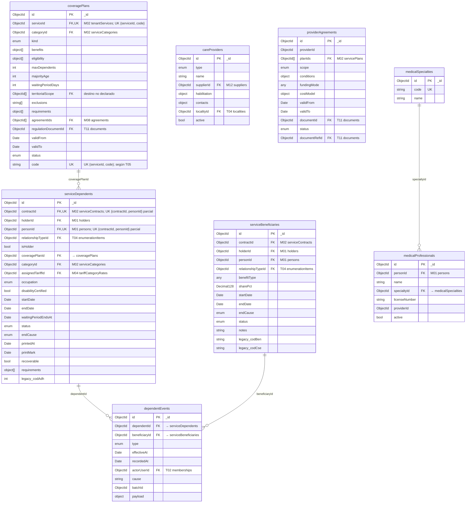
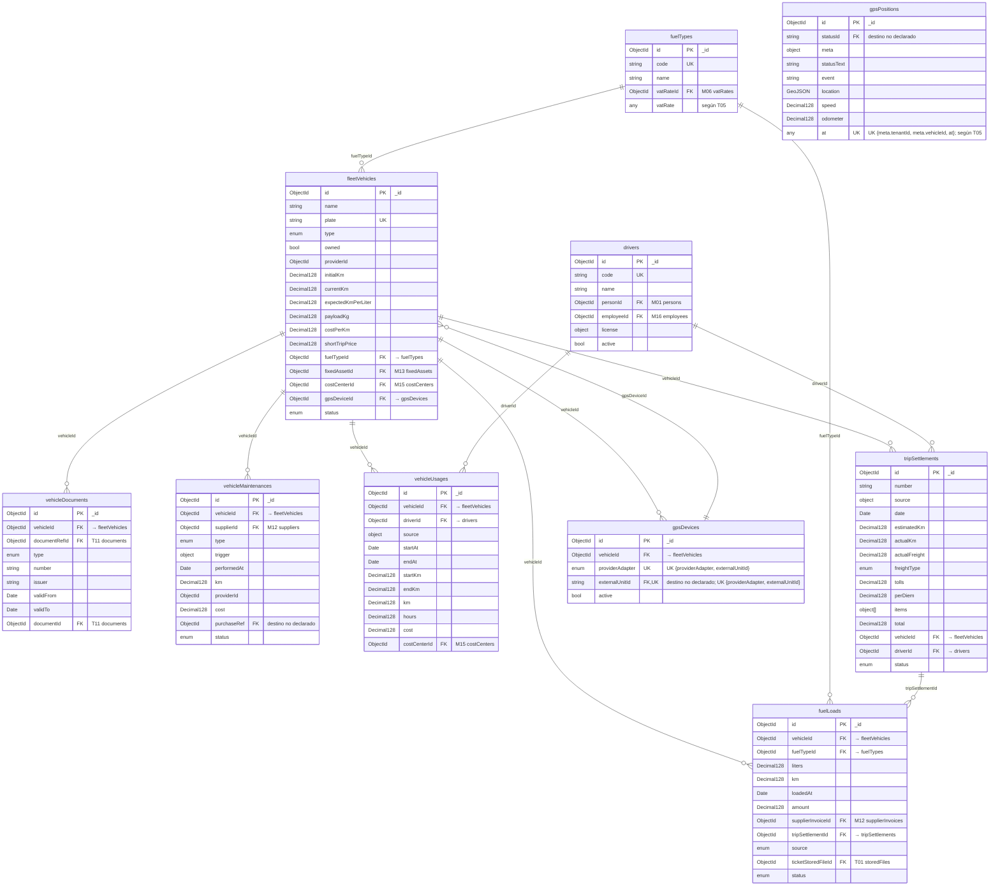

# Modelo entidad-relación — M18 SOC Servicios sociales y flota

| Campo | Valor |
|---|---|
| Artefacto | 6.1 Modelo entidad-relación completo, vista por módulo (índice: [`03-modelo-entidad-relacion.md`](../03-modelo-entidad-relacion.md)) |
| Anexo dueño | [`M18-SOC-servicios-sociales-flota.md`](../../especificacion/anexos/M18-SOC-servicios-sociales-flota.md), §7 |
| Catálogo canónico | [`T05-DAT-modelo-datos.md`](../../especificacion/anexos/T05-DAT-modelo-datos.md), filas `COL-SOC-NN` |
| Vista por dominio | [`03e-er-institucional-social-portal-transversales.md` §21](../03e-er-institucional-social-portal-transversales.md) |
| Versión | 2.1 (05-11-2026) |
| Generado con | [`_trabajo/generar_er_completo.py`](../_trabajo/generar_er_completo.py), revisado a mano |

## 1. Resumen

T05 registra 53 filas con dueño M18: **53 colecciones a crear** y 0 absorbidas en otras colecciones. Las 53 colecciones a crear se dibujan en 4 diagramas, uno por subdominio.

Convenciones: las del índice (secciones 1.3 y 2). Cada entidad lleva `id PK "_id"` y los campos de su ficha del §7; se omiten los campos transversales (`tenantId`, auditoría, `version`, baja lógica, `legacy`). El comentario de una `FK` indica el destino: `→ colección` si es del mismo módulo, `MXX colección` si es de otro; "(inferido)" cuando ni el anexo ni T05 §7.2 y §7.2.1 nombran el destino para esa colección y el nombre del campo no coincide literalmente con el de la colección (se dedujo por rol, sufijo, versión o por el contexto de §7.2.1; a confirmar); "destino no declarado" cuando no se puede fijar. Una referencia polimórfica (`entityType` + `entityId`, `resourceType` + `resourceId`, `targetRef`, `subjectRef`…) no lleva `FK` ni relación: el comentario "referencia polimórfica según <discriminador>" la señala, porque el destino depende del discriminador. Los campos que T05 §7.2.1 declara "no es referencia" no llevan `FK`. Los nombres que el anexo o T05 citan solo en notas "antes …", "Reemplazado por" o "alias" no se toman como campos ni como destinos. `UK` marca los únicos mínimos de T05; "según T05" señala un campo que figura en el catálogo pero no en la ficha del anexo. El tipo `any` indica que el anexo no declara el tipo.

## 2. Colecciones del módulo

| COL-ID | Colección | Diagrama | Ola | Clasificación | Alcance | Volumen o TTL (T05 §7.8) | Ficha en el anexo |
|---|---|---|---|---|---|---|---|
| COL-SOC-01 | `serviceDependents` | 1 | O4 | ID/SE | T | — | serviceDependents — adherentes |
| COL-SOC-02 | `serviceBeneficiaries` | 1 | O4 | ID | T | — | serviceBeneficiaries |
| COL-SOC-03 | `dependentEvents` | 1 | O4 | AU | T | — | dependentEvents |
| COL-SOC-04 | `coveragePlans` | 1 | O10 | CF | T | — | coveragePlans |
| COL-SOC-05 | `careProviders` | 1 | O10 | CF | T | — | careProviders |
| COL-SOC-06 | `providerAgreements` | 1 | O10 | CF | T | — | providerAgreements |
| COL-SOC-07 | `medicalSpecialties` | 1 | O10 | CF | T | — | medicalSpecialties y medicalPr |
| COL-SOC-08 | `medicalProfessionals` | 1 | O10 | ID | T | — | medicalSpecialties y medicalPr |
| COL-SOC-09 | `benefitRequests` | 2 | O10 | SE | T | — | benefitRequests |
| COL-SOC-10 | `burialServiceCases` | 2 | O10 | SE | T | — | burialServiceCases |
| COL-SOC-11 | `deathSubsidyCases` | 2 | O10 | FI | T | — | deathSubsidyCases |
| COL-SOC-12 | `bloodCoverageRequests` | 2 | O10 | SE | T | — | bloodCoverageRequests |
| COL-SOC-13 | `donationCampaigns` | 2 | O10 | OP | T | — | donationCampaigns y donationAp |
| COL-SOC-14 | `donationAppointments` | 2 | O10 | SE | T | — | donationCampaigns y donationAp |
| COL-SOC-15 | `healthAuthorizations` | 2 | O10 | SE | T | — | healthAuthorizations |
| COL-SOC-16 | `transportTrips` | 2 | O10 | SE/UB | T | — | transportTrips y tripLegs |
| COL-SOC-17 | `tripLegs` | 2 | O10 | UB | T | — | transportTrips y tripLegs |
| COL-SOC-18 | `tripCharacteristics` | 2 | O10 | CF | T | — | tripCharacteristics |
| COL-SOC-19 | `cemeteries` | 2 | O10 | CF | T | — | §7.4 |
| COL-SOC-20 | `cemeteryRegulations` | 2 | O10 | CF | T | — | §7.4 |
| COL-SOC-21 | `burialUnits` | 2 | O10 | OP/UB | T | — | §7.4 |
| COL-SOC-22 | `burialRights` | 2 | O10 | ID/FI | T | — | §7.4 |
| COL-SOC-23 | `burialRightEvents` | 2 | O10 | AU | T | — | §7.4 |
| COL-SOC-24 | `burialOccupancies` | 2 | O10 | ID | T | — | §7.4 |
| COL-SOC-25 | `cemeteryActs` | 2 | O10 | ID | T | — | §7.4 |
| COL-SOC-26 | `orthopedicItems` | 2 | O10 | OP | T | — | §7.5 |
| COL-SOC-27 | `orthopedicLoans` | 2 | O10 | SE | T | — | §7.5 |
| COL-SOC-28 | `dispenserWithdrawals` | 2 | O10 | OP | T | — | §7.5 |
| COL-SOC-53 | `contractRegistrations` | 2 | O10 | OP | T | — | §7.5 |
| COL-SOC-29 | `housingPlans` | 3 | O10 | CF | T | — | §7.6 |
| COL-SOC-30 | `housingPrices` | 3 | O10 | CF | T | — | §7.6 |
| COL-SOC-31 | `housingUnits` | 3 | O10 | FI/UB | T | — | §7.6 |
| COL-SOC-32 | `housingContributions` | 3 | O10 | FI | T | — | §7.6 |
| COL-SOC-33 | `housingStages` | 3 | O10 | CF | T | — | §7.6 |
| COL-SOC-34 | `housingActivities` | 3 | O10 | CF | T | — | §7.6 |
| COL-SOC-35 | `housingActivityMaterials` | 3 | O10 | CF | T | — | §7.6 |
| COL-SOC-36 | `housingProgress` | 3 | O10 | OP | T | — | §7.6 |
| COL-SOC-37 | `housingProgressMaterials` | 3 | O10 | OP | T | — | §7.6 |
| COL-SOC-38 | `housingMaterialAllocations` | 3 | O10 | OP | T | — | §7.6 |
| COL-SOC-39 | `housingMaterialWithdrawals` | 3 | O10 | OP | T | — | §7.6 |
| COL-SOC-40 | `housingCertificates` | 3 | O10 | FI | T | — | §7.6 |
| COL-SOC-41 | `housingPlanChanges` | 3 | O10 | FI | T | — | §7.6 |
| COL-SOC-42 | `housingTerminations` | 3 | O10 | FI | T | — | §7.6 |
| COL-SOC-43 | `fleetVehicles` | 4 | O8 | OP | T | — | §7.7 |
| COL-SOC-44 | `drivers` | 4 | O8 | ID | T | — | §7.7 |
| COL-SOC-45 | `vehicleDocuments` | 4 | O8 | OP | T | — | §7.7 |
| COL-SOC-46 | `vehicleMaintenances` | 4 | O8 | OP | T | — | §7.7 |
| COL-SOC-47 | `vehicleUsages` | 4 | O8 | OP | T | — | §7.7 |
| COL-SOC-48 | `fuelTypes` | 4 | O8 | CF | T | — | §7.7 |
| COL-SOC-49 | `fuelLoads` | 4 | O8 | OP | T | — | §7.7 |
| COL-SOC-50 | `tripSettlements` | 4 | O8 | FI | T | — | §7.7 |
| COL-SOC-51 | `gpsDevices` | 4 | O8 | TE | T | — | §7.7 |
| COL-SOC-52 | `gpsPositions` | 4 | O8 | UB | T | 30 M (30 vehículos, cada 30 s) / 90 M por año | §7.7 |

## 3. Diagrama 1: Grupos de cobertura, planes, prestadores y convenios

8 colecciones (ver tabla de la sección 2). Ficha en el anexo: serviceDependents — adherentes, serviceBeneficiaries, dependentEvents, coveragePlans, careProviders, providerAgreements, medicalSpecialties y medicalPr.

**Índices principales del diagrama 1**

| Colección | Índices declarados en el anexo | Únicos mínimos (T05) |
|---|---|---|
| `serviceDependents` | `{tenantId, contractId, status}`; `{tenantId, personId, status}`; `{tenantId, contractId, personId}` único parcial (`status ≠ ended`) salvo PRM-SOC-002. Origen: `ADHSOC` (más 6 columnas no detalladas [VERIFICAR]). | `{contractId, personId}` p. (`status ≠ ended`) |
| `serviceBeneficiaries` | `{tenantId, contractId, status}`, `{tenantId, personId}`. Origen: `BENSOC`, destino único (CTR-SOC-03, RN-MIG-054 de T07). | — |
| `dependentEvents` | `{tenantId, dependentId, effectiveAt}`. | — |
| `coveragePlans` | `{tenantId, serviceId, validFrom}`. | `{serviceId, code}` [VERIFICAR] |
| `careProviders` | `{tenantId, type, active}`. Origen: nosocomios y empresas de `AMBULANC`. | — |
| `providerAgreements` | `{tenantId, providerId, validFrom}`. | — |
| `medicalSpecialties` | — | `code` |
| `medicalProfessionals` | — | — |

## 4. Diagrama 2: Solicitudes y prestaciones, cementerio parque y otros servicios

21 colecciones (ver tabla de la sección 2). Ficha en el anexo: benefitRequests, burialServiceCases, deathSubsidyCases, bloodCoverageRequests, donationCampaigns y donationAp, healthAuthorizations, transportTrips y tripLegs, tripCharacteristics ….

```mermaid
erDiagram
  benefitRequests {
    ObjectId id PK "_id"
    string number UK
    enum kind
    ObjectId contractId FK "M02 serviceContracts"
    ObjectId beneficiaryPersonId FK "M01 persons"
    ObjectId requesterPersonId FK "M01 persons"
    Date eventDate
    enum channel
    object coverageCheck
    ObjectId providerId
    string providerReference
    Decimal128 costs
    ObjectId memberChargeBillingRef FK "destino no declarado"
    ObjectId providerInvoiceRef FK "M12 supplierInvoices"
    enum status
    object decision
    ObjectId[] documents FK "destino no declarado"
    string sensitiveNotes
  }
  burialServiceCases {
    ObjectId id PK "_id"
    ObjectId requestId FK "→ benefitRequests"
    ObjectId deceasedPersonId FK "M01 persons"
    Date deathDate
    string place
    ObjectId providerId
    object[] services
    ObjectId cemeteryActId FK "→ cemeteryActs"
    ObjectId tripId FK "→ transportTrips"
    ObjectId deathCertificateDocumentId FK "T11 documents"
    enum status
    Date providerConformityAt
  }
  deathSubsidyCases {
    ObjectId id PK "_id"
    ObjectId requestId FK "→ benefitRequests"
    ObjectId deceasedPersonId FK "M01 persons"
    string regulationVersion
    any fund
    Decimal128 amount
    object[] beneficiaries
    Date claimDeadline
    ObjectId approvalId FK "T11 approvalRequests"
    enum status
  }
  bloodCoverageRequests {
    ObjectId id PK "_id"
    ObjectId requestId FK "→ benefitRequests"
    ObjectId agreementId FK "→ providerAgreements"
    ObjectId facilityId FK "destino no declarado"
    string providerReference
    string requestedUnitsNote
    Date responseAt
    string responseSummary
    enum status
  }
  donationCampaigns {
    ObjectId id PK "_id"
    string name
    ObjectId agreementId FK "→ providerAgreements"
    Date dates
    string place
    Decimal128 capacity
    enum status
  }
  donationAppointments {
    ObjectId id PK "_id"
    ObjectId campaignId FK "→ donationCampaigns"
    ObjectId personId FK "M01 persons"
    Date slotAt
    enum status
  }
  healthAuthorizations {
    ObjectId id PK "_id"
    ObjectId requestId FK "→ benefitRequests"
    enum type
    ObjectId providerId
    Date admissionDate
    Date dischargeDate
    string authorizationNumber
    int coveredDays
    Decimal128 cost
    enum status
  }
  transportTrips {
    ObjectId id PK "_id"
    string number UK
    enum kind
    ObjectId requestId FK "→ benefitRequests"
    ObjectId passengerPersonId FK "M01 persons"
    ObjectId beneficiaryId FK "→ serviceBeneficiaries"
    object passengerSnapshot
    Date requestedAt
    Date tripDate
    object origin
    object destination
    ObjectId companyProviderId FK "→ careProviders"
    ObjectId vehicleId FK "→ fleetVehicles"
    ObjectId driverId FK "→ drivers"
    ObjectId[] professionalIds FK "→ medicalProfessionals"
    ObjectId characteristicId FK "→ tripCharacteristics"
    enum reasonCategory
    string reasonText
    Decimal128 km
    Decimal128 amount
    ObjectId billingRef FK "destino no declarado"
    ObjectId parentTripId FK "→ transportTrips"
    object schedule
    enum status
  }
  tripLegs {
    ObjectId id PK "_id"
    ObjectId tripId FK, UK "→ transportTrips; UK {tripId, order}"
    int order UK "UK {tripId, order}"
    object origin
    object destination
    Decimal128 km
    Date startedAt
    Date endedAt
  }
  tripCharacteristics {
    ObjectId id PK "_id"
    string code UK
    string name
    Decimal128 tariffModifier
  }
  cemeteries {
    ObjectId id PK "_id"
    string name UK
    object habilitation
    enum legalRegime
    string mortuaryAuthority
    object address
    bool active
  }
  cemeteryRegulations {
    ObjectId id PK "_id"
    ObjectId cemeteryId FK, UK "→ cemeteries; UK {cemeteryId, validFrom}"
    ObjectId documentId FK "T11 documents"
    ObjectId documentRefId FK "T11 documents"
    Date validFrom UK "UK {cemeteryId, validFrom}"
    Date validTo
    ObjectId approvalRef FK "T11 approvalRequests"
  }
  burialUnits {
    ObjectId id PK "_id"
    ObjectId cemeteryId FK, UK "→ cemeteries; UK {cemeteryId, code}"
    string code UK "UK {cemeteryId, code}"
    object hierarchy
    enum type
    int levels
    GeoJSON geo
    enum availability
    int occupiedLevels
    ObjectId currentRightId FK "→ burialRights"
  }
  burialRights {
    ObjectId id PK "_id"
    string number UK
    ObjectId unitId FK "→ burialUnits"
    string regulationVersion
    enum modality
    object[] holders
    ObjectId contractorPersonId FK "M01 persons"
    ObjectId payerAccountId FK "M01 accounts"
    object[] authorizedPersons
    ObjectId instrumentDocumentId FK "T11 documents"
    object acquisition
    ObjectId maintenanceContractId FK "M02 serviceContracts"
    Date startDate
    Date endDate
    enum status
    Date reservationExpiresAt
  }
  burialRightEvents {
    ObjectId id PK "_id"
    ObjectId rightId FK "→ burialRights"
    enum type
    Date effectiveAt
    ObjectId approvalId FK "T11 approvalRequests"
    ObjectId[] documentIds FK "T11 documents"
    object payload
  }
  burialOccupancies {
    ObjectId id PK "_id"
    ObjectId unitId FK "→ burialUnits"
    enum level
    ObjectId deceasedPersonId FK "M01 persons"
    object deceasedSnapshot
    ObjectId intermentActId FK "→ cemeteryActs"
    Date startDate
    Date endDate
    ObjectId endActId FK "→ cemeteryActs"
    enum status
  }
  cemeteryActs {
    ObjectId id PK "_id"
    string number UK
    enum type
    ObjectId unitId FK "→ burialUnits"
    ObjectId targetUnitId FK "→ burialUnits"
    ObjectId rightId FK "→ burialRights"
    ObjectId deceasedPersonId FK "M01 persons"
    object authorizedBy
    object permit
    Date scheduledAt
    Date performedAt
    ObjectId responsibleEmployeeId FK "M16 employees"
    object origin
    any destination
    ObjectId billingRef FK "destino no declarado"
    enum status
  }
  orthopedicItems {
    ObjectId id PK "_id"
    string code UK
    enum type
    string description
    enum condition
    ObjectId fixedAssetId FK "M13 fixedAssets"
    ObjectId branchId FK "T04 branches"
  }
  orthopedicLoans {
    ObjectId id PK "_id"
    ObjectId itemId FK, UK "→ orthopedicItems; UK parcial"
    ObjectId requestId FK "→ benefitRequests"
    ObjectId borrowerPersonId FK "M01 persons"
    Date startDate
    Date dueDate
    Date returnedAt
    object deposit
    string returnCondition
    enum status
    bool active UK "UK parcial; según T05"
  }
  dispenserWithdrawals {
    ObjectId id PK "_id"
    ObjectId contractId FK "M02 serviceContracts"
    ObjectId personId FK "M01 persons"
    Decimal128 liters
    Date withdrawnAt
    ObjectId branchId FK "T04 branches"
    ObjectId operatorId FK "T02 memberships"
    Decimal128 monthlyAccumulated
  }
  contractRegistrations {
    ObjectId id PK "_id"
    ObjectId contractId FK, UK "M02 serviceContracts; UK {contractId, status}"
    enum type UK "UK {type, vehicle.plate}"
    object vehicle
    object device
    string description
    Date startDate
    Date endDate
    enum status UK "UK {contractId, status}"
  }
  benefitRequests ||--o{ burialServiceCases : "requestId"
  cemeteryActs ||--o{ burialServiceCases : "cemeteryActId"
  transportTrips ||--o{ burialServiceCases : "tripId"
  benefitRequests ||--o{ deathSubsidyCases : "requestId"
  benefitRequests ||--o{ bloodCoverageRequests : "requestId"
  donationCampaigns ||--o{ donationAppointments : "campaignId"
  benefitRequests ||--o{ healthAuthorizations : "requestId"
  benefitRequests |o--o{ transportTrips : "requestId"
  tripCharacteristics |o--o{ transportTrips : "characteristicId"
  transportTrips |o--o{ transportTrips : "parentTripId"
  transportTrips ||--o{ tripLegs : "tripId"
  cemeteries ||--o{ cemeteryRegulations : "cemeteryId"
  cemeteries ||--o{ burialUnits : "cemeteryId"
  burialRights ||--o{ burialUnits : "currentRightId"
  burialUnits ||--o{ burialRights : "unitId"
  burialRights ||--o{ burialRightEvents : "rightId"
  burialUnits ||--o{ burialOccupancies : "unitId"
  cemeteryActs ||--o{ burialOccupancies : "intermentActId"
  cemeteryActs ||--o{ burialOccupancies : "endActId"
  burialUnits ||--o{ cemeteryActs : "unitId"
  burialUnits ||--o{ cemeteryActs : "targetUnitId"
  burialRights ||--o{ cemeteryActs : "rightId"
  orthopedicItems ||--o{ orthopedicLoans : "itemId"
  benefitRequests ||--o{ orthopedicLoans : "requestId"
```

**Índices principales del diagrama 2**

| Colección | Índices declarados en el anexo | Únicos mínimos (T05) |
|---|---|---|
| `benefitRequests` | `{tenantId, kind, status, eventDate}`, `{tenantId, beneficiaryPersonId}`, `{tenantId, number}` único. | `number` |
| `burialServiceCases` | `{tenantId, deceasedPersonId}`. | — |
| `deathSubsidyCases` | `{tenantId, status}`. | — |
| `bloodCoverageRequests` | `{tenantId, status}`. Sin campos de grupo sanguíneo, diagnóstico ni compatibilidad (RN-SOC-028, PA-SOC-03). | — |
| `donationCampaigns` | — | — |
| `donationAppointments` | — | — |
| `healthAuthorizations` | — | — |
| `transportTrips` | — | `number` |
| `tripLegs` | — | `{tripId, order}` |
| `tripCharacteristics` | — | `code` |
| `cemeteries` | — | `name` |
| `cemeteryRegulations` | — | `{cemeteryId, validFrom}` |
| `burialUnits` | — | `{cemeteryId, code}` |
| `burialRights` | — | `number` [VERIFICAR] |
| `burialRightEvents` | — | — |
| `burialOccupancies` | — | — |
| `cemeteryActs` | — | `number` |
| `orthopedicItems` | — | `code` |
| `orthopedicLoans` | — | `itemId` p. (`active`) [VERIFICAR] |
| `dispenserWithdrawals` | — | — |
| `contractRegistrations` | — | — (índices `{contractId, status}`, `{type, vehicle.plate}`, `{device.serialNumber}`) |

## 5. Diagrama 3: Planes de vivienda

14 colecciones (ver tabla de la sección 2). Ficha en el anexo: §7.6.

```mermaid
erDiagram
  housingPlans {
    ObjectId id PK "_id"
    ObjectId serviceId FK, UK "M02 tenantServices"
    string name
    object[] typologies
    object settings
    enum status
  }
  housingPrices {
    ObjectId id PK "_id"
    ObjectId planId FK "M02 servicePlans"
    ObjectId categoryId FK "M02 serviceCategories"
    Date date
    Decimal128 amount
    enum status
    ObjectId approvalId FK "T11 approvalRequests"
    ObjectId batchId
  }
  housingUnits {
    ObjectId id PK "_id"
    ObjectId contractId FK, UK "M02 serviceContracts"
    ObjectId holderId FK "M01 holders"
    ObjectId accountId FK "M01 accounts"
    ObjectId planId FK "M02 servicePlans"
    ObjectId categoryId FK "M02 serviceCategories"
    Date enrollmentDate
    Date allocationDate
    enum allocationMethod
    bool allocated
    bool ownLand
    Date partialDeliveryDate
    Date deliveryDate
    Date constructionStart
    Date constructionEnd
    Decimal128 pctToBill
    Decimal128 pctBilled
    Decimal128 pctPaid
    object lot
    enum status
  }
  housingContributions {
    ObjectId id PK "_id"
    ObjectId unitId FK, UK "→ housingUnits; UK {unitId, period, source}"
    string period UK "UK {unitId, period, source}"
    Decimal128 pct
    Decimal128 priceUsed
    Decimal128 amount
    ObjectId invoiceId FK "M05 invoices"
    enum status
    enum source UK "UK {unitId, period, source}"
  }
  housingStages {
    ObjectId id PK "_id"
    ObjectId planId FK "M02 servicePlans"
    ObjectId categoryId FK, UK "M02 serviceCategories; UK {categoryId, order}"
    string code
    string name
    int order UK "UK {categoryId, order}"
  }
  housingActivities {
    ObjectId id PK "_id"
    ObjectId stageId FK, UK "→ housingStages; UK {stageId, order}"
    string code
    string name
    Decimal128 hours
    Decimal128 hourPrice
    Decimal128 cost
    int order UK "UK {stageId, order}"
  }
  housingActivityMaterials {
    ObjectId id PK "_id"
    ObjectId activityId FK, UK "→ housingActivities; UK {activityId, inventoryItemId}"
    ObjectId inventoryItemId FK, UK "M13 inventoryItems; UK {activityId, inventoryItemId}"
    Decimal128 quantity
  }
  housingProgress {
    ObjectId id PK "_id"
    ObjectId unitId FK "→ housingUnits"
    ObjectId activityId FK "→ housingActivities"
    ObjectId supplierId FK "M12 suppliers"
    Date dateFrom
    Date dateTo
    Decimal128 hours
    Decimal128 pct
    string notes
    ObjectId providerId
    ObjectId purchaseInvoiceRef FK "M05 invoices"
    ObjectId certificateId FK "→ housingCertificates"
    ObjectId recordedBy FK "T02 memberships"
  }
  housingProgressMaterials {
    ObjectId id PK "_id"
    ObjectId progressId FK "destino no declarado"
    ObjectId allocationId FK "→ housingMaterialAllocations"
    ObjectId inventoryItemId FK "M13 inventoryItems"
    Decimal128 quantity
  }
  housingMaterialAllocations {
    ObjectId id PK "_id"
    ObjectId unitId FK "→ housingUnits"
    ObjectId inventoryItemId FK "M13 inventoryItems"
    string description
    Decimal128 quantity
    Decimal128 unitCost
    ObjectId stockMovementRef FK "M13 stockMovements"
    enum state
  }
  housingMaterialWithdrawals {
    ObjectId id PK "_id"
    ObjectId unitId FK "→ housingUnits"
    ObjectId providerId
    Date date
    object voucherRef FK "M05 voucherTypes"
    ObjectId stageId FK "→ housingStages"
    ObjectId warehouseId FK "M13 warehouses"
    ObjectId responsibleId FK "T02 memberships"
    object[] items
    ObjectId stockMovementRef FK "M13 stockMovements"
    enum status
  }
  housingCertificates {
    ObjectId id PK "_id"
    string number UK
    ObjectId unitId FK "→ housingUnits"
    ObjectId providerId
    ObjectId supplierId FK "M12 suppliers"
    Date periodFrom
    Date periodTo
    enum type
    object[] lines
    Decimal128 total
    ObjectId conceptId FK "M02 billableConcepts"
    ObjectId purchaseRef FK "destino no declarado"
    enum status
  }
  housingPlanChanges {
    ObjectId id PK "_id"
    ObjectId unitId FK "→ housingUnits"
    ObjectId fromCategoryId FK "M02 serviceCategories"
    ObjectId toCategoryId FK "M02 serviceCategories"
    Decimal128 billedPctBefore
    Decimal128 recalculatedPct
    Decimal128 difference
    ObjectId templateId FK "T11 documentTemplates"
    ObjectId approvalId FK "T11 approvalRequests"
    Date effectiveAt
  }
  housingTerminations {
    ObjectId id PK "_id"
    ObjectId unitId FK, UK "→ housingUnits; UK parcial"
    enum type
    Decimal128 contributedAmount
    Decimal128 commissionPct
    Decimal128 commissionAmount
    Decimal128 differenceAmount
    Decimal128 refundAmount
    ObjectId documentRef "referencia polimórfica"
    ObjectId templateId FK "T11 documentTemplates"
    ObjectId approvalId FK "T11 approvalRequests"
    enum status
  }
  housingUnits ||--o{ housingContributions : "unitId"
  housingStages ||--o{ housingActivities : "stageId"
  housingActivities ||--o{ housingActivityMaterials : "activityId"
  housingUnits ||--o{ housingProgress : "unitId"
  housingActivities ||--o{ housingProgress : "activityId"
  housingCertificates ||--o{ housingProgress : "certificateId"
  housingMaterialAllocations ||--o{ housingProgressMaterials : "allocationId"
  housingUnits ||--o{ housingMaterialAllocations : "unitId"
  housingUnits ||--o{ housingMaterialWithdrawals : "unitId"
  housingStages ||--o{ housingMaterialWithdrawals : "stageId"
  housingUnits ||--o{ housingCertificates : "unitId"
  housingUnits ||--o{ housingPlanChanges : "unitId"
  housingUnits ||--o{ housingTerminations : "unitId"
```

**Índices principales del diagrama 3**

| Colección | Índices declarados en el anexo | Únicos mínimos (T05) |
|---|---|---|
| `housingPlans` | — | `serviceId` [VERIFICAR] |
| `housingPrices` | — | — |
| `housingUnits` | — | `contractId` |
| `housingContributions` | — | `{unitId, period, source}` [VERIFICAR] |
| `housingStages` | — | `{categoryId, order}` |
| `housingActivities` | — | `{stageId, order}` |
| `housingActivityMaterials` | — | `{activityId, inventoryItemId}` |
| `housingProgress` | — | — |
| `housingProgressMaterials` | — | — |
| `housingMaterialAllocations` | — | — |
| `housingMaterialWithdrawals` | — | — |
| `housingCertificates` | — | `number` |
| `housingPlanChanges` | — | — |
| `housingTerminations` | — | `unitId` p. (no anuladas) [VERIFICAR] |

## 6. Diagrama 4: Flota y GPS

10 colecciones (ver tabla de la sección 2). Ficha en el anexo: §7.7.

**Índices principales del diagrama 4**

| Colección | Índices declarados en el anexo | Únicos mínimos (T05) |
|---|---|---|
| `fleetVehicles` | — | `plate` |
| `drivers` | — | `code` |
| `vehicleDocuments` | — | — |
| `vehicleMaintenances` | — | — |
| `vehicleUsages` | — | — |
| `fuelTypes` | — | `code` |
| `fuelLoads` | — | — |
| `tripSettlements` | — | `{source.kind, source.id}` |
| `gpsDevices` | — | `{providerAdapter, externalUnitId}` |
| `gpsPositions` | — | `{meta.tenantId, meta.vehicleId, at}` |

## 7. Relaciones con otros módulos y entre diagramas

Referencias que salen de una colección de este módulo hacia una entidad de otro módulo o de otro diagrama del mismo módulo (no se dibujan para mantener cada diagrama dentro de su módulo y subdominio).

| Colección origen | Campo | Cardinalidad (destino a origen) | Destino | COL-ID destino | Módulo destino |
|---|---|---|---|---|---|
| `serviceDependents` | `contractId` | 1 a N | `serviceContracts` | COL-CAT-18 | M02 |
| `serviceDependents` | `holderId` | 1 a N | `holders` | COL-PER-04 | M01 |
| `serviceDependents` | `personId` | 1 a N | `persons` | COL-PER-01 | M01 |
| `serviceDependents` | `relationshipTypeId` | 1 a N | `enumerationItems` | COL-CFG-06 | T04 |
| `serviceDependents` | `categoryId` | 0..1 a N | `serviceCategories` | COL-CAT-10 | M02 |
| `serviceDependents` | `assignedTariffId` | 0..1 a N | `tariffCategoryRates` | COL-TAR-03 | M04 |
| `serviceBeneficiaries` | `contractId` | 1 a N | `serviceContracts` | COL-CAT-18 | M02 |
| `serviceBeneficiaries` | `holderId` | 1 a N | `holders` | COL-PER-04 | M01 |
| `serviceBeneficiaries` | `personId` | 1 a N | `persons` | COL-PER-01 | M01 |
| `serviceBeneficiaries` | `relationshipTypeId` | 1 a N | `enumerationItems` | COL-CFG-06 | T04 |
| `dependentEvents` | `actorUserId` | 1 a N | `memberships` | COL-IAM-04 | T02 |
| `coveragePlans` | `serviceId` | 1 a N | `tenantServices` | COL-CAT-02 | M02 |
| `coveragePlans` | `categoryId` | 1 a N | `serviceCategories` | COL-CAT-10 | M02 |
| `coveragePlans` | `agreementIds` | N a N | `agreements` | COL-MOR-29 | M08 |
| `coveragePlans` | `regulationDocumentId` | 0..1 a N | `documents` | COL-WFL-34 | T11 |
| `careProviders` | `supplierId` | 1 a N | `suppliers` | COL-CMP-01 | M12 |
| `careProviders` | `localityId` | 1 a N | `localities` | COL-CFG-10 | T04 |
| `providerAgreements` | `planIds` | N a N | `servicePlans` | COL-CAT-07 | M02 |
| `providerAgreements` | `documentId`, `documentRefId` | 1 a N | `documents` | COL-WFL-34 | T11 |
| `medicalProfessionals` | `personId` | 1 a N | `persons` | COL-PER-01 | M01 |
| `benefitRequests` | `contractId` | 0..1 a N | `serviceContracts` | COL-CAT-18 | M02 |
| `benefitRequests` | `beneficiaryPersonId`, `requesterPersonId` | 1 a N | `persons` | COL-PER-01 | M01 |
| `benefitRequests` | `providerInvoiceRef` | 0..1 a N | `supplierInvoices` | COL-CMP-12 | M12 |
| `burialServiceCases` | `deceasedPersonId` | 1 a N | `persons` | COL-PER-01 | M01 |
| `burialServiceCases` | `deathCertificateDocumentId` | 1 a N | `documents` | COL-WFL-34 | T11 |
| `deathSubsidyCases` | `deceasedPersonId` | 1 a N | `persons` | COL-PER-01 | M01 |
| `deathSubsidyCases` | `approvalId` | 1 a N | `approvalRequests` | COL-WFL-24 | T11 |
| `bloodCoverageRequests` | `agreementId` | 1 a N | `providerAgreements` | COL-SOC-06 | mismo módulo, diagrama 1 |
| `donationCampaigns` | `agreementId` | 1 a N | `providerAgreements` | COL-SOC-06 | mismo módulo, diagrama 1 |
| `donationAppointments` | `personId` | 1 a N | `persons` | COL-PER-01 | M01 |
| `transportTrips` | `passengerPersonId` | 0..1 a N | `persons` | COL-PER-01 | M01 |
| `transportTrips` | `beneficiaryId` | 0..1 a N | `serviceBeneficiaries` | COL-SOC-02 | mismo módulo, diagrama 1 |
| `transportTrips` | `companyProviderId` | 0..1 a N | `careProviders` | COL-SOC-05 | mismo módulo, diagrama 1 |
| `transportTrips` | `vehicleId` | 0..1 a N | `fleetVehicles` | COL-SOC-43 | mismo módulo, diagrama 4 |
| `transportTrips` | `driverId` | 0..1 a N | `drivers` | COL-SOC-44 | mismo módulo, diagrama 4 |
| `transportTrips` | `professionalIds` | N a N | `medicalProfessionals` | COL-SOC-08 | mismo módulo, diagrama 1 |
| `cemeteryRegulations` | `documentId`, `documentRefId` | 1 a N | `documents` | COL-WFL-34 | T11 |
| `cemeteryRegulations` | `approvalRef` | 1 a N | `approvalRequests` | COL-WFL-24 | T11 |
| `burialRights` | `contractorPersonId` | 1 a N | `persons` | COL-PER-01 | M01 |
| `burialRights` | `payerAccountId` | 1 a N | `accounts` | COL-PER-05 | M01 |
| `burialRights` | `instrumentDocumentId` | 1 a N | `documents` | COL-WFL-34 | T11 |
| `burialRights` | `maintenanceContractId` | 1 a N | `serviceContracts` | COL-CAT-18 | M02 |
| `burialRightEvents` | `approvalId` | 1 a N | `approvalRequests` | COL-WFL-24 | T11 |
| `burialRightEvents` | `documentIds` | N a N | `documents` | COL-WFL-34 | T11 |
| `burialOccupancies` | `deceasedPersonId` | 1 a N | `persons` | COL-PER-01 | M01 |
| `cemeteryActs` | `deceasedPersonId` | 1 a N | `persons` | COL-PER-01 | M01 |
| `cemeteryActs` | `responsibleEmployeeId` | 1 a N | `employees` | COL-SUE-02 | M16 |
| `orthopedicItems` | `fixedAssetId` | 1 a N | `fixedAssets` | COL-STK-26 | M13 |
| `orthopedicItems` | `branchId` | 1 a N | `branches` | COL-CFG-42 | T04 |
| `orthopedicLoans` | `borrowerPersonId` | 1 a N | `persons` | COL-PER-01 | M01 |
| `dispenserWithdrawals` | `contractId` | 1 a N | `serviceContracts` | COL-CAT-18 | M02 |
| `dispenserWithdrawals` | `personId` | 1 a N | `persons` | COL-PER-01 | M01 |
| `dispenserWithdrawals` | `branchId` | 1 a N | `branches` | COL-CFG-42 | T04 |
| `dispenserWithdrawals` | `operatorId` | 1 a N | `memberships` | COL-IAM-04 | T02 |
| `housingPlans` | `serviceId` | 1 a 0..1 | `tenantServices` | COL-CAT-02 | M02 |
| `housingPrices` | `planId` | 1 a N | `servicePlans` | COL-CAT-07 | M02 |
| `housingPrices` | `categoryId` | 1 a N | `serviceCategories` | COL-CAT-10 | M02 |
| `housingPrices` | `approvalId` | 1 a N | `approvalRequests` | COL-WFL-24 | T11 |
| `housingUnits` | `contractId` | 1 a 0..1 | `serviceContracts` | COL-CAT-18 | M02 |
| `housingUnits` | `holderId` | 1 a N | `holders` | COL-PER-04 | M01 |
| `housingUnits` | `accountId` | 1 a N | `accounts` | COL-PER-05 | M01 |
| `housingUnits` | `planId` | 1 a N | `servicePlans` | COL-CAT-07 | M02 |
| `housingUnits` | `categoryId` | 1 a N | `serviceCategories` | COL-CAT-10 | M02 |
| `housingContributions` | `invoiceId` | 1 a N | `invoices` | COL-FAC-13 | M05 |
| `housingStages` | `planId` | 1 a N | `servicePlans` | COL-CAT-07 | M02 |
| `housingStages` | `categoryId` | 1 a N | `serviceCategories` | COL-CAT-10 | M02 |
| `housingActivityMaterials` | `inventoryItemId` | 1 a N | `inventoryItems` | COL-STK-05 | M13 |
| `housingProgress` | `supplierId` | 1 a N | `suppliers` | COL-CMP-01 | M12 |
| `housingProgress` | `purchaseInvoiceRef` | 1 a N | `invoices` | COL-FAC-13 | M05 |
| `housingProgress` | `recordedBy` | 0..1 a N | `memberships` | COL-IAM-04 | T02 |
| `housingProgressMaterials` | `inventoryItemId` | 1 a N | `inventoryItems` | COL-STK-05 | M13 |
| `housingMaterialAllocations` | `inventoryItemId` | 1 a N | `inventoryItems` | COL-STK-05 | M13 |
| `housingMaterialAllocations` | `stockMovementRef` | 1 a N | `stockMovements` | COL-STK-11 | M13 |
| `housingMaterialWithdrawals` | `voucherRef` | 1 a N | `voucherTypes` | COL-FAC-18 | M05 |
| `housingMaterialWithdrawals` | `warehouseId` | 1 a N | `warehouses` | COL-STK-07 | M13 |
| `housingMaterialWithdrawals` | `responsibleId` | 1 a N | `memberships` | COL-IAM-04 | T02 |
| `housingMaterialWithdrawals` | `stockMovementRef` | 1 a N | `stockMovements` | COL-STK-11 | M13 |
| `housingCertificates` | `supplierId` | 1 a N | `suppliers` | COL-CMP-01 | M12 |
| `housingCertificates` | `conceptId` | 1 a N | `billableConcepts` | COL-CAT-06 | M02 |
| `housingPlanChanges` | `fromCategoryId`, `toCategoryId` | 1 a N | `serviceCategories` | COL-CAT-10 | M02 |
| `housingPlanChanges` | `templateId` | 1 a N | `documentTemplates` | COL-WFL-41 | T11 |
| `housingPlanChanges` | `approvalId` | 1 a N | `approvalRequests` | COL-WFL-24 | T11 |
| `housingTerminations` | `templateId` | 1 a N | `documentTemplates` | COL-WFL-41 | T11 |
| `housingTerminations` | `approvalId` | 1 a N | `approvalRequests` | COL-WFL-24 | T11 |
| `fleetVehicles` | `fixedAssetId` | 1 a N | `fixedAssets` | COL-STK-26 | M13 |
| `fleetVehicles` | `costCenterId` | 1 a N | `costCenters` | COL-CON-16 | M15 |
| `drivers` | `personId` | 1 a N | `persons` | COL-PER-01 | M01 |
| `drivers` | `employeeId` | 1 a N | `employees` | COL-SUE-02 | M16 |
| `vehicleDocuments` | `documentRefId`, `documentId` | 1 a N | `documents` | COL-WFL-34 | T11 |
| `vehicleMaintenances` | `supplierId` | 1 a N | `suppliers` | COL-CMP-01 | M12 |
| `vehicleUsages` | `costCenterId` | 1 a N | `costCenters` | COL-CON-16 | M15 |
| `fuelTypes` | `vatRateId` | 1 a N | `vatRates` | COL-FIS-16 | M06 |
| `fuelLoads` | `supplierInvoiceId` | 1 a N | `supplierInvoices` | COL-CMP-12 | M12 |
| `fuelLoads` | `ticketStoredFileId` | 1 a N | `storedFiles` | COL-PLA-29 | T01 |
| `contractRegistrations` | `contractId` | 1 a N | `serviceContracts` | COL-CAT-18 | M02 |

## 8. Colecciones absorbidas y renombradas

Ninguna colección del módulo quedó absorbida.

## 9. Observaciones e inconsistencias detectadas

- Referencias sin colección destino declarada (ni en el anexo ni en T05 §7.2 y §7.2.1; quedan como `FK` "destino no declarado"): `coveragePlans.territorialScope`, `benefitRequests.memberChargeBillingRef`, `benefitRequests.documents`, `bloodCoverageRequests.facilityId`, `transportTrips.billingRef`, `cemeteryActs.billingRef`, `housingProgressMaterials.progressId`, `housingCertificates.purchaseRef`, `vehicleMaintenances.purchaseRef`, `gpsDevices.externalUnitId`, `gpsPositions.statusId`.
- Campos que T05 cita en "Claves y referencias" o "Únicos" y que la ficha del anexo no declara con ese nombre (posible diferencia de nombre; a verificar en el anexo): `coveragePlans`: `code`; `orthopedicLoans`: `active`; `fuelTypes`: `vatRate`; `gpsPositions`: `at`.
