# Modelo entidad-relación — M19 POR Portal del socio y landing

| Campo | Valor |
|---|---|
| Artefacto | 6.1 Modelo entidad-relación completo, vista por módulo (índice: [`03-modelo-entidad-relacion.md`](../03-modelo-entidad-relacion.md)) |
| Anexo dueño | [`M19-POR-portal-socio-landing.md`](../../especificacion/anexos/M19-POR-portal-socio-landing.md), §7 |
| Catálogo canónico | [`T05-DAT-modelo-datos.md`](../../especificacion/anexos/T05-DAT-modelo-datos.md), filas `COL-POR-NN` |
| Vista por dominio | [`03e-er-institucional-social-portal-transversales.md` §22](../03e-er-institucional-social-portal-transversales.md) |
| Versión | 2.1 (05-11-2026) |
| Generado con | [`_trabajo/generar_er_completo.py`](../_trabajo/generar_er_completo.py), revisado a mano |

## 1. Resumen

T05 registra 14 filas con dueño M19: **14 colecciones a crear** y 0 absorbidas en otras colecciones. Las 14 colecciones a crear se dibujan en 1 diagrama, uno por subdominio.

Convenciones: las del índice (secciones 1.3 y 2). Cada entidad lleva `id PK "_id"` y los campos de su ficha del §7; se omiten los campos transversales (`tenantId`, auditoría, `version`, baja lógica, `legacy`). El comentario de una `FK` indica el destino: `→ colección` si es del mismo módulo, `MXX colección` si es de otro; "(inferido)" cuando ni el anexo ni T05 §7.2 y §7.2.1 nombran el destino para esa colección y el nombre del campo no coincide literalmente con el de la colección (se dedujo por rol, sufijo, versión o por el contexto de §7.2.1; a confirmar); "destino no declarado" cuando no se puede fijar. Una referencia polimórfica (`entityType` + `entityId`, `resourceType` + `resourceId`, `targetRef`, `subjectRef`…) no lleva `FK` ni relación: el comentario "referencia polimórfica según <discriminador>" la señala, porque el destino depende del discriminador. Los campos que T05 §7.2.1 declara "no es referencia" no llevan `FK`. Los nombres que el anexo o T05 citan solo en notas "antes …", "Reemplazado por" o "alias" no se toman como campos ni como destinos. `UK` marca los únicos mínimos de T05; "según T05" señala un campo que figura en el catálogo pero no en la ficha del anexo. El tipo `any` indica que el anexo no declara el tipo.

## 2. Colecciones del módulo

| COL-ID | Colección | Diagrama | Ola | Clasificación | Alcance | Volumen o TTL (T05 §7.8) | Ficha en el anexo |
|---|---|---|---|---|---|---|---|
| COL-POR-01 | `landingPages` | 1 | O2 | CF | T | — | §7.1 |
| COL-POR-02 | `landingPageVersions` | 1 | O2 | CF | T | — | §7.2 |
| COL-POR-03 | `portalAccountAccess` | 1 | O2 | ID | T | — | §7.3 |
| COL-POR-04 | `portalLinkAttempts` | 1 | O2 | TE | T | TTL sobre `expiresAt` (Según M19) | §7.4 |
| COL-POR-05 | `portalDelegationInvites` | 1 | O2 | CT | T | — | §7.5 |
| COL-POR-06 | `portalForms` | 1 | O2 | CF | T | — | §7.6 |
| COL-POR-07 | `portalFormSubmissions` | 1 | O2 | CT | T | — | §7.7 |
| COL-POR-08 | `portalDrafts` | 1 | O2 | CT | T | TTL sobre `expiresAt` (Según M19) | §7.8 |
| COL-POR-09 | `publicSubmissions` | 1 | O2 | CT | T | — | §7.9 |
| COL-POR-10 | `portalUserPreferences` | 1 | O2 | CF | T | — | §7.10 |
| COL-POR-11 | `portalBanners` | 1 | O2 | CF | T | — | §7.11 |
| COL-POR-12 | `legacyPortalImports` | 1 | O11 | TE | T | — | §7.12 |
| COL-POR-13 | `legacyPortalUserMap` | 1 | O11 | ID | T | — | §7.13 |
| COL-POR-14 | `kioskDevices` | 1 | O10 | TE | T | — | §7.14 |

## 3. Diagrama 1: Landing, acceso al portal, formularios, banners, herencia CoopOnline y kioscos

14 colecciones (ver tabla de la sección 2). Ficha en el anexo: §7.1, §7.2, §7.3, §7.4, §7.5, §7.6, §7.7, §7.8 ….

```mermaid
erDiagram
  landingPages {
    ObjectId id PK "_id"
    string locale UK
    string slug UK
    string customDomain UK "UK parcial"
    enum customDomainStatus
    ObjectId publishedVersionId FK "→ landingPageVersions"
    ObjectId draftVersionId FK "→ landingPageVersions"
    object seo
    array legacyRedirects
    enum status
    ObjectId tenantBrandingId FK "T03 tenantBrandings"
  }
  landingPageVersions {
    ObjectId id PK "_id"
    ObjectId landingPageId FK, UK "→ landingPages"
    int number
    enum status
    array blocks
    object blocks_props
    Date scheduledAt
    Date publishedAt
    ObjectId publishedBy FK "T02 memberships"
    string reviewComment
    ObjectId previousVersionId FK "→ landingPageVersions"
  }
  portalAccountAccess {
    ObjectId id PK "_id"
    ObjectId userId FK, UK "T02 memberships; UK {userId, accountId} parcial"
    ObjectId personId FK "M01 persons"
    ObjectId accountId FK, UK "M01 accounts; UK {userId, accountId} parcial"
    ObjectId[] contractIds FK "M02 serviceContracts"
    enum role
    enum[] actions
    enum origin
    object evidence
    ObjectId grantedByUserId FK "T02 memberships"
    Date validFrom
    Date validTo
    enum status
    Date revokedAt
    ObjectId revokedBy FK "T02 memberships"
    string revokeReason
    bool isDefault
    Date lastUsedAt
  }
  portalLinkAttempts {
    ObjectId id PK "_id"
    ObjectId userId FK "T02 memberships"
    enum method
    string inputFingerprint
    enum result
    ObjectId accountId FK "M01 accounts"
    string ip
    string userAgentHash
    Date expiresAt
  }
  portalDelegationInvites {
    ObjectId id PK "_id"
    ObjectId accountId FK "M01 accounts"
    ObjectId[] contractIds FK "M02 serviceContracts"
    ObjectId grantorUserId FK "T02 memberships"
    object inviteeContact
    ObjectId inviteeUserId FK "T02 memberships"
    enum[] actions
    Date validTo
    string tokenHash UK
    enum status
    ObjectId accessId FK "destino no declarado"
  }
  portalForms {
    ObjectId id PK "_id"
    string code UK
    string nameKey
    string descriptionKey
    ObjectId serviceId FK "M02 tenantServices"
    enum kind
    enum requiredSubject
    enum audience
    enum requiredAction
    enum repetition
    bool compareDocument
    bool showTerms
    bool termsKey
    bool termsVersion
    ObjectId pdfStoredFileId FK "T01 storedFiles"
    bool contactRequired
    string executionCommand
    string notifyEmail
    bool selfServiceImmediate
    enum status
    int currentVersion
    array versions
    object[] versions_steps_fields
    enum fields_type
    ObjectId formVersionId FK "T11 formVersions"
  }
  portalFormSubmissions {
    ObjectId id PK "_id"
    ObjectId formId FK "→ portalForms"
    ObjectId formVersion
    ObjectId formVersionId FK "T11 formVersions"
    ObjectId userId FK "T02 memberships"
    ObjectId actorUserId FK "T02 memberships"
    ObjectId onBehalfOfPersonId FK "M01 persons"
    object subject
    string serviceCode
    object values
    object operatorValues
    ObjectId[] storedFileIds FK "T01 storedFiles"
    object termsAccepted
    enum status
    array observations
    ObjectId crmCaseId FK "M09 crmCases"
    object executionResult
    enum channel
    string idempotencyKey UK
    ObjectId receiptStoredFileId FK "T01 storedFiles"
  }
  portalDrafts {
    ObjectId id PK "_id"
    ObjectId userId FK "T02 memberships"
    enum space
    enum kind
    ObjectId formId FK "→ portalForms"
    ObjectId formVersion
    ObjectId formVersionId FK "T11 formVersions"
    string currentStep
    object values
    ObjectId[] storedFileIds FK "T01 storedFiles"
    string clientMutationId
    Date expiresAt
    Date expiryNoticeSentAt
  }
  publicSubmissions {
    ObjectId id PK "_id"
    enum kind
    string publicCode UK
    string serviceCode
    object declared
    object contact
    bool sameChannelAsContract
    Date receivedAt
    Date codeDeliveredAt
    Date codeDeliveryEvidence
    Date receiptIssuedAt
    ObjectId receiptStoredFileId FK "T01 storedFiles"
    Date dueCodeAt
    Date dueReceiptAt
    object identification
    ObjectId crmCaseId FK "M09 crmCases"
    enum status
    number captchaScore
    number ip
  }
  portalUserPreferences {
    ObjectId id PK "_id"
    ObjectId userId FK, UK "T02 memberships"
    ObjectId defaultAccountId FK "M01 accounts"
    enum defaultSpace
    enum theme
    number textScale
    bool reduceMotion
    bool wideLayout
    ObjectId[] dismissedBannerIds FK "→ portalBanners"
    enum installPromptState
    Date lastContactConfirmationAt
    array acceptedTerms
  }
  portalBanners {
    ObjectId id PK "_id"
    string titleKey
    string bodyKey
    enum severity
    object audience
    enum surface
    object cta
    Date validFrom
    Date validTo
    bool dismissible
    int priority
    enum status
  }
  legacyPortalImports {
    ObjectId id PK "_id"
    enum sourceKind
    ObjectId storedFileId FK "T01 storedFiles"
    enum status
    object counters
    array errors
    string jobId
    ObjectId migrationRunId FK "T07 migrationRuns"
  }
  legacyPortalUserMap {
    ObjectId id PK "_id"
    ObjectId importId FK "→ legacyPortalImports"
    int legacyCodUser UK
    ObjectId userId FK "T02 memberships"
    string emailNormalized
    string phoneE164
    Date legacyValidatedAt
    enum status
    string conflictReason
  }
  kioskDevices {
    ObjectId id PK "_id"
    string code UK
    string name
    ObjectId branchId FK "T04 branches"
    ObjectId cashboxId FK "destino no declarado"
    enum[] capabilities
    enum[] paymentMethods
    enum defaultSearch
    object peripherals
    string closeSecretHash
    int idleSeconds
    bool allowAdvance
    enum orientation
    enum status
    Date lastHeartbeatAt
    ObjectId localAgentId FK "T06 localAgents"
  }
  landingPageVersions |o--o{ landingPages : "publishedVersionId"
  landingPageVersions |o--o{ landingPages : "draftVersionId"
  landingPages ||--o| landingPageVersions : "landingPageId"
  landingPageVersions |o--o{ landingPageVersions : "previousVersionId"
  portalForms ||--o{ portalFormSubmissions : "formId"
  portalForms |o--o{ portalDrafts : "formId"
  portalBanners }o--o{ portalUserPreferences : "dismissedBannerIds"
  legacyPortalImports ||--o{ legacyPortalUserMap : "importId"
```

**Índices principales del diagrama 1**

| Colección | Índices declarados en el anexo | Únicos mínimos (T05) |
|---|---|---|
| `landingPages` | `{ tenantId: 1, locale: 1 }` único; `{ slug: 1 }` único global (resolución de tenant desde subdominio, sin tenant en token); `{ customDomain: 1 }` único parcial (control de consistencia; la unicidad y la resolución de … | `locale`; `slug` (único **global**); `customDomain` (único **global** p.) |
| `landingPageVersions` | `{ tenantId: 1, landingPageId: 1, number: -1 }`. | `{landingPageId, version}` |
| `portalAccountAccess` | `{ tenantId: 1, userId: 1, status: 1 }`; `{ tenantId: 1, accountId: 1, status: 1 }`; único parcial `{ tenantId: 1, userId: 1, accountId: 1 }` donde `status ∈ {activo, pendiente*}`. | `{userId, accountId}` p. (activo o pendiente) |
| `portalLinkAttempts` | `{ tenantId: 1, userId: 1, createdAt: -1 }`; `{ tenantId: 1, ip: 1, createdAt: -1 }`; TTL en `expiresAt`. | — |
| `portalDelegationInvites` | `{ tenantId: 1, accountId: 1, status: 1 }`; `{ tokenHash: 1 }` único. | `tokenHash` (único **global**) |
| `portalForms` | `{ tenantId: 1, code: 1 }` único; `{ tenantId: 1, serviceId: 1, kind: 1, status: 1 }`. () | `code` |
| `portalFormSubmissions` | `{ tenantId: 1, userId: 1, createdAt: -1 }`; `{ tenantId: 1, formId: 1, status: 1 }`; `{ tenantId: 1, idempotencyKey: 1 }` único; `{ tenantId: 1, crmCaseId: 1 }`. | `idempotencyKey` |
| `portalDrafts` | `{ tenantId: 1, userId: 1, kind: 1, updatedAt: -1 }`; TTL en `expiresAt` (el job purga además adjuntos). | — |
| `publicSubmissions` | `{ tenantId: 1, publicCode: 1 }` único; `{ tenantId: 1, status: 1, dueCodeAt: 1 }`; `{ tenantId: 1, kind: 1, receivedAt: -1 }`. | `publicCode` |
| `portalUserPreferences` | `{ tenantId: 1, userId: 1 }` único. | `userId` |
| `portalBanners` | `{ tenantId: 1, surface: 1, status: 1, validFrom: 1, validTo: 1 }`. | — |
| `legacyPortalImports` | — | — |
| `legacyPortalUserMap` | `{ tenantId: 1, legacyCodUser: 1 }` único; `{ tenantId: 1, status: 1 }`. | `legacyCodUser` |
| `kioskDevices` | `{ tenantId: 1, code: 1 }` único. | `code` |

## 4. Relaciones con otros módulos y entre diagramas

Referencias que salen de una colección de este módulo hacia una entidad de otro módulo o de otro diagrama del mismo módulo (no se dibujan para mantener cada diagrama dentro de su módulo y subdominio).

| Colección origen | Campo | Cardinalidad (destino a origen) | Destino | COL-ID destino | Módulo destino |
|---|---|---|---|---|---|
| `landingPages` | `tenantBrandingId` | 1 a N | `tenantBrandings` | COL-UXD-01 | T03 |
| `landingPageVersions` | `publishedBy` | 0..1 a N | `memberships` | COL-IAM-04 | T02 |
| `portalAccountAccess` | `userId` | 1 a N | `memberships` | COL-IAM-04 | T02 |
| `portalAccountAccess` | `personId` | 1 a N | `persons` | COL-PER-01 | M01 |
| `portalAccountAccess` | `accountId` | 1 a N | `accounts` | COL-PER-05 | M01 |
| `portalAccountAccess` | `contractIds` | N a N | `serviceContracts` | COL-CAT-18 | M02 |
| `portalAccountAccess` | `grantedByUserId`, `revokedBy` | 0..1 a N | `memberships` | COL-IAM-04 | T02 |
| `portalLinkAttempts` | `userId` | 1 a N | `memberships` | COL-IAM-04 | T02 |
| `portalLinkAttempts` | `accountId` | 0..1 a N | `accounts` | COL-PER-05 | M01 |
| `portalDelegationInvites` | `accountId` | 1 a N | `accounts` | COL-PER-05 | M01 |
| `portalDelegationInvites` | `contractIds` | N a N | `serviceContracts` | COL-CAT-18 | M02 |
| `portalDelegationInvites` | `grantorUserId` | 1 a N | `memberships` | COL-IAM-04 | T02 |
| `portalDelegationInvites` | `inviteeUserId` | 0..1 a N | `memberships` | COL-IAM-04 | T02 |
| `portalForms` | `serviceId` | 0..1 a N | `tenantServices` | COL-CAT-02 | M02 |
| `portalForms` | `pdfStoredFileId` | 0..1 a N | `storedFiles` | COL-PLA-29 | T01 |
| `portalForms` | `formVersionId` | 1 a N | `formVersions` | COL-WFL-19 | T11 |
| `portalFormSubmissions` | `formVersionId` | 1 a N | `formVersions` | COL-WFL-19 | T11 |
| `portalFormSubmissions` | `userId`, `actorUserId` | 0..1 a N | `memberships` | COL-IAM-04 | T02 |
| `portalFormSubmissions` | `onBehalfOfPersonId` | 0..1 a N | `persons` | COL-PER-01 | M01 |
| `portalFormSubmissions` | `storedFileIds` | N a N | `storedFiles` | COL-PLA-29 | T01 |
| `portalFormSubmissions` | `crmCaseId` | 0..1 a N | `crmCases` | COL-CRM-01 | M09 |
| `portalFormSubmissions` | `receiptStoredFileId` | 0..1 a N | `storedFiles` | COL-PLA-29 | T01 |
| `portalDrafts` | `userId` | 1 a N | `memberships` | COL-IAM-04 | T02 |
| `portalDrafts` | `formVersionId` | 0..1 a N | `formVersions` | COL-WFL-19 | T11 |
| `portalDrafts` | `storedFileIds` | N a N | `storedFiles` | COL-PLA-29 | T01 |
| `publicSubmissions` | `receiptStoredFileId` | 0..1 a N | `storedFiles` | COL-PLA-29 | T01 |
| `publicSubmissions` | `crmCaseId` | 0..1 a N | `crmCases` | COL-CRM-01 | M09 |
| `portalUserPreferences` | `userId` | 1 a 0..1 | `memberships` | COL-IAM-04 | T02 |
| `portalUserPreferences` | `defaultAccountId` | 0..1 a N | `accounts` | COL-PER-05 | M01 |
| `legacyPortalImports` | `storedFileId` | 1 a N | `storedFiles` | COL-PLA-29 | T01 |
| `legacyPortalImports` | `migrationRunId` | 1 a N | `migrationRuns` | COL-MIG-06 | T07 |
| `legacyPortalUserMap` | `userId` | 0..1 a N | `memberships` | COL-IAM-04 | T02 |
| `kioskDevices` | `branchId` | 1 a N | `branches` | COL-CFG-42 | T04 |
| `kioskDevices` | `localAgentId` | 1 a N | `localAgents` | COL-INT-16 | T06 |

## 5. Colecciones absorbidas y renombradas

Ninguna colección del módulo quedó absorbida.

## 6. Observaciones e inconsistencias detectadas

- Referencias sin colección destino declarada (ni en el anexo ni en T05 §7.2 y §7.2.1; quedan como `FK` "destino no declarado"): `portalDelegationInvites.accessId`, `kioskDevices.cashboxId`.
