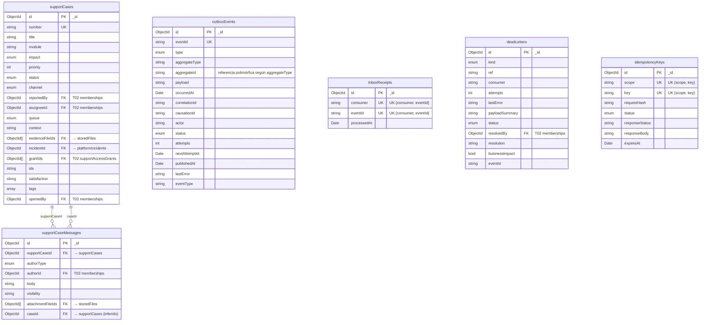

# Modelo entidad-relación — T01 PLA Plataforma SaaS

| Campo | Valor |
|---|---|
| Artefacto | 6.1 Modelo entidad-relación completo, vista por módulo (índice: [`03-modelo-entidad-relacion.md`](../03-modelo-entidad-relacion.md)) |
| Anexo dueño | [`T01-PLA-plataforma-saas.md`](../../especificacion/anexos/T01-PLA-plataforma-saas.md), §7 |
| Catálogo canónico | [`T05-DAT-modelo-datos.md`](../../especificacion/anexos/T05-DAT-modelo-datos.md), filas `COL-PLA-NN` |
| Vista por dominio | [`03a-er-plataforma-personas-catalogo.md` §4](../03a-er-plataforma-personas-catalogo.md) |
| Versión | 2.1 (05-11-2026) |
| Generado con | [`_trabajo/generar_er_completo.py`](../_trabajo/generar_er_completo.py), revisado a mano |

## 1. Resumen

T05 registra 32 filas con dueño T01: **31 colecciones a crear** y 1 absorbida en otras colecciones. Las 31 colecciones a crear se dibujan en 2 diagramas, uno por subdominio.

Convenciones: las del índice (secciones 1.3 y 2). Cada entidad lleva `id PK "_id"` y los campos de su ficha del §7; se omiten los campos transversales (`tenantId`, auditoría, `version`, baja lógica, `legacy`). El comentario de una `FK` indica el destino: `→ colección` si es del mismo módulo, `MXX colección` si es de otro; "(inferido)" cuando ni el anexo ni T05 §7.2 y §7.2.1 nombran el destino para esa colección y el nombre del campo no coincide literalmente con el de la colección (se dedujo por rol, sufijo, versión o por el contexto de §7.2.1; a confirmar); "destino no declarado" cuando no se puede fijar. Una referencia polimórfica (`entityType` + `entityId`, `resourceType` + `resourceId`, `targetRef`, `subjectRef`…) no lleva `FK` ni relación: el comentario "referencia polimórfica según <discriminador>" la señala, porque el destino depende del discriminador. Los campos que T05 §7.2.1 declara "no es referencia" no llevan `FK`. Los nombres que el anexo o T05 citan solo en notas "antes …", "Reemplazado por" o "alias" no se toman como campos ni como destinos. `UK` marca los únicos mínimos de T05; "según T05" señala un campo que figura en el catálogo pero no en la ficha del anexo. El tipo `any` indica que el anexo no declara el tipo.

## 2. Colecciones del módulo

| COL-ID | Colección | Diagrama | Ola | Clasificación | Alcance | Volumen o TTL (T05 §7.8) | Ficha en el anexo |
|---|---|---|---|---|---|---|---|
| COL-PLA-01 | `tenants` | 1 | O0 | CF/ID | G | — | §7.11.1 |
| COL-PLA-02 | `moduleCatalog` | 1 | O0 | CF | G | — | §7.11.2 |
| COL-PLA-03 | `platformPlans` | 1 | O1 | CF | P | — | §7.11.3 |
| COL-PLA-04 | `tenantLicenses` | 1 | O1 | CF | T | — | §7.11.4 |
| COL-PLA-05 | `tenantModuleActivations` | 1 | O1 | CF | T | — | §7.11.5 |
| COL-PLA-06 | `tenantChecklists` | 1 | O1 | OP | T | — | §7.11.6 |
| COL-PLA-07 | `onboardingDrafts` | 1 | O1 | ID/CT | P | — | §7.11.7 |
| COL-PLA-08 | `saasContracts` | 1 | O1 | FI | P | — | §7.11.8 |
| COL-PLA-09 | `usageSnapshots` | 1 | O1 | OP | T | — | §7.11.9 |
| COL-PLA-13 | `supportSessions` | 1 | O1 | AU | T | — | §7.11.12 |
| COL-PLA-14 | `platformIncidents` | 1 | O1 | TE | P | — | §7.11.13 |
| COL-PLA-15 | `alertRules` | 1 | O1 | CF | T+P | — | §7.11.14 |
| COL-PLA-16 | `alerts` | 1 | O1 | TE | T+P | — | §7.11.15 |
| COL-PLA-17 | `backupPolicies` | 1 | O0 | CF | P | — | §7.11.16 |
| COL-PLA-18 | `backupRuns` | 1 | O0 | TE | P | — | §7.11.17 |
| COL-PLA-19 | `restoreRequests` | 1 | O1 | AU | T | — | §7.11.18 |
| COL-PLA-20 | `restoreTests` | 1 | O1 | AU | T+P | — | §7.11.19 |
| COL-PLA-21 | `tenantExports` | 1 | O1 | AU | T | — | §7.11.20 |
| COL-PLA-22 | `releases` | 1 | O1 | TE | P | — | §7.11.21 |
| COL-PLA-23 | `featureFlags` | 1 | O1 | CF | T+P | — | §7.11.22 |
| COL-PLA-27 | `jobRuns` | 1 | O0 | TE | T (+G) | 20 M en tránsito / 120 M en tránsito por año | §7.11.24 |
| COL-PLA-29 | `storedFiles` | 1 | O0 | según dueño | T | — | §7.11.25 |
| COL-PLA-30 | `aiUsage` | 1 | O2 | OP | T | — | §7.11.26 |
| COL-PLA-31 | `healthSnapshots` | 1 | O1 | TE | P | TTL sobre `at` (30 días) | §7.11.27 |
| COL-PLA-32 | `schemaMigrations` | 1 | O0 | TE | G | — | §7.11.28 |
| COL-PLA-10 | `supportCases` | 2 | O1 | OP/CT | T | — | §7.12 |
| COL-PLA-11 | `supportCaseMessages` | 2 | O1 | OP/CT | T | — | §7.12 |
| COL-PLA-24 | `outboxEvents` | 2 | O0 | TE | T (+G despachador) | 20 M en tránsito / 120 M en tránsito por año | §7.12 |
| COL-PLA-25 | `inboxReceipts` | 2 | O0 | TE | T | 20 M en tránsito / 120 M en tránsito por año | §7.12 |
| COL-PLA-26 | `deadLetters` | 2 | O0 | TE | T | — | §7.12 |
| COL-PLA-28 | `idempotencyKeys` | 2 | O0 | TE | T | TTL sobre `expiresAt` (24 h (API) o lo que fije el endpoint) | §7.12 |

## 3. Diagrama 1: Tenants, licencias, soporte, alertas, respaldos y outbox

25 colecciones (ver tabla de la sección 2). Ficha en el anexo: §7.11.1, §7.11.2, §7.11.3, §7.11.4, §7.11.5, §7.11.6, §7.11.7, §7.11.8 ….

```mermaid
erDiagram
  tenants {
    ObjectId id PK "_id"
    string code UK
    enum kind UK "UK {cuit, kind, environmentKind} parcial"
    string legalName
    string shortName
    string cuit UK "UK {cuit, kind, environmentKind} parcial"
    enum legalForm
    string inaesRegistration
    object fiscalAddress
    array contacts
    enum status
    any statusHistory
    object suspension
    object closing
    string timezone
    string locale
    string currency
    string dataRegion
    array domains
    enum releaseRing
    enum environmentKind UK "UK {cuit, kind, environmentKind} parcial"
    object productionTenantRef FK "→ tenants"
    array sandboxes
    ObjectId saasContractId FK "→ saasContracts"
    int modulesVersion
    object onboarding
    ObjectId brandingRef FK "T03 tenantBrandings"
    bool isDemo
  }
  moduleCatalog {
    ObjectId id PK "_id"
    string code UK
    enum kind
    any label
    string description
    enum group
    string[] dependsOn
    string[] packs
    string[] capabilityPrefixes
    string[] meteredDimensions
    string checklistCode
    string minWave
    enum status
    bool sellable
  }
  platformPlans {
    ObjectId id PK "_id"
    string code UK
    any label
    string[] modules
    array defaultQuotas
    enum targetSize
    object priceRef
    enum status
    Date validFrom
    Date validTo
    array moduleCodes
  }
  tenantLicenses {
    ObjectId id PK "_id"
    string moduleCode
    enum source
    ObjectId saasContractId FK "→ saasContracts"
    Date validFrom
    Date validTo
    object[] quotaOverrides
    enum status UK "UK parcial"
    ObjectId approvedBy FK "T02 memberships"
    Date approvedAt
    ObjectId platformPlanId FK "→ platformPlans; según T05"
  }
  tenantModuleActivations {
    ObjectId id PK "_id"
    string moduleCode UK
    enum mode
    bool newSalesBlocked
    enum status
    ObjectId checklistSnapshotId FK "→ tenantChecklists"
    Date activatedAt
    ObjectId activatedBy FK "T02 memberships"
    string reason
    string history
  }
  tenantChecklists {
    ObjectId id PK "_id"
    string capabilityCode
    array items
    any overallStatus
    Date evaluatedAt
    array snapshots
    string code UK
  }
  onboardingDrafts {
    ObjectId id PK "_id"
    enum step
    object data
    string aiProposal
    any acceptedProposal
    enum status
    Date expiresAt
    string draftCode UK
  }
  saasContracts {
    ObjectId id PK "_id"
    string number UK
    string planCode
    string[] addons
    object[] quotas
    Date validFrom
    Date validTo
    bool autoRenew
    object billing
    object serviceLevels
    string dataRegion
    object exitTerms
    enum status
    object[] versions
    ObjectId signedDocumentFileId FK "→ storedFiles"
    ObjectId customerTenantId FK "→ tenants; según T05"
  }
  usageSnapshots {
    ObjectId id PK "_id"
    Date day
    string dimension
    Decimal128 value
    string quotaSoft
    string quotaHard
    string pct
    string period UK "UK {period, metric}"
    string metric UK "UK {period, metric}"
  }
  supportSessions {
    ObjectId id PK "_id"
    ObjectId supportAccessGrantId FK "T02 supportAccessGrants"
    ObjectId agentUserId FK "T02 memberships"
    string tokenJti
    Date startedAt
    Date endedAt
    string ip
    string userAgent
    any endReason
  }
  platformIncidents {
    ObjectId id PK "_id"
    string number UK
    string title
    enum severity
    enum status
    ObjectId[] affectedTenantIds FK "→ tenants"
    array affectedModules
    Date startedAt
    Date identifiedAt
    Date resolvedAt
    any publicMessage
    array updates
    ObjectId[] linkedCaseIds FK "→ supportCases"
    ObjectId postmortemFileId FK "→ storedFiles"
  }
  alertRules {
    ObjectId id PK "_id"
    string code UK
    any scope
    string ownerModule
    any conditionType
    object params
    enum severity
    array recipients
    array channels
    string dedupeKeyTemplate
    int cooldownMinutes
    string escalation
    bool enabled
    ObjectId sloDefinitionId FK "T08 sloDefinitions"
  }
  alerts {
    ObjectId id PK "_id"
    string ruleCode
    string scope
    enum severity
    enum status
    string dedupeKey
    int count
    Date firstAt
    Date lastAt
    string title
    string objectRef "referencia polimórfica"
    ObjectId ackBy FK "T02 memberships"
    Date ackAt
    ObjectId resolvedBy FK "T02 memberships"
    Date resolvedAt
    string resolution
    string silencedUntil
    array notifiedChannels
    ObjectId alertRuleId FK "→ alertRules"
  }
  backupPolicies {
    ObjectId id PK "_id"
    string code UK
    enum type
    any frequency
    string retention
    string encryptionKeyRef FK "T08 encryptionKeys"
    string targetLocation
    any appliesTo
    bool enabled
  }
  backupRuns {
    ObjectId id PK "_id"
    string policyCode
    enum type
    any scope
    Date startedAt
    Date finishedAt
    enum status
    int sizeBytes
    int objectCount
    int collectionsCount
    any checksum
    string locationRef
    string retentionUntil
    Date verifiedAt
    string error
    ObjectId backupPolicyId FK "→ backupPolicies"
  }
  restoreRequests {
    ObjectId id PK "_id"
    string number UK
    enum mode
    Date targetPointInTime
    object[] scope
    any reason
    ObjectId caseId FK "→ supportCases (inferido)"
    ObjectId incidentId FK "→ platformIncidents (inferido)"
    object[] approvals
    enum status
    any stagingRef
    object diffSummary
    object[] reconciliation
    Date startedAt
    Date finishedAt
    array rtoActualMinutes
    ObjectId[] evidenceFileIds FK "→ storedFiles"
  }
  restoreTests {
    ObjectId id PK "_id"
    Date scheduledAt
    Date executedAt
    string pointInTime
    any result
    array checks
    int rtoActualMinutes
    ObjectId reportFileId FK "→ storedFiles"
    ObjectId backupRunId FK "→ backupRuns"
  }
  tenantExports {
    ObjectId id PK "_id"
    any purpose
    any scope
    any format
    enum status
    ObjectId jobRunId FK "→ jobRuns"
    array files
    ObjectId storedFileId FK "→ storedFiles"
    Date expiresAt
    ObjectId requestedBy FK "T02 memberships"
    array downloads
  }
  releases {
    ObjectId id PK "_id"
    string gitSha
    array imageDigests
    array migrations
    array deployments
    enum status
  }
  featureFlags {
    ObjectId id PK "_id"
    string key UK
    string description
    string ownerModule
    bool default
    array rules
    Date expiresAt
    enum status
    enum kind
  }
  jobRuns {
    ObjectId id PK "_id"
    string jobName
    string jobKey UK "UK parcial"
    string jobId
    enum queue
    enum status
    object progress
    object cursor
    bool cancelRequested
    ObjectId requestedBy FK "T02 memberships"
    Date startedAt
    Date finishedAt
    object summary
    object error
    string migrationName
  }
  storedFiles {
    ObjectId id PK "_id"
    string key
    array bucketAlias
    string moduleCode
    string ownerRef "referencia polimórfica"
    any classification
    string originalName
    string mime
    int sizeBytes
    string sha256
    any scanStatus
    string retentionUntil
    string legalHold
    ObjectId uploadedBy FK "T02 memberships"
    string storageKey UK
  }
  aiUsage {
    ObjectId id PK "_id"
    any feature UK "UK {period, feature}"
    string moduleCode
    string provider
    string model
    array inputTokens
    array outputTokens
    any costRef
    ObjectId requestId FK "→ restoreRequests"
    ObjectId userId FK "T02 memberships"
    any outcome
    string period UK "UK {period, feature}"
  }
  healthSnapshots {
    ObjectId id PK "_id"
    string at
    any component
    enum status
    array metrics
  }
  schemaMigrations {
    ObjectId id PK "_id"
    string name UK
    string moduleCode
    enum phase
    string[] collections
    string checksum
    ObjectId releaseId FK "→ releases"
    Date appliedAt
    int durationMs
    enum status
    string[] backfillJobKeys
    string error
  }
  tenants ||--o{ tenants : "productionTenantRef"
  saasContracts ||--o{ tenants : "saasContractId"
  saasContracts ||--o{ tenantLicenses : "saasContractId"
  platformPlans ||--o{ tenantLicenses : "platformPlanId"
  tenantChecklists ||--o{ tenantModuleActivations : "checklistSnapshotId"
  storedFiles ||--o{ saasContracts : "signedDocumentFileId"
  tenants ||--o{ saasContracts : "customerTenantId"
  tenants }o--o{ platformIncidents : "affectedTenantIds"
  storedFiles ||--o{ platformIncidents : "postmortemFileId"
  alertRules ||--o{ alerts : "alertRuleId"
  backupPolicies ||--o{ backupRuns : "backupPolicyId"
  platformIncidents ||--o{ restoreRequests : "incidentId"
  storedFiles }o--o{ restoreRequests : "evidenceFileIds"
  storedFiles ||--o{ restoreTests : "reportFileId"
  backupRuns ||--o{ restoreTests : "backupRunId"
  jobRuns ||--o{ tenantExports : "jobRunId"
  storedFiles ||--o{ tenantExports : "storedFileId"
  restoreRequests ||--o{ aiUsage : "requestId"
  releases ||--o{ schemaMigrations : "releaseId"
```

**Índices principales del diagrama 1**

| Colección | Índices declarados en el anexo | Únicos mínimos (T05) |
|---|---|---|
| `tenants` | `{ code: 1 }` único; `{ cuit: 1, kind: 1, environmentKind: 1 }` único parcial (status ≠ `purged`, kind `cooperative`); `{ status: 1 }`; `{ 'domains.host': 1 }` único. Mapeo ProCoop: `Configuracion*.pro` + variables … | `code`; `{cuit, kind, environmentKind}` p.; `domains.host` |
| `moduleCatalog` | `{ code: 1 }` único. Mapeo ProCoop: `MODULOS` (COD_MOD, DES_MOD, VERSION, CATEGORIA). | `code` |
| `platformPlans` | — | `code` |
| `tenantLicenses` | `{ tenantId: 1, moduleCode: 1, validFrom: -1 }`, `{ tenantId: 1, status: 1 }`. `ownerScope: platform`. | `{status: active}` p. por tenant |
| `tenantModuleActivations` | único `{ tenantId: 1, moduleCode: 1 }`. | `moduleCode` |
| `tenantChecklists` | único `{ tenantId: 1, capabilityCode: 1 }`. | `code` |
| `onboardingDrafts` | `{ tenantId: 1, status: 1 }`. | `draftCode` |
| `saasContracts` | `{ tenantId: 1, status: 1 }`, `{ number: 1 }` único (global vía `tenantId` + number). | `number` |
| `usageSnapshots` | único `{ tenantId: 1, dimension: 1, day: 1 }`. | `{period, metric}` |
| `supportSessions` | `{ tenantId: 1, supportAccessGrantId: 1 }` (). | — |
| `platformIncidents` | `{ tenantId: 1, status: 1, startedAt: -1 }`. | `number` |
| `alertRules` | — | `code` |
| `alerts` | `{ tenantId: 1, status: 1, severity: 1 }`, único parcial `{ tenantId: 1, dedupeKey: 1 }` con `status` ∈ (`open`, `acknowledged`). | — |
| `backupPolicies` | — | `code` |
| `backupRuns` | `{ tenantId: 1, type: 1, startedAt: -1 }`. | — |
| `restoreRequests` | — | `number` |
| `restoreTests` | — | — |
| `tenantExports` | `{ tenantId: 1, status: 1, createdAt: -1 }`. | — |
| `releases` | — | `version` |
| `featureFlags` | — | `key` |
| `jobRuns` | de `jobRuns`: `{ tenantId: 1, jobName: 1, createdAt: -1 }`, único `{ tenantId: 1, jobKey: 1 }` parcial para estados no terminales. | `{jobKey}` p. (no terminales) (5-11-2026, residuales: alineado a T01 §7; ) |
| `storedFiles` | `{ tenantId: 1, ownerRef.type: 1, ownerRef.id: 1 }`, `{ tenantId: 1, sha256: 1 }`. Mapeo ProCoop: `ADJUNTOS` (COD_ADJ, TIPO, COD_TIP, FECHA, FECHA_CAP, OBSERVA, USUARIO, NOM_ARC), `frmEliminarAdjuntos`. | `storageKey` |
| `aiUsage` | `{ tenantId: 1, createdAt: -1 }`, `{ tenantId: 1, feature: 1, createdAt: -1 }`. | `{period, feature}` |
| `healthSnapshots` | — | — |
| `schemaMigrations` | `{ name: 1 }` único; `{ releaseId: 1, appliedAt: 1 }`. Sin TTL (se conserva todo el historial). Sin origen ProCoop (en ProCoop el esquema lo cambiaba cada actualización del ejecutable sobre la base de cada cooperativa). | `name` |

## 4. Diagrama 2: Jobs, idempotencia, archivos, consumo de IA y migraciones de esquema

6 colecciones (`supportCases`, `supportCaseMessages`, `outboxEvents`, `inboxReceipts`, `deadLetters`, `idempotencyKeys`). Ficha en el anexo: §7.12.

**Índices principales del diagrama 2**

| Colección | Índices declarados en el anexo | Únicos mínimos (T05) |
|---|---|---|
| `supportCases` | — | `number` |
| `supportCaseMessages` | — | — |
| `outboxEvents` | — | `eventId` |
| `inboxReceipts` | — | `{consumer, eventId}` |
| `deadLetters` | — | — |
| `idempotencyKeys` | — | `{scope, key}` |

## 5. Relaciones con otros módulos y entre diagramas

Referencias que salen de una colección de este módulo hacia una entidad de otro módulo o de otro diagrama del mismo módulo (no se dibujan para mantener cada diagrama dentro de su módulo y subdominio).

| Colección origen | Campo | Cardinalidad (destino a origen) | Destino | COL-ID destino | Módulo destino |
|---|---|---|---|---|---|
| `tenants` | `brandingRef` | 0..1 a N | `tenantBrandings` | COL-UXD-01 | T03 |
| `tenantLicenses` | `approvedBy` | 1 a N | `memberships` | COL-IAM-04 | T02 |
| `tenantModuleActivations` | `activatedBy` | 1 a N | `memberships` | COL-IAM-04 | T02 |
| `supportCases` | `reportedBy`, `assigneeId` | 0..1 a N | `memberships` | COL-IAM-04 | T02 |
| `supportCases` | `evidenceFileIds` | N a N | `storedFiles` | COL-PLA-29 | mismo módulo, diagrama 1 |
| `supportCases` | `incidentId` | 0..1 a N | `platformIncidents` | COL-PLA-14 | mismo módulo, diagrama 1 |
| `supportCases` | `grantIds` | N a N | `supportAccessGrants` | COL-IAM-20 | T02 |
| `supportCases` | `openedBy` | 1 a N | `memberships` | COL-IAM-04 | T02 |
| `supportCaseMessages` | `authorId` | 0..1 a N | `memberships` | COL-IAM-04 | T02 |
| `supportCaseMessages` | `attachmentFileIds` | N a N | `storedFiles` | COL-PLA-29 | mismo módulo, diagrama 1 |
| `supportSessions` | `supportAccessGrantId` | 1 a N | `supportAccessGrants` | COL-IAM-20 | T02 |
| `supportSessions` | `agentUserId` | 1 a N | `memberships` | COL-IAM-04 | T02 |
| `platformIncidents` | `linkedCaseIds` | N a N | `supportCases` | COL-PLA-10 | mismo módulo, diagrama 2 |
| `alertRules` | `sloDefinitionId` | 1 a N | `sloDefinitions` | COL-NFR-16 | T08 |
| `alerts` | `ackBy`, `resolvedBy` | 1 a N | `memberships` | COL-IAM-04 | T02 |
| `backupPolicies` | `encryptionKeyRef` | 1 a N | `encryptionKeys` | COL-NFR-12 | T08 |
| `restoreRequests` | `caseId` | 1 a N | `supportCases` | COL-PLA-10 | mismo módulo, diagrama 2 |
| `tenantExports` | `requestedBy` | 1 a N | `memberships` | COL-IAM-04 | T02 |
| `deadLetters` | `resolvedBy` | 0..1 a N | `memberships` | COL-IAM-04 | T02 |
| `jobRuns` | `requestedBy` | 0..1 a N | `memberships` | COL-IAM-04 | T02 |
| `storedFiles` | `uploadedBy` | 1 a N | `memberships` | COL-IAM-04 | T02 |
| `aiUsage` | `userId` | 1 a N | `memberships` | COL-IAM-04 | T02 |

## 6. Colecciones absorbidas y renombradas

| COL-ID | Colección declarada | Destino (no se crea) | Detalle en T05 |
|---|---|---|---|
| COL-PLA-12 | `supportAccessGrants` | `supportAccessGrants` (COL-IAM-20, T02) | (duplicada con T02) |

## 7. Observaciones e inconsistencias detectadas

- Campos que T05 cita en "Claves y referencias" o "Únicos" y que la ficha del anexo no declara con ese nombre (posible diferencia de nombre; a verificar en el anexo): `tenantLicenses`: `platformPlanId`; `saasContracts`: `customerTenantId`.
