# Modelo entidad-relación — T02 IAM Identidad, roles y auditoría

| Campo | Valor |
|---|---|
| Artefacto | 6.1 Modelo entidad-relación completo, vista por módulo (índice: [`03-modelo-entidad-relacion.md`](../03-modelo-entidad-relacion.md)) |
| Anexo dueño | [`T02-IAM-identidad-roles-auditoria.md`](../../especificacion/anexos/T02-IAM-identidad-roles-auditoria.md), §7 |
| Catálogo canónico | [`T05-DAT-modelo-datos.md`](../../especificacion/anexos/T05-DAT-modelo-datos.md), filas `COL-IAM-NN` |
| Vista por dominio | [`03a-er-plataforma-personas-catalogo.md` §4](../03a-er-plataforma-personas-catalogo.md) |
| Versión | 2.1 (05-11-2026) |
| Generado con | [`_trabajo/generar_er_completo.py`](../_trabajo/generar_er_completo.py), revisado a mano |

## 1. Resumen

T05 registra 31 filas con dueño T02: **31 colecciones a crear** y 0 absorbidas en otras colecciones. Las 31 colecciones a crear se dibujan en 2 diagramas, uno por subdominio.

Convenciones: las del índice (secciones 1.3 y 2). Cada entidad lleva `id PK "_id"` y los campos de su ficha del §7; se omiten los campos transversales (`tenantId`, auditoría, `version`, baja lógica, `legacy`). El comentario de una `FK` indica el destino: `→ colección` si es del mismo módulo, `MXX colección` si es de otro; "(inferido)" cuando ni el anexo ni T05 §7.2 y §7.2.1 nombran el destino para esa colección y el nombre del campo no coincide literalmente con el de la colección (se dedujo por rol, sufijo, versión o por el contexto de §7.2.1; a confirmar); "destino no declarado" cuando no se puede fijar. Una referencia polimórfica (`entityType` + `entityId`, `resourceType` + `resourceId`, `targetRef`, `subjectRef`…) no lleva `FK` ni relación: el comentario "referencia polimórfica según <discriminador>" la señala, porque el destino depende del discriminador. Los campos que T05 §7.2.1 declara "no es referencia" no llevan `FK`. Los nombres que el anexo o T05 citan solo en notas "antes …", "Reemplazado por" o "alias" no se toman como campos ni como destinos. `UK` marca los únicos mínimos de T05; "según T05" señala un campo que figura en el catálogo pero no en la ficha del anexo. El tipo `any` indica que el anexo no declara el tipo.

## 2. Colecciones del módulo

| COL-ID | Colección | Diagrama | Ola | Clasificación | Alcance | Volumen o TTL (T05 §7.8) | Ficha en el anexo |
|---|---|---|---|---|---|---|---|
| COL-IAM-01 | `identities` | 1 | O0 | ID/CT | G | — | §7.1 |
| COL-IAM-02 | `authFactors` | 1 | O0 | SC | P | — | §7.2 |
| COL-IAM-03 | `federatedLinks` | 1 | O1 | ID | G | — | §7.3 |
| COL-IAM-04 | `memberships` | 1 | O0 | ID | T | — | §7.4 |
| COL-IAM-05 | `roles` | 1 | O1 | CF | T+P | — | §7.5 |
| COL-IAM-06 | `screenProfiles` | 1 | O1 | CF | T+P | — | §7.6 |
| COL-IAM-07 | `roleAssignments` | 1 | O1 | CF | T | — | §7.7 |
| COL-IAM-08 | `profileAssignments` | 1 | O1 | CF | T | — | §7.8 |
| COL-IAM-13 | `sessions` | 1 | O0 | SC/TE | T | TTL sobre `expiresAt` (Según T02) | §7.11 |
| COL-IAM-19 | `authorizationRequests` | 1 | O1 | AU | T | — | §7.13 |
| COL-IAM-20 | `supportAccessGrants` | 1 | O1 | AU | T | — | §7.14 |
| COL-IAM-21 | `identityProviderConfigs` | 1 | O1 | CF | T+P | — | §7.15 |
| COL-IAM-24 | `auditLogs` | 1 | O0 | AU | T | 10 M / 60 M por año | auditLogs (cambios) |
| COL-IAM-25 | `auditAccess` | 1 | O0 | AU | T | — | auditAccess |
| COL-IAM-26 | `auditReads` | 1 | O1 | AU | T | — | auditReads |
| COL-IAM-27 | `auditMessages` | 1 | O1 | AU | T | — | auditMessages |
| COL-IAM-28 | `auditAi` | 1 | O1 | AU | T | — | auditAi |
| COL-IAM-29 | `legacyAuditRecords` | 1 | O11 | AU | T | — | legacyAuditRecords |
| COL-IAM-09 | `capabilityCatalog` | 2 | O0 | CF | P | — | §7.20 |
| COL-IAM-10 | `screenCatalog` | 2 | O1 | CF | P | — | §7.20 |
| COL-IAM-11 | `sodRules` | 2 | O1 | CF | T+P | — | §7.20 |
| COL-IAM-12 | `sodExceptions` | 2 | O1 | AU | T | — | §7.20 |
| COL-IAM-14 | `authTransactions` | 2 | O0 | TE | P | TTL sobre `expiresAt` (Según T02) | §7.20 |
| COL-IAM-15 | `trustedDevices` | 2 | O1 | TE | P | — | §7.20 |
| COL-IAM-16 | `otpChallenges` | 2 | O1 | SC | P | TTL sobre `expiresAt` (Según T02) | §7.20 |
| COL-IAM-17 | `actionTokens` | 2 | O0 | SC | T | TTL sobre `expiresAt` (Según T02) | §7.20 |
| COL-IAM-18 | `editPresence` | 2 | O1 | TE | T | TTL sobre `lastSeenAt` (2 minutos) | §7.20 |
| COL-IAM-22 | `apiClients` | 2 | O1 | CF | T | — | §7.20 |
| COL-IAM-23 | `apiCredentials` | 2 | O1 | SC | T | — | §7.20 |
| COL-IAM-30 | `accessReviews` | 2 | O1 | AU | T | — | §7.20 |
| COL-IAM-31 | `securityAlerts` | 2 | O1 | AU | T | — | §7.20 |

## 3. Diagrama 1: Identidad, membresías, roles, sesiones y clientes API

18 colecciones (ver tabla de la sección 2). Ficha en el anexo: §7.1, §7.2, §7.3, §7.4, §7.5, §7.6, §7.7, §7.8 ….

```mermaid
erDiagram
  identities {
    ObjectId id PK "_id"
    enum status
    string primaryEmail
    Date emailVerifiedAt
    string phoneE164
    Date phoneVerifiedAt
    string displayName
    string locale
    string passwordHash
    enum passwordAlgo
    Date passwordChangedAt
    bool passwordCompromised
    int failedLoginCount
    Date failedWindowStartedAt
    Date lockedUntil
    Date lastLoginAt
    int sessionEpoch
    ObjectId mfa FK "→ authFactors"
    bool platformMember
    any emailNormalized UK "UK disperso; según T05"
    any cuilHmac UK "UK disperso; según T05"
  }
  authFactors {
    ObjectId id PK "_id"
    ObjectId identityId FK, UK "→ identities; UK {identityId, kind, label}"
    enum type
    enum status
    string label UK "UK {identityId, kind, label}"
    string destinationMasked
    Binary totpSecretEnc
    object[] webauthn
    array recoveryCodeHashes
    Date verifiedAt
    Date lastUsedAt
    Date revokedAt
    enum kind UK "UK {identityId, kind, label}; según T05"
  }
  federatedLinks {
    ObjectId id PK "_id"
    ObjectId identityId FK "→ identities"
    enum provider UK "UK {provider, subject}"
    string issuer
    string subject UK "UK {provider, subject}"
    ObjectId scopeTenantId FK "T01 tenants"
    ObjectId idpConfigId FK "→ identityProviderConfigs"
    string emailAtLink
    string assuranceLevel
    enum status
    Date linkedAt
    Date lastUsedAt
  }
  memberships {
    ObjectId id PK "_id"
    ObjectId identityId FK, UK "→ identities"
    enum status
    any staff
    any portal
    int sessionEpoch
    int authzVersion
    Date lastAccessAt
    ObjectId invitedBy FK "→ memberships"
    Date invitedAt
    Date activatedAt
    Date revokedAt
    any revokedReason
    ObjectId personId FK "M01 persons; según T05"
  }
  roles {
    ObjectId id PK "_id"
    string code UK
    string nameKey
    string description
    enum space
    enum origin
    string templateCode
    string templateVersion
    string[] capabilities
    string[] denyCapabilities
    enum defaultScopeMode
    bool requiresMfa
    enum status
  }
  screenProfiles {
    ObjectId id PK "_id"
    string code UK
    string nameKey
    any origin
    string templateCode
    enum[] apps
    string[] screens
    array timeWindows
    enum outsideWindowBehavior
    enum status
  }
  roleAssignments {
    ObjectId id PK "_id"
    ObjectId membershipId FK "→ memberships"
    ObjectId roleId FK "→ roles"
    any scope
    Decimal128 limits
    string[] denyCapabilities
    Date validFrom
    Date validTo
    enum status
    ObjectId grantedBy FK "→ memberships"
    Date grantedAt
    any justification
    ObjectId sodExceptionId FK "→ sodExceptions"
    Date lastRecertifiedAt
    ObjectId recertifiedBy FK "→ memberships"
  }
  profileAssignments {
    ObjectId id PK "_id"
    ObjectId membershipId FK "→ memberships"
    ObjectId screenProfileId FK "→ screenProfiles"
    Date validFrom
    Date validTo
    enum status
    ObjectId grantedBy FK "→ memberships"
    Date grantedAt
  }
  sessions {
    ObjectId id PK "_id"
    ObjectId identityId FK "→ identities"
    ObjectId membershipId FK "→ memberships"
    enum context
    string refreshTokenHash
    string refreshFamilyId UK
    string[] previousHashes
    bool remember
    string[] amr
    string acr
    Date authTime
    Date mfaTime
    object operatingContext
    string ip
    string userAgent
    string deviceLabel
    string geoApprox
    ObjectId supportGrantId FK "→ supportAccessGrants"
    Date lastUsedAt
    Date expiresAt
    Date absoluteExpiresAt
    Date revokedAt
    any revokedReason
    enum status
  }
  authorizationRequests {
    ObjectId id PK "_id"
    string code
    enum mode
    string capability
    enum reasonType
    object resource
    string actionHash
    string summaryKey
    string summaryParams
    Decimal128 amount
    string currency
    ObjectId requestedBy FK "→ memberships"
    string requestReason
    enum status
    object approverRequirement
    ObjectId decidedBy FK "→ memberships"
    Date decidedAt
    any decisionComment
    any[] decisionAmr
    Date expiresAt
    Date consumedAt
    ObjectId consumedRequestId FK "→ auditLogs"
    ObjectId approverId FK "→ memberships; según T05"
    string number UK "según T05"
  }
  supportAccessGrants {
    ObjectId id PK "_id"
    string code
    ObjectId agentIdentityId FK "→ identities"
    ObjectId agentMembershipId FK "→ memberships"
    any ticketRef
    enum mode
    array capabilities
    any scope
    any justification
    enum status
    any approvalType
    ObjectId approvedBy FK "→ memberships"
    Date approvedAt
    Date startsAt
    Date expiresAt
    ObjectId revokedBy FK "→ memberships"
    Date revokedAt
    any actionsCount
    ObjectId postReviewBy FK "→ memberships"
    Date postReviewAt
    ObjectId supportCaseId FK "T01 supportCases; según T05"
  }
  identityProviderConfigs {
    ObjectId id PK "_id"
    enum type
    string displayNameKey
    string issuer
    string discoveryUrl
    string clientId
    any clientSecretRef
    array scopes
    any claimMapping
    array allowedEmailDomains
    any[] enabledFor
    bool acceptIdpMfa
    string buttonLogoRef
    enum status
    Date lastTestAt
    string lastTestResult
    string credentialRef FK "T06 integrationSecrets"
    string code UK
  }
  auditLogs {
    ObjectId id PK "_id"
    string eventId
    number seq
    Date occurredAt
    any actor
    any origin
    any entity
    enum operation
    array changes
    array fileRefs
    string reason
    ObjectId authorizationRequestId FK "→ authorizationRequests"
    enum result
    string errorCode
    string prevHash
    string hash
  }
  auditAccess {
    ObjectId id PK "_id"
    string eventId
    Date occurredAt
    ObjectId identityId FK "→ identities"
    string identifierHash
    ObjectId membershipId FK "→ memberships"
    string sessionId
    any event
    string method
    string result
    string reasonCode
    string ip
    string userAgent
    ObjectId deviceId FK "→ trustedDevices"
    string geoApprox
    ObjectId workstationId FK "T04 workstations"
    string prevHash
    string hash
    ObjectId actorId FK "→ memberships"
  }
  auditReads {
    ObjectId id PK "_id"
    string eventId
    Date occurredAt
    string actor
    enum category
    any resource
    array fields
    string filterSummary
    int rowsCount
    any fileRef
    any viewType
    string prevHash
    string hash
    string entityRef "referencia polimórfica"
  }
  auditMessages {
    ObjectId id PK "_id"
    ObjectId messageId
    enum channel
    string toMasked
    string toHash
    int ccCount
    string subject
    ObjectId templateId FK "T09 messageTemplates"
    string templateVersion
    string relatedEntity
    ObjectId triggeredBy FK "→ memberships"
    enum status
    string providerMessageId
    string providerResponseCode
    array attachments
    Date queuedAt
    Date sentAt
    Date statusAt
    ObjectId communicationId FK "T09 communications"
  }
  auditAi {
    ObjectId id PK "_id"
    string eventId
    Date occurredAt
    any actor
    any function
    string provider
    string model
    string modelVersion
    string promptTemplateCode
    string promptTemplateVersion
    array inputRefs
    string inputRedacted
    string outputRef
    string outputSummary
    int tokensIn
    int tokensOut
    Decimal128 cost
    string currency
    int latencyMs
    string confidence
    array safetyFlags
    any decision
    any result
    ObjectId aiUsageLogId FK "T06 aiUsageLogs"
  }
  legacyAuditRecords {
    ObjectId id PK "_id"
    any sourceTable
    string sourceKey
    Date occurredAt
    string legacyUser
    any payloadEnc
    ObjectId importBatchId FK "T07 migrationBatches"
  }
  authFactors ||--o{ identities : "mfa"
  identities ||--o{ authFactors : "identityId"
  identities ||--o{ federatedLinks : "identityId"
  identityProviderConfigs |o--o{ federatedLinks : "idpConfigId"
  identities ||--o| memberships : "identityId"
  memberships |o--o{ memberships : "invitedBy"
  memberships ||--o{ roleAssignments : "membershipId"
  roles ||--o{ roleAssignments : "roleId"
  memberships ||--o{ roleAssignments : "grantedBy"
  memberships |o--o{ roleAssignments : "recertifiedBy"
  memberships ||--o{ profileAssignments : "membershipId"
  screenProfiles ||--o{ profileAssignments : "screenProfileId"
  memberships ||--o{ profileAssignments : "grantedBy"
  identities ||--o{ sessions : "identityId"
  memberships ||--o{ sessions : "membershipId"
  supportAccessGrants |o--o{ sessions : "supportGrantId"
  memberships ||--o{ authorizationRequests : "requestedBy"
  memberships |o--o{ authorizationRequests : "decidedBy"
  auditLogs ||--o{ authorizationRequests : "consumedRequestId"
  memberships ||--o{ authorizationRequests : "approverId"
  identities ||--o{ supportAccessGrants : "agentIdentityId"
  memberships ||--o{ supportAccessGrants : "agentMembershipId"
  memberships ||--o{ supportAccessGrants : "approvedBy"
  memberships ||--o{ supportAccessGrants : "revokedBy"
  memberships ||--o{ supportAccessGrants : "postReviewBy"
  authorizationRequests |o--o{ auditLogs : "authorizationRequestId"
  identities ||--o{ auditAccess : "identityId"
  memberships ||--o{ auditAccess : "membershipId"
  memberships ||--o{ auditAccess : "actorId"
  memberships ||--o{ auditMessages : "triggeredBy"
```

**Índices principales del diagrama 1**

| Colección | Índices declarados en el anexo | Únicos mínimos (T05) |
|---|---|---|
| `identities` | `{tenantId, primaryEmail}` único parcial; `{tenantId, phoneE164}`; `{tenantId, status}`. | `emailNormalized` d.; `cuilHmac` d. |
| `authFactors` | `{tenantId, identityId, type, status}`; `{"webauthn.credentialId"}` único parcial. | `{identityId, kind, label}` |
| `federatedLinks` | único `{provider, issuer, subject}`. | `{provider, subject}` |
| `memberships` | `{tenantId, identityId}` único; `{tenantId, "staff.username"}` único parcial; `{tenantId, "portal.personId"}` único parcial; `{tenantId, status}`. | `identityId`; `staff.userCode` d. |
| `roles` | único `{tenantId, code}`. | `code` |
| `screenProfiles` | — | `code` |
| `roleAssignments` | `{tenantId, membershipId, status}`; `{tenantId, roleId}`. | — |
| `profileAssignments` | `{tenantId, membershipId, status}`. | — |
| `sessions` | — | `refreshFamilyId` (5-11-2026, sincronización: T02 §7 adopta el nombre canónico de T05; ) |
| `authorizationRequests` | `{tenantId, status, "approverRequirement.capability"}`; `{tenantId, requestedBy, createdAt}`. | `number` |
| `supportAccessGrants` | — | — |
| `identityProviderConfigs` | — | `code` |
| `auditLogs` | `{tenantId, "entity.collection", "entity.id", occurredAt}`, `{tenantId, "actor.membershipId", occurredAt}`, `{tenantId, occurredAt}`, `{tenantId, "origin.correlationId"}`. Permisos de base: el usuario de aplicación … | — |
| `auditAccess` | — | — |
| `auditReads` | — | — |
| `auditMessages` | — | — |
| `auditAi` | — | — |
| `legacyAuditRecords` | — | — |

## 4. Diagrama 2: Auditoría, revisiones de acceso y alertas de seguridad

13 colecciones (ver tabla de la sección 2). Ficha en el anexo: §7.20.

```mermaid
erDiagram
  capabilityCatalog {
    ObjectId id PK "_id"
    string code UK
    string moduleCode
    string resource
    string action
    string descriptionKey
    string sensitive
    array sodTags
    string supervisorOverridable
    string amountBound
    string apiExposable
    string licenseModule
    enum contexts
    string wave
    Date deprecatedAt
    any module
  }
  screenCatalog {
    ObjectId id PK "_id"
    string screenId UK
    string app
    string route
    string module
    string group
    any requiredAny
    string licenseModule
    array legacyForms
    array legacyMenuCodes
    array capabilities
    string code
  }
  sodRules {
    ObjectId id PK "_id"
    string code UK
    enum type
    any capabilitiesA
    any capabilitiesB
    enum enforcement
    string descriptionKey
    enum status
  }
  sodExceptions {
    ObjectId id PK "_id"
    ObjectId membershipId FK "→ memberships"
    string ruleCode
    string justification
    string compensatingControl
    ObjectId requestedBy FK "→ memberships"
    ObjectId approvedBy FK "→ memberships"
    Date approvedAt
    Date validTo
    enum status
    ObjectId sodRuleId FK "→ sodRules"
  }
  authTransactions {
    ObjectId id PK "_id"
    ObjectId identityId FK "→ identities"
    enum step
    array candidateMemberships
    any amr
    int attempts
    string ip
    Date expiresAt
    string txId UK
  }
  trustedDevices {
    ObjectId id PK "_id"
    ObjectId identityId FK, UK "→ identities; UK {identityId, deviceHash}"
    string tokenHash_secret
    string label
    string ip
    string userAgent
    Date lastUsedAt
    Date expiresAt
    Date revokedAt
    string deviceHash UK "UK {identityId, deviceHash}"
  }
  otpChallenges {
    ObjectId id PK "_id"
    string identityId_o_destinationHash
    enum purpose
    enum channel
    string codeHash_secret
    int attempts
    int maxAttempts
    Date expiresAt
    Date consumedAt
    ObjectId identityId FK "→ identities"
  }
  actionTokens {
    ObjectId id PK "_id"
    enum type
    string tokenHash_secret
    string identityId_email
    ObjectId membershipId FK "→ memberships"
    string payload
    Date expiresAt
    Date consumedAt
    string tokenHash UK
  }
  editPresence {
    ObjectId id PK "_id"
    enum entityRef "referencia polimórfica"
    ObjectId membershipId FK, UK "→ memberships; UK {entity.collection, entity.id, membershipId}"
    string displayName
    Date startedAt
    Date heartbeatAt
    any entity "según T05"
  }
  apiClients {
    ObjectId id PK "_id"
    string code
    string name
    string purpose
    ObjectId ownerMembershipId FK "→ memberships"
    enum grantTypes
    array scopes
    any ipAllowlist
    string rateLimitTier
    enum status
    Date lastUsedAt
    string legacyWsKeyCode
    string clientId UK
  }
  apiCredentials {
    ObjectId id PK "_id"
    ObjectId apiClientId FK "→ apiClients"
    string clientId
    string secretPrefix UK
    string secretHash
    string secret
    Date expiresAt
    Date lastUsedAt
    Date revokedAt
    ObjectId rotatedFromId FK "→ apiCredentials"
    string keyPrefix
    enum status
  }
  accessReviews {
    ObjectId id PK "_id"
    string period
    ObjectId reviewerMembershipId FK "→ memberships"
    array items
    enum status
    Date dueAt
    string number UK
  }
  securityAlerts {
    ObjectId id PK "_id"
    enum type
    enum severity
    string subject
    ObjectId[] sourceEventIds FK "T01 outboxEvents"
    string dedupKey
    enum status
    string assignedTo
    Date acknowledgedAt
    Date resolvedAt
    string resolution
    ObjectId identityId FK "→ identities"
  }
  sodRules ||--o{ sodExceptions : "sodRuleId"
  apiClients |o--o{ apiCredentials : "apiClientId"
  apiCredentials |o--o{ apiCredentials : "rotatedFromId"
```

**Índices principales del diagrama 2**

| Colección | Índices declarados en el anexo | Únicos mínimos (T05) |
|---|---|---|
| `capabilityCatalog` | — | `code` |
| `screenCatalog` | — | `screenId` (5-11-2026, residuales: alineado a T02 §7; ) |
| `sodRules` | — | `code` |
| `sodExceptions` | — | — |
| `authTransactions` | — | `txId` |
| `trustedDevices` | — | `{identityId, deviceHash}` |
| `otpChallenges` | — | — |
| `actionTokens` | — | `tokenHash` |
| `editPresence` | — | `{entity.collection, entity.id, membershipId}` (5-11-2026, residuales: alineado a T02 §7; ) |
| `apiClients` | — | `clientId` |
| `apiCredentials` | — | `secretPrefix` (5-11-2026, residuales: alineado a T02 §7; ) |
| `accessReviews` | — | `number` |
| `securityAlerts` | — | — |

## 5. Relaciones con otros módulos y entre diagramas

Referencias que salen de una colección de este módulo hacia una entidad de otro módulo o de otro diagrama del mismo módulo (no se dibujan para mantener cada diagrama dentro de su módulo y subdominio).

| Colección origen | Campo | Cardinalidad (destino a origen) | Destino | COL-ID destino | Módulo destino |
|---|---|---|---|---|---|
| `federatedLinks` | `scopeTenantId` | 0..1 a N | `tenants` | COL-PLA-01 | T01 |
| `memberships` | `personId` | 1 a N | `persons` | COL-PER-01 | M01 |
| `roleAssignments` | `sodExceptionId` | 0..1 a N | `sodExceptions` | COL-IAM-12 | mismo módulo, diagrama 2 |
| `sodExceptions` | `membershipId`, `requestedBy`, `approvedBy` | 0..1 a N | `memberships` | COL-IAM-04 | mismo módulo, diagrama 1 |
| `authTransactions` | `identityId` | 0..1 a N | `identities` | COL-IAM-01 | mismo módulo, diagrama 1 |
| `trustedDevices` | `identityId` | 1 a N | `identities` | COL-IAM-01 | mismo módulo, diagrama 1 |
| `otpChallenges` | `identityId` | 1 a N | `identities` | COL-IAM-01 | mismo módulo, diagrama 1 |
| `actionTokens` | `membershipId` | 0..1 a N | `memberships` | COL-IAM-04 | mismo módulo, diagrama 1 |
| `editPresence` | `membershipId` | 1 a N | `memberships` | COL-IAM-04 | mismo módulo, diagrama 1 |
| `supportAccessGrants` | `supportCaseId` | 1 a N | `supportCases` | COL-PLA-10 | T01 |
| `identityProviderConfigs` | `credentialRef` | 1 a N | `integrationSecrets` | COL-INT-03 | T06 |
| `apiClients` | `ownerMembershipId` | 0..1 a N | `memberships` | COL-IAM-04 | mismo módulo, diagrama 1 |
| `auditAccess` | `deviceId` | 1 a N | `trustedDevices` | COL-IAM-15 | mismo módulo, diagrama 2 |
| `auditAccess` | `workstationId` | 1 a N | `workstations` | COL-CFG-43 | T04 |
| `auditMessages` | `templateId` | 1 a N | `messageTemplates` | COL-COM-36 | T09 |
| `auditMessages` | `communicationId` | 1 a N | `communications` | COL-COM-39 | T09 |
| `auditAi` | `aiUsageLogId` | 1 a N | `aiUsageLogs` | COL-INT-18 | T06 |
| `legacyAuditRecords` | `importBatchId` | 1 a N | `migrationBatches` | COL-MIG-07 | T07 |
| `accessReviews` | `reviewerMembershipId` | 0..1 a N | `memberships` | COL-IAM-04 | mismo módulo, diagrama 1 |
| `securityAlerts` | `sourceEventIds` | N a N | `outboxEvents` | COL-PLA-24 | T01 |
| `securityAlerts` | `identityId` | 1 a N | `identities` | COL-IAM-01 | mismo módulo, diagrama 1 |

## 6. Colecciones absorbidas y renombradas

Ninguna colección del módulo quedó absorbida.

## 7. Observaciones e inconsistencias detectadas

- Campos que T05 cita en "Claves y referencias" o "Únicos" y que la ficha del anexo no declara con ese nombre (posible diferencia de nombre; a verificar en el anexo): `identities`: `emailNormalized`, `cuilHmac`; `authFactors`: `kind`; `memberships`: `personId`; `editPresence`: `entity`; `authorizationRequests`: `approverId`, `number`; `supportAccessGrants`: `supportCaseId`.
