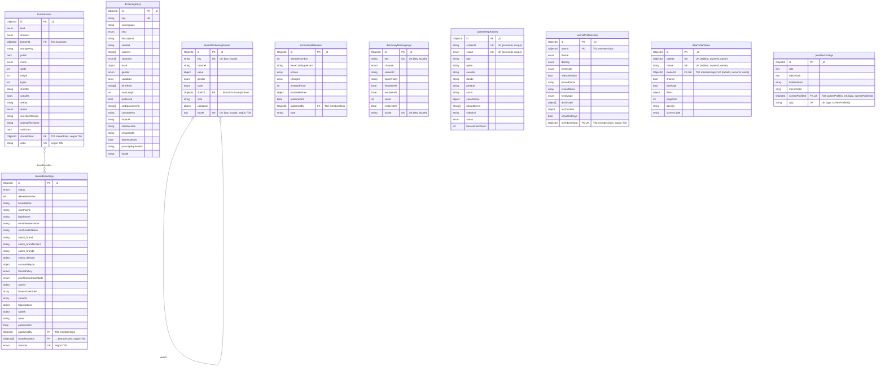

# Modelo entidad-relación — T03 UXD Experiencia, marca y diccionario

| Campo | Valor |
|---|---|
| Artefacto | 6.1 Modelo entidad-relación completo, vista por módulo (índice: [`03-modelo-entidad-relacion.md`](../03-modelo-entidad-relacion.md)) |
| Anexo dueño | [`T03-UXD-experiencia-marca-diccionario.md`](../../especificacion/anexos/T03-UXD-experiencia-marca-diccionario.md), §7 |
| Catálogo canónico | [`T05-DAT-modelo-datos.md`](../../especificacion/anexos/T05-DAT-modelo-datos.md), filas `COL-UXD-NN` |
| Vista por dominio | Sin sección propia en la vista por dominio (sus colecciones se citan como destino de referencias) |
| Versión | 2.1 (05-11-2026) |
| Generado con | [`_trabajo/generar_er_completo.py`](../_trabajo/generar_er_completo.py), revisado a mano |

## 1. Resumen

T05 registra 11 filas con dueño T03: **10 colecciones a crear** y 1 absorbida en otras colecciones. Las 10 colecciones a crear se dibujan en 1 diagrama, uno por subdominio.

Convenciones: las del índice (secciones 1.3 y 2). Cada entidad lleva `id PK "_id"` y los campos de su ficha del §7; se omiten los campos transversales (`tenantId`, auditoría, `version`, baja lógica, `legacy`). El comentario de una `FK` indica el destino: `→ colección` si es del mismo módulo, `MXX colección` si es de otro; "(inferido)" cuando ni el anexo ni T05 §7.2 y §7.2.1 nombran el destino para esa colección y el nombre del campo no coincide literalmente con el de la colección (se dedujo por rol, sufijo, versión o por el contexto de §7.2.1; a confirmar); "destino no declarado" cuando no se puede fijar. Una referencia polimórfica (`entityType` + `entityId`, `resourceType` + `resourceId`, `targetRef`, `subjectRef`…) no lleva `FK` ni relación: el comentario "referencia polimórfica según <discriminador>" la señala, porque el destino depende del discriminador. Los campos que T05 §7.2.1 declara "no es referencia" no llevan `FK`. Los nombres que el anexo o T05 citan solo en notas "antes …", "Reemplazado por" o "alias" no se toman como campos ni como destinos. `UK` marca los únicos mínimos de T05; "según T05" señala un campo que figura en el catálogo pero no en la ficha del anexo. El tipo `any` indica que el anexo no declara el tipo.

## 2. Colecciones del módulo

| COL-ID | Colección | Diagrama | Ola | Clasificación | Alcance | Volumen o TTL (T05 §7.8) | Ficha en el anexo |
|---|---|---|---|---|---|---|---|
| COL-UXD-01 | `tenantBrandings` | 1 | O0 | CF | T | — | §7.B.1 |
| COL-UXD-02 | `brandAssets` | 1 | O0 | CF | T | — | §7.B.2 |
| COL-UXD-03 | `dictionaryKeys` | 1 | O0 | CF | P | — | §7.B.3 |
| COL-UXD-04 | `tenantDictionaryEntries` | 1 | O1 | CF | T | — | §7.B.4 |
| COL-UXD-05 | `dictionaryReleases` | 1 | O1 | CF | T+P | — | §7.B.5 |
| COL-UXD-06 | `dictionaryMissingKeys` | 1 | O1 | TE | P | — | §7.B.6 |
| COL-UXD-07 | `screenHelpArticles` | 1 | O1 | CF | T+P | — | §7.B.7 |
| COL-UXD-09 | `userUiPreferences` | 1 | O0 | OP | T | — | §7.B.9 |
| COL-UXD-10 | `dataTableViews` | 1 | O0 | CF | T | — | §7.B.10 |
| COL-UXD-11 | `pwaNavConfigs` | 1 | O1 | CF | T+P | — | §7.B.11 |

## 3. Diagrama 1: Marca, diccionario, ayuda y preferencias de interfaz

10 colecciones (ver tabla de la sección 2). Ficha en el anexo: §7.B.1, §7.B.2, §7.B.3, §7.B.4, §7.B.5, §7.B.6, §7.B.7, §7.B.9 ….

**Índices principales del diagrama 1**

| Colección | Índices declarados en el anexo | Únicos mínimos (T05) |
|---|---|---|
| `tenantBrandings` | `{tenantId, status}` único parcial para `status ∈ {draft, published}`; `{tenantId, releaseNumber}` único. Mapeo ProCoop: `VAR` 518/709/2264/2812 (RN-09), `WEB_Logos_Facturas` (DFA M26, `CapaDatos.PWeb`). | `{channel, version}` |
| `brandAssets` | `{tenantId, kind, channel, branchId}`, `{tenantId, sha256}`. | `code` |
| `dictionaryKeys` | `{key}` único, `{namespace, kind}`, `{module}`. Fuente: archivo `packages/dictionary/base/*.json` sincronizado a la colección en cada despliegue (JOB-UXD-05). | `key` |
| `tenantDictionaryEntries` | `{tenantId, key, channel, state}` único parcial para `state ∈ {draft, published}`. Mapeo ProCoop: `VARIABLE_PMOVIL` (VAR_PMOVIL 5, 6, 7, 8, 9, 35, 65), VAR 3157 (sección 19). | `{key, locale}` |
| `dictionaryReleases` | `{tenantId, releaseNumber}` único. Inmutable (sin `updatedAt` operativo). | `version` |
| `dictionaryMissingKeys` | `{tenantId, key, channel}` único. Alimenta el indicador IND-UXD-01. | `{key, locale}` |
| `screenHelpArticles` | `{tenantId, screenId, scope}` único. | `{screenId, scope}` (T03; ) |
| `userUiPreferences` | — | `membershipId` |
| `dataTableViews` | `{tenantId, tableId, ownerId, name}` único. | `{tableId, ownerId, name}` () |
| `pwaNavConfigs` | `{tenantId, role}` único. No otorga permisos (RN-UXD-023). | `{app, screenProfileId}` |

## 4. Relaciones con otros módulos y entre diagramas

Referencias que salen de una colección de este módulo hacia una entidad de otro módulo o de otro diagrama del mismo módulo (no se dibujan para mantener cada diagrama dentro de su módulo y subdominio).

| Colección origen | Campo | Cardinalidad (destino a origen) | Destino | COL-ID destino | Módulo destino |
|---|---|---|---|---|---|
| `tenantBrandings` | `publishedBy` | 1 a N | `memberships` | COL-IAM-04 | T02 |
| `brandAssets` | `branchId` | 0..1 a N | `branches` | COL-CFG-42 | T04 |
| `brandAssets` | `storedFileId` | 1 a N | `storedFiles` | COL-PLA-29 | T01 |
| `dictionaryReleases` | `publishedBy` | 1 a N | `memberships` | COL-IAM-04 | T02 |
| `userUiPreferences` | `userId` | 1 a N | `memberships` | COL-IAM-04 | T02 |
| `userUiPreferences` | `membershipId` | 1 a 0..1 | `memberships` | COL-IAM-04 | T02 |
| `dataTableViews` | `ownerId` | 1 a N | `memberships` | COL-IAM-04 | T02 |
| `pwaNavConfigs` | `screenProfileId` | 1 a N | `screenProfiles` | COL-IAM-06 | T02 |

## 5. Colecciones absorbidas y renombradas

| COL-ID | Colección declarada | Destino (no se crea) | Detalle en T05 |
|---|---|---|---|
| COL-UXD-08 | `uiFeatureFlags` | `featureFlags` (COL-PLA-23, T01) | (duplicada con `featureFlags`; dueño de la colección canónica: T01. Lo que T03 describe para `uiFeatureFlags` se aplica a `featureFlags` con `kind = ui`) |

## 6. Observaciones e inconsistencias detectadas

- Campos que T05 cita en "Claves y referencias" o "Únicos" y que la ficha del anexo no declara con ese nombre (posible diferencia de nombre; a verificar en el anexo): `tenantBrandings`: `brandAssetIds`, `channel`; `brandAssets`: `storedFileId`, `code`; `tenantDictionaryEntries`: `locale`; `userUiPreferences`: `membershipId`.
