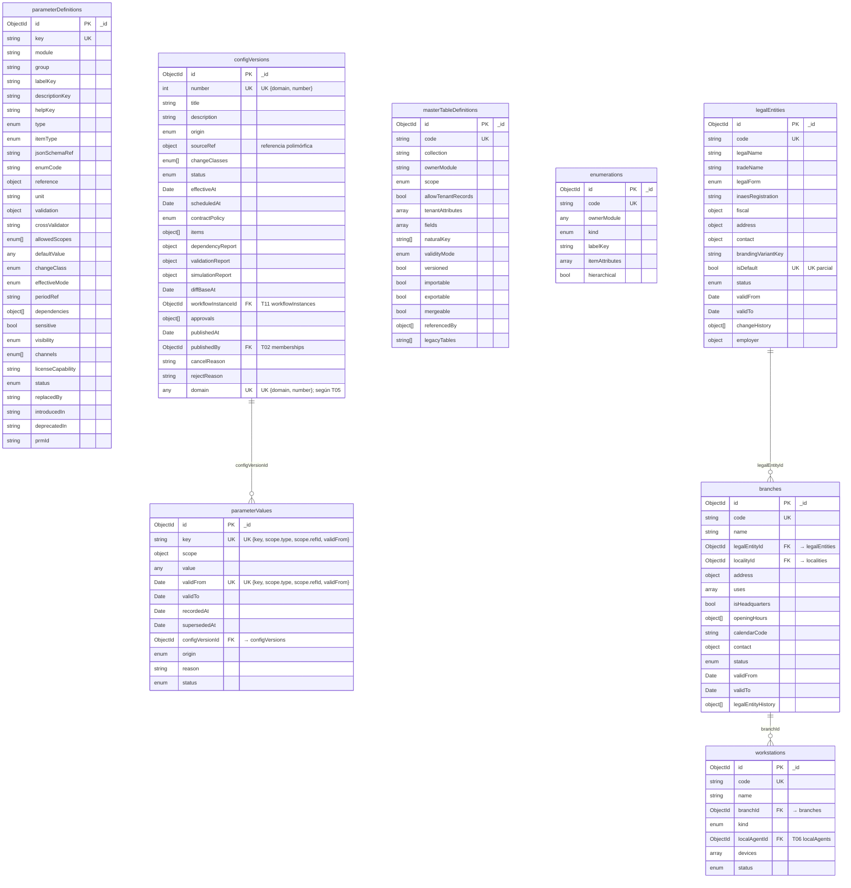
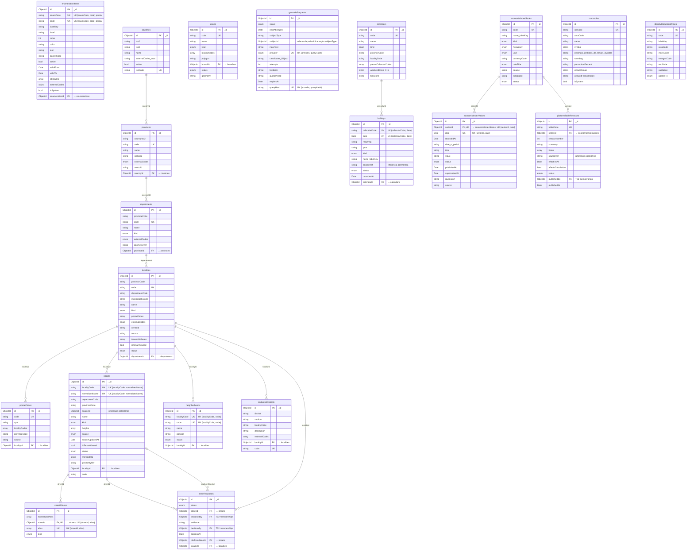

# Modelo entidad-relación — T04 CFG Configuración, parámetros y maestros

| Campo | Valor |
|---|---|
| Artefacto | 6.1 Modelo entidad-relación completo, vista por módulo (índice: [`03-modelo-entidad-relacion.md`](../03-modelo-entidad-relacion.md)) |
| Anexo dueño | [`T04-CFG-configuracion-parametros-maestros.md`](../../especificacion/anexos/T04-CFG-configuracion-parametros-maestros.md), §7 |
| Catálogo canónico | [`T05-DAT-modelo-datos.md`](../../especificacion/anexos/T05-DAT-modelo-datos.md), filas `COL-CFG-NN` |
| Vista por dominio | [`03a-er-plataforma-personas-catalogo.md` §4](../03a-er-plataforma-personas-catalogo.md) |
| Versión | 2.1 (05-11-2026) |
| Generado con | [`_trabajo/generar_er_completo.py`](../_trabajo/generar_er_completo.py), revisado a mano |

## 1. Resumen

T05 registra 55 filas con dueño T04: **45 colecciones a crear** y 10 absorbidas en otras colecciones. Las 45 colecciones a crear se dibujan en 3 diagramas, uno por subdominio.

Convenciones: las del índice (secciones 1.3 y 2). Cada entidad lleva `id PK "_id"` y los campos de su ficha del §7; se omiten los campos transversales (`tenantId`, auditoría, `version`, baja lógica, `legacy`). El comentario de una `FK` indica el destino: `→ colección` si es del mismo módulo, `MXX colección` si es de otro; "(inferido)" cuando ni el anexo ni T05 §7.2 y §7.2.1 nombran el destino para esa colección y el nombre del campo no coincide literalmente con el de la colección (se dedujo por rol, sufijo, versión o por el contexto de §7.2.1; a confirmar); "destino no declarado" cuando no se puede fijar. Una referencia polimórfica (`entityType` + `entityId`, `resourceType` + `resourceId`, `targetRef`, `subjectRef`…) no lleva `FK` ni relación: el comentario "referencia polimórfica según <discriminador>" la señala, porque el destino depende del discriminador. Los campos que T05 §7.2.1 declara "no es referencia" no llevan `FK`. Los nombres que el anexo o T05 citan solo en notas "antes …", "Reemplazado por" o "alias" no se toman como campos ni como destinos. `UK` marca los únicos mínimos de T05; "según T05" señala un campo que figura en el catálogo pero no en la ficha del anexo. El tipo `any` indica que el anexo no declara el tipo.

## 2. Colecciones del módulo

| COL-ID | Colección | Diagrama | Ola | Clasificación | Alcance | Volumen o TTL (T05 §7.8) | Ficha en el anexo |
|---|---|---|---|---|---|---|---|
| COL-CFG-01 | `parameterDefinitions` | 1 | O0 | CF | P | — | §7.1 |
| COL-CFG-02 | `parameterValues` | 1 | O1 | CF | T | — | §7.2 |
| COL-CFG-03 | `configVersions` | 1 | O1 | CF | T | — | §7.3 |
| COL-CFG-04 | `masterTableDefinitions` | 1 | O1 | CF | T+P | — | §7.4 |
| COL-CFG-05 | `enumerations` | 1 | O1 | CF | T+P | — | §7.5 |
| COL-CFG-41 | `legalEntities` | 1 | O0 | ID/FI | T | — | §7.14 |
| COL-CFG-42 | `branches` | 1 | O0 | CF/UB | T | — | §7.15 |
| COL-CFG-43 | `workstations` | 1 | O1 | CF | T | — | §7.16 |
| COL-CFG-06 | `enumerationItems` | 2 | O1 | CF | T+P | — | §7.18 |
| COL-CFG-07 | `countries` | 2 | O1 | CF | P | — | §7.18 |
| COL-CFG-08 | `provinces` | 2 | O1 | CF | P | — | §7.18 |
| COL-CFG-09 | `departments` | 2 | O1 | CF | P | — | §7.18 |
| COL-CFG-10 | `localities` | 2 | O1 | CF/UB | T+P | — | §7.18 |
| COL-CFG-11 | `postalCodes` | 2 | O1 | UB | P | — | §7.18 |
| COL-CFG-12 | `streets` | 2 | O1 | UB | T | — | §7.18 |
| COL-CFG-13 | `streetAliases` | 2 | O1 | UB | T | — | §7.18 |
| COL-CFG-14 | `streetProposals` | 2 | O1 | UB | T | — | §7.18 |
| COL-CFG-15 | `neighborhoods` | 2 | O1 | UB | T | — | §7.18 |
| COL-CFG-16 | `zones` | 2 | O1 | UB | T | — | §7.18 |
| COL-CFG-17 | `cadastralDistricts` | 2 | O1 | UB | T | — | §7.18 |
| COL-CFG-18 | `geocodeRequests` | 2 | O1 | UB/TE | T | TTL sobre `createdAt` (90 días) | §7.18 |
| COL-CFG-19 | `calendars` | 2 | O1 | CF | T+P | — | §7.18 |
| COL-CFG-20 | `holidays` | 2 | O1 | CF | T+P | — | §7.18 |
| COL-CFG-21 | `economicIndexSeries` | 2 | O1 | CF | T+P | — | §7.18 |
| COL-CFG-22 | `economicIndexValues` | 2 | O1 | CF | T+P | — | §7.18 |
| COL-CFG-23 | `currencies` | 2 | O1 | CF | P | — | §7.18 |
| COL-CFG-28 | `identityDocumentTypes` | 2 | O1 | CF | T+P | — | §7.18 |
| COL-CFG-31 | `platformTableReleases` | 2 | O1 | CF | P | — | §7.18 |
| COL-CFG-32 | `platformTableAdoptions` | 3 | O1 | CF | T | — | §7.18 |
| COL-CFG-33 | `customFieldDefinitions` | 3 | O2 | CF | T | — | §7.18 |
| COL-CFG-34 | `formCustomizations` | 3 | O2 | CF | T | — | §7.18 |
| COL-CFG-36 | `masterImportJobs` | 3 | O1 | OP | T | — | §7.18 |
| COL-CFG-37 | `seedPacks` | 3 | O1 | CF | P | — | §7.18 |
| COL-CFG-38 | `seedApplications` | 3 | O1 | CF | T | — | §7.18 |
| COL-CFG-39 | `legacyParameterMappings` | 3 | O11 | CF | P | — | §7.18 |
| COL-CFG-44 | `payrollOfficialCodes` | 3 | O9 | CF | P | — | §7.18 |
| COL-CFG-45 | `contributionRates` | 3 | O9 | CF | P | — | §7.18 |
| COL-CFG-46 | `contributionBaseLimits` | 3 | O9 | CF | P | — | §7.18 |
| COL-CFG-47 | `minimumWages` | 3 | O9 | CF | P | — | §7.18 |
| COL-CFG-48 | `incomeTaxDeductionTables` | 3 | O9 | CF | P | — | §7.18 |
| COL-CFG-49 | `incomeTaxScales` | 3 | O9 | CF | P | — | §7.18 |
| COL-CFG-50 | `incomeTaxRules` | 3 | O9 | CF | P | — | §7.18 |
| COL-CFG-51 | `cedularTaxScales` | 3 | O9 | CF | P | — | §7.18 |
| COL-CFG-52 | `garnishmentScales` | 3 | O9 | CF | P | — | §7.18 |
| COL-CFG-53 | `laborLawParameters` | 3 | O9 | CF | P | — | §7.18 |

## 3. Diagrama 1: Parámetros, enumeraciones, geografía, calendarios, índices y padrones

8 colecciones (ver tabla de la sección 2). Ficha en el anexo: §7.1, §7.2, §7.3, §7.4, §7.5, §7.14, §7.15, §7.16.

**Índices principales del diagrama 1**

| Colección | Índices declarados en el anexo | Únicos mínimos (T05) |
|---|---|---|
| `parameterDefinitions` | `{ tenantId, key }` único; `{ tenantId, module, group }`; `{ tenantId, 'legacy.table', 'legacy.codVar', 'legacy.modVar' }`. | `key` |
| `parameterValues` | `{ tenantId, key, 'scope.type', 'scope.refId', validFrom }`; `{ tenantId, configVersionId }`. Los valores en borrador **no** viven aquí sino en los ítems de `configVersions`. | `{key, scope.type, scope.refId, validFrom}` (5-11-2026, residuales: alineado a T04 §7; ) |
| `configVersions` | `{ tenantId, number }` único; `{ tenantId, status, scheduledAt }`; `{ tenantId, 'items.target.key' }`. | `{domain, number}` |
| `masterTableDefinitions` | — | `code` |
| `enumerations` | — | `code` |
| `legalEntities` | `{ tenantId, code }` único; `{ tenantId, 'fiscal.cuit' }` único; `{ tenantId, isDefault }` único parcial (`isDefault: true, status: 'active'`); `{ tenantId, status }`. | `code`; `fiscal.cuit`; `isDefault` p. (`isDefault: true`, `status: active`) |
| `branches` | `{ tenantId, code }` único; `{ tenantId, legalEntityId, status }`; `{ tenantId, localityId }`. | `code` |
| `workstations` | `{ tenantId, code }` único; `{ tenantId, branchId }`. Las cajas (M07) y el turnero (M09) referencian `workstationId`; los atributos técnicos del dispositivo los mantiene M09. | `code` |

## 4. Diagrama 2: Tablas de plataforma, personalización, importaciones, entidades jurídicas y sucursales

20 colecciones (ver tabla de la sección 2). Ficha en el anexo: §7.18.

**Índices principales del diagrama 2**

| Colección | Índices declarados en el anexo | Únicos mínimos (T05) |
|---|---|---|
| `enumerationItems` | — | `{enumCode, code}` p. (5-11-2026, residuales: alineado a T04 §7; ) |
| `countries` | — | `isoCode` |
| `provinces` | — | `code` |
| `departments` | — | `code` |
| `localities` | — | `code` |
| `postalCodes` | — | `code` (5-11-2026, residuales: alineado a T04 §7; ) |
| `streets` | — | `{localityCode, normalizedName}` (5-11-2026, residuales: alineado a T04 §7; ) |
| `streetAliases` | — | `{streetId, alias}` |
| `streetProposals` | — | — |
| `neighborhoods` | — | `{localityCode, code}` (5-11-2026, residuales: alineado a T04 §7; ) |
| `zones` | — | `code` |
| `cadastralDistricts` | — | `code` |
| `geocodeRequests` | — | `{provider, queryHash}` |
| `calendars` | — | `code` |
| `holidays` | — | `{calendarCode, date}` (5-11-2026, residuales: alineado a T04 §7; ) |
| `economicIndexSeries` | — | `code` |
| `economicIndexValues` | — | `{seriesId, date}` |
| `currencies` | — | `isoCode` |
| `identityDocumentTypes` | — | `code` |
| `platformTableReleases` | — | `{tableCode, version}` |

## 5. Diagrama 3: Tablas legales de sueldos de plataforma

17 colecciones (ver tabla de la sección 2). Ficha en el anexo: §7.18.

```mermaid
erDiagram
  platformTableAdoptions {
    ObjectId id PK "_id"
    string tableCode UK "UK {tableCode, effectiveFrom}"
    ObjectId seriesId FK "→ economicIndexSeries"
    enum mode
    int pinnedReleaseNumber
    array pendingReleases
    ObjectId acknowledgedBy FK "T02 memberships"
    Date acknowledgedAt
    string purpose
    ObjectId releaseId FK "→ platformTableReleases"
    string effectiveFrom UK "UK {tableCode, effectiveFrom}"
  }
  customFieldDefinitions {
    ObjectId id PK "_id"
    enum entity UK "UK {entity, key}"
    string key UK "UK {entity, key}"
    string labelKey
    enum type
    string enumCode
    string reference
    enum validation
    string defaultValue
    string section
    int order
    string visibility
    string editCapability
    string searchable
    string exportable
    string historized
    enum status
  }
  formCustomizations {
    ObjectId id PK "_id"
    string formKey UK "UK {formKey, fieldKey}"
    string fieldKey UK "UK {formKey, fieldKey}"
    string hidden
    string required
    string readOnly
    string defaultValue
    string labelKey
    string helpKey
    int order
    array allowedEnumCodes
    enum status
    ObjectId configVersionId FK "→ configVersions"
    string screenCode
  }
  masterImportJobs {
    ObjectId id PK "_id"
    string targetTableCode
    string fileRef
    enum format
    string layoutRef
    string mapping
    enum mode
    enum status
    enum counters
    string errorFileRef
    ObjectId configVersionId FK "→ configVersions"
    ObjectId platformTableReleaseId FK "→ platformTableReleases"
    string idempotencyKey
    ObjectId storedFileId FK "T01 storedFiles"
  }
  seedPacks {
    ObjectId id PK "_id"
    string code UK
    string description
    array contents
    string demoOnly
  }
  seedApplications {
    ObjectId id PK "_id"
    string seedPackCode UK
    Date appliedAt
    ObjectId appliedBy FK "T02 memberships"
    ObjectId configVersionId FK "→ configVersions"
    array createdRecordRefs
    enum status
    ObjectId seedPackId FK "→ seedPacks"
  }
  legacyParameterMappings {
    ObjectId id PK "_id"
    enum legacyTable UK "UK {legacyTable, modVar, codVar}"
    string modVar UK "UK {legacyTable, modVar, codVar}"
    string codVar UK "UK {legacyTable, modVar, codVar}"
    string legacyName
    string legacyModule
    string legacyType
    bool directUse
    enum destinationKind
    array keys
    enum transform
    string prmId
    string parameterKey
    string legacyKey
  }
  payrollOfficialCodes {
    ObjectId id PK "_id"
    enum type UK "UK {type, code, validFrom}"
    string code UK "UK {type, code, validFrom}"
    Date validFrom UK "UK {type, code, validFrom}"
  }
  contributionRates {
    ObjectId id PK "_id"
    string subsystem UK "UK {subsystem, regime, employerType, validFrom}"
    string regime UK "UK {subsystem, regime, employerType, validFrom}"
    string employerType UK "UK {subsystem, regime, employerType, validFrom}"
    Date validFrom UK "UK {subsystem, regime, employerType, validFrom}"
  }
  contributionBaseLimits {
    ObjectId id PK "_id"
    string period UK
  }
  minimumWages {
    ObjectId id PK "_id"
    Date validFrom UK
  }
  incomeTaxDeductionTables {
    ObjectId id PK "_id"
    enum type UK "UK {type, year, month}"
    string year UK "UK {type, year, month}"
    string month UK "UK {type, year, month}"
  }
  incomeTaxScales {
    ObjectId id PK "_id"
    enum type UK "UK {type, year, month, from}"
    string year UK "UK {type, year, month, from}"
    string month UK "UK {type, year, month, from}"
    string from UK "UK {type, year, month, from}"
  }
  incomeTaxRules {
    ObjectId id PK "_id"
    Date validFrom UK
  }
  cedularTaxScales {
    ObjectId id PK "_id"
    Date validFrom UK
  }
  garnishmentScales {
    ObjectId id PK "_id"
    Date validFrom UK
  }
  laborLawParameters {
    ObjectId id PK "_id"
    Date validFrom UK
  }
  seedPacks ||--o{ seedApplications : "seedPackId"
```

**Índices principales del diagrama 3**

| Colección | Índices declarados en el anexo | Únicos mínimos (T05) |
|---|---|---|
| `platformTableAdoptions` | — | `{tableCode, effectiveFrom}` |
| `customFieldDefinitions` | — | `{entity, key}` |
| `formCustomizations` | — | `{formKey, fieldKey}` por vigente (T04; ) |
| `masterImportJobs` | — | — |
| `seedPacks` | — | `{code, version}` |
| `seedApplications` | — | `{seedPackCode, version}` (5-11-2026, residuales: alineado a T04 §7; ) |
| `legacyParameterMappings` | — | `{legacyTable, modVar, codVar}` (5-11-2026, residuales: alineado a T04 §7; ) |
| `payrollOfficialCodes` | — | `{type, code, validFrom}` |
| `contributionRates` | — | `{subsystem, regime, employerType, validFrom}` |
| `contributionBaseLimits` | — | `{period}` |
| `minimumWages` | — | `validFrom` |
| `incomeTaxDeductionTables` | — | `{type, year, month}` |
| `incomeTaxScales` | — | `{type, year, month, from}` |
| `incomeTaxRules` | — | `validFrom` |
| `cedularTaxScales` | — | `validFrom` |
| `garnishmentScales` | — | `validFrom` |
| `laborLawParameters` | — | `validFrom` |

## 6. Relaciones con otros módulos y entre diagramas

Referencias que salen de una colección de este módulo hacia una entidad de otro módulo o de otro diagrama del mismo módulo (no se dibujan para mantener cada diagrama dentro de su módulo y subdominio).

| Colección origen | Campo | Cardinalidad (destino a origen) | Destino | COL-ID destino | Módulo destino |
|---|---|---|---|---|---|
| `configVersions` | `workflowInstanceId` | 0..1 a N | `workflowInstances` | COL-WFL-14 | T11 |
| `configVersions` | `publishedBy` | 0..1 a N | `memberships` | COL-IAM-04 | T02 |
| `enumerationItems` | `enumerationId` | 1 a N | `enumerations` | COL-CFG-05 | mismo módulo, diagrama 1 |
| `streetProposals` | `proposedBy`, `decisionBy` | 0..1 a N | `memberships` | COL-IAM-04 | T02 |
| `zones` | `branchId` | 0..1 a N | `branches` | COL-CFG-42 | mismo módulo, diagrama 1 |
| `platformTableReleases` | `publishedBy` | 0..1 a N | `memberships` | COL-IAM-04 | T02 |
| `platformTableAdoptions` | `seriesId` | 0..1 a N | `economicIndexSeries` | COL-CFG-21 | mismo módulo, diagrama 2 |
| `platformTableAdoptions` | `acknowledgedBy` | 0..1 a N | `memberships` | COL-IAM-04 | T02 |
| `platformTableAdoptions` | `releaseId` | 1 a N | `platformTableReleases` | COL-CFG-31 | mismo módulo, diagrama 2 |
| `formCustomizations` | `configVersionId` | 0..1 a N | `configVersions` | COL-CFG-03 | mismo módulo, diagrama 1 |
| `masterImportJobs` | `configVersionId` | 0..1 a N | `configVersions` | COL-CFG-03 | mismo módulo, diagrama 1 |
| `masterImportJobs` | `platformTableReleaseId` | 0..1 a N | `platformTableReleases` | COL-CFG-31 | mismo módulo, diagrama 2 |
| `masterImportJobs` | `storedFileId` | 1 a N | `storedFiles` | COL-PLA-29 | T01 |
| `seedApplications` | `appliedBy` | 0..1 a N | `memberships` | COL-IAM-04 | T02 |
| `seedApplications` | `configVersionId` | 0..1 a N | `configVersions` | COL-CFG-03 | mismo módulo, diagrama 1 |
| `branches` | `localityId` | 1 a N | `localities` | COL-CFG-10 | mismo módulo, diagrama 2 |
| `workstations` | `localAgentId` | 1 a N | `localAgents` | COL-INT-16 | T06 |

## 7. Colecciones absorbidas y renombradas

| COL-ID | Colección declarada | Destino (no se crea) | Detalle en T05 |
|---|---|---|---|
| COL-CFG-24 | `vatConditions` | `vatConditionSettings` (COL-FIS-15, M06) | (duplicada con M06) |
| COL-CFG-25 | `vatRates` | `vatRates` (COL-FIS-16, M06) | (duplicada con M06) |
| COL-CFG-26 | `grossIncomeConditions` | `grossIncomeSettings` (COL-FIS-19, M06) | (duplicada con M06) |
| COL-CFG-27 | `grossIncomeRates` | `grossIncomeSettings` (COL-FIS-19, M06) | (duplicada con M06) |
| COL-CFG-29 | `taxRegistries` | `taxpayerRegistries` (COL-FIS-20, M06) | (duplicada con M06) |
| COL-CFG-30 | `taxRegistryEntries` | `taxpayerRegistryEntries` (COL-FIS-21, M06) | (duplicada con M06) |
| COL-CFG-35 | `savedViews` | `dataTableViews` (COL-UXD-10, T03) | (duplicada con T03 y T10) |
| COL-CFG-40 | `sequences` | `numberingSequences` (COL-WFL-45, T11) | (duplicada con T11 `numberingSequences`) |
| COL-CFG-54 | `statutoryFileLayouts` | `fileLayouts` (COL-INT-10, T06) | (diseños LSD, SICOSS, SICORE: son layouts) |
| COL-CFG-55 | `officialTableAdoptions` | `platformTableAdoptions` (COL-CFG-32, T04) | (adopción declarada en M16 §7.45) |

## 8. Observaciones e inconsistencias detectadas

- Campos que T05 cita en "Claves y referencias" o "Únicos" y que la ficha del anexo no declara con ese nombre (posible diferencia de nombre; a verificar en el anexo): `configVersions`: `domain`.
