# Modelo entidad-relación — T06 INT Integraciones

| Campo | Valor |
|---|---|
| Artefacto | 6.1 Modelo entidad-relación completo, vista por módulo (índice: [`03-modelo-entidad-relacion.md`](../03-modelo-entidad-relacion.md)) |
| Anexo dueño | [`T06-INT-integraciones.md`](../../especificacion/anexos/T06-INT-integraciones.md), §7 |
| Catálogo canónico | [`T05-DAT-modelo-datos.md`](../../especificacion/anexos/T05-DAT-modelo-datos.md), filas `COL-INT-NN` |
| Vista por dominio | [`03a-er-plataforma-personas-catalogo.md` §4](../03a-er-plataforma-personas-catalogo.md) |
| Versión | 2.1 (05-11-2026) |
| Generado con | [`_trabajo/generar_er_completo.py`](../_trabajo/generar_er_completo.py), revisado a mano |

## 1. Resumen

T05 registra 18 filas con dueño T06: **18 colecciones a crear** y 0 absorbidas en otras colecciones. Las 18 colecciones a crear se dibujan en 1 diagrama, uno por subdominio.

Convenciones: las del índice (secciones 1.3 y 2). Cada entidad lleva `id PK "_id"` y los campos de su ficha del §7; se omiten los campos transversales (`tenantId`, auditoría, `version`, baja lógica, `legacy`). El comentario de una `FK` indica el destino: `→ colección` si es del mismo módulo, `MXX colección` si es de otro; "(inferido)" cuando ni el anexo ni T05 §7.2 y §7.2.1 nombran el destino para esa colección y el nombre del campo no coincide literalmente con el de la colección (se dedujo por rol, sufijo, versión o por el contexto de §7.2.1; a confirmar); "destino no declarado" cuando no se puede fijar. Una referencia polimórfica (`entityType` + `entityId`, `resourceType` + `resourceId`, `targetRef`, `subjectRef`…) no lleva `FK` ni relación: el comentario "referencia polimórfica según <discriminador>" la señala, porque el destino depende del discriminador. Los campos que T05 §7.2.1 declara "no es referencia" no llevan `FK`. Los nombres que el anexo o T05 citan solo en notas "antes …", "Reemplazado por" o "alias" no se toman como campos ni como destinos. `UK` marca los únicos mínimos de T05; "según T05" señala un campo que figura en el catálogo pero no en la ficha del anexo. El tipo `any` indica que el anexo no declara el tipo.

## 2. Colecciones del módulo

| COL-ID | Colección | Diagrama | Ola | Clasificación | Alcance | Volumen o TTL (T05 §7.8) | Ficha en el anexo |
|---|---|---|---|---|---|---|---|
| COL-INT-01 | `integrationProviders` | 1 | O0 | CF | P | — | §7.1 |
| COL-INT-02 | `integrationConnections` | 1 | O1 | CF | T | — | §7.2 |
| COL-INT-03 | `integrationSecrets` | 1 | O0 | SC | T | — | §7.3 |
| COL-INT-04 | `integrationCertificates` | 1 | O1 | CF | T | — | §7.4 |
| COL-INT-05 | `integrationTokens` | 1 | O0 | SC | T | TTL sobre `expiresAt` (Vencimiento del token) | §7.5 |
| COL-INT-06 | `integrationOperations` | 1 | O0 | TE | T | — | §7.6 |
| COL-INT-07 | `integrationMessages` | 1 | O0 | TE | T | TTL sobre `bodyExpiresAt` (Según T06) | §7.7 |
| COL-INT-10 | `fileLayouts` | 1 | O1 | CF | T+P | — | §7.9 |
| COL-INT-11 | `integrationFileExchanges` | 1 | O1 | TE | T | — | §7.10 |
| COL-INT-12 | `integrationReconciliations` | 1 | O4 | OP | T | — | §7.11 |
| COL-INT-13 | `integrationAlerts` | 1 | O1 | TE | T | — | §7.12 |
| COL-INT-14 | `integrationContingencies` | 1 | O4 | OP | T | — | §7.13 |
| COL-INT-15 | `externalReferences` | 1 | O1 | OP | T | — | §7.14 |
| COL-INT-18 | `aiUsageLogs` | 1 | O2 | TE | T | — | §7.16 |
| COL-INT-08 | `webhookEndpoints` | 1 | O1 | CF | T | — | §7.18 |
| COL-INT-09 | `webhookInbox` | 1 | O1 | TE | T | TTL sobre `receivedAt` (Según T06) | §7.18 |
| COL-INT-16 | `localAgents` | 1 | O10 | CF | T | — | §7.18 |
| COL-INT-17 | `localAgentCommands` | 1 | O10 | TE | T | TTL sobre `expiresAt` (Según T06) | §7.18 |

## 3. Diagrama 1: Proveedores, conexiones, secretos, mensajes, archivos y agente local

18 colecciones (ver tabla de la sección 2). Ficha en el anexo: §7.1, §7.2, §7.3, §7.4, §7.5, §7.6, §7.7, §7.9 ….

```mermaid
erDiagram
  integrationProviders {
    ObjectId id PK "_id"
    string code UK
    string name
    enum connectorType
    string adapterVersion
    string[] capabilities
    enum[] protocols
    object environments
    any credentialSchema
    object configSchema
    object webhook
    string[] fileLayouts
    object rateLimits
    object retryPolicy
    object timeouts
    object circuitBreaker
    string[] egressHosts
    string[] dataShared
    string licenseCapability
    string sheet
    enum status
  }
  integrationConnections {
    ObjectId id PK "_id"
    string providerCode
    string adapterVersion
    string name
    string[] purpose
    enum mode
    enum status
    object config
    object secretRefs FK "→ integrationSecrets"
    ObjectId[] certificateRefs FK "→ integrationCertificates (inferido)"
    ObjectId legalEntityId FK "T04 legalEntities"
    object scope
    string[] defaultFor
    ObjectId[] fallbackConnectionIds FK "→ integrationConnections"
    array schedules
    object overrides
    ObjectId webhookEndpointId FK "→ webhookEndpoints"
    object health
    array contacts
    Date validFrom
    Date validTo
    ObjectId approvalRequestId FK "T11 approvalRequests"
    object copiedFrom
    string notes
    string code UK "según T05"
  }
  integrationSecrets {
    ObjectId id PK "_id"
    ObjectId connectionId FK "→ integrationConnections (inferido)"
    string name
    enum kind
    int versionNo
    Binary ciphertext
    Binary iv
    Binary authTag
    string dataKeyId
    string kmsKeyId
    string fingerprint
    string hint
    enum status
    Date expiresAt
    Date rotationDueAt
    Date activatedAt
    Date rotatedAt
    Date revokedAt
    Date lastUsedAt
    any ref UK "según T05"
  }
  integrationCertificates {
    ObjectId id PK "_id"
    ObjectId connectionId FK "→ integrationConnections (inferido)"
    enum purpose
    string alias
    string cuit
    string subject
    string issuer UK "UK {issuer, serialNumber}"
    string serialNumber UK "UK {issuer, serialNumber}"
    Date notBefore
    Date notAfter
    string csrPem
    string certificatePem
    ObjectId privateKeySecretId FK "→ integrationSecrets"
    enum status
    any alertsSent
    string[] arcaServices
    any credentialRef FK "→ integrationSecrets; según T05"
  }
  integrationTokens {
    ObjectId id PK "_id"
    ObjectId connectionId FK, UK "→ integrationConnections; UK {connectionId, scope}"
    string service
    Date issuedAt
    Date expiresAt
    string cuitRepresentado
    any scope UK "UK {connectionId, scope}; según T05"
  }
  integrationOperations {
    ObjectId id PK "_id"
    ObjectId connectionId FK "→ integrationConnections (inferido)"
    string operationType
    string idempotencyKey UK
    object businessRef
    string requestHash
    enum priority
    enum status
    int attempts
    Date nextAttemptAt
    object lastError
    object result
    object externalIds
    string correlationId
    string jobId
    ObjectId batchId
    ObjectId contingencyId FK "→ integrationContingencies (inferido)"
    object manualResolution
    Date startedAt
    Date finishedAt
  }
  integrationMessages {
    ObjectId id PK "_id"
    ObjectId connectionId FK "→ integrationConnections (inferido)"
    ObjectId operationId
    enum direction
    enum channel
    string endpoint
    string method
    string action
    int statusCode
    int durationMs
    int sizeBytes
    int attempt
    enum mode
    object requestHeaders
    object responseHeaders
    object requestBody
    object responseBody
    object payloadRef
    string[] redactions
    string correlationId
    Date at
    Date retentionUntil
  }
  fileLayouts {
    ObjectId id PK "_id"
    string code UK
    string layoutVersion
    string providerCode
    enum direction
    enum format
    string encoding
    string lineEnding
    string delimiter
    string quote
    string decimalSeparator
    string fileNamePattern
    array records
    object controlFile
    string[] checkDigitAlgorithms
    string[] hooks
    array sampleFiles
    Date validFrom
    Date validTo
    enum status
    string[] procoopEquivalent
    any family "según T05"
  }
  integrationFileExchanges {
    ObjectId id PK "_id"
    ObjectId connectionId FK, UK "→ integrationConnections; UK {connectionId, sha256}"
    string layoutCode
    string layoutVersion
    string direction
    string businessBatchRef
    string fileName
    ObjectId storedFileId FK "T01 storedFiles"
    string sha256 UK "UK {connectionId, sha256}"
    int recordCount
    array controlTotals
    any transport
    enum status
    Date generatedAt
    Date deliveredAt
    Date acknowledgedAt
    Date receivedAt
    Date appliedAt
    array lineResults
    any lineErrorsRef
    ObjectId approvedBy FK "T02 memberships"
    ObjectId supersedesId FK "→ integrationFileExchanges"
    string externalTransactionNumber
    ObjectId fileLayoutId FK "→ fileLayouts"
    string fileHash
  }
  integrationReconciliations {
    ObjectId id PK "_id"
    ObjectId connectionId FK "→ integrationConnections"
    enum type
    string periodFrom
    string periodTo
    string external
    string internal
    array differences
    enum status
    ObjectId actStoredFileId FK "T01 storedFiles"
    ObjectId approvedBy FK "T02 memberships"
    Date closedAt
  }
  integrationAlerts {
    ObjectId id PK "_id"
    ObjectId connectionId FK "→ integrationConnections"
    enum type
    enum severity
    enum status
    string dedupKey
    int count
    Date firstAt
    Date lastAt
    any[] notifiedTo
    ObjectId ackBy FK "T02 memberships"
    ObjectId resolvedBy FK "T02 memberships"
    string link
  }
  integrationContingencies {
    ObjectId id PK "_id"
    ObjectId connectionId FK "→ integrationConnections"
    string reason
    any trigger
    enum mode
    Date startedAt
    ObjectId declaredBy FK "T02 memberships"
    ObjectId approvedBy FK "T02 memberships"
    Date endedAt
    ObjectId endedBy FK "T02 memberships"
    array affectedOperations
    ObjectId closingReconciliationId FK "→ integrationReconciliations"
    enum status
  }
  externalReferences {
    ObjectId id PK "_id"
    any system UK "UK {system, externalId, entity.type}"
    string externalId UK "UK {system, externalId, entity.type}"
    any entity
    enum kind
    Date validFrom
    Date validTo
    ObjectId supersededBy FK "T02 memberships"
    string entityRef "referencia polimórfica según entityType"
    string providerCode
    string entityType
  }
  aiUsageLogs {
    ObjectId id PK "_id"
    ObjectId connectionId FK "→ integrationConnections"
    any feature
    string provider
    string model
    string promptHash
    bool piiRedacted
    int tokensIn
    int tokensOut
    Decimal128 cost
    string currency
    ObjectId userId FK "T02 memberships"
    string businessRef
    enum status
    int latencyMs
    any outcome
    ObjectId actorId FK "T02 memberships"
  }
  webhookEndpoints {
    ObjectId id PK "_id"
    ObjectId connectionId FK "→ integrationConnections"
    string endpointKey
    string signatureScheme
    string credentialRef FK "→ integrationSecrets"
    array allowedIps
    int toleranceSeconds
    enum status
    string previousKeyValidUntil
    string path UK
  }
  webhookInbox {
    ObjectId id PK "_id"
    ObjectId endpointId FK, UK "→ webhookEndpoints; UK {endpointId, dedupKey}"
    ObjectId connectionId FK "→ integrationConnections"
    Date receivedAt
    string sourceIp
    array headers
    string bodyRef
    string body
    string providerEventId
    string dedupeKey
    bool signatureValid
    enum status
    int attempts
    string operationId
    string error
    string dedupKey UK "UK {endpointId, dedupKey}"
  }
  localAgents {
    ObjectId id PK "_id"
    ObjectId branchId FK "T04 branches"
    string name
    array os
    string agentVersion
    string publicKey
    string pairingCodeHash
    Date pairingExpiresAt
    enum status
    array devices
    Date lastSeenAt
    string ip
    array capabilities
    ObjectId workstationId FK "T04 workstations"
    string agentCode UK
  }
  localAgentCommands {
    ObjectId id PK "_id"
    ObjectId agentId FK "→ localAgents"
    ObjectId localAgentId FK "→ localAgents"
    enum commandId UK
    string payloadRef
    string signature
    Date expiresAt
    enum status
    string result
    string operationId
    ObjectId deviceId
    any command
  }
  integrationSecrets ||--o{ integrationConnections : "secretRefs"
  integrationCertificates }o--o{ integrationConnections : "certificateRefs"
  integrationConnections }o--o{ integrationConnections : "fallbackConnectionIds"
  webhookEndpoints |o--o{ integrationConnections : "webhookEndpointId"
  integrationConnections ||--o{ integrationSecrets : "connectionId"
  integrationConnections ||--o{ integrationCertificates : "connectionId"
  integrationSecrets ||--o{ integrationCertificates : "privateKeySecretId"
  integrationSecrets ||--o{ integrationCertificates : "credentialRef"
  integrationConnections ||--o{ integrationTokens : "connectionId"
  integrationConnections ||--o{ integrationOperations : "connectionId"
  integrationContingencies |o--o{ integrationOperations : "contingencyId"
  integrationConnections ||--o{ integrationMessages : "connectionId"
  integrationConnections |o--o{ webhookEndpoints : "connectionId"
  integrationSecrets |o--o{ webhookEndpoints : "credentialRef"
  webhookEndpoints ||--o{ webhookInbox : "endpointId"
  integrationConnections |o--o{ webhookInbox : "connectionId"
  integrationConnections ||--o{ integrationFileExchanges : "connectionId"
  integrationFileExchanges ||--o{ integrationFileExchanges : "supersedesId"
  fileLayouts ||--o{ integrationFileExchanges : "fileLayoutId"
  integrationConnections ||--o{ integrationReconciliations : "connectionId"
  integrationConnections ||--o{ integrationAlerts : "connectionId"
  integrationConnections ||--o{ integrationContingencies : "connectionId"
  integrationReconciliations ||--o{ integrationContingencies : "closingReconciliationId"
  localAgents |o--o{ localAgentCommands : "agentId"
  localAgents ||--o{ localAgentCommands : "localAgentId"
  integrationConnections ||--o{ aiUsageLogs : "connectionId"
```

**Índices principales del diagrama 1**

| Colección | Índices declarados en el anexo | Únicos mínimos (T05) |
|---|---|---|
| `integrationProviders` | `{ code: 1 }` único; `{ connectorType: 1, status: 1 }`. | `code` |
| `integrationConnections` | `{ tenantId: 1, providerCode: 1, name: 1 }` único; `{ tenantId: 1, status: 1 }`; `{ tenantId: 1, defaultFor: 1 }`. | `code` |
| `integrationSecrets` | `{ tenantId: 1, connectionId: 1, name: 1, versionNo: -1 }` único; `{ tenantId: 1, status: 1, expiresAt: 1 }`. Los accesos se registran en la auditoría genérica (T02) con `action: int.secret.decrypted`. | `ref` |
| `integrationCertificates` | `{ tenantId: 1, connectionId: 1, status: 1 }`; `{ status: 1, notAfter: 1 }` (job de alertas, plataforma). | `{issuer, serialNumber}` |
| `integrationTokens` | — | `{connectionId, scope}` |
| `integrationOperations` | `{ tenantId: 1, idempotencyKey: 1 }` único; `{ tenantId: 1, status: 1, nextAttemptAt: 1 }`; `{ tenantId: 1, "businessRef.entity": 1, "businessRef.id": 1 }`; `{ tenantId: 1, connectionId: 1, createdAt: -1 }`; `{ … | `idempotencyKey` |
| `integrationMessages` | `{ tenantId: 1, operationId: 1, at: 1 }`; `{ tenantId: 1, connectionId: 1, at: -1 }`; `{ tenantId: 1, correlationId: 1 }`; TTL sobre `retentionUntil` solo para cuerpos (los metadatos se archivan; las bitácoras de más de … | — |
| `fileLayouts` | — | `{code, version}` |
| `integrationFileExchanges` | `{ tenantId: 1, connectionId: 1, sha256: 1 }` único para entrantes; `{ tenantId: 1, status: 1 }`. | `{connectionId, sha256}` (5-11-2026, residuales: alineado a T06 §7; ) |
| `integrationReconciliations` | — | — |
| `integrationAlerts` | `{ tenantId: 1, dedupKey: 1, status: 1 }`. | — |
| `integrationContingencies` | — | — |
| `externalReferences` | único `{ tenantId: 1, system: 1, kind: 1, externalId: 1 }`; `{ tenantId: 1, "entity.type": 1, "entity.id": 1 }`. | `{system, externalId, entity.type}` (5-11-2026, residuales: alineado a T06 §7; ) |
| `aiUsageLogs` | — | — |
| `webhookEndpoints` | — | `path` |
| `webhookInbox` | — | `{endpointId, dedupKey}` (5-11-2026, residuales: alineado a T06 §7; ) |
| `localAgents` | — | `agentCode` |
| `localAgentCommands` | — | `commandId` |

## 4. Relaciones con otros módulos y entre diagramas

Referencias que salen de una colección de este módulo hacia una entidad de otro módulo o de otro diagrama del mismo módulo (no se dibujan para mantener cada diagrama dentro de su módulo y subdominio).

| Colección origen | Campo | Cardinalidad (destino a origen) | Destino | COL-ID destino | Módulo destino |
|---|---|---|---|---|---|
| `integrationConnections` | `legalEntityId` | 0..1 a N | `legalEntities` | COL-CFG-41 | T04 |
| `integrationConnections` | `approvalRequestId` | 0..1 a N | `approvalRequests` | COL-WFL-24 | T11 |
| `integrationFileExchanges` | `storedFileId` | 1 a N | `storedFiles` | COL-PLA-29 | T01 |
| `integrationFileExchanges` | `approvedBy` | 1 a N | `memberships` | COL-IAM-04 | T02 |
| `integrationReconciliations` | `actStoredFileId` | 1 a N | `storedFiles` | COL-PLA-29 | T01 |
| `integrationReconciliations` | `approvedBy` | 1 a N | `memberships` | COL-IAM-04 | T02 |
| `integrationAlerts` | `ackBy`, `resolvedBy` | 1 a N | `memberships` | COL-IAM-04 | T02 |
| `integrationContingencies` | `declaredBy`, `approvedBy`, `endedBy` | 1 a N | `memberships` | COL-IAM-04 | T02 |
| `externalReferences` | `supersededBy` | 1 a N | `memberships` | COL-IAM-04 | T02 |
| `localAgents` | `branchId` | 0..1 a N | `branches` | COL-CFG-42 | T04 |
| `localAgents` | `workstationId` | 1 a N | `workstations` | COL-CFG-43 | T04 |
| `aiUsageLogs` | `userId`, `actorId` | 1 a N | `memberships` | COL-IAM-04 | T02 |

## 5. Colecciones absorbidas y renombradas

Ninguna colección del módulo quedó absorbida.

## 6. Observaciones e inconsistencias detectadas

- Campos que T05 cita en "Claves y referencias" o "Únicos" y que la ficha del anexo no declara con ese nombre (posible diferencia de nombre; a verificar en el anexo): `integrationConnections`: `code`; `integrationSecrets`: `ref`; `integrationCertificates`: `credentialRef`; `integrationTokens`: `scope`; `fileLayouts`: `family`.
