# Modelo entidad-relación — T07 MIG Migración desde ProCoop

| Campo | Valor |
|---|---|
| Artefacto | 6.1 Modelo entidad-relación completo, vista por módulo (índice: [`03-modelo-entidad-relacion.md`](../03-modelo-entidad-relacion.md)) |
| Anexo dueño | [`T07-MIG-migracion-procoop.md`](../../especificacion/anexos/T07-MIG-migracion-procoop.md), §7 |
| Catálogo canónico | [`T05-DAT-modelo-datos.md`](../../especificacion/anexos/T05-DAT-modelo-datos.md), filas `COL-MIG-NN` |
| Vista por dominio | [`03a-er-plataforma-personas-catalogo.md` §4](../03a-er-plataforma-personas-catalogo.md) |
| Versión | 2.1 (05-11-2026) |
| Generado con | [`_trabajo/generar_er_completo.py`](../_trabajo/generar_er_completo.py), revisado a mano |

## 1. Resumen

T05 registra 20 filas con dueño T07: **20 colecciones a crear** y 0 absorbidas en otras colecciones. Las 20 colecciones a crear se dibujan en 1 diagrama, uno por subdominio.

Convenciones: las del índice (secciones 1.3 y 2). Cada entidad lleva `id PK "_id"` y los campos de su ficha del §7; se omiten los campos transversales (`tenantId`, auditoría, `version`, baja lógica, `legacy`). El comentario de una `FK` indica el destino: `→ colección` si es del mismo módulo, `MXX colección` si es de otro; "(inferido)" cuando ni el anexo ni T05 §7.2 y §7.2.1 nombran el destino para esa colección y el nombre del campo no coincide literalmente con el de la colección (se dedujo por rol, sufijo, versión o por el contexto de §7.2.1; a confirmar); "destino no declarado" cuando no se puede fijar. Una referencia polimórfica (`entityType` + `entityId`, `resourceType` + `resourceId`, `targetRef`, `subjectRef`…) no lleva `FK` ni relación: el comentario "referencia polimórfica según <discriminador>" la señala, porque el destino depende del discriminador. Los campos que T05 §7.2.1 declara "no es referencia" no llevan `FK`. Los nombres que el anexo o T05 citan solo en notas "antes …", "Reemplazado por" o "alias" no se toman como campos ni como destinos. `UK` marca los únicos mínimos de T05; "según T05" señala un campo que figura en el catálogo pero no en la ficha del anexo. El tipo `any` indica que el anexo no declara el tipo.

## 2. Colecciones del módulo

| COL-ID | Colección | Diagrama | Ola | Clasificación | Alcance | Volumen o TTL (T05 §7.8) | Ficha en el anexo |
|---|---|---|---|---|---|---|---|
| COL-MIG-01 | `migrationProjects` | 1 | O1 | OP | T | — | §7.1 |
| COL-MIG-02 | `legacySnapshots` | 1 | O0 | ID/FI | T | — | §7.2 |
| COL-MIG-03 | `migrationMappingSets` | 1 | O1 | CF | T+P | — | §7.3 |
| COL-MIG-04 | `migrationMappingRules` | 1 | O1 | CF | T+P | — | §7.3 |
| COL-MIG-06 | `migrationRuns` | 1 | O1 | OP | T | — | §7.4 |
| COL-MIG-08 | `migStagingRecords` | 1 | O1 | ID/FI | T | TTL sobre `expiresAt` (Fin del proyecto de migración + 90 días) | §7.5 |
| COL-MIG-09 | `legacyIdMap` | 1 | O0 | OP | T | — | §7.6 |
| COL-MIG-11 | `migrationIssues` | 1 | O1 | OP | T | — | §7.7 |
| COL-MIG-12 | `migrationReconciliations` | 1 | O1 | OP | T | — | §7.8 |
| COL-MIG-13 | `parallelRuns` | 1 | O11 | OP | T | — | §7.9 |
| COL-MIG-14 | `parallelComparisons` | 1 | O11 | FI | T | — | §7.9 |
| COL-MIG-19 | `legacyRecords` | 1 | O1 | según origen | T | — | §7.11 |
| COL-MIG-20 | `anonymizationProfiles` | 1 | O1 | CF | P | — | §7.12 |
| COL-MIG-05 | `migrationValueMaps` | 1 | O1 | CF | T+P | — | §7.14 |
| COL-MIG-07 | `migrationBatches` | 1 | O1 | OP | T | — | §7.14 |
| COL-MIG-10 | `legacyKeyAliases` | 1 | O1 | OP | T | — | §7.14 |
| COL-MIG-15 | `bypassPlans` | 1 | O11 | OP | T | — | §7.14 |
| COL-MIG-16 | `coexistenceSyncs` | 1 | O11 | OP | T | — | §7.14 |
| COL-MIG-17 | `cutoverPlans` | 1 | O11 | OP | T | — | §7.14 |
| COL-MIG-18 | `rollbackJournal` | 1 | O11 | OP | T | — | §7.14 |

## 3. Diagrama 1: Proyecto, corridas, mapeos, staging, conciliación, paralelo y corte

20 colecciones (ver tabla de la sección 2). Ficha en el anexo: §7.1, §7.2, §7.3, §7.4, §7.5, §7.6, §7.7, §7.8 ….

```mermaid
erDiagram
  migrationProjects {
    ObjectId id PK "_id"
    string code UK
    enum sourceSystem
    string sourceSigla
    object[] sources
    enum status
    object[] strategy
    object[] tableInventory
    object[] responsibles
    ObjectId acceptanceActId FK "T11 documents"
  }
  legacySnapshots {
    ObjectId id PK "_id"
    ObjectId projectId FK, UK "→ migrationProjects (inferido); UK {projectId, takenAt}"
    enum kind
    Date asOf
    ObjectId baseSnapshotId FK "→ legacySnapshots"
    object[] manifest
    bool anonymized
    ObjectId anonymizationProfileId FK "→ anonymizationProfiles"
    Date retentionUntil
    enum status
    ObjectId storedFileId FK "T01 storedFiles; según T05"
    Date takenAt UK "UK {projectId, takenAt}; según T05"
  }
  migrationMappingSets {
    ObjectId id PK "_id"
    string code UK
    any semver
    any scope
    ObjectId baseSetId FK "→ migrationMappingSets"
    enum status
    Date publishedAt
    ObjectId publishedBy FK "T02 memberships"
    any changelog
  }
  migrationMappingRules {
    ObjectId id PK "_id"
    ObjectId mappingSetId FK, UK "→ migrationMappingSets; UK {mappingSetId, sourceTable, target}"
    string ruleCode
    string sourceTable UK "UK {mappingSetId, sourceTable, target}"
    string[] sourceColumns
    object target UK "UK {mappingSetId, sourceTable, target}"
    Decimal128 transform
    object[] validations
    int order
    string notes
  }
  migrationRuns {
    ObjectId id PK "_id"
    ObjectId projectId FK, UK "→ migrationProjects (inferido); UK {projectId, number}"
    ObjectId snapshotId FK "→ legacySnapshots (inferido)"
    ObjectId mappingSetId FK "→ migrationMappingSets (inferido)"
    enum kind
    object[] scope
    enum targetEnvironment
    ObjectId targetTenantId FK "T01 tenants"
    enum status
    object stats
    Date startedAt
    Date finishedAt
    ObjectId executedBy FK "T02 memberships"
    string idempotencyKey
    string number UK "UK {projectId, number}; según T05"
  }
  migStagingRecords {
    ObjectId id PK "_id"
    ObjectId runId FK "→ migrationRuns"
    string sourceTable
    string sourceKey UK "UK {batchId, sourceKey}"
    string sourceHash
    object raw
    object transformed
    enum status
    ObjectId[] issues FK "→ migrationIssues"
    object targetRef "referencia polimórfica"
    Date expiresAt
    ObjectId batchId UK "UK {batchId, sourceKey}; según T05"
  }
  legacyIdMap {
    ObjectId id PK "_id"
    any sourceSystem
    string sourceTable UK "UK {sourceTable, sourceKey}"
    string sourceKey UK "UK {sourceTable, sourceKey}"
    string targetAnnex
    string targetCollection
    ObjectId targetId "referencia polimórfica según targetCollection"
    ObjectId firstRunId FK "→ migrationRuns"
    ObjectId lastRunId FK "→ migrationRuns"
    string lastSourceHash
    int targetVersionAtLoad
    enum status
    ObjectId mergedIntoId FK "→ legacyIdMap (inferido)"
  }
  migrationIssues {
    ObjectId id PK "_id"
    ObjectId runId FK "→ migrationRuns"
    ObjectId stagingRecordId FK "→ migStagingRecords"
    string sourceTable
    string sourceKey
    ObjectId ruleId FK "→ migrationMappingRules"
    string code
    enum severity
    string field
    any value
    any message
    string suggestedAction
    any fixLocation
    string assignedTo
    enum status
    string resolution
    ObjectId resolvedBy FK "T02 memberships"
    Date resolvedAt
    string batchId
    string ruleCode "según T05"
  }
  migrationReconciliations {
    ObjectId id PK "_id"
    ObjectId projectId FK "→ migrationProjects (inferido)"
    ObjectId runId FK, UK "→ migrationRuns (inferido); UK {runId, check}"
    enum domain
    Decimal128[] checks
    object[] breakdown
    enum status
    ObjectId approvedBy FK "T02 memberships"
    Date approvedAt
    ObjectId evidenceDocId FK "T11 documents"
    any check UK "UK {runId, check}; según T05"
  }
  parallelRuns {
    ObjectId id PK "_id"
    ObjectId projectId FK, UK "→ migrationProjects (inferido); UK {projectId, period, domain}"
    any service
    any billingPeriod
    any procoopRunRef
    ObjectId goodappsBatchId FK "M05 billingRuns"
    enum status
    any period UK "UK {projectId, period, domain}; según T05"
    any domain UK "UK {projectId, period, domain}; según T05"
  }
  parallelComparisons {
    ObjectId id PK "_id"
    ObjectId parallelRunId FK, UK "→ parallelRuns; UK {parallelRunId, itemKey}"
    ObjectId accountId FK "M01 accounts"
    ObjectId contractId FK "M01 accounts"
    ObjectId billingGroupId FK "M01 accounts"
    string procoopInvoiceKey
    ObjectId goodappsSimDocId FK "T11 documents"
    object[] diffs
    enum classification
    any explanation
    ObjectId responsibleId FK "T02 memberships"
    any ticketRef FK "T02 memberships"
    string itemKey UK "UK {parallelRunId, itemKey}"
  }
  legacyRecords {
    ObjectId id PK "_id"
    string sourceTable
    string sourceKey
    int catSection
    object links
    Date recordDate
    object payload
    string schemaRef
    ObjectId runId FK "→ migrationRuns"
    any entityRef "referencia polimórfica; según T05"
  }
  anonymizationProfiles {
    ObjectId id PK "_id"
    string code UK
    any seedRef
    enum status
  }
  migrationValueMaps {
    ObjectId id PK "_id"
    string code
    enum defaultAction
    ObjectId mappingSetId FK, UK "→ migrationMappingSets; UK {mappingSetId, domain, sourceValue}"
    string domain UK "UK {mappingSetId, domain, sourceValue}"
    string sourceValue UK "UK {mappingSetId, domain, sourceValue}"
  }
  migrationBatches {
    ObjectId id PK "_id"
    ObjectId runId FK, UK "→ migrationRuns; UK {runId, sourceTable, batchNo}"
    string table
    string seq
    string fromKey
    string toKey
    enum status
    int attempts
    string error
    string committed
    string sourceTable UK "UK {runId, sourceTable, batchNo}"
    string batchNo UK "UK {runId, sourceTable, batchNo}"
  }
  legacyKeyAliases {
    ObjectId id PK "_id"
    enum kind UK "UK {kind, alias}"
    string value
    Date validFrom
    Date validTo
    bool active
    string targetRef "referencia polimórfica"
    array alias UK "UK {kind, alias}"
  }
  bypassPlans {
    ObjectId id PK "_id"
    ObjectId projectId FK, UK "→ migrationProjects; UK {projectId, moduleCode}"
    enum status
    string moduleCode UK "UK {projectId, moduleCode}"
  }
  coexistenceSyncs {
    ObjectId id PK "_id"
    enum direction
    string domain
    enum mechanism
    string schedule
    Date lastRunAt
    string lastStatus
    array lastStats
  }
  cutoverPlans {
    ObjectId id PK "_id"
    ObjectId projectId FK, UK "→ migrationProjects; UK parcial"
    string scope
    Date freezeAt
    ObjectId finalSnapshotId FK "→ legacySnapshots"
    string rollbackDeadline
    enum status
  }
  rollbackJournal {
    ObjectId id PK "_id"
    ObjectId cutoverId FK "→ cutoverPlans"
    string eventType
    string entityRef "referencia polimórfica"
    Date occurredAt
    string payloadForProcoop
    Date exportedAt
    string rollbackDeadline
    ObjectId runId FK "→ migrationRuns"
  }
  migrationProjects ||--o{ legacySnapshots : "projectId"
  legacySnapshots |o--o{ legacySnapshots : "baseSnapshotId"
  anonymizationProfiles |o--o{ legacySnapshots : "anonymizationProfileId"
  migrationMappingSets ||--o{ migrationMappingSets : "baseSetId"
  migrationMappingSets ||--o{ migrationMappingRules : "mappingSetId"
  migrationMappingSets ||--o{ migrationValueMaps : "mappingSetId"
  migrationProjects ||--o{ migrationRuns : "projectId"
  legacySnapshots ||--o{ migrationRuns : "snapshotId"
  migrationMappingSets ||--o{ migrationRuns : "mappingSetId"
  migrationRuns ||--o{ migrationBatches : "runId"
  migrationRuns ||--o{ migStagingRecords : "runId"
  migrationIssues }o--o{ migStagingRecords : "issues"
  migrationRuns ||--o{ legacyIdMap : "firstRunId"
  migrationRuns ||--o{ legacyIdMap : "lastRunId"
  legacyIdMap |o--o{ legacyIdMap : "mergedIntoId"
  migrationRuns ||--o{ migrationIssues : "runId"
  migStagingRecords ||--o{ migrationIssues : "stagingRecordId"
  migrationMappingRules ||--o{ migrationIssues : "ruleId"
  migrationProjects ||--o{ migrationReconciliations : "projectId"
  migrationRuns ||--o{ migrationReconciliations : "runId"
  migrationProjects ||--o{ parallelRuns : "projectId"
  parallelRuns ||--o{ parallelComparisons : "parallelRunId"
  migrationProjects ||--o{ bypassPlans : "projectId"
  migrationProjects ||--o{ cutoverPlans : "projectId"
  legacySnapshots |o--o{ cutoverPlans : "finalSnapshotId"
  cutoverPlans |o--o{ rollbackJournal : "cutoverId"
  migrationRuns ||--o{ rollbackJournal : "runId"
  migrationRuns ||--o{ legacyRecords : "runId"
```

**Índices principales del diagrama 1**

| Colección | Índices declarados en el anexo | Únicos mínimos (T05) |
|---|---|---|
| `migrationProjects` | `{ tenantId, code }` único; `{ tenantId, status }`. | `code` |
| `legacySnapshots` | `{ tenantId, projectId, asOf }`. | `{projectId, takenAt}` |
| `migrationMappingSets` | — | `{code, version}` |
| `migrationMappingRules` | — | `{mappingSetId, sourceTable, target}` |
| `migrationRuns` | — | `{projectId, number}` |
| `migStagingRecords` | `{ tenantId, runId, sourceTable, sourceKey }` único; `{ tenantId, runId, status }`; TTL sobre `expiresAt`. | `{batchId, sourceKey}` |
| `legacyIdMap` | `{ tenantId, sourceTable, sourceKey }` único; `{ tenantId, targetCollection, targetId }`.; `{ tenantId, 'legacy.table', 'legacy.key' }` sparse en las colecciones que reciben datos migrados. | `{sourceTable, sourceKey}` |
| `migrationIssues` | `{ tenantId, runId, severity, status }`, `{ tenantId, code }`. | — |
| `migrationReconciliations` | — | `{runId, check}` |
| `parallelRuns` | — | `{projectId, period, domain}` |
| `parallelComparisons` | `{ tenantId, parallelRunId, classification }`. | `{parallelRunId, itemKey}` |
| `legacyRecords` | `{ tenantId, 'links.accountId', recordDate }`, `{ tenantId, sourceTable, sourceKey }` único. Sin endpoints de escritura. | `{legacy.table, legacy.key}` |
| `anonymizationProfiles` | — | `code` |
| `migrationValueMaps` | — | `{mappingSetId, domain, sourceValue}` |
| `migrationBatches` | — | `{runId, sourceTable, batchNo}` |
| `legacyKeyAliases` | — | `{kind, alias}` |
| `bypassPlans` | — | `{projectId, moduleCode}` |
| `coexistenceSyncs` | — | — |
| `cutoverPlans` | — | `projectId` p. activo |
| `rollbackJournal` | — | — |

## 4. Relaciones con otros módulos y entre diagramas

Referencias que salen de una colección de este módulo hacia una entidad de otro módulo o de otro diagrama del mismo módulo (no se dibujan para mantener cada diagrama dentro de su módulo y subdominio).

| Colección origen | Campo | Cardinalidad (destino a origen) | Destino | COL-ID destino | Módulo destino |
|---|---|---|---|---|---|
| `migrationProjects` | `acceptanceActId` | 0..1 a N | `documents` | COL-WFL-34 | T11 |
| `legacySnapshots` | `storedFileId` | 1 a N | `storedFiles` | COL-PLA-29 | T01 |
| `migrationMappingSets` | `publishedBy` | 1 a N | `memberships` | COL-IAM-04 | T02 |
| `migrationRuns` | `targetTenantId` | 1 a N | `tenants` | COL-PLA-01 | T01 |
| `migrationRuns` | `executedBy` | 1 a N | `memberships` | COL-IAM-04 | T02 |
| `migrationIssues` | `resolvedBy` | 1 a N | `memberships` | COL-IAM-04 | T02 |
| `migrationReconciliations` | `approvedBy` | 0..1 a N | `memberships` | COL-IAM-04 | T02 |
| `migrationReconciliations` | `evidenceDocId` | 0..1 a N | `documents` | COL-WFL-34 | T11 |
| `parallelRuns` | `goodappsBatchId` | 1 a N | `billingRuns` | COL-FAC-05 | M05 |
| `parallelComparisons` | `accountId`, `contractId`, `billingGroupId` | 1 a N | `accounts` | COL-PER-05 | M01 |
| `parallelComparisons` | `goodappsSimDocId` | 1 a N | `documents` | COL-WFL-34 | T11 |
| `parallelComparisons` | `responsibleId`, `ticketRef` | 1 a N | `memberships` | COL-IAM-04 | T02 |

## 5. Colecciones absorbidas y renombradas

Ninguna colección del módulo quedó absorbida.

## 6. Observaciones e inconsistencias detectadas

- Campos que T05 cita en "Claves y referencias" o "Únicos" y que la ficha del anexo no declara con ese nombre (posible diferencia de nombre; a verificar en el anexo): `legacySnapshots`: `storedFileId`, `takenAt`; `migrationRuns`: `number`; `migStagingRecords`: `batchId`; `migrationIssues`: `ruleCode`; `migrationReconciliations`: `check`; `parallelRuns`: `period`, `domain`; `legacyRecords`: `entityRef`.
