# Modelo entidad-relación — T08 NFR No funcionales, seguridad y privacidad

| Campo | Valor |
|---|---|
| Artefacto | 6.1 Modelo entidad-relación completo, vista por módulo (índice: [`03-modelo-entidad-relacion.md`](../03-modelo-entidad-relacion.md)) |
| Anexo dueño | [`T08-NFR-no-funcionales-seguridad.md`](../../especificacion/anexos/T08-NFR-no-funcionales-seguridad.md), §15.1 (T08 ubica su modelo de datos en esa sección) |
| Catálogo canónico | [`T05-DAT-modelo-datos.md`](../../especificacion/anexos/T05-DAT-modelo-datos.md), filas `COL-NFR-NN` |
| Vista por dominio | Sin sección propia en la vista por dominio (sus colecciones se citan como destino de referencias) |
| Versión | 2.1 (05-11-2026) |
| Generado con | [`_trabajo/generar_er_completo.py`](../_trabajo/generar_er_completo.py), revisado a mano |

## 1. Resumen

T05 registra 23 filas con dueño T08: **17 colecciones a crear** y 6 absorbidas en otras colecciones. Las 17 colecciones a crear se dibujan en 1 diagrama, uno por subdominio.

Convenciones: las del índice (secciones 1.3 y 2). Cada entidad lleva `id PK "_id"` y los campos de su ficha del §15.1; se omiten los campos transversales (`tenantId`, auditoría, `version`, baja lógica, `legacy`). El comentario de una `FK` indica el destino: `→ colección` si es del mismo módulo, `MXX colección` si es de otro; "(inferido)" cuando ni el anexo ni T05 §7.2 y §7.2.1 nombran el destino para esa colección y el nombre del campo no coincide literalmente con el de la colección (se dedujo por rol, sufijo, versión o por el contexto de §7.2.1; a confirmar); "destino no declarado" cuando no se puede fijar. Una referencia polimórfica (`entityType` + `entityId`, `resourceType` + `resourceId`, `targetRef`, `subjectRef`…) no lleva `FK` ni relación: el comentario "referencia polimórfica según <discriminador>" la señala, porque el destino depende del discriminador. Los campos que T05 §7.2.1 declara "no es referencia" no llevan `FK`. Los nombres que el anexo o T05 citan solo en notas "antes …", "Reemplazado por" o "alias" no se toman como campos ni como destinos. `UK` marca los únicos mínimos de T05; "según T05" señala un campo que figura en el catálogo pero no en la ficha del anexo. El tipo `any` indica que el anexo no declara el tipo.

## 2. Colecciones del módulo

| COL-ID | Colección | Diagrama | Ola | Clasificación | Alcance | Volumen o TTL (T05 §7.8) | Ficha en el anexo |
|---|---|---|---|---|---|---|---|
| COL-NFR-01 | `dataCatalogEntries` | 1 | O0 | CF | T+P | — | §15.1 |
| COL-NFR-02 | `processingActivities` | 1 | O1 | CF | T | — | §15.1 |
| COL-NFR-03 | `privacyNotices` | 1 | O1 | CF | T | — | §15.1 |
| COL-NFR-04 | `consentRecords` | 1 | O1 | ID/CT | T | — | §15.1 |
| COL-NFR-05 | `dataSubjectRequests` | 1 | O1 | ID | T | — | §15.1 |
| COL-NFR-06 | `retentionPolicies` | 1 | O1 | CF | T+P | — | §15.1 |
| COL-NFR-07 | `legalHolds` | 1 | O1 | AU | T | — | §15.1 |
| COL-NFR-08 | `retentionRuns` | 1 | O1 | AU | T | — | §15.1 |
| COL-NFR-09 | `erasureLedger` | 1 | O1 | AU | G | — | §15.1 |
| COL-NFR-10 | `securityIncidents` | 1 | O1 | AU | T+P | — | §15.1 |
| COL-NFR-12 | `encryptionKeys` | 1 | O0 | SC | T | — | §15.1 |
| COL-NFR-15 | `locks` | 1 | O0 | TE | T | TTL sobre `expiresAt` (Duración del lock) | §15.1 |
| COL-NFR-16 | `sloDefinitions` | 1 | O1 | CF | P | — | §15.1 |
| COL-NFR-19 | `cspReports` | 1 | O0 | TE | P | TTL sobre `receivedAt` (30 días) | §15.1 |
| COL-NFR-20 | `qualityEvidence` | 1 | O0 | AU | P | — | §15.1 |
| COL-NFR-21 | `statusNotices` | 1 | O1 | TE | P | — | §15.1 |
| COL-NFR-23 | `subprocessors` | 1 | O1 | CF | P | — | §15.1 |

## 3. Diagrama 1: Privacidad, conservación, incidentes, claves y evidencias de calidad

17 colecciones (ver tabla de la sección 2). Ficha en el anexo: §15.1.

```mermaid
erDiagram
  dataCatalogEntries {
    ObjectId id PK "_id"
    string module
    string collection UK "UK {collection, field}"
    string field UK "UK {collection, field}"
    enum category
    enum sensitivity
    enum encryption
    ObjectId[] purposes FK "→ processingActivities"
    ObjectId retentionPolicyId FK "→ retentionPolicies"
    object exposure
    string maskRule
  }
  processingActivities {
    ObjectId id PK "_id"
    string code UK
    string name
    string purpose
    enum legalBasis
    enum[] dataSubjects
    enum[] dataCategories
    string[] recipients
    ObjectId[] subprocessorIds FK "→ subprocessors"
    object[] internationalTransfers
    ObjectId[] retentionPolicyIds FK "→ retentionPolicies"
    string[] securityMeasures
    enum status
    Date validFrom
    Date validTo
    ObjectId approvedBy FK "T02 memberships"
    Date approvedAt
  }
  privacyNotices {
    ObjectId id PK "_id"
    enum channel UK
    int versionNumber
    string content
    ObjectId[] purposesCovered FK "→ processingActivities"
    enum status
    Date publishedAt
    string contentHash
  }
  consentRecords {
    ObjectId id PK "_id"
    ObjectId personId FK "M01 persons"
    ObjectId userId FK "T02 memberships"
    string purposeCode
    ObjectId noticeId FK "→ privacyNotices"
    string noticeVersion
    enum status
    enum channel
    Date grantedAt
    Date revokedAt
    object evidence
    ObjectId representativePersonId FK "M01 persons"
    Date expiresAt
    string purpose
  }
  dataSubjectRequests {
    ObjectId id PK "_id"
    string number UK
    enum type
    enum channel
    ObjectId personId FK "M01 persons"
    object requester
    Date receivedAt
    Date verifiedAt
    Date dueAt
    any dueRule
    enum status
    string assignedTo
    object[] findings
    object[] decisions
    string responseObjectKey
    Date responseSentAt
    Date closedAt
    string rejectionReason
  }
  retentionPolicies {
    ObjectId id PK "_id"
    string code UK
    enum category
    any retentionClass
    array durationMonths
    enum startEvent
    any action
    array platformMinMonths
    array platformMaxMonths
    string legalReference
    enum status
    Date validFrom
  }
  legalHolds {
    ObjectId id PK "_id"
    enum scope
    ObjectId[] targetIds "referencia polimórfica"
    enum reason
    string description
    enum status
    ObjectId requestedBy FK "T02 memberships"
    ObjectId approvedBy FK "T02 memberships"
    string activeFrom
    Date releasedAt
    string releaseReason
    array entityRefs "referencia polimórfica"
    string number UK
  }
  retentionRuns {
    ObjectId id PK "_id"
    ObjectId policyId FK "→ retentionPolicies (inferido)"
    enum mode
    enum status
    array candidates
    any excludedByHold
    ObjectId approvedBy FK "T02 memberships"
    Date startedAt
    Date finishedAt
    string jobId
    string checkpoint
    any result
    ObjectId retentionPolicyId FK "→ retentionPolicies"
  }
  erasureLedger {
    ObjectId id PK "_id"
    any subjectRef "referencia polimórfica"
    string scope
    Date executedAt
    ObjectId requestId FK "→ dataSubjectRequests"
    string entityRef UK "referencia polimórfica"
  }
  securityIncidents {
    ObjectId id PK "_id"
    string number UK
    string title
    enum severity
    enum type
    enum status
    Date detectedAt
    Date confirmedAt
    Date containedAt
    Date resolvedAt
    ObjectId[] affectedTenantIds FK "T01 tenants"
    array affectedDataCategories
    any affectedSubjectsEstimate
    object[] notifications
    object[] timeline
    string rootCause
    object[] actions
    string postmortemObjectKey
    ObjectId platformIncidentId FK "T01 platformIncidents"
  }
  encryptionKeys {
    ObjectId id PK "_id"
    any purpose
    any kmsKeyRef
    Binary wrappedKey
    string keyVersion
    enum status
    string rotateAfter
    Date rotatedAt
    enum category UK
  }
  locks {
    ObjectId id PK "_id"
    any resource UK
    any owner
    string leaseUntil
  }
  sloDefinitions {
    ObjectId id PK "_id"
    string service
    any sli
    any target
    any window
    array burnRateRules
    string owner
    string code UK
  }
  cspReports {
    ObjectId id PK "_id"
    string app
    string directive
    any blockedUri
    any documentUri
    int count
    string firstSeen
    string lastSeen
  }
  qualityEvidence {
    ObjectId id PK "_id"
    any release
    string commit
    any wave UK "UK {wave, control}"
    object[] checks
    string asvsMatrixVersion
    ObjectId approvedBy FK "T02 memberships"
    Date approvedAt
    Date promotedAt
    string control UK "UK {wave, control}"
  }
  statusNotices {
    ObjectId id PK "_id"
    enum type
    string title
    any body
    string[] affectedServices
    ObjectId[] affectedTenantIds FK "T01 tenants"
    string scheduledFrom
    string scheduledTo
    Date publishedAt
    object[] updates
    ObjectId incidentId FK "T01 platformIncidents"
    enum status
    ObjectId platformIncidentId FK "T01 platformIncidents"
  }
  subprocessors {
    ObjectId id PK "_id"
    string name
    string service
    array dataCategories
    string country
    any safeguard
    Date addedAt
    Date noticeSentAt
    enum status
    string code UK
  }
  processingActivities }o--o{ dataCatalogEntries : "purposes"
  retentionPolicies ||--o{ dataCatalogEntries : "retentionPolicyId"
  subprocessors }o--o{ processingActivities : "subprocessorIds"
  retentionPolicies }o--o{ processingActivities : "retentionPolicyIds"
  processingActivities }o--o{ privacyNotices : "purposesCovered"
  privacyNotices ||--o{ consentRecords : "noticeId"
  retentionPolicies ||--o{ retentionRuns : "policyId"
  retentionPolicies ||--o{ retentionRuns : "retentionPolicyId"
  dataSubjectRequests ||--o{ erasureLedger : "requestId"
```

**Índices principales del diagrama 1**

| Colección | Índices declarados en el anexo | Únicos mínimos (T05) |
|---|---|---|
| `dataCatalogEntries` | `{ tenantId, collection, field }` único; `{ tenantId, sensitivity }`. Las entradas de plataforma (`tenantId = PLATFORM`) son la plantilla heredada. | `{collection, field}` |
| `processingActivities` | `{ tenantId, code }` único. | `code` |
| `privacyNotices` | `{ tenantId, channel, versionNumber }` único. | `{channel, version}` |
| `consentRecords` | `{ tenantId, personId, purposeCode, status }`; `{ tenantId, purposeCode, status }`. Nunca se edita: revocar crea un estado nuevo con auditoría. Campos que usa T09 (COL-COM-50 absorbida, CTR-DAT-18): `contactPointId` … | — |
| `dataSubjectRequests` | `{ tenantId, number }` único; `{ tenantId, status, dueAt }`; `{ tenantId, personId }`. | `number` |
| `retentionPolicies` | `{ tenantId, code, validFrom }`. | `code` |
| `legalHolds` | `{ tenantId, status, scope }`. | `number` |
| `retentionRuns` | `{ tenantId, policyId, createdAt }`. | — |
| `erasureLedger` | — | `{tenantId, entityRef}` |
| `securityIncidents` | — | `number` |
| `encryptionKeys` | `{ tenantId, purpose, status }`. | `{category, version}` |
| `locks` | `{ tenantId, resource }` único; TTL sobre `leaseUntil`. | `resource` |
| `sloDefinitions` | — | `code` |
| `cspReports` | `{ app, directive, blockedUri }` único (agregación). | — |
| `qualityEvidence` | — | `{wave, control}` |
| `statusNotices` | `{ status, scheduledFrom }`. Alimenta PAN-NFR-18 y el aviso en el admin. | — |
| `subprocessors` | — | `code` |

## 4. Relaciones con otros módulos y entre diagramas

Referencias que salen de una colección de este módulo hacia una entidad de otro módulo o de otro diagrama del mismo módulo (no se dibujan para mantener cada diagrama dentro de su módulo y subdominio).

| Colección origen | Campo | Cardinalidad (destino a origen) | Destino | COL-ID destino | Módulo destino |
|---|---|---|---|---|---|
| `processingActivities` | `approvedBy` | 1 a N | `memberships` | COL-IAM-04 | T02 |
| `consentRecords` | `personId`, `representativePersonId` | 1 a N | `persons` | COL-PER-01 | M01 |
| `consentRecords` | `userId` | 1 a N | `memberships` | COL-IAM-04 | T02 |
| `dataSubjectRequests` | `personId` | 1 a N | `persons` | COL-PER-01 | M01 |
| `legalHolds` | `requestedBy`, `approvedBy` | 1 a N | `memberships` | COL-IAM-04 | T02 |
| `retentionRuns` | `approvedBy` | 1 a N | `memberships` | COL-IAM-04 | T02 |
| `securityIncidents` | `affectedTenantIds` | N a N | `tenants` | COL-PLA-01 | T01 |
| `securityIncidents` | `platformIncidentId` | 1 a N | `platformIncidents` | COL-PLA-14 | T01 |
| `qualityEvidence` | `approvedBy` | 1 a N | `memberships` | COL-IAM-04 | T02 |
| `statusNotices` | `affectedTenantIds` | N a N | `tenants` | COL-PLA-01 | T01 |
| `statusNotices` | `incidentId`, `platformIncidentId` | 1 a N | `platformIncidents` | COL-PLA-14 | T01 |

## 5. Colecciones absorbidas y renombradas

| COL-ID | Colección declarada | Destino (no se crea) | Detalle en T05 |
|---|---|---|---|
| COL-NFR-11 | `restoreDrills` | `restoreTests` (COL-PLA-20, T01) | (duplicada con `restoreTests`) |
| COL-NFR-13 | `idempotencyKeys` | `idempotencyKeys` (COL-PLA-28, T01) | (duplicada con T01) |
| COL-NFR-14 | `processedEvents` | `inboxReceipts` (COL-PLA-25, T01) | (duplicada con `inboxReceipts`) |
| COL-NFR-17 | `alertRules` | `alertRules` (COL-PLA-15, T01) | (duplicada con T01) |
| COL-NFR-18 | `alertEvents` | `alerts` (COL-PLA-16, T01) | (duplicada con `alerts`) |
| COL-NFR-22 | `tenantUsageSnapshots` | `usageSnapshots` (COL-PLA-09, T01) | (duplicada con `usageSnapshots`) |

## 6. Observaciones e inconsistencias detectadas

- Sin observaciones.
