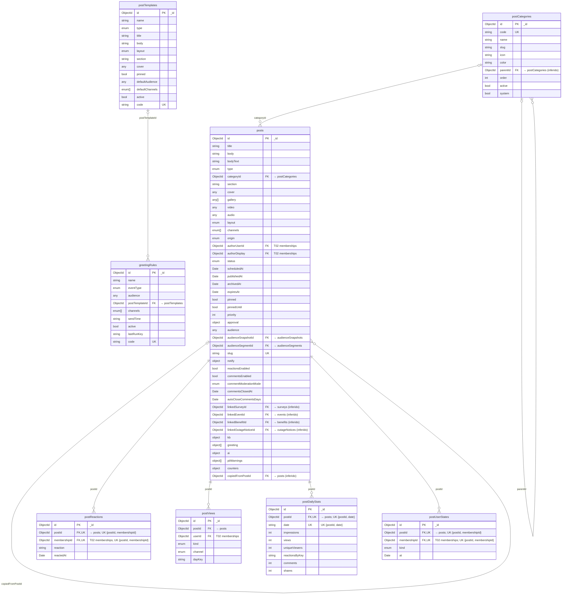
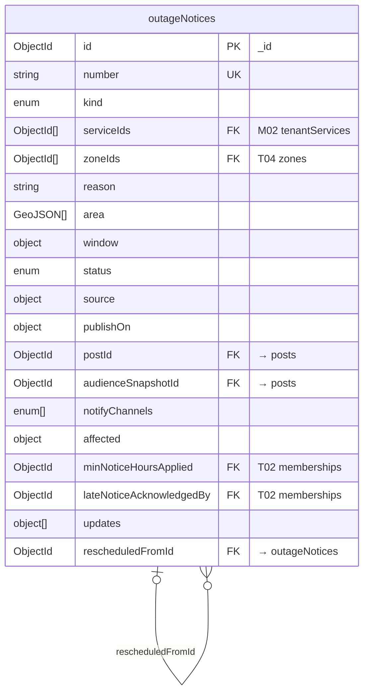

# Modelo entidad-relación — T09 COM Comunidad y comunicaciones

| Campo | Valor |
|---|---|
| Artefacto | 6.1 Modelo entidad-relación completo, vista por módulo (índice: [`03-modelo-entidad-relacion.md`](../03-modelo-entidad-relacion.md)) |
| Anexo dueño | [`T09-COM-comunidad-comunicaciones.md`](../../especificacion/anexos/T09-COM-comunidad-comunicaciones.md), §7 |
| Catálogo canónico | [`T05-DAT-modelo-datos.md`](../../especificacion/anexos/T05-DAT-modelo-datos.md), filas `COL-COM-NN` |
| Vista por dominio | [`03e-er-institucional-social-portal-transversales.md` §23](../03e-er-institucional-social-portal-transversales.md) |
| Versión | 2.1 (05-11-2026) |
| Generado con | [`_trabajo/generar_er_completo.py`](../_trabajo/generar_er_completo.py), revisado a mano |

## 1. Resumen

T05 registra 56 filas con dueño T09: **55 colecciones a crear** y 1 absorbida en otras colecciones. Las 55 colecciones a crear se dibujan en 4 diagramas, uno por subdominio.

Convenciones: las del índice (secciones 1.3 y 2). Cada entidad lleva `id PK "_id"` y los campos de su ficha del §7; se omiten los campos transversales (`tenantId`, auditoría, `version`, baja lógica, `legacy`). El comentario de una `FK` indica el destino: `→ colección` si es del mismo módulo, `MXX colección` si es de otro; "(inferido)" cuando ni el anexo ni T05 §7.2 y §7.2.1 nombran el destino para esa colección y el nombre del campo no coincide literalmente con el de la colección (se dedujo por rol, sufijo, versión o por el contexto de §7.2.1; a confirmar); "destino no declarado" cuando no se puede fijar. Una referencia polimórfica (`entityType` + `entityId`, `resourceType` + `resourceId`, `targetRef`, `subjectRef`…) no lleva `FK` ni relación: el comentario "referencia polimórfica según <discriminador>" la señala, porque el destino depende del discriminador. Los campos que T05 §7.2.1 declara "no es referencia" no llevan `FK`. Los nombres que el anexo o T05 citan solo en notas "antes …", "Reemplazado por" o "alias" no se toman como campos ni como destinos. `UK` marca los únicos mínimos de T05; "según T05" señala un campo que figura en el catálogo pero no en la ficha del anexo. El tipo `any` indica que el anexo no declara el tipo.

## 2. Colecciones del módulo

| COL-ID | Colección | Diagrama | Ola | Clasificación | Alcance | Volumen o TTL (T05 §7.8) | Ficha en el anexo |
|---|---|---|---|---|---|---|---|
| COL-COM-01 | `posts` | 1 | O2 | OP | T | — | §7.1 |
| COL-COM-02 | `postCategories` | 1 | O2 | CF | T | — | §7.1 |
| COL-COM-03 | `postTemplates` | 1 | O2 | CF | T+P | — | §7.1 |
| COL-COM-04 | `postReactions` | 1 | O2 | OP | T | — | §7.1 |
| COL-COM-05 | `postViews` | 1 | O2 | TE | T | TTL sobre `viewedAt` (400 días) | §7.1 |
| COL-COM-06 | `postDailyStats` | 1 | O2 | OP | T | — | §7.1 |
| COL-COM-07 | `postUserStates` | 1 | O2 | OP | T | — | §7.1 |
| COL-COM-08 | `greetingRules` | 1 | O2 | CF | T | — | §7.1 |
| COL-COM-09 | `comments` | 2 | O2 | OP | T | — | §7.2 |
| COL-COM-10 | `moderationPolicies` | 2 | O2 | CF | T+P | — | §7.2 |
| COL-COM-11 | `moderationRules` | 2 | O2 | CF | T+P | — | §7.2 |
| COL-COM-12 | `moderationCases` | 2 | O2 | OP | T | — | §7.2 |
| COL-COM-13 | `contentReports` | 2 | O2 | OP | T | — | §7.2 |
| COL-COM-14 | `communitySanctions` | 2 | O2 | OP | T | — | §7.2 |
| COL-COM-15 | `communityGuidelines` | 2 | O2 | CF | T | — | §7.2 |
| COL-COM-16 | `guidelineAcceptances` | 2 | O2 | AU | T | — | §7.2 |
| COL-COM-17 | `newsletterRules` | 2 | O2 | CF | T | — | §7.3 |
| COL-COM-18 | `newsletters` | 2 | O2 | OP | T | — | §7.3 |
| COL-COM-19 | `newsletterRecipients` | 2 | O2 | CT | T | — | §7.3 |
| COL-COM-20 | `surveys` | 2 | O2 | OP | T | — | §7.4 |
| COL-COM-21 | `surveyResponses` | 2 | O2 | OP | T | — | §7.4 |
| COL-COM-22 | `surveyInvitations` | 2 | O2 | CT | T | — | §7.4 |
| COL-COM-23 | `surveyTemplates` | 2 | O2 | CF | T+P | — | §7.4 |
| COL-COM-24 | `surveyCategories` | 2 | O2 | CF | T | — | §7.4 |
| COL-COM-25 | `events` | 2 | O2 | OP | T | — | §7.5 |
| COL-COM-26 | `eventRegistrations` | 2 | O2 | CT | T | — | §7.5 |
| COL-COM-27 | `benefitPartners` | 2 | O2 | CF | T | — | §7.5 |
| COL-COM-28 | `benefits` | 2 | O2 | CF | T | — | §7.5 |
| COL-COM-29 | `benefitRedemptions` | 2 | O2 | OP | T | — | §7.5 |
| COL-COM-30 | `audienceSegments` | 3 | O2 | CF | T | — | §7.6 |
| COL-COM-31 | `audienceImportLists` | 3 | O2 | CT | T | — | §7.6 |
| COL-COM-32 | `audienceImportRows` | 3 | O2 | CT | T | — | §7.6 |
| COL-COM-33 | `audienceSnapshots` | 3 | O2 | OP | T | — | §7.6 |
| COL-COM-34 | `audienceSnapshotMembers` | 3 | O2 | CT | T | — | §7.6 |
| COL-COM-35 | `communicationTypes` | 3 | O0 | CF | T+P | — | §7.7 |
| COL-COM-36 | `messageTemplates` | 3 | O2 | CF | T+P | — | §7.7 |
| COL-COM-37 | `messageTemplateVersions` | 3 | O2 | CF | T+P | — | §7.7 |
| COL-COM-38 | `templateVariables` | 3 | O2 | CF | P | — | §7.7 |
| COL-COM-39 | `communications` | 3 | O0 | CT | T | — | §7.7 |
| COL-COM-40 | `communicationAttempts` | 3 | O0 | TE | T | — | §7.7 |
| COL-COM-41 | `communicationEvents` | 3 | O2 | TE | T | — | §7.7 |
| COL-COM-42 | `trackedLinks` | 3 | O2 | TE | T | — | §7.7 |
| COL-COM-43 | `senderIdentities` | 3 | O2 | CF | T | — | §7.7 |
| COL-COM-44 | `channelSettings` | 3 | O2 | CF | T | — | §7.7 |
| COL-COM-45 | `messagingUsage` | 3 | O2 | OP | T | — | §7.7 |
| COL-COM-46 | `internalNotificationRules` | 3 | O1 | CF | T | — | §7.7 |
| COL-COM-47 | `campaigns` | 3 | O2 | OP | T | — | §7.8 |
| COL-COM-48 | `invoiceMessages` | 3 | O4 | CF | T | — | §7.8 |
| COL-COM-49 | `communicationPreferences` | 3 | O2 | CT | T | — | §7.9 |
| COL-COM-51 | `suppressionEntries` | 3 | O2 | CT | T | — | §7.9 |
| COL-COM-52 | `appNotifications` | 3 | O0 | OP | T | TTL sobre `expiresAt` (Según T09) | §7.10 |
| COL-COM-53 | `pushSubscriptions` | 3 | O2 | TE | T | — | §7.10 |
| COL-COM-54 | `platformNotices` | 3 | O1 | OP | P | — | §7.10 |
| COL-COM-55 | `platformNoticeReads` | 3 | O1 | OP | T | — | §7.10 |
| COL-COM-56 | `outageNotices` | 4 | O2 | OP | T | — | §7.11 |

## 3. Diagrama 1: Muro editorial

8 colecciones (ver tabla de la sección 2). Ficha en el anexo: §7.1.

**Índices principales del diagrama 1**

| Colección | Índices declarados en el anexo | Únicos mínimos (T05) |
|---|---|---|
| `posts` | `{tenantId, status, pinned, priority, publishedAt}`; `{tenantId, status, scheduledAt}`; `{tenantId, channels, status, publishedAt}`; `{tenantId, type, publishedAt}`; `{tenantId, authorUserId, createdAt}`; único parcial … | `slug` |
| `postCategories` | único `{tenantId, code}`. Índices con los nombres de T05 (). | `code` |
| `postTemplates` | — | `code` |
| `postReactions` | — | `{postId, membershipId}` |
| `postViews` | — | — |
| `postDailyStats` | — | `{postId, date}` |
| `postUserStates` | — | `{postId, membershipId}` |
| `greetingRules` | — | `code` |

## 4. Diagrama 2: Comentarios, moderación, boletines, encuestas, eventos y beneficios

21 colecciones (ver tabla de la sección 2). Ficha en el anexo: §7.2, §7.3, §7.4, §7.5.

```mermaid
erDiagram
  comments {
    ObjectId id PK "_id"
    ObjectId postId FK "→ posts"
    ObjectId parentId FK "→ comments (inferido)"
    ObjectId authorUserId FK "T02 memberships"
    ObjectId authorPersonId FK "T02 memberships"
    string text
    string textDisplayed
    any media
    ObjectId[] mentions FK "T02 memberships"
    enum status
    object[] moderation
    object adminReply
    object[] editHistory
    int reportsCount
    string guidelinesVersion
    string clientMutationId
  }
  moderationPolicies {
    ObjectId id PK "_id"
    bool commentsEnabled
    enum defaultMode
    bool aiEnabled
    ObjectId aiConnectorId FK "destino no declarado"
    object riskThresholds
    object categoryActions
    int reportThreshold
    int maxCommentsPerHour
    enum linkPolicy
    int maxLength
    bool imageCommentsEnabled
    bool gifEnabled
    int autoCloseDays
    object[] sanctionLadder
    int reincidenceWindowDays
    int evidenceRetentionDays
    object slaMinutes
    ObjectId currentGuidelinesId FK "destino no declarado"
    Date publishedAt
    string code UK
  }
  moderationRules {
    ObjectId id PK "_id"
    string name
    enum kind
    object config
    enum action
    enum appliesTo
    ObjectId[] categoryIds FK "M02 serviceCategories"
    int priority
    bool active
    int ruleVersion
    string code UK
    ObjectId policyId FK "→ moderationPolicies"
  }
  moderationCases {
    ObjectId id PK "_id"
    object targetRef "referencia polimórfica"
    ObjectId postId FK "→ posts"
    ObjectId authorUserId FK "→ posts"
    enum origin
    enum priority
    any riskSnapshot
    array ruleHits
    ObjectId[] reportIds FK "→ contentReports (inferido)"
    enum status
    ObjectId assignedTo FK "T02 memberships"
    Date slaDueAt
    object decision
    ObjectId crmCaseId FK "M09 crmCases"
    ObjectId sanctionId FK "M09 crmCases"
    ObjectId evidenceRemovalWflId FK "M09 crmCases"
    object[] history
  }
  contentReports {
    ObjectId id PK "_id"
    object targetRef "referencia polimórfica"
    ObjectId postId FK "→ posts"
    ObjectId reporterUserId FK "T02 memberships"
    enum reasonCode
    string text
    enum status
    ObjectId crmCaseId FK "M09 crmCases"
    Date resolvedAt
    Date reporterNotifiedAt
  }
  communitySanctions {
    ObjectId id PK "_id"
    ObjectId membershipId FK "T02 memberships"
    ObjectId personId FK "M01 persons"
    enum kind
    string reasonCode
    ObjectId[] caseIds FK "→ moderationCases"
    int offenseNumber
    Date startsAt
    Date endsAt
    enum status
    bool suggestedBySystem
    ObjectId appliedBy FK "T02 memberships"
    ObjectId revokedBy FK "T02 memberships"
    string revokeReason
    object appeal
    Date notifiedAt
  }
  communityGuidelines {
    ObjectId id PK "_id"
    string title
    string body
    enum status
    Date publishedAt
  }
  guidelineAcceptances {
    ObjectId id PK "_id"
    ObjectId membershipId FK, UK "T02 memberships; UK {membershipId, guidelinesVersion}"
    string guidelinesVersion UK "UK {membershipId, guidelinesVersion}"
    Date acceptedAt
    object device
    string ipHash
  }
  newsletterRules {
    ObjectId id PK "_id"
    string name
    enum scheduleMode
    int intervalHours
    int[] calendarWeekdays
    string calendarTime
    string timezone
    enum format
    string greetingTemplate
    bool requireReview
    int postCount
    enum selectMode
    enum[] types
    int maxAgeHours
    bool avoidRepeats
    any audience
    enum[] channels
    bool enabled
    Date lastRunAt
    Date nextRunAt
    string lastRunKey
    string code UK
  }
  newsletters {
    ObjectId id PK "_id"
    ObjectId ruleId FK "→ newsletterRules"
    string subject
    enum status
    string format
    object[] posts
    ObjectId featuredPostId FK "→ posts"
    string lede
    bool ledeAi
    string greetingTemplate
    bool visibleInApp
    object[] variants
    object totals
    object actors
    ObjectId audienceSnapshotId FK "→ audienceSnapshots"
    string runKey
    string number UK
  }
  newsletterRecipients {
    ObjectId id PK "_id"
    ObjectId newsletterId FK, UK "→ newsletters; UK {newsletterId, personId}"
    ObjectId personId FK, UK "M01 persons; UK {newsletterId, personId}"
    ObjectId userId FK "T02 memberships"
    string fingerprint
    ObjectId[] postIds FK "→ posts"
    bool included
    bool isExternal
    bool canEmail
    ObjectId[] communicationIds FK "→ communications"
    enum deliveryStatus
    Date sentAt
    string error
  }
  surveys {
    ObjectId id PK "_id"
    string code UK
    enum kind
    string internalName
    string title
    string description
    string instructions
    string welcomeMessage
    string thanksMessage
    string aiContext
    any cover
    any[] gallery
    any video
    enum status
    enum purpose
    object[] trigger
    array questions
    object[] pages
    int surveyVersion
    any[] versionHistory
    any audience
    ObjectId audienceSnapshotId FK "→ audienceSnapshots"
    Date startsAt
    Date endsAt
    Date timezone
    object presentation
    bool anonymous
    enum voterUnit
    enum resultVisibility
    bool nonBindingNotice
    object consent
    object[] scoring
    object reminders
    object[] reportSchedule
    object periodic
    object sampling
    object external
    bool printQr
    ObjectId[] languages FK "T06 integrationConnections"
    ObjectId[] defaultLanguage FK "T06 integrationConnections"
    ObjectId[] webhookConnectorId FK "T06 integrationConnections"
    ObjectId[] templateId FK "T06 integrationConnections"
    ObjectId[] categoryId FK "T06 integrationConnections"
    ObjectId[] tags FK "T06 integrationConnections"
    ObjectId[] estimatedMinutes FK "T06 integrationConnections"
    object[] exportAudit
    object aiCache
    string externalId
  }
  surveyResponses {
    ObjectId id PK "_id"
    ObjectId surveyId FK, UK "→ surveys; UK {surveyId, respondentKey}"
    int surveyVersion
    ObjectId invitationId FK "→ surveyInvitations"
    ObjectId fieldAssignmentId FK "destino no declarado"
    ObjectId userId FK "T02 memberships"
    ObjectId personId FK "M01 persons"
    string respondentKey UK "UK {surveyId, respondentKey}"
    string guestKey
    string guestLabel
    object[] answers
    enum status
    Date startedAt
    Date lastSavedAt
    Date submittedAt
    enum channel
    object device
    int attemptNumber
    string invalidReason
    int scoreTotal
    object scoreByGroup
    string scoreBand
    Date consentAcceptedAt
    string consentVersion
    object[] alerts
    object context
    string clientMutationId
  }
  surveyInvitations {
    ObjectId id PK "_id"
    ObjectId surveyId FK "→ surveys"
    ObjectId personId FK "M01 persons"
    ObjectId userId FK "T02 memberships"
    string idempotencyKey UK
    enum status
    enum[] channels
    ObjectId[] communicationIds FK "→ communications"
    bool sampledIn
    Date expiresAt
    int remindersSent
  }
  surveyTemplates {
    ObjectId id PK "_id"
    string name
    enum kind
    enum purpose
    object[] questions
    object[] pages
    object scoring
    object consent
    ObjectId[] serviceIds FK "M02 tenantServices"
    ObjectId platformTemplateId FK "→ surveyTemplates"
    bool active
    string code UK
  }
  surveyCategories {
    ObjectId id PK "_id"
    string code UK
    string name
    string color
    int order
    bool active
  }
  events {
    ObjectId id PK "_id"
    string title
    string description
    enum type
    Date startsAt
    Date endsAt
    string timezone
    object location
    int capacity
    enum registrationMode
    int maxCompanions
    bool waitlistEnabled
    any audience
    any cover
    enum status
    object[] reminders
    ObjectId postId FK "→ posts"
    object[] changeLog
    object counters
    string code UK
  }
  eventRegistrations {
    ObjectId id PK "_id"
    ObjectId eventId UK "UK {eventId, personId}"
    ObjectId personId FK, UK "M01 persons; UK {eventId, personId}"
    ObjectId userId FK "T02 memberships"
    int companions
    enum status
    int waitlistPosition
    string qrToken
    Date checkedInAt
    ObjectId checkedInBy FK "T02 memberships"
    string clientMutationId
  }
  benefitPartners {
    ObjectId id PK "_id"
    string name
    string taxId
    object contact
    string addressText
    ObjectId[] validatorUserIds FK "T02 memberships"
    bool validationLinkEnabled
    bool active
    string code UK
  }
  benefits {
    ObjectId id PK "_id"
    string title
    string description
    ObjectId benefitPartnerId FK "→ benefitPartners"
    enum kind
    Decimal128 value
    string currency
    string conditions
    Date validFrom
    Date validTo
    any audience
    int totalQuota
    int perPersonQuota
    enum redemptionMode
    string genericCode
    any cover
    enum status
    object counters
    ObjectId postId FK "→ posts"
    string code UK
  }
  benefitRedemptions {
    ObjectId id PK "_id"
    ObjectId benefitId FK "→ benefits"
    ObjectId personId FK "M01 persons"
    ObjectId userId FK "T02 memberships"
    string code UK
    string qrToken
    enum status
    Date issuedAt
    Date expiresAt
    Date redeemedAt
    ObjectId redeemedBy FK "T02 memberships"
    ObjectId partnerId FK "→ benefitPartners"
  }
  comments |o--o{ comments : "parentId"
  moderationPolicies ||--o{ moderationRules : "policyId"
  contentReports }o--o{ moderationCases : "reportIds"
  moderationCases }o--o{ communitySanctions : "caseIds"
  newsletterRules ||--o{ newsletters : "ruleId"
  newsletters ||--o{ newsletterRecipients : "newsletterId"
  surveys ||--o{ surveyResponses : "surveyId"
  surveyInvitations |o--o{ surveyResponses : "invitationId"
  surveys ||--o{ surveyInvitations : "surveyId"
  surveyTemplates |o--o{ surveyTemplates : "platformTemplateId"
  benefitPartners |o--o{ benefits : "benefitPartnerId"
  benefits ||--o{ benefitRedemptions : "benefitId"
  benefitPartners |o--o{ benefitRedemptions : "partnerId"
```

**Índices principales del diagrama 2**

| Colección | Índices declarados en el anexo | Únicos mínimos (T05) |
|---|---|---|
| `comments` | `{tenantId, postId, status, createdAt}`; `{tenantId, authorUserId, createdAt}`; `{tenantId, status, moderation.ai.risk}`; único parcial `{tenantId, authorUserId, clientMutationId}`. | — |
| `moderationPolicies` | — | `code` |
| `moderationRules` | `{tenantId, active, priority}`. | `code` |
| `moderationCases` | `{tenantId, status, priority, slaDueAt}`; `{tenantId, targetRef.type, targetRef.id}` único parcial con `status ≠ closed` (); `{tenantId, assignedTo, status}`. | — |
| `contentReports` | — | — |
| `communitySanctions` | `{tenantId, membershipId, status, endsAt}`. Índices con los nombres de T05 (). | — |
| `communityGuidelines` | — | `version` p. (solo documentos con `version`: T09 la declara opcional y los borradores pueden no tenerla; PA-DAT-03, ) |
| `guidelineAcceptances` | — | `{membershipId, guidelinesVersion}` (campo de T09; PA-DAT-03, ) |
| `newsletterRules` | — | `code` |
| `newsletters` | `{tenantId, status, createdAt}`, único `{tenantId, runKey}`. | `number` |
| `newsletterRecipients` | — | `{newsletterId, personId}` |
| `surveys` | `{tenantId, status, startsAt, endsAt}`; `{tenantId, kind, status}`; `{tenantId, trigger.eventName, status}`. | `code` |
| `surveyResponses` | — | `{surveyId, respondentKey}` |
| `surveyInvitations` | — | `idempotencyKey` (= encuesta + evento + persona, como T09; PA-DAT-03, ) |
| `surveyTemplates` | — | `code` |
| `surveyCategories` | — | `code` |
| `events` | `{tenantId, status, startsAt}`. | `code` |
| `eventRegistrations` | — | `{eventId, personId}` |
| `benefitPartners` | — | `code` |
| `benefits` | `{tenantId, status, validTo}`. | `code` |
| `benefitRedemptions` | — | `code` |

## 5. Diagrama 3: Audiencias, motor de comunicaciones, campañas, preferencias y bandeja

25 colecciones (ver tabla de la sección 2). Ficha en el anexo: §7.6, §7.7, §7.8, §7.9, §7.10.

```mermaid
erDiagram
  audienceSegments {
    ObjectId id PK "_id"
    string name
    string description
    ObjectId ownerUserId FK "T02 memberships"
    enum visibility
    any definition
    enum evaluation
    ObjectId lastSnapshotId FK "→ audienceSnapshots"
    int lastCount
    Date lastEvaluatedAt
    bool active
    string code UK
  }
  audienceImportLists {
    ObjectId id PK "_id"
    string name
    string fileObjectKey
    enum matchBy
    int rowsTotal
    int rowsMatched
    int rowsUnmatched
    enum status
    ObjectId importedBy FK "T02 memberships"
    Date confirmedAt
  }
  audienceImportRows {
    ObjectId id PK "_id"
    ObjectId listId FK "→ audienceImportLists"
    int rowNumber
    object raw
    ObjectId personId FK "M01 persons"
    ObjectId accountId FK "M01 accounts"
    enum matchStatus
    string error
  }
  audienceSnapshots {
    ObjectId id PK "_id"
    enum ownerType
    ObjectId ownerId "referencia polimórfica según ownerType"
    string definitionHash
    any definition
    string grantHash
    Date capturedAt
    object counts
    object[] estimatedCost
    ObjectId segmentId FK "→ audienceSegments"
  }
  audienceSnapshotMembers {
    ObjectId id PK "_id"
    ObjectId snapshotId FK, UK "→ audienceSnapshots; UK {snapshotId, personId}"
    ObjectId personId FK, UK "M01 persons; UK {snapshotId, personId}"
    ObjectId accountId FK "M01 accounts"
    ObjectId contractId FK "M02 serviceContracts"
    ObjectId userId FK "T02 memberships"
    enum[] resolvedChannels
    enum excludedReason
  }
  communicationTypes {
    ObjectId id PK "_id"
    string code UK
    string name
    string description
    string module
    string[] triggerEvents
    enum purpose
    enum audienceKind
    enum[] allowedChannels
    enum[] defaultChannels
    enum[] fallbackOrder
    enum optOut
    bool quietHoursExempt
    enum priority
    object sendWindow
    int ttlHours
    enum requiredMilestone
    bool evidenceRequired
    string notifKind
    any deepLink
    enum recipientRule
    enum grouping
    ObjectId[] templateIds FK "→ templateVariables (inferido)"
    enum status
    ObjectId platformTypeId FK "→ communicationTypes"
    ObjectId overridden FK "→ communicationTypes"
  }
  messageTemplates {
    ObjectId id PK "_id"
    ObjectId communicationTypeId FK "→ communicationTypes"
    enum channel
    string locale
    string name
    ObjectId currentVersionId FK "→ messageTemplateVersions"
    enum status
    ObjectId platformTemplateId FK "→ messageTemplates"
    object whatsapp
    string code UK
  }
  messageTemplateVersions {
    ObjectId id PK "_id"
    ObjectId templateId FK, UK "→ messageTemplates; UK {templateId, versionNumber}"
    int versionNumber UK "UK {templateId, versionNumber}"
    enum status
    string subject
    string preheader
    string bodyHtml
    string bodyText
    string title
    string imageRef
    object[] attachments
    string[] variablesUsed
    string themeVersion
    string dictionaryVersion
    object smsStats
    Date publishedAt
    ObjectId publishedBy FK "T02 memberships"
    string changeNote
  }
  templateVariables {
    ObjectId id PK "_id"
    string key UK
    string label
    enum type
    string format
    string providerModule
    string example
    enum nullPolicy
    string defaultValue
    bool sensitive
    string[] communicationTypeCodes
    int wspPosition
  }
  communications {
    ObjectId id PK "_id"
    string communicationTypeCode
    enum purpose
    object origin
    object sourceRef "referencia polimórfica"
    ObjectId personId FK "M01 persons"
    object recipient
    enum channel
    ObjectId templateVersionId FK "→ messageTemplateVersions (inferido)"
    any templateVersionNumber
    object render
    object[] attachments
    enum status
    object[] statusHistory
    enum failureClass
    ObjectId providerConnectorId FK "T06 integrationConnections"
    ObjectId providerMessageId FK "T06 integrationConnections"
    enum priority
    enum scheduledFor
    enum expiresAt
    int attemptCount
    object fallback
    object milestone
    string idempotencyKey UK
    Decimal128 costEstimate
    Decimal128 costActual
    object proofDocumentRef FK "T11 documents"
    enum environment
    bool legalHold
  }
  communicationAttempts {
    ObjectId id PK "_id"
    ObjectId communicationId FK "→ communications"
    int attemptNumber
    ObjectId connectorId FK "T06 integrationConnections"
    Date startedAt
    Date finishedAt
    enum result
    string providerCode
    string providerMessage
    bool retryable
    Date nextRetryAt
    ObjectId intOperationId FK "T06 integrationOperations"
  }
  communicationEvents {
    ObjectId id PK "_id"
    ObjectId communicationId FK "→ communications"
    string providerMessageId
    enum kind
    Date occurredAt
    Date receivedAt
    string providerEventId UK "UK {provider, providerEventId}"
    string payloadRef
    ObjectId linkId FK "→ trackedLinks"
    string provider UK "UK {provider, providerEventId}"
  }
  trackedLinks {
    ObjectId id PK "_id"
    ObjectId communicationId FK "→ communications"
    ObjectId campaignId FK "→ campaigns"
    string code UK
    string targetUrl
    int clicks
    Date firstClickAt
  }
  senderIdentities {
    ObjectId id PK "_id"
    enum channel UK "UK {channel, address}"
    string name
    string module
    string purpose
    string fromName
    string fromAddress
    string senderId FK "destino no declarado"
    string replyTo
    ObjectId connectorId FK "T06 integrationConnections"
    enum verificationStatus
    bool default
    string address UK "UK {channel, address}"
    string credentialRef FK "T06 integrationSecrets"
  }
  channelSettings {
    ObjectId id PK "_id"
    bool enabled
    ObjectId connectionId FK "T06 integrationConnections"
    enum providerKind
    object throttle
    int maxAttempts
    int ttlHours
    object circuitBreaker
    object quietHours
    int dailyCapPerRecipient
    Decimal128 monthlyBudget
    string[] bccForBulk
    bool allowEditTemplateOnSingleSend
    int smsMaxChars
    bool whatsappSessionOnlyFromCrm
    object health
    enum channel UK
  }
  messagingUsage {
    ObjectId id PK "_id"
    string period
    string dayKey UK "UK {dayKey, channel, purpose, communicationTypeCode}"
    enum channel UK "UK {dayKey, channel, purpose, communicationTypeCode}"
    enum purpose UK "UK {dayKey, channel, purpose, communicationTypeCode}"
    string module
    string communicationTypeCode UK "UK {dayKey, channel, purpose, communicationTypeCode}"
    int count
    int segments
    int conversations
    Decimal128 costAmount
    string currency
  }
  internalNotificationRules {
    ObjectId id PK "_id"
    string name
    string communicationTypeCode
    object filters
    enum moment
    object recipients
    enum[] channels
    object schedule
    bool active
    string code UK
  }
  campaigns {
    ObjectId id PK "_id"
    string code UK
    string name
    string description
    enum purpose
    any audience
    object[] channels
    object[] adhocContent
    object[] abTest
    object link
    object schedule
    object throttleOverride
    Decimal128 costCap
    array testRecipients
    enum status
    object[] approval
    ObjectId audienceSnapshotId FK "→ audienceSnapshots"
    object metrics
    object[] runs
  }
  invoiceMessages {
    ObjectId id PK "_id"
    ObjectId campaignId FK "→ campaigns"
    string text
    enum area
    int priority
    any audience
    ObjectId[] serviceIds FK "M02 tenantServices"
    string[] billingPeriods
    string[] validFrom
    string[] validTo
    object qr
    enum status
    ObjectId approvedBy FK "T02 memberships"
    string code UK
    ObjectId segmentId FK "→ audienceSegments"
  }
  communicationPreferences {
    ObjectId id PK "_id"
    ObjectId personId FK, UK "M01 persons"
    ObjectId userId FK "T02 memberships"
    object byPurpose
    object byType
    string locale
    object quietHours
    int newsletterMaxPerWeek
    object invoiceDigital
    enum updatedVia
  }
  suppressionEntries {
    ObjectId id PK "_id"
    enum channel UK "UK {channel, addressHmac}"
    string addressHmac UK "UK {channel, addressHmac}"
    string addressMasked
    enum reason
    ObjectId sourceCommunicationId FK "→ communications"
    Date since
    Date until
    enum status
    ObjectId liftedBy FK "T02 memberships"
    string liftEvidenceRef
  }
  appNotifications {
    ObjectId id PK "_id"
    ObjectId membershipId FK "T02 memberships"
    ObjectId personId FK "M01 persons"
    enum kind
    string title
    string body
    string link
    any image
    string refType
    ObjectId refId "referencia polimórfica según refType"
    ObjectId senderUserId FK "T02 memberships"
    string senderDisplay
    ObjectId communicationId FK "→ communications"
    Date readAt
    Date dismissedAt
    bool actionPending
    Date validUntil
    string dedupeKey
  }
  pushSubscriptions {
    ObjectId id PK "_id"
    ObjectId membershipId FK "T02 memberships"
    string endpointHash UK
    object keys
    object device
    Date lastSuccessAt
    int failures
    enum status
    string endpoint
  }
  platformNotices {
    ObjectId id PK "_id"
    enum kind
    string title
    string body
    ObjectId[] targetTenants FK "destino no declarado"
    string[] targetRoles
    enum permanence
    Date startsAt
    Date endsAt
    ObjectId surveyId FK "→ surveys"
    enum status
  }
  platformNoticeReads {
    ObjectId id PK "_id"
    ObjectId noticeId FK, UK "→ platformNotices; UK {noticeId, membershipId}"
    ObjectId membershipId FK, UK "T02 memberships; UK {noticeId, membershipId}"
    Date readAt
  }
  audienceSnapshots ||--o{ audienceSegments : "lastSnapshotId"
  audienceImportLists ||--o{ audienceImportRows : "listId"
  audienceSegments |o--o{ audienceSnapshots : "segmentId"
  audienceSnapshots ||--o{ audienceSnapshotMembers : "snapshotId"
  templateVariables }o--o{ communicationTypes : "templateIds"
  communicationTypes |o--o{ communicationTypes : "platformTypeId"
  communicationTypes |o--o{ communicationTypes : "overridden"
  communicationTypes ||--o{ messageTemplates : "communicationTypeId"
  messageTemplateVersions |o--o{ messageTemplates : "currentVersionId"
  messageTemplates |o--o{ messageTemplates : "platformTemplateId"
  messageTemplates ||--o{ messageTemplateVersions : "templateId"
  messageTemplateVersions ||--o{ communications : "templateVersionId"
  communications ||--o{ communicationAttempts : "communicationId"
  communications ||--o{ communicationEvents : "communicationId"
  trackedLinks |o--o{ communicationEvents : "linkId"
  communications ||--o{ trackedLinks : "communicationId"
  campaigns |o--o{ trackedLinks : "campaignId"
  audienceSnapshots ||--o{ campaigns : "audienceSnapshotId"
  campaigns |o--o{ invoiceMessages : "campaignId"
  audienceSegments |o--o{ invoiceMessages : "segmentId"
  communications |o--o{ suppressionEntries : "sourceCommunicationId"
  communications |o--o{ appNotifications : "communicationId"
  platformNotices ||--o{ platformNoticeReads : "noticeId"
```

**Índices principales del diagrama 3**

| Colección | Índices declarados en el anexo | Únicos mínimos (T05) |
|---|---|---|
| `audienceSegments` | — | `code` |
| `audienceImportLists` | — | — |
| `audienceImportRows` | `{tenantId, listId, matchStatus}`. | — |
| `audienceSnapshots` | — | — |
| `audienceSnapshotMembers` | `{tenantId, snapshotId, personId}` único por unidad. | `{snapshotId, personId}` |
| `communicationTypes` | único `{tenantId, code}`. | `code` |
| `messageTemplates` | — | `code` |
| `messageTemplateVersions` | — | `{templateId, versionNumber}` (campo de T09; PA-DAT-03, ) |
| `templateVariables` | — | `key` |
| `communications` | único `{tenantId, idempotencyKey}`; `{tenantId, personId, createdAt}` (); `{tenantId, recipient.accountId, createdAt}`; `{tenantId, sourceRef.type, sourceRef.id}` (); `{tenantId, origin.campaignId, status}`; `{tenantId, … | `idempotencyKey` |
| `communicationAttempts` | `{tenantId, communicationId, attemptNumber}` único. Origen: `ENVIOS`, `RESULTADOS`. | — |
| `communicationEvents` | — | `{provider, providerEventId}` |
| `trackedLinks` | único `{code}` (colección técnica con `tenantId`). Índices con los nombres de T05 (). | `code` |
| `senderIdentities` | `{tenantId, channel, module}`. | `{channel, address}` |
| `channelSettings` | — | `channel` |
| `messagingUsage` | — | `{dayKey, channel, purpose, communicationTypeCode}` (como T09; PA-DAT-03, ) |
| `internalNotificationRules` | `{tenantId, communicationTypeCode, active}`. | `code` |
| `campaigns` | `{tenantId, status, schedule.at}`, `{tenantId, purpose, createdAt}`. | `code` |
| `invoiceMessages` | `{tenantId, status, validFrom, validTo}`. M05 consulta `GET /api/internal/com/invoice-messages/resolve` por comprobante. Origen: leyendas de `CIRCULAR`. | `code` |
| `communicationPreferences` | — | `personId` |
| `suppressionEntries` | — | `{channel, addressHmac}` |
| `appNotifications` | `{tenantId, membershipId, dismissedAt, createdAt}`, `{tenantId, membershipId, readAt}`, único parcial `{tenantId, membershipId, dedupeKey}`, TTL sobre `purgeAt`. Origen: `NOTI_COOP`, `PROMAIL` tipo notificación. Índices … | — |
| `pushSubscriptions` | — | `endpointHash` |
| `platformNotices` | — | — |
| `platformNoticeReads` | — | `{noticeId, membershipId}` |

## 6. Diagrama 4: Avisos de interrupción

1 colecciones (`outageNotices`). Ficha en el anexo: §7.11.

**Índices principales del diagrama 4**

| Colección | Índices declarados en el anexo | Únicos mínimos (T05) |
|---|---|---|
| `outageNotices` | `{tenantId, status, window.startsAt}`, `{tenantId, source.kind, source.refId}` único parcial. | `number`; `{source.kind, source.refId}` p. |

## 7. Relaciones con otros módulos y entre diagramas

Referencias que salen de una colección de este módulo hacia una entidad de otro módulo o de otro diagrama del mismo módulo (no se dibujan para mantener cada diagrama dentro de su módulo y subdominio).

| Colección origen | Campo | Cardinalidad (destino a origen) | Destino | COL-ID destino | Módulo destino |
|---|---|---|---|---|---|
| `posts` | `authorUserId`, `authorDisplay` | 1 a N | `memberships` | COL-IAM-04 | T02 |
| `posts` | `audienceSnapshotId` | 1 a N | `audienceSnapshots` | COL-COM-33 | mismo módulo, diagrama 3 |
| `posts` | `audienceSegmentId` | 0..1 a N | `audienceSegments` | COL-COM-30 | mismo módulo, diagrama 3 |
| `posts` | `linkedSurveyId` | 0..1 a N | `surveys` | COL-COM-20 | mismo módulo, diagrama 2 |
| `posts` | `linkedEventId` | 0..1 a N | `events` | COL-COM-25 | mismo módulo, diagrama 2 |
| `posts` | `linkedBenefitId` | 0..1 a N | `benefits` | COL-COM-28 | mismo módulo, diagrama 2 |
| `posts` | `linkedOutageNoticeId` | 0..1 a N | `outageNotices` | COL-COM-56 | mismo módulo, diagrama 4 |
| `postReactions` | `membershipId` | 1 a N | `memberships` | COL-IAM-04 | T02 |
| `postViews` | `userId` | 1 a N | `memberships` | COL-IAM-04 | T02 |
| `postUserStates` | `membershipId` | 1 a N | `memberships` | COL-IAM-04 | T02 |
| `comments` | `postId` | 1 a N | `posts` | COL-COM-01 | mismo módulo, diagrama 1 |
| `comments` | `authorUserId`, `authorPersonId` | 1 a N | `memberships` | COL-IAM-04 | T02 |
| `comments` | `mentions` | N a N | `memberships` | COL-IAM-04 | T02 |
| `moderationRules` | `categoryIds` | N a N | `serviceCategories` | COL-CAT-10 | M02 |
| `moderationCases` | `postId`, `authorUserId` | 1 a N | `posts` | COL-COM-01 | mismo módulo, diagrama 1 |
| `moderationCases` | `assignedTo` | 0..1 a N | `memberships` | COL-IAM-04 | T02 |
| `moderationCases` | `crmCaseId`, `sanctionId`, `evidenceRemovalWflId` | 0..1 a N | `crmCases` | COL-CRM-01 | M09 |
| `contentReports` | `postId` | 0..1 a N | `posts` | COL-COM-01 | mismo módulo, diagrama 1 |
| `contentReports` | `reporterUserId` | 1 a N | `memberships` | COL-IAM-04 | T02 |
| `contentReports` | `crmCaseId` | 0..1 a N | `crmCases` | COL-CRM-01 | M09 |
| `communitySanctions` | `membershipId` | 1 a N | `memberships` | COL-IAM-04 | T02 |
| `communitySanctions` | `personId` | 0..1 a N | `persons` | COL-PER-01 | M01 |
| `communitySanctions` | `appliedBy`, `revokedBy` | 0..1 a N | `memberships` | COL-IAM-04 | T02 |
| `guidelineAcceptances` | `membershipId` | 1 a N | `memberships` | COL-IAM-04 | T02 |
| `newsletters` | `featuredPostId` | 0..1 a N | `posts` | COL-COM-01 | mismo módulo, diagrama 1 |
| `newsletters` | `audienceSnapshotId` | 0..1 a N | `audienceSnapshots` | COL-COM-33 | mismo módulo, diagrama 3 |
| `newsletterRecipients` | `personId` | 1 a N | `persons` | COL-PER-01 | M01 |
| `newsletterRecipients` | `userId` | 0..1 a N | `memberships` | COL-IAM-04 | T02 |
| `newsletterRecipients` | `postIds` | N a N | `posts` | COL-COM-01 | mismo módulo, diagrama 1 |
| `newsletterRecipients` | `communicationIds` | N a N | `communications` | COL-COM-39 | mismo módulo, diagrama 3 |
| `surveys` | `audienceSnapshotId` | 1 a N | `audienceSnapshots` | COL-COM-33 | mismo módulo, diagrama 3 |
| `surveys` | `languages`, `defaultLanguage`, `webhookConnectorId`, `templateId`, `categoryId`, `tags`, `estimatedMinutes` | N a N | `integrationConnections` | COL-INT-02 | T06 |
| `surveyResponses` | `userId` | 0..1 a N | `memberships` | COL-IAM-04 | T02 |
| `surveyResponses` | `personId` | 0..1 a N | `persons` | COL-PER-01 | M01 |
| `surveyInvitations` | `personId` | 0..1 a N | `persons` | COL-PER-01 | M01 |
| `surveyInvitations` | `userId` | 0..1 a N | `memberships` | COL-IAM-04 | T02 |
| `surveyInvitations` | `communicationIds` | N a N | `communications` | COL-COM-39 | mismo módulo, diagrama 3 |
| `surveyTemplates` | `serviceIds` | N a N | `tenantServices` | COL-CAT-02 | M02 |
| `events` | `postId` | 0..1 a N | `posts` | COL-COM-01 | mismo módulo, diagrama 1 |
| `eventRegistrations` | `personId` | 1 a N | `persons` | COL-PER-01 | M01 |
| `eventRegistrations` | `userId`, `checkedInBy` | 0..1 a N | `memberships` | COL-IAM-04 | T02 |
| `benefitPartners` | `validatorUserIds` | N a N | `memberships` | COL-IAM-04 | T02 |
| `benefits` | `postId` | 0..1 a N | `posts` | COL-COM-01 | mismo módulo, diagrama 1 |
| `benefitRedemptions` | `personId` | 0..1 a N | `persons` | COL-PER-01 | M01 |
| `benefitRedemptions` | `userId`, `redeemedBy` | 0..1 a N | `memberships` | COL-IAM-04 | T02 |
| `audienceSegments` | `ownerUserId` | 0..1 a N | `memberships` | COL-IAM-04 | T02 |
| `audienceImportLists` | `importedBy` | 0..1 a N | `memberships` | COL-IAM-04 | T02 |
| `audienceImportRows` | `personId` | 0..1 a N | `persons` | COL-PER-01 | M01 |
| `audienceImportRows` | `accountId` | 0..1 a N | `accounts` | COL-PER-05 | M01 |
| `audienceSnapshotMembers` | `personId` | 0..1 a N | `persons` | COL-PER-01 | M01 |
| `audienceSnapshotMembers` | `accountId` | 0..1 a N | `accounts` | COL-PER-05 | M01 |
| `audienceSnapshotMembers` | `contractId` | 0..1 a N | `serviceContracts` | COL-CAT-18 | M02 |
| `audienceSnapshotMembers` | `userId` | 0..1 a N | `memberships` | COL-IAM-04 | T02 |
| `messageTemplateVersions` | `publishedBy` | 0..1 a N | `memberships` | COL-IAM-04 | T02 |
| `communications` | `personId` | 1 a N | `persons` | COL-PER-01 | M01 |
| `communications` | `providerConnectorId`, `providerMessageId` | 0..1 a N | `integrationConnections` | COL-INT-02 | T06 |
| `communications` | `proofDocumentRef` | 0..1 a N | `documents` | COL-WFL-34 | T11 |
| `communicationAttempts` | `connectorId` | 0..1 a N | `integrationConnections` | COL-INT-02 | T06 |
| `communicationAttempts` | `intOperationId` | 0..1 a N | `integrationOperations` | COL-INT-06 | T06 |
| `senderIdentities` | `connectorId` | 0..1 a N | `integrationConnections` | COL-INT-02 | T06 |
| `senderIdentities` | `credentialRef` | 0..1 a N | `integrationSecrets` | COL-INT-03 | T06 |
| `channelSettings` | `connectionId` | 0..1 a N | `integrationConnections` | COL-INT-02 | T06 |
| `invoiceMessages` | `serviceIds` | N a N | `tenantServices` | COL-CAT-02 | M02 |
| `invoiceMessages` | `approvedBy` | 0..1 a N | `memberships` | COL-IAM-04 | T02 |
| `communicationPreferences` | `personId` | 1 a 0..1 | `persons` | COL-PER-01 | M01 |
| `communicationPreferences` | `userId` | 0..1 a N | `memberships` | COL-IAM-04 | T02 |
| `suppressionEntries` | `liftedBy` | 0..1 a N | `memberships` | COL-IAM-04 | T02 |
| `appNotifications` | `membershipId` | 1 a N | `memberships` | COL-IAM-04 | T02 |
| `appNotifications` | `personId` | 0..1 a N | `persons` | COL-PER-01 | M01 |
| `appNotifications` | `senderUserId` | 0..1 a N | `memberships` | COL-IAM-04 | T02 |
| `pushSubscriptions` | `membershipId` | 1 a N | `memberships` | COL-IAM-04 | T02 |
| `platformNotices` | `surveyId` | 0..1 a N | `surveys` | COL-COM-20 | mismo módulo, diagrama 2 |
| `platformNoticeReads` | `membershipId` | 0..1 a N | `memberships` | COL-IAM-04 | T02 |
| `outageNotices` | `serviceIds` | N a N | `tenantServices` | COL-CAT-02 | M02 |
| `outageNotices` | `zoneIds` | N a N | `zones` | COL-CFG-16 | T04 |
| `outageNotices` | `postId`, `audienceSnapshotId` | 1 a N | `posts` | COL-COM-01 | mismo módulo, diagrama 1 |
| `outageNotices` | `minNoticeHoursApplied`, `lateNoticeAcknowledgedBy` | 0..1 a N | `memberships` | COL-IAM-04 | T02 |

## 8. Colecciones absorbidas y renombradas

| COL-ID | Colección declarada | Destino (no se crea) | Detalle en T05 |
|---|---|---|---|
| COL-COM-50 | `consentRecords` | `consentRecords` (COL-NFR-04, T08) | (mismo nombre que T08, otro esquema) |

## 9. Observaciones e inconsistencias detectadas

- Referencias sin colección destino declarada (ni en el anexo ni en T05 §7.2 y §7.2.1; quedan como `FK` "destino no declarado"): `moderationPolicies.aiConnectorId`, `moderationPolicies.currentGuidelinesId`, `surveyResponses.fieldAssignmentId`, `senderIdentities.senderId`, `platformNotices.targetTenants`.
