# Modelo entidad-relación — T10 BIA Reportes, BI y APIs

| Campo | Valor |
|---|---|
| Artefacto | 6.1 Modelo entidad-relación completo, vista por módulo (índice: [`03-modelo-entidad-relacion.md`](../03-modelo-entidad-relacion.md)) |
| Anexo dueño | [`T10-BIA-reportes-bi-apis.md`](../../especificacion/anexos/T10-BIA-reportes-bi-apis.md), §7 |
| Catálogo canónico | [`T05-DAT-modelo-datos.md`](../../especificacion/anexos/T05-DAT-modelo-datos.md), filas `COL-BIA-NN` |
| Vista por dominio | [`03e-er-institucional-social-portal-transversales.md` §25](../03e-er-institucional-social-portal-transversales.md) |
| Versión | 2.1 (05-11-2026) |
| Generado con | [`_trabajo/generar_er_completo.py`](../_trabajo/generar_er_completo.py), revisado a mano |

## 1. Resumen

T05 registra 69 filas con dueño T10: **67 colecciones a crear** (incluye 39 analíticas `bi_*` de la base analítica) y 2 absorbidas en otras colecciones. Las 67 colecciones a crear se dibujan en 4 diagramas, uno por subdominio.

Convenciones: las del índice (secciones 1.3 y 2). Cada entidad lleva `id PK "_id"` y los campos de su ficha del §7; se omiten los campos transversales (`tenantId`, auditoría, `version`, baja lógica, `legacy`). El comentario de una `FK` indica el destino: `→ colección` si es del mismo módulo, `MXX colección` si es de otro; "(inferido)" cuando ni el anexo ni T05 §7.2 y §7.2.1 nombran el destino para esa colección y el nombre del campo no coincide literalmente con el de la colección (se dedujo por rol, sufijo, versión o por el contexto de §7.2.1; a confirmar); "destino no declarado" cuando no se puede fijar. Una referencia polimórfica (`entityType` + `entityId`, `resourceType` + `resourceId`, `targetRef`, `subjectRef`…) no lleva `FK` ni relación: el comentario "referencia polimórfica según <discriminador>" la señala, porque el destino depende del discriminador. Los campos que T05 §7.2.1 declara "no es referencia" no llevan `FK`. Los nombres que el anexo o T05 citan solo en notas "antes …", "Reemplazado por" o "alias" no se toman como campos ni como destinos. `UK` marca los únicos mínimos de T05; "según T05" señala un campo que figura en el catálogo pero no en la ficha del anexo. El tipo `any` indica que el anexo no declara el tipo.

## 2. Colecciones del módulo

| COL-ID | Colección | Diagrama | Ola | Clasificación | Alcance | Volumen o TTL (T05 §7.8) | Ficha en el anexo |
|---|---|---|---|---|---|---|---|
| COL-BIA-01 | `reportDefinitions` | 1 | O1 | CF | T+P | — | §7.1 |
| COL-BIA-02 | `reportPresets` | 1 | O2 | CF | T | — | §7.2 |
| COL-BIA-03 | `savedViews` | 1 | O1 | CF | T | — | §7.3 |
| COL-BIA-04 | `reportRuns` | 1 | O1 | TE | T | TTL sobre `expiresAt` (Según T10 (resultados: horas)) | §7.4 |
| COL-BIA-30 | `reportRunResults` | 1 | O1 | según reporte | T | TTL sobre `expiresAt` (Según T10 (resultados: horas)) | §7.4 |
| COL-BIA-05 | `reportExports` | 1 | O1 | según reporte | T | — | §7.5 |
| COL-BIA-08 | `reportTemplates` | 1 | O1 | CF | T+P | — | §7.7 |
| COL-BIA-09 | `exportLayouts` | 1 | O1 | CF | T+P | — | §7.8 |
| COL-BIA-10 | `reportAccessLogs` | 1 | O1 | AU | T | — | §7.9 |
| COL-BIA-11 | `indicatorDefinitions` | 1 | O2 | CF | T+P | — | §7.10 |
| COL-BIA-12 | `indicatorSnapshots` | 1 | O2 | OP | T | — | §7.11 |
| COL-BIA-17 | `analyticsDatasets` | 1 | O11 | CF | T+P | — | §7.14 |
| COL-BIA-18 | `customReports` | 1 | O11 | CF | T | — | §7.16 |
| COL-BIA-19 | `aiQuestions` | 1 | O11 | OP | T | — | §7.17 |
| COL-BIA-22 | `apiUsageLogs` | 1 | O11 | TE | T | TTL sobre `at` (Según T10 (el agregado diario queda en `apiUsageDaily`)) | §7.20 |
| COL-BIA-23 | `apiUsageDaily` | 1 | O11 | OP | T | — | §7.20 |
| COL-BIA-26 | `extBulkExports` | 1 | O11 | según dataset | T | — | §7.22 |
| COL-BIA-27 | `openDataPublications` | 1 | O11 | OP | T | — | §7.23 |
| COL-BIA-06 | `reportSchedules` | 2 | O2 | CF | T | — | §7.26 |
| COL-BIA-07 | `reportDeliveries` | 2 | O2 | TE | T | — | §7.26 |
| COL-BIA-13 | `dashboards` | 2 | O1 | CF | T+P | — | §7.26 |
| COL-BIA-14 | `dashboardUserPrefs` | 2 | O1 | OP | T | — | §7.26 |
| COL-BIA-15 | `kpiAlertRules` | 2 | O2 | CF | T | — | §7.26 |
| COL-BIA-16 | `kpiAlerts` | 2 | O2 | OP | T | — | §7.26 |
| COL-BIA-24 | `extWebhookSubscriptions` | 2 | O11 | CF | T | — | §7.26 |
| COL-BIA-25 | `extWebhookDeliveries` | 2 | O11 | TE | T | TTL sobre `at` (Según T10 (el agregado diario queda en `apiUsageDaily`)) | §7.26 |
| COL-BIA-28 | `benchmarkParticipations` | 2 | O11 | CF | T | — | §7.26 |
| COL-BIA-29 | `benchmarkAggregates` | 2 | O11 | OP | P | — | §7.26 |
| COL-BIA-31 | `bi_dim_date` | 2 | O11 | OP | A | — | §7.26 |
| COL-BIA-32 | `bi_dim_person` | 2 | O11 | ID | A | — | §7.26 |
| COL-BIA-33 | `bi_dim_account` | 2 | O11 | OP | A | — | §7.26 |
| COL-BIA-34 | `bi_dim_contract` | 2 | O11 | OP | A | — | §7.26 |
| COL-BIA-35 | `bi_dim_service` | 2 | O11 | CF | A | — | §7.26 |
| COL-BIA-36 | `bi_dim_category` | 2 | O11 | CF | A | — | §7.26 |
| COL-BIA-37 | `bi_dim_plan` | 2 | O11 | CF | A | — | §7.26 |
| COL-BIA-38 | `bi_dim_product` | 2 | O11 | CF | A | — | §7.26 |
| COL-BIA-39 | `bi_dim_concept` | 2 | O11 | CF | A | — | §7.26 |
| COL-BIA-40 | `bi_dim_channel` | 2 | O11 | CF | A | — | §7.26 |
| COL-BIA-41 | `bi_dim_cashbox` | 3 | O11 | CF | A | — | §7.26 |
| COL-BIA-42 | `bi_dim_crew` | 3 | O11 | CF | A | — | §7.26 |
| COL-BIA-43 | `bi_dim_supplier` | 3 | O11 | ID | A | — | §7.26 |
| COL-BIA-44 | `bi_dim_glAccount` | 3 | O11 | CF | A | — | §7.26 |
| COL-BIA-45 | `bi_dim_costCenter` | 3 | O11 | CF | A | — | §7.26 |
| COL-BIA-46 | `bi_dim_employee` | 3 | O11 | ID | A | — | §7.26 |
| COL-BIA-47 | `bi_dim_branch` | 3 | O11 | CF | A | — | §7.26 |
| COL-BIA-48 | `bi_dim_zone` | 3 | O11 | UB | A | — | §7.26 |
| COL-BIA-49 | `bi_fact_invoice` | 3 | O11 | FI | A | — | §7.26 |
| COL-BIA-50 | `bi_fact_invoiceLine` | 3 | O11 | FI | A | — | §7.26 |
| COL-BIA-51 | `bi_fact_payment` | 3 | O11 | FI | A | — | §7.26 |
| COL-BIA-52 | `bi_fact_allocation` | 3 | O11 | FI | A | — | §7.26 |
| COL-BIA-53 | `bi_fact_ledgerEntry` | 3 | O11 | FI | A | — | §7.26 |
| COL-BIA-54 | `bi_fact_consumption` | 3 | O11 | OP | A | — | §7.26 |
| COL-BIA-55 | `bi_fact_reading` | 3 | O11 | OP | A | — | §7.26 |
| COL-BIA-56 | `bi_fact_arrears` | 3 | O11 | FI | A | — | §7.26 |
| COL-BIA-57 | `bi_fact_agreement` | 3 | O11 | FI | A | — | §7.26 |
| COL-BIA-58 | `bi_fact_ticket` | 3 | O11 | OP | A | — | §7.26 |
| COL-BIA-59 | `bi_fact_workOrder` | 3 | O11 | OP | A | — | §7.26 |
| COL-BIA-60 | `bi_fact_turn` | 3 | O11 | OP | A | — | §7.26 |
| COL-BIA-61 | `bi_fact_stockMovement` | 4 | O11 | OP | A | — | §7.26 |
| COL-BIA-62 | `bi_fact_purchase` | 4 | O11 | FI | A | — | §7.26 |
| COL-BIA-63 | `bi_fact_treasury` | 4 | O11 | FI | A | — | §7.26 |
| COL-BIA-64 | `bi_fact_journalLine` | 4 | O11 | FI | A | — | §7.26 |
| COL-BIA-65 | `bi_fact_payroll` | 4 | O11 | FI | A | — | §7.26 |
| COL-BIA-66 | `bi_fact_member` | 4 | O11 | OP | A | — | §7.26 |
| COL-BIA-67 | `bi_fact_communication` | 4 | O11 | OP | A | — | §7.26 |
| COL-BIA-68 | `bi_fact_apiUsage` | 4 | O11 | TE | A | — | §7.26 |
| COL-BIA-69 | `bi_snap_balance` | 4 | O11 | FI | A | — | §7.26 |

## 3. Diagrama 1: Reportes, corridas, exportaciones, programaciones, indicadores y tableros

18 colecciones (ver tabla de la sección 2). Ficha en el anexo: §7.1, §7.2, §7.3, §7.4, §7.5, §7.7, §7.8, §7.9 ….

```mermaid
erDiagram
  reportDefinitions {
    ObjectId id PK "_id"
    string code UK
    enum origin
    enum ownerModule
    string nameKey
    string descriptionKey
    string helpKey
    string cluster
    enum grain
    enum source
    string providerKey
    ObjectId datasetId FK "→ analyticsDatasets (inferido)"
    object[] parameters
    enum[] dateTypes
    Decimal128[] columns
    array groupings
    array sortOptions
    enum[] outputs
    string[] requiredCapabilities
    string[] exportCapabilities
    enum sensitivity
    enum[] scopeDimensions
    number maxSyncRows
    number estimatedCostFn
    ObjectId templateId FK "→ reportTemplates (inferido)"
    string[] procoopEquivalents
    string wave
    enum status
    int definitionVersion
    object tenantOverrides
    string moduleCode "según T05"
  }
  reportPresets {
    ObjectId id PK "_id"
    string reportCode UK "UK {reportCode, name}"
    string name UK "UK {reportCode, name}"
    ObjectId ownerUserId FK "T02 memberships"
    ObjectId[] sharedWithRoleIds FK "T02 roles (inferido)"
    object parameters
    array columns
    any[] sort
    ObjectId[] groupBy FK "T02 memberships"
    bool isDefault
  }
  savedViews {
    ObjectId id PK "_id"
    string screenKey
    string name UK "UK {ownerUserId, name}"
    ObjectId ownerUserId FK, UK "T02 memberships; UK {ownerUserId, name}"
    ObjectId[] sharedWithRoleIds FK "T02 roles (inferido)"
    object filters
    array columns
    any[] sort
    ObjectId[] groupBy FK "T02 memberships"
    any pageSize
    bool isDefault
    string reportCode "según T05"
  }
  reportRuns {
    ObjectId id PK "_id"
    string reportCode
    string definitionVersion
    ObjectId requestedBy FK "T02 memberships"
    enum trigger
    object parameters
    object effectiveScope
    enum mode
    enum status
    object progress
    object resultRef FK "→ reportRunResults"
    object metadata
    object error
    Date startedAt
    Date finishedAt
    Date durationMs
    string jobId
    string idempotencyKey
    Date expiresAt
  }
  reportRunResults {
    ObjectId id PK "_id"
    ObjectId reportRunId FK, UK "→ reportRuns; UK {reportRunId, rowNo}"
    int rowNo UK "UK {reportRunId, rowNo}"
    object row
    Date expiresAt
  }
  reportExports {
    ObjectId id PK "_id"
    ObjectId runId FK "→ reportRuns"
    GeoJSON format
    any csvDialect
    ObjectId layoutId FK "→ exportLayouts"
    enum status
    ObjectId storedFileId FK "T01 storedFiles"
    string fileName
    int sizeBytes
    string sha256
    int rowCount
    bool containsPersonalData
    bool masked
    ObjectId requestedBy FK "T02 memberships"
    Date expiresAt
    object[] downloads
    string error
    ObjectId reportRunId FK "→ reportRuns"
  }
  reportTemplates {
    ObjectId id PK "_id"
    string reportCode
    any scope
    any engine
    any paper
    string orientation
    any header
    string footer
    any[] columnOrder
    array assets
    enum status
    string code UK
  }
  exportLayouts {
    ObjectId id PK "_id"
    string code UK
    string name
    enum sourceType
    string sourceRef "referencia polimórfica según sourceType"
    enum targetType
    string fileNamePattern
    string delimiter
    string quote
    string lineEnding
    string encoding
    object header
    object trailer
    object[] columns
    enum status
  }
  reportAccessLogs {
    ObjectId id PK "_id"
    string reportCode
    ObjectId runId FK "→ reportRuns"
    ObjectId exportId FK "→ reportExports"
    any action
    ObjectId userId FK "T02 memberships"
    ObjectId apiClientId FK "T02 apiClients"
    string ip
    string userAgent
    int rowCount
    string containsPersonalData
    string at
    ObjectId reportDefinitionId FK "→ reportDefinitions"
  }
  indicatorDefinitions {
    ObjectId id PK "_id"
    string code UK
    enum ownerModule
    string nameKey
    string definitionKey
    object formula
    ObjectId datasetId FK "→ analyticsDatasets (inferido)"
    enum grain
    object[] universe
    enum dateBasis
    enum periodType
    enum unit
    int decimals
    enum direction
    object targets
    string[] dimensions
    enum refresh
    string detailCapability
    string drillReportCode
    enum status
    int definitionVersion
  }
  indicatorSnapshots {
    ObjectId id PK "_id"
    ObjectId indicatorId FK "→ indicatorDefinitions"
    string indicatorCode UK "UK {indicatorCode, periodKey, dimensionKey}"
    string definitionVersion
    string periodType
    string periodKey UK "UK {indicatorCode, periodKey, dimensionKey}"
    string dimensionKey UK "UK {indicatorCode, periodKey, dimensionKey}"
    object dimensions
    Decimal128 value
    string numerator
    string denominator
    int count
    Date computedAt
    string sourceWatermark
    bool isClosed
    ObjectId scenarioId FK "M15 simulationScenarios"
    Date date
    string scopeKey
  }
  analyticsDatasets {
    ObjectId id PK "_id"
    string code UK
    string nameKey
    string descriptionKey
    string ownerModule
    string grain
    any factCollection
    object[] dimensions
    object[] measures
    object[] fields
    object exposedTo
    array requiredCapabilities
    string apiScope
    int freshnessTargetMinutes
    enum status
  }
  customReports {
    ObjectId id PK "_id"
    string code UK
    ObjectId datasetId FK "→ analyticsDatasets"
    array fields
    array filters
    ObjectId[] groupBy FK "T02 memberships"
    array measures
    any[] sort
    object chart
    array conditionalFormats
    enum status
    ObjectId ownerUserId FK "T02 memberships"
    ObjectId[] publishedToRoleIds FK "T02 roles (inferido)"
    ObjectId approvedBy FK "T02 memberships"
    Date approvedAt
    ObjectId templateOriginId FK "→ customReports"
  }
  aiQuestions {
    ObjectId id PK "_id"
    ObjectId userId FK "T02 memberships"
    string room
    any questionText
    string catalogQuestionCode
    object semanticQuery
    any resultSummary
    object[] citations
    string answerText
    enum status
    any refusalReason
    string provider
    string model
    int tokensIn
    int tokensOut
    any feedback
    string at
    ObjectId aiUsageLogId FK "T06 aiUsageLogs"
  }
  apiUsageLogs {
    ObjectId id PK "_id"
    ObjectId apiClientId FK "T02 apiClients"
    any credentialPrefix
    ObjectId requestId
    any method
    any route
    any scopeUsed
    enum status
    any problemType
    array latencyMs
    array rows
    array bytes
    any ip
    any at
  }
  apiUsageDaily {
    ObjectId id PK "_id"
    ObjectId apiClientId FK, UK "T02 apiClients; UK {apiClientId, date, route, status}"
    Date date UK "UK {apiClientId, date, route, status}"
    string route UK "UK {apiClientId, date, route, status}"
    int status UK "UK {apiClientId, date, route, status}"
    int calls
    int rows
    int bytes
    int latencyP95Ms
  }
  extBulkExports {
    ObjectId id PK "_id"
    ObjectId apiClientId FK "T02 apiClients"
    ObjectId userId FK "T02 memberships"
    string datasetCode
    string resource
    array filters
    any format
    enum status
    object[] parts
    string asOf
    Date expiresAt
    any purpose
  }
  openDataPublications {
    ObjectId id PK "_id"
    string datasetCode
    string slug
    string titleKey
    string descriptionKey
    any license
    any aggregation
    int minCellSize
    any refresh
    array formats
    enum status
    ObjectId approvedBy FK "T02 memberships"
    Date approvedAt
    Date lastPublishedAt
    object[] versions
    string code UK
  }
  analyticsDatasets ||--o{ reportDefinitions : "datasetId"
  reportTemplates |o--o{ reportDefinitions : "templateId"
  reportRunResults |o--o{ reportRuns : "resultRef"
  reportRuns ||--o{ reportExports : "runId"
  exportLayouts ||--o{ reportExports : "layoutId"
  reportRuns ||--o{ reportExports : "reportRunId"
  reportRuns ||--o{ reportAccessLogs : "runId"
  reportExports ||--o{ reportAccessLogs : "exportId"
  reportDefinitions ||--o{ reportAccessLogs : "reportDefinitionId"
  analyticsDatasets ||--o{ indicatorDefinitions : "datasetId"
  indicatorDefinitions ||--o{ indicatorSnapshots : "indicatorId"
  analyticsDatasets ||--o{ customReports : "datasetId"
  customReports ||--o{ customReports : "templateOriginId"
  reportRuns ||--o{ reportRunResults : "reportRunId"
```

**Índices principales del diagrama 1**

| Colección | Índices declarados en el anexo | Únicos mínimos (T05) |
|---|---|---|
| `reportDefinitions` | `{tenantId, code}` único; `{tenantId, ownerModule, status}`; `{tenantId, cluster}`; texto sobre claves resueltas (índice de búsqueda por idioma del tenant). | `code` |
| `reportPresets` | `{tenantId, reportCode, ownerUserId}`; `{tenantId, sharedWithRoleIds}`. | `{reportCode, name}` (5-11-2026, residuales: alineado a T10 §7; ) |
| `savedViews` | `{tenantId, screenKey, ownerUserId}`. | `{ownerUserId, name}` (5-11-2026, residuales: alineado a T10 §7; ) |
| `reportRuns` | `{tenantId, requestedBy, createdAt:-1}`; `{tenantId, reportCode, createdAt:-1}`; `{tenantId, status}`; TTL sobre `expiresAt` para resultados (la fila de corrida se conserva `PRM-BIA-016` días). | — |
| `reportRunResults` | `{tenantId, reportRunId, rowNo}` único y TTL sobre `expiresAt`. Se lee solo a través de la corrida (`resultRef.storage = collection`, `key = reportRunId`) y con el filtro forzado por tenant; nunca se crea una colección … | `{reportRunId, rowNo}` |
| `reportExports` | `{tenantId, requestedBy, createdAt:-1}`, `{tenantId, status}`, `{expiresAt}`. | — |
| `reportTemplates` | `{tenantId, reportCode, status}`. | `{code, version}` |
| `exportLayouts` | — | `code` |
| `reportAccessLogs` | — | — |
| `indicatorDefinitions` | — | `code` |
| `indicatorSnapshots` | `{tenantId, indicatorCode, periodType, periodKey, dimensionKey}` único; `{tenantId, indicatorCode, computedAt:-1}`. | `{indicatorCode, periodKey, dimensionKey}` (5-11-2026, residuales: alineado a T10 §7; ) |
| `analyticsDatasets` | — | `code` |
| `customReports` | — | `code` |
| `aiQuestions` | — | — |
| `apiUsageLogs` | — | — |
| `apiUsageDaily` | único `{ tenantId, apiClientId, date, route, status }` (). | `{apiClientId, date, route, status}` (5-11-2026, sincronización: T10 §7.20 es dueño y usa `date` (PA-DAT-05); ) |
| `extBulkExports` | — | — |
| `openDataPublications` | — | `code` |

## 4. Diagrama 2: Almacén analítico: dimensiones bi_dim_*

20 colecciones (ver tabla de la sección 2). Ficha en el anexo: §7.26.

```mermaid
erDiagram
  reportSchedules {
    ObjectId id PK "_id"
    string reportCode
    ObjectId presetId FK "→ reportPresets"
    array parameters
    ObjectId ownerUserId FK "T02 memberships"
    any recurrence
    string timeZone
    array formats
    array recipients
    enum deliveryMode
    string subjectKey
    string messageText
    enum status
    int consecutiveFailures
    Date nextRunAt
    Date lastRunAt
    ObjectId lastRunId FK "→ reportRuns"
    Date validFrom
    Date validTo
    ObjectId reportDefinitionId FK "→ reportDefinitions"
    string code UK
  }
  reportDeliveries {
    ObjectId id PK "_id"
    ObjectId scheduleId FK "→ reportSchedules"
    ObjectId runId FK "→ reportRuns"
    ObjectId[] exportIds FK "→ reportExports"
    string recipient
    enum channel
    enum status
    string providerMessageId
    Date sentAt
    string error
  }
  dashboards {
    ObjectId id PK "_id"
    string code UK
    string nameKey
    ObjectId[] audienceRoleIds FK "T02 roles"
    enum audienceType
    array widgets
    array globalFilters
    enum status
    enum origin
  }
  dashboardUserPrefs {
    ObjectId id PK "_id"
    ObjectId membershipId FK "T02 memberships"
    string dashboardCode UK "UK {dashboardCode, userId}"
    any pinned
    any hidden
    any order
    array filters
    ObjectId dashboardId FK "→ dashboards"
    ObjectId userId FK, UK "T02 memberships; UK {dashboardCode, userId}"
  }
  kpiAlertRules {
    ObjectId id PK "_id"
    string indicatorCode
    object condition
    string dimensionsFilter
    enum severity
    array recipients
    enum channels
    int dedupWindowMinutes
    any escalation
    enum status
    ObjectId indicatorId FK "→ indicatorDefinitions"
    string code UK
  }
  kpiAlerts {
    ObjectId id PK "_id"
    ObjectId kpiAlertRuleId FK "→ kpiAlertRules"
    string indicatorCode
    string dimensionKey
    string value
    enum severity
    enum status
    Date openedAt
    ObjectId acknowledgedBy FK "T02 memberships"
    Date acknowledgedAt
    ObjectId resolvedBy FK "T02 memberships"
    Date resolvedAt
    string resolutionNote
    string objectRef "referencia polimórfica"
    array notifications
    ObjectId ruleId FK "→ kpiAlertRules (inferido); según T05"
  }
  extWebhookSubscriptions {
    ObjectId id PK "_id"
    ObjectId apiClientId FK "T02 apiClients"
    string url
    array eventTypes
    string secretHash
    string secretPrefix
    enum status
    string failingSince
    string description
    string code UK
  }
  extWebhookDeliveries {
    ObjectId id PK "_id"
    ObjectId subscriptionId FK, UK "→ extWebhookSubscriptions; UK {subscriptionId, eventId}"
    string eventId UK "UK {subscriptionId, eventId}"
    string eventType
    string payloadRef
    string attempt
    enum status
    string responseStatus
    int responseMs
    Date nextAttemptAt
    Date deliveredAt
  }
  benchmarkParticipations {
    ObjectId id PK "_id"
    enum status
    array segmentAttributes
    ObjectId consentBy FK "T02 memberships"
    Date consentAt
    Date withdrawnAt
    string period UK
  }
  benchmarkAggregates {
    ObjectId id PK "_id"
    string indicatorCode UK "UK {indicatorCode, periodKey, segmentKey}"
    string periodKey UK "UK {indicatorCode, periodKey, segmentKey}"
    string segmentKey UK "UK {indicatorCode, periodKey, segmentKey}"
    string n
    string p25
    string median
    string p75
    string mean
    Date computedAt
    string period
    string metric
  }
  bi_dim_date {
    ObjectId id PK "_id"
    string fecha
    string semana_ISO
    string mes
    string trimestre
    string ano
    string dia_habil_del_tenant
    string feriado
    string dateKey UK
  }
  bi_dim_person {
    ObjectId id PK "_id"
    ObjectId personId FK, UK "M01 persons"
    string tipo
    string condicion_IVA
    string localidad
    string estado
    Date validFrom
    Date validTo
  }
  bi_dim_account {
    ObjectId id PK "_id"
    ObjectId accountId FK, UK "M01 accounts; UK {accountId, validFrom}"
    string titular
    string sucursal
    string zona
    string sector
    string ruta
    string localidad
    string barrio
    string estado
    Date validFrom UK "UK {accountId, validFrom}"
  }
  bi_dim_contract {
    ObjectId id PK "_id"
    ObjectId contractId FK, UK "M02 serviceContracts; UK {contractId, validFrom}"
    string servicio
    string plan
    string categoria
    string estado
    string fecha_alta_baja
    string prepago
    string medido
    Date validFrom UK "UK {contractId, validFrom}"
  }
  bi_dim_service {
    ObjectId id PK "_id"
    string codigo
    string nombre
    string jerarquia
    string vigencia
    ObjectId serviceId FK, UK "M02 tenantServices"
  }
  bi_dim_category {
    ObjectId id PK "_id"
    string codigo
    string nombre
    string jerarquia
    string vigencia
    ObjectId categoryId FK, UK "M02 serviceCategories"
  }
  bi_dim_plan {
    ObjectId id PK "_id"
    string codigo
    string nombre
    string jerarquia
    string vigencia
    ObjectId planVersionId FK, UK "M02 servicePlanVersions"
  }
  bi_dim_product {
    ObjectId id PK "_id"
    string codigo
    string nombre
    string jerarquia
    string vigencia
    ObjectId serviceProductId FK, UK "M02 serviceProducts"
  }
  bi_dim_concept {
    ObjectId id PK "_id"
    string codigo
    string nombre
    string jerarquia
    string vigencia
    ObjectId conceptId FK, UK "M02 billableConcepts"
  }
  bi_dim_channel {
    ObjectId id PK "_id"
    string codigo
    string nombre
    string jerarquia
    string vigencia
    string code UK
  }
  reportSchedules |o--o{ reportDeliveries : "scheduleId"
  dashboards ||--o{ dashboardUserPrefs : "dashboardId"
  kpiAlertRules ||--o{ kpiAlerts : "kpiAlertRuleId"
  kpiAlertRules ||--o{ kpiAlerts : "ruleId"
  extWebhookSubscriptions ||--o{ extWebhookDeliveries : "subscriptionId"
```

**Índices principales del diagrama 2**

| Colección | Índices declarados en el anexo | Únicos mínimos (T05) |
|---|---|---|
| `reportSchedules` | — | `code` |
| `reportDeliveries` | — | — |
| `dashboards` | — | `code` |
| `dashboardUserPrefs` | — | `{dashboardCode, userId}` (5-11-2026, residuales: alineado a T10 §7; ) |
| `kpiAlertRules` | — | `code` |
| `kpiAlerts` | — | — |
| `extWebhookSubscriptions` | — | `code` |
| `extWebhookDeliveries` | — | `{subscriptionId, eventId}` |
| `benchmarkParticipations` | — | `period` |
| `benchmarkAggregates` | — | `{indicatorCode, periodKey, segmentKey}` (5-11-2026, residuales: alineado a T10 §7; ) |
| `bi_dim_date` | — | `dateKey` |
| `bi_dim_person` | — | `personId` |
| `bi_dim_account` | — | `{accountId, validFrom}` |
| `bi_dim_contract` | — | `{contractId, validFrom}` |
| `bi_dim_service` | — | `serviceId` |
| `bi_dim_category` | — | `categoryId` |
| `bi_dim_plan` | — | `planVersionId` |
| `bi_dim_product` | — | `serviceProductId` |
| `bi_dim_concept` | — | `conceptId` |
| `bi_dim_channel` | — | `code` |

## 5. Diagrama 3: Almacén analítico: hechos bi_fact_*, reportes propios, IA y uso de API

20 colecciones (ver tabla de la sección 2). Ficha en el anexo: §7.26.

```mermaid
erDiagram
  bi_dim_cashbox {
    ObjectId id PK "_id"
    string codigo
    string nombre
    string jerarquia
    string vigencia
    ObjectId cashRegisterId FK, UK "M07 cashRegisters"
  }
  bi_dim_crew {
    ObjectId id PK "_id"
    string codigo
    string nombre
    string jerarquia
    string vigencia
    ObjectId crewId FK, UK "M10 crews"
  }
  bi_dim_supplier {
    ObjectId id PK "_id"
    string codigo
    string nombre
    string jerarquia
    string vigencia
    ObjectId supplierId FK, UK "M12 suppliers"
  }
  bi_dim_glAccount {
    ObjectId id PK "_id"
    string codigo
    string nombre
    string jerarquia
    string vigencia
    ObjectId ledgerAccountId FK, UK "M15 ledgerAccounts"
  }
  bi_dim_costCenter {
    ObjectId id PK "_id"
    string codigo
    string nombre
    string jerarquia
    string vigencia
    ObjectId costCenterId FK, UK "M15 costCenters"
  }
  bi_dim_employee {
    ObjectId id PK "_id"
    string codigo
    string nombre
    string jerarquia
    string vigencia
    ObjectId employeeId FK, UK "M16 employees"
  }
  bi_dim_branch {
    ObjectId id PK "_id"
    string codigo
    string nombre
    string jerarquia
    string vigencia
    ObjectId branchId FK, UK "T04 branches"
  }
  bi_dim_zone {
    ObjectId id PK "_id"
    string codigo
    string nombre
    string jerarquia
    string vigencia
    ObjectId zoneId FK, UK "T04 zones"
  }
  bi_fact_invoice {
    ObjectId id PK "_id"
    ObjectId invoiceId FK, UK "M05 invoices"
    string tipo
    string letra
    string numero
    string fechas
    string contrato
    string cuenta
    string servicio
    string neto
    string impuestos
    string total
    string estado
    string autorizado
    string anulado
    string modalidad
  }
  bi_fact_invoiceLine {
    ObjectId id PK "_id"
    ObjectId invoiceId FK, UK "M05 invoices; UK {invoiceId, lineId}"
    string concepto
    string cantidad
    string precio
    string importe
    string impuesto
    string tramo
    string categoria
    ObjectId lineId UK "UK {invoiceId, lineId}"
  }
  bi_fact_payment {
    ObjectId id PK "_id"
    ObjectId paymentId FK "M07 cashOperations"
    string canal
    string ente
    string fechas
    string importe
    string comision
    string estado
    ObjectId receiptId FK, UK "M07 receipts"
  }
  bi_fact_allocation {
    ObjectId id PK "_id"
    ObjectId paymentId FK "M07 cashOperations"
    ObjectId invoiceId FK "M05 invoices"
    string importe
    string fecha_efectiva
    ObjectId allocationId FK, UK "M07 allocations"
  }
  bi_fact_ledgerEntry {
    ObjectId id PK "_id"
    ObjectId accountId FK "M01 accounts"
    ObjectId contractId FK "M02 serviceContracts"
    string servicio
    string tipo
    string debito_credito
    string fecha_efectiva
    Date recordedAt
    string documento
    ObjectId ledgerEntryId FK, UK "M07 ledgerEntries"
  }
  bi_fact_consumption {
    ObjectId id PK "_id"
    string contrato
    string medidor
    string periodo
    string canal
    string cantidad
    string estimado
    string origen
    ObjectId consumptionId FK, UK "M03 consumptions"
  }
  bi_fact_reading {
    ObjectId id PK "_id"
    string ruta
    string lecturista
    string resultado
    string observacion
    string fecha
    ObjectId meterReadingId FK, UK "M03 meterReadings"
  }
  bi_fact_arrears {
    ObjectId id PK "_id"
    string instancia
    string notificacion
    string promesa
    string corte
    string reconexion
    ObjectId accountId FK, UK "M01 accounts; UK {accountId, cutoffDate}"
    Date cutoffDate UK "UK {accountId, cutoffDate}"
  }
  bi_fact_agreement {
    ObjectId id PK "_id"
    string plan
    string cuotas
    string capital
    string interes
    string estado
    ObjectId agreementId FK, UK "M08 agreements"
  }
  bi_fact_ticket {
    ObjectId id PK "_id"
    string tipo
    string canal
    string area
    string prioridad
    string tiempos
    string estado
    string satisfaccion
    ObjectId crmCaseId FK, UK "M09 crmCases"
  }
  bi_fact_workOrder {
    ObjectId id PK "_id"
    string tipo
    string operacion
    string cuadrilla
    string fechas
    string resultado
    string reclamo
    string reincidencia
    string costos
    ObjectId workOrderId FK, UK "M10 workOrders"
  }
  bi_fact_turn {
    ObjectId id PK "_id"
    string area
    string box
    string espera
    string atencion
    string resultado
    ObjectId crmQueueTicketId FK, UK "M09 crmQueueTickets"
  }
```

**Índices principales del diagrama 3**

| Colección | Índices declarados en el anexo | Únicos mínimos (T05) |
|---|---|---|
| `bi_dim_cashbox` | — | `cashRegisterId` |
| `bi_dim_crew` | — | `crewId` |
| `bi_dim_supplier` | — | `supplierId` |
| `bi_dim_glAccount` | — | `ledgerAccountId` |
| `bi_dim_costCenter` | — | `costCenterId` |
| `bi_dim_employee` | — | `employeeId` |
| `bi_dim_branch` | — | `branchId` |
| `bi_dim_zone` | — | `zoneId` |
| `bi_fact_invoice` | — | `invoiceId` |
| `bi_fact_invoiceLine` | — | `{invoiceId, lineId}` |
| `bi_fact_payment` | — | `receiptId` |
| `bi_fact_allocation` | — | `allocationId` |
| `bi_fact_ledgerEntry` | — | `ledgerEntryId` |
| `bi_fact_consumption` | — | `consumptionId` |
| `bi_fact_reading` | — | `meterReadingId` |
| `bi_fact_arrears` | — | `{accountId, cutoffDate}` |
| `bi_fact_agreement` | — | `agreementId` |
| `bi_fact_ticket` | — | `crmCaseId` |
| `bi_fact_workOrder` | — | `workOrderId` |
| `bi_fact_turn` | — | `crmQueueTicketId` |

## 6. Diagrama 4: Exportaciones masivas, datos abiertos y benchmarking

9 colecciones (ver tabla de la sección 2). Ficha en el anexo: §7.26.

```mermaid
erDiagram
  bi_fact_stockMovement {
    ObjectId id PK "_id"
    string producto
    string deposito
    string ubicacion
    string serie
    string tipo
    string cantidad
    string costo
    ObjectId stockMovementId FK, UK "M13 stockMovements"
  }
  bi_fact_purchase {
    ObjectId id PK "_id"
    string tipo
    string proveedor
    string rubro
    string importes
    string fechas
    string estado
    ObjectId supplierInvoiceId FK, UK "M12 supplierInvoices"
  }
  bi_fact_treasury {
    ObjectId id PK "_id"
    string cuenta
    string tipo
    string fecha
    string fecha_contable
    string importe
    string conciliado
    ObjectId treasuryMovementId FK, UK "M14 treasuryMovements"
  }
  bi_fact_journalLine {
    ObjectId id PK "_id"
    string asiento
    string cuenta
    string centro
    string debe
    string haber
    string ejercicio
    string plan
    string escenario
    ObjectId journalLineId FK, UK "M15 journalLines"
  }
  bi_fact_payroll {
    ObjectId id PK "_id"
    string liquidacion
    string concepto
    string centro
    string importe
    string horas
    ObjectId payslipId FK, UK "M16 payslips; UK {payslipId, conceptCode}"
    string conceptCode UK "UK {payslipId, conceptCode}"
  }
  bi_fact_member {
    ObjectId id PK "_id"
    string alta
    string capital_suscripto_integrado
    ObjectId associateMembershipId FK, UK "M17 associateMemberships; UK {associateMembershipId, date}"
    Date date UK "UK {associateMembershipId, date}"
  }
  bi_fact_communication {
    ObjectId id PK "_id"
    string canal
    string campana
    string entregado
    string abierto
    ObjectId communicationId FK, UK "T09 communications"
  }
  bi_fact_apiUsage {
    ObjectId id PK "_id"
    string cliente
    string endpoint
    string estado
    string latencia
    ObjectId apiClientId FK, UK "T02 apiClients; UK {apiClientId, date}"
    Date date UK "UK {apiClientId, date}"
  }
  bi_snap_balance {
    ObjectId id PK "_id"
    string saldo
    string vencido
    string aging_buckets
    string deuda_en_convenio
    ObjectId currentAccountId FK, UK "M07 currentAccounts; UK {currentAccountId, cutoffDate}"
    Date cutoffDate UK "UK {currentAccountId, cutoffDate}"
  }
```

**Índices principales del diagrama 4**

| Colección | Índices declarados en el anexo | Únicos mínimos (T05) |
|---|---|---|
| `bi_fact_stockMovement` | — | `stockMovementId` |
| `bi_fact_purchase` | — | `supplierInvoiceId` |
| `bi_fact_treasury` | — | `treasuryMovementId` |
| `bi_fact_journalLine` | — | `journalLineId` |
| `bi_fact_payroll` | — | `{payslipId, conceptCode}` |
| `bi_fact_member` | — | `{associateMembershipId, date}` |
| `bi_fact_communication` | — | `communicationId` |
| `bi_fact_apiUsage` | — | `{apiClientId, date}` |
| `bi_snap_balance` | — | `{currentAccountId, cutoffDate}` |

## 7. Relaciones con otros módulos y entre diagramas

Referencias que salen de una colección de este módulo hacia una entidad de otro módulo o de otro diagrama del mismo módulo (no se dibujan para mantener cada diagrama dentro de su módulo y subdominio).

| Colección origen | Campo | Cardinalidad (destino a origen) | Destino | COL-ID destino | Módulo destino |
|---|---|---|---|---|---|
| `reportPresets` | `ownerUserId` | 1 a N | `memberships` | COL-IAM-04 | T02 |
| `reportPresets` | `sharedWithRoleIds` | N a N | `roles` | COL-IAM-05 | T02 |
| `reportPresets` | `groupBy` | N a N | `memberships` | COL-IAM-04 | T02 |
| `savedViews` | `ownerUserId` | 1 a N | `memberships` | COL-IAM-04 | T02 |
| `savedViews` | `sharedWithRoleIds` | N a N | `roles` | COL-IAM-05 | T02 |
| `savedViews` | `groupBy` | N a N | `memberships` | COL-IAM-04 | T02 |
| `reportRuns` | `requestedBy` | 1 a N | `memberships` | COL-IAM-04 | T02 |
| `reportExports` | `storedFileId` | 1 a N | `storedFiles` | COL-PLA-29 | T01 |
| `reportExports` | `requestedBy` | 1 a N | `memberships` | COL-IAM-04 | T02 |
| `reportSchedules` | `presetId` | 0..1 a N | `reportPresets` | COL-BIA-02 | mismo módulo, diagrama 1 |
| `reportSchedules` | `ownerUserId` | 0..1 a N | `memberships` | COL-IAM-04 | T02 |
| `reportSchedules` | `lastRunId` | 0..1 a N | `reportRuns` | COL-BIA-04 | mismo módulo, diagrama 1 |
| `reportSchedules` | `reportDefinitionId` | 1 a N | `reportDefinitions` | COL-BIA-01 | mismo módulo, diagrama 1 |
| `reportDeliveries` | `runId` | 0..1 a N | `reportRuns` | COL-BIA-04 | mismo módulo, diagrama 1 |
| `reportDeliveries` | `exportIds` | N a N | `reportExports` | COL-BIA-05 | mismo módulo, diagrama 1 |
| `reportAccessLogs` | `userId` | 1 a N | `memberships` | COL-IAM-04 | T02 |
| `reportAccessLogs` | `apiClientId` | 1 a N | `apiClients` | COL-IAM-22 | T02 |
| `indicatorSnapshots` | `scenarioId` | 1 a N | `simulationScenarios` | COL-CON-22 | M15 |
| `dashboards` | `audienceRoleIds` | N a N | `roles` | COL-IAM-05 | T02 |
| `dashboardUserPrefs` | `membershipId`, `userId` | 1 a N | `memberships` | COL-IAM-04 | T02 |
| `kpiAlertRules` | `indicatorId` | 1 a N | `indicatorDefinitions` | COL-BIA-11 | mismo módulo, diagrama 1 |
| `kpiAlerts` | `acknowledgedBy`, `resolvedBy` | 0..1 a N | `memberships` | COL-IAM-04 | T02 |
| `customReports` | `groupBy` | N a N | `memberships` | COL-IAM-04 | T02 |
| `customReports` | `ownerUserId`, `approvedBy` | 1 a N | `memberships` | COL-IAM-04 | T02 |
| `customReports` | `publishedToRoleIds` | N a N | `roles` | COL-IAM-05 | T02 |
| `aiQuestions` | `userId` | 1 a N | `memberships` | COL-IAM-04 | T02 |
| `aiQuestions` | `aiUsageLogId` | 1 a N | `aiUsageLogs` | COL-INT-18 | T06 |
| `apiUsageLogs` | `apiClientId` | 1 a N | `apiClients` | COL-IAM-22 | T02 |
| `apiUsageDaily` | `apiClientId` | 1 a N | `apiClients` | COL-IAM-22 | T02 |
| `extWebhookSubscriptions` | `apiClientId` | 0..1 a N | `apiClients` | COL-IAM-22 | T02 |
| `extBulkExports` | `apiClientId` | 1 a N | `apiClients` | COL-IAM-22 | T02 |
| `extBulkExports` | `userId` | 1 a N | `memberships` | COL-IAM-04 | T02 |
| `openDataPublications` | `approvedBy` | 1 a N | `memberships` | COL-IAM-04 | T02 |
| `benchmarkParticipations` | `consentBy` | 0..1 a N | `memberships` | COL-IAM-04 | T02 |
| `bi_dim_person` | `personId` | 1 a 0..1 | `persons` | COL-PER-01 | M01 |
| `bi_dim_account` | `accountId` | 1 a N | `accounts` | COL-PER-05 | M01 |
| `bi_dim_contract` | `contractId` | 1 a N | `serviceContracts` | COL-CAT-18 | M02 |
| `bi_dim_service` | `serviceId` | 1 a 0..1 | `tenantServices` | COL-CAT-02 | M02 |
| `bi_dim_category` | `categoryId` | 1 a 0..1 | `serviceCategories` | COL-CAT-10 | M02 |
| `bi_dim_plan` | `planVersionId` | 1 a 0..1 | `servicePlanVersions` | COL-CAT-08 | M02 |
| `bi_dim_product` | `serviceProductId` | 1 a 0..1 | `serviceProducts` | COL-CAT-05 | M02 |
| `bi_dim_concept` | `conceptId` | 1 a 0..1 | `billableConcepts` | COL-CAT-06 | M02 |
| `bi_dim_cashbox` | `cashRegisterId` | 1 a 0..1 | `cashRegisters` | COL-COB-09 | M07 |
| `bi_dim_crew` | `crewId` | 1 a 0..1 | `crews` | COL-TEC-23 | M10 |
| `bi_dim_supplier` | `supplierId` | 1 a 0..1 | `suppliers` | COL-CMP-01 | M12 |
| `bi_dim_glAccount` | `ledgerAccountId` | 1 a 0..1 | `ledgerAccounts` | COL-CON-04 | M15 |
| `bi_dim_costCenter` | `costCenterId` | 1 a 0..1 | `costCenters` | COL-CON-16 | M15 |
| `bi_dim_employee` | `employeeId` | 1 a 0..1 | `employees` | COL-SUE-02 | M16 |
| `bi_dim_branch` | `branchId` | 1 a 0..1 | `branches` | COL-CFG-42 | T04 |
| `bi_dim_zone` | `zoneId` | 1 a 0..1 | `zones` | COL-CFG-16 | T04 |
| `bi_fact_invoice` | `invoiceId` | 1 a 0..1 | `invoices` | COL-FAC-13 | M05 |
| `bi_fact_invoiceLine` | `invoiceId` | 1 a N | `invoices` | COL-FAC-13 | M05 |
| `bi_fact_payment` | `paymentId` | 0..1 a N | `cashOperations` | COL-COB-11 | M07 |
| `bi_fact_payment` | `receiptId` | 1 a 0..1 | `receipts` | COL-COB-12 | M07 |
| `bi_fact_allocation` | `paymentId` | 0..1 a N | `cashOperations` | COL-COB-11 | M07 |
| `bi_fact_allocation` | `invoiceId` | 0..1 a N | `invoices` | COL-FAC-13 | M05 |
| `bi_fact_allocation` | `allocationId` | 1 a 0..1 | `allocations` | COL-COB-04 | M07 |
| `bi_fact_ledgerEntry` | `accountId` | 0..1 a N | `accounts` | COL-PER-05 | M01 |
| `bi_fact_ledgerEntry` | `contractId` | 0..1 a N | `serviceContracts` | COL-CAT-18 | M02 |
| `bi_fact_ledgerEntry` | `ledgerEntryId` | 1 a 0..1 | `ledgerEntries` | COL-COB-03 | M07 |
| `bi_fact_consumption` | `consumptionId` | 1 a 0..1 | `consumptions` | COL-MED-19 | M03 |
| `bi_fact_reading` | `meterReadingId` | 1 a 0..1 | `meterReadings` | COL-MED-18 | M03 |
| `bi_fact_arrears` | `accountId` | 1 a N | `accounts` | COL-PER-05 | M01 |
| `bi_fact_agreement` | `agreementId` | 1 a 0..1 | `agreements` | COL-MOR-29 | M08 |
| `bi_fact_ticket` | `crmCaseId` | 1 a 0..1 | `crmCases` | COL-CRM-01 | M09 |
| `bi_fact_workOrder` | `workOrderId` | 1 a 0..1 | `workOrders` | COL-TEC-12 | M10 |
| `bi_fact_turn` | `crmQueueTicketId` | 1 a 0..1 | `crmQueueTickets` | COL-CRM-27 | M09 |
| `bi_fact_stockMovement` | `stockMovementId` | 1 a 0..1 | `stockMovements` | COL-STK-11 | M13 |
| `bi_fact_purchase` | `supplierInvoiceId` | 1 a 0..1 | `supplierInvoices` | COL-CMP-12 | M12 |
| `bi_fact_treasury` | `treasuryMovementId` | 1 a 0..1 | `treasuryMovements` | COL-TES-10 | M14 |
| `bi_fact_journalLine` | `journalLineId` | 1 a 0..1 | `journalLines` | COL-CON-09 | M15 |
| `bi_fact_payroll` | `payslipId` | 1 a N | `payslips` | COL-SUE-40 | M16 |
| `bi_fact_member` | `associateMembershipId` | 1 a N | `associateMemberships` | COL-INS-01 | M17 |
| `bi_fact_communication` | `communicationId` | 1 a 0..1 | `communications` | COL-COM-39 | T09 |
| `bi_fact_apiUsage` | `apiClientId` | 1 a N | `apiClients` | COL-IAM-22 | T02 |
| `bi_snap_balance` | `currentAccountId` | 1 a N | `currentAccounts` | COL-COB-01 | M07 |

## 8. Colecciones absorbidas y renombradas

| COL-ID | Colección declarada | Destino (no se crea) | Detalle en T05 |
|---|---|---|---|
| COL-BIA-20 | `apiClients` | `apiClients` (COL-IAM-22, T02) | (duplicada con T02) |
| COL-BIA-21 | `apiCredentials` | `apiCredentials` (COL-IAM-23, T02) | (duplicada con T02) |

## 9. Observaciones e inconsistencias detectadas

- Campos que T05 cita en "Claves y referencias" o "Únicos" y que la ficha del anexo no declara con ese nombre (posible diferencia de nombre; a verificar en el anexo): `reportDefinitions`: `moduleCode`; `savedViews`: `reportCode`; `kpiAlerts`: `ruleId`.
