# Modelo entidad-relación — T11 WFL Workflow, eventos y documentos

| Campo | Valor |
|---|---|
| Artefacto | 6.1 Modelo entidad-relación completo, vista por módulo (índice: [`03-modelo-entidad-relacion.md`](../03-modelo-entidad-relacion.md)) |
| Anexo dueño | [`T11-WFL-workflow-eventos-documentos.md`](../../especificacion/anexos/T11-WFL-workflow-eventos-documentos.md), §7 |
| Catálogo canónico | [`T05-DAT-modelo-datos.md`](../../especificacion/anexos/T05-DAT-modelo-datos.md), filas `COL-WFL-NN` |
| Vista por dominio | [`03e-er-institucional-social-portal-transversales.md` §24](../03e-er-institucional-social-portal-transversales.md) |
| Versión | 2.1 (05-11-2026) |
| Generado con | [`_trabajo/generar_er_completo.py`](../_trabajo/generar_er_completo.py), revisado a mano |

## 1. Resumen

T05 registra 53 filas con dueño T11: **51 colecciones a crear** y 2 absorbidas en otras colecciones. Las 51 colecciones a crear se dibujan en 3 diagramas, uno por subdominio.

Convenciones: las del índice (secciones 1.3 y 2). Cada entidad lleva `id PK "_id"` y los campos de su ficha del §7; se omiten los campos transversales (`tenantId`, auditoría, `version`, baja lógica, `legacy`). El comentario de una `FK` indica el destino: `→ colección` si es del mismo módulo, `MXX colección` si es de otro; "(inferido)" cuando ni el anexo ni T05 §7.2 y §7.2.1 nombran el destino para esa colección y el nombre del campo no coincide literalmente con el de la colección (se dedujo por rol, sufijo, versión o por el contexto de §7.2.1; a confirmar); "destino no declarado" cuando no se puede fijar. Una referencia polimórfica (`entityType` + `entityId`, `resourceType` + `resourceId`, `targetRef`, `subjectRef`…) no lleva `FK` ni relación: el comentario "referencia polimórfica según <discriminador>" la señala, porque el destino depende del discriminador. Los campos que T05 §7.2.1 declara "no es referencia" no llevan `FK`. Los nombres que el anexo o T05 citan solo en notas "antes …", "Reemplazado por" o "alias" no se toman como campos ni como destinos. `UK` marca los únicos mínimos de T05; "según T05" señala un campo que figura en el catálogo pero no en la ficha del anexo. El tipo `any` indica que el anexo no declara el tipo.

## 2. Colecciones del módulo

| COL-ID | Colección | Diagrama | Ola | Clasificación | Alcance | Volumen o TTL (T05 §7.8) | Ficha en el anexo |
|---|---|---|---|---|---|---|---|
| COL-WFL-01 | `eventTypes` | 1 | O0 | CF | P | — | §7.1 |
| COL-WFL-02 | `eventSubscriptions` | 1 | O0 | CF | T+P | — | §7.1 |
| COL-WFL-03 | `operationalInboxItems` | 1 | O1 | OP | T | — | §7.1 |
| COL-WFL-04 | `jobDefinitions` | 1 | O0 | CF | P | — | §7.2 |
| COL-WFL-05 | `jobSchedules` | 1 | O0 | CF | T | — | §7.2 |
| COL-WFL-06 | `bulkRuns` | 1 | O0 | OP | T | — | §7.2 |
| COL-WFL-07 | `bulkRunItems` | 1 | O0 | OP | T | — | §7.2 |
| COL-WFL-08 | `operationTypes` | 1 | O0 | CF | P | — | §7.3 |
| COL-WFL-09 | `operations` | 1 | O0 | OP | T | — | §7.3 |
| COL-WFL-10 | `operationSteps` | 1 | O0 | OP | T | — | §7.3 |
| COL-WFL-11 | `stateMachineRegistry` | 2 | O1 | CF | P | — | §7.4 |
| COL-WFL-12 | `workflowDefinitions` | 2 | O2 | CF | T+P | — | §7.4 |
| COL-WFL-13 | `workflowVersions` | 2 | O2 | CF | T+P | — | §7.4 |
| COL-WFL-14 | `workflowInstances` | 2 | O2 | OP | T | — | §7.4 |
| COL-WFL-15 | `workflowInstanceEvents` | 2 | O2 | AU | T | — | §7.4 |
| COL-WFL-16 | `slaPolicies` | 2 | O2 | CF | T+P | — | §7.4 |
| COL-WFL-17 | `slaTimers` | 2 | O2 | OP | T | — | §7.4 |
| COL-WFL-18 | `formDefinitions` | 2 | O2 | CF | T+P | — | §7.4 (declaración conjunta) |
| COL-WFL-19 | `formVersions` | 2 | O2 | CF | T+P | — | §7.4 |
| COL-WFL-20 | `formSubmissions` | 2 | O2 | según formulario | T | — | §7.4 |
| COL-WFL-21 | `actionCatalog` | 2 | O2 | CF | P | — | §7.4 |
| COL-WFL-22 | `dataSourceCatalog` | 2 | O2 | CF | P | — | §7.4 |
| COL-WFL-23 | `approvalPolicies` | 2 | O1 | CF | T | — | §7.5 |
| COL-WFL-24 | `approvalRequests` | 2 | O1 | AU | T | — | §7.5 |
| COL-WFL-25 | `approvalSteps` | 2 | O1 | AU | T | — | §7.5 |
| COL-WFL-26 | `approvalDecisions` | 2 | O1 | AU | T | — | §7.5 |
| COL-WFL-27 | `delegations` | 2 | O1 | AU | T | — | §7.5 |
| COL-WFL-28 | `tasks` | 2 | O1 | OP | T | — | §7.6 |
| COL-WFL-29 | `taskComments` | 2 | O1 | OP | T | — | §7.6 |
| COL-WFL-30 | `workItems` | 2 | O1 | OP | T | — | §7.6 |
| COL-WFL-31 | `agendaEntries` | 2 | O2 | OP | T | — | §7.6 |
| COL-WFL-32 | `agendaFeeds` | 2 | O2 | SC | T | — | §7.6 |
| COL-WFL-33 | `documentTypes` | 3 | O0 | CF | T+P | — | §7.7 |
| COL-WFL-34 | `documents` | 3 | O0 | según clase | T | — | §7.7 |
| COL-WFL-35 | `documentVersions` | 3 | O0 | según clase | T | — | §7.7 |
| COL-WFL-36 | `documentLinks` | 3 | O0 | OP | T | — | §7.7 |
| COL-WFL-37 | `shareLinks` | 3 | O1 | SC | T | — | §7.7 |
| COL-WFL-40 | `documentAccessLogs` | 3 | O1 | AU | T | TTL sobre `at` (Según T11) | §7.7 |
| COL-WFL-41 | `documentTemplates` | 3 | O0 | CF | T+P | — | §7.8 |
| COL-WFL-42 | `templateVersions` | 3 | O0 | CF | T+P | — | §7.8 |
| COL-WFL-43 | `templateDataContracts` | 3 | O0 | CF | P | — | §7.8 |
| COL-WFL-44 | `renderRequests` | 3 | O0 | TE | T | — | §7.8 |
| COL-WFL-45 | `numberingSequences` | 3 | O0 | CF | T | — | §7.9 |
| COL-WFL-46 | `numberingAssignments` | 3 | O0 | AU | T | — | §7.9 |
| COL-WFL-47 | `signatureProfiles` | 3 | O3 | CF | T | — | §7.10 |
| COL-WFL-48 | `signatureRequests` | 3 | O3 | AU | T | — | §7.10 |
| COL-WFL-49 | `signatureParticipants` | 3 | O3 | ID | T | — | §7.10 |
| COL-WFL-50 | `signatureEvidences` | 3 | O3 | AU/SE | T | — | §7.10 |
| COL-WFL-51 | `dossiers` | 3 | O1 | según contenido | T | — | §7.11 |
| COL-WFL-52 | `dossierEntries` | 3 | O1 | según contenido | T | — | §7.11 |
| COL-WFL-53 | `dossierTimeline` | 3 | O1 | OP | T | — | §7.11 |

## 3. Diagrama 1: Contrato de eventos, jobs funcionales y operaciones

10 colecciones (ver tabla de la sección 2). Ficha en el anexo: §7.1, §7.2, §7.3.

```mermaid
erDiagram
  eventTypes {
    ObjectId id PK "_id"
    string type UK
    string catalogId
    string producerModule
    string aggregateType
    object jsonSchema
    enum piiLevel
    enum visibility
    bool timeline
    bool businessImpact
    string responsibleRole
    string[] aliases
    enum status
    Date deprecatedAt
    Date sunsetAt
  }
  eventSubscriptions {
    ObjectId id PK "_id"
    string consumer UK "UK {type, consumer}"
    string consumerModule
    string type UK "UK {type, consumer}"
    int[] acceptedVersions
    enum queue
    enum ordering
    object filter
    object retry
    bool requiresModuleActive
  }
  operationalInboxItems {
    ObjectId id PK "_id"
    string number
    enum kind
    object sourceRef "referencia polimórfica"
    string businessTitleKey
    object businessContext
    ObjectId responsibleRole FK "M09 crmAreas"
    ObjectId responsibleAreaId FK "M09 crmAreas"
    enum severity
    string[] suggestedActions
    enum status
    object resolution
    string dedupeKey UK "UK parcial"
  }
  jobDefinitions {
    ObjectId id PK "_id"
    string name UK
    string catalogId
    string module
    enum queue
    int priority
    int tenantConcurrency
    object retry
    string jobKeyTemplate
    enum[] trigger
    string defaultCron
    object allowedWindow
    bool tenantSchedulable
    bool cancellable
    bool resumable
    bool pausable
    bool externalEffect
    string ola
  }
  jobSchedules {
    ObjectId id PK "_id"
    string jobName UK
    string cron
    string timezone
    object window
    string calendarCode
    object params
    enum status
    string pausedReason
    string pausedUntil
    Date nextRunAt
    Date lastRunAt
    Date lastRunStatus
    bool skipIfMissed
  }
  bulkRuns {
    ObjectId id PK "_id"
    string number
    string jobName
    string module
    string kind
    object sourceRef "referencia polimórfica"
    object universe
    object progress
    enum status
    object pauseReason
    object cursor
    ObjectId resultStoredFileId FK "T01 storedFiles"
    ObjectId requestedBy FK "T02 memberships"
    ObjectId approvedOperationId FK "T02 memberships"
    string idempotencyKey UK
  }
  bulkRunItems {
    ObjectId id PK "_id"
    ObjectId bulkRunId FK, UK "→ bulkRuns; UK {bulkRunId, itemKey}"
    string itemKey UK "UK {bulkRunId, itemKey}"
    object subjectRef "referencia polimórfica"
    enum status
    string reasonCode
    string ownerModule
    string ownerRole
    string message
    int attempts
    ObjectId reprocessRunId FK "→ bulkRuns"
  }
  operationTypes {
    ObjectId id PK "_id"
    string code UK
    string ownerModule
    string nameKey
    string defaultPolicyCode
    string[] riskAttributes
    object decisionDeadline
    object executionDeadline
    bool supportsBatch
    bool atomicBatch
    bool compensable
    bool externalEffect
    bool evidenceRequired
    bool requiresStrongAuth
  }
  operations {
    ObjectId id PK "_id"
    string number UK
    string typeCode
    object[] subjectRefs "referencia polimórfica"
    object[] items
    object payload
    string contentHash
    Decimal128 amount
    string currency
    object riskAttributes
    string reason
    ObjectId[] evidenceDocumentIds FK "→ documents"
    ObjectId requestedBy FK "T02 memberships"
    Date requestedAt
    ObjectId approvalRequestId FK "→ approvalRequests"
    enum status
    int executionAttempts
    int lastError
    object result
    ObjectId reversesOperationId FK "→ operations (inferido)"
    string correlationId
    object deadlines
  }
  operationSteps {
    ObjectId id PK "_id"
    ObjectId operationId UK "UK {operationId, order}"
    int order UK "UK {operationId, order}"
    string module
    string command
    object params
    enum status
    int attempts
    string idempotencyKey
    object result
    object compensation
    Date startedAt
    Date finishedAt
  }
  bulkRuns ||--o{ bulkRunItems : "bulkRunId"
  bulkRuns |o--o{ bulkRunItems : "reprocessRunId"
  operations |o--o{ operations : "reversesOperationId"
```

**Índices principales del diagrama 1**

| Colección | Índices declarados en el anexo | Únicos mínimos (T05) |
|---|---|---|
| `eventTypes` | `{ type: 1, schemaVersion: 1 }` único; `{ producerModule: 1 }`. | `{type, schemaVersion}` |
| `eventSubscriptions` | `{ type: 1, consumer: 1 }` único. | `{type, consumer}` |
| `operationalInboxItems` | `{ tenantId: 1, status: 1, severity: -1, createdAt: 1 }`; `{ tenantId: 1, dedupeKey: 1 }` único parcial para `status ∈ {open, inProgress}`. | `dedupeKey` p. (abiertos) (5-11-2026: alineado a T11 §7; ) |
| `jobDefinitions` | — | `name` (5-11-2026: alineado a T11 §7; ) |
| `jobSchedules` | `{ tenantId: 1, jobName: 1 }` único; `{ status: 1, nextRunAt: 1 }` (lectura del scheduler de T01 con `runAsPlatform`, lista blanca). | `jobName` |
| `bulkRuns` | `{ tenantId: 1, number: 1 }` único; `{ tenantId: 1, idempotencyKey: 1 }` único; `{ tenantId: 1, module: 1, status: 1 }`. | `idempotencyKey` |
| `bulkRunItems` | `{ tenantId: 1, bulkRunId: 1, status: 1 }`; `{ tenantId: 1, ownerRole: 1, status: 1 }`; `{ tenantId: 1, bulkRunId: 1, itemKey: 1 }` único. | `{bulkRunId, itemKey}` |
| `operationTypes` | — | `code` |
| `operations` | `{ tenantId: 1, number: 1 }` único; `{ tenantId: 1, typeCode: 1, status: 1, createdAt: -1 }`; `{ tenantId: 1, "subjectRefs.type": 1, "subjectRefs.id": 1 }`; `{ tenantId: 1, status: 1, "deadlines.decisionDueAt": 1 }`. | `number` |
| `operationSteps` | `{ tenantId: 1, operationId: 1, order: 1 }` único. | `{operationId, order}` (5-11-2026: alineado a T11 §7; ) |

## 4. Diagrama 2: Máquinas de estado, workflow, aprobaciones, tareas y agenda

22 colecciones (ver tabla de la sección 2). Ficha en el anexo: §7.4, §7.4 (declaración conjunta), §7.5, §7.6.

```mermaid
erDiagram
  stateMachineRegistry {
    ObjectId id PK "_id"
    string module UK "UK {module, entity}"
    string entity UK "UK {module, entity}"
    object[] states
    object[] transitions
    string diagram
  }
  workflowDefinitions {
    ObjectId id PK "_id"
    string code UK
    enum scope
    ObjectId basedOnTemplateId FK "→ workflowDefinitions"
    string nameKey
    string descriptionKey
    string ownerModule
    string[] subjectTypes
    enum[] channels
    ObjectId currentVersionId FK "→ workflowVersions"
    ObjectId draftVersionId FK "→ workflowVersions"
    enum status
    string[] extensionPoints
  }
  workflowVersions {
    ObjectId id PK "_id"
    ObjectId workflowDefinitionId FK, UK "→ workflowDefinitions; UK {workflowDefinitionId, number}"
    ObjectId number FK, UK "→ workflowDefinitions; UK {workflowDefinitionId, number}"
    enum status
    object[] nodes
    object[] edges
    object[] requiredDocuments
    string numberingSequenceCode
    Date validFrom
    ObjectId publishedBy FK "T02 memberships"
    Date publishedAt
    ObjectId approvalRequestId FK "→ approvalRequests"
    object validationReport
  }
  workflowInstances {
    ObjectId id PK "_id"
    string number UK
    ObjectId workflowDefinitionId FK "→ workflowDefinitions"
    ObjectId workflowVersionId FK "→ workflowVersions"
    object subjectRef "referencia polimórfica"
    object[] relatedRefs
    object requester
    enum channel
    enum status
    object[] currentNodes
    object data
    ObjectId[] formSubmissionIds FK "→ formSubmissions"
    ObjectId[] documentIds FK "→ documents"
    object sla
    Date dueAt
    Date expiredActionsExecutedAt
    string publicStatusKey
    enum outcome
    string correlationId
  }
  workflowInstanceEvents {
    ObjectId id PK "_id"
    ObjectId workflowInstanceId FK "→ workflowInstances"
    Date at
    enum kind
    string nodeId
    object actor
    enum visibility
    object data
  }
  slaPolicies {
    ObjectId id PK "_id"
    string code UK
    object target
    string calendarSource
    object[] thresholds
    string[] pauseOnStates
    object escalationRoster
  }
  slaTimers {
    ObjectId id PK "_id"
    object targetRef UK "referencia polimórfica; UK {targetRef, slaPolicyId} parcial"
    ObjectId slaPolicyId FK, UK "→ slaPolicies; UK {targetRef, slaPolicyId} parcial"
    Date startedAt
    Date dueAt
    Date nextThresholdAt
    object[] thresholdsFired
    Date pausedAt
    Date pausedMs
    enum status
  }
  formDefinitions {
    ObjectId id PK "_id"
    string code UK
    string nameKey
    ObjectId formDefinitionId FK "→ formDefinitions"
    int status
    object[] fields
    object[] sections
    string zodSchemaHash
    ObjectId formVersionId FK "→ formVersions"
    ObjectId workflowInstanceId FK "→ workflowInstances"
    object submittedBy FK "T02 memberships"
    enum channel
    object values
    ObjectId[] documentIds FK "→ documents"
    string hash
    ObjectId supersedesSubmissionId FK "→ formDefinitions"
    object[] verification
    string clientMutationId
    string module
    object paramsSchema
    object resultSchema
    string requiresCapability
    bool idempotent
    string compensationCode
    bool externalEffect
    enum[] availableInNodes
    string ola
    object itemSchema
    bool scopeAware
    int cacheSeconds
  }
  formVersions {
    ObjectId id PK "_id"
    string code
    string nameKey
    ObjectId formDefinitionId FK, UK "→ formDefinitions"
    int status
    object[] fields
    object[] sections
    string zodSchemaHash
  }
  formSubmissions {
    ObjectId id PK "_id"
    ObjectId formVersionId FK "→ formVersions"
    ObjectId workflowInstanceId FK "→ workflowInstances"
    object submittedBy FK "T02 memberships"
    enum channel
    object values
    ObjectId[] documentIds FK "→ documents"
    string hash
    ObjectId supersedesSubmissionId FK "→ formSubmissions"
    object[] verification
    string clientMutationId UK "UK disperso"
  }
  actionCatalog {
    ObjectId id PK "_id"
    string code UK
    string module
    object paramsSchema
    object resultSchema
    string requiresCapability
    bool idempotent
    string compensationCode
    bool externalEffect
    enum[] availableInNodes
    string ola
  }
  dataSourceCatalog {
    ObjectId id PK "_id"
    string code UK
    string module
    object paramsSchema
    object itemSchema
    bool scopeAware
    int cacheSeconds
  }
  approvalPolicies {
    ObjectId id PK "_id"
    string code UK
    string nameKey
    int status
    int validFrom
    object appliesTo
    object[] rules
    object sod
    enum onExpire
    ObjectId approvalRequestId FK "→ approvalRequests"
  }
  approvalRequests {
    ObjectId id PK "_id"
    string number UK
    ObjectId approvalPolicyId FK "→ approvalPolicies"
    ObjectId policyVersion FK "→ approvalPolicies"
    ObjectId ruleIndex FK "→ approvalPolicies"
    object sourceRef "referencia polimórfica"
    object summary
    string contentHash
    Decimal128 amount
    Decimal128 currency
    ObjectId requestedBy FK "T02 memberships"
    enum status
    int currentStepOrder
    Date decidedAt
    Date outcome
    Date dueAt
  }
  approvalSteps {
    ObjectId id PK "_id"
    ObjectId approvalRequestId FK, UK "→ approvalRequests; UK {approvalRequestId, order}"
    int order UK "UK {approvalRequestId, order}"
    enum mode
    object assigneeResolution
    int quorum
    enum status
    Date activatedAt
    Date dueAt
    ObjectId slaTimerId FK "→ slaTimers"
    object[] escalations
  }
  approvalDecisions {
    ObjectId id PK "_id"
    ObjectId approvalRequestId FK "→ approvalRequests"
    ObjectId approvalStepId FK, UK "→ approvalSteps; UK {approvalStepId, decidedBy}"
    ObjectId decidedBy FK, UK "T02 memberships; UK {approvalStepId, decidedBy}"
    ObjectId onBehalfOf FK "destino no declarado"
    ObjectId delegationId FK "→ delegations"
    enum decision
    string comment
    ObjectId[] evidenceDocumentIds FK "→ documents"
    string contentHash
    enum authMethod
    string ip
    Date at
    int policyVersion
  }
  delegations {
    ObjectId id PK "_id"
    ObjectId delegatorUserId FK "T02 memberships"
    ObjectId delegateUserId FK "T02 memberships"
    Date from
    Date to
    object scope
    string reason
    enum status
  }
  tasks {
    ObjectId id PK "_id"
    string number
    enum kind
    string titleKey
    string title
    string description
    object[] subjectRefs "referencia polimórfica"
    ObjectId workflowInstanceId FK "→ workflowInstances"
    ObjectId nodeId
    object assignee
    ObjectId claimedBy FK "T02 memberships"
    Date claimedAt
    int priority
    Date dueAt
    Date startAt
    object recurrence
    object[] checklist
    object evidenceRequired
    ObjectId formVersionId FK "→ formVersions"
    ObjectId formSubmissionId FK "→ formSubmissions"
    enum status
    object completion
    ObjectId slaTimerId FK "→ slaTimers"
    object origin
  }
  taskComments {
    ObjectId id PK "_id"
    ObjectId taskId FK "→ tasks"
    ObjectId workflowInstanceId FK "→ workflowInstances"
    string body
    ObjectId[] mentions FK "destino no declarado"
    enum visibility
    ObjectId[] documentIds FK "→ documents"
    Date editedAt
  }
  workItems {
    ObjectId id PK "_id"
    enum sourceType UK "UK {sourceType, sourceId}"
    ObjectId sourceModule FK "destino no declarado"
    ObjectId sourceId UK "referencia polimórfica según sourceType; UK {sourceType, sourceId}"
    string titleKey
    string titleParams
    object subjectSummary
    object[] assignees
    ObjectId claimedBy FK "T02 memberships"
    int priority
    int dueAt
    enum dueBucket
    string[] actions
    string deepLink
    enum status
    Date snoozedUntil
  }
  agendaEntries {
    ObjectId id PK "_id"
    ObjectId userId FK, UK "T02 memberships; UK {sourceType, sourceId, userId}"
    ObjectId teamRef FK "T02 memberships"
    enum sourceType UK "UK {sourceType, sourceId, userId}"
    ObjectId sourceId UK "referencia polimórfica según sourceType; UK {sourceType, sourceId, use"
    Date start
    Date end
    bool allDay
    string titleKey
    string title
    string location
    enum status
    string deepLink
    enum privacy
  }
  agendaFeeds {
    ObjectId id PK "_id"
    ObjectId userId FK "T02 memberships"
    string tokenHash UK
    enum scope
    enum[] includeSources
    enum status
    Date lastAccessAt
  }
  workflowDefinitions |o--o{ workflowDefinitions : "basedOnTemplateId"
  workflowVersions |o--o{ workflowDefinitions : "currentVersionId"
  workflowVersions |o--o{ workflowDefinitions : "draftVersionId"
  workflowDefinitions ||--o{ workflowVersions : "workflowDefinitionId"
  workflowDefinitions ||--o{ workflowVersions : "number"
  approvalRequests |o--o{ workflowVersions : "approvalRequestId"
  workflowDefinitions ||--o{ workflowInstances : "workflowDefinitionId"
  workflowVersions ||--o{ workflowInstances : "workflowVersionId"
  formSubmissions }o--o{ workflowInstances : "formSubmissionIds"
  workflowInstances ||--o{ workflowInstanceEvents : "workflowInstanceId"
  slaPolicies ||--o{ slaTimers : "slaPolicyId"
  formDefinitions ||--o{ formDefinitions : "formDefinitionId"
  formVersions ||--o{ formDefinitions : "formVersionId"
  workflowInstances |o--o{ formDefinitions : "workflowInstanceId"
  formDefinitions |o--o{ formDefinitions : "supersedesSubmissionId"
  formDefinitions ||--o| formVersions : "formDefinitionId"
  formVersions ||--o{ formSubmissions : "formVersionId"
  workflowInstances |o--o{ formSubmissions : "workflowInstanceId"
  formSubmissions |o--o{ formSubmissions : "supersedesSubmissionId"
  approvalRequests |o--o{ approvalPolicies : "approvalRequestId"
  approvalPolicies ||--o{ approvalRequests : "approvalPolicyId"
  approvalPolicies ||--o{ approvalRequests : "policyVersion"
  approvalPolicies ||--o{ approvalRequests : "ruleIndex"
  approvalRequests ||--o{ approvalSteps : "approvalRequestId"
  slaTimers |o--o{ approvalSteps : "slaTimerId"
  approvalRequests ||--o{ approvalDecisions : "approvalRequestId"
  approvalSteps ||--o{ approvalDecisions : "approvalStepId"
  delegations |o--o{ approvalDecisions : "delegationId"
  workflowInstances |o--o{ tasks : "workflowInstanceId"
  formVersions |o--o{ tasks : "formVersionId"
  formSubmissions |o--o{ tasks : "formSubmissionId"
  slaTimers |o--o{ tasks : "slaTimerId"
  tasks |o--o{ taskComments : "taskId"
  workflowInstances |o--o{ taskComments : "workflowInstanceId"
```

**Índices principales del diagrama 2**

| Colección | Índices declarados en el anexo | Únicos mínimos (T05) |
|---|---|---|
| `stateMachineRegistry` | `{ module: 1, entity: 1, version: 1 }` único. | `{module, entity, version}` (5-11-2026: alineado a T11 §7; ) |
| `workflowDefinitions` | — | `code` |
| `workflowVersions` | — | `{workflowDefinitionId, number}` (5-11-2026: alineado a T11 §7; ) |
| `workflowInstances` | `{ tenantId: 1, number: 1 }` único; `{ tenantId: 1, workflowDefinitionId: 1, status: 1 }`; `{ tenantId: 1, "subjectRef.type": 1, "subjectRef.id": 1 }`; `{ tenantId: 1, "requester.personId": 1, createdAt: -1 }`; `{ … | `number` |
| `workflowInstanceEvents` | `{ tenantId: 1, workflowInstanceId: 1, at: 1 }`. | — |
| `slaPolicies` | `{ tenantId: 1, code: 1 }` único. | `code` |
| `slaTimers` | `{ tenantId: 1, status: 1, nextThresholdAt: 1 }`; `{ tenantId: 1, "targetRef.type": 1, "targetRef.id": 1, slaPolicyId: 1 }` único parcial para `status ∈ {running, paused}`; global `{ status: 1, nextThresholdAt: 1 }` en … | `{targetRef, slaPolicyId}` p. (activos) |
| `formDefinitions` | `{ tenantId: 1, workflowInstanceId: 1, createdAt: 1 }`; `{ tenantId: 1, clientMutationId: 1 }` único parcial.; `{ code: 1 }` único. | `code` |
| `formVersions` | — | `{formDefinitionId, version}` |
| `formSubmissions` | `{ tenantId: 1, workflowInstanceId: 1, createdAt: 1 }`; `{ tenantId: 1, clientMutationId: 1 }` único parcial. | `clientMutationId` d. |
| `actionCatalog` | `{ code: 1 }` único. | `code` |
| `dataSourceCatalog` | `{ code: 1 }` único. | `code` |
| `approvalPolicies` | — | `code` |
| `approvalRequests` | `{ tenantId: 1, number: 1 }` único; `{ tenantId: 1, status: 1, dueAt: 1 }`; `{ tenantId: 1, "sourceRef.type": 1, "sourceRef.id": 1 }`. | `number` |
| `approvalSteps` | `{ tenantId: 1, approvalRequestId: 1, order: 1 }`. | `{approvalRequestId, order}` (5-11-2026: alineado a T11 §7; ) |
| `approvalDecisions` | `{ tenantId: 1, approvalRequestId: 1, at: 1 }`; único `{ tenantId: 1, approvalStepId: 1, decidedBy: 1 }`. | `{approvalStepId, decidedBy}` (5-11-2026: alineado a T11 §7; ) |
| `delegations` | `{ tenantId: 1, delegateUserId: 1, status: 1, to: 1 }`. | — |
| `tasks` | `{ tenantId: 1, "origin.module": 1, "origin.dedupKey": 1 }` único parcial (solo tareas `review` abiertas con `dedupKey`; HUECO-SAN-02); `{ tenantId: 1, number: 1 }` único; `{ tenantId: 1, "assignee.kind": 1, … | — |
| `taskComments` | `{ tenantId: 1, taskId: 1, createdAt: 1 }`. | — |
| `workItems` | `{ tenantId: 1, "assignees.kind": 1, "assignees.id": 1, status: 1, dueAt: 1 }`; `{ tenantId: 1, sourceType: 1, sourceId: 1 }` único. | `{sourceType, sourceId}` (5-11-2026: alineado a T11 §7; ) |
| `agendaEntries` | `{ tenantId: 1, userId: 1, start: 1 }`; `{ tenantId: 1, sourceType: 1, sourceId: 1, userId: 1 }` único. | `{sourceType, sourceId, userId}` (5-11-2026: alineado a T11 §7; ) |
| `agendaFeeds` | `{ tokenHash: 1 }` único (lista blanca; lectura pública por token). | `tokenHash` |

## 5. Diagrama 3: Documentos, plantillas, numeración, firma y expediente

19 colecciones (ver tabla de la sección 2). Ficha en el anexo: §7.7, §7.8, §7.9, §7.10, §7.11.

```mermaid
erDiagram
  documentTypes {
    ObjectId id PK "_id"
    string code UK
    string nameKey
    enum category
    string[] allowedSubjects
    string[] mimeTypes
    string[] maxSizeMb
    enum sensitivity
    string retentionPolicyCode
    bool visibleToMember
    bool requiresAcceptedVersion
    object metadataSchema
    object expires
    int legacyAdjuntosTipo
  }
  documents {
    ObjectId id PK "_id"
    string number UK
    ObjectId documentTypeId FK "→ documentTypes"
    string documentTypeCode
    string title
    ObjectId currentVersionId FK "→ documentVersions"
    ObjectId[] acceptedVersionIds FK "→ documentVersions"
    object metadata
    enum sensitivity
    enum origin
    object generatedFrom
    enum status
    Date expiresAt
    object retention
    ObjectId[] legalHoldIds FK "T08 legalHolds"
    object voided
  }
  documentVersions {
    ObjectId id PK "_id"
    ObjectId documentId FK, UK "→ documents; UK {documentId, number}"
    int number UK "UK {documentId, number}"
    ObjectId storedFileId FK "T01 storedFiles"
    ObjectId thumbnailStoredFileId FK "T01 storedFiles"
    string sha256
    string sizeBytes
    string mimeType
    string pages
    enum scanStatus
    ObjectId uploadedBy FK "T02 memberships"
    Date uploadedAt
    enum channel
    string note
    object accepted
    ObjectId[] signatures FK "destino no declarado"
    bool pdfa
  }
  documentLinks {
    ObjectId id PK "_id"
    ObjectId documentId FK, UK "→ documents; UK {documentId, subjectType, subjectId}"
    ObjectId subjectType FK, UK "destino no declarado; UK {documentId, subjectType, subjectId}"
    ObjectId subjectId UK "referencia polimórfica según subjectType; UK {documentId, subjectType,"
    enum role
    ObjectId linkedBy FK "T02 memberships"
    Date linkedAt
    Date unlinkedAt
  }
  shareLinks {
    ObjectId id PK "_id"
    ObjectId documentId FK "→ documents"
    ObjectId versionId FK "→ documentVersions"
    string tokenHash UK
    Date expiresAt
    int maxDownloads
    int downloads
    string passwordHash
    string recipientNote
    enum status
  }
  documentAccessLogs {
    ObjectId id PK "_id"
    ObjectId documentId FK "→ documents"
    ObjectId versionId FK "→ documentVersions (inferido)"
    enum action
    object actor
    Date at
    string ip
    enum channel
  }
  documentTemplates {
    ObjectId id PK "_id"
    string code UK
    string nameKey
    string documentTypeCode
    string ownerModule
    string dataContractCode
    enum scope
    ObjectId basedOnTemplateId FK "→ documentTemplates"
    ObjectId currentVersionId FK "→ templateVersions"
    bool requiresApproval
    enum paper
    enum[] copies
    string[] editableZones
    enum status
  }
  templateVersions {
    ObjectId id PK "_id"
    ObjectId documentTemplateId FK, UK "→ documentTemplates; UK {documentTemplateId, number}"
    int number UK "UK {documentTemplateId, number}"
    enum status
    string html
    string css
    string header
    string footer
    ObjectId[] assets FK "destino no declarado"
    int dataContractVersion
    Date validFrom
    bool pdfa
    object[] watermarkRules
    ObjectId approvalRequestId FK "→ approvalRequests"
    ObjectId previewStoredFileId FK "T01 storedFiles"
    string changeNote
  }
  templateDataContracts {
    ObjectId id PK "_id"
    string code UK
    string module
    object jsonSchema
    object[] variables
    enum status
  }
  renderRequests {
    ObjectId id PK "_id"
    ObjectId templateVersionId FK "→ templateVersions"
    int dataContractVersion
    object sourceRef "referencia polimórfica"
    string idempotencyKey UK
    enum mode
    ObjectId bulkRunId FK "→ bulkRuns"
    enum status
    ObjectId documentId FK "→ documents"
    ObjectId versionId FK "→ documentVersions"
    int durationMs
    object error
  }
  numberingSequences {
    ObjectId id PK "_id"
    string code UK "UK {code, scopeHash}"
    string[] scopeKeys
    object scopeValues
    string scopeHash UK "UK {code, scopeHash}"
    string mask
    number next
    number step
    number min
    number max
    enum resetPolicy
    enum gapPolicy
    string ownerModule
    int thresholdPercent
    enum status
  }
  numberingAssignments {
    ObjectId id PK "_id"
    ObjectId numberingSequenceId FK, UK "→ numberingSequences; UK {numberingSequenceId, value}"
    number value UK "UK {numberingSequenceId, value}"
    string formatted
    object assignedTo
    Date assignedAt
    enum status
    string voidReason
  }
  signatureProfiles {
    ObjectId id PK "_id"
    string code UK
    enum level
    ObjectId providerConnectionId FK "T06 integrationConnections"
    enum[] otpChannels
    object evidence
    string legalTextKey
    object appearance
    int expiresAfterHours
    object[] reminders
  }
  signatureRequests {
    ObjectId id PK "_id"
    string number UK
    ObjectId documentId FK "→ documents"
    ObjectId versionId FK "→ documentVersions"
    ObjectId signedVersionId FK "→ documentVersions"
    ObjectId signatureProfileId FK "→ signatureProfiles"
    enum order
    enum status
    ObjectId requestedBy FK "T02 memberships"
    object sourceRef "referencia polimórfica"
    Date expiresAt
    string externalRef
    string correlationId
  }
  signatureParticipants {
    ObjectId id PK "_id"
    ObjectId signatureRequestId FK, UK "→ signatureRequests; UK {signatureRequestId, order}"
    int order UK "UK {signatureRequestId, order}"
    object party
    enum role
    object position
    object anchor
    enum status
    Date signedAt
    string rejectReason
  }
  signatureEvidences {
    ObjectId id PK "_id"
    ObjectId signatureParticipantId FK "→ signatureParticipants"
    enum level
    string documentSha256
    ObjectId signatureImageStoredFileId FK "T01 storedFiles"
    object otp
    object geo
    object device
    string ip
    Date serverTimestamp
    object providerEvidence
    string verificationCode
  }
  dossiers {
    ObjectId id PK "_id"
    string number UK
    enum kind
    object subjectRef "referencia polimórfica"
    string title
    enum status
    ObjectId responsibleAreaId FK "M09 crmAreas"
    Date openedAt
    Date closedAt
    object foliation
    ObjectId coverDocumentId FK "→ documents"
    ObjectId[] legalHoldIds FK "T08 legalHolds"
  }
  dossierEntries {
    ObjectId id PK "_id"
    ObjectId dossierId FK "→ dossiers"
    int order
    enum entryType
    object ref
    int folioFrom
    int folioTo
    ObjectId addedBy FK "T02 memberships"
    Date addedAt
  }
  dossierTimeline {
    ObjectId id PK "_id"
    object subjectRef UK "referencia polimórfica; UK {subjectRef, eventId}"
    ObjectId dossierId FK "→ dossiers"
    string eventId UK "UK {subjectRef, eventId}"
    string type
    object sourceRef "referencia polimórfica"
    Date occurredAt
    string titleKey
    string titleParams
    enum visibility
    string deepLink
    Date retainUntil
  }
  documentTypes ||--o{ documents : "documentTypeId"
  documentVersions ||--o{ documents : "currentVersionId"
  documentVersions }o--o{ documents : "acceptedVersionIds"
  documents ||--o{ documentVersions : "documentId"
  documents ||--o{ documentLinks : "documentId"
  documents ||--o{ shareLinks : "documentId"
  documentVersions |o--o{ shareLinks : "versionId"
  documents ||--o{ documentAccessLogs : "documentId"
  documentVersions |o--o{ documentAccessLogs : "versionId"
  documentTemplates |o--o{ documentTemplates : "basedOnTemplateId"
  templateVersions |o--o{ documentTemplates : "currentVersionId"
  documentTemplates ||--o{ templateVersions : "documentTemplateId"
  templateVersions ||--o{ renderRequests : "templateVersionId"
  documents |o--o{ renderRequests : "documentId"
  documentVersions |o--o{ renderRequests : "versionId"
  numberingSequences ||--o{ numberingAssignments : "numberingSequenceId"
  documents ||--o{ signatureRequests : "documentId"
  documentVersions ||--o{ signatureRequests : "versionId"
  documentVersions ||--o{ signatureRequests : "signedVersionId"
  signatureProfiles ||--o{ signatureRequests : "signatureProfileId"
  signatureRequests ||--o{ signatureParticipants : "signatureRequestId"
  signatureParticipants ||--o{ signatureEvidences : "signatureParticipantId"
  documents |o--o{ dossiers : "coverDocumentId"
  dossiers ||--o{ dossierEntries : "dossierId"
  dossiers |o--o{ dossierTimeline : "dossierId"
```

**Índices principales del diagrama 3**

| Colección | Índices declarados en el anexo | Únicos mínimos (T05) |
|---|---|---|
| `documentTypes` | — | `code` |
| `documents` | `{ tenantId: 1, documentTypeCode: 1, status: 1 }`; `{ tenantId: 1, number: 1 }` único parcial; `{ tenantId: 1, "retention.retainUntil": 1, status: 1 }`; `{ tenantId: 1, expiresAt: 1 }`. | `number` |
| `documentVersions` | `{ tenantId: 1, documentId: 1, number: 1 }` único; `{ tenantId: 1, sha256: 1 }`. | `{documentId, number}` (5-11-2026: alineado a T11 §7; ) |
| `documentLinks` | `{ tenantId: 1, subjectType: 1, subjectId: 1, linkedAt: -1 }`; `{ tenantId: 1, documentId: 1, subjectType: 1, subjectId: 1 }` único (T05 COL-WFL-35). | `{documentId, subjectType, subjectId}` (5-11-2026: alineado a T11 §7; ) |
| `shareLinks` | `{ tokenHash: 1 }` único (lista blanca). | `tokenHash` |
| `documentAccessLogs` | `{ tenantId: 1, documentId: 1, at: -1 }`; TTL sobre `at`. | — |
| `documentTemplates` | `{ tenantId: 1, code: 1 }` único. | `code` |
| `templateVersions` | `{ tenantId: 1, documentTemplateId: 1, number: 1 }` único. | `{documentTemplateId, number}` (5-11-2026: alineado a T11 §7; ) |
| `templateDataContracts` | `{ code: 1, version: 1 }` único. | `{code, version}` |
| `renderRequests` | `{ tenantId: 1, idempotencyKey: 1 }` único. | `idempotencyKey` |
| `numberingSequences` | `{ tenantId: 1, code: 1, scopeHash: 1 }` único. | `{code, scopeHash}` (5-11-2026: alineado a T11 §7; ) |
| `numberingAssignments` | `{ tenantId: 1, numberingSequenceId: 1, value: 1 }` único. | `{numberingSequenceId, value}` (5-11-2026: alineado a T11 §7; ) |
| `signatureProfiles` | `{ tenantId: 1, code: 1 }` único. | `code` |
| `signatureRequests` | `{ tenantId: 1, number: 1 }` único; `{ tenantId: 1, documentId: 1, status: 1 }`. | `number` |
| `signatureParticipants` | `{ tenantId: 1, signatureRequestId: 1, order: 1 }`. | `{signatureRequestId, order}` (5-11-2026: alineado a T11 §7; ) |
| `signatureEvidences` | `{ tenantId: 1, signatureParticipantId: 1 }` único; `{ verificationCode: 1 }` único (lista blanca). | — |
| `dossiers` | `{ tenantId: 1, number: 1 }` único; `{ tenantId: 1, status: 1, kind: 1 }`. | `number` |
| `dossierEntries` | `{ tenantId: 1, dossierId: 1, order: 1 }` único. | — |
| `dossierTimeline` | `{ tenantId: 1, "subjectRef.type": 1, "subjectRef.id": 1, occurredAt: -1 }`; `{ tenantId: 1, eventId: 1, "subjectRef.id": 1 }` único. | `{subjectRef, eventId}` (5-11-2026: alineado a T11 §7; ) |

## 6. Relaciones con otros módulos y entre diagramas

Referencias que salen de una colección de este módulo hacia una entidad de otro módulo o de otro diagrama del mismo módulo (no se dibujan para mantener cada diagrama dentro de su módulo y subdominio).

| Colección origen | Campo | Cardinalidad (destino a origen) | Destino | COL-ID destino | Módulo destino |
|---|---|---|---|---|---|
| `operationalInboxItems` | `responsibleRole`, `responsibleAreaId` | 1 a N | `crmAreas` | COL-CRM-09 | M09 |
| `bulkRuns` | `resultStoredFileId` | 0..1 a N | `storedFiles` | COL-PLA-29 | T01 |
| `bulkRuns` | `requestedBy`, `approvedOperationId` | 0..1 a N | `memberships` | COL-IAM-04 | T02 |
| `operations` | `evidenceDocumentIds` | N a N | `documents` | COL-WFL-34 | mismo módulo, diagrama 3 |
| `operations` | `requestedBy` | 1 a N | `memberships` | COL-IAM-04 | T02 |
| `operations` | `approvalRequestId` | 0..1 a N | `approvalRequests` | COL-WFL-24 | mismo módulo, diagrama 2 |
| `workflowVersions` | `publishedBy` | 0..1 a N | `memberships` | COL-IAM-04 | T02 |
| `workflowInstances` | `documentIds` | N a N | `documents` | COL-WFL-34 | mismo módulo, diagrama 3 |
| `formDefinitions` | `submittedBy` | 1 a N | `memberships` | COL-IAM-04 | T02 |
| `formDefinitions` | `documentIds` | N a N | `documents` | COL-WFL-34 | mismo módulo, diagrama 3 |
| `formSubmissions` | `submittedBy` | 1 a N | `memberships` | COL-IAM-04 | T02 |
| `formSubmissions` | `documentIds` | N a N | `documents` | COL-WFL-34 | mismo módulo, diagrama 3 |
| `approvalRequests` | `requestedBy` | 1 a N | `memberships` | COL-IAM-04 | T02 |
| `approvalDecisions` | `decidedBy` | 1 a N | `memberships` | COL-IAM-04 | T02 |
| `approvalDecisions` | `evidenceDocumentIds` | N a N | `documents` | COL-WFL-34 | mismo módulo, diagrama 3 |
| `delegations` | `delegatorUserId`, `delegateUserId` | 1 a N | `memberships` | COL-IAM-04 | T02 |
| `tasks` | `claimedBy` | 0..1 a N | `memberships` | COL-IAM-04 | T02 |
| `taskComments` | `documentIds` | N a N | `documents` | COL-WFL-34 | mismo módulo, diagrama 3 |
| `workItems` | `claimedBy` | 0..1 a N | `memberships` | COL-IAM-04 | T02 |
| `agendaEntries` | `userId`, `teamRef` | 0..1 a N | `memberships` | COL-IAM-04 | T02 |
| `agendaFeeds` | `userId` | 1 a N | `memberships` | COL-IAM-04 | T02 |
| `documents` | `legalHoldIds` | N a N | `legalHolds` | COL-NFR-07 | T08 |
| `documentVersions` | `storedFileId`, `thumbnailStoredFileId` | 1 a N | `storedFiles` | COL-PLA-29 | T01 |
| `documentVersions` | `uploadedBy` | 1 a N | `memberships` | COL-IAM-04 | T02 |
| `documentLinks` | `linkedBy` | 1 a N | `memberships` | COL-IAM-04 | T02 |
| `templateVersions` | `approvalRequestId` | 0..1 a N | `approvalRequests` | COL-WFL-24 | mismo módulo, diagrama 2 |
| `templateVersions` | `previewStoredFileId` | 0..1 a N | `storedFiles` | COL-PLA-29 | T01 |
| `renderRequests` | `bulkRunId` | 0..1 a N | `bulkRuns` | COL-WFL-06 | mismo módulo, diagrama 1 |
| `signatureProfiles` | `providerConnectionId` | 0..1 a N | `integrationConnections` | COL-INT-02 | T06 |
| `signatureRequests` | `requestedBy` | 1 a N | `memberships` | COL-IAM-04 | T02 |
| `signatureEvidences` | `signatureImageStoredFileId` | 0..1 a N | `storedFiles` | COL-PLA-29 | T01 |
| `dossiers` | `responsibleAreaId` | 0..1 a N | `crmAreas` | COL-CRM-09 | M09 |
| `dossiers` | `legalHoldIds` | N a N | `legalHolds` | COL-NFR-07 | T08 |
| `dossierEntries` | `addedBy` | 1 a N | `memberships` | COL-IAM-04 | T02 |

## 7. Colecciones absorbidas y renombradas

| COL-ID | Colección declarada | Destino (no se crea) | Detalle en T05 |
|---|---|---|---|
| COL-WFL-38 | `retentionPolicies` | `retentionPolicies` (COL-NFR-06, T08) | (duplicada con T08) |
| COL-WFL-39 | `legalHolds` | `legalHolds` (COL-NFR-07, T08) | (duplicada con T08) |

## 8. Observaciones e inconsistencias detectadas

- Referencias sin colección destino declarada (ni en el anexo ni en T05 §7.2 y §7.2.1; quedan como `FK` "destino no declarado"): `approvalDecisions.onBehalfOf`, `taskComments.mentions`, `workItems.sourceModule`, `documentVersions.signatures`, `documentLinks.subjectType`, `templateVersions.assets`.
