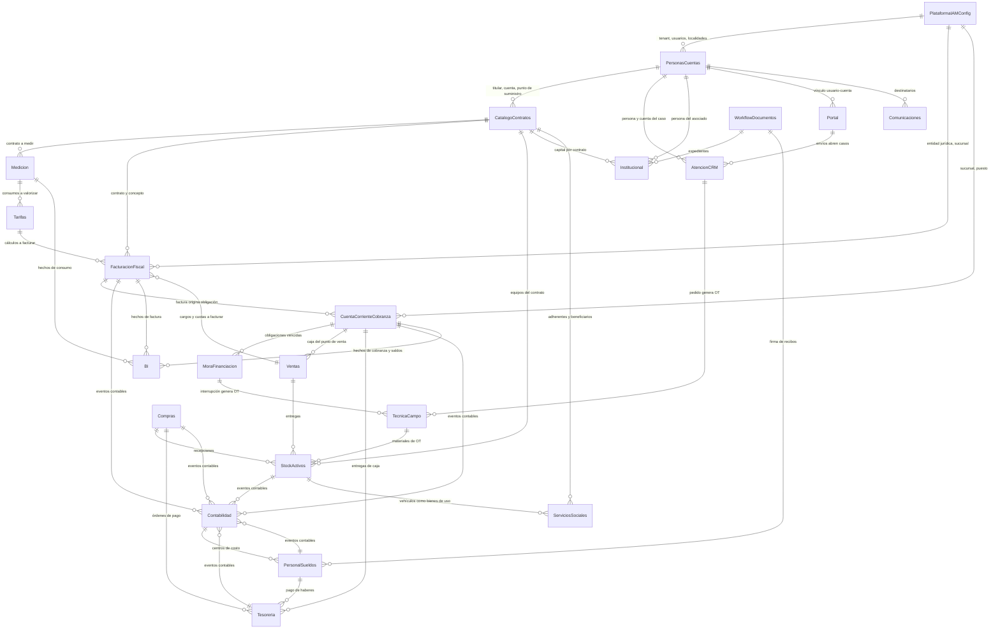
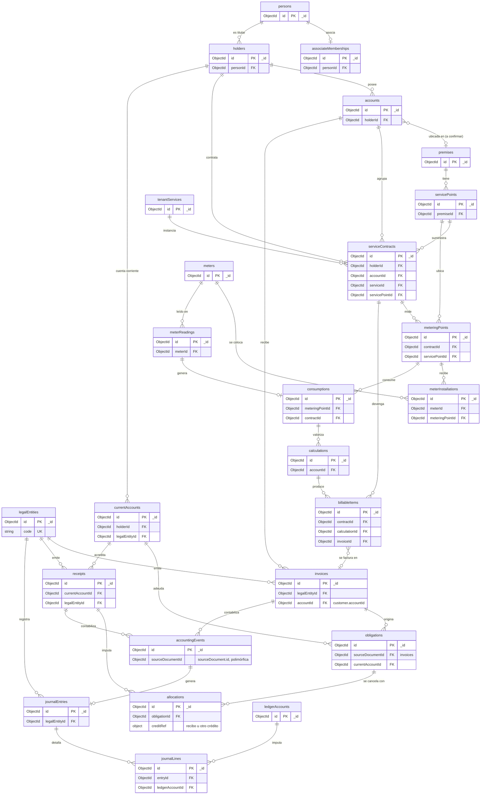

# Modelo entidad-relación

| Campo | Valor |
|---|---|
| Proyecto | GACAC — plataforma SaaS de gestión integral para cooperativas de servicios |
| Artefacto | 6.1 Modelo entidad-relación completo: vista por dominio y vista por módulo (ver [`00-INDICE.md`](00-INDICE.md)) |
| Documento | `03-modelo-entidad-relacion.md` (índice), partes `03a` a `03e` (vista por dominio) y carpeta `03-er/` (vista por módulo) |
| Versión | 2.1 |
| Fecha | 05-11-2026 |
| Estado | Emitido para revisión |
| Fuente principal | [`T05-DAT-modelo-datos.md`](../especificacion/anexos/T05-DAT-modelo-datos.md) (catálogo canónico de colecciones) |
| Fuentes complementarias | §7 de los anexos M01 a M19 y T01 a T11 |

## Control de versiones

| Versión | Fecha | Autor | Descripción |
|---|---|---|---|
| 1.0 | 05-11-2026 | Equipo de análisis y diseño | Versión inicial: 22 dominios, mapa de dominios y núcleo transversal. |
| 2.0 | 05-11-2026 | Equipo de análisis y diseño | Modelo completo: nueva vista por módulo en `03-er/` (29 archivos, 60 diagramas) con las 1.053 colecciones a crear de T05, sus campos del §7, claves, relaciones, índices y relaciones con otros módulos. Las partes `03a` a `03e` se conservan como vista por dominio. Nuevas secciones 29 (inconsistencias detectadas en la especificación) y 30 (cobertura). |
| 2.1 | 05-11-2026 | Equipo de análisis y diseño | Regeneración de la vista por módulo contra la especificación corregida: T05 pasa a 1.108 filas y 1.057 colecciones a crear (nuevas `bundleSubscriptions` M02, `fiscalClasses` M06, `collectionAccountingGroups` M07 y `costCenterModels` M15); se aplican los destinos de T05 §7.2.1 y los renombres de campos de los anexos. El generador lee además las tablas "referencias declaradas" y las tablas normalizadas de campos que agregaron los anexos. Resultado: 30 archivos (M10 se parte en dos) y 61 diagramas. La vista por dominio (`03a` a `03e`, versión 1.1) se actualiza a mano: 3 entidades nuevas (`bundleSubscriptions`, `fiscalClasses`, `costCenterModels`; total 426), `fiscalClassId` y `originAccountId` resueltos, y renombres de campos (`associateMembershipId`, `subjectPersonId`, `seriesId`, `retentionPolicyCode`, `formVersionId`). |

## Estructura del documento

El modelo tiene dos vistas complementarias que este índice enlaza:

- **Vista por dominio** (partes `03a` a `03e`): 22 diagramas conceptuales con las entidades principales de cada dominio de negocio y sus claves de cruce. Sirve para entender el modelo de un vistazo.
- **Vista por módulo** (carpeta [`03-er/`](03-er/)): un archivo por anexo dueño (M01 a M19 y T01 a T11, salvo T05, que es el catálogo y no es dueño de colecciones). Contiene las 1.057 colecciones a crear del catálogo de T05, con sus campos del §7 del anexo dueño, claves, relaciones con cardinalidad, índices principales, relaciones con otros módulos y las colecciones absorbidas o renombradas. Es la referencia para el diseño físico.

### Vista por dominio

La numeración de secciones es continua entre este índice y las cinco partes.

| Archivo | Secciones |
|---|---|
| `03-modelo-entidad-relacion.md` (este documento) | 1. Propósito, alcance y notación · 2. Convenciones transversales · 3. Mapa de dominios · 26. Núcleo transversal · 27. Referencias · 28. Verificación y pendientes · 29. Inconsistencias detectadas en la especificación · 30. Cobertura |
| [`03a-er-plataforma-personas-catalogo.md`](03a-er-plataforma-personas-catalogo.md) | 4. Plataforma, IAM y configuración · 5. Personas y cuentas · 6. Catálogo y contratos |
| [`03b-er-medicion-tarifas-facturacion.md`](03b-er-medicion-tarifas-facturacion.md) | 7. Medición · 8. Tarifas · 9. Facturación y fiscal |
| [`03c-er-cobranza-mora-crm-tecnica.md`](03c-er-cobranza-mora-crm-tecnica.md) | 10. Cuenta corriente y cobranza · 11. Mora y financiación · 12. Atención (CRM) · 13. Técnica y campo |
| [`03d-er-erp-administrativo.md`](03d-er-erp-administrativo.md) | 14. Ventas · 15. Compras · 16. Stock y activos · 17. Tesorería · 18. Contabilidad · 19. Personal y sueldos |
| [`03e-er-institucional-social-portal-transversales.md`](03e-er-institucional-social-portal-transversales.md) | 20. Institucional · 21. Servicios sociales y flota · 22. Portal · 23. Comunicaciones · 24. Workflow, documentos y eventos · 25. BI |

### Vista por módulo

Cada archivo se llama igual que su anexo dueño y tiene numeración propia: resumen, tabla de colecciones (ID `COL-xxx`, ola, clasificación de datos, alcance, volumen y TTL según T05 §7.8), un apartado por diagrama de subdominio (de 25 entidades como máximo) con su tabla de índices principales, relaciones con otros módulos y entre diagramas, colecciones absorbidas y renombradas, y observaciones sobre la especificación. La relación entre dominio y módulo está en la tabla de la sección 3.2.

| Anexo dueño | Archivo | Colecciones | Diagramas | Máx. entidades por diagrama | Atributos | Relaciones dibujadas |
|---|---|---|---|---|---|---|
| M01 | [`M01-PER-personas-titulares-cuentas.md`](03-er/M01-PER-personas-titulares-cuentas.md) | 17 | 1 | 17 | 237 | 46 |
| M02 | [`M02-CAT-catalogo-servicios.md`](03-er/M02-CAT-catalogo-servicios.md) | 25 | 1 | 25 | 337 | 95 |
| M03 | [`M03-MED-medicion-consumos.md`](03-er/M03-MED-medicion-consumos.md) | 34 | 2 | 23 | 404 | 113 |
| M04 | [`M04-TAR-tarifas-motor-calculo.md`](03-er/M04-TAR-tarifas-motor-calculo.md) | 35 | 2 | 22 | 444 | 111 |
| M05 | [`M05-FAC-facturacion.md`](03-er/M05-FAC-facturacion.md) | 38 | 2 | 25 | 496 | 133 |
| M06 | [`M06-FIS-fiscal-impuestos.md`](03-er/M06-FIS-fiscal-impuestos.md) | 47 | 2 | 24 | 539 | 89 |
| M07 | [`M07-COB-cuenta-corriente-cobranza.md`](03-er/M07-COB-cuenta-corriente-cobranza.md) | 45 | 2 | 25 | 669 | 191 |
| M08 | [`M08-MOR-mora-financiacion.md`](03-er/M08-MOR-mora-financiacion.md) | 39 | 2 | 25 | 531 | 133 |
| M09 | [`M09-CRM-atencion.md`](03-er/M09-CRM-atencion.md) | 42 | 2 | 25 | 489 | 144 |
| M10 | [`M10-TEC-tecnica-campo-redes.md`](03-er/M10-TEC-tecnica-campo-redes.md), [`M10-TEC-tecnica-campo-redes-parte2.md`](03-er/M10-TEC-tecnica-campo-redes-parte2.md) | 75 | 4 | 25 | 843 | 247 |
| M11 | [`M11-VEN-ventas-presupuestos.md`](03-er/M11-VEN-ventas-presupuestos.md) | 14 | 1 | 14 | 227 | 68 |
| M12 | [`M12-CMP-compras-proveedores.md`](03-er/M12-CMP-compras-proveedores.md) | 23 | 2 | 15 | 300 | 70 |
| M13 | [`M13-STK-stock-activos-fabricacion.md`](03-er/M13-STK-stock-activos-fabricacion.md) | 39 | 2 | 25 | 497 | 160 |
| M14 | [`M14-TES-tesoreria-bancos.md`](03-er/M14-TES-tesoreria-bancos.md) | 42 | 2 | 25 | 544 | 132 |
| M15 | [`M15-CON-contabilidad.md`](03-er/M15-CON-contabilidad.md) | 36 | 2 | 25 | 405 | 115 |
| M16 | [`M16-SUE-personal-sueldos.md`](03-er/M16-SUE-personal-sueldos.md) | 59 | 3 | 25 | 641 | 151 |
| M17 | [`M17-INS-institucional.md`](03-er/M17-INS-institucional.md) | 35 | 2 | 25 | 359 | 117 |
| M18 | [`M18-SOC-servicios-sociales-flota.md`](03-er/M18-SOC-servicios-sociales-flota.md) | 53 | 4 | 21 | 490 | 153 |
| M19 | [`M19-POR-portal-socio-landing.md`](03-er/M19-POR-portal-socio-landing.md) | 14 | 1 | 14 | 180 | 44 |
| T01 | [`T01-PLA-plataforma-saas.md`](03-er/T01-PLA-plataforma-saas.md) | 31 | 2 | 25 | 342 | 45 |
| T02 | [`T02-IAM-identidad-roles-auditoria.md`](03-er/T02-IAM-identidad-roles-auditoria.md) | 31 | 2 | 18 | 397 | 56 |
| T03 | [`T03-UXD-experiencia-marca-diccionario.md`](03-er/T03-UXD-experiencia-marca-diccionario.md) | 10 | 1 | 10 | 130 | 10 |
| T04 | [`T04-CFG-configuracion-parametros-maestros.md`](03-er/T04-CFG-configuracion-parametros-maestros.md) | 45 | 3 | 20 | 399 | 36 |
| T06 | [`T06-INT-integraciones.md`](03-er/T06-INT-integraciones.md) | 18 | 1 | 18 | 280 | 42 |
| T07 | [`T07-MIG-migracion-procoop.md`](03-er/T07-MIG-migracion-procoop.md) | 20 | 1 | 20 | 182 | 43 |
| T08 | [`T08-NFR-no-funcionales-seguridad.md`](03-er/T08-NFR-no-funcionales-seguridad.md) | 17 | 1 | 17 | 176 | 23 |
| T09 | [`T09-COM-comunidad-comunicaciones.md`](03-er/T09-COM-comunidad-comunicaciones.md) | 55 | 4 | 25 | 720 | 139 |
| T10 | [`T10-BIA-reportes-bi-apis.md`](03-er/T10-BIA-reportes-bi-apis.md) | 67 | 4 | 20 | 622 | 98 |
| T11 | [`T11-WFL-workflow-eventos-documentos.md`](03-er/T11-WFL-workflow-eventos-documentos.md) | 51 | 3 | 22 | 587 | 101 |

Totales de la vista por módulo: 30 archivos, 61 diagramas, 1.057 entidades, 13.524 atributos (sin contar los transversales), 2.980 claves foráneas y 1.100 relaciones dibujadas dentro de los diagramas. Las referencias que cruzan de diagrama o de módulo no se dibujan: se listan en la tabla de relaciones de cada archivo.

---

## 1. Propósito, alcance y notación

### 1.1 Propósito

Este documento presenta el modelo de datos conceptual de GACAC organizado por dominios de negocio. Su objetivo es que analistas, diseñadores y desarrolladores entiendan qué entidades principales existen, cómo se relacionan dentro de cada dominio y qué claves cruzan de un dominio a otro, sin necesidad de recorrer el catálogo completo de colecciones.

Desde la versión 2.0 el documento también presenta el modelo completo: la vista por módulo de `03-er/` dibuja todas las colecciones a crear del catálogo, con sus campos y relaciones, para servir de base al diseño físico.

### 1.2 Alcance

- **Incluye (vista por dominio):** las entidades principales de cada dominio (entre 8 y 20 por diagrama), sus atributos clave (identificador, claves foráneas y claves únicas de negocio), las relaciones internas del dominio y las relaciones con otros dominios.
- **Incluye (vista por módulo, desde la versión 2.0):** las 1.057 colecciones a crear de T05, cada una en un diagrama de su módulo dueño, con todos los campos que declara el §7 del anexo dueño (nombre, tipo y marcas `PK`, `FK` o `UK`, con el destino de cada referencia), las relaciones con cardinalidad, los índices principales, la ola, la clasificación de datos, el alcance, el volumen y el TTL que indica T05, y las relaciones con otros módulos.
- **No incluye:** ~~el detalle físico de cada colección (todos los campos, tipos completos, índices, validadores JSON Schema, TTL, particionamiento, clasificación de datos personales por campo).~~ Reemplazado por: los validadores JSON Schema, el particionamiento y la clasificación de datos personales por campo, que siguen en el §7 de cada anexo dueño y en T05. Los campos, los índices principales y el TTL quedan cubiertos por la vista por módulo.
- **Fuente de nombres:** el catálogo de T05 (1.108 filas, 1.057 colecciones a crear y 51 absorbidas en otras; hasta la versión 2.0 eran 1.104 y 1.053). Cuando un anexo de módulo usa otro nombre, prevalece T05. Las seis colecciones renombradas por colisión (`associateMemberships`, `debtCollectionAgencies`, `financingInstitutionPlans`, `pointsOfSale`, `reportRunResults`, `workOrderOperationTypes`) se muestran con el nombre con que se crean.
- **Colecciones absorbidas:** no se dibujan; cada sección indica, en su apartado final, dónde quedó absorbida cada una. En la vista por módulo se listan con su destino en el apartado "Colecciones absorbidas y renombradas" de cada archivo, y en total en la sección 30.
- **Datos:** el documento no contiene datos reales, credenciales ni secretos.

### 1.3 Notación

Los diagramas usan Mermaid `erDiagram` con notación de pata de gallo (*crow's foot*).

| Símbolo | Significado |
|---|---|
| `\|\|--o{` | Uno a cero o muchos. |
| `\|\|--o\|` | Uno a cero o uno. |
| `}o--o{` | Muchos a muchos (por arreglo de referencias o por colección intermedia). |
| `}o--o\|` | Muchos a cero o uno. |

Convenciones de escritura:

- **Entidades:** nombre de la colección MongoDB tal como figura en T05 (camelCase; las colecciones analíticas `bi_*` conservan el guion bajo).
- **Atributos:** formato `tipo nombre clave "comentario"`. El identificador `_id` se escribe `id PK "_id"` porque Mermaid exige que el nombre del atributo empiece con letra. `FK` marca una referencia; `UK` una clave única de negocio (si es compuesta o parcial, el comentario lo aclara).
- **Tipos:** `ObjectId`, `string`, `int`, `date`, `DateOnly` (fecha sin hora), `Period` (período `YYYY-MM`), `object` (subdocumento o referencia polimórfica).
- **Tipos en la vista por módulo:** se toman del §7 del anexo dueño y se normalizan a `ObjectId`, `string`, `int`, `number`, `Decimal128`, `bool`, `Date`, `enum`, `object`, `array`, `Binary` y `GeoJSON`; el sufijo `[]` indica arreglo. `any` marca un campo cuyo tipo no declara el anexo. El comentario de una `FK` indica el destino (`→ colección` en el mismo módulo, `MXX colección` en otro) y se agrega "(inferido)" cuando el destino se dedujo por el nombre del campo, "destino no declarado" cuando no se puede fijar, "referencia polimórfica" cuando apunta a varias colecciones y "según T05" cuando el campo figura en el catálogo pero no en la ficha del anexo.
- **Referencias a otro dominio:** el comentario del atributo indica el anexo dueño y la colección destino (por ejemplo, `"M01 accounts"`). Cada diagrama dibuja solo entidades de su dominio; las claves que cruzan se listan en la tabla "Relaciones con otros dominios" de cada sección. En la vista por módulo, cada diagrama dibuja solo las entidades de su subdominio, y las referencias a otro diagrama o a otro módulo se listan en la tabla "Relaciones con otros módulos y entre diagramas" del archivo.
- **Etiquetas de relación:** verbos breves entre comillas.
- **Relaciones dudosas:** se rotulan "(a confirmar)" en el diagrama o en la tabla, y se listan en la sección 28.
- Las cardinalidades son de negocio; la integridad la garantiza la aplicación (MongoDB no impone claves foráneas).

Cada sección de dominio tiene cuatro apartados: diagrama, tabla de entidades (colección, descripción, módulo dueño, ola y ID `COL-xxx` de T05), relaciones con otros dominios y otras colecciones o absorciones.

---

## 2. Convenciones transversales

Estas reglas, definidas en T05 §7.1 y en T01, se aplican a todas las colecciones. Para no sobrecargar los diagramas, **los campos transversales de esta sección se omiten en todos los diagramas** salvo cuando son parte de una clave de negocio (por ejemplo, `legalEntityId` en documentos económicos).

### 2.1 Tenancy

- Base MongoDB compartida con aislamiento lógico por `tenantId` (DEC-002). Toda colección de tenant lleva `tenantId` como primer campo de cada índice, y el acceso pasa por un repositorio que lo inyecta.
- Las colecciones globales son una lista cerrada (`tenants`, `moduleCatalog`, `identities`, `federatedLinks`, `schemaMigrations`, `erasureLedger` y el despachador del outbox, entre otras declaradas en T05). Los datos de la operación de la plataforma usan el tenant reservado `PLATFORM`.

### 2.2 Auditoría

- Campos estándar en toda colección: `createdAt`, `createdBy`, `updatedAt`, `updatedBy` (las referencias a usuario apuntan a `memberships`) y `version` para control optimista de concurrencia.
- Las acciones relevantes se registran además en `auditLogs` (T02).

### 2.3 Baja lógica y documentos económicos

- La baja lógica (`isDeleted`, `deletedAt`, `deletedBy`, `deleteReason`) solo se usa en configuración y maestros; los índices únicos son parciales sobre los registros no borrados.
- Los documentos económicos (facturas, recibos, obligaciones, asientos, movimientos de fondos, etc.) **nunca se borran**: se corrigen con un documento de contrapartida enlazado (`reversalOf`, `reversedBy[]`).
- Todo documento económico lleva `legalEntityId` (entidad jurídica emisora, DEC-064).

### 2.4 Importes, fechas y períodos

- Importes y cantidades en `Decimal128` (`Money`, `Dec`), operados con decimal.js; las precisiones se rigen por PRM-TAR-150. Toda conversión de moneda guarda cotización y fecha.
- Fechas con hora en UTC (`Date`); fechas civiles como `DateOnly`; períodos de facturación como `Period` (`YYYY-MM`) más `sequence` cuando hay más de un ciclo por mes.
- Vigencias con `validFrom` y `validTo`; los hechos con tiempo de negocio y de registro distintos usan `effectiveAt` y `recordedAt` (bitemporalidad).

### 2.5 Versionado

- La configuración publicada (cuadros tarifarios, planes, workflows, plantillas, conceptos de sueldos) se guarda en versiones inmutables con `contentHash`.
- Cada documento lleva `schemaVersion`; las migraciones de esquema siguen el patrón *expand/contract* y se registran en `schemaMigrations`.
- Los documentos que dependen de datos variables guardan una foto (*snapshot*) de lo usado (por ejemplo, el cliente y la tarifa en la factura).

### 2.6 Trazabilidad con el sistema heredado

- Los registros migrados llevan el subdocumento `legacy` (`system`, `table`, `key`, `displayKey`, `runId`, `hash`, `readOnly`, `priorMigration`) con índice disperso.
- La correspondencia de claves se centraliza en `legacyIdMap`; los alias de claves en `legacyKeyAliases` (T07).

### 2.7 Datos personales y eventos

- Cada campo se clasifica por clase de dato personal (ID, CT, UB, FI, SE, OP, CF, TE, SC, AU según T08); los datos sensibles y financieros se cifran por campo y se buscan por HMAC.
- Todo cambio de estado de negocio publica un evento escribiendo en `outboxEvents` dentro de la misma transacción (T01, T11).

---

## 3. Mapa de dominios

### 3.1 Diagrama de alto nivel

El diagrama relaciona los 22 dominios por sus flujos de datos principales. Las cardinalidades son indicativas: expresan que un dominio aporta referencias o documentos a otro, no relaciones entre registros concretos.

Los dominios Workflow y Comunicaciones prestan servicio a todos los demás por referencias polimórficas (`subjectRef`, `sourceRef`); el diagrama muestra solo algunos ejemplos para no saturarlo. Contabilidad recibe eventos de todo documento económico; se dibujan los emisores principales.

### 3.2 Dominios, anexos y ubicación

| # | Dominio | Entidad del mapa | Anexos dueños | Sección | Archivo |
|---|---|---|---|---|---|
| 1 | Plataforma, IAM y configuración | `PlataformaIAMConfig` | T01, T02, T04, T06, T07 | 4 | `03a` |
| 2 | Personas y cuentas | `PersonasCuentas` | M01 | 5 | `03a` |
| 3 | Catálogo y contratos | `CatalogoContratos` | M02 | 6 | `03a` |
| 4 | Medición | `Medicion` | M03 | 7 | `03b` |
| 5 | Tarifas | `Tarifas` | M04 | 8 | `03b` |
| 6 | Facturación y fiscal | `FacturacionFiscal` | M05, M06 | 9 | `03b` |
| 7 | Cuenta corriente y cobranza | `CuentaCorrienteCobranza` | M07 | 10 | `03c` |
| 8 | Mora y financiación | `MoraFinanciacion` | M08 | 11 | `03c` |
| 9 | Atención (CRM) | `AtencionCRM` | M09 | 12 | `03c` |
| 10 | Técnica y campo | `TecnicaCampo` | M10 | 13 | `03c` |
| 11 | Ventas | `Ventas` | M11 | 14 | `03d` |
| 12 | Compras | `Compras` | M12 | 15 | `03d` |
| 13 | Stock y activos | `StockActivos` | M13 | 16 | `03d` |
| 14 | Tesorería | `Tesoreria` | M14 | 17 | `03d` |
| 15 | Contabilidad | `Contabilidad` | M15 | 18 | `03d` |
| 16 | Personal y sueldos | `PersonalSueldos` | M16 | 19 | `03d` |
| 17 | Institucional | `Institucional` | M17 | 20 | `03e` |
| 18 | Servicios sociales y flota | `ServiciosSociales` | M18 | 21 | `03e` |
| 19 | Portal | `Portal` | M19 | 22 | `03e` |
| 20 | Comunicaciones | `Comunicaciones` | T09 | 23 | `03e` |
| 21 | Workflow, documentos y eventos | `WorkflowDocumentos` | T11, T01 (outbox) | 24 | `03e` |
| 22 | BI | `BI` | T10 | 25 | `03e` |

T03 (experiencia de usuario y marca) y T08 (requisitos no funcionales, consentimientos y retención) aportan colecciones que se citan como destino de referencias, sin sección propia.

---

## 26. Núcleo transversal

### 26.1 Diagrama integrador

El núcleo atraviesa ocho dominios y sigue el recorrido del dato desde la persona hasta el asiento contable: persona → titular → cuenta → contrato → servicio y punto de suministro → punto de medición → medidor → lectura → consumo → cálculo → ítem facturable → factura → obligación → recibo e imputación → evento contable → asiento. Todas las relaciones dibujadas ya figuran en las secciones de dominio o en el mapa de relaciones de T05 §7.10.

### 26.2 Entidades del núcleo

| Colección | Dominio | Sección | ID T05 |
|---|---|---|---|
| `legalEntities` | Plataforma, IAM y configuración | 4 | COL-CFG-41 |
| `persons` | Personas y cuentas | 5 | COL-PER-01 |
| `associateMemberships` | Institucional | 20 | COL-INS-01 |
| `holders` | Personas y cuentas | 5 | COL-PER-04 |
| `accounts` | Personas y cuentas | 5 | COL-PER-05 |
| `premises` | Personas y cuentas | 5 | COL-PER-08 |
| `servicePoints` | Personas y cuentas | 5 | COL-PER-09 |
| `tenantServices` | Catálogo y contratos | 6 | COL-CAT-02 |
| `serviceContracts` | Catálogo y contratos | 6 | COL-CAT-18 |
| `meteringPoints` | Medición | 7 | COL-MED-08 |
| `meters` | Medición | 7 | COL-MED-07 |
| `meterInstallations` | Medición | 7 | COL-MED-10 |
| `meterReadings` | Medición | 7 | COL-MED-18 |
| `consumptions` | Medición | 7 | COL-MED-19 |
| `calculations` | Tarifas | 8 | COL-TAR-30 |
| `billableItems` | Facturación y fiscal | 9 | COL-FAC-11 |
| `invoices` | Facturación y fiscal | 9 | COL-FAC-13 |
| `currentAccounts` | Cuenta corriente y cobranza | 10 | COL-COB-01 |
| `obligations` | Cuenta corriente y cobranza | 10 | COL-COB-02 |
| `receipts` | Cuenta corriente y cobranza | 10 | COL-COB-12 |
| `allocations` | Cuenta corriente y cobranza | 10 | COL-COB-04 |
| `accountingEvents` | Contabilidad | 18 | COL-CON-07 |
| `journalEntries` | Contabilidad | 18 | COL-CON-08 |
| `journalLines` | Contabilidad | 18 | COL-CON-09 |
| `ledgerAccounts` | Contabilidad | 18 | COL-CON-04 |

### 26.3 Reglas que sostienen el núcleo

- **Persona única:** una persona por documento en el tenant (`personIdentifierIndex`); titular, asociado, empleado, proveedor y beneficiario la referencian, no la duplican.
- **El contrato es el ancla operativa:** medición, facturación, servicios sociales, técnica y capital social referencian `serviceContracts`.
- **La factura no se modifica:** el ítem facturable queda vinculado a una sola factura; las correcciones se hacen por nota de crédito o débito (`invoiceRelations`).
- **La deuda vive en la obligación:** la cuenta corriente se compone de obligaciones, movimientos e imputaciones; los saldos son proyecciones reconstruibles.
- **Contabilidad por eventos:** ningún módulo escribe asientos directamente; cada documento económico emite eventos a `accountingEvents` y M15 los contabiliza.

---

## 27. Referencias

| Documento | Uso en este modelo |
|---|---|
| [`00-INDICE.md`](00-INDICE.md) | Definición del artefacto 6.1. |
| [`T05-DAT-modelo-datos.md`](../especificacion/anexos/T05-DAT-modelo-datos.md) | Catálogo canónico de colecciones (IDs `COL-xxx`), convenciones §7.1, mapa de claves §7.2, olas §7.9, mapa de relaciones §7.10 y contradicciones resueltas (`CTR-DAT-xx`). |
| Anexos M01 a M19 (`docs/especificacion/anexos/`) | §7 de cada módulo: campos, índices y relaciones de sus colecciones. |
| Anexos T01 a T11 (`docs/especificacion/anexos/`) | §7 de cada anexo transversal: plataforma, identidad, experiencia, configuración, datos, integraciones, migración, requisitos no funcionales, comunicaciones, BI y workflow (en T08, el modelo de datos está en el §15.1). |
| [`03-er/`](03-er/) | Vista por módulo del modelo completo (versión 2.0). |
| `_trabajo/generar_er_completo.py` | Script que genera la vista por módulo a partir de T05 y del §7 de los anexos, y verifica la cobertura y la sintaxis de los diagramas (`_trabajo/er-verificacion.json`). |

Decisiones citadas: DEC-002 (tenancy), DEC-043 (vínculo usuario–cuenta), DEC-058 (sueldos externos y propios), DEC-064 (entidades jurídicas), DEC-069 (contabilidad externa), DEC-071 (adherentes) y DEC-086 (beneficiarios). Su texto está en el registro de decisiones del proyecto.

---

## 28. Verificación y pendientes

### 28.1 Resumen cuantitativo

| Indicador | Valor |
|---|---|
| Dominios | 22 |
| Diagramas | 24 (1 mapa de dominios, 22 diagramas de dominio y 1 núcleo transversal) |
| Entidades en diagramas de dominio | 426 (cada colección aparece en un solo dominio; 423 hasta la versión 2.0) |
| Entidades en el diagrama del núcleo | 25 (repetidas de los diagramas de dominio) |
| Relaciones marcadas "a confirmar" | 10 |

Todos los IDs `COL-xxx` citados en el índice y en las cinco partes se verificaron contra el catálogo de T05.

### 28.2 Relaciones marcadas "a confirmar"

| # | Relación | Sección | Motivo |
|---|---|---|---|
| 1 | `memberships` → `auditLogs` (`actorId`) | 4 | T05 no fija la colección destino del actor. |
| 2 | `accounts` → `premises` | 5 | Figura en T05 §7.10, pero el catálogo de `accounts` no declara el campo de referencia. |
| 3 | `billableConcepts.fiscalClassId` | 6 | ~~T05 §7.2 no fija la colección destino en M06.~~ Resuelto en la especificación: T05 §7.2.1 lo fija en `fiscalClasses` (COL-FIS-47, M06 §7.38). Las dos vistas ya lo dibujan así (`03a` §6 y `03b` §9, versión 1.1). |
| 4 | `worksInstallmentPlans.rightId` | 8 | T05 indica solo "M18"; por contexto sería `burialRights`. |
| 5 | `paymentPlans` → `agreements` | 11 | El catálogo de `agreements` no declara clave hacia `paymentPlans`. |
| 6 | `salesOrders` → `salesInstallments` | 14 | El origen de la cuota es polimórfico (`originType`, `originId`); no se confirma que incluya la venta. |
| 7 | `supplyBalances.invoiceIds` | 15 | No se indica si apunta a `supplierInvoices` o a `invoices`. |
| 8 | `signalRightsContracts.packageIds` | 15 | T05 indica "M02" sin nombrar la colección de paquetes. |
| 9 | `payrollPaymentBatches.originAccountId` | 17 | ~~No se nombra la colección destino; por contexto sería `treasuryAccounts`.~~ Resuelto en la especificación: T05 §7.2.1 lo fija en `treasuryAccounts` (M14). Las dos vistas ya lo dibujan así (`03d` §17, versión 1.1). |
| 10 | `capitalRefunds.paymentOrderRef` | 20 | No se nombra la colección destino; por contexto sería `paymentOrders`. |

Se recomienda resolver estos puntos en el §7 del anexo dueño y actualizar T05 §7.2 antes de cerrar el diseño físico.

### 28.3 Verificación de la vista por módulo

La vista por módulo se generó con `_trabajo/generar_er_completo.py` y se revisó a mano. Controles aplicados:

- Cada colección a crear de T05 aparece exactamente una vez, en un diagrama de su anexo dueño: 1.057 dibujadas, ninguna faltante, ninguna duplicada y ninguna entidad que no figure en el catálogo.
- Ningún diagrama supera las 25 entidades (el límite de la regla es de unas 40) y ningún archivo supera las 1.400 líneas (el mayor, `M10-TEC-tecnica-campo-redes`, tiene 1.371).
- Las 61 definiciones `erDiagram` de `03-er/` y los 2 diagramas de este índice pasan el analizador de Mermaid 11.17.2 sin errores (versión 2.1).
- Los únicos mínimos, referencias y destinos se recalculan contra T05 §7.2 y §7.2.1; los atributos se toman de todas las fichas de la colección en el §7 del anexo (la ficha original, la tabla normalizada de campos y la tabla de "referencias declaradas", cuando existen).
- Los atributos transversales de la sección 2 (`tenantId`, auditoría, `version`, baja lógica y `legacy`) se omiten, como en la vista por dominio.

---

## 29. Inconsistencias detectadas en la especificación

La especificación no se modificó. Las diferencias encontradas al cruzar T05 con el §7 de cada anexo dueño se listan con detalle en el apartado "Observaciones e inconsistencias detectadas" de cada archivo de `03-er/`. Resumen por tipo:

1. **Referencias sin colección destino declarada.** 75 campos con forma de referencia (`…Id`, `…Ids`) que ni el anexo dueño ni T05 §7.2 y §7.2.1 asocian a una colección. En los diagramas figuran como `FK "destino no declarado"`. Por ejemplo: `cashSessions.closeGroupId` (M07), `taxExemptions.partyId` (M06) y `worksInstallmentPlans.levyEventId` (M04). Otros 142 destinos se infirieron por el nombre del campo o por el contexto de T05 §7.2.1 y se marcan "(inferido)", a confirmar.
2. **Campos que solo figuran en T05.** 90 campos citados en las columnas "Claves y referencias" o "Únicos" de T05 que la ficha del anexo no declara con ese nombre. Se dibujan con la nota "según T05". En muchos casos es una diferencia de nombre o un campo que T05 agrega como mínimo canónico y el anexo todavía no incorporó (el detalle está en las observaciones de cada archivo).
3. **Colecciones sin ficha o sin campos en el §7.** ~~`personIdentifierIndex` (M01), `slotCounters` (M10) y `dossierTimeline` (T11) solo se mencionan en el §7, sin ficha propia. Las fichas de `roundingCarryEntries` (M04), `crmAreas` (M09), `jobRuns` (T01), `integrationTokens` (T06) y `apiUsageDaily` (T10) no enumeran campos.~~ Reemplazado en la versión 2.1 por: con la especificación corregida, todas las colecciones a crear tienen ficha con campos en el §7 de su anexo dueño (las de `crmAreas` y `apiUsageDaily` ya existían en tabla y el generador de la versión 2.0 no las leía).
4. **Nombres declarados distintos del nombre con que se crean.** ~~En cuatro de las seis renombradas, la columna "Colección" de T05 trae el nombre declarado …~~ Reemplazado en la versión 2.1 por: la columna "Colección" de T05 ya trae el nombre creado en las seis renombradas, y los anexos dueños las declaran con ese nombre (`associateMemberships` en M17 §7.1, `debtCollectionAgencies` y `financingInstitutionPlans` en M08 §7.31 y §7.24, `workOrderOperationTypes` en M10, `pointsOfSale` en M06 §7.9 y `reportRunResults` en T10). Sin embargo, T05 las sigue marcando con estado `R` ("crear con el nombre indicado en lugar del declarado"), cuando su propia fila COL-INS-01 dice que pasa a `C` en cuanto el anexo adopte el nombre. Debería pasar a `C` en las seis.
5. **Destinos de usuario.** Los campos de actor (`…By`, `userId`, `assignedTo` y similares) se resolvieron hacia `memberships` (T02), según la sección 2.2. Varios anexos no lo declaran de forma explícita.
6. **Renombres de campos aplicados en T05 y no en el anexo dueño.** T05 usa los nombres canónicos nuevos, pero algunas fichas del §7 conservan el anterior; en el diagrama figuran los dos (el del anexo y el de T05 con la nota "según T05"). Casos: M17 `capitalTransfers` (`fromMembershipId` y `toMembershipId` en el anexo; `fromAssociateMembershipId` y `toAssociateMembershipId` en T05) y `proxies` (`grantorMembershipId` y `proxyMembershipId` frente a `grantorAssociateMembershipId` y `proxyAssociateMembershipId`, que además forman parte del único de T05); M13 `stockMovements` y `stockBalances` (`itemId` en el anexo, `inventoryItemId` en T05 y en el único `{inventoryItemId, warehouseId, locationId, lotId}`).
7. **Otras diferencias de nombre entre la ficha y el único de T05.** Por ejemplo, T10 `apiUsageDaily` declara `day` y T05 cita `date`; en M01 `relationships`, la columna "Claves y referencias" de T05 cita `fromPersonId` y `toPersonId`, mientras el anexo y el propio único de T05 usan `subjectPersonId` y `target`; M01 `premises` no declara `cadastralDistrictId` ni `cadastralKey`, que T05 cita. El detalle completo está en las observaciones de cada archivo de `03-er/` (393 campos en total, punto 2).
8. **Destinos de T05 §7.2.1 con `[VERIFICAR]`.** La vista por módulo los aplica tal como están, pero siguen abiertos en la especificación: `templateId` en M12 y T02 (`messageTemplates`), `deviceId` en M03 y M16, `importBatchId` en M08 y M11, `projectId` en M13, `targetAccountId` en M08, `memberId`, `paymentId` (`cashOperations` o `receipts`), `lineId` en T10 y `unitId` en M01. `taxRateIds` admite dos destinos (`vatRates` o `taxDefinitions`); el diagrama muestra el primero.

De los diez puntos "a confirmar" de la sección 28.2, los puntos 3 y 9 quedaron resueltos por T05 §7.2.1; los otros ocho siguen vigentes.

---

## 30. Cobertura

Universo: el catálogo de T05 §7.3 a §7.7, con 1.108 filas. De ellas, 1.057 son colecciones a crear (incluidas las 0 renombradas, que se dibujan con el nombre con que se crean, y las 39 analíticas `bi_*` de T10) y 51 son absorbidas en otra colección.

### 30.1 Cobertura por anexo dueño

| Anexo dueño | Filas en T05 | A crear | Absorbidas | Renombradas | `bi_*` | Dibujadas | Cobertura |
|---|---|---|---|---|---|---|---|
| M01 | 21 | 17 | 4 | 0 | 0 | 17 | 17/17 |
| M02 | 29 | 25 | 4 | 0 | 0 | 25 | 25/25 |
| M03 | 37 | 34 | 3 | 0 | 0 | 34 | 34/34 |
| M04 | 36 | 35 | 1 | 0 | 0 | 35 | 35/35 |
| M05 | 42 | 38 | 4 | 0 | 0 | 38 | 38/38 |
| M06 | 47 | 47 | 0 | 0 | 0 | 47 | 47/47 |
| M07 | 47 | 45 | 2 | 0 | 0 | 45 | 45/45 |
| M08 | 39 | 39 | 0 | 0 | 0 | 39 | 39/39 |
| M09 | 42 | 42 | 0 | 0 | 0 | 42 | 42/42 |
| M10 | 76 | 75 | 1 | 0 | 0 | 75 | 75/75 |
| M11 | 15 | 14 | 1 | 0 | 0 | 14 | 14/14 |
| M12 | 23 | 23 | 0 | 0 | 0 | 23 | 23/23 |
| M13 | 40 | 39 | 1 | 0 | 0 | 39 | 39/39 |
| M14 | 43 | 42 | 1 | 0 | 0 | 42 | 42/42 |
| M15 | 39 | 36 | 3 | 0 | 0 | 36 | 36/36 |
| M16 | 61 | 59 | 2 | 0 | 0 | 59 | 59/59 |
| M17 | 36 | 35 | 1 | 0 | 0 | 35 | 35/35 |
| M18 | 53 | 53 | 0 | 0 | 0 | 53 | 53/53 |
| M19 | 14 | 14 | 0 | 0 | 0 | 14 | 14/14 |
| T01 | 32 | 31 | 1 | 0 | 0 | 31 | 31/31 |
| T02 | 31 | 31 | 0 | 0 | 0 | 31 | 31/31 |
| T03 | 11 | 10 | 1 | 0 | 0 | 10 | 10/10 |
| T04 | 55 | 45 | 10 | 0 | 0 | 45 | 45/45 |
| T06 | 18 | 18 | 0 | 0 | 0 | 18 | 18/18 |
| T07 | 20 | 20 | 0 | 0 | 0 | 20 | 20/20 |
| T08 | 23 | 17 | 6 | 0 | 0 | 17 | 17/17 |
| T09 | 56 | 55 | 1 | 0 | 0 | 55 | 55/55 |
| T10 | 69 | 67 | 2 | 0 | 39 | 67 | 67/67 |
| T11 | 53 | 51 | 2 | 0 | 0 | 51 | 51/51 |
| **Total** | **1108** | **1057** | **51** | **0** | **39** | **1057** | **1057/1057** |

Meta cumplida: **1.057/1.057** colecciones a crear dibujadas en la vista por módulo. La vista por dominio (`03a` a `03e`, curada a mano) cubre 426 de ellas como entidades principales.

### 30.2 Observaciones por anexo dueño

Cantidad de casos de la sección 29 en cada anexo dueño. El detalle está en el archivo correspondiente de `03-er/`.

| Anexo dueño | FK sin destino declarado | Campos solo en T05 | Colecciones sin ficha o sin campos en la ficha |
|---|---|---|---|
| M01 | 1 | 0 | 0 |
| M02 | 0 | 3 | 0 |
| M03 | 0 | 7 | 0 |
| M04 | 1 | 6 | 0 |
| M05 | 3 | 3 | 0 |
| M06 | 4 | 5 | 0 |
| M07 | 0 | 0 | 0 |
| M08 | 6 | 1 | 0 |
| M09 | 2 | 11 | 0 |
| M10 | 0 | 1 | 0 |
| M11 | 0 | 0 | 0 |
| M12 | 9 | 0 | 0 |
| M13 | 4 | 0 | 0 |
| M14 | 5 | 4 | 0 |
| M15 | 6 | 4 | 0 |
| M16 | 9 | 7 | 0 |
| M17 | 1 | 0 | 0 |
| M18 | 11 | 4 | 0 |
| M19 | 2 | 0 | 0 |
| T01 | 0 | 2 | 0 |
| T02 | 0 | 8 | 0 |
| T03 | 0 | 6 | 0 |
| T04 | 0 | 1 | 0 |
| T06 | 0 | 5 | 0 |
| T07 | 0 | 9 | 0 |
| T08 | 0 | 0 | 0 |
| T09 | 5 | 0 | 0 |
| T10 | 0 | 3 | 0 |
| T11 | 6 | 0 | 0 |
| **Total** | **75** | **90** | **0** |

### 30.3 Excluidas: colecciones absorbidas

Las 51 filas con estado `A→` en T05 no se crean como colección propia: su contenido vive en la colección destino. Por eso no se dibujan como entidad. Cada una figura también en el apartado "Colecciones absorbidas y renombradas" del archivo de su anexo dueño.

| # | COL-ID | Colección absorbida | Anexo dueño | Destino |
|---|---|---|---|---|
| 1 | COL-PLA-12 | `supportAccessGrants` | T01 | COL-IAM-20 `supportAccessGrants` |
| 2 | COL-UXD-08 | `uiFeatureFlags` | T03 | COL-PLA-23 `featureFlags` |
| 3 | COL-CFG-24 | `vatConditions` | T04 | COL-FIS-15 `vatConditionSettings` |
| 4 | COL-CFG-25 | `vatRates` | T04 | COL-FIS-16 `vatRates` |
| 5 | COL-CFG-26 | `grossIncomeConditions` | T04 | COL-FIS-19 `grossIncomeSettings` |
| 6 | COL-CFG-27 | `grossIncomeRates` | T04 | COL-FIS-19 `grossIncomeSettings` |
| 7 | COL-CFG-29 | `taxRegistries` | T04 | COL-FIS-20 `taxpayerRegistries` |
| 8 | COL-CFG-30 | `taxRegistryEntries` | T04 | COL-FIS-21 `taxpayerRegistryEntries` |
| 9 | COL-CFG-35 | `savedViews` | T04 | COL-UXD-10 `dataTableViews` |
| 10 | COL-CFG-40 | `sequences` | T04 | COL-WFL-45 `numberingSequences` |
| 11 | COL-CFG-54 | `statutoryFileLayouts` | T04 | COL-INT-10 `fileLayouts` |
| 12 | COL-CFG-55 | `officialTableAdoptions` | T04 | COL-CFG-32 `platformTableAdoptions` |
| 13 | COL-NFR-11 | `restoreDrills` | T08 | COL-PLA-20 `restoreTests` |
| 14 | COL-NFR-13 | `idempotencyKeys` | T08 | COL-PLA-28 `idempotencyKeys` |
| 15 | COL-NFR-14 | `processedEvents` | T08 | COL-PLA-25 `inboxReceipts` |
| 16 | COL-NFR-17 | `alertRules` | T08 | COL-PLA-15 `alertRules` |
| 17 | COL-NFR-18 | `alertEvents` | T08 | COL-PLA-16 `alerts` |
| 18 | COL-NFR-22 | `tenantUsageSnapshots` | T08 | COL-PLA-09 `usageSnapshots` |
| 19 | COL-COM-50 | `consentRecords` | T09 | COL-NFR-04 `consentRecords` |
| 20 | COL-BIA-20 | `apiClients` | T10 | COL-IAM-22 `apiClients` |
| 21 | COL-BIA-21 | `apiCredentials` | T10 | COL-IAM-23 `apiCredentials` |
| 22 | COL-WFL-38 | `retentionPolicies` | T11 | COL-NFR-06 `retentionPolicies` |
| 23 | COL-WFL-39 | `legalHolds` | T11 | COL-NFR-07 `legalHolds` |
| 24 | COL-PER-11 | `adherents` | M01 | COL-SOC-01 `serviceDependents`, COL-SOC-02 `serviceBeneficiaries` |
| 25 | COL-PER-19 | `consents` | M01 | COL-NFR-04 `consentRecords` |
| 26 | COL-PER-20 | `dataSubjectRequests` | M01 | COL-NFR-05 `dataSubjectRequests` |
| 27 | COL-PER-21 | `personUserLinks` | M01 | COL-IAM-04 `memberships` |
| 28 | COL-CAT-15 | `eventChargeRules` | M02 | COL-TAR-07 `eventCharges` |
| 29 | COL-CAT-16 | `eventChargeWaivers` | M02 | COL-TAR-08 `eventChargeBonuses` |
| 30 | COL-CAT-23 | `contractMembers` | M02 | COL-SOC-01 `serviceDependents`, COL-SOC-02 `serviceBeneficiaries` |
| 31 | COL-CAT-24 | `generationAgreements` | M02 | COL-MED-35 `distributedGenerationContracts` |
| 32 | COL-MED-11 | `meterSeals` | M03 | COL-TEC-50 `seals` |
| 33 | COL-MED-25 | `gasCorrectionFactors` | M03 | COL-TAR-10 `gasCalorificFactors` |
| 34 | COL-MED-31 | `meteringConnectorLogs` | M03 | COL-INT-07 `integrationMessages` |
| 35 | COL-TAR-35 | `preloadedCharges` | M04 | COL-FAC-11 `billableItems` |
| 36 | COL-FAC-04 | `billingHolds` | M05 | COL-PER-13 `blocks` |
| 37 | COL-FAC-15 | `invoiceBlockReasons` | M05 | COL-MOR-11 `holdReasons` |
| 38 | COL-FAC-16 | `invoiceBlockHistory` | M05 | COL-MOR-12 `documentHolds` |
| 39 | COL-FAC-20 | `pointsOfSale` | M05 | COL-FIS-09 `pointsOfSale` |
| 40 | COL-COB-16 | `cashDiscountRules` | M07 | COL-MOR-06 `earlyPaymentDiscountRules` |
| 41 | COL-COB-22 | `fileLayouts` | M07 | COL-INT-10 `fileLayouts` |
| 42 | COL-TEC-76 | `intakeChannels` | M10 | COL-CRM-23 `crmChannels` |
| 43 | COL-VEN-15 | `freightSettlements` | M11 | COL-SOC-50 `tripSettlements` |
| 44 | COL-STK-18 | `equipmentAssignments` | M13 | COL-CAT-20 `contractEquipmentAssignments` |
| 45 | COL-TES-26 | `cardPlans` | M14 | COL-COB-15 `cardPlans` |
| 46 | COL-CON-15 | `capitalRubricAccounts` | M15 | COL-CON-38 `entityAccountAssignments` |
| 47 | COL-CON-29 | `inflationIndexSeries` | M15 | COL-CFG-21 `economicIndexSeries` |
| 48 | COL-CON-30 | `inflationIndexValues` | M15 | COL-CFG-22 `economicIndexValues` |
| 49 | COL-SUE-01 | `employers` | M16 | COL-CFG-41 `legalEntities` |
| 50 | COL-SUE-61 | `parallelRunComparisons` | M16 | COL-MIG-14 `parallelComparisons` |
| 51 | COL-INS-03 | `insNumberingSeries` | M17 | COL-WFL-45 `numberingSequences` |

### 30.4 Incluidas con otro nombre: colecciones renombradas

| # | COL-ID | Nombre anterior (declarado antes en el anexo) | Se crea como | Anexo dueño |
|---|---|---|---|---|

Ninguna colección a crear quedó sin cubrir.
