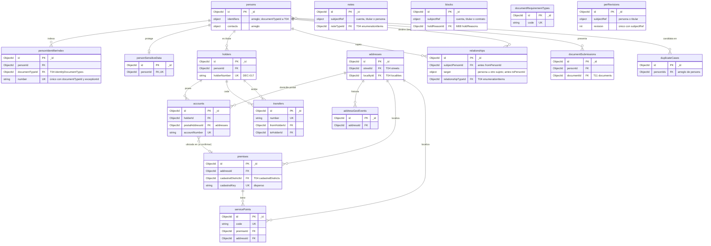
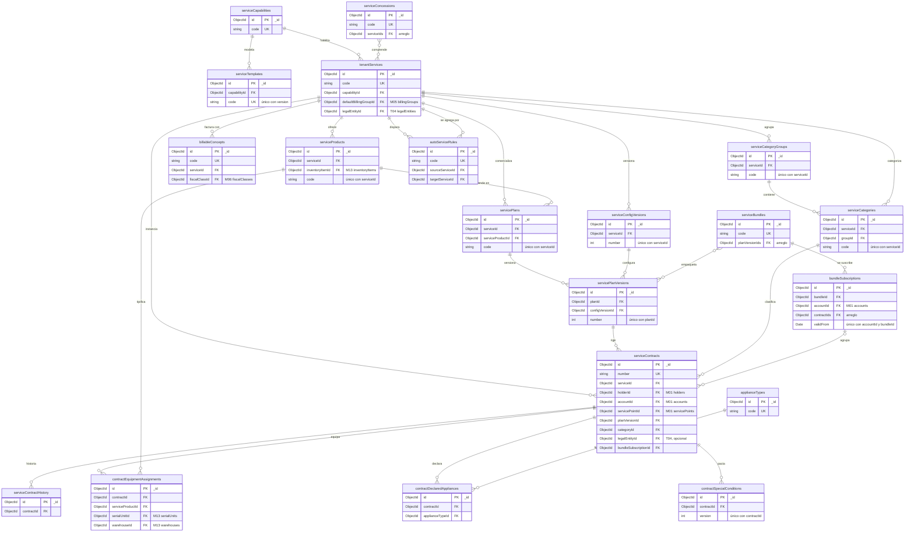

# Modelo entidad-relación — Parte A: Plataforma, personas y catálogo

Parte del artefacto 6.1 [`03-modelo-entidad-relacion.md`](03-modelo-entidad-relacion.md). Versión 1.1 (05-11-2026). Notación y convenciones en las secciones 1 y 2 del documento índice.

Nota de la versión 1.1: actualizada a mano contra la especificación corregida (T05 con 1.108 filas y 1.057 colecciones a crear). Cambios: `relationships` usa `subjectPersonId` y `target` en lugar de `fromPersonId` y `toPersonId`; `billableConcepts.fiscalClassId` apunta a `fiscalClasses` (M06, T05 §7.2.1), ya no "a confirmar"; nueva colección `bundleSubscriptions` (COL-CAT-29) en el §6; nueva referencia `accounts.accountingGroupId` hacia `collectionAccountingGroups` (M07).

Esta parte se conserva como **vista por dominio** (entidades principales). Desde la versión 2.0 del artefacto, el modelo completo, con todas las colecciones a crear de T05 y sus campos, está en la **vista por módulo** de [`03-er/`](03-er/). Para este dominio, ver [`T01`](03-er/T01-PLA-plataforma-saas.md), [`T02`](03-er/T02-IAM-identidad-roles-auditoria.md), [`T04`](03-er/T04-CFG-configuracion-parametros-maestros.md), [`T06`](03-er/T06-INT-integraciones.md), [`T07`](03-er/T07-MIG-migracion-procoop.md), [`M01`](03-er/M01-PER-personas-titulares-cuentas.md) y [`M02`](03-er/M02-CAT-catalogo-servicios.md).

Contenido de esta parte:

- [4. Dominio Plataforma, IAM y configuración](#4-dominio-plataforma-iam-y-configuración)
- [5. Dominio Personas y cuentas](#5-dominio-personas-y-cuentas)
- [6. Dominio Catálogo y contratos](#6-dominio-catálogo-y-contratos)

---

## 4. Dominio Plataforma, IAM y configuración

**Anexos dueños:** T01 (plataforma SaaS), T02 (identidad y auditoría), T04 (configuración y maestros), T06 (integraciones) y T07 (migración). **Olas:** O0 y O1.

El dominio contiene la raíz de tenancy (`tenants`), la identidad federada y su membresía por tenant, las entidades jurídicas y sucursales (DEC-064), los parámetros y enumeraciones configurables, la bóveda de secretos y el mapa de claves de migración. Casi todas las demás colecciones del sistema referencian alguna de estas entidades.

### 4.1 Diagrama

```mermaid
erDiagram
  tenants {
    ObjectId id PK "_id"
    string code UK
    ObjectId brandingRef FK "T03 tenantBrandings"
  }
  moduleCatalog {
    ObjectId id PK "_id"
    string code UK
  }
  tenantModuleActivations {
    ObjectId id PK "_id"
    string moduleCode FK "moduleCatalog.code"
  }
  storedFiles {
    ObjectId id PK "_id"
    string storageKey UK
    object ownerRef "referencia polimórfica"
  }
  identities {
    ObjectId id PK "_id"
    string emailNormalized UK "disperso"
    string cuilHmac UK "disperso"
  }
  memberships {
    ObjectId id PK "_id"
    ObjectId identityId FK
    ObjectId personId FK "M01 persons"
  }
  roles {
    ObjectId id PK "_id"
    string code UK
  }
  roleAssignments {
    ObjectId id PK "_id"
    ObjectId membershipId FK
    ObjectId roleId FK
  }
  auditLogs {
    ObjectId id PK "_id"
    object entityRef "entidad auditada"
    ObjectId actorId FK "a confirmar"
  }
  legalEntities {
    ObjectId id PK "_id"
    string code UK
    string fiscalCuit UK "fiscal.cuit"
    object employer "subdocumento de M16"
  }
  branches {
    ObjectId id PK "_id"
    string code UK
    ObjectId legalEntityId FK
    ObjectId localityId FK
  }
  workstations {
    ObjectId id PK "_id"
    string code UK
    ObjectId branchId FK
    ObjectId localAgentId FK "T06 localAgents"
  }
  parameterDefinitions {
    ObjectId id PK "_id"
    string key UK
  }
  parameterValues {
    ObjectId id PK "_id"
    string key FK "parameterDefinitions.key"
    string scopeType
    ObjectId scopeId
    DateOnly validFrom
  }
  enumerations {
    ObjectId id PK "_id"
    string code UK
  }
  enumerationItems {
    ObjectId id PK "_id"
    ObjectId enumerationId FK
    string code
  }
  localities {
    ObjectId id PK "_id"
    string code UK
    ObjectId departmentId FK "T04 departments"
  }
  integrationConnections {
    ObjectId id PK "_id"
    string code UK
    string providerCode FK "T06 integrationProviders"
    string credentialRef FK "integrationSecrets.ref"
  }
  integrationSecrets {
    ObjectId id PK "_id"
    string ref UK
    ObjectId connectionId FK
  }
  legacyIdMap {
    ObjectId id PK "_id"
    string sourceTable UK "único con sourceKey"
    string sourceKey UK "único con sourceTable"
    string targetCollection
  }

  tenants ||--o{ legalEntities : "tiene"
  legalEntities ||--o{ branches : "opera"
  localities ||--o{ branches : "ubica"
  branches ||--o{ workstations : "contiene"
  tenants ||--o{ tenantModuleActivations : "activa"
  moduleCatalog ||--o{ tenantModuleActivations : "se activa como"
  identities ||--o{ memberships : "ingresa como"
  tenants ||--o{ memberships : "agrupa"
  memberships ||--o{ roleAssignments : "recibe"
  roles ||--o{ roleAssignments : "otorga"
  memberships ||--o{ auditLogs : "actúa en (a confirmar)"
  parameterDefinitions ||--o{ parameterValues : "valoriza"
  enumerations ||--o{ enumerationItems : "contiene"
  integrationConnections ||--o{ integrationSecrets : "custodia"
```

`storedFiles` y `legacyIdMap` no tienen relaciones internas: se vinculan con muchas colecciones de otros dominios por referencias polimórficas (`ownerRef`, `targetCollection`) o por `storedFileId`.

### 4.2 Entidades

| Colección | Descripción | Dueño | Ola | ID T05 |
|---|---|---|---|---|
| `tenants` | Registro del tenant (raíz), ciclo de vida, dominios y zona horaria; colección global. | T01 | O0 | COL-PLA-01 |
| `moduleCatalog` | Catálogo de módulos y capabilities licenciables; colección global. | T01 | O0 | COL-PLA-02 |
| `tenantModuleActivations` | Activación de módulos por tenant. | T01 | O1 | COL-PLA-05 |
| `storedFiles` | Metadatos de binarios en almacenamiento privado. | T01 | O0 | COL-PLA-29 |
| `identities` | Identidad de inicio de sesión (persona humana); colección global. | T02 | O0 | COL-IAM-01 |
| `memberships` | Identidad dentro del tenant (personal, socio, empleado, proveedor). | T02 | O0 | COL-IAM-04 |
| `roles` | Roles con capabilities. | T02 | O1 | COL-IAM-05 |
| `roleAssignments` | Rol asignado a una membresía con alcance de datos. | T02 | O1 | COL-IAM-07 |
| `auditLogs` | Auditoría de cambios de toda colección marcada como auditada. | T02 | O0 | COL-IAM-24 |
| `legalEntities` | Entidades jurídicas emisoras del tenant, con subdocumento `employer` (DEC-064, CTR-DAT-06). | T04 | O0 | COL-CFG-41 |
| `branches` | Sucursales del tenant con sus usos (atención, caja, depósito, punto de venta, base técnica). | T04 | O0 | COL-CFG-42 |
| `workstations` | Puestos físicos (mostrador, caja, oficina, kiosco, campo). | T04 | O1 | COL-CFG-43 |
| `parameterDefinitions` | Registro tipado de parámetros PRM. | T04 | O0 | COL-CFG-01 |
| `parameterValues` | Valores de parámetros por ámbito y vigencia. | T04 | O1 | COL-CFG-02 |
| `enumerations` | Enumeraciones configurables (incluye los catálogos simples de M01). | T04 | O1 | COL-CFG-05 |
| `enumerationItems` | Ítems de enumeraciones y tablas maestras simples. | T04 | O1 | COL-CFG-06 |
| `localities` | Localidades (geografía de plataforma y del tenant). | T04 | O1 | COL-CFG-10 |
| `integrationConnections` | Conexión del tenant con un proveedor externo. | T06 | O1 | COL-INT-02 |
| `integrationSecrets` | Bóveda de secretos cifrados por sobre con KMS (DEC-074). | T06 | O0 | COL-INT-03 |
| `legacyIdMap` | Mapa transversal clave ProCoop → `ObjectId`. | T07 | O0 | COL-MIG-09 |

### 4.3 Relaciones con otros dominios

| Desde (colección.campo) | Hacia | Cardinalidad | Observación |
|---|---|---|---|
| `memberships.personId` | `persons` (§5) | N:0..1 | Vínculo persona–usuario; absorbe `personUserLinks` (COL-PER-21). |
| `legalEntityId` en documentos económicos y fiscales (`invoices`, `receipts`, `obligations`, `currentAccounts`, `journalEntries`, `payslips`, `treasuryAccounts`, entre otros) | `legalEntities` | N:1 | Obligatorio desde O0 (RN-DAT-008, DEC-064). |
| `tenantServices.legalEntityId`, `serviceContracts.legalEntityId` | `legalEntities` | N:1 | Entidad que presta y factura; la del contrato es opcional (CTR-DAT-79). |
| `branchId` en `pointsOfSale`, `cashRegisters`, `warehouses`, `crmAreas`, `posTerminals`, `kioskDevices` | `branches` | N:1 | Los dueños validan contra `branches.uses`. |
| `cashRegisters.workstationId` | `workstations` | N:1 | Caja de M07 (§10). |
| `userId`, `createdBy`, `updatedBy`, `assigneeId` en todas las colecciones | `memberships` | N:1 | Nombre canónico (T05 §7.2). |
| `storedFileId` y `<rol>StoredFileId` (`documentVersions`, `invoiceDocuments`, `reportExports`, `bankStatementImports`, `minutes`, entre otros) | `storedFiles` | N:1 | Binarios fuera de la base. |
| `credentialRef` en `arcaCredentials`, `meteringSystems`, `gatewayConnectors`, `serviceTechnicalProfiles`, `interbankingConnections`, `senderIdentities` | `integrationSecrets` | N:1 | Ningún secreto en colecciones de negocio (RN-DAT-010). |
| `connectionId` en `meteringSystems`, `gatewayConnectors`, `crmChannels`, `provisioningSystems`, `channelSettings` | `integrationConnections` | N:1 | Colecciones de dominio sobre una conexión técnica. |
| `localityId` en `addresses` (M01) y `careProviders` (M18) | `localities` | N:1 | Geografía de T04. |
| `legalEntities.employer.bankAgreements.treasuryAccountId` | `treasuryAccounts` (§17) | N:1 | Convenios bancarios del empleador. |
| `legacyIdMap.targetCollection` | Cualquier colección destino de migración | Polimórfica | Único traductor de claves ProCoop (T05 §19.2). |

### 4.4 Otras colecciones del dominio no diagramadas

`tenantBrandings` (COL-UXD-01), `capabilityCatalog` (COL-IAM-09), `sessions` (COL-IAM-13), `streets` (COL-CFG-12), `cadastralDistricts` (COL-CFG-17), `calendars` (COL-CFG-19), `holidays` (COL-CFG-20), `economicIndexSeries` (COL-CFG-21), `currencies` (COL-CFG-23), `identityDocumentTypes` (COL-CFG-28), `fileLayouts` (COL-INT-10), `externalReferences` (COL-INT-15), `localAgents` (COL-INT-16), `migrationRuns` (COL-MIG-06), `legacyRecords` (COL-MIG-19), `consentRecords` (COL-NFR-04), `dataSubjectRequests` (COL-NFR-05), `retentionPolicies` (COL-NFR-06), `erasureLedger` (COL-NFR-09) y `encryptionKeys` (COL-NFR-12). El detalle está en T05 §7.3 y §7.4.

---

## 5. Dominio Personas y cuentas

**Anexo dueño:** M01 (personas, titulares y cuentas). **Ola:** O2.

Separa la persona (identidad y contacto) de sus roles comerciales: el titular, la cuenta de servicios (ex `SUMSOC`), los domicilios normalizados, los inmuebles y los puntos de suministro. Los datos sensibles van en una colección aparte y cifrada. Los catálogos simples de M01 §7.18 no son colecciones: viven en `enumerations`/`enumerationItems` de T04 (CTR-DAT-12).

### 5.1 Diagrama

`notes`, `blocks` y `perRevisions` se vinculan con persona, titular, cuenta o contrato por la referencia polimórfica `subjectRef`; `documentRequirementTypes` es el catálogo de requisitos por trámite. La relación `accounts`–`premises` figura en el mapa de relaciones de T05 §7.10, pero el catálogo de `accounts` no declara una clave hacia `premises`: queda marcada **a confirmar**.

### 5.2 Entidades

| Colección | Descripción | Dueño | Ola | ID T05 |
|---|---|---|---|---|
| `persons` | Persona humana o jurídica: identidad y contacto. | M01 | O2 | COL-PER-01 |
| `personIdentifierIndex` | Índice auxiliar de unicidad de documentos de identidad. | M01 | O2 | COL-PER-02 |
| `personSensitiveData` | Datos sensibles separados y cifrados (discapacidad, electrodependencia, salud). | M01 | O2 | COL-PER-03 |
| `holders` | Titular: rol comercial de la persona. | M01 | O2 | COL-PER-04 |
| `accounts` | Cuenta de servicios: agrupa contratos y domicilio postal (ex `SUMSOC`). | M01 | O2 | COL-PER-05 |
| `addresses` | Domicilios normalizados con georreferencia. | M01 | O2 | COL-PER-06 |
| `addressGeoEvents` | Historia de geocodificación del domicilio. | M01 | O2 | COL-PER-07 |
| `premises` | Inmuebles (canónica para `properties`). | M01 | O2 | COL-PER-08 |
| `servicePoints` | Punto de suministro en un inmueble (domicilio de servicio). | M01 | O2 | COL-PER-09 |
| `relationships` | Vínculos entre personas con tipo y vigencia. | M01 | O2 | COL-PER-10 |
| `notes` | Notas de cuenta, titular o persona. | M01 | O2 | COL-PER-12 |
| `blocks` | Bloqueos de cuenta, titular o contrato con efectos; absorbe `billingHolds` de M05. | M01 | O2 | COL-PER-13 |
| `documentRequirementTypes` | Requisitos documentales por trámite. | M01 | O2 | COL-PER-14 |
| `documentSubmissions` | Documentos presentados por una persona. | M01 | O2 | COL-PER-15 |
| `transfers` | Transferencias de titularidad (no confundir con las de stock, CTR-DAT-45). | M01 | O2 | COL-PER-16 |
| `duplicateCases` | Casos de posibles personas duplicadas. | M01 | O2 | COL-PER-17 |
| `perRevisions` | Revisiones versionadas de persona y titular. | M01 | O2 | COL-PER-18 |

### 5.3 Relaciones con otros dominios

| Desde (colección.campo) | Hacia | Cardinalidad | Observación |
|---|---|---|---|
| `serviceContracts.holderId`, `.accountId`, `.servicePointId` (§6) | `holders`, `accounts`, `servicePoints` | N:1 | El contrato cuelga de titular, cuenta y punto de servicio (CTR-DAT-66, CTR-DAT-67). |
| `meteringPoints.accountId`, `.premiseId`, `.servicePointId` (§7) | `accounts`, `premises`, `servicePoints` | N:1 | Ubicación del punto de medición. |
| `invoices.customer.accountId`, `billingGroups.holderId`/`.accountId`, `billableItems.accountId` (§9) | `accounts`, `holders` | N:1 | La factura guarda además un snapshot del cliente. |
| `currentAccounts.holderId`, `.accountIds` (§10) | `holders`, `accounts` | N:1 / N:N | Cuenta corriente por titular y entidad jurídica (DEC-087); nunca se usa `accountId` para la cuenta corriente (CTR-DAT-65). |
| `crmCases.requester.personId`, `.context.accountId` (§12) | `persons`, `accounts` | N:1 | Solicitante y contexto del caso. |
| `workBeneficiaries.premiseId`/`.accountId` (§13); `worksInstallmentPlans.premiseId` (§8) | `premises`, `accounts` | N:1 | Obras y contribución por mejoras. |
| `serviceProtections.personSensitiveDataId` (§11) | `personSensitiveData` | N:1 | Protecciones normativas (electrodependientes). |
| `associateMemberships.personId` (§20) | `persons` | 0..1:1 | Una membresía institucional vigente por persona. |
| `employees.personId` (§19), `suppliers.personId` (§15, opcional), `memberships.personId` (§4) | `persons` | N:1 | La persona es única; los roles se modelan en cada dominio. |
| `communications.personId`, `communicationPreferences.personId` (§23); `consentRecords.personId` (T08) | `persons` | N:1 | Contacto y consentimiento. |
| `portalAccountAccess.accountId` (§22) | `accounts` | N:1 | Acceso del usuario del portal a sus cuentas (DEC-043). |
| `blocks.holdReasonId` | `holdReasons` (§11) | N:1 | Motivos de bloqueo canónicos de M08 (CTR-DAT-36). |
| `documentSubmissions.documentId` | `documents` (§24) | N:1 | Expediente documental de T11. |
| `addresses.streetId`/`.localityId`, `premises.cadastralDistrictId` | Geografía de T04 (§4) | N:1 | Calles, localidades y distritos catastrales. |
| `accounts.accountingGroupId` | `collectionAccountingGroups` (§10) | N:1 | Grupo contable de cobranza (origen `GRU_CON`; T05 §7.2.1, PA-PER-17). Agregada en la versión 1.1. |

### 5.4 Colecciones absorbidas

`adherents` (COL-PER-11) se reparte entre `serviceDependents` y `serviceBeneficiaries` de M18 (DEC-071, DEC-086); `consents` (COL-PER-19) y `dataSubjectRequests` (COL-PER-20) se absorben en T08; `personUserLinks` (COL-PER-21) se absorbe en `memberships` de T02.

---

## 6. Dominio Catálogo y contratos

**Anexo dueño:** M02 (catálogo de servicios y contratos). **Olas:** O2 (núcleo), O3 (equipos) y O7 (artefactos y condiciones especiales).

Define qué servicios presta el tenant (`tenantServices`, apuntado por `serviceId`), su oferta comercial versionada (productos, planes, categorías, conceptos facturables sin precio) y el contrato de servicio (`serviceContracts`, apuntado por `contractId`, DEC-011), que es la pieza que une al titular con el servicio, el punto de suministro, la medición y la facturación.

### 6.1 Diagrama

### 6.2 Entidades

| Colección | Descripción | Dueño | Ola | ID T05 |
|---|---|---|---|---|
| `serviceCapabilities` | Capacidades de servicio de plataforma (INT, ELE, AG…); tenant `PLATFORM`. | M02 | O2 | COL-CAT-01 |
| `serviceTemplates` | Plantillas de servicio de plataforma. | M02 | O2 | COL-CAT-28 |
| `tenantServices` | Servicio habilitado por el tenant y su perfil; `legalEntityId` obligatorio (CTR-DAT-79). | M02 | O2 | COL-CAT-02 |
| `serviceConfigVersions` | Paquete versionado y publicable de configuración del servicio. | M02 | O2 | COL-CAT-03 |
| `serviceConcessions` | Concesiones que amparan uno o más servicios. | M02 | O2 | COL-CAT-04 |
| `serviceProducts` | Productos y subservicios (faceta comercial; la de stock es `inventoryItems`). | M02 | O2 | COL-CAT-05 |
| `billableConcepts` | Conceptos facturables (sin precio). | M02 | O2 | COL-CAT-06 |
| `servicePlans` | Planes comerciales. | M02 | O2 | COL-CAT-07 |
| `servicePlanVersions` | Versiones de plan (DEC-012). | M02 | O2 | COL-CAT-08 |
| `serviceBundles` | Paquetes multiservicio. | M02 | O2 | COL-CAT-09 |
| `serviceCategoryGroups` | Grupos de categorías. | M02 | O2 | COL-CAT-11 |
| `serviceCategories` | Categorías estructurales del servicio. | M02 | O2 | COL-CAT-10 |
| `autoServiceRules` | Altas automáticas de servicios relacionados (DEC-023). | M02 | O2 | COL-CAT-17 |
| `serviceContracts` | Contrato de servicio (DEC-011), con atributos de dominio tipados por servicio. | M02 | O2 | COL-CAT-18 |
| `serviceContractHistory` | Historia de eventos del contrato (solo agregado). | M02 | O2 | COL-CAT-19 |
| `contractEquipmentAssignments` | Equipos asignados al contrato; absorbe `equipmentAssignments` de M13 (CTR-DAT-28). | M02 | O3 | COL-CAT-20 |
| `applianceTypes` | Tipos de artefacto. | M02 | O7 | COL-CAT-21 |
| `contractDeclaredAppliances` | Artefactos declarados por contrato (declaración jurada). | M02 | O7 | COL-CAT-22 |
| `contractSpecialConditions` | Condiciones especiales de grandes usuarios (MER-003). | M02 | O7 | COL-CAT-25 |
| `bundleSubscriptions` | Suscripción de una cuenta a un combo (`serviceBundles`) con sus contratos (PA-CAT-22). Nueva en la versión 1.1. | M02 | O4 | COL-CAT-29 |

### 6.3 Relaciones con otros dominios

| Desde (colección.campo) | Hacia | Cardinalidad | Observación |
|---|---|---|---|
| `serviceContracts.holderId`, `.accountId`, `.servicePointId` | `holders`, `accounts`, `servicePoints` (§5) | N:1 | Ver §5.3. |
| `tenantServices.legalEntityId`, `serviceContracts.legalEntityId` | `legalEntities` (§4) | N:1 | La entidad efectiva es la del contrato si está informada; si no, la del servicio (CTR-DAT-79). |
| `tenantServices.defaultBillingGroupId` | `billingGroups` (§9) | N:1 | Grupo de facturación por defecto. |
| `serviceProducts.inventoryItemId` | `inventoryItems` (§16) | N:1 | Faceta comercial frente a faceta de stock. |
| `contractEquipmentAssignments.serialUnitId`, `.warehouseId` | `serialUnits`, `warehouses` (§16) | N:1 | Equipo serializado entregado al socio. |
| `billableConcepts.fiscalClassId` | `fiscalClasses` (§9) | N:1 | ~~**A confirmar:** T05 §7.2 no fija la colección destino de `fiscalClassId`.~~ Resuelto: T05 §7.2.1 lo fija en `fiscalClasses` (COL-FIS-47, M06 §7.38; PA-FIS-21). |
| `bundleSubscriptions.accountId` | `accounts` (§5) | N:1 | Cuenta suscripta al combo. |
| `meteringPoints.contractId`, `consumptions.contractId` (§7) | `serviceContracts` | N:1 | Contrato medido. |
| `tariffSchedules.serviceId`, `tariffRows.categoryId`/`.conceptId`, `productPrices.serviceProductId` (§8) | `tenantServices`, `serviceCategories`, `billableConcepts`, `serviceProducts` | N:1 | El precio vive en M04; M02 no guarda precios. |
| `billedPeriods.contractId`, `billableItems.contractId`/`.conceptId`, `billingCycles.serviceId` (§9) | `serviceContracts`, `billableConcepts`, `tenantServices` | N:1 | Marca anti doble facturación por contrato y período. |
| `obligations.serviceId` (§10) | `tenantServices` | N:1 | Obligación por bloque de servicio. |
| `serviceProtections.contractId`, `interruptionCases.contractId` (§11) | `serviceContracts` | N:1 | Mora y corte. |
| `workOrders.contractId`, `serviceNetworkConnections.contractId`, `serviceTechnicalProfiles.contractId` (§13) | `serviceContracts` | N:1 | Técnica y aprovisionamiento. |
| `serialUnits.currentContractId` (§16) | `serviceContracts` | N:0..1 | Ubicación actual del equipo. |
| `capitalMovements.contractId`, `capitalSubscriptionRules.serviceId`/`.categoryId` (§20) | `serviceContracts`, `tenantServices`, `serviceCategories` | N:1 | Capital social por servicio. |
| `serviceDependents.contractId`, `serviceBeneficiaries.contractId`, `housingUnits.contractId`, `contractRegistrations.contractId` (§21) | `serviceContracts` | N:1 | Adherentes y beneficiarios (DEC-071, DEC-086). |

### 6.4 Otras colecciones y absorciones

No diagramadas: `serviceClasses` (COL-CAT-12), `serviceProperties` (COL-CAT-13), `serviceStatuses` (COL-CAT-14), `serviceCopyRuns` (COL-CAT-26) y `bulkContractOperations` (COL-CAT-27). Absorbidas: `eventChargeRules` y `eventChargeWaivers` (COL-CAT-15 y COL-CAT-16) en `eventCharges`/`eventChargeBonuses` de M04; `contractMembers` (COL-CAT-23) en M18; `generationAgreements` (COL-CAT-24) en `distributedGenerationContracts` de M03.
