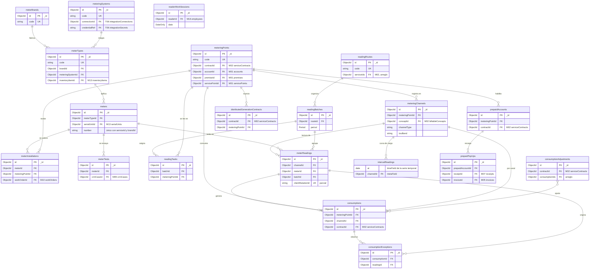
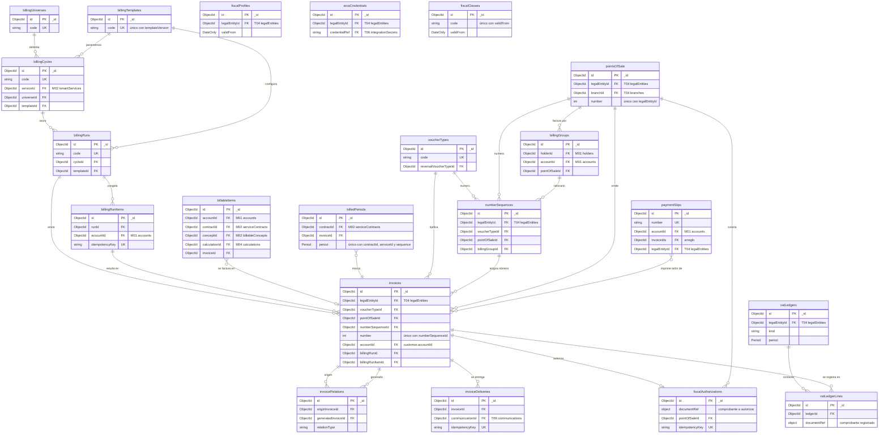

# Modelo entidad-relación — Parte B: Medición, tarifas y facturación

Parte del artefacto 6.1 [`03-modelo-entidad-relacion.md`](03-modelo-entidad-relacion.md). Versión 1.1 (05-11-2026). Notación y convenciones en las secciones 1 y 2 del documento índice.

Nota de la versión 1.1: actualizada a mano contra la especificación corregida (T05 con 1.108 filas y 1.057 colecciones a crear). Cambios: nueva colección `fiscalClasses` (COL-FIS-47) en el §9, destino de `billableConcepts.fiscalClassId` según T05 §7.2.1. `worksInstallmentPlans.rightId` sigue "a confirmar": ni el anexo ni T05 nombran la colección destino.

Esta parte se conserva como **vista por dominio** (entidades principales). Desde la versión 2.0 del artefacto, el modelo completo, con todas las colecciones a crear de T05 y sus campos, está en la **vista por módulo** de [`03-er/`](03-er/). Para estos dominios, ver [`M03`](03-er/M03-MED-medicion-consumos.md), [`M04`](03-er/M04-TAR-tarifas-motor-calculo.md), [`M05`](03-er/M05-FAC-facturacion.md) y [`M06`](03-er/M06-FIS-fiscal-impuestos.md).

Contenido de esta parte:

- [7. Dominio Medición](#7-dominio-medición)
- [8. Dominio Tarifas](#8-dominio-tarifas)
- [9. Dominio Facturación y fiscal](#9-dominio-facturación-y-fiscal)

---

## 7. Dominio Medición

**Anexo dueño:** M03 (medición y consumos). **Ola:** O7.

Modela el punto de medición del contrato, sus canales (registros por tipo de energía y banda horaria), los medidores físicos y su colocación, el circuito de lectura (rutas, lotes, tareas), las lecturas y los consumos resultantes, la telemedición y la operación prepaga. `meterReadings`, `consumptions` e `intervalReadings` son colecciones de alto volumen (T05 §7.8.2); `intervalReadings` es una serie temporal.

### 7.1 Diagrama

`readerWorkSessions` solo se relaciona con `employees` de M16 (jornada del lecturista). La relación `meterReadings`–`consumptions` sigue el mapa de T05 §7.10.

### 7.2 Entidades

| Colección | Descripción | Dueño | Ola | ID T05 |
|---|---|---|---|---|
| `meterBrands` | Marcas de medidor. | M03 | O7 | COL-MED-01 |
| `meteringSystems` | Sistemas de telemedición y prepago (dominio sobre `integrationConnections`). | M03 | O7 | COL-MED-28 |
| `meterTypes` | Tipos y modelos de medidor con sus registros. | M03 | O7 | COL-MED-02 |
| `meters` | Ficha metrológica del medidor. | M03 | O7 | COL-MED-07 |
| `meteringPoints` | Punto de medición del contrato. | M03 | O7 | COL-MED-08 |
| `meteringChannels` | Canales del punto (tipo de registro y banda horaria). | M03 | O7 | COL-MED-09 |
| `meterInstallations` | Colocación y retiro de medidores. | M03 | O7 | COL-MED-10 |
| `meterTests` | Ensayos y contrastes. | M03 | O7 | COL-MED-12 |
| `readingRoutes` | Rutas de lectura. | M03 | O7 | COL-MED-13 |
| `readingBatches` | Lotes de lectura por ruta y período. | M03 | O7 | COL-MED-15 |
| `readingTasks` | Tareas de lectura por punto. | M03 | O7 | COL-MED-16 |
| `readerWorkSessions` | Jornadas del lecturista. | M03 | O7 | COL-MED-17 |
| `meterReadings` | Lecturas (alto volumen). | M03 | O7 | COL-MED-18 |
| `consumptions` | Consumos por canal e intervalo (alto volumen). | M03 | O7 | COL-MED-19 |
| `consumptionExceptions` | Excepciones de consumo. | M03 | O7 | COL-MED-20 |
| `consumptionAdjustments` | Ajustes y regularizaciones de consumo. | M03 | O7 | COL-MED-21 |
| `intervalReadings` | Curvas de carga (serie temporal, PA-MED-03). | M03 | O7 | COL-MED-32 |
| `prepaidAccounts` | Cuenta prepaga técnica del punto. | M03 | O7 | COL-MED-33 |
| `prepaidTopUps` | Recargas prepagas (token cifrado). | M03 | O7 | COL-MED-34 |
| `distributedGenerationContracts` | Contrato técnico del usuario-generador; absorbe `generationAgreements` de M02 (CTR-DAT-59). | M03 | O7 | COL-MED-35 |

### 7.3 Relaciones con otros dominios

| Desde (colección.campo) | Hacia | Cardinalidad | Observación |
|---|---|---|---|
| `meteringPoints.contractId`, `consumptions.contractId`, `consumptionAdjustments.contractId`, `prepaidAccounts.contractId`, `distributedGenerationContracts.contractId` | `serviceContracts` (§6) | N:1 | Dueño del contrato: M02 (CTR-DAT-71). |
| `meteringPoints.accountId`, `.premiseId`, `.servicePointId` | `accounts`, `premises`, `servicePoints` (§5) | N:1 | Ubicación y cuenta del punto. |
| `meteringChannels.conceptId` | `billableConcepts` (§6) | N:1 | Concepto facturable del canal. |
| `meters.serialUnitId`, `meterTypes.inventoryItemId` | `serialUnits`, `inventoryItems` (§16) | N:1 | El medidor es una unidad serializada de stock. |
| `meterInstallations.workOrderId` | `workOrders` (§13) | N:1 | Colocación o retiro por OT. |
| `meterTests.crmCaseId` | `crmCases` (§12) | N:1 | Ensayo pedido por reclamo. |
| `readerWorkSessions.readerId` | `employees` (§19) | N:1 | Lecturista como empleado. |
| `prepaidTopUps.receiptId`, `.invoiceId` | `receipts` (§10), `invoices` (§9) | N:1 | Cobro y comprobante de la recarga. |
| `meteringSystems.connectionId`, `.credentialRef` | `integrationConnections`, `integrationSecrets` (§4) | N:1 | Sin secretos en M03 (CTR-DAT-72). |
| `calculations` (§8) valoriza `consumptions` | `consumptions` | 1:N | Relación conceptual del mapa de T05 §7.10. |
| `seals.placement.meterId` (§13) | `meters` | N:1 | Precintos canónicos de M10 (CTR-DAT-60). |
| `inspectionCases.meteringPointId` (§13) | `meteringPoints` | N:1 | Inspecciones y consumo no registrado. |
| `gasCalorificFactors` (§8) | — | Lectura | M03 lee los factores de M04 para estimar y validar (DEC-085). |

### 7.4 Otras colecciones y absorciones

No diagramadas: catálogos de observación y resultado (COL-MED-03 a COL-MED-06), `readingCalendars` (COL-MED-14), `consumptionDistributions` (COL-MED-22), `demandDeclarations` (COL-MED-23), `demandTransgressions` (COL-MED-24), `readingImportProfiles` (COL-MED-26), `readingImportJobs` (COL-MED-27), `telemetryRegisterMappings` (COL-MED-29), `remoteMeterOperations` (COL-MED-30), `injectionBalances` (COL-MED-36) y `consumptionClassReviews` (COL-MED-37). Absorbidas: `meterSeals` (COL-MED-11) en `seals` de M10, `gasCorrectionFactors` (COL-MED-25) en `gasCalorificFactors` de M04 y `meteringConnectorLogs` (COL-MED-31) en `integrationMessages` de T06.

---

## 8. Dominio Tarifas

**Anexo dueño:** M04 (tarifas y motor de cálculo). **Olas:** O4 (cuadros, reglas y motor), O7 (servicios medidos, subsidios, beneficios, gas) y O10 (tasación telefónica).

Contiene los cuadros tarifarios versionados y su detalle (tarifas por categoría, tramos, precios de productos, coeficientes), los cargos por evento, las reglas declarativas, los beneficios y subsidios, las promociones, las cuotas de obra y el motor de cálculo (`calculationRuns` y `calculations`, con traza por cuenta). M04 es dueño del precio; M02 define conceptos sin precio.

### 8.1 Diagrama

```mermaid
erDiagram
  tariffSchedules {
    ObjectId id PK "_id"
    ObjectId serviceId FK "M02 tenantServices"
    string code UK "único con version"
    int version
  }
  tariffServiceSettings {
    ObjectId id PK "_id"
    ObjectId serviceId FK "M02 tenantServices"
    int version "único con serviceId"
  }
  tariffCategoryRates {
    ObjectId id PK "_id"
    ObjectId tariffScheduleId FK
    ObjectId categoryId FK "M02 serviceCategories"
  }
  tariffRows {
    ObjectId id PK "_id"
    ObjectId tariffScheduleId FK
    ObjectId categoryId FK "M02 serviceCategories"
    ObjectId conceptId FK "M02 billableConcepts"
  }
  adherentRates {
    ObjectId id PK "_id"
    ObjectId tariffScheduleId FK
    ObjectId categoryId FK "M02 serviceCategories"
  }
  productPrices {
    ObjectId id PK "_id"
    ObjectId serviceProductId FK "M02 serviceProducts"
    ObjectId tariffScheduleId FK
    DateOnly validFrom
  }
  categoryCoefficients {
    ObjectId id PK "_id"
    ObjectId tariffScheduleId FK
    ObjectId categoryId FK "M02 serviceCategories"
  }
  gasCalorificFactors {
    ObjectId id PK "_id"
    ObjectId serviceId FK "M02 tenantServices"
    ObjectId zoneId FK "T04 zones"
    ObjectId categoryId FK "M02 serviceCategories"
    Period period
  }
  eventCharges {
    ObjectId id PK "_id"
    string code UK "único con version"
    ObjectId serviceIds FK "M02, arreglo"
    ObjectId conceptId FK "M02 billableConcepts"
  }
  eventChargeBonuses {
    ObjectId id PK "_id"
    ObjectId eventChargeId FK
    ObjectId accountId FK "M01 accounts"
  }
  chargeRules {
    ObjectId id PK "_id"
    string code UK "único con version"
    ObjectId conceptId FK "M02 billableConcepts"
  }
  benefitGroups {
    ObjectId id PK "_id"
    string code UK
  }
  benefitGroupMembers {
    ObjectId id PK "_id"
    ObjectId groupId FK
    ObjectId contractId FK "M02 serviceContracts"
    ObjectId personId FK "M01 persons"
  }
  subsidyRegimes {
    ObjectId id PK "_id"
    string code UK "único con version"
    ObjectId serviceIds FK "M02, arreglo"
  }
  subsidyEnrollments {
    ObjectId id PK "_id"
    ObjectId regimeId FK
    ObjectId contractId FK "M02 serviceContracts"
    ObjectId personId FK "M01 persons"
  }
  promotions {
    ObjectId id PK "_id"
    string code UK "único con version"
    ObjectId planIds FK "M02 servicePlans, arreglo"
  }
  promotionAssignments {
    ObjectId id PK "_id"
    ObjectId promotionId FK
    ObjectId contractId FK "M02 serviceContracts"
  }
  worksInstallmentPlans {
    ObjectId id PK "_id"
    ObjectId contractId FK "M02 serviceContracts"
    ObjectId workId FK "M10 works"
    ObjectId premiseId FK "M01 premises"
    ObjectId rightId FK "M18, a confirmar"
  }
  calculationRuns {
    ObjectId id PK "_id"
    string jobId UK
    ObjectId billingRunId FK "M05 billingRuns"
  }
  calculations {
    ObjectId id PK "_id"
    ObjectId calculationRunId FK
    ObjectId accountId FK "M01 accounts"
    ObjectId invoiceId FK "M05 invoices"
  }

  tariffSchedules ||--o{ tariffCategoryRates : "tarifa por categoría"
  tariffSchedules ||--o{ tariffRows : "tramos"
  tariffSchedules ||--o{ adherentRates : "tarifa de adherente"
  tariffSchedules ||--o{ productPrices : "precia"
  tariffSchedules ||--o{ categoryCoefficients : "coeficientes"
  eventCharges ||--o{ eventChargeBonuses : "bonifica"
  benefitGroups ||--o{ benefitGroupMembers : "incluye"
  subsidyRegimes ||--o{ subsidyEnrollments : "inscribe"
  promotions ||--o{ promotionAssignments : "asigna"
  calculationRuns ||--o{ calculations : "produce"
  tariffSchedules ||--o{ calculations : "aplica"
```

`tariffServiceSettings`, `gasCalorificFactors`, `chargeRules` y `worksInstallmentPlans` se relacionan solo con colecciones de otros dominios (servicio, categoría, concepto, contrato, obra). La relación `tariffSchedules`–`calculations` sigue el mapa de T05 §7.10: la versión tarifaria usada queda en la traza del cálculo.

### 8.2 Entidades

| Colección | Descripción | Dueño | Ola | ID T05 |
|---|---|---|---|---|
| `tariffSchedules` | Versión de cuadro tarifario con referencias normativas. | M04 | O4 | COL-TAR-01 |
| `tariffServiceSettings` | Configuración tarifaria del servicio. | M04 | O4 | COL-TAR-02 |
| `tariffCategoryRates` | Tarifa por categoría dentro del cuadro. | M04 | O4 | COL-TAR-03 |
| `tariffRows` | Tramos y escalones por categoría, concepto y banda horaria. | M04 | O4 | COL-TAR-04 |
| `adherentRates` | Tarifas por adherente. | M04 | O4 | COL-TAR-05 |
| `productPrices` | Precios de productos por versión (incluye cementerio; no vivienda). | M04 | O4 | COL-TAR-06 |
| `categoryCoefficients` | Coeficientes por categoría. | M04 | O7 | COL-TAR-09 |
| `gasCalorificFactors` | Factores de gas por período, zona y categoría (DEC-085). | M04 | O7 | COL-TAR-10 |
| `eventCharges` | Cargos por evento con filtros; absorbe `eventChargeRules` de M02. | M04 | O4 | COL-TAR-07 |
| `eventChargeBonuses` | Bonificaciones de cargos por evento. | M04 | O4 | COL-TAR-08 |
| `chargeRules` | Reglas declarativas de cargos, beneficios y tributos. | M04 | O4 | COL-TAR-11 |
| `benefitGroups` | Grupos de beneficio tarifario. | M04 | O7 | COL-TAR-13 |
| `benefitGroupMembers` | Miembros de grupos de beneficio (historia inmutable). | M04 | O7 | COL-TAR-14 |
| `subsidyRegimes` | Regímenes de subsidio. | M04 | O7 | COL-TAR-15 |
| `subsidyEnrollments` | Inscripciones a subsidio por contrato y persona. | M04 | O7 | COL-TAR-17 |
| `promotions` | Promociones comerciales. | M04 | O4 | COL-TAR-18 |
| `promotionAssignments` | Promociones asignadas a contratos. | M04 | O4 | COL-TAR-19 |
| `worksInstallmentPlans` | Cuotas de obra por obra e inmueble (HUECO-OBR-05). | M04 | O7 | COL-TAR-20 |
| `calculationRuns` | Ejecuciones del motor de cálculo. | M04 | O4 | COL-TAR-29 |
| `calculations` | Resultado de cálculo por cuenta con traza (alto volumen). | M04 | O4 | COL-TAR-30 |

### 8.3 Relaciones con otros dominios

| Desde (colección.campo) | Hacia | Cardinalidad | Observación |
|---|---|---|---|
| `tariffSchedules.serviceId`, `tariffServiceSettings.serviceId`, `gasCalorificFactors.serviceId`, `eventCharges.serviceIds`, `subsidyRegimes.serviceIds` | `tenantServices` (§6) | N:1 / N:N | Tarifa por servicio del tenant. |
| `categoryId` en `tariffCategoryRates`, `tariffRows`, `adherentRates`, `categoryCoefficients`, `gasCalorificFactors` | `serviceCategories` (§6) | N:1 | Categoría estructural. |
| `conceptId` en `tariffRows`, `eventCharges`, `chargeRules` | `billableConcepts` (§6) | N:1 | Concepto facturable sin precio. |
| `productPrices.serviceProductId`, `promotions.planIds` | `serviceProducts`, `servicePlans` (§6) | N:1 / N:N | Precio de producto y promoción por plan. |
| `benefitGroupMembers.contractId`/`.personId`, `subsidyEnrollments.contractId`/`.personId`, `promotionAssignments.contractId`, `worksInstallmentPlans.contractId` | `serviceContracts` (§6), `persons` (§5) | N:1 | `BENSOC` no carga `benefitGroupMembers` (DEC-086). |
| `eventChargeBonuses.accountId`, `calculations.accountId` | `accounts` (§5) | N:1 | Cálculo por cuenta de servicios. |
| `worksInstallmentPlans.premiseId` | `premises` (§5) | N:1 | Cuota de obra por inmueble. |
| `worksInstallmentPlans.workId` | `works` (§13) | N:1 | Obra de M10. |
| `worksInstallmentPlans.rightId` | Colección de M18 (§21) | N:1 | **A confirmar:** T05 indica solo "M18"; por contexto sería `burialRights`, sin confirmación explícita. |
| `calculationRuns.billingRunId`, `calculations.invoiceId` | `billingRuns`, `invoices` (§9) | N:1 | El motor se ejecuta dentro del lote de facturación. |
| `billableItems.calculationId` (§9) | `calculations` | N:1 | Ítem facturable que incluyó el cálculo (RN-TAR-007). |
| `gasCalorificFactors.zoneId` | `zones` (T04, §4) | N:1 | Zona geográfica. |
| `interruptionChargeRules.eventChargeId` (§11) | `eventCharges` | N:1 | Cargos de suspensión y reconexión. |
| `calculations` valoriza `consumptions` (§7) | `consumptions` | N:N | Relación conceptual del mapa de T05 §7.10. |

### 8.4 Otras colecciones y absorciones

No diagramadas: `formulaFunctions` (COL-TAR-12), `subsidyRollImports` (COL-TAR-16), `roundingPolicies` (COL-TAR-21), `roundingCarryEntries` (COL-TAR-22), tasación telefónica (COL-TAR-23 a COL-TAR-28), `simulationRuns` (COL-TAR-31), `simulationResults` (COL-TAR-32), `retroactiveDiffRuns` (COL-TAR-33), `normativeDocuments` (COL-TAR-34) y `bonusRecalcRuns` (COL-TAR-36). Absorbida: `preloadedCharges` (COL-TAR-35) en `billableItems` de M05 (CTR-DAT-38).

---

## 9. Dominio Facturación y fiscal

**Anexos dueños:** M05 (facturación) y M06 (fiscal e impuestos). **Olas:** O4 (núcleo de facturación, ARCA, IVA e ingresos brutos), O5, O7 y O8 (retenciones, libros IVA y regímenes).

M05 arma el universo y los lotes, congela los casos, toma los ítems facturables pendientes (`billableItems`, que absorbe `preloadedCharges` de M04) y emite el comprobante (`invoices`, con renglones embebidos acotados). M06 aporta el punto de venta único, el perfil fiscal por entidad jurídica, la autorización ARCA (CAE, CAEA, CAI, CESP) y los libros de IVA. La numeración fiscal es `numberSequences` (M05); la no fiscal es `numberingSequences` (T11, CTR-DAT-16).

### 9.1 Diagrama

`fiscalProfiles` y `arcaCredentials` se relacionan con `legalEntities` (§4). `fiscalAuthorizations.documentRef` y `vatLedgerLines.documentRef` son referencias a documento; el diagrama muestra el caso de facturas de venta (en el libro de compras la línea apunta a `supplierInvoices`, §15).

### 9.2 Entidades

| Colección | Descripción | Dueño | Ola | ID T05 |
|---|---|---|---|---|
| `billingUniverses` | Criterio de pertenencia al universo de facturación. | M05 | O4 | COL-FAC-02 |
| `billingTemplates` | Plantilla de corrida versionada. | M05 | O4 | COL-FAC-03 |
| `billingCycles` | Ciclo de facturación por servicio y universo. | M05 | O4 | COL-FAC-01 |
| `billingRuns` | Lote de facturación. | M05 | O4 | COL-FAC-05 |
| `billingRunItems` | Caso del universo congelado (alto volumen). | M05 | O4 | COL-FAC-06 |
| `billableItems` | Ítems facturables pendientes; absorbe `preloadedCharges` de M04. | M05 | O4 | COL-FAC-11 |
| `billedPeriods` | Marca anti doble facturación por contrato y período. | M05 | O4 | COL-FAC-10 |
| `invoices` | Comprobante emitido con renglones embebidos (alto volumen). | M05 | O4 | COL-FAC-13 |
| `invoiceRelations` | Relaciones entre comprobantes (nota de crédito, reversión, refacturación). | M05 | O4 | COL-FAC-14 |
| `voucherTypes` | Tipos de comprobante (canónica para `COMPROB`). | M05 | O4 | COL-FAC-18 |
| `numberSequences` | Numeración fiscal por entidad, tipo, punto de venta y talonario. | M05 | O4 | COL-FAC-21 |
| `billingGroups` | Grupos de facturación (FAC-006). | M05 | O4 | COL-FAC-23 |
| `paymentSlips` | Talones sumados y de cuota (el cupón único es de M07). | M05 | O4 | COL-FAC-35 |
| `invoiceDeliveries` | Entrega por comprobante y canal (alto volumen). | M05 | O4 | COL-FAC-39 |
| `pointsOfSale` | Punto de venta único fiscal y operativo; se crea con este nombre en lugar de `fiscalPointsOfSale` (Est. R); M06 §7.9 ya la declara así. | M06 | O4 | COL-FIS-09 |
| `fiscalProfiles` | Perfil fiscal del emisor por entidad jurídica. | M06 | O4 | COL-FIS-04 |
| `arcaCredentials` | Metadatos del certificado ARCA (el secreto vive en T06). | M06 | O4 | COL-FIS-07 |
| `fiscalAuthorizations` | Cola de autorización CAE, CAEA, CAI o CESP. | M06 | O4 | COL-FIS-10 |
| `vatLedgers` | Libros IVA por entidad, tipo y período. | M06 | O8 | COL-FIS-31 |
| `vatLedgerLines` | Líneas del libro IVA (alto volumen). | M06 | O8 | COL-FIS-32 |
| `fiscalClasses` | Clases fiscales de los conceptos facturables (M06 §7.38, PA-FIS-21). Nueva en la versión 1.1; se dibuja sin relaciones internas porque solo la referencia `billableConcepts` (§6). | M06 | O2 | COL-FIS-47 |

### 9.3 Relaciones con otros dominios

| Desde (colección.campo) | Hacia | Cardinalidad | Observación |
|---|---|---|---|
| `invoices.legalEntityId`, `numberSequences.legalEntityId`, `pointsOfSale.legalEntityId`, `fiscalProfiles.legalEntityId`, `arcaCredentials.legalEntityId`, `vatLedgers.legalEntityId`, `paymentSlips.legalEntityId` | `legalEntities` (§4) | N:1 | Un comprobante tiene una sola entidad emisora (DEC-064). |
| `pointsOfSale.branchId` | `branches` (§4) | N:1 | Sucursal del punto de venta. |
| `invoices.customer.accountId`, `billingRunItems.accountId`, `billableItems.accountId`, `paymentSlips.accountId`, `billingGroups.holderId`/`.accountId` | `accounts`, `holders` (§5) | N:1 | Snapshot del cliente en el comprobante (T05 §7.1.9). |
| `invoices.serviceBlocks.contractId`, `billableItems.contractId`/`.conceptId`, `billedPeriods.contractId`, `billingCycles.serviceId` | `serviceContracts`, `billableConcepts`, `tenantServices` (§6) | N:1 | Bloques por servicio (FAC-008). |
| `billableItems.calculationId` | `calculations` (§8) | N:1 | Traza del cálculo. |
| `obligations.sourceDocumentId` (§10) | `invoices` | N:1 | La factura origina una obligación por bloque de servicio. |
| `agreementInstallments.billableItemId`, `deferredInterests.billableItemId` (§11) | `billableItems` | N:1 | Cuotas de convenio e intereses diferidos a facturar. |
| `documentHolds.documentRef` (§11) | `invoices` | N:1 | Bloqueos de documento canónicos de M08 (CTR-DAT-36). |
| `operationCharges`, `salesInstallments` (§14) | `billableItems` | 1:N | Cargos y cuotas que factura M05; el vínculo es `billableItems.sourceModule` + `sourceRef` (M05 §7.2). |
| `invoiceDeliveries.communicationId` | `communications` (§23) | N:1 | Entrega por correo o mensajería. |
| `arcaCredentials.credentialRef` | `integrationSecrets` (§4) | N:1 | Certificado ARCA en la bóveda (DEC-074). |
| `receipts.pointOfSaleId`, `.voucherTypeId` (§10); `posTerminals.pointOfSaleId` (§14) | `pointsOfSale`, `voucherTypes` | N:1 | Recibos y punto de venta del POS. |
| `prepaidTopUps.invoiceId` (§7) | `invoices` | N:1 | Venta prepaga. |
| `accountingEvents.sourceDocument.id` (§18) | `invoices` | 1:N | Todo documento económico genera eventos contables. |
| `billableConcepts.fiscalClassId` (§6) | `fiscalClasses` | N:1 | Clase fiscal del concepto (T05 §7.2.1; antes "a confirmar"). |

### 9.4 Otras colecciones y absorciones

No diagramadas (M05): `billingRunNumberRanges` (COL-FAC-07), `billingExceptions` (COL-FAC-08), `invoiceDrafts` (COL-FAC-12), `invoiceAnnulmentRequests` (COL-FAC-17), `voucherResolutionRules` (COL-FAC-19), `dueDateSchemes` (COL-FAC-24), `invoiceTemplates` (COL-FAC-30), `invoiceDocuments` (COL-FAC-36), `deliveryPreferences` (COL-FAC-37), `distributionRuns` (COL-FAC-38), `postalCarriers` (COL-FAC-41) y `billingCycleClosures` (COL-FAC-42). No diagramadas (M06): `vatConditionSettings` (COL-FIS-15), `vatRates` (COL-FIS-16), `taxDefinitions` (COL-FIS-18), `grossIncomeSettings` (COL-FIS-19), `taxpayerRegistries` (COL-FIS-20), `withholdingTypes` (COL-FIS-25), `withholdingsApplied` (COL-FIS-28), `taxObligations` (COL-FIS-30), `regimeFilings` (COL-FIS-36), `thirdPartyAgreements` (COL-FIS-37) y `thirdPartyCharges` (COL-FIS-38). Absorbidas: `billingHolds` (COL-FAC-04) en `blocks` de M01; `invoiceBlockReasons` y `invoiceBlockHistory` (COL-FAC-15 y COL-FAC-16) en M08; `pointsOfSale` de M05 (COL-FAC-20) en COL-FIS-09.
