# Modelo entidad-relación — Parte C: Cobranza, mora, atención y técnica

Parte del artefacto 6.1 [`03-modelo-entidad-relacion.md`](03-modelo-entidad-relacion.md). Versión 1.1 (05-11-2026). Notación y convenciones en las secciones 1 y 2 del documento índice.

Nota de la versión 1.1: actualizada a mano contra la especificación corregida (T05 con 1.108 filas y 1.057 colecciones a crear). Cambios: se agrega `collectionAccountingGroups` (COL-COB-47) a las colecciones no diagramadas del §10, y se aclara que M08 y M10 ya declaran `debtCollectionAgencies` y `workOrderOperationTypes` con el nombre con que se crean. `delinquencyNotices.batchId` conserva el nombre del §7 de M08; el evento EVT-MOR-07 usa `delinquencyBatchId`.

Esta parte se conserva como **vista por dominio** (entidades principales). Desde la versión 2.0 del artefacto, el modelo completo, con todas las colecciones a crear de T05 y sus campos, está en la **vista por módulo** de [`03-er/`](03-er/). Para estos dominios, ver [`M07`](03-er/M07-COB-cuenta-corriente-cobranza.md), [`M08`](03-er/M08-MOR-mora-financiacion.md), [`M09`](03-er/M09-CRM-atencion.md) y [`M10`](03-er/M10-TEC-tecnica-campo-redes.md).

Contenido de esta parte:

- [10. Dominio Cuenta corriente y cobranza](#10-dominio-cuenta-corriente-y-cobranza)
- [11. Dominio Mora y financiación](#11-dominio-mora-y-financiación)
- [12. Dominio Atención (CRM)](#12-dominio-atención-crm)
- [13. Dominio Técnica y campo](#13-dominio-técnica-y-campo)

---

## 10. Dominio Cuenta corriente y cobranza

**Anexo dueño:** M07 (cuenta corriente y cobranza). **Olas:** O5 (núcleo) y O10 (cobradores).

La cuenta corriente (`currentAccounts`) es el auxiliar de saldo por titular y entidad jurídica (DEC-087); es un concepto distinto de la cuenta de servicios `accounts` de M01 (CTR-DAT-65). Las facturas originan obligaciones exigibles por bloque de servicio; los cobros, en caja, por ente recaudador o por pasarela, emiten recibos (uno por entidad jurídica) que se imputan contra obligaciones. Todo queda en el libro auxiliar `ledgerEntries`, de solo agregado.

### 10.1 Diagrama

```mermaid
erDiagram
  currentAccounts {
    ObjectId id PK "_id"
    string code UK
    ObjectId holderId FK "M01 holders"
    ObjectId accountIds FK "M01 accounts, arreglo"
    ObjectId billingGroupId FK "M05 billingGroups"
    ObjectId legalEntityId FK "T04 legalEntities"
  }
  obligations {
    ObjectId id PK "_id"
    ObjectId sourceDocumentId FK "M05 invoices"
    string sourceLineKey "único con sourceDocumentId"
    ObjectId currentAccountId FK
    ObjectId serviceId FK "M02 tenantServices"
  }
  ledgerEntries {
    ObjectId id PK "_id"
    ObjectId currentAccountId FK
    ObjectId obligationId FK
    ObjectId operationId
    string entryNo UK
  }
  allocations {
    ObjectId id PK "_id"
    ObjectId obligationId FK
    object creditRef "recibo u otro crédito"
  }
  creditBalances {
    ObjectId id PK "_id"
    ObjectId currentAccountId FK
  }
  cashRegisters {
    ObjectId id PK "_id"
    string code UK
    ObjectId branchId FK "T04 branches"
    ObjectId workstationId FK "T04 workstations"
  }
  cashSessions {
    ObjectId id PK "_id"
    ObjectId cashRegisterId FK
    ObjectId userId FK "T02 memberships"
  }
  cashOperations {
    ObjectId id PK "_id"
    ObjectId sessionId FK
    string operationId UK
  }
  receipts {
    ObjectId id PK "_id"
    ObjectId cashOperationId FK
    ObjectId currentAccountId FK
    ObjectId pointOfSaleId FK "M06 pointsOfSale"
    ObjectId voucherTypeId FK "M05 voucherTypes"
    ObjectId legalEntityId FK "T04 legalEntities"
  }
  paymentTenders {
    ObjectId id PK "_id"
    ObjectId cashOperationId FK
    ObjectId thirdPartyCheckId FK "M14 thirdPartyChecks"
  }
  paymentReferences {
    ObjectId id PK "_id"
    string code UK
    ObjectId targetId "objeto pagable"
  }
  paymentCoupons {
    ObjectId id PK "_id"
    string number UK
    ObjectId obligationIds FK "arreglo"
    ObjectId paymentReferenceId FK
  }
  collectionAgencies {
    ObjectId id PK "_id"
    string code UK
    ObjectId fileLayoutIds FK "T06 fileLayouts, arreglo"
  }
  agencySettlements {
    ObjectId id PK "_id"
    ObjectId agencyId FK
    ObjectId storedFileId FK "T01 storedFiles"
  }
  agencySettlementLines {
    ObjectId id PK "_id"
    ObjectId settlementId FK
    ObjectId receiptId FK
    int lineNo "único con settlementId"
  }
  gatewayConnectors {
    ObjectId id PK "_id"
    ObjectId connectionId FK "T06 integrationConnections"
    string credentialRef FK "T06 integrationSecrets"
  }
  directDebitMandates {
    ObjectId id PK "_id"
    ObjectId currentAccountId FK
    ObjectId gatewayConnectorId FK
  }
  paymentIntents {
    ObjectId id PK "_id"
    string intentNo UK
    ObjectId gatewayConnectorId FK
    ObjectId obligationIds FK "items.obligationId"
  }
  gatewayTransactions {
    ObjectId id PK "_id"
    ObjectId intentId FK
    ObjectId cashOperationId FK
  }
  treasuryHandovers {
    ObjectId id PK "_id"
    string number UK
    ObjectId cashSessionIds FK "arreglo"
  }

  currentAccounts ||--o{ obligations : "adeuda"
  currentAccounts ||--o{ ledgerEntries : "registra"
  obligations ||--o{ ledgerEntries : "se asienta en"
  obligations ||--o{ allocations : "se cancela con"
  receipts ||--o{ allocations : "imputa"
  currentAccounts ||--o{ creditBalances : "saldo a favor"
  cashRegisters ||--o{ cashSessions : "abre"
  cashSessions ||--o{ cashOperations : "contiene"
  cashOperations ||--o{ receipts : "emite"
  currentAccounts ||--o{ receipts : "acredita"
  cashOperations ||--o{ paymentTenders : "se paga con"
  paymentReferences ||--o{ paymentCoupons : "identifica"
  paymentCoupons }o--o{ obligations : "agrupa"
  collectionAgencies ||--o{ agencySettlements : "rinde"
  agencySettlements ||--o{ agencySettlementLines : "detalla"
  receipts ||--o{ agencySettlementLines : "concilia"
  gatewayConnectors ||--o{ directDebitMandates : "debita"
  currentAccounts ||--o{ directDebitMandates : "adhiere"
  gatewayConnectors ||--o{ paymentIntents : "procesa"
  paymentIntents }o--o{ obligations : "paga"
  paymentIntents ||--o{ gatewayTransactions : "genera"
  cashOperations ||--o{ gatewayTransactions : "registra"
  treasuryHandovers }o--o{ cashSessions : "entrega fondos de"
```

### 10.2 Entidades

| Colección | Descripción | Dueño | Ola | ID T05 |
|---|---|---|---|---|
| `currentAccounts` | Cuenta corriente (auxiliar de saldo) por titular o grupo de facturación y entidad jurídica. | M07 | O5 | COL-COB-01 |
| `obligations` | Obligaciones exigibles por bloque de servicio (alto volumen). | M07 | O5 | COL-COB-02 |
| `ledgerEntries` | Libro auxiliar de movimientos (alto volumen, solo agregado). | M07 | O5 | COL-COB-03 |
| `allocations` | Imputaciones de créditos contra obligaciones (alto volumen). | M07 | O5 | COL-COB-04 |
| `creditBalances` | Saldos a favor y anticipos. | M07 | O5 | COL-COB-06 |
| `cashRegisters` | Cajas. | M07 | O5 | COL-COB-09 |
| `cashSessions` | Turnos de caja. | M07 | O5 | COL-COB-10 |
| `cashOperations` | Operaciones de caja. | M07 | O5 | COL-COB-11 |
| `receipts` | Recibos; un cobro que cubre varias entidades emite un recibo por entidad (DEC-087). | M07 | O5 | COL-COB-12 |
| `paymentTenders` | Medios de pago aplicados en una operación. | M07 | O5 | COL-COB-13 |
| `paymentReferences` | Identificadores de pago autocontenidos (DEC-050). | M07 | O5 | COL-COB-23 |
| `paymentCoupons` | Cupón de pago único que agrupa obligaciones (CTR-DAT-39). | M07 | O5 | COL-COB-37 |
| `collectionAgencies` | Entes recaudadores (redes, bancos, pasarelas por archivo). | M07 | O5 | COL-COB-21 |
| `agencySettlements` | Rendiciones de entes. | M07 | O5 | COL-COB-27 |
| `agencySettlementLines` | Líneas de rendición (alto volumen). | M07 | O5 | COL-COB-28 |
| `gatewayConnectors` | Pasarelas de pago (dominio sobre `integrationConnections`). | M07 | O5 | COL-COB-32 |
| `directDebitMandates` | Adhesiones a débito automático (CBU cifrado). | M07 | O5 | COL-COB-30 |
| `paymentIntents` | Intenciones de pago en línea. | M07 | O5 | COL-COB-34 |
| `gatewayTransactions` | Transacciones de pasarela. | M07 | O5 | COL-COB-35 |
| `treasuryHandovers` | Entrega de fondos de caja a tesorería. | M07 | O5 | COL-COB-41 |

### 10.3 Relaciones con otros dominios

| Desde (colección.campo) | Hacia | Cardinalidad | Observación |
|---|---|---|---|
| `obligations.sourceDocumentId` | `invoices` (§9) | N:1 | Una obligación por bloque de servicio de la factura. |
| `obligations.serviceId` | `tenantServices` (§6) | N:1 | Bloque de servicio. |
| `currentAccounts.holderId`, `.accountIds` | `holders`, `accounts` (§5) | N:1 / N:N | Por titular y entidad jurídica. |
| `currentAccounts.billingGroupId` | `billingGroups` (§9) | N:1 | Cuenta corriente de grupo de facturación. |
| `currentAccounts.legalEntityId`, `receipts.legalEntityId` | `legalEntities` (§4) | N:1 | La imputación nunca cruza entidades (DEC-087). |
| `receipts.pointOfSaleId`, `.voucherTypeId` | `pointsOfSale`, `voucherTypes` (§9) | N:1 | Numeración del recibo con entidad (CTR-DAT-74). |
| `cashRegisters.branchId`, `.workstationId`; `cashSessions.userId` | `branches`, `workstations`, `memberships` (§4) | N:1 | Caja física y cajero. |
| `paymentTenders.thirdPartyCheckId` | `thirdPartyChecks` (§17) | N:1 | Cheque recibido en caja. |
| `treasuryHandovers` → `cashRemittances.treasuryHandoverId` (§17) | `cashRemittances` | 1:1 | Entrega (M07) y recepción (M14) son dos actos (CTR-DAT-64). |
| `collectionReconciliations.treasuryMovementIds` (no diagramada) | `treasuryMovements` (§17) | N:N | Conciliación de cobranza con tesorería. |
| `gatewayConnectors.connectionId`, `collectionAgencies.fileLayoutIds` | `integrationConnections`, `fileLayouts` (§4) | N:1 / N:N | Integración técnica de T06 (CTR-DAT-05). |
| `agreementObligations.obligationId`, `writeOffs.obligationIds` (§11) | `obligations` | N:1 / N:N | Convenios e incobrables. |
| `prepaidTopUps.receiptId` (§7), `cardVouchers.origin.receiptId` (§17) | `receipts` | N:1 | Recargas prepagas y cupones de tarjeta. |
| `posSessions.cashSessionId`, `posTerminals.cashRegisterId` (§14) | `cashSessions`, `cashRegisters` | N:1 | Punto de venta sobre la caja. |
| `bi_snap_balance.currentAccountId` (§25) | `currentAccounts` | N:1 | Foto analítica de saldos. |

### 10.4 Otras colecciones y absorciones

No diagramadas: `allocationPolicies` (COL-COB-05), `unidentifiedReceipts` (COL-COB-07), `accountStatements` (COL-COB-08), `paymentMethods` (COL-COB-14), `cardPlans` (COL-COB-15), `staticQrCodes` (COL-COB-17), cobradores (COL-COB-18 a COL-COB-20), `externalKeyAliases` (COL-COB-24), deuda publicada y novedades de entes (COL-COB-25, COL-COB-26, COL-COB-29), `directDebitBatches` (COL-COB-31), `paymentChannels` (COL-COB-33), `refundCases` (COL-COB-38), `chargebacks` (COL-COB-39), `collectionReconciliations` (COL-COB-40), cobros de terceros (COL-COB-42, COL-COB-43) y, desde la versión 1.1, `collectionAccountingGroups` (COL-COB-47, grupos contables de cobranza de M07 §7.36, origen `GRU_CON`; los referencia `accounts.accountingGroupId` del §5). Absorbidas: `cashDiscountRules` (COL-COB-16) en M08 y `fileLayouts` de M07 (COL-COB-22) en T06.

---

## 11. Dominio Mora y financiación

**Anexo dueño:** M08 (mora y financiación). **Olas:** O4 (recargo entre vencimientos), O5 (intereses y bloqueos) y O6 (mora, convenios, gestión externa, incobrables).

Calcula intereses inmutables, administra bloqueos de documentos con motivos canónicos, ejecuta el circuito de mora por instancias (lotes y notificaciones con promesa de pago), escala a suspensión, corte o reconexión respetando protecciones normativas, y gestiona convenios de financiación con garantías, gestión externa o judicial, incobrables y prescripción.

### 11.1 Diagrama

```mermaid
erDiagram
  interestPolicies {
    ObjectId id PK "_id"
    string code UK
    ObjectId serviceId FK "scope.serviceId, M02"
  }
  interestRateTables {
    ObjectId id PK "_id"
    ObjectId policyId FK
    DateOnly validFrom
  }
  interestCalculations {
    ObjectId id PK "_id"
    object documentRef "documento que devenga"
    object operationRef "operación de cobro"
    ObjectId accountId FK "M01 accounts"
  }
  deferredInterests {
    ObjectId id PK "_id"
    ObjectId accountId FK "M01 accounts"
    ObjectId billableItemId FK "M05 billableItems"
  }
  holdReasons {
    ObjectId id PK "_id"
    string code UK
  }
  documentHolds {
    ObjectId id PK "_id"
    object documentRef "documento bloqueado"
    ObjectId holdReasonId FK
  }
  delinquencyPolicies {
    ObjectId id PK "_id"
    string code UK "único con version"
  }
  delinquencyStages {
    ObjectId id PK "_id"
    ObjectId policyId FK
    string code "único con policyId"
  }
  delinquencyBatches {
    ObjectId id PK "_id"
    string number UK
    ObjectId stageId FK
  }
  delinquencyNotices {
    ObjectId id PK "_id"
    ObjectId accountId FK "M01 accounts"
    ObjectId batchId FK
    ObjectId stageId FK
  }
  serviceProtections {
    ObjectId id PK "_id"
    ObjectId contractId FK "M02 serviceContracts"
    ObjectId personSensitiveDataId FK "M01 personSensitiveData"
  }
  interruptionCases {
    ObjectId id PK "_id"
    string number UK
    ObjectId contractId FK "M02 serviceContracts"
    ObjectId noticeId FK
    ObjectId workOrderId FK "M10 workOrders"
    ObjectId provisioningCommandId FK "M10 provisioningCommands"
  }
  paymentPlans {
    ObjectId id PK "_id"
    string code UK
    ObjectId financialInstitutionId FK "M14 financialInstitutions"
  }
  agreements {
    ObjectId id PK "_id"
    string number UK
    ObjectId accountId FK "M01 accounts"
    ObjectId signatureRequestId FK "T11 signatureRequests"
  }
  agreementObligations {
    ObjectId id PK "_id"
    ObjectId agreementId FK
    ObjectId obligationId FK "M07 obligations"
  }
  agreementInstallments {
    ObjectId id PK "_id"
    ObjectId agreementId FK
    ObjectId billableItemId FK "M05 billableItems"
    int number "único con agreementId"
  }
  guarantees {
    ObjectId id PK "_id"
    ObjectId agreementId FK
    ObjectId personId FK "M01 persons"
  }
  debtCollectionAgencies {
    ObjectId id PK "_id"
    string code UK
    ObjectId supplierId FK "M12 suppliers"
  }
  collectionCases {
    ObjectId id PK "_id"
    string number UK
    ObjectId debtCollectionAgencyId FK
    ObjectId dossierId FK "T11 dossiers"
  }
  writeOffs {
    ObjectId id PK "_id"
    string number UK
    ObjectId obligationIds FK "M07, arreglo"
    ObjectId journalEntryId FK "M15 journalEntries"
  }

  interestPolicies ||--o{ interestRateTables : "tasa vigente"
  holdReasons ||--o{ documentHolds : "motiva"
  delinquencyPolicies ||--o{ delinquencyStages : "define"
  delinquencyStages ||--o{ delinquencyBatches : "agrupa"
  delinquencyBatches ||--o{ delinquencyNotices : "notifica"
  delinquencyStages ||--o{ delinquencyNotices : "instancia"
  delinquencyNotices ||--o| interruptionCases : "escala"
  paymentPlans ||--o{ agreements : "financia (a confirmar)"
  agreements ||--o{ agreementObligations : "refinancia"
  agreements ||--o{ agreementInstallments : "cuotas"
  agreements ||--o{ guarantees : "garantiza"
  debtCollectionAgencies ||--o{ collectionCases : "gestiona"
```

`interestCalculations`, `deferredInterests`, `serviceProtections` y `writeOffs` se relacionan solo con colecciones de otros dominios. El catálogo de `agreements` no declara una clave hacia `paymentPlans`; la relación queda **a confirmar** en el §7 de M08.

### 11.2 Entidades

| Colección | Descripción | Dueño | Ola | ID T05 |
|---|---|---|---|---|
| `interestPolicies` | Políticas de interés por alcance. | M08 | O5 | COL-MOR-01 |
| `interestRateTables` | Tablas de tasas por vigencia. | M08 | O5 | COL-MOR-02 |
| `interestCalculations` | Cálculos de interés inmutables. | M08 | O5 | COL-MOR-07 |
| `deferredInterests` | Intereses diferidos a facturar. | M08 | O5 | COL-MOR-08 |
| `holdReasons` | Motivos de bloqueo de documento, cuenta o contrato; absorbe los de M01 y M05. | M08 | O5 | COL-MOR-11 |
| `documentHolds` | Bloqueos de documentos; absorbe `invoiceBlockHistory` de M05. | M08 | O5 | COL-MOR-12 |
| `delinquencyPolicies` | Políticas de mora. | M08 | O6 | COL-MOR-13 |
| `delinquencyStages` | Instancias de mora. | M08 | O6 | COL-MOR-14 |
| `delinquencyBatches` | Lotes de mora. | M08 | O6 | COL-MOR-16 |
| `delinquencyNotices` | Notificaciones de mora con promesa de pago embebida. | M08 | O6 | COL-MOR-17 |
| `serviceProtections` | Protecciones normativas acreditadas (electrodependientes, entes públicos). | M08 | O6 | COL-MOR-20 |
| `interruptionCases` | Suspensión, corte, reconexión y baja por mora. | M08 | O6 | COL-MOR-24 |
| `paymentPlans` | Planes y tipos de financiación. | M08 | O6 | COL-MOR-26 |
| `agreements` | Convenios de pago con firmantes embebidos. | M08 | O6 | COL-MOR-29 |
| `agreementObligations` | Obligaciones incluidas en el convenio. | M08 | O6 | COL-MOR-30 |
| `agreementInstallments` | Cuotas de convenio. | M08 | O6 | COL-MOR-31 |
| `guarantees` | Garantías y garantes. | M08 | O6 | COL-MOR-32 |
| `debtCollectionAgencies` | Estudios y agencias de gestión de deuda; declarada como `collectionAgencies`, se crea con este nombre (Est. R, CTR-DAT-07); M08 §7.31 ya la declara así. | M08 | O6 | COL-MOR-34 |
| `collectionCases` | Expedientes de gestión externa y judicial. | M08 | O6 | COL-MOR-35 |
| `writeOffs` | Incobrables. | M08 | O6 | COL-MOR-36 |

### 11.3 Relaciones con otros dominios

| Desde (colección.campo) | Hacia | Cardinalidad | Observación |
|---|---|---|---|
| `agreementObligations.obligationId`, `writeOffs.obligationIds` | `obligations` (§10) | N:1 / N:N | El convenio refinancia obligaciones existentes. |
| `agreementInstallments.billableItemId`, `deferredInterests.billableItemId` | `billableItems` (§9) | N:1 | Las cuotas e intereses se facturan por M05. |
| `documentHolds.documentRef` | `invoices` (§9) | N:1 | Bloqueo de documento (CTR-DAT-36). |
| `blocks.holdReasonId` (§5) | `holdReasons` | N:1 | Bloqueos de cuenta y contrato de M01. |
| `delinquencyNotices.accountId`, `agreements.accountId`, `interestCalculations.accountId`, `deferredInterests.accountId` | `accounts` (§5) | N:1 | Cuenta de servicios. |
| `guarantees.personId` | `persons` (§5) | N:1 | Garante. |
| `serviceProtections.personSensitiveDataId` | `personSensitiveData` (§5) | N:1 | Dato sensible cifrado. |
| `serviceProtections.contractId`, `interruptionCases.contractId`, `interestPolicies.scope.serviceId` | `serviceContracts`, `tenantServices` (§6) | N:1 | Contrato afectado. |
| `interruptionCases.workOrderId`, `.provisioningCommandId` | `workOrders`, `provisioningCommands` (§13) | N:1 | Corte o reconexión física o remota. |
| `paymentPlans.financialInstitutionId` | `financialInstitutions` (§17) | N:1 | Entidad financiera de M14 (CTR-DAT-43). |
| `debtCollectionAgencies.supplierId` | `suppliers` (§15) | N:1 | El estudio es proveedor. |
| `agreements.signatureRequestId`, `collectionCases.dossierId` | `signatureRequests`, `dossiers` (§24) | N:1 | Firma del convenio y expediente judicial. |
| `writeOffs.journalEntryId` | `journalEntries` (§18) | N:1 | Asiento de incobrable. |
| `collectionFollowUps.crmCaseId` (no diagramada) | `crmCases` (§12) | N:1 | Seguimiento de deuda desde atención. |

### 11.4 Otras colecciones

No diagramadas: `interestIndexTables` (COL-MOR-03), `interestIndexValues` (COL-MOR-04), `dueDateSurchargeSchemes` (COL-MOR-05), `earlyPaymentDiscountRules` (COL-MOR-06), corridas de intereses (COL-MOR-09, COL-MOR-10), `delinquencyNoticeModels` (COL-MOR-15), `delinquencyNoticeEvents` (COL-MOR-18), `delinquencyExceptions` (COL-MOR-19), `suspensionRestrictionRules` (COL-MOR-21), `delinquencyReasons` (COL-MOR-22), `delinquencyEvaluations` (COL-MOR-23), `interruptionChargeRules` (COL-MOR-25), `financingInstitutionPlans` (COL-MOR-27, Est. R), `agreementSimulations` (COL-MOR-28), `guaranteeRequirementRules` (COL-MOR-33), prescripción (COL-MOR-37, COL-MOR-38) y `collectionFollowUps` (COL-MOR-39).

---

## 12. Dominio Atención (CRM)

**Anexo dueño:** M09 (atención). **Olas:** O2 (casos, mensajes, canales), O3 (incidentes), O6 (conversaciones, bot e IA), O7 (trámites) y O10 (turnero, proyectos y actividades).

El expediente único de gestión es `crmCases` (solicitudes, reclamos y mesa de entradas), con historial inmutable, mensajes, comandos a los módulos dueños (por ejemplo, para crear órdenes de trabajo) y SLA en `slaTimers` de T11. Incluye conversaciones omnicanal, bot, sugerencias de IA supervisada y el turnero de sucursal.

### 12.1 Diagrama

```mermaid
erDiagram
  crmCases {
    ObjectId id PK "_id"
    string number UK
    ObjectId personId FK "requester.personId, M01"
    ObjectId accountId FK "context.accountId, M01"
    ObjectId contractId FK "context.contractId, M02"
    ObjectId areaId FK
  }
  crmCaseEvents {
    ObjectId id PK "_id"
    ObjectId caseId FK
    int seq "único con caseId"
  }
  crmChannels {
    ObjectId id PK "_id"
    string kind UK "único global con address"
    string address UK "único global con kind"
    ObjectId connectionId FK "T06 integrationConnections"
  }
  crmConversations {
    ObjectId id PK "_id"
    ObjectId channelId FK
    ObjectId personId FK "participant.personId, M01"
  }
  crmMessages {
    ObjectId id PK "_id"
    ObjectId caseId FK
    ObjectId conversationId FK
  }
  crmInteractions {
    ObjectId id PK "_id"
    ObjectId personId FK "M01 persons"
    ObjectId accountId FK "M01 accounts"
  }
  crmCaseTypes {
    ObjectId id PK "_id"
    string code UK
  }
  crmCaseSubtypes {
    ObjectId id PK "_id"
    ObjectId caseTypeId FK
    string code "único con caseTypeId"
  }
  crmSlaPolicies {
    ObjectId id PK "_id"
    string code UK
    ObjectId caseSubtypeId FK
  }
  crmAreas {
    ObjectId id PK "_id"
    string code UK
    ObjectId branchId FK "T04 branches"
  }
  crmRoutingRules {
    ObjectId id PK "_id"
    string code UK
    ObjectId areaId FK
  }
  crmCommandRequests {
    ObjectId id PK "_id"
    ObjectId caseId FK
    ObjectId operationId FK "T11 operations"
    string idempotencyKey UK
  }
  crmContacts {
    ObjectId id PK "_id"
    ObjectId personId FK "M01 persons"
  }
  crmIncidents {
    ObjectId id PK "_id"
    string number UK
    ObjectId serviceId FK "M02 tenantServices"
    ObjectId zoneIds FK "scope.zoneIds, T04"
  }
  crmAccountAssignments {
    ObjectId id PK "_id"
    ObjectId accountId FK "M01 accounts"
    ObjectId userId FK "T02 memberships"
  }
  crmBotSessions {
    ObjectId id PK "_id"
    ObjectId conversationId FK
  }
  crmAiSuggestions {
    ObjectId id PK "_id"
    ObjectId caseId FK
    ObjectId aiUsageLogId FK "T06 aiUsageLogs"
  }
  crmQueueTickets {
    ObjectId id PK "_id"
    ObjectId branchId FK "T04 branches"
    ObjectId areaId FK
  }
  crmQueueDesks {
    ObjectId id PK "_id"
    ObjectId branchId FK "T04 branches"
    int number "único con branchId"
  }
  crmQueueDeskSessions {
    ObjectId id PK "_id"
    ObjectId deskId FK
    ObjectId userId FK "T02 memberships"
  }

  crmCases ||--o{ crmCaseEvents : "historia"
  crmCases ||--o{ crmMessages : "contiene"
  crmConversations ||--o{ crmMessages : "hilo"
  crmChannels ||--o{ crmConversations : "canaliza"
  crmCaseTypes ||--o{ crmCaseSubtypes : "detalla"
  crmCaseSubtypes ||--o{ crmSlaPolicies : "fija SLA"
  crmAreas ||--o{ crmCases : "atiende"
  crmAreas ||--o{ crmRoutingRules : "deriva"
  crmCases ||--o{ crmCommandRequests : "solicita"
  crmConversations ||--o{ crmBotSessions : "automatiza"
  crmCases ||--o{ crmAiSuggestions : "sugiere"
  crmAreas ||--o{ crmQueueTickets : "turnos de"
  crmQueueDesks ||--o{ crmQueueDeskSessions : "abre"
```

### 12.2 Entidades

| Colección | Descripción | Dueño | Ola | ID T05 |
|---|---|---|---|---|
| `crmCases` | Expediente único de gestión: solicitudes, reclamos y mesa de entradas. | M09 | O2 | COL-CRM-01 |
| `crmCaseEvents` | Historial inmutable del caso. | M09 | O2 | COL-CRM-02 |
| `crmChannels` | Canales del tenant; absorbe las vías de ingreso de M10 (CTR-DAT-77). | M09 | O2 | COL-CRM-23 |
| `crmConversations` | Hilos de conversación por canal. | M09 | O6 | COL-CRM-03 |
| `crmMessages` | Mensajes y notas. | M09 | O2 | COL-CRM-04 |
| `crmInteractions` | Historial unificado de interacciones. | M09 | O2 | COL-CRM-05 |
| `crmCaseTypes` | Tipos de gestión. | M09 | O2 | COL-CRM-06 |
| `crmCaseSubtypes` | Subtipos y motivos. | M09 | O2 | COL-CRM-07 |
| `crmSlaPolicies` | SLA de atención (temporizadores en T11). | M09 | O2 | COL-CRM-10 |
| `crmAreas` | Áreas de atención, turnero y actividades. | M09 | O2 | COL-CRM-09 |
| `crmRoutingRules` | Derivación sugerida y guardias. | M09 | O2 | COL-CRM-11 |
| `crmCommandRequests` | Comandos del caso a módulos dueños. | M09 | O2 | COL-CRM-12 |
| `crmContacts` | Contactos no titulares. | M09 | O2 | COL-CRM-13 |
| `crmIncidents` | Incidentes comunes por zona. | M09 | O3 | COL-CRM-14 |
| `crmAccountAssignments` | Responsables por cuenta. | M09 | O2 | COL-CRM-21 |
| `crmBotSessions` | Sesiones de bot (TTL). | M09 | O6 | COL-CRM-25 |
| `crmAiSuggestions` | Sugerencias de IA supervisada. | M09 | O6 | COL-CRM-26 |
| `crmQueueTickets` | Turnos del turnero. | M09 | O10 | COL-CRM-27 |
| `crmQueueDesks` | Boxes de atención. | M09 | O10 | COL-CRM-30 |
| `crmQueueDeskSessions` | Apertura y cierre de boxes. | M09 | O10 | COL-CRM-31 |

### 12.3 Relaciones con otros dominios

| Desde (colección.campo) | Hacia | Cardinalidad | Observación |
|---|---|---|---|
| `crmCases.requester.personId`, `.context.accountId`; `crmInteractions`, `crmContacts`, `crmConversations` | `persons`, `accounts` (§5) | N:1 | Solicitante y contexto. |
| `crmCases.context.contractId`, `crmIncidents.serviceId` | `serviceContracts`, `tenantServices` (§6) | N:1 | Servicio afectado. |
| `crmCommandRequests` → `workOrders` | `workOrders` (§13) | 1:0..1 | El caso pide la OT por comando (mapa de T05 §7.10); la OT guarda `crmCaseId`. |
| `crmCommandRequests.operationId` | `operations` (§24) | N:1 | Coordinación entre módulos por operaciones de T11. |
| `crmAreas.branchId`, `crmQueueTickets.branchId`, `crmQueueDesks.branchId`; `crmAccountAssignments.userId`, `crmQueueDeskSessions.userId` | `branches`, `memberships` (§4) | N:1 | Sucursal y operador. |
| `crmChannels.connectionId`, `crmAiSuggestions.aiUsageLogId` | `integrationConnections` (§4), `aiUsageLogs` (T06) | N:1 | Integración y registro de IA. |
| `workOrders.crmCaseId` (§13), `meterTests.crmCaseId` (§7), `damageAssessments.crmCaseId` (M10) | `crmCases` | N:1 | Trabajo originado en el caso. |
| `portalFormSubmissions.crmCaseId`, `publicSubmissions.crmCaseId` (§22) | `crmCases` | N:1 | Formularios del portal que generan casos. |
| `collectionFollowUps.crmCaseId` (§11) | `crmCases` | N:1 | Seguimiento de deuda. |
| `slaTimers.subjectRef` (T11, §24) | `crmCases` | N:1 | Temporizadores de SLA. |
| `bi_fact_ticket.crmCaseId` (T10) | `crmCases` | 1:1 | Hecho analítico del caso. |

### 12.4 Otras colecciones

No diagramadas: `crmStatusSets` (COL-CRM-08), `crmProcedureTypes` (COL-CRM-16), `crmProcedureRecords` (COL-CRM-17), proyectos y bolsas de horas (COL-CRM-18 a COL-CRM-20), `crmQuickReplies` (COL-CRM-22), `crmBotFlows` (COL-CRM-24), eventos y tipos del turnero (COL-CRM-28, COL-CRM-29), `crmQueueDisplays` (COL-CRM-32), `crmQueueAppointments` (COL-CRM-33), actividades internas (COL-CRM-34 a COL-CRM-38), calendario (COL-CRM-39, COL-CRM-40) y circulares (COL-CRM-41, COL-CRM-42).

---

## 13. Dominio Técnica y campo

**Anexo dueño:** M10 (técnica, campo y redes). **Olas:** O3 (factibilidad, OT, agenda, cuadrillas, aprovisionamiento), O7 (redes, obras, precintos, inspecciones) y O10 (telefonía y CDR).

La orden de trabajo (`workOrders`) es el centro del dominio: se tipifica por `workOrderOperationTypes` (nombre que reemplaza `operationTypes` de M10, CTR-DAT-15), se asigna a cuadrillas, se agenda en visitas, consume materiales y cierra con conformidad firmada. El dominio también modela la red instalada (GIS), la conexión contrato–elemento de red, el perfil técnico y el aprovisionamiento, las obras con sus frentistas y los precintos.

### 13.1 Diagrama

```mermaid
erDiagram
  feasibilityRequests {
    ObjectId id PK "_id"
    string number UK
    ObjectId personId FK "M01 persons"
    ObjectId usedByContractId FK "M02 serviceContracts"
  }
  workOrderOperationTypes {
    ObjectId id PK "_id"
    ObjectId serviceId FK "M02 tenantServices"
    string code "único con serviceId"
  }
  workTypes {
    ObjectId id PK "_id"
    string code UK
  }
  taskGroups {
    ObjectId id PK "_id"
    string code UK
  }
  taskCatalog {
    ObjectId id PK "_id"
    string code UK
    ObjectId taskGroupId FK
  }
  crews {
    ObjectId id PK "_id"
    string code UK
    ObjectId employeeIds FK "M16, arreglo"
    ObjectId warehouseId FK "M13 warehouses"
  }
  fieldResources {
    ObjectId id PK "_id"
    string code UK
    ObjectId employeeId FK "M16 employees"
    ObjectId vehicleId FK "M18 fleetVehicles"
  }
  workOrders {
    ObjectId id PK "_id"
    string number UK
    ObjectId operationTypeId FK
    ObjectId contractId FK "M02 serviceContracts"
    ObjectId crmCaseId FK "M09 crmCases"
    ObjectId crewId FK
    ObjectId workTypeId FK "closing.workTypeId"
  }
  workOrderMaterials {
    ObjectId id PK "_id"
    ObjectId workOrderId FK
    ObjectId workId FK
    ObjectId inventoryItemId FK "M13 inventoryItems"
  }
  serviceConformities {
    ObjectId id PK "_id"
    ObjectId workOrderId FK, UK
    ObjectId signatureRequestId FK "T11 signatureRequests"
  }
  visitBookings {
    ObjectId id PK "_id"
    string slotKey
    ObjectId workOrderId FK
  }
  visits {
    ObjectId id PK "_id"
    ObjectId workOrderId FK
    ObjectId crewId FK
  }
  networks {
    ObjectId id PK "_id"
    string code UK
    ObjectId serviceId FK "M02 tenantServices"
  }
  networkElements {
    ObjectId id PK "_id"
    string code UK
    ObjectId networkId FK
    ObjectId parentId FK
  }
  serviceNetworkConnections {
    ObjectId id PK "_id"
    ObjectId contractId FK "M02 serviceContracts"
    ObjectId networkElementId FK
  }
  serviceTechnicalProfiles {
    ObjectId id PK "_id"
    ObjectId contractId FK, UK "M02 serviceContracts"
    string credentialRef FK "T06 integrationSecrets"
  }
  provisioningCommands {
    ObjectId id PK "_id"
    string commandId UK
    ObjectId contractId FK "M02 serviceContracts"
    ObjectId workOrderId FK
  }
  works {
    ObjectId id PK "_id"
    string code UK
    ObjectId serviceId FK "M02 tenantServices"
  }
  workBeneficiaries {
    ObjectId id PK "_id"
    ObjectId workId FK
    ObjectId premiseId FK "M01 premises"
    ObjectId accountId FK "M01 accounts"
  }
  seals {
    ObjectId id PK "_id"
    string number UK
    ObjectId meterId FK "placement.meterId, M03"
    ObjectId contractId FK "placement.contractId, M02"
  }

  workOrderOperationTypes ||--o{ workOrders : "tipifica"
  workTypes ||--o{ workOrders : "clasifica el cierre"
  taskGroups ||--o{ taskCatalog : "agrupa"
  crews ||--o{ workOrders : "ejecuta"
  workOrders ||--o{ workOrderMaterials : "consume"
  works ||--o{ workOrderMaterials : "requiere"
  workOrders ||--o| serviceConformities : "conformidad"
  workOrders ||--o{ visitBookings : "reserva"
  workOrders ||--o{ visits : "se visita"
  crews ||--o{ visits : "realiza"
  networks ||--o{ networkElements : "compone"
  networkElements ||--o{ networkElements : "contiene"
  networkElements ||--o{ serviceNetworkConnections : "aloja"
  serviceTechnicalProfiles ||--o{ provisioningCommands : "aprovisiona"
  workOrders ||--o{ provisioningCommands : "dispara"
  works ||--o{ workBeneficiaries : "beneficia"
```

`feasibilityRequests`, `fieldResources` y `seals` se relacionan con colecciones de otros dominios (persona, contrato, empleado, vehículo, medidor). La relación `serviceTechnicalProfiles`–`provisioningCommands` sigue el mapa de T05 §7.10 (ambas se vinculan por el contrato).

### 13.2 Entidades

| Colección | Descripción | Dueño | Ola | ID T05 |
|---|---|---|---|---|
| `feasibilityRequests` | Factibilidades técnicas. | M10 | O3 | COL-TEC-01 |
| `workOrderOperationTypes` | Tipos de transacción de OT; declarada como `operationTypes`, se crea con este nombre (Est. R); M10 §7 ya la declara así. | M10 | O3 | COL-TEC-04 |
| `workTypes` | Tipos de trabajo. | M10 | O3 | COL-TEC-05 |
| `taskGroups` | Grupos de tareas. | M10 | O3 | COL-TEC-09 |
| `taskCatalog` | Catálogo único de tareas. | M10 | O3 | COL-TEC-08 |
| `crews` | Cuadrillas. | M10 | O3 | COL-TEC-23 |
| `fieldResources` | Recursos de campo. | M10 | O3 | COL-TEC-24 |
| `workOrders` | Órdenes de trabajo (instalación como subdocumento). | M10 | O3 | COL-TEC-12 |
| `workOrderMaterials` | Materiales y necesidades de la OT. | M10 | O3 | COL-TEC-13 |
| `serviceConformities` | Conformidad y firma del trabajo. | M10 | O3 | COL-TEC-15 |
| `visitBookings` | Reservas de visita. | M10 | O3 | COL-TEC-21 |
| `visits` | Visitas de campo. | M10 | O3 | COL-TEC-22 |
| `networks` | Redes por servicio. | M10 | O7 | COL-TEC-33 |
| `networkElements` | Elementos de red instalados (GIS). | M10 | O7 | COL-TEC-38 |
| `serviceNetworkConnections` | Conexión contrato–elemento de red. | M10 | O3 | COL-TEC-39 |
| `serviceTechnicalProfiles` | Perfil técnico del contrato (secretos en bóveda). | M10 | O3 | COL-TEC-44 |
| `provisioningCommands` | Comandos de aprovisionamiento. | M10 | O3 | COL-TEC-45 |
| `works` | Obras y contribución por mejoras. | M10 | O7 | COL-TEC-46 |
| `workBeneficiaries` | Frentistas beneficiarios de la obra. | M10 | O7 | COL-TEC-48 |
| `seals` | Precintos numerados con colocación; absorbe `meterSeals` de M03. | M10 | O7 | COL-TEC-50 |

### 13.3 Relaciones con otros dominios

| Desde (colección.campo) | Hacia | Cardinalidad | Observación |
|---|---|---|---|
| `workOrders.contractId`, `serviceNetworkConnections.contractId`, `serviceTechnicalProfiles.contractId`, `provisioningCommands.contractId`, `feasibilityRequests.usedByContractId`, `seals.placement.contractId` | `serviceContracts` (§6) | N:1 | El contrato es el objeto técnico; perfil técnico 1:0..1. |
| `workOrderOperationTypes.serviceId`, `networks.serviceId`, `works.serviceId` | `tenantServices` (§6) | N:1 | Por servicio. |
| `workOrders.crmCaseId` | `crmCases` (§12) | N:1 | OT originada en un caso. |
| `workOrderMaterials.inventoryItemId`, `crews.warehouseId` | `inventoryItems`, `warehouses` (§16) | N:1 | Materiales y depósito móvil de la cuadrilla; el retiro genera `stockDocuments` (mapa de T05 §7.10). |
| `crews.employeeIds`, `fieldResources.employeeId` | `employees` (§19) | N:N / N:1 | Integrantes. |
| `fieldResources.vehicleId` | `fleetVehicles` (§21) | N:1 | Vehículo canónico de M18. |
| `workBeneficiaries.premiseId`/`.accountId`, `feasibilityRequests.personId` | `premises`, `accounts`, `persons` (§5) | N:1 | Frentistas y solicitante. |
| `seals.placement.meterId` | `meters` (§7) | N:1 | Precinto colocado en un medidor. |
| `serviceConformities.signatureRequestId` | `signatureRequests` (§24) | N:1 | Firma del socio. |
| `serviceTechnicalProfiles.credentialRef` | `integrationSecrets` (§4) | N:1 | Sin secretos en M10. |
| `meterInstallations.workOrderId` (§7), `interruptionCases.workOrderId` (§11), `extraTasks.workOrderId` (§19), `salesOrders.workOrderId` (§14) | `workOrders` | N:1 | La OT ejecuta trabajos pedidos por otros dominios. |
| `interruptionCases.provisioningCommandId` (§11) | `provisioningCommands` | N:1 | Corte remoto. |
| `worksInstallmentPlans.workId` (§8) | `works` | N:1 | Cuotas de obra. |
| `outagePlans.outageNoticeId` (no diagramada) | `outageNotices` (§23) | N:1 | Corte programado avisado por T09. |

### 13.4 Otras colecciones y absorciones

No diagramadas: `connectionEstimates` (COL-TEC-02), `technicalNotes` (COL-TEC-03), catálogos de incidencia y resolución (COL-TEC-06, COL-TEC-07), `workOrderPrintTemplates` (COL-TEC-10), `chainedOrderRules` (COL-TEC-11), `fieldEvidence` (COL-TEC-14), `damageAssessments` (COL-TEC-16), `technicalProcedures` (COL-TEC-17), agenda (COL-TEC-18 a COL-TEC-20), campo offline (COL-TEC-27 a COL-TEC-30), `maintenancePlans` (COL-TEC-31), `outagePlans` (COL-TEC-32), modelo de red (COL-TEC-34 a COL-TEC-37), `networkDevices` (COL-TEC-41), aprovisionamiento (COL-TEC-42, COL-TEC-43), `workGroups` (COL-TEC-47), `inspectionCases` (COL-TEC-49), telefonía y CDR (COL-TEC-51 a COL-TEC-69, entre ellas `phoneLines` COL-TEC-61 y `callRecords` COL-TEC-67), `slotCounters` (COL-TEC-70), `onCallShifts` (COL-TEC-71), `emergencyProtocols` (COL-TEC-72), `numberPortings` (COL-TEC-73) y calidad del agua (COL-TEC-74, COL-TEC-75). Absorbida: `intakeChannels` (COL-TEC-76) en `crmChannels` de M09.
