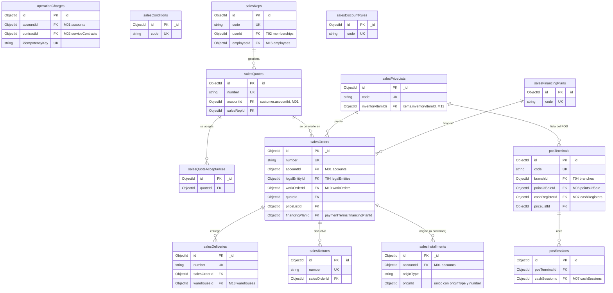
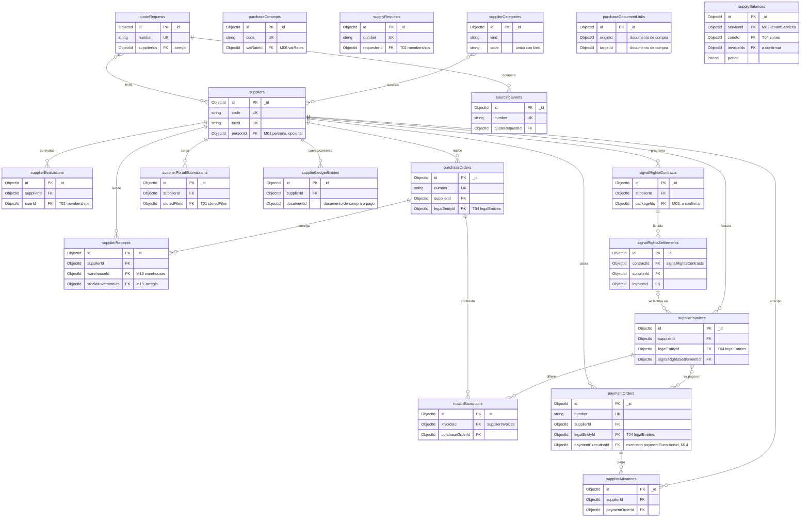

# Modelo entidad-relación — Parte D: ERP administrativo

Parte del artefacto 6.1 [`03-modelo-entidad-relacion.md`](03-modelo-entidad-relacion.md). Versión 1.1 (05-11-2026). Notación y convenciones en las secciones 1 y 2 del documento índice.

Nota de la versión 1.1: actualizada a mano contra la especificación corregida (T05 con 1.108 filas y 1.057 colecciones a crear). Cambios: nueva colección `costCenterModels` (COL-CON-39) en el §18, referenciada por `accountRoles` y `postingRules`; `payrollPaymentBatches.originAccountId` resuelto a `treasuryAccounts` (T05 §7.2.1), ya no "a confirmar"; `inflationAdjustmentRuns` usa `seriesId` hacia `economicIndexSeries`.

Esta parte se conserva como **vista por dominio** (entidades principales). Desde la versión 2.0 del artefacto, el modelo completo, con todas las colecciones a crear de T05 y sus campos, está en la **vista por módulo** de [`03-er/`](03-er/). Para estos dominios, ver [`M11`](03-er/M11-VEN-ventas-presupuestos.md), [`M12`](03-er/M12-CMP-compras-proveedores.md), [`M13`](03-er/M13-STK-stock-activos-fabricacion.md), [`M14`](03-er/M14-TES-tesoreria-bancos.md), [`M15`](03-er/M15-CON-contabilidad.md) y [`M16`](03-er/M16-SUE-personal-sueldos.md).

Contenido de esta parte:

- [14. Dominio Ventas](#14-dominio-ventas)
- [15. Dominio Compras](#15-dominio-compras)
- [16. Dominio Stock y activos](#16-dominio-stock-y-activos)
- [17. Dominio Tesorería](#17-dominio-tesorería)
- [18. Dominio Contabilidad](#18-dominio-contabilidad)
- [19. Dominio Personal y sueldos](#19-dominio-personal-y-sueldos)

---

## 14. Dominio Ventas

**Anexo dueño:** M11 (ventas y presupuestos). **Olas:** O4 (cargos por operación, ventas, planes y cuotas) y O8 (presupuestos, entregas, devoluciones, listas de precios, punto de venta).

Gestiona presupuestos versionados con aceptación en línea, ventas de productos y servicios adicionales (no fiscales: el comprobante lo emite M05), entregas, devoluciones, financiación comercial en cuotas y el punto de venta sobre la caja de M07.

### 14.1 Diagrama

Las relaciones `salesQuotes`–`salesOrders`, `salesPriceLists`–`salesOrders`, `salesFinancingPlans`–`salesOrders` y `salesPriceLists`–`posTerminals` surgen de los campos `quoteId`, `priceListId` y `paymentTerms.financingPlanId` declarados en M11 §7. El origen de `salesInstallments` es polimórfico (`originType`, `originId`); que la venta sea uno de esos orígenes queda **a confirmar**. `salesConditions` y `salesDiscountRules` son catálogos sin clave declarada desde otras colecciones del dominio.

### 14.2 Entidades

| Colección | Descripción | Dueño | Ola | ID T05 |
|---|---|---|---|---|
| `operationCharges` | Cargos por operación con titulares (a facturar por M05). | M11 | O4 | COL-VEN-01 |
| `salesConditions` | Condiciones de venta. | M11 | O8 | COL-VEN-02 |
| `salesReps` | Vendedores. | M11 | O8 | COL-VEN-10 |
| `salesQuotes` | Presupuestos con versiones, ítems y notas. | M11 | O8 | COL-VEN-03 |
| `salesQuoteAcceptances` | Evidencia de aceptación o rechazo en línea. | M11 | O8 | COL-VEN-04 |
| `salesPriceLists` | Listas de precios de productos. | M11 | O8 | COL-VEN-11 |
| `salesFinancingPlans` | Planes de financiación comercial. | M11 | O4 | COL-VEN-08 |
| `salesDiscountRules` | Recargos y descuentos comerciales. | M11 | O8 | COL-VEN-12 |
| `salesOrders` | Ventas de productos y servicios adicionales (no fiscales). | M11 | O4 | COL-VEN-05 |
| `salesDeliveries` | Entregas de venta. | M11 | O8 | COL-VEN-06 |
| `salesReturns` | Devoluciones de venta. | M11 | O8 | COL-VEN-07 |
| `salesInstallments` | Cuotas de venta (a facturar por M05). | M11 | O4 | COL-VEN-09 |
| `posTerminals` | Terminales de punto de venta. | M11 | O8 | COL-VEN-13 |
| `posSessions` | Sesiones de punto de venta. | M11 | O8 | COL-VEN-14 |

### 14.3 Relaciones con otros dominios

| Desde (colección.campo) | Hacia | Cardinalidad | Observación |
|---|---|---|---|
| `operationCharges.accountId`, `salesQuotes.customer.accountId`, `salesOrders.accountId`, `salesInstallments.accountId` | `accounts` (§5) | N:1 | Cliente socio o cuenta de servicios. |
| `operationCharges.contractId` | `serviceContracts` (§6) | N:1 | Cargo ligado a un contrato. |
| `operationCharges`, `salesInstallments` | `billableItems` (§9) | 1:N | M05 factura; vínculo por `billableItems.sourceModule` + `sourceRef`. |
| `salesOrders.legalEntityId` | `legalEntities` (§4) | N:1 | Entidad que vende. |
| `salesOrders.workOrderId` | `workOrders` (§13) | N:1 | Venta asociada a un trabajo de campo. |
| `salesDeliveries.warehouseId`, `salesPriceLists.items.inventoryItemId` | `warehouses`, `inventoryItems` (§16) | N:1 | Egreso de stock por M13. |
| `posTerminals.pointOfSaleId` | `pointsOfSale` (§9) | N:1 | Punto de venta fiscal. |
| `posTerminals.cashRegisterId`, `posSessions.cashSessionId` | `cashRegisters`, `cashSessions` (§10) | N:1 | El POS opera sobre la caja de M07. |
| `posTerminals.branchId`; `salesReps.userId` | `branches`, `memberships` (§4) | N:1 | Sucursal y usuario. |
| `salesReps.employeeId` | `employees` (§19) | N:1 | Vendedor empleado. |
| `tripSettlements.source` (§21) | `salesOrders` | N:1 | Rendición de viaje con `source.kind = salesDocument` (CTR-DAT-53). |

### 14.4 Absorción

`freightSettlements` (COL-VEN-15) se absorbe en `tripSettlements` de M18 (CTR-DAT-53).

---

## 15. Dominio Compras

**Anexo dueño:** M12 (compras y proveedores). **Olas:** O3 (proveedores), O8 (circuito de compras y pagos), O10 (derechos de señales) y O11 (extracción asistida por IA).

Cubre el ciclo proveedor → solicitud → cotización → orden de compra → recepción → comprobante de proveedor → orden de pago, con la cuenta corriente de proveedores como proyección reconstruible, el balance de compra mayorista de energía o gas y la liquidación de derechos de señales de TV.

### 15.1 Diagrama

`supplyRequests`, `purchaseConcepts`, `purchaseDocumentLinks` y `supplyBalances` se relacionan con colecciones de otros dominios o por referencias polimórficas. La relación `purchaseOrders`–`supplierReceipts` y la relación N:N `supplierInvoices`–`paymentOrders` (por `applications`) siguen el mapa de T05 §7.10.

### 15.2 Entidades

| Colección | Descripción | Dueño | Ola | ID T05 |
|---|---|---|---|---|
| `suppliers` | Proveedores (CBU cifrado). | M12 | O3 | COL-CMP-01 |
| `supplierCategories` | Rubros de proveedor y de productos o servicios comprados. | M12 | O8 | COL-CMP-02 |
| `supplierEvaluations` | Valoraciones de proveedores. | M12 | O8 | COL-CMP-03 |
| `purchaseConcepts` | Conceptos de compra, incluidos los asociados a tasas (HUECO-TAS-03). | M12 | O8 | COL-CMP-05 |
| `supplyRequests` | Solicitudes de abastecimiento. | M12 | O8 | COL-CMP-07 |
| `quoteRequests` | Pedidos de cotización. | M12 | O8 | COL-CMP-08 |
| `sourcingEvents` | Concursos y comparativas. | M12 | O8 | COL-CMP-09 |
| `purchaseOrders` | Órdenes de compra. | M12 | O8 | COL-CMP-10 |
| `supplierReceipts` | Recepciones de bienes y servicios. | M12 | O8 | COL-CMP-11 |
| `supplierInvoices` | Comprobantes de proveedor (incluye factura mayorista de energía o gas). | M12 | O8 | COL-CMP-12 |
| `purchaseDocumentLinks` | Relaciones entre documentos de compra. | M12 | O8 | COL-CMP-13 |
| `matchExceptions` | Excepciones de conciliación de tres vías. | M12 | O8 | COL-CMP-14 |
| `paymentOrders` | Órdenes de pago a proveedores. | M12 | O8 | COL-CMP-15 |
| `supplierAdvances` | Anticipos a proveedores. | M12 | O8 | COL-CMP-16 |
| `supplierPortalSubmissions` | Comprobantes cargados por proveedores en el portal. | M12 | O8 | COL-CMP-18 |
| `supplierLedgerEntries` | Proyección de cuenta corriente de proveedores (reconstruible). | M12 | O8 | COL-CMP-20 |
| `supplyBalances` | Balance mensual de compra mayorista de energía o gas. | M12 | O8 | COL-CMP-21 |
| `signalRightsContracts` | Contratos de derechos de señales de TV por programadora. | M12 | O10 | COL-CMP-22 |
| `signalRightsSettlements` | Liquidación mensual de derechos de señales. | M12 | O10 | COL-CMP-23 |

### 15.3 Relaciones con otros dominios

| Desde (colección.campo) | Hacia | Cardinalidad | Observación |
|---|---|---|---|
| `suppliers.personId` | `persons` (§5) | N:0..1 | Opcional. |
| `purchaseOrders.legalEntityId`, `supplierInvoices.legalEntityId`, `paymentOrders.legalEntityId` | `legalEntities` (§4) | N:1 | Entidad compradora y pagadora. |
| `supplierReceipts.warehouseId`, `.stockMovementIds` | `warehouses`, `stockMovements` (§16) | N:1 / N:N | La recepción genera el ingreso de stock en M13. |
| `paymentOrders.execution.paymentExecutionId` | `paymentExecutions` (§17) | 1:0..1 | Firma, entrega y medios en M14 (CTR-DAT-52). |
| `purchaseConcepts.vatRateId` | `vatRates` (M06, §9) | N:1 | Alícuota del concepto. |
| `supplyBalances.serviceId`, `.zoneId` | `tenantServices` (§6), `zones` (§4) | N:1 | Balance por servicio y zona. |
| `supplyBalances.invoiceIds` | Comprobantes del balance | N:N | **A confirmar:** T05 no indica si apuntan a `supplierInvoices` (compra mayorista) o a `invoices` (facturado a usuarios). |
| `signalRightsContracts.packageIds` | Colección de paquetes de M02 (§6) | N:N | **A confirmar:** T05 indica "M02" sin nombrar la colección. |
| `withholdingsApplied.paymentOrderId`, `.supplierId` (M06) | `paymentOrders`, `suppliers` | N:1 | Retenciones practicadas. |
| `debtCollectionAgencies.supplierId` (§11), `careProviders.supplierId` (§21), `rmaCases.supplierId` (§16) | `suppliers` | N:1 | El proveedor es una entidad transversal. |
| `fuelLoads.supplierInvoiceId` (§21) | `supplierInvoices` | N:1 | Carga de combustible. |
| `vatLedgerLines.documentRef` (§9) | `supplierInvoices` | N:1 | Libro IVA compras. |
| `accountingEvents.sourceDocument.id` (§18) | `supplierInvoices`, `paymentOrders` | 1:N | Contabilización. |
| `purchaseForecasts.costCenterId` (no diagramada) | `costCenters` (§18) | N:1 | Previsión por centro de costo. |

### 15.4 Otras colecciones

No diagramadas: `supplierCorrespondence` (COL-CMP-04), `purchaseLookups` (COL-CMP-06), `purchaseForecasts` (COL-CMP-17) y `aiInvoiceExtractions` (COL-CMP-19).

---

## 16. Dominio Stock y activos

**Anexo dueño:** M13 (stock, bienes de uso y fabricación). **Olas:** O3 (artículos, depósitos, movimientos, unidades serializadas), O8 (costeo y bienes de uso) y O10 (servicio técnico y fabricación).

El artículo de inventario (`inventoryItems`) es la faceta de stock del producto (la comercial es `serviceProducts` de M02). Los documentos de stock generan movimientos en un libro de solo agregado; los saldos son materializados y reconstruibles. Las unidades serializadas (equipos, medidores) tienen trayectoria propia. Los bienes de uso se amortizan por corridas.

### 16.1 Diagrama

```mermaid
erDiagram
  itemGroups {
    ObjectId id PK "_id"
    string code UK
  }
  inventoryItems {
    ObjectId id PK "_id"
    string code UK
    ObjectId itemGroupId FK
    ObjectId serviceIds FK "M02, arreglo"
  }
  itemKits {
    ObjectId id PK "_id"
    ObjectId inventoryItemId FK "kitItemId"
    ObjectId componentItemId FK
  }
  warehouses {
    ObjectId id PK "_id"
    string code UK
    ObjectId branchId FK "T04 branches"
    ObjectId crewId FK "M10 crews"
    ObjectId employeeId FK "M16 employees"
  }
  warehouseLocations {
    ObjectId id PK "_id"
    ObjectId warehouseId FK
    string code "único con warehouseId"
  }
  stockDocuments {
    ObjectId id PK "_id"
    string docType
    string numberDisplay "number.display, único con docType"
  }
  stockMovements {
    ObjectId id PK "_id"
    ObjectId stockDocumentId FK
    ObjectId inventoryItemId FK
    ObjectId warehouseId FK
  }
  stockBalances {
    ObjectId id PK "_id"
    ObjectId inventoryItemId FK
    ObjectId warehouseId FK
    ObjectId locationId FK
    ObjectId lotId FK
  }
  serialUnits {
    ObjectId id PK "_id"
    ObjectId inventoryItemId FK
    string serialNumber "único con inventoryItemId"
    ObjectId currentContractId FK "M02 serviceContracts"
  }
  serialUnitEvents {
    ObjectId id PK "_id"
    ObjectId serialUnitId FK
  }
  lotTypes {
    ObjectId id PK "_id"
    string code UK
  }
  lots {
    ObjectId id PK "_id"
    ObjectId lotTypeId FK
    ObjectId inventoryItemId FK
    string code "único con inventoryItemId"
  }
  stockReservations {
    ObjectId id PK "_id"
    ObjectId inventoryItemId FK
    object sourceRef "documento que reserva"
  }
  crewSettlements {
    ObjectId id PK "_id"
    string number UK
    ObjectId crewId FK "M10 crews"
    ObjectId warehouseId FK
  }
  physicalCounts {
    ObjectId id PK "_id"
    string number UK
    ObjectId warehouseId FK
  }
  costLayers {
    ObjectId id PK "_id"
    ObjectId inventoryItemId FK
    ObjectId stockMovementId FK
  }
  fixedAssets {
    ObjectId id PK "_id"
    string assetNumber UK
    ObjectId itemGroupId FK
    ObjectId serialUnitId FK
    ObjectId costCenterId FK "M15 costCenters"
  }
  fixedAssetHistory {
    ObjectId id PK "_id"
    ObjectId fixedAssetId FK
  }
  depreciationRuns {
    ObjectId id PK "_id"
    ObjectId fiscalYearId FK "M15 fiscalYears"
    Period period
  }
  fixedAssetDepreciations {
    ObjectId id PK "_id"
    ObjectId depreciationRunId FK
    ObjectId fixedAssetId FK
  }

  itemGroups ||--o{ inventoryItems : "agrupa"
  inventoryItems ||--o{ itemKits : "compone"
  warehouses ||--o{ warehouseLocations : "ubica"
  stockDocuments ||--o{ stockMovements : "mueve"
  inventoryItems ||--o{ stockMovements : "de"
  warehouses ||--o{ stockMovements : "en"
  inventoryItems ||--o{ stockBalances : "saldo de"
  warehouses ||--o{ stockBalances : "saldo en"
  warehouseLocations ||--o{ stockBalances : "posición"
  lots ||--o{ stockBalances : "lote"
  inventoryItems ||--o{ serialUnits : "serializa"
  serialUnits ||--o{ serialUnitEvents : "recorre"
  lotTypes ||--o{ lots : "tipifica"
  inventoryItems ||--o{ lots : "loteado en"
  inventoryItems ||--o{ stockReservations : "reserva"
  warehouses ||--o{ crewSettlements : "rinde a"
  warehouses ||--o{ physicalCounts : "inventaría"
  inventoryItems ||--o{ costLayers : "costea"
  stockMovements ||--o{ costLayers : "origina"
  itemGroups ||--o{ fixedAssets : "rubro"
  serialUnits ||--o| fixedAssets : "activa"
  fixedAssets ||--o{ fixedAssetHistory : "historia"
  depreciationRuns ||--o{ fixedAssetDepreciations : "calcula"
  fixedAssets ||--o{ fixedAssetDepreciations : "se amortiza"
```

### 16.2 Entidades

| Colección | Descripción | Dueño | Ola | ID T05 |
|---|---|---|---|---|
| `itemGroups` | Rubros de artículos. | M13 | O3 | COL-STK-03 |
| `inventoryItems` | Artículos de inventario (faceta de stock). | M13 | O3 | COL-STK-05 |
| `itemKits` | Composición de kits. | M13 | O3 | COL-STK-06 |
| `warehouses` | Depósitos, depósitos móviles y custodios. | M13 | O3 | COL-STK-07 |
| `warehouseLocations` | Ubicaciones dentro del depósito. | M13 | O3 | COL-STK-08 |
| `stockDocuments` | Documentos de stock (vales, remitos internos, transferencias entre depósitos). | M13 | O3 | COL-STK-10 |
| `stockMovements` | Libro de movimientos (alto volumen, solo agregado). | M13 | O3 | COL-STK-11 |
| `stockBalances` | Saldos materializados (reconstruibles). | M13 | O3 | COL-STK-12 |
| `serialUnits` | Unidades serializadas (equipos). | M13 | O3 | COL-STK-13 |
| `serialUnitEvents` | Trayectoria de la unidad serializada. | M13 | O3 | COL-STK-14 |
| `lotTypes` | Tipos de lote (CTR-DAT-46). | M13 | O3 | COL-STK-15 |
| `lots` | Lotes. | M13 | O3 | COL-STK-16 |
| `stockReservations` | Reservas de stock. | M13 | O3 | COL-STK-17 |
| `crewSettlements` | Rendiciones de material de cuadrilla. | M13 | O3 | COL-STK-19 |
| `physicalCounts` | Inventarios físicos. | M13 | O8 | COL-STK-20 |
| `costLayers` | Capas de costo. | M13 | O8 | COL-STK-22 |
| `fixedAssets` | Bienes de uso. | M13 | O8 | COL-STK-26 |
| `fixedAssetHistory` | Historia del bien de uso. | M13 | O8 | COL-STK-27 |
| `depreciationRuns` | Corridas de amortización. | M13 | O8 | COL-STK-29 |
| `fixedAssetDepreciations` | Amortizaciones por bien. | M13 | O8 | COL-STK-30 |

### 16.3 Relaciones con otros dominios

| Desde (colección.campo) | Hacia | Cardinalidad | Observación |
|---|---|---|---|
| `serviceProducts.inventoryItemId` (§6), `meterTypes.inventoryItemId` (§7) | `inventoryItems` | N:1 | Faceta comercial y metrológica del artículo. |
| `contractEquipmentAssignments.serialUnitId` (§6), `meters.serialUnitId` (§7), `networkDevices.serialUnitId` (M10) | `serialUnits` | N:1 | Equipos en contratos, medidores y red. |
| `serialUnits.currentContractId` | `serviceContracts` (§6) | N:0..1 | Contrato donde está el equipo. |
| `inventoryItems.serviceIds` | `tenantServices` (§6) | N:N | Artículos por servicio. |
| `warehouses.branchId` | `branches` (§4) | N:1 | Sucursal. |
| `warehouses.crewId`, `crewSettlements.crewId`; `crews.warehouseId` (§13) | `crews` (§13) | N:1 | Depósito móvil de la cuadrilla. |
| `warehouses.employeeId` | `employees` (§19) | N:1 | Custodio. |
| `workOrderMaterials.inventoryItemId` (§13) | `inventoryItems` | N:1 | El retiro de materiales de la OT genera `stockDocuments` (mapa de T05 §7.10). |
| `supplierReceipts.stockMovementIds` (§15) | `stockMovements` | N:N | Ingreso por compra. |
| `salesDeliveries.warehouseId` (§14) | `warehouses` | N:1 | Egreso por venta. |
| `fixedAssets.costCenterId`, `depreciationRuns.fiscalYearId` | `costCenters`, `fiscalYears` (§18) | N:1 | Contabilidad de bienes de uso. |
| `fleetVehicles.fixedAssetId`, `orthopedicItems.fixedAssetId` (§21) | `fixedAssets` | N:1 | Vehículos y elementos ortopédicos como bienes de uso. |
| `rmaCases.supplierId` (no diagramada) | `suppliers` (§15) | N:1 | Devolución de equipos al proveedor. |

### 16.4 Otras colecciones y absorciones

No diagramadas: `itemTypes` (COL-STK-01), `itemClassifications` (COL-STK-02), `itemDepartments` (COL-STK-04), `itemLocationDefaults` (COL-STK-09), `itemCostStates` (COL-STK-21), `revaluations` (COL-STK-23), `reorderSuggestions` (COL-STK-24), `expenseUnits` (COL-STK-25), `fixedAssetValueChanges` (COL-STK-28), `rmaCases` (COL-STK-31), servicio técnico (COL-STK-32, COL-STK-33) y fabricación (COL-STK-34 a COL-STK-40). Absorbida: `equipmentAssignments` (COL-STK-18) en `contractEquipmentAssignments` de M02.

---

## 17. Dominio Tesorería

**Anexo dueño:** M14 (tesorería y bancos). **Olas:** O5 (cuentas, movimientos, conciliación, recepción de caja), O8 (cheques, tarjetas, retenciones sufridas, ejecución de pagos) y O9 (pago de haberes).

`treasuryMovements` es el libro único de movimientos de fondos sobre cuentas financieras (bancos, cajas de tesorería y de pagos, tránsito). Las operaciones de tesorería agrupan movimientos; los extractos bancarios se importan y concilian; los cheques propios y de terceros tienen historia; la ejecución de pagos (`paymentExecutions`) concreta las órdenes de pago de M12.

### 17.1 Diagrama

```mermaid
erDiagram
  financialInstitutions {
    ObjectId id PK "_id"
    string bcraCode UK
  }
  bankBranches {
    ObjectId id PK "_id"
    ObjectId institutionId FK
    string branchCode "único con institutionId"
  }
  treasuryAccounts {
    ObjectId id PK "_id"
    string code UK
    ObjectId legalEntityId FK "T04 legalEntities"
    ObjectId institutionId FK
  }
  treasuryAccountSigners {
    ObjectId id PK "_id"
    ObjectId treasuryAccountId FK
    ObjectId personId FK "M01 persons"
    ObjectId employeeId FK "M16 employees"
  }
  treasuryOperations {
    ObjectId id PK "_id"
    string number UK
    ObjectId legalEntityId FK "T04 legalEntities"
    ObjectId originDocId "origin.docId"
  }
  treasuryMovements {
    ObjectId id PK "_id"
    ObjectId treasuryAccountId FK
    ObjectId operationId FK
  }
  bankStatementImports {
    ObjectId id PK "_id"
    ObjectId treasuryAccountId FK
    ObjectId storedFileId FK "T01 storedFiles"
  }
  bankStatementLines {
    ObjectId id PK "_id"
    ObjectId treasuryAccountId FK
    ObjectId importId FK
  }
  reconciliations {
    ObjectId id PK "_id"
    ObjectId treasuryAccountId FK
    DateOnly cutoffDate
  }
  reconciliationMatches {
    ObjectId id PK "_id"
    ObjectId reconciliationId FK
    ObjectId statementLineIds FK "arreglo"
    ObjectId movementIds FK "arreglo"
  }
  thirdPartyChecks {
    ObjectId id PK "_id"
    ObjectId institutionId FK
    string echeqId UK "parcial"
  }
  checkEvents {
    ObjectId id PK "_id"
    ObjectId checkId FK
  }
  checkbooks {
    ObjectId id PK "_id"
    ObjectId treasuryAccountId FK
    string code "único con la cuenta"
  }
  ownChecks {
    ObjectId id PK "_id"
    ObjectId checkbookId FK
    ObjectId paymentExecutionId FK
  }
  cardVouchers {
    ObjectId id PK "_id"
    ObjectId cardPlanId FK "M07 cardPlans"
    ObjectId receiptId FK "origin.receiptId, M07"
  }
  cardSettlements {
    ObjectId id PK "_id"
    ObjectId cardPlanId FK "M07 cardPlans"
    ObjectId treasuryMovementId FK
  }
  paymentExecutions {
    ObjectId id PK "_id"
    string sourceModule "sourceRef.module"
    ObjectId sourceDocId FK "sourceRef.docId, M12 paymentOrders"
  }
  cashRemittances {
    ObjectId id PK "_id"
    ObjectId cashSessionId FK, UK "M07 cashSessions"
    ObjectId treasuryHandoverId FK "M07 treasuryHandovers"
  }
  exchangeRates {
    ObjectId id PK "_id"
    string currency "único con source y quotedAt"
    date quotedAt
  }
  payrollPaymentBatches {
    ObjectId id PK "_id"
    ObjectId payrollRunId FK "M16 payrollRuns"
    ObjectId originAccountId FK "treasuryAccounts, T05 7.2.1"
  }

  financialInstitutions ||--o{ bankBranches : "tiene"
  financialInstitutions ||--o{ treasuryAccounts : "radica"
  treasuryAccounts ||--o{ treasuryAccountSigners : "autoriza a"
  treasuryOperations ||--o{ treasuryMovements : "agrupa"
  treasuryAccounts ||--o{ treasuryMovements : "registra"
  treasuryAccounts ||--o{ bankStatementImports : "importa"
  bankStatementImports ||--o{ bankStatementLines : "contiene"
  treasuryAccounts ||--o{ bankStatementLines : "extracto de"
  treasuryAccounts ||--o{ reconciliations : "concilia"
  reconciliations ||--o{ reconciliationMatches : "parea"
  bankStatementLines }o--o{ reconciliationMatches : "línea"
  treasuryMovements }o--o{ reconciliationMatches : "movimiento"
  financialInstitutions ||--o{ thirdPartyChecks : "libra"
  thirdPartyChecks ||--o{ checkEvents : "historia"
  treasuryAccounts ||--o{ checkbooks : "emite"
  checkbooks ||--o{ ownChecks : "contiene"
  paymentExecutions ||--o{ ownChecks : "paga con"
  paymentExecutions ||--o{ treasuryMovements : "mueve"
  cardSettlements }o--o| treasuryMovements : "acredita"
  treasuryAccounts ||--o{ payrollPaymentBatches : "origen"
```

`cardVouchers`, `cashRemittances` y `exchangeRates` se relacionan con colecciones de otros dominios. La relación `paymentExecutions`–`treasuryMovements` sigue el mapa de T05 §7.10. ~~El catálogo indica `payrollPaymentBatches.originAccountId` sin nombrar la colección destino; que sea `treasuryAccounts` queda **a confirmar**.~~ Resuelto en la versión 1.1: T05 §7.2.1 fija `originAccountId` en `treasuryAccounts` para las colecciones de M14.

### 17.2 Entidades

| Colección | Descripción | Dueño | Ola | ID T05 |
|---|---|---|---|---|
| `financialInstitutions` | Entidades financieras; absorbe `financialEntities` de M08 como entidad. | M14 | O5 | COL-TES-01 |
| `bankBranches` | Sucursales bancarias (`bankBranchId`, CTR-DAT-80). | M14 | O5 | COL-TES-02 |
| `treasuryAccounts` | Cuentas financieras (bancos, cajas de tesorería y de pagos, tránsito). | M14 | O5 | COL-TES-03 |
| `treasuryAccountSigners` | Firmantes autorizados de cuentas y órdenes de pago (CTR-DAT-78). | M14 | O5 | COL-TES-04 |
| `treasuryOperations` | Operaciones de tesorería. | M14 | O5 | COL-TES-09 |
| `treasuryMovements` | Libro único de movimientos de fondos (alto volumen). | M14 | O5 | COL-TES-10 |
| `bankStatementImports` | Importaciones de extractos bancarios. | M14 | O5 | COL-TES-13 |
| `bankStatementLines` | Líneas de extracto (alto volumen, inmutables). | M14 | O5 | COL-TES-14 |
| `reconciliations` | Conciliaciones bancarias. | M14 | O5 | COL-TES-15 |
| `reconciliationMatches` | Pareos entre líneas de extracto y movimientos. | M14 | O5 | COL-TES-16 |
| `thirdPartyChecks` | Cheques y eCheq de terceros. | M14 | O8 | COL-TES-22 |
| `checkEvents` | Historia de cheques. | M14 | O8 | COL-TES-23 |
| `checkbooks` | Chequeras. | M14 | O8 | COL-TES-24 |
| `ownChecks` | Cheques propios. | M14 | O8 | COL-TES-25 |
| `cardVouchers` | Cupones de tarjeta (sin PAN, vencimiento ni código). | M14 | O8 | COL-TES-27 |
| `cardSettlements` | Liquidaciones de tarjetas. | M14 | O8 | COL-TES-29 |
| `paymentExecutions` | Ejecución de pagos (firma, entrega, medios). | M14 | O8 | COL-TES-35 |
| `cashRemittances` | Recepción en tesorería de la entrega de caja de M07. | M14 | O5 | COL-TES-33 |
| `exchangeRates` | Cotizaciones (canónica para toda conversión). | M14 | O5 | COL-TES-37 |
| `payrollPaymentBatches` | Lotes de pago de haberes (confidenciales). | M14 | O9 | COL-TES-42 |

### 17.3 Relaciones con otros dominios

| Desde (colección.campo) | Hacia | Cardinalidad | Observación |
|---|---|---|---|
| `treasuryAccounts.legalEntityId`, `treasuryOperations.legalEntityId` | `legalEntities` (§4) | N:1 | Fondos por entidad jurídica. |
| `legalEntities.employer.bankAgreements.treasuryAccountId` (§4) | `treasuryAccounts` | N:1 | Convenios bancarios del empleador. |
| `treasuryAccountSigners.personId`, `.employeeId` | `persons` (§5), `employees` (§19) | N:1 | Firmante como persona y empleado. |
| `paymentExecutions.sourceRef.docId` | `paymentOrders` (§15) | 1:0..1 | Ejecución de la orden de pago (CTR-DAT-52). |
| `cashRemittances.cashSessionId`, `.treasuryHandoverId` | `cashSessions`, `treasuryHandovers` (§10) | 1:1 | Recepción de la entrega de caja (CTR-DAT-64). |
| `paymentTenders.thirdPartyCheckId` (§10) | `thirdPartyChecks` | N:1 | Cheque recibido en cobranza. |
| `cardVouchers.cardPlanId`, `.origin.receiptId`; `cardSettlements.cardPlanId` | `cardPlans`, `receipts` (§10) | N:1 | Planes de tarjeta canónicos de M07 (CTR-DAT-08). |
| `payrollPaymentBatches.payrollRunId` | `payrollRuns` (§19) | 1:0..1 | Pago de la liquidación. |
| `paymentPlans.financialInstitutionId` (§11), `financingInstitutionPlans.financialInstitutionId` (M08) | `financialInstitutions` | N:1 | Financiación por entidad (CTR-DAT-43). |
| `taxObligations.treasuryMovementId` (M06), `collectionReconciliations.treasuryMovementIds` (M07) | `treasuryMovements` | N:1 / N:N | Pago de impuestos y conciliación de cobranza. |
| `exchangeRates.currency` | `currencies` (T04, §4) | N:1 | Toda conversión guarda cotización y fecha (T05 §7.1.7). |
| `accountingEvents.sourceDocument.id` (§18) | `treasuryMovements`, `ownChecks`, `thirdPartyChecks` | 1:N | Contabilización. |

### 17.4 Otras colecciones y absorciones

No diagramadas: `treasuryCategories` (COL-TES-05), `treasuryConcepts` (COL-TES-06), `instrumentTypes` (COL-TES-07), `checkDrawerAccounts` (COL-TES-08), `bankDeposits` (COL-TES-11), `statementImportProfiles` (COL-TES-12), `reconciliationRules` (COL-TES-17), Interbanking (COL-TES-18 a COL-TES-20), `paymentFiles` (COL-TES-21), `cardPresentations` (COL-TES-28), retenciones sufridas (COL-TES-30, COL-TES-31), `paymentCashSessions` (COL-TES-32), `treasuryCashClosings` (COL-TES-34), `tenantCurrencySettings` (COL-TES-36), flujo de fondos (COL-TES-38 a COL-TES-41) y `treasurySettings` (COL-TES-43). Absorbida: `cardPlans` de M14 (COL-TES-26) en COL-COB-15.

---

## 18. Dominio Contabilidad

**Anexo dueño:** M15 (contabilidad). **Olas:** O5 (núcleo contable) y O8 (reparto de costos, presupuesto, simulación, estados contables).

Todo documento económico de otro módulo genera eventos en la bandeja `accountingEvents`, que se contabilizan en asientos (`journalEntries`) con renglones (`journalLines`) sobre cuentas del plan vigente por ejercicio. Los dueños de otras entidades no guardan cuentas contables: la asignación vive en `entityAccountAssignments` (CTR-DAT-57). Los saldos son reconstruibles desde los renglones.

### 18.1 Diagrama

```mermaid
erDiagram
  chartOfAccounts {
    ObjectId id PK "_id"
    ObjectId legalEntityId FK "T04 legalEntities"
    string code "único con versionNumber"
    int versionNumber
  }
  accountRubrics {
    ObjectId id PK "_id"
    ObjectId chartId FK
    string code "único con chartId y kind"
  }
  ledgerAccounts {
    ObjectId id PK "_id"
    ObjectId chartId FK
    ObjectId parentId FK
    string code "único con chartId"
  }
  accountRoles {
    ObjectId id PK "_id"
    ObjectId chartId FK
    string roleKey
    ObjectId costCenterModelId FK
  }
  postingRules {
    ObjectId id PK "_id"
    string code UK
    ObjectId chartId FK
    ObjectId costCenterModelId FK
  }
  costCenterModels {
    ObjectId id PK "_id"
    string code UK
    array splits "reparto por centro de costo"
  }
  entryTemplates {
    ObjectId id PK "_id"
    string code UK
    ObjectId chartId FK
  }
  accountingEvents {
    ObjectId id PK "_id"
    string sourceEventId UK
    ObjectId sourceDocumentId "sourceDocument.id, polimórfica"
  }
  postingBatches {
    ObjectId id PK "_id"
    string number UK
  }
  fiscalYears {
    ObjectId id PK "_id"
    string number UK
    ObjectId legalEntityId FK "T04 legalEntities"
  }
  accountingPeriods {
    ObjectId id PK "_id"
    ObjectId fiscalYearId FK
  }
  journalEntries {
    ObjectId id PK "_id"
    ObjectId fiscalYearId FK
    ObjectId legalEntityId FK "T04 legalEntities"
    string internalNumber UK
  }
  journalLines {
    ObjectId id PK "_id"
    ObjectId entryId FK
    ObjectId ledgerAccountId FK
    int lineNo "único con entryId"
  }
  costCenters {
    ObjectId id PK "_id"
    string code UK
  }
  costCenterGroups {
    ObjectId id PK "_id"
    string code UK
    ObjectId costCenterIds FK "arreglo"
  }
  ledgerBalances {
    ObjectId id PK "_id"
    ObjectId ledgerAccountId FK
    ObjectId periodId FK
    ObjectId costCenterId FK
    ObjectId serviceId FK "M02 tenantServices"
  }
  budgets {
    ObjectId id PK "_id"
    ObjectId fiscalYearId FK
    string code "único con fiscalYearId y versionNumber"
  }
  budgetLines {
    ObjectId id PK "_id"
    ObjectId budgetId FK
    ObjectId ledgerAccountId FK
    ObjectId costCenterId FK
  }
  commitments {
    ObjectId id PK "_id"
    ObjectId sourceDocumentId "sourceDocument.id, polimórfica"
  }
  entityAccountAssignments {
    ObjectId id PK "_id"
    string entityType
    ObjectId entityId "entidad de otro módulo"
    ObjectId ledgerAccountId FK
  }
  externalLedgerMappings {
    ObjectId id PK "_id"
    ObjectId ledgerAccountId FK
    string externalSystem "único con operationCode"
  }

  chartOfAccounts ||--o{ accountRubrics : "rubros"
  chartOfAccounts ||--o{ ledgerAccounts : "cuentas"
  ledgerAccounts ||--o{ ledgerAccounts : "agrupa"
  chartOfAccounts ||--o{ accountRoles : "roles"
  chartOfAccounts ||--o{ postingRules : "reglas"
  chartOfAccounts ||--o{ entryTemplates : "modelos"
  accountingEvents ||--o| journalEntries : "contabiliza"
  fiscalYears ||--o{ journalEntries : "ejercicio"
  journalEntries ||--o{ journalLines : "detalla"
  ledgerAccounts ||--o{ journalLines : "imputa"
  fiscalYears ||--o{ accountingPeriods : "divide"
  costCenterGroups }o--o{ costCenters : "agrupa"
  costCenterModels |o--o{ accountRoles : "reparte"
  costCenterModels |o--o{ postingRules : "reparte"
  ledgerAccounts ||--o{ ledgerBalances : "saldo de"
  accountingPeriods ||--o{ ledgerBalances : "período"
  costCenters ||--o{ ledgerBalances : "centro"
  fiscalYears ||--o{ budgets : "presupuesta"
  budgets ||--o{ budgetLines : "líneas"
  ledgerAccounts ||--o{ budgetLines : "cuenta"
  costCenters ||--o{ budgetLines : "centro"
  ledgerAccounts ||--o{ entityAccountAssignments : "asignada a"
  ledgerAccounts ||--o{ externalLedgerMappings : "equivale"
```

`postingBatches` (lotes de contabilización) y `commitments` (compromisos presupuestarios con documento origen polimórfico) no tienen claves declaradas hacia otras entidades del dominio. La relación `accountingEvents`–`journalEntries` sigue el mapa de T05 §7.10.

### 18.2 Entidades

| Colección | Descripción | Dueño | Ola | ID T05 |
|---|---|---|---|---|
| `chartOfAccounts` | Planes de cuentas (uno operativo por ejercicio). | M15 | O5 | COL-CON-02 |
| `accountRubrics` | Rubros contables. | M15 | O5 | COL-CON-03 |
| `ledgerAccounts` | Cuentas contables (sin saldos). | M15 | O5 | COL-CON-04 |
| `accountRoles` | Roles contables (cuenta por función). | M15 | O5 | COL-CON-05 |
| `postingRules` | Reglas de contabilización. | M15 | O5 | COL-CON-06 |
| `entryTemplates` | Modelos de asiento. | M15 | O5 | COL-CON-10 |
| `accountingEvents` | Bandeja de eventos a contabilizar (alto volumen). | M15 | O5 | COL-CON-07 |
| `postingBatches` | Lotes de contabilización. | M15 | O5 | COL-CON-11 |
| `fiscalYears` | Ejercicios contables por entidad jurídica. | M15 | O5 | COL-CON-12 |
| `accountingPeriods` | Períodos contables. | M15 | O5 | COL-CON-13 |
| `journalEntries` | Asientos. | M15 | O5 | COL-CON-08 |
| `journalLines` | Renglones de asiento (alto volumen). | M15 | O5 | COL-CON-09 |
| `costCenters` | Centros de costo. | M15 | O5 | COL-CON-16 |
| `costCenterGroups` | Grupos de centros de costo. | M15 | O5 | COL-CON-17 |
| `costCenterModels` | Modelos de centro de costo (reparto porcentual) que usan roles contables, reglas y modelos de asiento (M15 §7.19.1, PA-CON-18). Nueva en la versión 1.1. | M15 | O5 | COL-CON-39 |
| `ledgerBalances` | Saldos reconstruibles desde `journalLines`. | M15 | O5 | COL-CON-25 |
| `budgets` | Presupuestos. | M15 | O8 | COL-CON-26 |
| `budgetLines` | Líneas de presupuesto. | M15 | O8 | COL-CON-27 |
| `commitments` | Compromisos presupuestarios. | M15 | O8 | COL-CON-28 |
| `entityAccountAssignments` | Cuentas asignadas a entidades de otros módulos. | M15 | O5 | COL-CON-38 |
| `externalLedgerMappings` | Mapeo con contabilidad externa (convivencia, DEC-069). | M15 | O5 | COL-CON-36 |

### 18.3 Relaciones con otros dominios

| Desde (colección.campo) | Hacia | Cardinalidad | Observación |
|---|---|---|---|
| `accountingEvents.sourceDocument.id` | Documentos económicos de M05, M07, M08, M12, M13, M14, M16, M17 | N:1 | Polimórfica: todo documento económico 1–N `accountingEvents` (T05 §7.10). |
| `chartOfAccounts.legalEntityId`, `fiscalYears.legalEntityId`, `journalEntries.legalEntityId` | `legalEntities` (§4) | N:1 | Contabilidad por entidad jurídica (DEC-064). |
| `entityAccountAssignments.entityId` | `suppliers`, `treasuryAccounts`, `vatRates`, `capitalItems`, `withholdingTypes`, entre otras | N:1 | Polimórfica por `entityType` (incluye `capitalRubric`, CTR-DAT-57). |
| `ledgerBalances.serviceId` | `tenantServices` (§6) | N:1 | Resultado por servicio. |
| `writeOffs.journalEntryId` (§11), `taxObligations.journalEntryId` (M06), `fixedAssetValueChanges.journalEntryId` (M13) | `journalEntries` | N:1 | Asientos de origen específico. |
| `depreciationRuns.fiscalYearId` (§16), `inflationAdjustmentRuns.fiscalYearId` | `fiscalYears` | N:1 | Amortización y ajuste por inflación. |
| `costCenterId` en `fixedAssets` (§16), `employeeCostAllocations` (§19), `fleetVehicles` (§21), `expenseUnits`, `purchaseForecasts`, `workAreas` | `costCenters` | N:1 | Imputación por centro de costo. |
| `ledgerAccountId` en `paymentMethods` (M07), `withholdingTypes` (M06), `prescriptionRules` (M08), `thirdPartyAgreements.liabilityLedgerAccountId` (M06) | `ledgerAccounts` | N:1 | Referencias declaradas en el catálogo de T05. |
| `inflationAdjustmentRuns.seriesId` (no diagramada; antes `economicIndexSeriesId`) | `economicIndexSeries` (T04, §4) | N:1 | Series de inflación canónicas en T04 (CTR-DAT-29); nombre de campo según T05 §7.2.1. |
| `payrollAccountingRules` (M16) | `postingRules` | N:1 | Las reglas de sueldos resuelven contra `postingRules`. |

### 18.4 Otras colecciones y absorciones

No diagramadas: `accountingSettings` (COL-CON-01), `resultTargets` (COL-CON-14), reparto de costos (COL-CON-18 a COL-CON-20), `accountMappings` (COL-CON-21), simulación y proyecciones (COL-CON-22 a COL-CON-24), `inflationAdjustmentRuns` (COL-CON-31), `reconciliationRuns` (COL-CON-32), `rubricatedBooks` (COL-CON-33), estados contables (COL-CON-34, COL-CON-35) y `externalLedgerTransfers` (COL-CON-37). Absorbidas: `capitalRubricAccounts` (COL-CON-15) en COL-CON-38; `inflationIndexSeries` y `inflationIndexValues` (COL-CON-29 y COL-CON-30) en T04.

---

## 19. Dominio Personal y sueldos

**Anexo dueño:** M16 (personal y sueldos). **Olas:** O3 (legajo mínimo y áreas), O8 (liquidador externo, DEC-058) y O9 (liquidación propia).

El legajo (`employees`) se vincula con la persona de M01 y con la entidad jurídica empleadora (subdocumento `employer` de `legalEntities`, CTR-DAT-06). La liquidación se organiza por períodos, corridas y recibos, con conceptos versionados por configuración publicada, convenios colectivos y escalas. Los datos de salud, sindicales, sanciones y juicios son sensibles y se cifran por campo.

### 19.1 Diagrama

```mermaid
erDiagram
  employees {
    ObjectId id PK "_id"
    ObjectId personId FK "M01 persons"
    ObjectId legalEntityId FK "T04 legalEntities"
    string fileNumber "único con legalEntityId"
  }
  employeeAssignments {
    ObjectId id PK "_id"
    ObjectId employeeId FK
    DateOnly validFrom
  }
  employeeCostAllocations {
    ObjectId id PK "_id"
    ObjectId employeeId FK
    ObjectId costCenterId FK "M15 costCenters"
  }
  employeeFamilyMembers {
    ObjectId id PK "_id"
    ObjectId employeeId FK
    ObjectId personId FK "M01 persons"
  }
  employeePayAccounts {
    ObjectId id PK "_id"
    ObjectId employeeId FK
    string cbuHmac "único con employeeId"
  }
  unions {
    ObjectId id PK "_id"
    string code UK
  }
  laborAgreements {
    ObjectId id PK "_id"
    string code UK
    ObjectId unionId FK
  }
  salaryCategories {
    ObjectId id PK "_id"
    ObjectId laborAgreementId FK
    string code "único con laborAgreementId"
  }
  salaryScales {
    ObjectId id PK "_id"
    ObjectId salaryCategoryId FK
    DateOnly validFrom
  }
  workAreas {
    ObjectId id PK "_id"
    string code UK
    ObjectId costCenterId FK "M15 costCenters"
  }
  payrollConfigVersions {
    ObjectId id PK "_id"
    int number UK
  }
  payrollConcepts {
    ObjectId id PK "_id"
    ObjectId configVersionId FK
    string code "único con configVersionId"
  }
  payrollTypes {
    ObjectId id PK "_id"
    string code UK
  }
  novelties {
    ObjectId id PK "_id"
    ObjectId employeeId FK
    object sourceRef "origen de la novedad"
  }
  leaveCauses {
    ObjectId id PK "_id"
    string code UK
  }
  leaveRequests {
    ObjectId id PK "_id"
    ObjectId employeeId FK
    ObjectId leaveCauseId FK
  }
  payPeriods {
    ObjectId id PK "_id"
    ObjectId legalEntityId FK "T04 legalEntities"
    string periodKey "único con legalEntityId y frequency"
  }
  payrollRuns {
    ObjectId id PK "_id"
    string number UK
    ObjectId legalEntityId FK "T04 legalEntities"
    ObjectId payPeriodId FK
  }
  payslips {
    ObjectId id PK "_id"
    ObjectId employeeId FK
    ObjectId payrollRunId FK
    ObjectId payrollTypeId FK
    ObjectId legalEntityId FK "T04 legalEntities"
  }
  terminations {
    ObjectId id PK "_id"
    ObjectId employeeId FK
    ObjectId terminationReasonId FK "M16 terminationReasons"
  }

  employees ||--o{ employeeAssignments : "historia laboral"
  employees ||--o{ employeeCostAllocations : "distribuye costo"
  employees ||--o{ employeeFamilyMembers : "familiares"
  employees ||--o{ employeePayAccounts : "cobra en"
  unions ||--o{ laborAgreements : "firma"
  laborAgreements ||--o{ salaryCategories : "define"
  salaryCategories ||--o{ salaryScales : "escala"
  payrollConfigVersions ||--o{ payrollConcepts : "publica"
  employees ||--o{ novelties : "registra"
  leaveCauses ||--o{ leaveRequests : "causa"
  employees ||--o{ leaveRequests : "solicita"
  payPeriods ||--o{ payrollRuns : "liquida"
  payrollRuns ||--o{ payslips : "emite"
  employees ||--o{ payslips : "cobra"
  payrollTypes ||--o{ payslips : "tipifica"
  employees ||--o{ terminations : "egresa"
```

`workAreas` se relaciona con `costCenters` de M15; T05 no declara una clave desde `employeeAssignments` hacia `workAreas`, por lo que esa relación no se dibuja.

### 19.2 Entidades

| Colección | Descripción | Dueño | Ola | ID T05 |
|---|---|---|---|---|
| `employees` | Legajos. | M16 | O3 | COL-SUE-02 |
| `employeeAssignments` | Historia de categoría, puesto y área. | M16 | O3 | COL-SUE-03 |
| `employeeCostAllocations` | Distribución del empleado por centro de costo. | M16 | O9 | COL-SUE-04 |
| `employeeFamilyMembers` | Familiares a cargo. | M16 | O9 | COL-SUE-05 |
| `employeePayAccounts` | Cuentas de cobro (CBU cifrado). | M16 | O9 | COL-SUE-06 |
| `unions` | Sindicatos. | M16 | O9 | COL-SUE-17 |
| `laborAgreements` | Convenios colectivos. | M16 | O9 | COL-SUE-18 |
| `salaryCategories` | Categorías salariales. | M16 | O9 | COL-SUE-19 |
| `salaryScales` | Escalas salariales. | M16 | O9 | COL-SUE-20 |
| `workAreas` | Áreas laborales (distintas de `crmAreas`, CTR-DAT-69). | M16 | O3 | COL-SUE-23 |
| `payrollConfigVersions` | Versiones publicadas de configuración de liquidación. | M16 | O9 | COL-SUE-29 |
| `payrollConcepts` | Conceptos de liquidación. | M16 | O9 | COL-SUE-27 |
| `payrollTypes` | Tipos de liquidación. | M16 | O9 | COL-SUE-28 |
| `novelties` | Novedades de liquidación. | M16 | O9 | COL-SUE-31 |
| `leaveCauses` | Causas de licencia. | M16 | O9 | COL-SUE-35 |
| `leaveRequests` | Licencias (diagnóstico nunca en claro). | M16 | O9 | COL-SUE-36 |
| `payPeriods` | Períodos de liquidación. | M16 | O9 | COL-SUE-38 |
| `payrollRuns` | Liquidaciones. | M16 | O9 | COL-SUE-39 |
| `payslips` | Recibos de sueldo. | M16 | O9 | COL-SUE-40 |
| `terminations` | Egresos y liquidación final. | M16 | O9 | COL-SUE-46 |

### 19.3 Relaciones con otros dominios

| Desde (colección.campo) | Hacia | Cardinalidad | Observación |
|---|---|---|---|
| `employees.personId`, `employeeFamilyMembers.personId` | `persons` (§5) | N:1 | La persona es única en el tenant. |
| `employees.legalEntityId`, `payPeriods.legalEntityId`, `payrollRuns.legalEntityId`, `payslips.legalEntityId` | `legalEntities` (§4) | N:1 | Empleador = entidad jurídica (CTR-DAT-06). |
| `employeeCostAllocations.costCenterId`, `workAreas.costCenterId` | `costCenters` (§18) | N:1 | Costo laboral por centro. |
| `payrollPaymentBatches.payrollRunId` (§17) | `payrollRuns` | 1:0..1 | Pago de haberes por M14. |
| `readerWorkSessions.readerId` (§7), `crews.employeeIds` y `fieldResources.employeeId` (§13), `warehouses.employeeId` (§16), `salesReps.employeeId` (§14), `treasuryAccountSigners.employeeId` (§17), `drivers.employeeId` (§21) | `employees` | N:1 | El empleado participa en procesos de otros dominios. |
| `extraTasks.workOrderId` (no diagramada) | `workOrders` (§13) | N:1 | Tareas extraordinarias ligadas a OT. |
| `payslipNotifications.signatureRequestId` (no diagramada) | `signatureRequests` (§24) | N:1 | Firma del recibo. |
| `statutoryFilings.legalEntityId`, `.storedFileId` (no diagramada) | `legalEntities`, `storedFiles` (§4) | N:1 | Presentaciones LSD y F.931. |
| `healthInsurerAdoptions.officialCodeId` (no diagramada) | `payrollOfficialCodes` (T04) | N:1 | Catálogo oficial de obras sociales. |

### 19.4 Otras colecciones y absorciones

No diagramadas: `employeeDocuments` (COL-SUE-07), `employeeNotes` (COL-SUE-08), `supervisionLinks` (COL-SUE-09), turnos (COL-SUE-10, COL-SUE-11), `employmentStatusPeriods` (COL-SUE-12), extras (COL-SUE-13 a COL-SUE-15), `deductionPlans` (COL-SUE-16), `seniorityScales` (COL-SUE-21), `positions` (COL-SUE-22), `healthInsurerAdoptions` (COL-SUE-24), `terminationReasons` (COL-SUE-25), `payrollVariables` (COL-SUE-26), `noveltyTypes` (COL-SUE-30), `noveltyImportBatches` (COL-SUE-32), `timePunches` (COL-SUE-33), `extraTasks` (COL-SUE-34), `vacationBalances` (COL-SUE-37), Ganancias (COL-SUE-41, COL-SUE-42), `statutoryFilings` (COL-SUE-43), `payrollPaymentRequests` (COL-SUE-44), `payrollAccountingRules` (COL-SUE-45), certificados y notificaciones (COL-SUE-47, COL-SUE-48), desempeño (COL-SUE-49 a COL-SUE-52), legajo sensible (COL-SUE-53 a COL-SUE-56), `reportGroups` (COL-SUE-57), `salaryIncreaseBatches` (COL-SUE-58) y liquidador externo (COL-SUE-59, COL-SUE-60). Absorbidas: `employers` (COL-SUE-01) en `legalEntities` y `parallelRunComparisons` (COL-SUE-61) en T07.
