# Modelo entidad-relación — Parte E: institucional, servicios sociales, portal y transversales

Parte del artefacto 6.1 [`03-modelo-entidad-relacion.md`](03-modelo-entidad-relacion.md). Versión 1.1 (05-11-2026). Notación y convenciones en las secciones 1 y 2 del documento índice.

Nota de la versión 1.1: actualizada a mano contra la especificación corregida (T05 con 1.108 filas y 1.057 colecciones a crear). Cambios: en el §20 los campos `membershipId` del asociado pasan a `associateMembershipId` (y `capitalTransfers` usa `fromAssociateMembershipId` y `toAssociateMembershipId`, nombres de T05; el §7 de M17 todavía dice `fromMembershipId` y `toMembershipId`); en el §22 `portalFormSubmissions` y `portalDrafts` agregan `formVersionId`; en el §24 `documentTypes` usa `retentionPolicyCode` en lugar de `retentionClass`. Ninguna de las cuatro colecciones nuevas de T05 pertenece a estos dominios.

Esta parte se conserva como **vista por dominio** (entidades principales). Desde la versión 2.0 del artefacto, el modelo completo, con todas las colecciones a crear de T05 y sus campos, está en la **vista por módulo** de [`03-er/`](03-er/). Para estos dominios, ver [`M17`](03-er/M17-INS-institucional.md), [`M18`](03-er/M18-SOC-servicios-sociales-flota.md), [`M19`](03-er/M19-POR-portal-socio-landing.md), [`T09`](03-er/T09-COM-comunidad-comunicaciones.md), [`T11`](03-er/T11-WFL-workflow-eventos-documentos.md) y [`T10`](03-er/T10-BIA-reportes-bi-apis.md). T03 y T08 tienen su propia vista: [`T03`](03-er/T03-UXD-experiencia-marca-diccionario.md) y [`T08`](03-er/T08-NFR-no-funcionales-seguridad.md).

Contenido de esta parte:

- [20. Dominio Institucional](#20-dominio-institucional)
- [21. Dominio Servicios sociales y flota](#21-dominio-servicios-sociales-y-flota)
- [22. Dominio Portal](#22-dominio-portal)
- [23. Dominio Comunicaciones](#23-dominio-comunicaciones)
- [24. Dominio Workflow, documentos y eventos](#24-dominio-workflow-documentos-y-eventos)
- [25. Dominio BI](#25-dominio-bi)

---

## 20. Dominio Institucional

**Anexo dueño:** M17 (institucional y asociados). **Olas:** O2 (membresía y categorías INAES), O5 (capital social) y O10 (gobierno, asambleas, padrones, excedentes).

La relación institucional del asociado es `associateMemberships` (renombrada para no chocar con `memberships` de T02); los campos `membershipId` del dominio apuntan a ella. Desde la versión 1.1 se llaman `associateMembershipId` (y `fromAssociateMembershipId`, `toAssociateMembershipId`, `grantorAssociateMembershipId`, `proxyAssociateMembershipId` con rol), según T05 §7.2 y M17 (PA-INS-12). El capital social se registra en un libro mayor económico (`capitalMovements`) con saldo proyectado reconstruible (`capitalBalances`). El gobierno cooperativo cubre órganos, mandatos, reuniones, actas, resoluciones y padrones.

### 20.1 Diagrama

```mermaid
erDiagram
  associateMemberships {
    ObjectId id PK "_id"
    ObjectId personId FK "M01 persons"
    ObjectId electoralDistrictId FK
    ObjectId inaesCategoryId FK
    string memberNumber UK "parcial"
  }
  membershipEvents {
    ObjectId id PK "_id"
    ObjectId associateMembershipId FK
  }
  inaesCategories {
    ObjectId id PK "_id"
    string code UK
  }
  electoralDistricts {
    ObjectId id PK "_id"
    string code UK
  }
  capitalItems {
    ObjectId id PK "_id"
    string code UK
  }
  capitalSubscriptionRules {
    ObjectId id PK "_id"
    ObjectId capitalItemId FK
    ObjectId serviceId FK "M02 tenantServices"
    ObjectId categoryId FK "M02 serviceCategories"
  }
  capitalMovements {
    ObjectId id PK "_id"
    ObjectId associateMembershipId FK
    ObjectId capitalItemId FK
    ObjectId accountId FK "M01 accounts"
    ObjectId contractId FK "M02 serviceContracts"
    ObjectId legalEntityId FK "T04 legalEntities"
    string idempotencyKey UK
  }
  capitalBalances {
    ObjectId id PK "_id"
    ObjectId associateMembershipId FK
    ObjectId capitalItemId FK
    ObjectId lastMovementId FK
  }
  capitalTransfers {
    ObjectId id PK "_id"
    ObjectId fromAssociateMembershipId FK "anexo: fromMembershipId"
    ObjectId toAssociateMembershipId FK "anexo: toMembershipId"
  }
  shareCertificates {
    ObjectId id PK "_id"
    string number UK
    ObjectId associateMembershipId FK
    ObjectId storedFileId FK "T01 storedFiles"
  }
  surplusDistributions {
    ObjectId id PK "_id"
    ObjectId resolutionId FK
    int fiscalYear UK "parcial"
  }
  surplusAllocations {
    ObjectId id PK "_id"
    ObjectId distributionId FK
    ObjectId associateMembershipId FK
  }
  governanceBodies {
    ObjectId id PK "_id"
    string type
  }
  bodyMandates {
    ObjectId id PK "_id"
    ObjectId bodyId FK
    ObjectId personId FK "M01 persons"
    ObjectId associateMembershipId FK
  }
  meetings {
    ObjectId id PK "_id"
    ObjectId bodyId FK
    ObjectId rosterId FK
    ObjectId dossierId FK "T11 dossiers"
  }
  meetingAgendaItems {
    ObjectId id PK "_id"
    ObjectId meetingId FK
    int order "único con meetingId"
  }
  minutes {
    ObjectId id PK "_id"
    ObjectId meetingId FK
    ObjectId storedFileId FK "T01 storedFiles"
  }
  resolutions {
    ObjectId id PK "_id"
    ObjectId meetingId FK
    ObjectId agendaItemId FK
    ObjectId minuteId FK
  }
  rosters {
    ObjectId id PK "_id"
    ObjectId meetingId FK
    int version "único con meetingId"
  }
  rosterEntries {
    ObjectId id PK "_id"
    ObjectId rosterId FK
    ObjectId associateMembershipId FK
  }

  associateMemberships ||--o{ membershipEvents : "historia"
  inaesCategories ||--o{ associateMemberships : "categoriza"
  electoralDistricts ||--o{ associateMemberships : "distrito"
  capitalItems ||--o{ capitalSubscriptionRules : "regla de"
  capitalItems ||--o{ capitalMovements : "rubro"
  associateMemberships ||--o{ capitalMovements : "aporta"
  associateMemberships ||--o{ capitalBalances : "saldo de"
  capitalItems ||--o{ capitalBalances : "por rubro"
  capitalMovements ||--o{ capitalBalances : "último movimiento"
  associateMemberships ||--o{ capitalTransfers : "cede"
  associateMemberships ||--o{ capitalTransfers : "recibe"
  associateMemberships ||--o{ shareCertificates : "certifica"
  resolutions ||--o{ surplusDistributions : "aprueba"
  surplusDistributions ||--o{ surplusAllocations : "asigna"
  associateMemberships ||--o{ surplusAllocations : "retorno a"
  governanceBodies ||--o{ bodyMandates : "integra"
  associateMemberships ||--o{ bodyMandates : "ejerce"
  governanceBodies ||--o{ meetings : "convoca"
  meetings ||--o{ meetingAgendaItems : "orden del día"
  meetings ||--o{ minutes : "consta en"
  meetings ||--o{ resolutions : "resuelve"
  meetingAgendaItems ||--o{ resolutions : "punto"
  minutes ||--o{ resolutions : "transcribe"
  meetings ||--o{ rosters : "padrón"
  rosters ||--o{ rosterEntries : "renglones"
  associateMemberships ||--o{ rosterEntries : "empadrona"
```

`meetings.rosterId` (padrón vigente de la reunión) y `rosters.meetingId` describen la misma asociación en ambos sentidos; se dibuja una sola relación.

### 20.2 Entidades

| Colección | Descripción | Dueño | Ola | ID T05 |
|---|---|---|---|---|
| `associateMemberships` | Relación institucional del asociado (renombrada desde `memberships`). | M17 | O2 | COL-INS-01 |
| `membershipEvents` | Historia de la membresía. | M17 | O2 | COL-INS-02 |
| `inaesCategories` | Categorías INAES. | M17 | O2 | COL-INS-32 |
| `electoralDistricts` | Distritos electorales. | M17 | O10 | COL-INS-04 |
| `capitalItems` | Rubros de capital (sin cuenta contable, CTR-DAT-57). | M17 | O5 | COL-INS-05 |
| `capitalSubscriptionRules` | Reglas de suscripción de capital. | M17 | O5 | COL-INS-06 |
| `capitalMovements` | Libro mayor de capital (documento económico). | M17 | O5 | COL-INS-08 |
| `capitalBalances` | Saldo de capital por asociado (proyección de `capitalMovements`). | M17 | O5 | COL-INS-36 |
| `capitalTransfers` | Transferencias de capital entre asociados. | M17 | O10 | COL-INS-10 |
| `shareCertificates` | Certificados de aportación. | M17 | O10 | COL-INS-13 |
| `surplusDistributions` | Distribución de excedentes por ejercicio. | M17 | O10 | COL-INS-14 |
| `surplusAllocations` | Retornos por asociado. | M17 | O10 | COL-INS-15 |
| `governanceBodies` | Órganos (consejo, sindicatura, comisiones). | M17 | O10 | COL-INS-16 |
| `bodyMandates` | Mandatos. | M17 | O10 | COL-INS-17 |
| `meetings` | Reuniones y asambleas. | M17 | O10 | COL-INS-18 |
| `meetingAgendaItems` | Orden del día. | M17 | O10 | COL-INS-19 |
| `minutes` | Actas. | M17 | O10 | COL-INS-22 |
| `resolutions` | Resoluciones. | M17 | O10 | COL-INS-23 |
| `rosters` | Padrones. | M17 | O10 | COL-INS-24 |
| `rosterEntries` | Renglones del padrón (alto volumen por asamblea). | M17 | O10 | COL-INS-25 |

### 20.3 Relaciones con otros dominios

| Desde (colección.campo) | Hacia | Cardinalidad | Observación |
|---|---|---|---|
| `associateMemberships.personId`, `bodyMandates.personId` | `persons` (§5) | N:1 | Una membresía activa por persona (índice parcial). |
| `capitalMovements.accountId`, `.contractId`; `capitalBalances.accountId`, `.contractId` | `accounts` (§5), `serviceContracts` (§6) | N:1 | Capital suscripto por cuenta y contrato. |
| `capitalMovements.legalEntityId` | `legalEntities` (§4) | N:1 | Documento económico (DEC-064). |
| `capitalSubscriptionRules.serviceId`, `.categoryId` | `tenantServices`, `serviceCategories` (§6) | N:1 | Suscripción por servicio y categoría. |
| `entityAccountAssignments.entityId` (§18) | `capitalItems` | N:1 | Cuenta contable del rubro (CTR-DAT-57). |
| `capitalRefunds.paymentOrderRef` (no diagramada) | `paymentOrders` (§15) | N:0..1 | **A confirmar:** T05 nombra la referencia sin indicar la colección destino. |
| `meetings.dossierId` | `dossiers` (§24) | N:1 | Expediente de la reunión. |
| `shareCertificates.storedFileId`, `minutes.storedFileId` | `storedFiles` (§4) | N:1 | Archivo firmado. |
| `bi_fact_member.associateMembershipId` (§25) | `associateMemberships` | N:1 | Hecho analítico del asociado. |

### 20.4 Otras colecciones y absorciones

No diagramadas: `capitalShareValues` (COL-INS-07), `capitalReserves` (COL-INS-09), `capitalRefunds` (COL-INS-11), `capitalClosings` (COL-INS-12), `meetingParticipants` (COL-INS-20), `meetingPermissions` (COL-INS-21), poderes, listas y votaciones (COL-INS-26 a COL-INS-29), retribuciones (COL-INS-30, COL-INS-31), `inaesReports` (COL-INS-33), `associateRegisterEditions` (COL-INS-34) y `memberCredentials` (COL-INS-35). Absorbida: `insNumberingSeries` (COL-INS-03) en `numberingSequences` de T11 (COL-WFL-45).

---

## 21. Dominio Servicios sociales y flota

**Anexo dueño:** M18 (servicios sociales, cementerio, vivienda y flota). **Olas:** O4 (adherentes y beneficiarios), O8 (flota) y O10 (prestaciones, traslados, cementerio, vivienda, registraciones).

Los adherentes y beneficiarios cuelgan del contrato de M02. Las prestaciones de salud y sepelio se gestionan como solicitudes con autorizaciones (sin datos clínicos). El cementerio parque administra unidades, derechos y ocupaciones. La vivienda adjudica unidades por plan. La flota es canónica para `vehicleId`.

### 21.1 Diagrama

```mermaid
erDiagram
  serviceDependents {
    ObjectId id PK "_id"
    ObjectId contractId FK "M02 serviceContracts"
    ObjectId holderId FK "M01 holders"
    ObjectId personId FK "M01 persons"
  }
  serviceBeneficiaries {
    ObjectId id PK "_id"
    ObjectId contractId FK "M02 serviceContracts"
    ObjectId holderId FK "M01 holders"
    ObjectId personId FK "M01 persons"
  }
  dependentEvents {
    ObjectId id PK "_id"
    ObjectId dependentId FK
  }
  coveragePlans {
    ObjectId id PK "_id"
    ObjectId serviceId FK "M02 tenantServices"
    ObjectId categoryId FK "M02 serviceCategories"
  }
  careProviders {
    ObjectId id PK "_id"
    ObjectId supplierId FK "M12 suppliers"
    ObjectId localityId FK "T04 localities"
  }
  providerAgreements {
    ObjectId id PK "_id"
    ObjectId providerId FK
  }
  benefitRequests {
    ObjectId id PK "_id"
    string number UK
    ObjectId contractId FK "M02 serviceContracts"
    ObjectId beneficiaryPersonId FK "M01 persons"
  }
  healthAuthorizations {
    ObjectId id PK "_id"
    ObjectId requestId FK
    ObjectId providerId FK
  }
  transportTrips {
    ObjectId id PK "_id"
    string number UK
    ObjectId passengerPersonId FK "M01 persons"
    ObjectId vehicleId FK
    ObjectId driverId FK
  }
  tripLegs {
    ObjectId id PK "_id"
    ObjectId tripId FK
    int order "único con tripId"
  }
  cemeteries {
    ObjectId id PK "_id"
    string name UK
  }
  burialUnits {
    ObjectId id PK "_id"
    ObjectId cemeteryId FK
    ObjectId currentRightId FK
    string code "único con cemeteryId"
  }
  burialRights {
    ObjectId id PK "_id"
    ObjectId unitId FK
    ObjectId payerAccountId FK "M01 accounts"
    ObjectId maintenanceContractId FK "M02 serviceContracts"
  }
  burialOccupancies {
    ObjectId id PK "_id"
    ObjectId unitId FK
    ObjectId deceasedPersonId FK "M01 persons"
  }
  housingPlans {
    ObjectId id PK "_id"
    ObjectId serviceId FK "M02 tenantServices"
  }
  housingUnits {
    ObjectId id PK "_id"
    ObjectId planId FK
    ObjectId contractId FK, UK "M02 serviceContracts"
    ObjectId holderId FK "M01 holders"
    ObjectId accountId FK "M01 accounts"
  }
  fleetVehicles {
    ObjectId id PK "_id"
    string plate UK
    ObjectId fixedAssetId FK "M13 fixedAssets"
    ObjectId costCenterId FK "M15 costCenters"
  }
  drivers {
    ObjectId id PK "_id"
    string code UK
    ObjectId personId FK "M01 persons"
    ObjectId employeeId FK "M16 employees"
  }
  tripSettlements {
    ObjectId id PK "_id"
    string sourceKind "source.kind"
    ObjectId sourceId "source.id, único con source.kind"
    ObjectId vehicleId FK
    ObjectId driverId FK
  }
  contractRegistrations {
    ObjectId id PK "_id"
    ObjectId contractId FK "M02 serviceContracts"
    string type
  }

  serviceDependents ||--o{ dependentEvents : "historia"
  careProviders ||--o{ providerAgreements : "conviene"
  benefitRequests ||--o{ healthAuthorizations : "autoriza"
  careProviders ||--o{ healthAuthorizations : "presta"
  transportTrips ||--o{ tripLegs : "tramos"
  fleetVehicles ||--o{ transportTrips : "traslada"
  drivers ||--o{ transportTrips : "conduce"
  cemeteries ||--o{ burialUnits : "contiene"
  burialUnits ||--o{ burialRights : "derechos"
  burialRights |o--o| burialUnits : "derecho vigente"
  burialUnits ||--o{ burialOccupancies : "ocupa"
  housingPlans ||--o{ housingUnits : "adjudica"
  fleetVehicles ||--o{ tripSettlements : "rinde"
  drivers ||--o{ tripSettlements : "rinde"
  transportTrips ||--o{ tripSettlements : "origen traslado"
```

`dependentEvents` registra la historia de adherentes y beneficiarios con un único campo `dependentId`; se dibuja la relación con `serviceDependents`. `tripSettlements.source.id` es polimórfico (venta, traslado u OT, CTR-DAT-53): en el diagrama se muestra solo el origen traslado; los otros orígenes figuran en la tabla 21.3. `coveragePlans`, `serviceBeneficiaries` y `contractRegistrations` se relacionan con colecciones de otros dominios.

### 21.2 Entidades

| Colección | Descripción | Dueño | Ola | ID T05 |
|---|---|---|---|---|
| `serviceDependents` | Adherentes (canónica, DEC-071). | M18 | O4 | COL-SOC-01 |
| `serviceBeneficiaries` | Beneficiarios del contrato (destino único de `BENSOC`, DEC-086). | M18 | O4 | COL-SOC-02 |
| `dependentEvents` | Historia de adherentes y beneficiarios. | M18 | O4 | COL-SOC-03 |
| `coveragePlans` | Planes de cobertura. | M18 | O10 | COL-SOC-04 |
| `careProviders` | Prestadores. | M18 | O10 | COL-SOC-05 |
| `providerAgreements` | Convenios con prestadores. | M18 | O10 | COL-SOC-06 |
| `benefitRequests` | Solicitudes de prestación. | M18 | O10 | COL-SOC-09 |
| `healthAuthorizations` | Autorizaciones de internación y prácticas (sin diagnóstico). | M18 | O10 | COL-SOC-15 |
| `transportTrips` | Traslados sanitarios y generales (canónica). | M18 | O10 | COL-SOC-16 |
| `tripLegs` | Tramos de traslado. | M18 | O10 | COL-SOC-17 |
| `cemeteries` | Cementerios parque. | M18 | O10 | COL-SOC-19 |
| `burialUnits` | Parcelas y nichos. | M18 | O10 | COL-SOC-21 |
| `burialRights` | Derechos de sepultura. | M18 | O10 | COL-SOC-22 |
| `burialOccupancies` | Ocupaciones. | M18 | O10 | COL-SOC-24 |
| `housingPlans` | Planes de vivienda. | M18 | O10 | COL-SOC-29 |
| `housingUnits` | Viviendas adjudicables. | M18 | O10 | COL-SOC-31 |
| `fleetVehicles` | Vehículos (canónica para `vehicleId`). | M18 | O8 | COL-SOC-43 |
| `drivers` | Choferes. | M18 | O8 | COL-SOC-44 |
| `tripSettlements` | Rendiciones de viaje (canónica; absorbe `freightSettlements`). | M18 | O8 | COL-SOC-50 |
| `contractRegistrations` | Registraciones del contrato (vehículo eléctrico, dispositivo u otro tipo). | M18 | O10 | COL-SOC-53 |

### 21.3 Relaciones con otros dominios

| Desde (colección.campo) | Hacia | Cardinalidad | Observación |
|---|---|---|---|
| `contractId` en `serviceDependents`, `serviceBeneficiaries`, `benefitRequests`, `housingUnits`, `contractRegistrations`; `burialRights.maintenanceContractId` | `serviceContracts` (§6) | N:1 | El contrato de M02 es el ancla de los servicios sociales. |
| `holderId` en `serviceDependents`, `serviceBeneficiaries`, `housingUnits` | `holders` (§5) | N:1 | Titular. |
| `personId`, `beneficiaryPersonId`, `passengerPersonId`, `deceasedPersonId` | `persons` (§5) | N:1 | Personas físicas involucradas. |
| `burialRights.payerAccountId`, `housingUnits.accountId` | `accounts` (§5) | N:1 | Cuenta que paga. |
| `coveragePlans.serviceId`, `.categoryId`; `housingPlans.serviceId` | `tenantServices`, `serviceCategories` (§6) | N:1 | Plan por servicio y categoría. |
| `contractRegistrations.type` | `tenantServices.registrations` (§6) | N:1 | El tipo se valida contra la ficha del servicio. |
| `careProviders.supplierId` | `suppliers` (§15) | N:1 | El prestador es proveedor. |
| `careProviders.localityId` | `localities` (§4) | N:1 | Localidad. |
| `fleetVehicles.fixedAssetId`, `.costCenterId` | `fixedAssets` (§16), `costCenters` (§18) | N:1 | Vehículo como bien de uso. |
| `drivers.employeeId` | `employees` (§19) | N:1 | Chofer empleado. |
| `tripSettlements.source.id` | `salesOrders` (§14), `transportTrips`, `workOrders` (§13) | N:1 | Polimórfica por `source.kind` (CTR-DAT-53). |
| `fieldResources.vehicleId` (§13) | `fleetVehicles` | N:1 | Recurso de campo con vehículo. |
| `worksInstallmentPlans.rightId` (§8) | Derecho de M18 | N:1 | Ya marcada **a confirmar** en la sección 8. |

### 21.4 Otras colecciones

No diagramadas: `medicalSpecialties` y `medicalProfessionals` (COL-SOC-07, COL-SOC-08), casos de sepelio y subsidios (COL-SOC-10, COL-SOC-11), sangre y donación (COL-SOC-12 a COL-SOC-14), `tripCharacteristics` (COL-SOC-18), `cemeteryRegulations` (COL-SOC-20), `burialRightEvents` (COL-SOC-23), `cemeteryActs` (COL-SOC-25), ortopedia (COL-SOC-26, COL-SOC-27), `dispenserWithdrawals` (COL-SOC-28), vivienda detallada (COL-SOC-30, COL-SOC-32 a COL-SOC-42) y flota detallada (COL-SOC-45 a COL-SOC-49, COL-SOC-51, COL-SOC-52).

---

## 22. Dominio Portal

**Anexo dueño:** M19 (portal y autogestión). **Olas:** O2 (landing, vínculo usuario-cuenta, formularios), O10 (terminales de autoconsulta) y O11 (importación de usuarios de CoopOnline).

El portal no es dueño de datos de negocio: vincula usuarios del tenant con cuentas (DEC-043), publica la landing y recibe formularios que generan casos en M09. Las vistas de facturas, deudas y pagos se leen de los dominios dueños.

### 22.1 Diagrama

```mermaid
erDiagram
  landingPages {
    ObjectId id PK "_id"
    ObjectId tenantBrandingId FK "T03 tenantBrandings"
    string slug UK "único global"
  }
  landingPageVersions {
    ObjectId id PK "_id"
    ObjectId landingPageId FK
    int version "único con landingPageId"
  }
  portalAccountAccess {
    ObjectId id PK "_id"
    ObjectId userId FK "T02 memberships"
    ObjectId accountId FK "M01 accounts"
  }
  portalLinkAttempts {
    ObjectId id PK "_id"
    ObjectId userId FK "T02 memberships"
    date expiresAt "TTL"
  }
  portalDelegationInvites {
    ObjectId id PK "_id"
    ObjectId accountId FK "M01 accounts"
    string tokenHash UK "único global"
  }
  portalForms {
    ObjectId id PK "_id"
    string code UK
    ObjectId formVersionId FK "T11 formVersions"
    ObjectId serviceId FK "M02 tenantServices"
  }
  portalFormSubmissions {
    ObjectId id PK "_id"
    ObjectId formId FK
    ObjectId formVersionId FK "T11 formVersions, PA-POR-21"
    ObjectId userId FK "T02 memberships"
    ObjectId crmCaseId FK "M09 crmCases"
    string idempotencyKey UK
  }
  portalDrafts {
    ObjectId id PK "_id"
    ObjectId userId FK "T02 memberships"
    ObjectId formVersionId FK "T11 formVersions, PA-POR-21"
    date expiresAt "TTL"
  }
  publicSubmissions {
    ObjectId id PK "_id"
    string publicCode UK
    ObjectId crmCaseId FK "M09 crmCases"
  }
  portalUserPreferences {
    ObjectId id PK "_id"
    ObjectId userId FK, UK "T02 memberships"
  }
  portalBanners {
    ObjectId id PK "_id"
  }
  legacyPortalImports {
    ObjectId id PK "_id"
    ObjectId migrationRunId FK "T07"
  }
  legacyPortalUserMap {
    ObjectId id PK "_id"
    ObjectId userId FK "T02 memberships"
    string legacyCodUser UK
  }
  kioskDevices {
    ObjectId id PK "_id"
    string code UK
    ObjectId branchId FK "T04 branches"
    ObjectId localAgentId FK "T06 localAgents"
  }

  landingPages ||--o{ landingPageVersions : "publica"
  portalForms ||--o{ portalFormSubmissions : "recibe"
```

El dominio es deliberadamente plano: casi todas sus claves apuntan a colecciones de otros dominios (usuario, cuenta, caso, formulario de T11).

### 22.2 Entidades

| Colección | Descripción | Dueño | Ola | ID T05 |
|---|---|---|---|---|
| `landingPages` | Landing del tenant. | M19 | O2 | COL-POR-01 |
| `landingPageVersions` | Versiones publicadas de la landing. | M19 | O2 | COL-POR-02 |
| `portalAccountAccess` | Vínculo usuario del portal–cuenta (DEC-043). | M19 | O2 | COL-POR-03 |
| `portalLinkAttempts` | Intentos de vinculación (TTL). | M19 | O2 | COL-POR-04 |
| `portalDelegationInvites` | Invitaciones de delegación. | M19 | O2 | COL-POR-05 |
| `portalForms` | Formularios del portal (sobre `formVersions` de T11). | M19 | O2 | COL-POR-06 |
| `portalFormSubmissions` | Envíos de formularios (generan caso en M09). | M19 | O2 | COL-POR-07 |
| `portalDrafts` | Borradores (TTL). | M19 | O2 | COL-POR-08 |
| `publicSubmissions` | Envíos públicos sin sesión. | M19 | O2 | COL-POR-09 |
| `portalUserPreferences` | Preferencias del usuario. | M19 | O2 | COL-POR-10 |
| `portalBanners` | Avisos y banners. | M19 | O2 | COL-POR-11 |
| `legacyPortalImports` | Importación de usuarios de CoopOnline. | M19 | O11 | COL-POR-12 |
| `legacyPortalUserMap` | Mapa de usuarios heredados. | M19 | O11 | COL-POR-13 |
| `kioskDevices` | Terminales de autoconsulta. | M19 | O10 | COL-POR-14 |

### 22.3 Relaciones con otros dominios

| Desde (colección.campo) | Hacia | Cardinalidad | Observación |
|---|---|---|---|
| `userId` en `portalAccountAccess`, `portalLinkAttempts`, `portalFormSubmissions`, `portalDrafts`, `portalUserPreferences`, `legacyPortalUserMap` | `memberships` (§4) | N:1 | `userId` es la identidad dentro del tenant (T05 §7.2). |
| `portalAccountAccess.accountId`, `portalDelegationInvites.accountId` | `accounts` (§5) | N:1 | Un usuario puede operar varias cuentas. |
| `portalFormSubmissions.crmCaseId`, `publicSubmissions.crmCaseId` | `crmCases` (§12) | N:1 | Cada envío abre un caso. |
| `portalForms.formVersionId` | `formVersions` (T11, §24) | N:1 | Formulario dinámico versionado. |
| `portalFormSubmissions.formVersionId`, `portalDrafts.formVersionId` | `formVersions` (T11, §24) | N:1 | Versión con que se envió o guardó el formulario (PA-POR-21; agregada en la versión 1.1). |
| `portalForms.serviceId` | `tenantServices` (§6) | N:1 | Formulario por servicio. |
| `landingPages.tenantBrandingId` | `tenantBrandings` (T03) | N:1 | Marca publicada. |
| `kioskDevices.branchId`, `.localAgentId` | `branches` (§4), `localAgents` (T06) | N:1 | Hardware local. |
| `legacyPortalImports.migrationRunId` | Corridas de migración de T07 | N:1 | Convivencia con CoopOnline. |

---

## 23. Dominio Comunicaciones

**Anexo dueño:** T09 (comunicaciones y comunidad). **Olas:** O0 (tipos, envío, intentos, bandeja in-app), O2 (plantillas, audiencias, campañas, muro, encuestas) y O4 (mensajes en factura).

`communications` es la comunicación enviada a un destinatario, con intentos por canal y eventos de entrega. Las audiencias se resuelven con un motor único de segmentos y fotos congeladas. Las preferencias de canal no son consentimientos (los consentimientos viven en T08).

### 23.1 Diagrama

```mermaid
erDiagram
  communicationTypes {
    ObjectId id PK "_id"
    string code UK
  }
  messageTemplates {
    ObjectId id PK "_id"
    string code UK
    ObjectId communicationTypeId FK
  }
  messageTemplateVersions {
    ObjectId id PK "_id"
    ObjectId templateId FK
    int version "único con templateId"
  }
  communications {
    ObjectId id PK "_id"
    ObjectId personId FK "M01 persons"
    object sourceRef "documento o evento de origen"
    string idempotencyKey UK
  }
  communicationAttempts {
    ObjectId id PK "_id"
    ObjectId communicationId FK
  }
  communicationEvents {
    ObjectId id PK "_id"
    ObjectId communicationId FK
    string providerEventId "único con provider"
  }
  trackedLinks {
    ObjectId id PK "_id"
    string code UK
    ObjectId communicationId FK
  }
  senderIdentities {
    ObjectId id PK "_id"
    string channel "único con address"
    string credentialRef
  }
  communicationPreferences {
    ObjectId id PK "_id"
    ObjectId personId FK, UK "M01 persons"
  }
  appNotifications {
    ObjectId id PK "_id"
    ObjectId membershipId FK "T02 memberships"
  }
  audienceSegments {
    ObjectId id PK "_id"
    string code UK
  }
  audienceSnapshots {
    ObjectId id PK "_id"
    ObjectId segmentId FK
  }
  audienceSnapshotMembers {
    ObjectId id PK "_id"
    ObjectId snapshotId FK
    ObjectId personId "único con snapshotId"
  }
  campaigns {
    ObjectId id PK "_id"
    string code UK
    ObjectId audienceSnapshotId FK
  }
  invoiceMessages {
    ObjectId id PK "_id"
    string code UK
    ObjectId segmentId FK
  }
  outageNotices {
    ObjectId id PK "_id"
    string number UK
    ObjectId zoneIds FK "T04 zones, arreglo"
    ObjectId serviceId FK "M02 tenantServices"
  }
  postCategories {
    ObjectId id PK "_id"
    string code UK
  }
  posts {
    ObjectId id PK "_id"
    string slug UK
    ObjectId categoryId FK
    ObjectId audienceSegmentId FK
  }
  surveys {
    ObjectId id PK "_id"
    string code UK
    ObjectId templateId FK "surveyTemplates"
  }
  surveyResponses {
    ObjectId id PK "_id"
    ObjectId surveyId FK
    string respondentKey "único con surveyId"
  }

  communicationTypes ||--o{ messageTemplates : "tipifica"
  messageTemplates ||--o{ messageTemplateVersions : "versiona"
  communications ||--o{ communicationAttempts : "intenta"
  communications ||--o{ communicationEvents : "registra"
  communications ||--o{ trackedLinks : "incluye"
  audienceSegments ||--o{ audienceSnapshots : "congela"
  audienceSnapshots ||--o{ audienceSnapshotMembers : "miembros"
  audienceSnapshots ||--o{ campaigns : "destinatarios"
  audienceSegments ||--o{ invoiceMessages : "segmenta"
  postCategories ||--o{ posts : "categoriza"
  audienceSegments ||--o{ posts : "audiencia"
  surveys ||--o{ surveyResponses : "responde"
```

T05 no declara una clave desde `communications` hacia `messageTemplates`, `campaigns` o `senderIdentities`; esas asociaciones no se dibujan.

### 23.2 Entidades

| Colección | Descripción | Dueño | Ola | ID T05 |
|---|---|---|---|---|
| `communicationTypes` | Tipos de comunicación. | T09 | O0 | COL-COM-35 |
| `messageTemplates` | Plantillas de mensaje. | T09 | O2 | COL-COM-36 |
| `messageTemplateVersions` | Versiones de plantilla. | T09 | O2 | COL-COM-37 |
| `communications` | Comunicación enviada a un destinatario. | T09 | O0 | COL-COM-39 |
| `communicationAttempts` | Intentos por canal. | T09 | O0 | COL-COM-40 |
| `communicationEvents` | Eventos de entrega (abierto, rebotado). | T09 | O2 | COL-COM-41 |
| `trackedLinks` | Enlaces con seguimiento. | T09 | O2 | COL-COM-42 |
| `senderIdentities` | Remitentes verificados (credencial por referencia). | T09 | O2 | COL-COM-43 |
| `communicationPreferences` | Preferencias de canal por persona (no consentimientos). | T09 | O2 | COL-COM-49 |
| `appNotifications` | Bandeja in-app (TTL). | T09 | O0 | COL-COM-52 |
| `audienceSegments` | Motor único de audiencias. | T09 | O2 | COL-COM-30 |
| `audienceSnapshots` | Foto congelada de audiencia. | T09 | O2 | COL-COM-33 |
| `audienceSnapshotMembers` | Miembros de la foto. | T09 | O2 | COL-COM-34 |
| `campaigns` | Campañas masivas. | T09 | O2 | COL-COM-47 |
| `invoiceMessages` | Mensajes a imprimir en factura por segmento. | T09 | O4 | COL-COM-48 |
| `outageNotices` | Avisos de interrupción por zona. | T09 | O2 | COL-COM-56 |
| `postCategories` | Categorías de publicaciones. | T09 | O2 | COL-COM-02 |
| `posts` | Publicaciones del muro y novedades. | T09 | O2 | COL-COM-01 |
| `surveys` | Encuestas y votaciones no vinculantes. | T09 | O2 | COL-COM-20 |
| `surveyResponses` | Respuestas. | T09 | O2 | COL-COM-21 |

### 23.3 Relaciones con otros dominios

| Desde (colección.campo) | Hacia | Cardinalidad | Observación |
|---|---|---|---|
| `communications.personId`, `communicationPreferences.personId`, `audienceSnapshotMembers.personId` | `persons` (§5) | N:1 | Destinatario. |
| `communications.sourceRef` | Documento o evento de cualquier módulo | N:1 | Polimórfica (factura, aviso de mora, caso, OT, etc.). |
| `appNotifications.membershipId` | `memberships` (§4) | N:1 | Usuario destinatario in-app. |
| `outageNotices.zoneIds`, `.serviceId` | `zones` (§4), `tenantServices` (§6) | N:N / N:1 | Aviso por zona y servicio. |
| `supplierCorrespondence.communicationId` (§15) | `communications` | N:1 | Circulares a proveedores. |
| `bi_fact_communication.communicationId` (§25) | `communications` | 1:1 | Hecho analítico. |

### 23.4 Otras colecciones y absorciones

No diagramadas: plantillas y estadísticas del muro (COL-COM-03 a COL-COM-09), moderación y comunidad (COL-COM-10 a COL-COM-16), boletines (COL-COM-17 a COL-COM-19), encuestas complementarias (COL-COM-22 a COL-COM-24), eventos (COL-COM-25, COL-COM-26), club de beneficios (COL-COM-27 a COL-COM-29), listas importadas (COL-COM-31, COL-COM-32), `templateVariables` (COL-COM-38), `channelSettings` (COL-COM-44), `messagingUsage` (COL-COM-45), `internalNotificationRules` (COL-COM-46), `suppressionEntries` (COL-COM-51), `pushSubscriptions` (COL-COM-53) y avisos de plataforma (COL-COM-54, COL-COM-55). Absorbida: `consentRecords` de T09 (COL-COM-50) en la colección homónima de T08.

---

## 24. Dominio Workflow, documentos y eventos

**Anexos dueños:** T11 (workflow, documentos y eventos) y T01 (outbox). **Olas:** O0 (eventos, operaciones, documentos, plantillas), O1 (aprobaciones) y O2 a O3 (workflows configurables, firma).

Concentra la infraestructura de proceso común: catálogo de eventos de dominio sobre el outbox transaccional, operaciones de negocio con pasos, workflows configurables, aprobaciones con segregación de funciones, expediente documental, plantillas de documentos y pedidos de firma. Las entidades se vinculan con cualquier objeto de negocio por referencias polimórficas (`subjectRef`, `entityRef`, `ownerRef`).

### 24.1 Diagrama

```mermaid
erDiagram
  eventTypes {
    ObjectId id PK "_id"
    string name "único con version"
    string moduleCode
  }
  eventSubscriptions {
    ObjectId id PK "_id"
    string eventTypeName FK
    string consumer "único con eventTypeName"
  }
  outboxEvents {
    ObjectId id PK "_id"
    string eventId UK
    string eventType FK
    ObjectId aggregateId "polimórfica"
  }
  operationTypes {
    ObjectId id PK "_id"
    string code UK
  }
  operations {
    ObjectId id PK "_id"
    string operationTypeCode FK
    string idempotencyKey UK
  }
  operationSteps {
    ObjectId id PK "_id"
    ObjectId operationId FK
    int stepNo "único con operationId"
  }
  workflowDefinitions {
    ObjectId id PK "_id"
    string code UK
  }
  workflowVersions {
    ObjectId id PK "_id"
    ObjectId workflowDefinitionId FK
    int version "único con workflowDefinitionId"
  }
  workflowInstances {
    ObjectId id PK "_id"
    string number UK
    ObjectId workflowVersionId FK
    object subjectRef "objeto de negocio"
  }
  approvalPolicies {
    ObjectId id PK "_id"
    string code UK
  }
  approvalRequests {
    ObjectId id PK "_id"
    string number UK
    ObjectId approvalPolicyId FK
    object subjectRef "objeto de negocio"
  }
  approvalSteps {
    ObjectId id PK "_id"
    ObjectId approvalRequestId FK
    int stepNo "único con approvalRequestId"
  }
  approvalDecisions {
    ObjectId id PK "_id"
    ObjectId approvalStepId FK
    ObjectId approverId "único con approvalStepId"
  }
  documentTypes {
    ObjectId id PK "_id"
    string code UK
    string retentionPolicyCode "T08 retentionPolicies.code; antes retentionClass"
  }
  documents {
    ObjectId id PK "_id"
    string number UK
    ObjectId documentTypeId FK
    object ownerRef "objeto dueño"
  }
  documentVersions {
    ObjectId id PK "_id"
    ObjectId documentId FK
    ObjectId storedFileId FK "T01 storedFiles"
  }
  documentLinks {
    ObjectId id PK "_id"
    ObjectId documentId FK
    object entityRef "entidad vinculada"
  }
  documentTemplates {
    ObjectId id PK "_id"
    string code UK
  }
  templateVersions {
    ObjectId id PK "_id"
    ObjectId documentTemplateId FK
    int version "único con documentTemplateId"
  }
  signatureRequests {
    ObjectId id PK "_id"
    string number UK
    ObjectId documentId FK
  }

  eventTypes ||--o{ eventSubscriptions : "suscribe"
  eventTypes ||--o{ outboxEvents : "tipifica"
  operationTypes ||--o{ operations : "tipifica"
  operations ||--o{ operationSteps : "pasos"
  workflowDefinitions ||--o{ workflowVersions : "versiona"
  workflowVersions ||--o{ workflowInstances : "instancia"
  approvalPolicies ||--o{ approvalRequests : "rige"
  approvalRequests ||--o{ approvalSteps : "niveles"
  approvalSteps ||--o{ approvalDecisions : "decide"
  documentTypes ||--o{ documents : "clasifica"
  documents ||--o{ documentVersions : "versiona"
  documents ||--o{ documentLinks : "vincula"
  documentTemplates ||--o{ templateVersions : "versiona"
  documents ||--o{ signatureRequests : "se firma"
```

Las relaciones `eventTypes`–`eventSubscriptions`, `eventTypes`–`outboxEvents` y `operationTypes`–`operations` usan claves de negocio (`name`, `code`) en lugar de `ObjectId`, tal como las declara T05.

### 24.2 Entidades

| Colección | Descripción | Dueño | Ola | ID T05 |
|---|---|---|---|---|
| `eventTypes` | Catálogo de eventos de dominio (contrato sobre el outbox). | T11 | O0 | COL-WFL-01 |
| `eventSubscriptions` | Suscripciones de consumidores. | T11 | O0 | COL-WFL-02 |
| `outboxEvents` | Outbox transaccional (TTL tras publicar). | T01 | O0 | COL-PLA-24 |
| `operationTypes` | Tipos de operación de negocio (canónica para el nombre). | T11 | O0 | COL-WFL-08 |
| `operations` | Operaciones de negocio con pasos. | T11 | O0 | COL-WFL-09 |
| `operationSteps` | Pasos de operación. | T11 | O0 | COL-WFL-10 |
| `workflowDefinitions` | Workflows configurables. | T11 | O2 | COL-WFL-12 |
| `workflowVersions` | Versiones de workflow. | T11 | O2 | COL-WFL-13 |
| `workflowInstances` | Instancias en curso. | T11 | O2 | COL-WFL-14 |
| `approvalPolicies` | Políticas de aprobación (monto, niveles, segregación de funciones). | T11 | O1 | COL-WFL-23 |
| `approvalRequests` | Pedidos de aprobación. | T11 | O1 | COL-WFL-24 |
| `approvalSteps` | Pasos de aprobación. | T11 | O1 | COL-WFL-25 |
| `approvalDecisions` | Decisiones. | T11 | O1 | COL-WFL-26 |
| `documentTypes` | Clases documentales del expediente. | T11 | O0 | COL-WFL-33 |
| `documents` | Documentos del expediente. | T11 | O0 | COL-WFL-34 |
| `documentVersions` | Versiones del documento. | T11 | O0 | COL-WFL-35 |
| `documentLinks` | Vínculos documento–entidad. | T11 | O0 | COL-WFL-36 |
| `documentTemplates` | Plantillas de documentos (incluye factura, CTR-DAT-41). | T11 | O0 | COL-WFL-41 |
| `templateVersions` | Versiones de plantilla. | T11 | O0 | COL-WFL-42 |
| `signatureRequests` | Pedidos de firma (convenios M08, recibos M16, conformidad M10). | T11 | O3 | COL-WFL-48 |

### 24.3 Relaciones con otros dominios

| Desde (colección.campo) | Hacia | Cardinalidad | Observación |
|---|---|---|---|
| `subjectRef`, `ownerRef`, `entityRef`, `outboxEvents.aggregateId` | Cualquier objeto de negocio | N:1 | Referencias polimórficas (tipo + id). |
| `eventTypes.moduleCode` | `moduleCatalog` (§4) | N:1 | Módulo emisor. |
| `documentVersions.storedFileId` | `storedFiles` (§4) | N:1 | Binario en almacenamiento de objetos. |
| `payslipNotifications.signatureRequestId` (M16) | `signatureRequests` | N:1 | Firma de recibos de sueldo. |
| `signatureParticipants.personId` (no diagramada) | `persons` (§5); firmantes de `treasuryAccountSigners` (§17) | N:1 | Toma los firmantes vigentes de M14 cuando la firma es conjunta (COL-WFL-49); no guarda clave hacia M14. |
| `meetings.dossierId` (§20), `laborLawsuits.dossierId` (M16) | `dossiers` (no diagramada) | N:1 | Expediente digital. |
| `portalForms.formVersionId` (§22) | `formVersions` (no diagramada) | N:1 | Formularios del portal y de campo. |

### 24.4 Otras colecciones y absorciones

No diagramadas: `operationalInboxItems` (COL-WFL-03), jobs y corridas masivas (COL-WFL-04 a COL-WFL-07), `stateMachineRegistry` (COL-WFL-11), `workflowInstanceEvents` (COL-WFL-15), SLA (COL-WFL-16, COL-WFL-17), formularios (COL-WFL-18 a COL-WFL-22), `delegations` (COL-WFL-27), tareas y agenda (COL-WFL-28 a COL-WFL-32), `shareLinks` (COL-WFL-37), `documentAccessLogs` (COL-WFL-40), `templateDataContracts` (COL-WFL-43), `renderRequests` (COL-WFL-44), numeración no fiscal (COL-WFL-45, COL-WFL-46), firma complementaria (COL-WFL-47, COL-WFL-49, COL-WFL-50) y expedientes (COL-WFL-51 a COL-WFL-53). Absorbidas: `retentionPolicies` y `legalHolds` de T11 (COL-WFL-38, COL-WFL-39) en T08.

---

## 25. Dominio BI

**Anexo dueño:** T10 (reportes, BI y APIs). **Olas:** O1 (catálogo y ejecución de reportes, tableros), O2 (programaciones, indicadores) y O11 (datasets, generador de reportes, modelo estrella).

Los reportes operativos se ejecutan sobre los datos transaccionales; el modelo analítico (dimensiones `bi_dim_*`, hechos `bi_fact_*` y fotos `bi_snap_*`) es una proyección reconstruible alimentada por eventos y jobs. Las dimensiones de persona y empleado están seudonimizadas.

### 25.1 Diagrama

```mermaid
erDiagram
  reportDefinitions {
    ObjectId id PK "_id"
    string code UK
    string moduleCode
  }
  reportRuns {
    ObjectId id PK "_id"
    ObjectId reportDefinitionId FK
  }
  reportExports {
    ObjectId id PK "_id"
    ObjectId reportRunId FK
    ObjectId storedFileId FK "T01 storedFiles"
  }
  reportSchedules {
    ObjectId id PK "_id"
    string code UK
    ObjectId reportDefinitionId FK
  }
  indicatorDefinitions {
    ObjectId id PK "_id"
    string code UK
  }
  indicatorSnapshots {
    ObjectId id PK "_id"
    ObjectId indicatorId FK
    string scopeKey "único con indicatorId y date"
  }
  dashboards {
    ObjectId id PK "_id"
    string code UK
    string indicatorCodes "widgets.indicatorCodes"
  }
  analyticsDatasets {
    ObjectId id PK "_id"
    string code UK
  }
  customReports {
    ObjectId id PK "_id"
    string code UK
    ObjectId datasetId FK
  }
  bi_dim_date {
    string dateKey UK
  }
  bi_dim_account {
    ObjectId accountId FK "M01 accounts"
    date validFrom "único con accountId"
  }
  bi_dim_contract {
    ObjectId contractId FK "M02 serviceContracts"
    date validFrom "único con contractId"
  }
  bi_dim_service {
    ObjectId serviceId FK, UK "M02 tenantServices"
  }
  bi_dim_concept {
    ObjectId conceptId FK, UK "M02 billableConcepts"
  }
  bi_fact_invoice {
    ObjectId invoiceId FK, UK "M05 invoices"
  }
  bi_fact_invoiceLine {
    ObjectId invoiceId FK
    ObjectId lineId "único con invoiceId"
  }
  bi_fact_allocation {
    ObjectId allocationId FK, UK "M07 allocations"
    ObjectId invoiceId FK
  }
  bi_fact_ledgerEntry {
    ObjectId ledgerEntryId FK, UK "M07 ledgerEntries"
    ObjectId accountId FK
    ObjectId contractId FK
  }
  bi_fact_consumption {
    ObjectId consumptionId FK, UK "M03 consumptions"
  }
  bi_snap_balance {
    ObjectId currentAccountId FK "M07 currentAccounts"
    DateOnly cutoffDate "único con currentAccountId"
  }

  reportDefinitions ||--o{ reportRuns : "ejecuta"
  reportRuns ||--o{ reportExports : "exporta"
  reportDefinitions ||--o{ reportSchedules : "programa"
  indicatorDefinitions ||--o{ indicatorSnapshots : "valores"
  dashboards }o--o{ indicatorDefinitions : "muestra"
  analyticsDatasets ||--o{ customReports : "base de"
  bi_fact_invoice ||--o{ bi_fact_invoiceLine : "renglones"
  bi_fact_invoice ||--o{ bi_fact_allocation : "imputada en"
  bi_dim_account ||--o{ bi_fact_invoice : "cuenta"
  bi_dim_contract ||--o{ bi_fact_invoice : "contrato"
  bi_dim_service ||--o{ bi_fact_invoice : "servicio"
  bi_dim_concept ||--o{ bi_fact_invoiceLine : "concepto"
  bi_dim_account ||--o{ bi_fact_ledgerEntry : "cuenta"
  bi_dim_contract ||--o{ bi_fact_ledgerEntry : "contrato"
  bi_dim_contract ||--o{ bi_fact_consumption : "contrato"
```

Los nombres `bi_*` se conservan tal como figuran en T05 (el guion bajo es válido en Mermaid). Las dimensiones y hechos no usan `_id` como clave de negocio: se identifican por la clave natural indicada. Las relaciones hecho–dimensión surgen de los atributos listados en T10 §7.15 (contrato, cuenta, servicio, concepto). `bi_dim_date` se muestra como dimensión conformada; T10 no declara su clave en cada hecho, por lo que no se dibujan sus relaciones. `bi_snap_balance` se identifica por `currentAccountId` y no se relaciona con `bi_dim_account`, que se identifica por `accountId`.

### 25.2 Entidades

| Colección | Descripción | Dueño | Ola | ID T05 |
|---|---|---|---|---|
| `reportDefinitions` | Catálogo de reportes. | T10 | O1 | COL-BIA-01 |
| `reportRuns` | Ejecuciones (TTL). | T10 | O1 | COL-BIA-04 |
| `reportExports` | Archivos exportados. | T10 | O1 | COL-BIA-05 |
| `reportSchedules` | Programaciones. | T10 | O2 | COL-BIA-06 |
| `indicatorDefinitions` | Indicadores con fórmula. | T10 | O2 | COL-BIA-11 |
| `indicatorSnapshots` | Valores calculados. | T10 | O2 | COL-BIA-12 |
| `dashboards` | Tableros. | T10 | O1 | COL-BIA-13 |
| `analyticsDatasets` | Datasets certificados. | T10 | O11 | COL-BIA-17 |
| `customReports` | Generador de reportes del tenant. | T10 | O11 | COL-BIA-18 |
| `bi_dim_date` | Dimensión fecha. | T10 | O11 | COL-BIA-31 |
| `bi_dim_account` | Dimensión cuenta. | T10 | O11 | COL-BIA-33 |
| `bi_dim_contract` | Dimensión contrato. | T10 | O11 | COL-BIA-34 |
| `bi_dim_service` | Dimensión servicio. | T10 | O11 | COL-BIA-35 |
| `bi_dim_concept` | Dimensión concepto. | T10 | O11 | COL-BIA-39 |
| `bi_fact_invoice` | Hecho factura. | T10 | O11 | COL-BIA-49 |
| `bi_fact_invoiceLine` | Hecho renglón de factura. | T10 | O11 | COL-BIA-50 |
| `bi_fact_allocation` | Hecho imputación. | T10 | O11 | COL-BIA-52 |
| `bi_fact_ledgerEntry` | Hecho movimiento de cuenta corriente. | T10 | O11 | COL-BIA-53 |
| `bi_fact_consumption` | Hecho consumo. | T10 | O11 | COL-BIA-54 |
| `bi_snap_balance` | Foto de saldos por corte. | T10 | O11 | COL-BIA-69 |

### 25.3 Relaciones con otros dominios

| Desde (colección.campo) | Hacia | Cardinalidad | Observación |
|---|---|---|---|
| `bi_fact_invoice.invoiceId` | `invoices` (§9) | 1:1 | Proyección por eventos de emisión, autorización y anulación. |
| `bi_fact_allocation.allocationId`, `bi_fact_ledgerEntry.ledgerEntryId`, `bi_snap_balance.currentAccountId` | `allocations`, `ledgerEntries`, `currentAccounts` (§10) | 1:1 / N:1 | Cobranza y saldos. |
| `bi_fact_consumption.consumptionId` | `consumptions` (§7) | 1:1 | Consumo aprobado. |
| `bi_dim_account.accountId`, `bi_dim_contract.contractId`, `bi_dim_service.serviceId`, `bi_dim_concept.conceptId` | `accounts` (§5), `serviceContracts`, `tenantServices`, `billableConcepts` (§6) | N:1 | Dimensiones con vigencia (`validFrom`) cuando corresponde. |
| `reportExports.storedFileId` | `storedFiles` (§4) | N:1 | Archivo exportado. |
| `reportDefinitions.moduleCode` | `moduleCatalog` (§4) | N:1 | Módulo dueño del reporte. |
| Hechos no diagramados (`bi_fact_payment`, `bi_fact_workOrder`, `bi_fact_journalLine`, `bi_fact_payroll`, `bi_fact_member`, etc.) | Colección dueña de cada dominio | 1:1 | Ver COL-BIA-51 a COL-BIA-68. |

### 25.4 Otras colecciones y absorciones

No diagramadas: `reportPresets` (COL-BIA-02), `savedViews` (COL-BIA-03), `reportDeliveries` (COL-BIA-07), plantillas y diseños (COL-BIA-08, COL-BIA-09), `reportAccessLogs` (COL-BIA-10), preferencias y alertas (COL-BIA-14 a COL-BIA-16), `aiQuestions` (COL-BIA-19), uso de API y webhooks (COL-BIA-22 a COL-BIA-26), datos abiertos y benchmarking (COL-BIA-27 a COL-BIA-29), `reportRunResults` (COL-BIA-30, renombrada), otras dimensiones (COL-BIA-32, COL-BIA-36 a COL-BIA-38, COL-BIA-40 a COL-BIA-48) y otros hechos (COL-BIA-51, COL-BIA-55 a COL-BIA-68). Absorbidas: `apiClients` y `apiCredentials` de T10 (COL-BIA-20, COL-BIA-21) en T02.
