# GoodApps Cooperativas

## Procesos de negocio (situación actual y proceso futuro)

**Entregable de Análisis y Diseño Detallado — Artefacto 2.1 (Procesos de negocio BPMN, actual y futuro)**

| Dato | Valor |
|---|---|
| Producto | GoodApps Cooperativas: plataforma de gestión en la nube (SaaS multi-tenant) para cooperativas de servicios públicos y sociales, que reemplaza a ProCoop |
| Documento | Procesos de negocio clave: situación actual en ProCoop y proceso futuro en GoodApps |
| Destinatarios | Responsables de área de la cooperativa, analistas funcionales, equipo de desarrollo y de pruebas |
| Carácter | Documento derivado de la especificación vigente; no la reemplaza. Ante cualquier diferencia prevalecen la especificación maestra (`00`), sus anexos y el registro de decisiones (`01`) |
| Versión | 1.3 |
| Fecha | 05-11-2026 |

### Control de versiones

| Versión | Fecha | Descripción del cambio | Autor |
|---|---|---|---|
| 1.0 | 05-11-2026 | Versión inicial: notación, mapa de procesos de nivel 0 y diez procesos clave | |
| 1.1 | 05-11-2026 | Ampliación a los 94 procesos `P-XXX-nn` de los anexos en las partes `04a` a `04i` (mapa de nivel 0 por cadena de valor, diagramas, pasos con RF/RN, nota de cambio frente a ProCoop y excepciones); vínculo de los doce diagramas de este documento con esos procesos; cooperativa piloto según DEC-088; inconsistencias y tabla de cobertura (§17 a §19) | |
| 1.2 | 05-11-2026 | Ampliación al universo completo de la sección 9 de los anexos: 373 subsecciones, 341 procesos (94 `P-XXX-nn` ya diagramados y 247 `PRC-<MOD>-nn` nuevos en las partes `04j` a `04v`) y 32 subsecciones excluidas con motivo; mapa de nivel 0 de 20 macroprocesos y mapas de nivel 1 en `04a`; diagramas validados con el parser de Mermaid; inconsistencias y cobertura actualizadas (§17 a §19) | |
| 1.3 | 05-11-2026 | Regeneración de `04a` a `04v` contra la especificación corregida (capabilities canónicas de T02, eventos y payloads renombrados en T11, CU renumerados y PA asumidas): universo recontado (373 subsecciones, 341 procesos: 94 `P-XXX-nn` y 247 `PRC-<MOD>-nn`; 32 excluidas); datos curados de P-COB-03, P-COB-17, P-COM-06 y P-COM-10 alineados al texto corregido; inconsistencias separadas en vigentes y resueltas (§18); cotejo de nombres con `_trabajo/bpmn_cotejo_spec.py` | |

### Aprobaciones

| Rol | Nombre | Firma | Fecha |
|---|---|---|---|
| Elaboró | | | |
| Revisó | | | |
| Aprobó | | | |

---

## Índice

1. Propósito y alcance
2. Fuentes y convenciones de lectura
3. Notación: equivalencia Mermaid ↔ BPMN
4. Mapa de procesos (nivel 0)
5. P1 — Alta de socio y contratación de servicio
6. P2 — Ciclo de medición y lectura
7. P3 — Facturación periódica y emisión fiscal
8. P4 — Cobranza: caja, pasarelas, débito, rendición y depósito
9. P5 — Mora, aviso, suspensión o restricción, rehabilitación y financiación
10. P6 — Reclamo y orden de trabajo
11. P7 — Compras y pago a proveedores
12. P8 — Cierre contable mensual
13. P9 — Servicio social de sepelio: alta, carencia y prestación
14. P10 — Migración y corte por etapas desde ProCoop
15. Matriz de procesos y módulos
16. Puntos a definir y no relevados (consolidado)
17. Ampliación: procesos de la sección 9 de los anexos (partes 04a a 04v)
18. Inconsistencias detectadas en la especificación
19. Tabla de cobertura del entregable

---

## 1. Propósito y alcance

Este documento describe los diez procesos de negocio que concentran la operación de una cooperativa de servicios públicos y su reemplazo de ProCoop por GoodApps Cooperativas. Para cada proceso presenta:

- la ficha del proceso (objetivo, disparador, actores y carriles);
- la situación actual en ProCoop, en términos de negocio y solo cuando la fuente la describe;
- el proceso futuro en GoodApps como diagrama de flujo con carriles (equivalente BPMN);
- la tabla de pasos con la regla (RN) o el requisito (RF) aplicado y el evento de dominio (EVT) emitido;
- las excepciones previstas;
- los indicadores del proceso;
- los cambios frente a ProCoop.

La versión 1.1 amplía el entregable a los 94 procesos con identificador `P-XXX-nn` definidos en los anexos. Cada uno tiene diagrama con carriles, tabla de pasos con RF/RN, nota de cambio frente a ProCoop y excepciones, en las partes enlazadas en §17; este documento es el índice del entregable.

Quedan fuera de este documento el detalle de pantallas (artefacto 4.2), los diagramas de secuencia y de estados (artefactos 7.3 y 7.4) y el plan de puesta en marcha (artefacto 8.3), que se tratan en sus documentos propios.

## 2. Fuentes y convenciones de lectura

### 2.1 Fuentes

| Fuente | Uso en este documento |
|---|---|
| `docs/especificacion/00-ESPECIFICACION-MAESTRA.md` | Módulos, límites y vocabulario |
| Anexos M01 a M19 (sección 9 "Procesos y flujos", sección 8 "Estados", sección 6 "Reglas de negocio", sección 20 "Contraposiciones") | Proceso futuro, reglas y situación actual de ProCoop |
| T07 (migración desde ProCoop), sección 9 | Proceso 10 y descripción del sistema de origen |
| T10 (reportes, BI y API), catálogo de indicadores KPI | Indicadores de cada proceso |
| T11 (workflow, eventos y documentos), sección 9 y catálogo de eventos de la sección 12 | Identificadores EVT, aprobaciones, corridas masivas |
| T12 (fichas verticales de servicios), ficha SEP | Proceso 9 |
| `docs/especificacion/01-registro-decisiones.md` | Decisiones DEC que condicionan los procesos |
| `docs/especificacion/02-preguntas-abiertas.md` | Estado de las preguntas abiertas (PA) citadas |
| `docs/base-funcional/` y `docs/alcance-funcional/` | Contexto funcional y recorridos de ejemplo |

### 2.2 Convenciones

- **Identificadores.** Solo se citan identificadores que existen en la especificación: requisitos (RF-xxx), reglas (RN-xxx), eventos (EVT-xxx), trabajos programados (JOB-xxx), parámetros (PRM-xxx), indicadores (KPI-xxx), contraposiciones con ProCoop (CTR-xxx), preguntas abiertas (PA-xxx) y decisiones (DEC-xxx). Cuando un evento agrupa variantes (por ejemplo EVT-MOR-12 agrupa `requested`, `blocked`, `approved` y `scheduled`), se indica entre paréntesis la variante que corresponde al paso.
- **"—"** en una columna significa que la fuente no asocia una regla o un evento específico a ese paso.
- **"No relevado"** indica que las fuentes no describen cómo opera hoy ProCoop en ese punto.
- **"A definir"** indica que las fuentes no fijan el dato (por ejemplo, un indicador o un valor objetivo).
- **Situación actual.** Se describe el comportamiento de ProCoop en términos de negocio, a partir de las contraposiciones (CTR) y de las reglas de los anexos, sin reproducir estructuras internas ni código del sistema de origen.
- **Datos.** El documento no contiene datos reales de socios ni secretos; los ejemplos que se mencionan son los ficticios de la propia especificación.
- **Módulos.** M01 Personas, M02 Catálogo y contratos, M03 Medición, M04 Tarifas, M05 Facturación, M06 Fiscal, M07 Cuenta corriente y cobranza, M08 Mora y financiación, M09 Atención (CRM), M10 Técnica y campo, M11 Ventas, M12 Compras, M13 Stock, M14 Tesorería, M15 Contabilidad, M18 Servicios sociales, M19 Portal; T06 Integraciones, T07 Migración, T09 Comunicaciones, T11 Workflow.

## 3. Notación: equivalencia Mermaid ↔ BPMN

Los diagramas se escriben en Mermaid (`flowchart LR`) para que se mantengan junto con la especificación. La siguiente tabla fija la equivalencia con los elementos BPMN 2.0.

| Elemento BPMN 2.0 | Representación Mermaid usada | Sintaxis | Significado en este documento |
|---|---|---|---|
| Pool / carril (lane) | Subgrafo con título | `subgraph ID["Actor o sistema"] ... end` | Responsable de las actividades que contiene: un rol humano, un módulo de GoodApps o un sistema externo |
| Evento de inicio | Círculo con borde verde | `ID(("Inicio: ..."))` + `class ID inicio` | Hecho que dispara el proceso |
| Evento de fin | Círculo con borde rojo grueso | `ID(("Fin: ..."))` + `class ID fin` | Resultado con el que termina un camino |
| Evento de temporizador (inicio o intermedio) | Estadio | `ID(["Temporizador: ..."])` | Disparo por calendario o trabajo programado |
| Evento intermedio de mensaje (evento de dominio) | Bandera | `ID>"EVT-xxx ..."]` | Publicación o recepción de un evento de dominio entre módulos |
| Tarea de usuario | Rectángulo | `ID["..."]` | Actividad que realiza una persona con apoyo del sistema |
| Tarea de servicio o subproceso automático | Rectángulo con doble borde | `ID[["..."]]` | Actividad automática del sistema (servicio o JOB) |
| Compuerta exclusiva (XOR) | Rombo | `ID{"¿...?"}` | Decisión con una sola salida según condición |
| Compuerta paralela (AND) | Hexágono | `ID{{"En paralelo"}}` | Bifurcación o unión de caminos simultáneos |
| Flujo de secuencia | Flecha continua | `A --> B` o `A -->\|"condición"\| B` | Orden de ejecución dentro del proceso |
| Flujo de mensaje | Flecha punteada | `A -.-> B` o `A -.->\|"EVT-xxx"\| B` | Comunicación asíncrona entre carriles (evento u orden) |

Ejemplo mínimo de la notación:

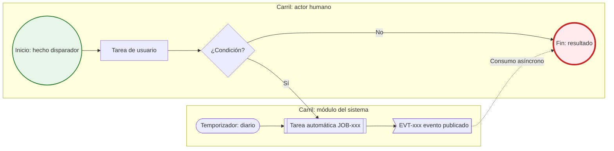

La misma notación rige los 94 diagramas de las partes `04b` a `04i` (§17).

## 4. Mapa de procesos (nivel 0)

**Vínculo con la ampliación (v1.1).** El mapa de nivel 0 que agrupa los 94 procesos `P-XXX-nn` en ocho macroprocesos (cadena de valor) está en [`04a` §2](04a-procesos-mapa-nivel0.md#2-mapa-de-nivel-0-cadena-de-valor); allí estos diez procesos figuran como entradas y salidas de la cadena.

El mapa muestra los diez procesos y sus dependencias principales. El ciclo comercial del socio (P1 a P6 y P9) alimenta los procesos administrativos (P7 y P8). La migración (P10) habilita la operación en GoodApps por etapas: primero el corte comercial y después el administrativo (DEC-068).

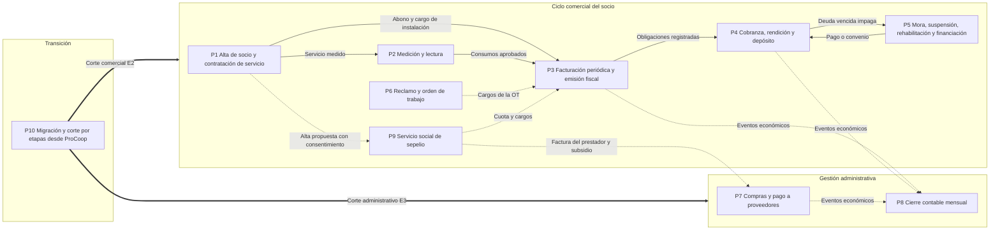

| Proceso | Grupo | Módulos dueños | Ola de habilitación de referencia |
|---|---|---|---|
| P1 Alta de socio y contratación | Comercial | M01, M02, M09, M10, M11 | Piloto Internet O2–O6 (DEC-005) |
| P2 Medición y lectura | Comercial | M03, PWA de campo | O7 (cargadores de medición en T07 §9.1) |
| P3 Facturación y emisión fiscal | Comercial | M05, M04, M06 | O4 (T07 §9.1) |
| P4 Cobranza | Comercial | M07, M14 | O5 (T07 §9.1) |
| P5 Mora y financiación | Comercial | M08, M10 | O6 (T07 §9.1) |
| P6 Reclamo y OT | Comercial | M09, M10, M19 | O2–O3 (T07 §9.1) |
| P7 Compras y pago | Administrativo | M12, M14, M15 | O8 (T07 §9.1) |
| P8 Cierre contable | Administrativo | M15 | O5 núcleo, O8 completo (T07 §9.1) |
| P9 Sepelio | Comercial (social) | M18 | O4 adherentes, O10 resto (DEC-071) |
| P10 Migración y corte | Transición | T07 | O0–O1 herramienta, O11 corte (T07 §9.1) |

---

## 5. P1 — Alta de socio y contratación de servicio

**Procesos vinculados (v1.3).** P-IAM-15, P-COM-05, P-WFL-10 detallan tramos de este proceso; además lo detallan 21 procesos `PRC-<MOD>-nn` (prefijos PER, CAT, CRM, POR); su ubicación está en el inventario de `04a` (ver [04a §5](04a-procesos-mapa-nivel0.md#5-vínculo-con-los-procesos-del-documento-base)).

### 5.1 Ficha del proceso

| Campo | Contenido |
|---|---|
| Objetivo | Incorporar a una persona como titular con su cuenta y contratar un servicio (caso piloto: Internet) desde la solicitud hasta la activación con fecha efectiva, el cargo de instalación y el primer abono. |
| Disparador | Solicitud de alta de servicio del socio en el portal, la landing, la app o en mostrador. |
| Actores y carriles | Socio o solicitante (M19); Atención al socio (M09); Personas, titulares y cuentas (M01); Catálogo y contratos (M02); Técnica y campo con la PWA del técnico (M10), con Stock (M13) para el equipo en comodato; Ventas (M11) y Facturación (M05). |
| Resultado | Contrato activo con fecha efectiva, equipo aplicado al contrato, cargo de instalación y abono en la facturación, caso resuelto. |
| Fuentes | M09 §9.2; M01 §9.1, §9.2, §9.4; M02 §9.2; M10 §9.1; M11 §9.1; DEC-005, DEC-033, DEC-040. |

### 5.2 Situación actual en ProCoop

- El alta de un servicio no técnico queda conectada al grabarse, sin un circuito de solicitud y aprobación (CTR-CAT-01).
- El servicio se activa al confirmar la orden técnica, sin un hito de activación con fecha efectiva propia (CTR-TEC-18).
- La factibilidad es opcional y, al validar un alta, no se descartan las factibilidades anuladas (CTR-TEC-33, CTR-TEC-14).
- Un parámetro permite registrar personas con documento duplicado y la unificación de duplicados es destructiva (CTR-PER-06, CTR-PER-11).
- El control de deuda en el domicilio o en el catastro puede negar el servicio por deuda de otra persona (CTR-PER-04).
- El acceso web del socio se basa en una clave compartida por socio o documento (CTR-PER-12).
- La encuesta de satisfacción se toma en el sitio al cerrar la orden (CTR-TEC-15).

### 5.3 Proceso futuro

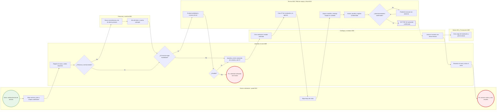

### 5.4 Pasos

| Paso | Actor | Actividad | Regla RN / RF aplicada | Evento EVT emitido |
|---|---|---|---|---|
| 1 | Socio | Solicita el servicio y el plan desde el portal o la landing; acepta las condiciones versionadas. Se crea el caso con número y constancia. | RF-POR-061, RF-CRM-060 | EVT-CRM-01 (`crm.case.created`) |
| 2 | Atención (M09) | Valida pertenencia de la cuenta, datos mínimos y vía de ingreso; si faltan requisitos, el caso queda a la espera de información. | RN-CRM-005, RN-CRM-058 | EVT-CRM-05 (`crm.case.statusChanged`) |
| 3 | Operador (M01) | Busca coincidencias de la persona dentro del tenant y la da de alta con validación de obligatorios, dígito verificador y unicidad. | RF-PER-001, RN-PER-002, RN-PER-005, RN-PER-007, RN-PER-011, RN-PER-019 | EVT-PER-01 (`per.person.created`) |
| 4 | Operador (M01) | Da de alta el titular con número de la secuencia del tenant y la primera cuenta, que queda como principal. | RF-PER-040, RF-PER-055, RN-PER-029, RN-PER-052 | EVT-PER-09 (`per.holder.created`), EVT-PER-11 (`per.account.created`) |
| 5 | Atención (M09) → Técnica (M10) | Si el servicio exige factibilidad, emite el comando de factibilidad con el punto de prestación. | PRM-TEC-024, DEC-040 | EVT-CRM-13 (`crm.commandRequest.requested`), EVT-TEC-01 (`tec.feasibility.requested`) |
| 6 | Evaluador (M10) | Dictamina la factibilidad; si requiere obra o materiales extraordinarios, M11 emite un presupuesto. | — | EVT-TEC-02 (`tec.feasibility.verdictIssued`) |
| 7 | Atención (M09) y M02 | Con factibilidad apta (y aprobación T11 si el tipo la exige) emite los comandos de contrato y de OT; M02 crea el contrato en estado solicitado. Se valida la deuda en el domicilio o catastro (advertencia o bloqueo solo por política validada). | RN-PER-062 | EVT-CRM-13, EVT-CAT-06 (`cat.contract.requested`) |
| 8 | Técnica (M10) | Crea la OT de instalación con materiales previstos y reglas encadenadas. | — | EVT-TEC-04 (`tec.workOrder.created`) |
| 9 | Socio | Elige franja en la app: reserva temporal que pasa a confirmada; la OT queda agendada. | RF-TEC-076 | EVT-TEC-13 (`tec.visit.statusChanged`) |
| 10 | Despachante (M10) y Stock (M13) | Asigna cuadrilla; M13 reserva el equipo serializado y lo transfiere a custodia del instalador. | — | EVT-STK-10 (`stk.reservation.created`), EVT-STK-03 (`stk.custody.transferred`) |
| 11 | Técnico (PWA de campo) | Informa "En camino", instala, prueba, registra materiales y fotos y captura la conformidad del receptor. | — | EVT-TEC-13, EVT-TEC-15 (`tec.conformity.signed`) |
| 12 | Sistema (sincronización) | Aplica las mutaciones de campo de forma idempotente; M13 aplica el equipo al contrato en comodato. Si la solicitud se canceló mientras se instalaba sin conexión, se abre un conflicto con ambas evidencias. | RN-CRM-027 | EVT-STK-04 (`stk.equipment.applied`), EVT-TEC-06 (`tec.workOrder.executed`) |
| 13 | Técnica (M10) y T06 | Emite el comando de aprovisionamiento con el perfil del plan y espera la confirmación. | — | EVT-TEC-33 (`tec.provisioning.requested`), EVT-TEC-21 (`tec.provisioning.confirmed`) |
| 14 | Técnica (M10) → Contratos (M02) | Publica la activación confirmada; el contrato pasa a activo desde la fecha efectiva solo con instalación y aprovisionamiento confirmados. | RN-CAT-064, DEC-033 | EVT-TEC-16 (`tec.installation.activationConfirmed`), EVT-CAT-09 (`cat.contract.activated`) |
| 15 | Ventas (M11) y Facturación (M05) | Crea o valoriza el cargo de instalación según la modalidad elegida (próxima factura, factura inmediata o cuotas) y M05 inicia el abono con prorrateo. | RN-VEN-001, RN-VEN-002, RF-VEN-081, RF-TEC-062 | EVT-VEN-01 (`ven.operationCharge.created`) |
| 16 | Atención (M09) y T09 | Resuelve el caso con la fecha efectiva, avisa al socio y solicita la encuesta posterior, que no afecta la activación. | — | EVT-CRM-08 (`crm.case.resolved`), EVT-TEC-17 (`tec.survey.requested`) |

### 5.5 Excepciones

| Excepción | Tratamiento | Fuente |
|---|---|---|
| Faltan requisitos de la solicitud | El caso queda a la espera de información; no se crea contrato. | M09 §9.2 |
| Persona con posible duplicado | Se muestran candidatos enmascarados; el operador usa la existente o registra "es otra persona" con motivo. | M01 §9.1 |
| No factible | El caso pasa a rechazado con motivo comunicado y conserva la evidencia. | M09 §9.2 |
| Deuda en el domicilio o catastro | Advertencia sin revelar detalle; bloqueo solo si la política validada lo indica. | RN-PER-062, CTR-PER-04 |
| Visita fallida | Nueva cita; el equipo sigue en custodia; no se crea el cargo de instalación. | M10 §9.1, M11 §9.1; EVT-TEC-14 |
| Prueba fallida o disconformidad del receptor | La instalación queda con prueba fallida o pasa a decisión del supervisor. | M10 §9.1 |
| Aprovisionamiento fallido | Pendiente manual y activación diferida; reintentos idempotentes. | M10 §9.1, §9.9; EVT-TEC-21 (`tec.provisioning.failed`) |
| Cancelación por el socio antes de instalar | Se cancelan OT y contrato sin exigir retiro de equipo; si ya se instaló sin conexión, se abre conflicto. | M09 §9.2, RN-CRM-027 |
| Sincronización repetida | No duplica el cargo de instalación. | M11 §9.1 |

### 5.6 Indicadores

| ID | Indicador | Fuente |
|---|---|---|
| KPI-CAT-04 | Tiempo solicitud → activación | T10 |
| KPI-CAT-02 | Altas netas | T10 |
| KPI-TEC-04 | Primera visita exitosa | T10 |
| KPI-TEC-05 | Visitas fallidas | T10 |
| KPI-TEC-08 | Aprovisionamiento al primer intento | T10 |
| KPI-TEC-09 | Satisfacción post instalación | T10 |

Valores objetivo de cada indicador: a definir.

### 5.7 Cambios frente a ProCoop

| Aspecto | ProCoop | GoodApps |
|---|---|---|
| Solicitud y ejecución | El alta no técnica queda conectada al grabarse. | Toda alta nace como solicitud y requiere aprobación; la activación exige los requisitos de RN-CAT-064. |
| Hito de activación | Se activa al confirmar la OT. | Se activa con instalación probada y aprovisionamiento confirmado, con fecha efectiva (DEC-033). |
| Factibilidad | Opcional; no filtra anuladas. | Configurable por servicio, obligatoria por defecto en Internet y servicios con red (DEC-040); anuladas y vencidas nunca son usables. |
| Identidad de la persona | Documento duplicado permitido; unificación destructiva. | Persona única por tenant con fusión aprobada y reversible. |
| Deuda de terceros | Puede bloquear el alta. | Advierte sin revelar datos; bloquea solo por política validada. |
| Acceso del socio | Clave compartida. | Usuario propio con vínculo verificado (DEC-043). |
| Encuesta | En el sitio, al cerrar. | Posterior e independiente; no bloquea la activación. |

---

## 6. P2 — Ciclo de medición y lectura

**Procesos vinculados (v1.3).** P-IAM-24 detalla tramos de este proceso; además lo detallan 17 procesos `PRC-<MOD>-nn` (prefijos MED, POR); su ubicación está en el inventario de `04a` (ver [04a §5](04a-procesos-mapa-nivel0.md#5-vínculo-con-los-procesos-del-documento-base)).

### 6.1 Ficha del proceso

| Campo | Contenido |
|---|---|
| Objetivo | Obtener, validar y aprobar los consumos del período de cada punto medido para que M04 y M05 los liquiden, con lectura de campo sin conexión, telemedición e importación. |
| Disparador | Cronograma de lectura publicado por servicio y ciclo; fecha planificada de generación de lotes. |
| Actores y carriles | Supervisor de medición; Sistema de medición (M03, trabajos programados); Lecturista con la PWA de campo; Telemedición (T06); Tarifas (M04) y Facturación (M05); Técnica (M10) para observaciones que requieren OT. |
| Resultado | Consumos aprobados disponibles para facturar; lote cerrado con acta; excepciones resueltas o trasladadas con causa. |
| Fuentes | M03 §9.1 a §9.7; DEC-085. |

### 6.2 Situación actual en ProCoop

- Los umbrales de control solo informan: ningún consumo anómalo se bloquea antes de liquidar (CTR-MED-01).
- Toda lectura menor que la anterior se toma como vuelta del medidor sin preguntar (CTR-MED-02).
- Un único porcentaje de tolerancia rige para todo el sistema (CTR-MED-12).
- Las lecturas y distribuciones se borran físicamente al corregirlas (CTR-MED-05).
- La aplicación móvil sincroniza a través de una base intermedia externa en la que conviven lecturas, fotos y posiciones de varias cooperativas (CTR-MED-07, CTR-TEC-13).
- Cada formato de importación de lecturas está programado por cooperativa o fabricante (CTR-MED-09).
- El período se deriva del mes de la fecha de lectura (CTR-MED-15).
- El ajuste de consumos estimados solo se hace como bonificación en unidades sobre la factura siguiente (CTR-MED-13).

### 6.3 Proceso futuro

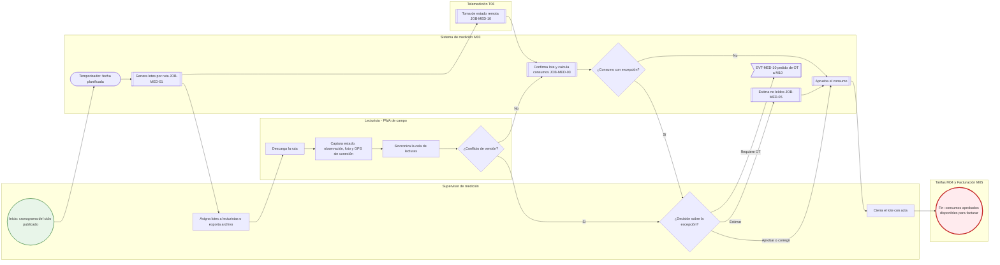

### 6.4 Pasos

| Paso | Actor | Actividad | Regla RN / RF aplicada | Evento EVT emitido |
|---|---|---|---|---|
| 1 | Supervisor | Publica el cronograma por servicio y ciclo. | — | — |
| 2 | Sistema (JOB-MED-01) | Genera los lotes de cada ruta: selecciona puntos, excluye los que están en otro lote abierto, calcula consumo de referencia y rango esperado, ordena por ruta; idempotente y reanudable. | RN-MED-023, RN-MED-028, RN-MED-029 | EVT-MED-05 (`med.readingBatch.generated`) |
| 3 | Supervisor | Asigna los lotes y habilita la descarga en la app o la exportación a archivo. | — | — |
| 4 | Lecturista (PWA) | Verifica dirección y medidor, captura estado por registro, observación, foto y GPS; validaciones locales con reingreso y foto si está fuera de rango. | RN-MED-047 | EVT-MED-08 (`med.reading.captured`) |
| 5 | Sistema | Recibe la cola por lotes con idempotencia por mutación; si la tarea cambió en el servidor, guarda la lectura y abre conflicto. | RN-MED-125 | EVT-MED-28 (`med.syncConflict.raised`) |
| 6 | Telemedición (T06, JOB-MED-10) | Toma el estado remoto por sistema de medición y crea lecturas capturadas; agotados los reintentos, genera excepción. | — | — |
| 7 | Sistema (JOB-MED-03) | Confirma el lote: verifica alta, medidor y estado anterior; aplica observaciones (pide OT a M10 si corresponde); calcula el consumo; ejecuta las reglas de validación; aprueba automáticamente los consumos sin excepciones. La corrección de volumen de gas la aplica M04 (DEC-085). | RN-MED-035, RN-MED-036, RN-MED-065, RN-MED-076, RN-MED-079 | EVT-MED-06 (`med.readingBatch.confirmed`), EVT-MED-10, EVT-MED-14 (`med.consumptionException.raised`) |
| 8 | Supervisor | Decide cada excepción: aprobar, corregir, estimar o pedir OT; la lectura menor se clasifica explícitamente (vuelta, error de captura o cambio de medidor no registrado). | RN-MED-066 | EVT-MED-11 o EVT-MED-12 (`med.consumption.blocked`) |
| 9 | Sistema (JOB-MED-05) | Estima los puntos no leídos. | — | — |
| 10 | Sistema | Aprueba los consumos (automática o manualmente). | RN-MED-079 | EVT-MED-11 (`med.consumption.approved`) |
| 11 | Supervisor | Cierra el lote con acta. | — | EVT-MED-07 (`med.readingBatch.closed`) |
| 12 | M04 y M05 | Toman los consumos aprobados del período; los observados quedan fuera con causa. Al emitir, M03 marca los consumos como facturados. | — | Consume EVT-FAC-07 (`fac.invoice.issued`) |
| 13 | Sistema (JOB-MED-08) | Regulariza los estimados cuando llega una lectura real posterior, por compensación en unidades o refacturación según el servicio. | RN-MED-089 | — |

### 6.5 Excepciones

| Excepción | Tratamiento | Fuente |
|---|---|---|
| Punto no leído | Estimación por JOB-MED-05 y regularización posterior. | M03 §9.1 |
| Lectura fuera de rango | Reingreso y foto en el campo; excepción en la confirmación. | M03 §9.3, §9.4 |
| Observación que impide la lectura | "No leído" y, si la observación lo exige, pedido de OT a M10. | M03 §9.4; EVT-MED-10 |
| Conflicto de versión al sincronizar | La lectura se guarda; el supervisor decide con ambas evidencias. | RN-MED-125 |
| Lectura rechazada por verificación | Lectura rechazada con causa y tarea. | RN-MED-035 |
| Telemedición sin respuesta | Excepción de lectura de telemedición faltante; pasa a estimación o a lectura de campo según parámetro. | M03 §9.7 |
| Lote en revisión por otro usuario | Bloqueo por lote; el segundo intento se rechaza. | M03 §9.4 |
| Importación con filas repetidas | Deduplicación por medidor, registro e instante. | RN-MED-063 |

### 6.6 Indicadores

| ID | Indicador | Fuente |
|---|---|---|
| KPI-MED-01 | Lectura real | T10 |
| KPI-MED-02 | Consumos estimados | T10 |
| KPI-MED-03 | Excepciones de consumo abiertas | T10 |
| KPI-MED-04 | Éxito de telemedición | T10 |
| KPI-MED-06 | Productividad de lecturistas | T10 |

Valores objetivo: a definir.

### 6.7 Cambios frente a ProCoop

| Aspecto | ProCoop | GoodApps |
|---|---|---|
| Control de consumos | Los umbrales solo informan. | Reglas con severidad (información, advertencia, bloqueante) y bandeja de excepciones; aprobación explícita del consumo. |
| Lectura menor | Siempre vuelta del medidor. | Clasificación explícita por el supervisor. |
| Tolerancia | Un porcentaje global. | Rango esperado por servicio, categoría y estacionalidad. |
| Correcciones | Borrado físico. | Anulación y versión nueva; nunca borrado. |
| App de campo | Base intermedia compartida entre cooperativas. | PWA propia con cola local, sincronización idempotente y aislamiento por tenant. |
| Importación | Formatos programados. | Perfiles de importación configurables. |
| Período | Mes de la fecha de lectura. | Período definido por el cronograma del ciclo. |

---

## 7. P3 — Facturación periódica y emisión fiscal

**Procesos vinculados (v1.3).** P-COB-01, P-COB-17, P-COM-06, P-COM-09, P-WFL-03, P-WFL-08 detallan tramos de este proceso; además lo detallan 32 procesos `PRC-<MOD>-nn` (prefijos TAR, FAC, FIS); su ubicación está en el inventario de `04a` (ver [04a §5](04a-procesos-mapa-nivel0.md#5-vínculo-con-los-procesos-del-documento-base)).

### 7.1 Ficha del proceso

| Campo | Contenido |
|---|---|
| Objetivo | Emitir los comprobantes del ciclo con universo congelado, cálculo determinista, aprobación, numeración atómica, autorización fiscal (CAE o CAEA), representación, distribución y cierre con acta de cuadre. |
| Disparador | Fecha de corrida del ciclo publicado (JOB-FAC-17, diario). |
| Actores y carriles | Responsable de facturación y correctores; Aprobador y contador; Sistema de facturación (M05); Motor de cálculo (M04) y mora (M08) para los importes por vencimiento; Fiscal (M06) y ARCA; Cuenta corriente (M07); Comunicaciones (T09) y portal (M19). |
| Resultado | Comprobantes autorizados, obligaciones registradas en la cuenta corriente, comprobantes distribuidos y ciclo cerrado con acta. |
| Fuentes | M05 §9.1 a §9.9; M06 §9.2 a §9.5; M08 §9.1; M07 §9.1; T11 §9.3. |

### 7.2 Situación actual en ProCoop

- Los comprobantes no autorizados se eliminan físicamente (con copia en una tabla de anulados) (CTR-FAC-02).
- La grabación de las facturas y del numerador se confirma en dos pasos separados (CTR-FAC-05) y las importaciones pueden dejar números sin usar (CTR-FAC-15).
- Un bloqueo global impide procesar más de un lote de facturación mensual a la vez (CTR-FAC-06).
- Un lote parcial no tiene estado; se recorre de nuevo confiando en la marca del último período facturado (CTR-FAC-14).
- El usuario administrador saltea controles fiscales (CTR-FAC-07).
- Se permite la modificación masiva de comprobantes electrónicos (CTR-FAC-11).
- El saldo se guarda en el propio comprobante (CTR-FAC-19).

### 7.3 Proceso futuro

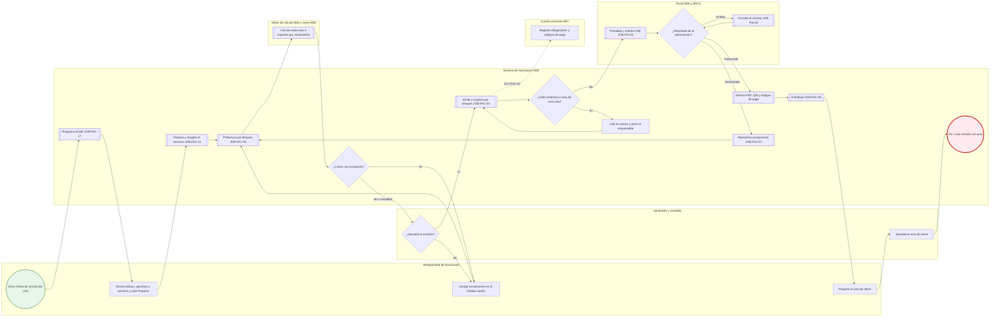

### 7.4 Pasos

| Paso | Actor | Actividad | Regla RN / RF aplicada | Evento EVT emitido |
|---|---|---|---|---|
| 1 | Sistema (JOB-FAC-17) | Crea el lote en borrador para cada ciclo cuya fecha llega, con fechas resueltas por el calendario; avisa al responsable. | — | — |
| 2 | Responsable y sistema (JOB-FAC-01) | Toma el bloqueo del lote, valida prerrequisitos (M06, M17), resuelve el universo y la elegibilidad, toma la foto de consumos aprobados e ítems facturables, resuelve la modalidad de cada cuenta, ordena servicios base antes que dependientes y congela el universo con huella. | RN-FAC-008, RN-FAC-020, RN-FAC-135, RN-FAC-155 | EVT-FAC-01 (`fac.billingRun.prepared`) |
| 3 | Sistema (JOB-FAC-02) y M04 | Prefactura por bloques: cálculo con versiones de reglas fijadas, tipo, letra y punto de venta, vencimientos con recargos de M08; compara con el período anterior. No numera. | RN-FAC-043, RN-FAC-058, RN-MOR-028 | EVT-FAC-02 (`fac.billingRun.prebilled`), EVT-FAC-16 (`fac.billingException.opened`) |
| 4 | Responsable y correctores | Trabajan la bandeja de excepciones en el módulo dueño; los casos que lo exigen pasan a revisión previa. Un cambio de universo genera una versión nueva y re-prefactura solo los afectados. | RF-FAC-174 | EVT-FAC-16 (`fac.billingException.resolved`) |
| 5 | Aprobador | Aprueba con el resumen obligatorio; debe ser distinto del preparador si así se configura; si el total supera el umbral se dispara el workflow T11. | PRM-FAC-070, PRM-FAC-072 | EVT-FAC-03 (`fac.billingRun.approved`) |
| 6 | Sistema (JOB-FAC-03) | Emite por bloques en una transacción por bloque: revalida, incrementa numeradores, crea comprobantes y períodos facturados, marca ítems como facturados. Ante error sistémico o tasa de error alta, pausa. | PRM-FAC-033 | EVT-FAC-07 (`fac.invoice.issued`), EVT-FAC-05 (`fac.billingRun.issued`), EVT-FAC-04 (`fac.billingRun.paused`), EVT-FAC-20 (`fac.billableItem.billed`) |
| 7 | Fiscal (M06, JOB-FIS-01) | Prevalida, toma el bloqueo del par punto de venta y tipo, contrasta el último autorizado, arma la tanda y solicita CAE; ante rechazo agrupado reintenta individualmente; ante timeout marca incierto sin reenviar. | RN-FIS-025, RF-FIS-041, RN-FIS-046 | EVT-FIS-01 (`fis.invoice.authorized`), EVT-FIS-02, EVT-FIS-03, EVT-FIS-04 |
| 8 | Cuenta corriente (M07) | Registra una obligación por bloque de servicio con vencimientos e identificadores de pago; aplica saldos a favor si corresponde; marca débito automático. | RN-COB-004, RN-COB-008 | EVT-COB-01 (`cob.obligation.registered`) |
| 9 | Sistema (JOB-FAC-04, JOB-FAC-05) | Genera códigos de pago y PDF con QR fiscal y QR de pago. | — | — |
| 10 | Sistema (JOB-FAC-06) y T09 | Distribuye por preferencia: correo y WhatsApp, portal y app, archivo de impresión por ruta; rebotes a papel. | RN-FAC-131 | EVT-FAC-14 (`fac.invoice.published`), EVT-FAC-15 (`fac.invoice.delivered`) |
| 11 | Sistema (JOB-FAC-07) | Reprocesa los casos con excepción resuelta en un lote vinculado. | — | EVT-FAC-16 |
| 12 | Responsable, aprobador y contador (JOB-FAC-15) | Proponen y aprueban el acta con cuadre; los pendientes pasan a trasladados con responsable. | — | EVT-FAC-17 (`fac.billingCycle.closed`), EVT-FAC-06 (`fac.billingRun.closed`) |

### 7.5 Excepciones

| Excepción | Tratamiento | Fuente |
|---|---|---|
| Datos fiscales faltantes o lectura inconsistente | Excepción por caso con responsable y próxima acción; el resto del lote se emite (ejemplo ESC-02). | M05 §9.2 |
| Otro lote activo con la misma clave | Rechazo por bloqueo de lote. | M05 §9.1 |
| Fallo sistémico (credencial fiscal, cálculo caído, numerador bloqueado) | Pausa del lote sin excepciones por cliente; reanudación desde el último bloque confirmado. | M05 §9.6; T11 §9.3 |
| Falla global de autorización | Pausa de corridas por el evento de falla global. | EVT-FIS-21 |
| Comprobante rechazado por ARCA | Excepción fiscal y reproceso. | M05 §9.1 |
| Respuesta incierta | Conciliación del incierto sin reenviar. | M06 §9.4; JOB-FAC-08 |
| Caída prolongada de ARCA | Contingencia con CAEA en los puntos habilitados e informe posterior. | M06 §9.5; EVT-FIS-07 |
| Corrección después de emitir | Nota de crédito y refacturación en un lote propio. | M05 §9.3, §9.4 |

### 7.6 Indicadores

| ID | Indicador | Fuente |
|---|---|---|
| KPI-FAC-01 | Facturado del período | T10 |
| KPI-FAC-03 | Casos excluidos del lote | T10 |
| KPI-FAC-04 | Pendientes de autorización | T10 |
| KPI-FAC-05 | Excepciones de facturación vencidas | T10 |
| KPI-FAC-06 | Rebote de entrega digital | T10 |
| KPI-FIS-01 | Rechazo de autorización fiscal | T10 |
| KPI-FIS-02 | Tiempo medio de autorización | T10 |

Duración objetivo del ciclo completo: a definir.

### 7.7 Cambios frente a ProCoop

| Aspecto | ProCoop | GoodApps |
|---|---|---|
| Comprobantes no autorizados | Eliminación física. | Anulación lógica; los autorizados solo se corrigen con nota de crédito. |
| Numeración | Dos confirmaciones separadas; huecos por importaciones. | Numeración atómica dentro de la transacción del bloque; sin huecos. |
| Concurrencia | Bloqueo global. | Bloqueo por tenant, ciclo, período y secuencia. |
| Lote parcial | Sin estado; se recorre de nuevo. | Estados de pausa y emisión con pendientes, progreso por bloque y acta de cuadre. |
| Controles fiscales | El administrador los saltea. | Excepción con motivo, aprobación y auditoría; sin usuario privilegiado. |
| Saldo | En el comprobante. | Calculado por M07 a partir de obligaciones e imputaciones. |

---

## 8. P4 — Cobranza: caja, pasarelas, débito, rendición y depósito

**Procesos vinculados (v1.3).** P-COB-01, P-COB-02, P-COB-03, P-COB-04, P-COB-05, P-COB-06, P-COB-07, P-COB-08, P-COB-09, P-COB-10, P-COB-11, P-COB-12, P-COB-13, P-COB-14, P-COB-15, P-COB-16, P-COB-17, P-COB-18, P-COB-19, P-TES-01, P-TES-02, P-TES-03, P-TES-04, P-TES-06, P-TES-07, P-TES-08, P-TES-10, P-IAM-17, P-IAM-18, P-WFL-04 detallan tramos de este proceso; además lo detallan 2 procesos `PRC-<MOD>-nn` (prefijos POR); su ubicación está en el inventario de `04a` (ver [04a §5](04a-procesos-mapa-nivel0.md#5-vínculo-con-los-procesos-del-documento-base)).

### 8.1 Ficha del proceso

| Campo | Contenido |
|---|---|
| Objetivo | Cobrar las obligaciones por cualquier canal (caja, portal y pasarelas, entes de cobranza, débito automático), imputarlas por componente, cerrar y rendir las cajas a tesorería, depositar y conciliar las acreditaciones bancarias. |
| Disparador | El socio decide pagar (caja o portal), llega una rendición de ente o una respuesta de débito, o el cajero inicia el cierre de su sesión. |
| Actores y carriles | Socio; Cajero (M07); Pasarela, ente o banco (externos vía T06); Sistema de cobranza (M07) con cotización de mora (M08); Tesorería (M14). |
| Resultado | Recibos emitidos con imputaciones trazables, caja rendida y aceptada, fondos depositados y conciliados. |
| Fuentes | M07 §9.1 a §9.12; M14 §9.1 a §9.3; M08 §9.2; PA-COB-08, PA-TES-06. |

### 8.2 Situación actual en ProCoop

- Un pago parcial no se reparte entre los servicios de un comprobante (CTR-COB-02) y el saldo es un campo que cada proceso edita (CTR-COB-03).
- La anulación de una cobranza borra registros (CTR-COB-04).
- El arqueo solo cuenta el efectivo; los demás medios se toman como teóricos (CTR-COB-05), y una diferencia de integridad solo genera un aviso (RN-COB-065).
- Un pago duplicado se convierte automáticamente en anticipo (CTR-COB-06).
- La identificación de pagos de entes puede ser ambigua y elegir la factura más reciente aunque esté paga (CTR-COB-07).
- Algunas confirmaciones de pago electrónico no se verifican con el proveedor y los avisos llegan a través de un intermediario externo (CTR-COB-09, CTR-COB-11).
- El cierre de caja de cobranza vive en tesorería y transfiere los fondos en el mismo acto (CTR-TES-14).
- La conciliación bancaria es una marca por movimiento, sin cabecera ni saldo de extracto, y los grupos de conciliación no se validan (CTR-TES-06, CTR-TES-12).

### 8.3 Proceso futuro

```mermaid
flowchart LR
  subgraph SOC["Socio"]
    S0(("Inicio: el socio decide pagar"))
    S1{"¿Canal de pago?"}
  end
  subgraph CAJ["Cajero - caja M07"]
    K1["Busca la cuenta y selecciona obligaciones"]
    K2["Carga medios y confirma el cobro"]
    K3["Cierra la caja y declara por medio"]
    K4{"¿Diferencia sobre el umbral?"}
    K5["Supervisor aprueba quebranto o sobrante"]
  end
  subgraph EXT["Pasarela, ente o banco - T06"]
    X1["Pago online: webhook, sondeo o conciliación"]
    X2["Rendición de ente por archivo o API"]
    X3["Débito automático: presentación y resultado"]
  end
  subgraph SIS["Sistema de cobranza M07 y mora M08"]
    M1[["Cotiza recargos e intereses M08"]]
    M2{"¿Pago confirmado e identificado?"}
    M3[["Motor de imputación y recibo"]]
    M4["No identificado, incierto o duplicado a revisión"]
    M5{"¿Cobro en caja?"}
  end
  subgraph TES["Tesorería M14"]
    T1["Recibe la rendición y cuenta valores"]
    T2{"¿Coincide con lo declarado?"}
    T3["Acepta la rendición"]
    T4["Observa y devuelve a la caja"]
    T5["Arma la boleta de depósito"]
    T6[["Importa extracto y concilia JOB-TES-03"]]
    T7(("Fin: fondos acreditados y conciliados"))
  end
  S0 --> S1
  S1 -->|"Caja"| K1 --> M1 --> K2 --> M3
  S1 -->|"Portal o pasarela"| X1 --> M2
  S1 -->|"Ente de cobranza"| X2 --> M2
  S1 -->|"Débito adherido"| X3 --> M2
  M2 -->|"Sí"| M3
  M2 -->|"No"| M4 -->|"Resuelto"| M3
  M3 --> M5
  M5 -->|"Sí"| K3 --> K4
  M5 -.->|"No: acreditación esperada EVT-COB-11"| T6
  K4 -->|"Sí"| K5 --> T1
  K4 -->|"No"| T1
  T1 --> T2
  T2 -->|"Sí"| T3 --> T5 --> T6 --> T7
  T2 -->|"No"| T4 --> K3
  classDef inicio fill:#e8f5e9,stroke:#2e7d32,stroke-width:2px
  classDef fin fill:#ffebee,stroke:#c62828,stroke-width:4px
  class S0 inicio
  class T7 fin
```

### 8.4 Pasos

| Paso | Actor | Actividad | Regla RN / RF aplicada | Evento EVT emitido |
|---|---|---|---|---|
| 1 | Cajero | Con sesión abierta, busca al titular por cuenta, documento, código de barras o identificador de pago; ve obligaciones, bloqueos, saldo a favor y avisos. | — | — |
| 2 | Sistema (M07 y M08) | Simula la imputación con la cotización de recargos e intereses a la fecha de cobro. | RN-COB-020 | — |
| 3 | Cajero | Carga los medios y confirma con clave de idempotencia; en una transacción se crean operación, recibos (al menos uno por entidad jurídica, con numeración de M05), imputaciones, medios y saldos. Nada se borra: toda corrección es un reverso vinculado. | RN-COB-003, RF-COB-193, RF-COB-087 | EVT-COB-04 (`cob.payment.confirmed`) |
| 4 | Mora (M08) | Liquida los intereses cobrados o diferidos en la misma transacción. | — | EVT-MOR-02 (`mor.interest.settled`), EVT-COB-07 (`cob.surcharge.deferred`) |
| 5 | Socio y conector (portal o pasarela) | Crea o reutiliza la intención de pago; la confirmación llega por webhook, sondeo o conciliación diaria y siempre se reconsulta al proveedor antes de imputar; ante timeout queda incierta sin reenviar. | RN-COB-111, RN-COB-122 | EVT-COB-20 (`cob.paymentIntent.statusChanged`), EVT-COB-04 |
| 6 | Sistema (JOB-COB-07, JOB-COB-08) | Presenta el débito automático y procesa el resultado: acreditados se cobran; rechazados con reintento según política; definitivos suspenden la adhesión. | PRM-COB-101 | EVT-COB-04, EVT-COB-16 (`cob.directDebit.rejected`) |
| 7 | Sistema (rendición de entes) | Importa la rendición con control de huella, valida cabecera y pie, resuelve cada línea, marca duplicados, confirma, calcula la comisión y la acreditación esperada. | RN-COB-039, RN-COB-085, RN-COB-090 | EVT-COB-04, EVT-COB-15 (`cob.agencyFee.recorded`), EVT-COB-11 (`cob.settlement.expected`) |
| 8 | Cajero | Pide el cierre: control de integridad que bloquea si hay diferencias, teórico por medio y moneda, declaración por medio, justificación de diferencias y aprobación sobre umbral; cheques a cartera y cupones a presentación. | RN-COB-064, RN-COB-065, RN-COB-066, RN-COB-068, PRM-COB-034 | EVT-COB-12 (`cob.cashSession.closed`), EVT-COB-13 (`cob.treasuryHandover.delivered`), EVT-COB-14 (`cob.cashDifference.recorded`) |
| 9 | Tesorería (M14) | Un auxiliar distinto del cajero recibe la rendición, cuenta efectivo y tilda cheques, cupones y retenciones. | — | — |
| 10 | Tesorería (M14) | Acepta, observa o acepta con diferencia (con aprobación sobre umbral). | PRM-TES-062 | EVT-TES-08 (`tes.cashRemittance.accepted` / `.observed`) |
| 11 | Tesorero | Arma la boleta de depósito; el importe pasa a la cuenta de tránsito. | — | EVT-TES-09 (`tes.deposit.registered`) |
| 12 | Sistema (JOB-TES-02, JOB-TES-03) y tesorero | Importa el extracto, concilia por reglas y confirma sugerencias; los grupos deben cuadrar; al acreditarse, el tránsito se cancela. | RN-TES-061 | EVT-TES-04 (`tes.statement.imported`), EVT-TES-07 (`tes.gatewayCredit.reconciled`), EVT-TES-09 (`tes.deposit.credited`), EVT-TES-05 (`tes.reconciliation.closed`) |
| 13 | Sistema (M07) | Al cancelarse una obligación por otro canal, marca como pagada la deuda publicada a los entes. | — | EVT-COB-02 (`cob.obligation.settled`) |

### 8.5 Excepciones

| Excepción | Tratamiento | Fuente |
|---|---|---|
| Pago incierto | Reconsulta con espera creciente hasta 72 h; el portal muestra "pago en verificación"; vencido el plazo, excepción al responsable. | M07 §9.10 |
| Pago de una obligación ya cancelada | Saldo a favor no automático y excepción de pago duplicado. | M07 §9.9; RN-COB-039 |
| Diferencia de importe en pago online | Se acepta, se imputa y la diferencia va a revisión. | PA-COB-05 (asumida, DEC-072) |
| Cobro no identificado | Queda como no identificado hasta su resolución. | M07 §9.7; KPI-COB-06 |
| Contracargo | Reverso de imputaciones, expediente y disputa. | M07 §9.11; EVT-COB-18 |
| Archivo de rendición repetido | Rechazo por huella. | M07 §9.7 |
| Falla a mitad del cierre | Se revierte el cierre completo. | RN-COB-070 |
| Rendición que no coincide | Observación a M07 o aceptación con diferencia y quebranto. | M14 §9.1 |
| Anulación de cobranza | Reverso total sin borrado; si tesorería ya recibió, contrapartida en M14. | M07 §9.4; EVT-COB-05 |

### 8.6 Indicadores

| ID | Indicador | Fuente |
|---|---|---|
| KPI-COB-01 | Cobrado del período | T10 |
| KPI-COB-02 | Eficacia de cobranza al primer vencimiento | T10 |
| KPI-COB-03 | Cobranza digital | T10 |
| KPI-COB-04 | Días promedio de cobro | T10 |
| KPI-COB-06 | No identificados con más de 15 días | T10 |
| KPI-COB-07 | Pagos inciertos abiertos | T10 |
| KPI-COB-08 | Rechazo de débito automático | T10 |
| KPI-COB-09 | Diferencias de arqueo | T10 |
| KPI-COB-10 | Bruto cobrado vs neto acreditado | T10 |
| KPI-TES-03 | Antigüedad de partidas sin conciliar | T10 |
| KPI-TES-04 | Tiempo de rendición de cajas | T10 |

Valores objetivo: a definir.

### 8.7 Cambios frente a ProCoop

| Aspecto | ProCoop | GoodApps |
|---|---|---|
| Imputación | Sin reparto entre servicios; saldo editable. | Motor de imputación por componente y servicio; saldo derivado. |
| Anulación | Borra registros. | Reverso vinculado; nada se borra. |
| Arqueo | Solo efectivo; diferencia de integridad como aviso. | Declaración por cada medio; la diferencia de integridad bloquea el cierre. |
| Pagos electrónicos | Confirmación sin verificar en algunos conectores; intermediario externo. | Reconsulta obligatoria al proveedor; webhook propio por tenant. |
| Identificación de entes | Ambigua. | Identificador autocontenido y resolución transitoria de claves heredadas (DEC-050). |
| Caja y tesorería | El cierre y la transferencia ocurren en tesorería en el mismo acto. | Doble control: M07 cierra y arquea; tesorería acepta u observa (PA-TES-06). |
| Conciliación bancaria | Marca por movimiento. | Conciliación con cabecera, fecha de corte, saldo de extracto y grupos que cuadran. |

---

## 9. P5 — Mora, aviso, suspensión o restricción, rehabilitación y financiación

**Procesos vinculados (v1.3).** P-COB-02, P-COM-06 detallan tramos de este proceso; además lo detallan 10 procesos `PRC-<MOD>-nn` (prefijos MOR); su ubicación está en el inventario de `04a` (ver [04a §5](04a-procesos-mapa-nivel0.md#5-vínculo-con-los-procesos-del-documento-base)).

### 9.1 Ficha del proceso

| Campo | Contenido |
|---|---|
| Objetivo | Gestionar la deuda vencida por instancias de aviso con constancia, interrumpir o restringir el servicio solo cuando las reglas lo permiten, rehabilitar al confirmarse el pago y ofrecer convenios de financiación. |
| Disparador | Evaluación diaria de mora (JOB-MOR-02) por tenant y servicio con política publicada. |
| Actores y carriles | Sistema de mora (M08); Gestor de mora; Comunicaciones (T09); Aprobación (T11); Técnica (M10) y red (T06); Socio; Cobranza (M07). |
| Resultado | Deuda regularizada (pago o convenio) con servicio rehabilitado, o servicio suspendido o restringido con aviso y constancia. |
| Fuentes | M08 §9.4 a §9.10; M10 §9.5; M02 §9.3; DEC-014. |

### 9.2 Situación actual en ProCoop

- Al procesar el tratamiento de morosos se emite la orden de corte sin verificar restricciones normativas ni evidencia de aviso (CTR-MOR-03, RN-MOR-081).
- El corte en el equipo de red es directo y sincrónico, sin trazabilidad del origen (CTR-TEC-11).
- Al cobrar, el servicio se reconecta y se marca conectado sin confirmación técnica (CTR-MOR-06, RN-MOR-102); la reconexión automática usa una ventana fija de días alrededor de la baja (RN-MOR-092).
- El cargo de reconexión y el costo de notificación se aplican de forma automática (CTR-MOR-04, CTR-MOR-05).
- Los convenios no tienen caducidad: operativamente se anulan y refinancian (CTR-MOR-07, RN-MOR-123); su anulación borra registros (CTR-MOR-08).
- Una función de "restablecer" borra todas las notificaciones (CTR-MOR-09).
- Existe un paso masivo del moroso a prepago (CTR-CAT-04).

### 9.3 Proceso futuro

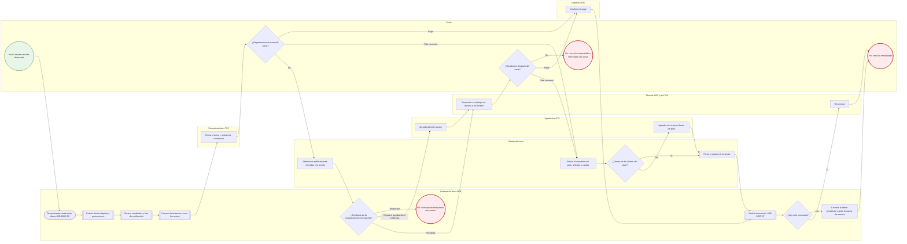

### 9.4 Pasos

| Paso | Actor | Actividad | Regla RN / RF aplicada | Evento EVT emitido |
|---|---|---|---|---|
| 1 | Sistema (JOB-MOR-02) | Evalúa cuentas con documentos vencidos: saldo elegible (excluye convenios al día, reclamos, pagos informados, deuda judicial, incobrable o prescripta), mínimo, instancia y decisión por servicio. Solo propone; no tiene efectos sobre el servicio. | — | EVT-MOR-06 (`mor.evaluation.closed`) |
| 2 | Sistema o gestor (JOB-MOR-03) | Genera candidatos con filtros y exclusiones con motivo; crea el lote y las notificaciones de la instancia de candidatos. | RF-MOR-077, RN-MOR-057, RN-MOR-058, RN-MOR-060 | EVT-MOR-07 (`mor.batch.generated`) |
| 3 | Sistema o gestor (JOB-MOR-04) | Procesa la instancia: valida composición y destinatarios, crea la notificación siguiente con su costo solo si está habilitado. | RN-MOR-062, RN-MOR-070 | EVT-MOR-08 (`mor.notice.created`), EVT-MOR-09 (`mor.notice.dispatchRequested`) |
| 4 | Comunicaciones (T09) | Envía el aviso, registra la entrega y el hito de constancia; si todos los canales fallan, M08 crea una tarea de canal alternativo. | — | EVT-COM-27, EVT-COM-28 (`com.communication.milestoneReached`), EVT-COM-29 |
| 5 | Gestor | Selecciona servicios y acción en la instancia de corte; se crea el caso de interrupción, que se evalúa antes de emitir la orden: política, aviso previo con constancia, protecciones, reclamos, pagos informados, convenio vigente y aprobación si corresponde. | RF-MOR-100, RN-MOR-077, RN-MOR-081, RN-MOR-082 | EVT-MOR-12 (`mor.interruption.requested` / `.blocked` / `.approved` / `.scheduled`) |
| 6 | Técnica (M10) y T06 | Ejecuta en remoto (comando idempotente), en terreno (OT) o en forma directa; si la orden llega con modo restringido, aplica el perfil de restricción (caudal reducido en agua, bloqueo saliente en telefonía, grilla mínima en TV). | RF-TEC-238, RN-MOR-137 | EVT-TEC-18 (`tec.disconnection.executed`), EVT-INT-15 |
| 7 | Mora (M08) | Con la confirmación, el caso queda ejecutado; el estado del servicio cambia solo con confirmación; se comunica al socio con medios de pago y cómo reactivar. | RN-MOR-102 | EVT-MOR-13 (`mor.interruption.executed`) |
| 8 | Cobranza (M07) y mora (JOB-MOR-07) | Al confirmarse un pago, cancela las órdenes no ejecutadas o crea el caso de reconexión según el criterio de deuda; en servicios remotos la reconexión es automática sin deuda vencida del servicio. | RN-MOR-091, RN-MOR-092, RN-MOR-094, DEC-014 | Consume EVT-COB-04; EVT-MOR-12 (reconexión), EVT-MOR-13 (`.cancelled`) |
| 9 | Técnica (M10) | Ejecuta la reconexión (comando o OT); sin sistema remoto queda una OT pendiente para cuadrilla; se aplica el prorrateo. | RN-TEC-072, RN-MOR-096 | EVT-TEC-19 (`tec.reconnection.executed`), EVT-MOR-13 |
| 10 | Gestor y socio | Convenio: selección de obligaciones, simulación (plan, anticipo, cuotas, quitas, CFT), validación de límites con aprobación T11 si está fuera de plan, firma presencial o electrónica y registro transaccional. | RF-MOR-145, RN-MOR-118, RF-MOR-154, RN-MOR-114 | EVT-MOR-14 (`mor.agreement.created` / `.activated`) |
| 11 | Sistema (JOB-MOR-11) | Seguimiento diario del convenio: atraso, aviso previo de caducidad y caída según la regla del plan. | RN-MOR-123 | EVT-MOR-14 (`.defaulted`), EVT-MOR-15 (`mor.installment.overdue`) |

### 9.5 Excepciones

| Excepción | Tratamiento | Fuente |
|---|---|---|
| Pago antes de ejecutar el corte | M08 cancela la orden; M10 cancela la OT o el comando pendiente. | M08 §9.7; M10 §9.5 |
| Falla de ejecución (visita fallida, OT cancelada, aprovisionamiento fallido) | Caso con ejecución fallida, tarea al coordinador y reintento. | M08 §9.7; EVT-TEC-14, EVT-TEC-08, EVT-INT-15 |
| Aviso sin constancia en instancia que la exige | Notificación sin evidencia y tarea de canal alternativo. | M08 §9.6; EVT-MOR-10 |
| Protección bloqueante (por ejemplo, electrodependencia) | Interrupción bloqueada con motivo. | RN-MOR-081; KPI-MOR-08 |
| Promesa de pago | Suspende el avance hasta su vencimiento; se marca cumplida o incumplida. | EVT-MOR-11; JOB-MOR-05 |
| Anticipo del convenio no pagado en plazo | El convenio caduca por falta de anticipo con restitución. | M08 §9.10 (JOB-MOR-09) |
| Titular fallecido o inspección de gas pendiente al reconectar | La evaluación de reconexión lo considera antes de ejecutar. | M08 §9.8 |

### 9.6 Indicadores

| ID | Indicador | Fuente |
|---|---|---|
| KPI-MOR-01 | Deuda vencida | T10 |
| KPI-MOR-02 | Índice de morosidad | T10 |
| KPI-MOR-03 | Cuentas en instancia de corte | T10 |
| KPI-MOR-04 | Recupero por instancia | T10 |
| KPI-MOR-05 | Cumplimiento de promesas | T10 |
| KPI-MOR-06 | Caída de convenios | T10 |
| KPI-MOR-07 | Tiempo de reconexión p90 | T10 |
| KPI-MOR-08 | Cortes bloqueados por protección | T10 |

Valores objetivo: a definir.

### 9.7 Cambios frente a ProCoop

| Aspecto | ProCoop | GoodApps |
|---|---|---|
| Emisión de la orden de corte | Directa al procesar el tratamiento. | Evaluación previa con restricciones, evidencia, aprobación y ventana. |
| Ejecución en red | Corte sincrónico sin trazabilidad. | Comando asíncrono, idempotente, con origen y reintentos; modo restricción por servicio. |
| Reconexión | Se marca conectado al cobrar. | El estado cambia solo con confirmación técnica; vínculo explícito con el caso de mora. |
| Cargos de notificación y reconexión | Automáticos. | Deshabilitados o gratuitos por defecto; habilitables con respaldo (PA-MOR-12, asumida DEC-072). |
| Convenios | Sin caducidad; anulación con borrado. | Caducidad configurable por plan y anulación lógica. |
| Historia de notificaciones | Puede borrarse en bloque. | Solo anulación de lote o eliminación lógica con motivo. |

---

## 10. P6 — Reclamo y orden de trabajo

**Procesos vinculados (v1.3).** P-IAM-24, P-COM-05, P-COM-08, P-WFL-10 detallan tramos de este proceso; además lo detallan 40 procesos `PRC-<MOD>-nn` (prefijos CRM, TEC, VEN, STK, POR); su ubicación está en el inventario de `04a` (ver [04a §5](04a-procesos-mapa-nivel0.md#5-vínculo-con-los-procesos-del-documento-base)).

### 10.1 Ficha del proceso

| Campo | Contenido |
|---|---|
| Objetivo | Recibir, clasificar, derivar y resolver los reclamos del socio con plazos comprometidos (SLA), vinculando la orden de trabajo técnica cuando hace falta y agrupando reclamos de un mismo incidente. |
| Disparador | Reclamo del socio por portal, app, WhatsApp, correo, teléfono o ventanilla. |
| Actores y carriles | Socio (M19 y canales); Atención: agente y supervisor (M09); Control de SLA (JOB-CRM-01); Técnica y PWA de campo (M10); Comunicaciones (T09). |
| Resultado | Caso resuelto y cerrado con encuesta; OT cerrada con sus efectos y cargos. |
| Fuentes | M09 §9.1, §9.6, §9.7, §9.8; M10 §9.2, §9.4, §9.11.1; M19 RF-POR-109, RF-POR-110. |

### 10.2 Situación actual en ProCoop

- El reclamo se registra como una orden técnica con una transacción de reclamo, y existe además una tabla de reclamos propia usada desde los titulares (CTR-CRM-02, CTR-TEC-31, CTR-CRM-03).
- No hay motor de SLA ni prioridad (CTR-CRM-04), y los filtros "en término" y "fuera de término" están invertidos (CTR-CRM-10).
- La asistencia de inteligencia artificial podría aplicar sus sugerencias (CTR-CRM-05).
- Las órdenes se borran físicamente y sus efectos se revierten a mano (CTR-TEC-20); la numeración puede duplicarse por concurrencia (CTR-TEC-19).

### 10.3 Proceso futuro

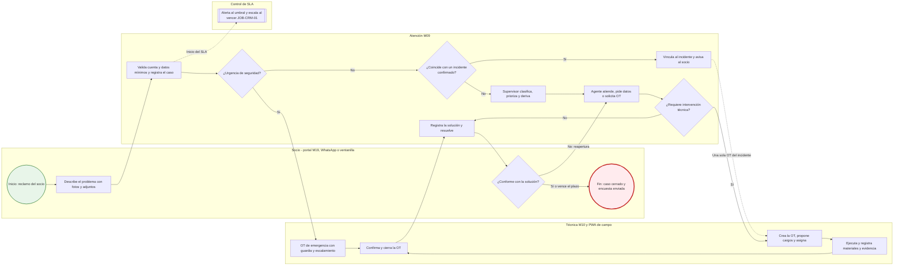

### 10.4 Pasos

| Paso | Actor | Actividad | Regla RN / RF aplicada | Evento EVT emitido |
|---|---|---|---|---|
| 1 | Socio | Inicia la gestión con tipología por servicio, descripción, fotos, ubicación opcional y contrato afectado. | RF-POR-109 | — |
| 2 | Atención (M09) | Valida la pertenencia de la cuenta (o marca "cuenta a identificar"), datos mínimos y vía de ingreso; registra el caso con número, SLA calculado y constancia; marca posibles duplicados sin bloquear. | RN-CRM-005, RN-CRM-058 | EVT-CRM-01 (`crm.case.created`) |
| 3 | Atención (M09) y Técnica (M10) | Si el subtipo es urgencia de seguridad, crea la OT de emergencia con prioridad crítica y protocolo, resuelve la guardia y escala sin aceptación en el plazo; el corte preventivo no requiere aprobación previa. | RF-CRM-122, RF-TEC-233, RN-TEC-116, PRM-TEC-152 | EVT-TEC-35 (`tec.emergency.declared`), EVT-TEC-36 (`tec.onCall.escalated`) |
| 4 | Supervisor y sistema (JOB-CRM-05) | Detecta reclamos coincidentes en una zona, confirma el incidente, vincula casos y pide una sola gestión técnica; la vinculación automática de nuevos reclamos depende de un parámetro. | PRM-CRM-039 | EVT-CRM-16 (`crm.incident.confirmed`) |
| 5 | Supervisor | Revisa servicio, cuenta, motivo, evidencia y propuesta de IA; acepta o corrige la clasificación y deriva al área. La IA solo propone. | RN-CRM-018, PA-CRM-02 | EVT-CRM-02 (`crm.case.classified`), EVT-CRM-03 (`crm.case.derived`) |
| 6 | Agente | Toma el caso, conversa, pide datos y solicita la OT si corresponde. | — | EVT-CRM-04 (`crm.case.assigned`), EVT-CRM-13 (`crm.commandRequest.requested`) |
| 7 | Técnica (M10) | Crea la OT con validación de duplicados; propone cargos "antes" y, si se aceptan, los crea como ítem facturable de M05. | RF-TEC-062 | EVT-TEC-04 (`tec.workOrder.created`), EVT-TEC-10 (`tec.charge.proposed`) |
| 8 | Técnico (PWA) | Ejecuta en campo o en forma administrativa, con operación sin conexión y sincronización con conflictos. | — | EVT-TEC-06 (`tec.workOrder.executed`), EVT-TEC-29 (si hay conflicto) |
| 9 | Técnica (M10) | Confirma validando requisitos de cierre, pagos pendientes y cadena de órdenes; aplica los efectos en el módulo dueño; registra cargos "luego" y lectura. | RF-TEC-062 | EVT-TEC-07 (`tec.workOrder.closed`) |
| 10 | Agente | Registra la solución, el código y el resultado; avisa al socio. | — | EVT-CRM-08 (`crm.case.resolved`) |
| 11 | Sistema (JOB-CRM-01) | Evalúa vencimientos con el calendario hábil; al umbral alerta y al vencer escala y marca el incumplimiento, que no se borra aunque luego se cumpla. | RF-CRM-103 | EVT-CRM-06 (`crm.case.slaWarning`), EVT-CRM-07 (`crm.case.slaBreached`) |
| 12 | Socio, agente o sistema (JOB-CRM-03) | Cierre por conformidad, por el empleado o automático tras el plazo; se envía la encuesta posterior. | — | EVT-CRM-09 (`crm.case.closed`) |
| 13 | Socio o supervisor | Reapertura dentro de la ventana; fuera de ella, caso nuevo vinculado. | — | EVT-CRM-10 (`crm.case.reopened`) |

### 10.5 Excepciones

| Excepción | Tratamiento | Fuente |
|---|---|---|
| Cuenta no identificada | El caso se crea igual con marca "cuenta a identificar". | RN-CRM-005 |
| Posible duplicado | Se marca para supervisión; no bloquea. | M09 §9.1 |
| El socio sigue sin servicio tras el restablecimiento del incidente | Se desvincula el caso, vuelve a atención y se pide OT individual. | M09 §9.6 |
| Falta información del socio | Estado de espera de información con pausa del SLA. | M09 §9.1, §9.7 |
| Visita fallida | Nueva visita; el caso sigue abierto. | EVT-TEC-14 |
| Conflicto de sincronización de campo | Se conservan las evidencias como hechos de campo y decide el supervisor. | M10 §9.4 |
| Encuesta negativa | Tarea de supervisión. | EVT-CRM-25 |
| Ingreso fuera de horario por el bot | Se informa horario y plazo, se crea el caso y se ofrece guardia si es urgencia. | M09 §9.8 |

### 10.6 Indicadores

| ID | Indicador | Fuente |
|---|---|---|
| KPI-CRM-01 | Casos abiertos | T10 |
| KPI-CRM-02 | Tiempo de primera respuesta | T10 |
| KPI-CRM-03 | Tiempo de resolución | T10 |
| KPI-CRM-04 | Cumplimiento SLA de casos | T10 |
| KPI-CRM-06 | Reincidencia | T10 |
| KPI-CRM-07 | CSAT | T10 |
| KPI-CRM-09 | Resolución en primer contacto | T10 |
| KPI-TEC-01 | OT pendientes | T10 |
| KPI-TEC-02 | Cumplimiento SLA de OT | T10 |
| KPI-TEC-03 | Demora promedio de OT | T10 |

Valores objetivo y plazos de SLA por tipo de reclamo: a definir por cada cooperativa en la configuración.

### 10.7 Cambios frente a ProCoop

| Aspecto | ProCoop | GoodApps |
|---|---|---|
| Naturaleza del reclamo | Es una orden técnica (y a veces una tabla aparte). | Es un caso de atención; la OT se solicita y se vincula. |
| Plazos | Sin SLA ni prioridad; filtros de término invertidos. | Políticas de SLA con pausa, alerta, escalamiento e incumplimiento registrado. |
| Incidentes | No relevado. | Incidente común con una sola OT y aviso a todos los afectados. |
| Inteligencia artificial | Podría aplicar sugerencias. | Solo propone; nunca deriva, cierra ni responde sin aprobación. |
| Órdenes | Borrado físico; numeración con riesgo de duplicados. | Anulación con compensación; contador atómico. |

---

## 11. P7 — Compras y pago a proveedores

**Procesos vinculados (v1.3).** P-TES-05, P-TES-06, P-TES-09, P-TES-13, P-WFL-04, P-WFL-05 detallan tramos de este proceso; además lo detallan 6 procesos `PRC-<MOD>-nn` (prefijos CMP); su ubicación está en el inventario de `04a` (ver [04a §5](04a-procesos-mapa-nivel0.md#5-vínculo-con-los-procesos-del-documento-base)).

### 11.1 Ficha del proceso

| Campo | Contenido |
|---|---|
| Objetivo | Comprar bienes y servicios con solicitud, cotización, orden de compra aprobada por bandas, recepción, factura conciliada en tres vías, orden de pago con retenciones y ejecución del pago con firmas. |
| Disparador | Necesidad de compra: reposición por stock mínimo, materiales faltantes de una OT u obra, fabricación o pedido manual. |
| Actores y carriles | Solicitante o depósito; Aprobadores (T11); Compras y cuentas a pagar (M12); Proveedor (portal de proveedores); Depósito (M13); Fiscal (M06); Tesorería (M14); Contabilidad (M15). |
| Resultado | Factura cancelada, pago ejecutado y conciliado, retenciones con certificado, asientos contabilizados. |
| Fuentes | M12 §9.1 a §9.6; M14 §9.5; M15 §9.1.5; alcance funcional §11.4. |

### 11.2 Situación actual en ProCoop

- El circuito de compras no es obligatorio: se admiten saltos como la factura o el remito directos (CTR-CMP-01, CTR-CMP-04).
- Las autorizaciones de solicitudes, órdenes y pagos no verifican permisos, y procesar un ítem autoriza la solicitud por defecto (CTR-CMP-06, RF-CMP-032).
- El remito y la factura mueven stock directamente desde compras (CTR-CMP-05).
- Las retenciones se calculan dentro de la orden de pago (CTR-CMP-07) y la contabilización es por lote posterior (CTR-CMP-08).
- La anulación borra la factura o deja las retenciones en cero (CTR-CMP-17).
- La orden de pago incluye firmas, entrega y medios de pago, y la firma y entrega masivas no validan permisos ni registran el usuario (CTR-CMP-20, CTR-TES-08).
- Al preparar el pago se reemplaza el vencimiento original de la factura (RF-CMP-107).

### 11.3 Proceso futuro

```mermaid
flowchart LR
  subgraph SOL["Solicitante o depósito"]
    S0(("Inicio: necesidad de compra"))
    S1["Crea la solicitud con servicio y centro de costo por línea"]
  end
  subgraph APR["Aprobadores T11"]
    A1{"¿Solicitud aprobada?"}
    A2{"¿OC aprobada por banda?"}
    A3{"¿Orden de pago aprobada?"}
  end
  subgraph CMP["Compras y cuentas a pagar M12"]
    C1["Pide cotizaciones y compara"]
    C2["Adjudica y emite la OC con compromiso de fondos"]
    C3["Registra la recepción contra la OC"]
    C4["Registra la factura del proveedor"]
    C5[["Control de tres vías JOB-CMP-02"]]
    C6{"¿Diferencia fuera de tolerancia?"}
    C7["Decide la excepción: aceptar, reclamar NC o rechazar"]
    C8["Prepara la orden de pago"]
    C9["Marca la orden de pago pagada"]
  end
  subgraph PRV["Proveedor - portal"]
    P1["Cotiza"]
    P2["Entrega bienes y emite factura"]
  end
  subgraph STK["Depósito M13"]
    D1["Ingresa el stock físico"]
  end
  subgraph FIS["Fiscal M06"]
    F1[["Calcula retenciones y numera certificados"]]
  end
  subgraph TES["Tesorería M14"]
    T1["Instrumenta medios y recaba firmas"]
    T2["Ejecuta el pago y concilia el débito"]
  end
  subgraph CON["Contabilidad M15"]
    K1(("Fin: pago ejecutado y contabilizado"))
  end
  S0 --> S1 --> A1
  A1 -->|"No: corrige o descarta"| S1
  A1 -->|"Sí"| C1 --> P1 --> C2 --> A2
  A2 -->|"No"| C2
  A2 -->|"Sí"| P2
  P2 --> C3 --> D1
  P2 --> C4 --> C5
  C3 --> C5
  C5 --> C6
  C6 -->|"Sí"| C7 --> C5
  C6 -->|"No"| C8 --> F1 --> A3
  A3 -->|"No"| C8
  A3 -->|"Sí"| T1 --> T2 --> C9 --> K1
  classDef inicio fill:#e8f5e9,stroke:#2e7d32,stroke-width:2px
  classDef fin fill:#ffebee,stroke:#c62828,stroke-width:4px
  class S0 inicio
  class K1 fin
```

### 11.4 Pasos

| Paso | Actor | Actividad | Regla RN / RF aplicada | Evento EVT emitido |
|---|---|---|---|---|
| 1 | Solicitante o depósito | Crea la solicitud de abastecimiento con ítems, criticidad y, por línea, servicio, centro de costo, OT u obra; conserva el vínculo con su origen. | RF-CMP-030, RF-CMP-031 | — |
| 2 | Aprobadores (T11) | Aprueban por política (monto, área, criticidad), con doble aprobación opcional; procesar un ítem nunca autoaprueba. | RF-CMP-032 | EVT-CMP-03 (`cmp.supplyRequest.approved`) |
| 3 | Compras | Genera solicitudes de cotización a uno o varios proveedores y compara en un cuadro. | RF-CMP-040, RF-CMP-042 | — |
| 4 | Compras y aprobadores | Emite la OC; la aprobación por bandas de monto y categoría con segregación es previa al envío; publica el compromiso de fondos. | RF-CMP-050, RF-CMP-052, RF-CMP-057 | EVT-CMP-04 (`cmp.purchaseOrder.approved`) |
| 5 | Compras | Envía la OC al proveedor por correo y portal; el proveedor confirma. | RF-CMP-053 | — |
| 6 | Receptor y depósito (M13) | Registra la recepción contra una o varias OC, con parciales y tolerancia de excesos; M12 no mueve stock: M13 registra el ingreso físico. | RF-CMP-060, RF-CMP-061, RF-CMP-063 | EVT-CMP-06 (`cmp.receipt.confirmed`), EVT-STK-01 (`stk.goods.received`) |
| 7 | Cuentas a pagar | Registra la factura del proveedor con importes por alícuota, percepciones e imputación por línea. | RF-CMP-070 | EVT-CMP-08 (`cmp.supplierInvoice.registered`) |
| 8 | Sistema (JOB-CMP-02) | Concilia cada línea con OC y recepción (cantidad, precio y condiciones); crea una excepción por diferencia fuera de tolerancia; las compras sin OC solo se admiten en categorías definidas. | RF-CMP-090, RF-CMP-091, RF-CMP-093 | EVT-CMP-10 (`cmp.matchException.raised` / `.decided`), EVT-CMP-09 (`cmp.supplierInvoice.released`) |
| 9 | Cuentas a pagar y Fiscal (M06) | Prepara la orden de pago con comprobantes habilitados y anticipos; M06 calcula las retenciones y el neto a pagar. | RF-CMP-100, RF-CMP-101 | EVT-CMP-15 (`cmp.paymentOrder.prepared`) |
| 10 | Aprobadores (T11) y M06 | Aprueban la orden de pago por bandas con segregación; M06 confirma las retenciones y numera los certificados. | RF-CMP-104 | EVT-CMP-11 (`cmp.paymentOrder.approved`), EVT-FIS-12 (`fis.withholding.confirmed`) |
| 11 | Tesorería (M14) | Crea la ejecución, instrumenta medios (Σ = neto), recaba firmas según regla con segregación, entrega o envía y confirma la ejecución. | RF-TES-117 | EVT-TES-15 (`tes.paymentExecution.signed` / `.executed`) |
| 12 | Cuentas a pagar | Marca la orden pagada y cancela saldos sin reemplazar el vencimiento original. | RF-CMP-106, RF-CMP-107 | EVT-CMP-13 (`cmp.paymentOrder.paid`) |
| 13 | Contabilidad (M15) | Contabiliza factura, retención y pago por evento (asientos tipo M-57, M-48 y M-58 de M15 §9.1.5). | RN-CON-011 | EVT-CON-01 (`con.entry.posted`) |

### 11.5 Excepciones

| Excepción | Tratamiento | Fuente |
|---|---|---|
| Factura que llega antes del remito | Queda retenida; la recepción posterior consume el pendiente y la conciliación la libera. | M12 §9.3; RF-CMP-076 |
| Diferencia de cantidad (ejemplo CU-19: 10 facturados, 6 recibidos) | Excepción con importe en disputa; retención o habilitación parcial según política. | M12 §9.1 |
| Servicio sin recepción material | La conformidad del responsable reemplaza la recepción. | RF-CMP-062 |
| Exceso de entrega sobre tolerancia | Rechazo o aprobación. | RF-CMP-063 |
| Depósito rechaza la recepción | Recepción con stock pendiente y alerta. | RF-CMP-061 |
| CBU del proveedor con cambio pendiente | La orden de pago no lo usa hasta su aprobación. | RF-CMP-003 |
| Rechazo de una línea de pago | Reinstrumentación sin duplicar. | M14 §9.5 |
| Anulación del pago o de la orden | Reposición exacta de saldos y anulación de retenciones sin borrado. | RF-CMP-106 |
| Comprobantes de ARCA no registrados | Borradores para revisión humana. | M12 §9.4; RF-CMP-120 |

### 11.6 Indicadores

| ID | Indicador | Fuente |
|---|---|---|
| KPI-CMP-01 | OC atrasadas | T10 |
| KPI-CMP-02 | Facturas sin OC | T10 |
| KPI-CMP-03 | Excepciones de tres vías abiertas | T10 |
| KPI-CMP-04 | Entregas a término | T10 |
| KPI-CMP-05 | Comprometido, devengado y pagado | T10 |

Tiempo de ciclo de compra y de pago: a definir.

### 11.7 Cambios frente a ProCoop

| Aspecto | ProCoop | GoodApps |
|---|---|---|
| Circuito | Opcional, con saltos. | Completo con control de tres vías obligatorio; saltos solo como excepciones controladas (PA-CMP-07, asumida DEC-072). |
| Autorizaciones | Sin verificación de permisos; autoautorización al procesar. | Workflow T11 con capacidad, bandas y segregación. |
| Stock | Remito y factura mueven stock. | M12 publica eventos; M13 mueve stock. |
| Retenciones | Calculadas dentro de la orden de pago. | Motor de M06; M12 aplica el resultado. |
| Contabilidad | Lote posterior. | Asiento en línea por evento. |
| Anulación | Borra la factura o pone retenciones en cero. | Nunca borra; conserva importes. |
| Firmas y entrega | En la orden de pago de compras. | M12 aprueba; M14 firma, entrega y ejecuta. |

---

## 12. P8 — Cierre contable mensual

**Procesos vinculados (v1.3).** P-COB-19, P-TES-15, P-CON-01, P-CON-02, P-CON-03, P-CON-04, P-CON-05, P-CON-06, P-CON-07, P-CON-08 detallan tramos de este proceso; su ubicación está en el inventario de `04a` (ver [04a §5](04a-procesos-mapa-nivel0.md#5-vínculo-con-los-procesos-del-documento-base)).

### 12.1 Ficha del proceso

| Campo | Contenido |
|---|---|
| Objetivo | Contabilizar en línea los eventos económicos de todos los módulos y cerrar el período mensual con un checklist verificable, conciliaciones de auxiliares y bloqueo de los módulos operativos. |
| Disparador | Continuo: cada evento económico publicado. Cierre: fecha de corte del período. |
| Actores y carriles | Módulos operativos productores de eventos (M05, M06, M07, M08, M12, M13, M14 y otros); Sistema contable (M15); Contador; Aprobación (T11). |
| Resultado | Período cerrado con todos los módulos bloqueados a la fecha, sin eventos pendientes y con conciliaciones balanceadas o explicadas. |
| Fuentes | M15 §9.1 a §9.5, §9.9; DEC-009, DEC-069; PA-CON-01. |

**Convivencia con ProCoop.** Durante la convivencia, la contabilidad oficial sigue en ProCoop hasta el corte administrativo; GoodApps contabiliza en un plan marcado como no oficial, concilia contra ProCoop y se oficializa en el corte (DEC-069). Mientras tanto se exportan asientos resumidos a ProCoop (RF-MIG-082).

### 12.2 Situación actual en ProCoop

- La contabilización es un lote desacoplado ("cierre automático") por rango de fechas y módulos (CTR-CON-01); tesorería también se contabiliza en lote (CTR-TES-07).
- Los asientos se pueden eliminar física e individualmente o en masa (CTR-CON-02).
- La importación de asientos acepta asientos parciales y no valida el período (CTR-CON-07).
- El stock se valoriza a demanda al momento del cierre (CTR-CON-14).
- Los saldos contables se guardan en campos del plan de cuentas (RN-CON-092).

### 12.3 Proceso futuro

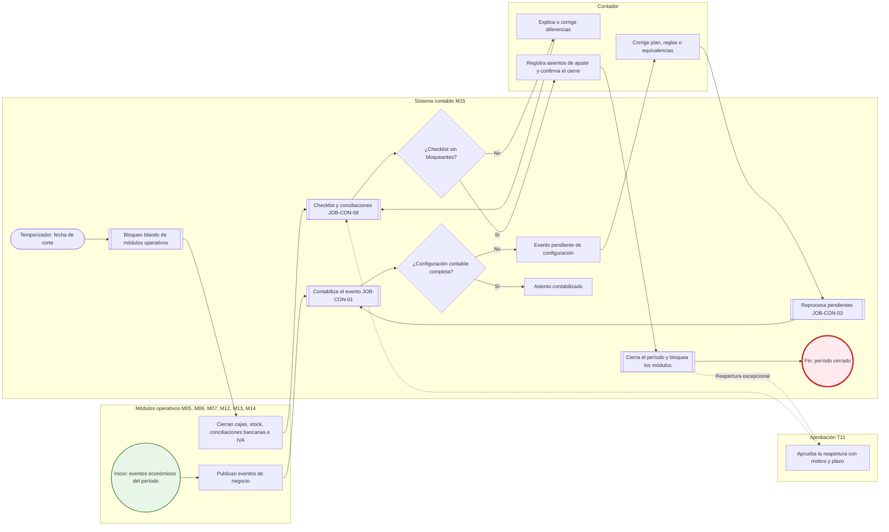

### 12.4 Pasos

| Paso | Actor | Actividad | Regla RN / RF aplicada | Evento EVT emitido |
|---|---|---|---|---|
| 1 | Módulos operativos | Publican los eventos económicos (facturación, cobranza, compras, stock, tesorería, fiscal) según la matriz evento → asiento tipo de M15 §9.1. | — | Por ejemplo EVT-FAC-07, EVT-COB-04, EVT-CMP-08, EVT-TES-15 |
| 2 | Sistema (JOB-CON-01) | Recibe el evento con idempotencia, resuelve cada renglón por la cascada de cuentas (entidad → regla → rol), valida el período y el balance y contabiliza en una transacción. | RN-CON-011, RN-CON-022 | EVT-CON-01 (`con.entry.posted`) |
| 3 | Sistema | Si falta una cuenta, un centro obligatorio o una equivalencia, el evento queda pendiente de configuración con sus causas. | — | EVT-CON-04 (`con.event.pendingConfiguration`) |
| 4 | Contador y sistema (JOB-CON-03) | Corrige la configuración y publica una versión; se reprocesan los eventos pendientes que la referencian. | — | Consume EVT-CON-11 (`con.config.published`) |
| 5 | Sistema (JOB-CON-02, opcional) | En los módulos configurados en modo resumen, contabiliza por lote con vista previa y confirmación; es idempotente. | RN-CON-011, PA-CON-01 | EVT-CON-01 |
| 6 | Sistema | A la fecha de corte aplica el bloqueo blando de los módulos operativos. | — | EVT-CON-06 (`con.period.locked`) |
| 7 | Módulos y contador | Completan el checklist: eventos pendientes en cero, cajas cerradas, amortización contabilizada, provisiones corridas, posición de IVA, conciliaciones obligatorias balanceadas o explicadas, diferencia de cambio. | PRM-CON-013 | Consume EVT-COB-12, EVT-STK-18, EVT-FIS-15, EVT-TES-05 |
| 8 | Sistema (JOB-CON-08) | Compara cada auxiliar con su cuenta de control y clasifica las diferencias. El saldo contable se deriva solo de renglones contabilizados. | RN-CON-092 | EVT-CON-13 (`con.reconciliation.differenceDetected`) |
| 9 | Contador | Registra asientos de ajuste manuales; los asientos de períodos cerrados solo se corrigen con contraasiento. | RN-CON-013 | EVT-CON-01 |
| 10 | Sistema | Cierra el período y bloquea todos los módulos a la fecha. | — | EVT-CON-07 (`con.period.closed`) |
| 11 | Contador y aprobación (T11) | Reapertura excepcional con motivo, aprobación y plazo. | — | EVT-CON-08 (`con.period.reopened`) |

### 12.5 Excepciones

| Excepción | Tratamiento | Fuente |
|---|---|---|
| Evento duplicado | Responde sin efecto. | RN-CON-011 |
| Período del módulo bloqueado | Fecha del primer día abierto con nota o error, según la política del módulo. | M15 §9.2 |
| Diferencia de redondeo sobre la tolerancia | Error del evento. | M15 §9.2 |
| Reintentos agotados | Evento en error con alerta y bandeja operativa. | M15 §9.2; EVT-CON-05 |
| Diferencia de auxiliar sin explicar | Bloquea el checklist hasta su explicación o corrección. | M15 §9.5, §9.9 |
| Reversión de un asiento de período cerrado | Contraasiento con fecha del período abierto. | M15 §9.2; RN-CON-013 |

### 12.6 Indicadores

| ID | Indicador | Fuente |
|---|---|---|
| KPI-CON-04 | Diferencias de auxiliares | T10 |
| KPI-CON-05 | Períodos con bloqueantes de cierre | T10 |

Duración objetivo del cierre mensual (días hábiles desde la fecha de corte): a definir.

### 12.7 Cambios frente a ProCoop

| Aspecto | ProCoop | GoodApps |
|---|---|---|
| Momento de contabilización | Lote desacoplado. | En línea por evento, con modo resumen configurable e idempotente. |
| Correcciones | Eliminación física, individual o masiva. | Anulación lógica en período abierto o contraasiento. |
| Importación de asientos | Acepta parciales sin validar período. | Todo o nada por archivo con validación previa (RF-CON-045). |
| Saldos | Campos guardados en el plan de cuentas. | Derivados de los renglones contabilizados. |
| Valorización de stock | A demanda en el cierre. | Costo perpetuo informado por M13 en cada evento. |
| Cierre | No relevado como checklist formal. | Checklist con bloqueantes, conciliaciones obligatorias y bloqueo de módulos. |

---

## 13. P9 — Servicio social de sepelio: alta, carencia y prestación

**Procesos vinculados (v1.3).** Ningún proceso con identificador `P-` detalla tramos de este proceso; además lo detallan 10 procesos `PRC-<MOD>-nn` (prefijos SOC); su ubicación está en el inventario de `04a` (ver [04a §5](04a-procesos-mapa-nivel0.md#5-vínculo-con-los-procesos-del-documento-base)).

### 13.1 Ficha del proceso

| Campo | Contenido |
|---|---|
| Objetivo | Adherir al socio y a su grupo familiar al servicio de sepelio, facturar la cuota según los adherentes vigentes, verificar la cobertura y la carencia a la fecha del evento y brindar la prestación y, si el plan lo incluye, el subsidio por fallecimiento. |
| Disparadores | (a) Solicitud de adhesión del socio o propuesta de alta automática con consentimiento; (b) aviso de fallecimiento o solicitud de prestación. |
| Actores y carriles | Socio o familiar; Atención (M09) y portal (M19); Contratos (M02); Servicios sociales (M18); Personas (M01); Prestador (empresa fúnebre, vía convenio); Tarifas (M04) y Facturación (M05); Compras (M12) y Tesorería (M14); Aprobación (T11). |
| Resultado | Grupo de cobertura vigente y facturado; prestación cerrada con conformidad; subsidio pagado o solicitud no cubierta con motivo. |
| Fuentes | M18 §9.1 a §9.3; T12 ficha SEP; DEC-023, DEC-071, DEC-072. |

### 13.2 Situación actual en ProCoop

- El sistema agrega el servicio de sepelio automáticamente al conectar otro servicio, como energía (RN-SOC-016).
- Desconectar el servicio da de baja a adherentes y beneficiarios (RN-SOC-008) y, al transferir el servicio, un parámetro permite eliminar los adherentes (RN-SOC-013, CTR-SOC-08).
- La mayoría de edad se controla con un valor fijo de 21 años y un aviso por correo (RN-SOC-004).
- La cuota se calcula por cantidad de adherentes y por categoría, con una franquicia de adherentes que no se cobran (RN-SOC-017, RN-SOC-018).
- Cobertura a la fecha del evento y carencia: no relevado (RN-SOC-020, RN-SOC-021).
- Carencia de rehabilitación tras una suspensión por mora: no existe en ProCoop (RN-SOC-054).
- Solicitud de prestación, coordinación con el prestador y subsidio por fallecimiento: no relevado.

### 13.3 Proceso futuro

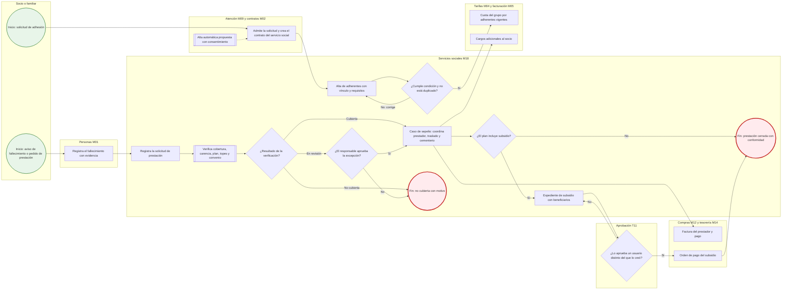

### 13.4 Pasos

| Paso | Actor | Actividad | Regla RN / RF aplicada | Evento EVT emitido |
|---|---|---|---|---|
| 1 | Socio o regla de alta automática | Solicita la adhesión (M19/M09) o recibe una propuesta de alta automática que requiere consentimiento; solo los servicios obligatorios con fundamento normativo se dan de alta directamente. | RF-CAT-086, DEC-023 | EVT-CRM-01 (`crm.case.created`) |
| 2 | Contratos (M02) | Crea y activa el contrato del servicio social. | RN-CAT-064 | EVT-CAT-09 (`cat.contract.activated`) |
| 3 | Operador o socio (M18) | Agrega adherentes (persona en M01, vínculo, requisitos) con validación de condición, adherente titular, duplicados, vínculo con otro titular y advertencia de deuda. | RN-SOC-001, RN-SOC-005, RN-SOC-006, RN-SOC-007, RN-SOC-014 | EVT-SOC-01 (`soc.dependent.added`) |
| 4 | Tarifas (M04) y Facturación (M05) | Calculan la cuota del grupo con la cantidad de adherentes vigentes al último día del período y la franquicia. | RN-SOC-017, RN-SOC-018 | EVT-FAC-07 (`fac.invoice.issued`) |
| 5 | Sistema (JOB-SOC-01) | Detecta la mayoría de edad configurable por plan y vínculo, avisa y propone baja o recategorización; los adherentes con discapacidad acreditada no se dan de baja por edad. | RN-SOC-004, RN-SOC-002 | EVT-SOC-02 (`soc.dependent.majorityReached`) |
| 6 | Supervisor (M01) | Registra el fallecimiento con fecha y evidencia; M18 da de baja las adhesiones de la persona con causa "fallecimiento". | RF-PER-009, RN-SOC-011 | EVT-PER-03 (`per.person.deceased`), EVT-SOC-01 (`.ended`) |
| 7 | Atención o servicios sociales | Registra la solicitud de prestación con beneficiario y fecha del evento. | RF-SOC-031 | — |
| 8 | Sistema (M18) | Verifica la cobertura a la fecha del evento: contrato, adherente, carencia desde el alta de cada adherente, plan, topes, convenio con el prestador y carencia de rehabilitación si la cobertura estuvo suspendida por mora. La deuda no decide prestaciones sanitarias. | RN-SOC-020, RN-SOC-021, RN-SOC-054, RN-SOC-022, PRM-SOC-013, PRM-SOC-052 | — |
| 9 | Responsable (T11) | Resuelve los casos en revisión con plazo; la deuda solo advierte y la decisión la toma un responsable. | RF-SOC-036 | EVT-SOC-03 (`soc.benefitRequest.decided`) |
| 10 | Servicios sociales | Abre el caso de sepelio, coordina con el prestador y vincula traslado y acto de cementerio si corresponde. | RF-SOC-039 | — |
| 11 | M04/M05 y M12 | Los cargos adicionales a cargo del socio se facturan como ítem facturable; la factura del prestador se registra en compras. | — | EVT-CMP-08 (`cmp.supplierInvoice.registered`) |
| 12 | Servicios sociales, aprobación (T11) y Tesorería (M14) | Subsidio: expediente con beneficiarios y requisitos según el reglamento versionado; aprobación por un usuario distinto del creador; orden de pago en M14. | RF-SOC-044, RF-SOC-045 | EVT-WFL-010 (`wfl.approval.decided`), EVT-SOC-04 (`soc.deathSubsidy.approved`), EVT-TES-15 (`tes.paymentExecution.executed`) |
| 13 | Servicios sociales (JOB-SOC-03) | Cierra la prestación con conformidad; marca vencidos los subsidios fuera de plazo. | — | — |

### 13.5 Excepciones

| Excepción | Tratamiento | Fuente |
|---|---|---|
| Evento dentro de la carencia | Resultado "no cubierta" por carencia con opción de excepción (escenario ESC-T12-SEP-02). | T12 ficha SEP; RN-SOC-021 |
| Evento durante la suspensión por mora o dentro de la carencia de rehabilitación | La solicitud queda en revisión con motivo; se puede excepcionar; nunca afecta urgencias ni prestaciones sanitarias. Requiere la restricción habilitada en M08 (apagada por defecto). | RN-SOC-054, RN-MOR-143, PRM-MOR-204, EVT-MOR-21 |
| Autoaprobación del subsidio | Se rechaza; debe aprobar otro usuario (escenario ESC-T12-SEP-04). | T12 ficha SEP |
| Adherente fuera de la edad del plan | Rechazo con motivo "edad fuera de rango"; reenviar la misma clave no crea un adherente. | T12 ficha SEP (ESC-T12-SEP-05) |
| Sin categoría para la cantidad de adherentes | Error explícito en la validación del plan. | RN-SOC-017 |
| Subsidio reclamado fuera de plazo | Expediente vencido. | M18 §9.3; JOB-SOC-03 |

### 13.6 Indicadores

| ID | Indicador | Fuente |
|---|---|---|
| KPI-SOC-01 | Adherentes vigentes | T10 |
| KPI-SOC-02 | Costo por beneficiario | T10 |

Tiempo de respuesta de la solicitud de prestación y de pago del subsidio: a definir.

### 13.7 Cambios frente a ProCoop

| Aspecto | ProCoop | GoodApps |
|---|---|---|
| Alta automática | Se agrega al conectar otro servicio. | Directa solo para obligatorios con fundamento normativo; los opcionales se proponen con consentimiento (DEC-023). |
| Historia del grupo | Puede eliminarse al transferir. | Nunca se borra; baja con causa "transferencia". |
| Mayoría de edad | 21 años fijo. | Edad configurable por plan y vínculo, con aviso por T09. |
| Cobertura y carencia | No relevado. | Verificación a la fecha del evento con carencia por adherente y excepción autorizada (PA-SOC-11, asumida DEC-072). |
| Rehabilitación tras mora | No existe. | Carencia de rehabilitación configurable que no afecta urgencias. |
| Subsidio | No relevado. | Expediente con reglamento versionado, segregación de la aprobación y pago por M14 (PA-SOC-10, asumida DEC-072). |

---

## 14. P10 — Migración y corte por etapas desde ProCoop

**Procesos vinculados (v1.3).** P-IAM-12, P-IAM-14 detallan tramos de este proceso; además lo detallan 7 procesos `PRC-<MOD>-nn` (prefijos MIG); su ubicación está en el inventario de `04a` (ver [04a §5](04a-procesos-mapa-nivel0.md#5-vínculo-con-los-procesos-del-documento-base)).

### 14.1 Ficha del proceso

| Campo | Contenido |
|---|---|
| Objetivo | Trasladar los datos de cada cooperativa desde ProCoop a GoodApps y convivir hasta apagarlo, sin interrumpir la operación diaria y sin perder trazabilidad de saldos, documentos, equipos ni histórico. |
| Disparador | Inicio del proyecto de migración de una cooperativa (un proyecto por tenant). |
| Actores y carriles | ProCoop (sistema de origen); Implementador y analista; Herramienta de migración (T07); Responsables funcionales y contador de la cooperativa; Líder del proyecto y responsable de la cooperativa. |
| Resultado | Dominios cortados por etapas con un único sistema de registro en cada momento, acta de aceptación y ProCoop apagado (solo consulta hasta el cierre del ejercicio, luego archivo). |
| Fuentes | T07 §1, §9.1 a §9.11, §5.9, §6; DEC-068, DEC-069, DEC-070, DEC-081 (Reemplazado por DEC-088). |

### 14.2 Situación actual en ProCoop

Las cooperativas operan hoy con ProCoop: base de datos SQL Server, aplicación de escritorio y portal CoopOnline sobre una base separada (T07 §1). ~~La cooperativa piloto de migración no está definida; la base relevada de Laguna Larga se usa solo como referencia para el mapeo y las pruebas de paralelo (DEC-081).~~ Reemplazado por DEC-088: la cooperativa piloto comercial y de migración es Laguna Larga (`LAG`), cuya base relevada sigue siendo la referencia del mapeo y de las pruebas de paralelo; su primera migración real ocurre después de O7 y el corte avanza por etapas hasta O11. El proceso de migración en sí es nuevo; no se relevaron migraciones anteriores hacia o desde ProCoop.

### 14.3 Proceso futuro

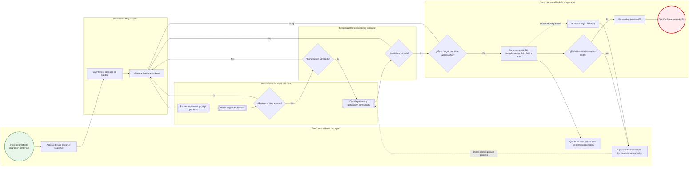

### 14.4 Pasos

| Paso | Actor | Actividad | Regla RN / RF aplicada | Evento EVT emitido |
|---|---|---|---|---|
| 1 | Implementador | Inventario (F1): registra fuentes con acceso de solo lectura, extrae el snapshot completo, cuenta filas y detecta módulos sin uso. | RN-MIG-001, RN-MIG-003 | EVT-MIG-01 (`mig.snapshot.ready`) |
| 2 | Analista | Perfilado de calidad (F2): huérfanos, duplicados, documentos y CUIT, domicilios, importes y fechas anómalas. | — | — |
| 3 | Implementador y responsables | Mapeo (F3): ajustes del conjunto de mapeo, mapas de valores, grupos de facturación y parámetros. | RN-MIG-049 | — |
| 4 | Analista y cooperativa | Limpieza (F4): corrección en origen o en staging; fusiones de personas aprobadas, nunca automáticas con documentos distintos. | RN-MIG-014 | EVT-MIG-03 (`mig.issue.assigned`) |
| 5 | Herramienta | Extracción (F5) completa, delta o final, con manifiesto y huella; las credenciales nunca salen del origen. | RN-MIG-013 | EVT-MIG-01 |
| 6 | Herramienta | Transformación y carga (F6, F7) en orden topológico mediante el servicio de cada módulo dueño; sin eventos externos ni notificaciones; conflicto ante documentos modificados operativamente. | RN-MIG-042, RN-MIG-043 | EVT-MIG-02 (`mig.run.started` / `.loaded`) |
| 7 | Herramienta y analista | Validación (F8): integridad e invariantes; la corrida queda cargada solo sin rechazos bloqueantes. | RN-MIG-039 | EVT-MIG-02 (`.failed` / `.accepted`) |
| 8 | Responsables funcionales y contador | Conciliación (F9) de deuda documento por documento, saldos, stock, contabilidad y fondos con tolerancias definidas; quien ejecuta no aprueba. | RN-MIG-006, RN-MIG-040, RN-MIG-041 | EVT-MIG-04 (`mig.reconciliation.approved`) |
| 9 | Facturación e implementador | Corrida paralela (F10): simula el ciclo sin CAE, sin publicación a entes ni notificaciones; compara factura por factura y clasifica cada diferencia. | RN-MIG-030, RF-MIG-072, PA-MIG-02 | EVT-MIG-05 (`mig.parallel.compared` / `.approved`) |
| 10 | Líder y cooperativa | Corte comercial E2 (by-pass de M01 a M09 y portal): un único sistema de registro por dominio; resolutor de claves heredadas para cobros con claves de ProCoop. | RN-MIG-031, RF-MIG-080, RF-MIG-083, DEC-068 | EVT-MIG-06 (`mig.domain.switched`) |
| 11 | Líder y cooperativa | Runbook de corte: sin comprobantes pendientes de CAE en ProCoop, cierre de cajas, congelamiento, snapshot final, delta final, conciliaciones finales, último número autorizado en ARCA, go/no-go con doble aprobación, activación de emisión, entes y portal, acta. | RN-MIG-028, RN-MIG-029, RF-MIG-086, RF-MIG-087 | EVT-MIG-07 (`mig.cutover.completed`) |
| 12 | Herramienta | Convivencia: exporta a ProCoop asientos resumidos, cobranzas para tesorería y retiros de materiales para los dominios que siguen allí. | RF-MIG-082, DEC-069 | — |
| 13 | Líder y cooperativa | Corte administrativo E3: compras, stock, tesorería, contabilidad y retenciones pasan a GoodApps. | DEC-068 | EVT-MIG-06 |
| 14 | Líder y cooperativa | Apagado E4: ProCoop solo consulta hasta el cierre del ejercicio y luego archivo; histórico según DEC-070. | DEC-070 | — |
| 15 | Líder y cooperativa | Rollback: antes de la primera emisión fiscal real o del primer cobro por entes, retorno con reinyección del diario de hechos; después, solo hacia adelante. Doble aprobación. | RF-MIG-088, RF-MIG-089 | EVT-MIG-08 (`mig.rollback.executed`) |

### 14.5 Excepciones

| Excepción | Tratamiento | Fuente |
|---|---|---|
| Rechazos bloqueantes en la carga (por ejemplo, cuenta sin titular) | La corrida no queda cargada; vuelve a limpieza o se excluye con aprobación. | T07 §9.5; RN-MIG-039 |
| CUIT con dígito verificador inválido | Persona cargada con CUIT inválido en cola de saneamiento; no recibe factura A hasta corregir. | T07 §9.5 |
| Documento modificado en GoodApps antes de un reproceso | Conflicto, nunca sobrescritura. | RN-MIG-042 |
| Diferencias en el paralelo | Clasificación con responsable; las diferencias intencionales se documentan como regla. | T07 §9.6 |
| Pagos de entes con clave heredada ambigua | Pago a cuenta con aviso; nunca imputa a una factura paga. | RF-MIG-083; RN-MIG-033 |
| Criterio go en rojo | No se habilita el corte. | RF-MIG-086 |
| Incidente bloqueante después del corte | Rollback dentro de la ventana; luego solo hacia adelante. | T07 §9.11 |

### 14.6 Indicadores

| ID | Indicador | Fuente |
|---|---|---|
| KPI-MIG-01 | Paralelo: comprobantes iguales | T10 |
| KPI-MIG-02 | Índice de calidad por dominio | T10 |

Duración objetivo de cada etapa y fecha de cada corte: a definir con la cooperativa piloto, ~~que aún no está definida (DEC-081)~~ Laguna Larga (`LAG`) (Reemplazado por DEC-088).

### 14.7 Cambios frente a ProCoop

| Aspecto | Situación de partida | GoodApps |
|---|---|---|
| Estructura | Una base por cooperativa, con portal en otra base. | Un tenant por cooperativa con varias entidades jurídicas (DEC-064). |
| Credenciales | Guardadas en tablas del sistema. | Nunca se migran; se reingresan en la bóveda. |
| Anulaciones e historia | Registros copiados a tablas de anulados e historiales sin fecha efectiva. | Estado del documento original con reversión y versiones con vigencia. |
| Portal | CoopOnline sincronizado desde la base principal. | Se apaga en el corte comercial; los socios pasan al portal GoodApps con sus usuarios migrados sin contraseñas (RF-MIG-090). |
| Convivencia | — | Un único sistema de registro por dominio; corte comercial antes que administrativo (DEC-068). |

---

## 15. Matriz de procesos y módulos

Leyenda: **D** dueño del proceso o de un tramo principal; **P** participa; vacío: no interviene según las fuentes.

| Módulo | P1 | P2 | P3 | P4 | P5 | P6 | P7 | P8 | P9 | P10 |
|---|---|---|---|---|---|---|---|---|---|---|
| M01 Personas | D | | | | P | | | | P | P |
| M02 Catálogo y contratos | D | | | | P | | | | D | P |
| M03 Medición | | D | P | | | | | | | P |
| M04 Tarifas | P | P | D | | | | | | P | P |
| M05 Facturación | P | P | D | | P | P | | P | P | P |
| M06 Fiscal | | | D | | | | P | P | | P |
| M07 Cobranza | | | P | D | P | | | P | | P |
| M08 Mora | | | P | P | D | | | | P | P |
| M09 Atención | D | | | | P | D | | | P | P |
| M10 Técnica | D | P | | | D | D | | | | P |
| M11 Ventas | P | | | | | | | | | P |
| M12 Compras | | | | | | | D | P | P | P |
| M13 Stock | P | | | | | P | P | P | | P |
| M14 Tesorería | | | | D | | | D | P | P | P |
| M15 Contabilidad | | | | | | | P | D | | P |
| M18 Servicios sociales | | | | | | | | | D | P |
| M19 Portal | P | | P | P | | P | | | P | P |
| T06 Integraciones | P | P | P | P | P | | P | | | |
| T07 Migración | | | | | | | | | | D |
| T09 Comunicaciones | P | | P | | P | P | | | P | |
| T11 Workflow | P | | P | P | P | P | P | P | P | |

## 16. Puntos a definir y no relevados (consolidado)

### 16.1 No relevado (situación actual en ProCoop)

| Proceso | Punto no relevado |
|---|---|
| P6 | Tratamiento de incidentes comunes que agrupan varios reclamos. |
| P8 | Existencia de un checklist formal de cierre mensual en ProCoop. |
| P9 | Cobertura a la fecha del evento y carencia (RN-SOC-020, RN-SOC-021); solicitud de prestación, coordinación con el prestador y subsidio por fallecimiento. |
| P10 | Migraciones anteriores hacia o desde ProCoop (el proceso de migración es nuevo). |

### 16.2 A definir

| Proceso | Punto a definir | Referencia |
|---|---|---|
| Todos | Valores objetivo (metas) de los indicadores; las fuentes definen el cálculo pero no la meta. | T10 (catálogo KPI) |
| P3 | Duración objetivo del ciclo de facturación completo. | — |
| P6 | Plazos de SLA por tipo y subtipo de reclamo en cada cooperativa (son configuración del tenant). | M09 §9.7 |
| P7 | Tiempo de ciclo de compra y de pago. | — |
| P8 | Duración objetivo del cierre mensual. | — |
| P9 | Tiempo de respuesta de la prestación y de pago del subsidio; reglamento del servicio social del tenant para la carencia de rehabilitación. | RN-SOC-054 |
| P10 | ~~Cooperativa piloto de migración,~~ fechas y duración de cada etapa de corte. La cooperativa piloto ya está definida: Laguna Larga (`LAG`). | ~~DEC-081~~ Reemplazado por DEC-088 |

### 16.3 Supuestos a validar con la cooperativa

Las siguientes preguntas abiertas condicionan los procesos y están asumidas con la opción recomendada por DEC-072; el solicitante puede revisarlas en cualquier momento.

| PA | Proceso | Opción asumida |
|---|---|---|
| PA-COB-05 | P4 | Pago online con diferencia de importe: aceptar, imputar y mandar la diferencia a revisión. |
| PA-COB-08 | P4 | Arqueo con declaración por cada medio de pago. |
| PA-TES-06 | P4 | Doble control: M07 cierra y arquea; tesorería acepta u observa. |
| PA-MOR-12 | P5 | Costos de notificación y reconexión deshabilitados o gratuitos, habilitables con respaldo. |
| PA-MOR-13 | P5 | Caducidad del convenio: 3 cuotas impagas o 60 días; el saldo de capital queda exigible y la deuda original no revive. |
| PA-CRM-02 | P6 | Supervisión obligatoria; las reglas solo proponen; auto-derivación habilitable, apagada por defecto. |
| PA-CMP-04 | P7 | Tolerancias del control de tres vías: cantidad 0 %, precio ±2 % con tope, configurables. |
| PA-CMP-07 | P7 | Compras sin OC solo en categorías definidas con aprobación posterior. |
| PA-CON-01 | P8 | Contabilización en tiempo real en el ERP administrativo y resumen diario en facturación y cobranza masiva. |
| PA-CON-04 | P8 | Borradores eliminables; contabilizados de período abierto con anulación lógica; resto con contraasiento. |
| PA-SOC-10 | P9 | Subsidio configurable por plan; por defecto fondo propio por reglamento con pago por M14. |
| PA-SOC-11 | P9 | Carencia configurable por plan, desde el alta de cada adherente, con excepción autorizada. |
| PA-MIG-02 | P10 | Paralelo aprobado con 2 ciclos consecutivos por servicio sin diferencias sin explicar. |
| PA-MIG-03 | P10 | Delta unidireccional ProCoop → GoodApps mientras ProCoop es maestro; luego exportaciones hacia ProCoop. |
| PA-MIG-16 | P10 | Alias de claves heredadas vigentes hasta el último vencimiento emitido por ProCoop más 180 días. |

## 17. Ampliación: procesos de la sección 9 de los anexos (partes 04a a 04v)

La versión 1.1 detalló los 94 procesos con identificador `P-XXX-nn` que definen seis anexos. La versión 1.2 amplía el universo a todas las subsecciones de proceso de la sección 9 de los anexos (§19): cada subsección que ya tiene `P-XXX-nn` se vincula a ese proceso, sin duplicarlo, y cada subsección de proceso sin identificador recibe `PRC-<MOD>-nn` (prefijo del anexo y número correlativo en el orden del anexo; la ficha cita `<anexo> §9.n`).

Las partes se generan con `_trabajo/generar_bpmn.py`. Los 94 `P-XXX-nn` salen de datos revisados a mano en `_trabajo/bpmn_datos_*.py`; los 247 `PRC-<MOD>-nn` se derivan automáticamente del texto del anexo con `_trabajo/generar_prc.py` y `_trabajo/prc_auto.py` (reglas de carriles, compuertas, eventos, excepciones y nota ProCoop al comienzo de cada parte `04j` en adelante; revisión manual de una muestra en `_trabajo/prc_revision.md`). El vínculo de §5 a §14 lo inserta `_trabajo/bpmn_vincular_base.py` y esta sección la reescribe `_trabajo/prc_actualizar_base.py`.

### 17.1 Partes de la versión 1.1 (procesos P-XXX-nn)

| Parte | Contenido | Procesos |
|---|---|---|
| [`04a-procesos-mapa-nivel0.md`](04a-procesos-mapa-nivel0.md) | Universo de la sección 9 con conteo por anexo, macroprocesos MP-01 a MP-20, mapa de nivel 0 (cadena de valor), mapas de nivel 1, inventario de los 341 procesos con su ubicación, vínculo con P1 a P10, exclusiones y cobertura | Los 341 |
| [`04b-procesos-cuenta-corriente-cobranza.md`](04b-procesos-cuenta-corriente-cobranza.md) | Cuenta corriente y cobranza (M07 §9) | P-COB-01 a P-COB-10 |
| [`04c-procesos-cobranza-excepciones-controles.md`](04c-procesos-cobranza-excepciones-controles.md) | Excepciones, conciliación, cobrador, terceros y controles de cobranza (M07 §9) | P-COB-11 a P-COB-19 |
| [`04d-procesos-tesoreria.md`](04d-procesos-tesoreria.md) | Tesorería (M14 §9) | P-TES-01 a P-TES-15 |
| [`04e-procesos-contabilidad.md`](04e-procesos-contabilidad.md) | Contabilidad (M15 §9) | P-CON-01 a P-CON-09 |
| [`04f-procesos-identidad-acceso.md`](04f-procesos-identidad-acceso.md) | Acceso e identidad (T02 §9) | P-IAM-01 a P-IAM-13 |
| [`04g-procesos-gobierno-accesos-auditoria.md`](04g-procesos-gobierno-accesos-auditoria.md) | Gobierno de accesos y auditoría (T02 §9) | P-IAM-14 a P-IAM-26 |
| [`04h-procesos-comunicaciones-comunidad.md`](04h-procesos-comunicaciones-comunidad.md) | Comunidad y comunicaciones (T09 §9) | P-COM-01 a P-COM-10 |
| [`04i-procesos-workflow-documentos.md`](04i-procesos-workflow-documentos.md) | Workflow, eventos y documentos (T11 §9) | P-WFL-01 a P-WFL-15 |

### 17.2 Partes de la versión 1.2 (procesos PRC-<MOD>-nn)

| Parte | Macroprocesos | Anexos | Procesos | Líneas |
|---|---|---|---|---:|
| [`04j-procesos-socio-contratacion.md`](04j-procesos-socio-contratacion.md) | MP-09 Socio, servicios y contratación | M01, M02, M11 | PRC-PER-01 a PRC-VEN-01 (20) | 1400 |
| [`04k-procesos-socio-contratacion-y-medicion-tarifas.md`](04k-procesos-socio-contratacion-y-medicion-tarifas.md) | MP-09 Socio, servicios y contratación; MP-10 Medición y tarificación | M03, M11 | PRC-VEN-02 a PRC-MED-15 (19) | 1328 |
| [`04l-procesos-medicion-tarifas-y-facturacion-fiscal.md`](04l-procesos-medicion-tarifas-y-facturacion-fiscal.md) | MP-10 Medición y tarificación; MP-11 Facturación y fiscal | M03, M04, M05, M06 | PRC-MED-16 a PRC-FIS-04 (19) | 1386 |
| [`04m-procesos-facturacion-fiscal-y-mora-financiacion.md`](04m-procesos-facturacion-fiscal-y-mora-financiacion.md) | MP-11 Facturación y fiscal; MP-12 Mora, corte y financiación | M06, M08 | PRC-FIS-05 a PRC-MOR-07 (21) | 1356 |
| [`04n-procesos-mora-financiacion-y-atencion-portal.md`](04n-procesos-mora-financiacion-y-atencion-portal.md) | MP-12 Mora, corte y financiación; MP-13 Atención y autogestión del socio | M08, M09, M19 | PRC-MOR-08 a PRC-POR-03 (19) | 1354 |
| [`04o-procesos-atencion-portal-y-tecnica-stock.md`](04o-procesos-atencion-portal-y-tecnica-stock.md) | MP-13 Atención y autogestión del socio; MP-14 Operación técnica, redes y stock | M10, M19 | PRC-POR-04 a PRC-TEC-06 (19) | 1363 |
| [`04p-procesos-tecnica-stock-y-compras.md`](04p-procesos-tecnica-stock-y-compras.md) | MP-14 Operación técnica, redes y stock; MP-15 Compras y proveedores | M10, M12, M13 | PRC-TEC-07 a PRC-CMP-02 (20) | 1405 |
| [`04q-procesos-compras-y-sueldos.md`](04q-procesos-compras-y-sueldos.md) | MP-15 Compras y proveedores; MP-16 Personal y sueldos; MP-17 Institucional y servicios sociales | M12, M16, M17 | PRC-CMP-03 a PRC-INS-06 (21) | 1394 |
| [`04r-procesos-institucional-social-y-plataforma-integraciones.md`](04r-procesos-institucional-social-y-plataforma-integraciones.md) | MP-17 Institucional y servicios sociales; MP-18 Plataforma, configuración, experiencia e integraciones | M17, M18, T01 | PRC-INS-07 a PRC-PLA-05 (21) | 1387 |
| [`04s-procesos-plataforma-integraciones.md`](04s-procesos-plataforma-integraciones.md) | MP-18 Plataforma, configuración, experiencia e integraciones | T01, T03, T04 | PRC-PLA-06 a PRC-CFG-06 (21) | 1402 |
| [`04t-procesos-plataforma-integraciones-2.md`](04t-procesos-plataforma-integraciones-2.md) | MP-18 Plataforma, configuración, experiencia e integraciones | T04, T06 | PRC-CFG-07 a PRC-INT-10 (21) | 1378 |
| [`04u-procesos-plataforma-integraciones-y-reportes-bi.md`](04u-procesos-plataforma-integraciones-y-reportes-bi.md) | MP-18 Plataforma, configuración, experiencia e integraciones; MP-19 Reportes, BI y API externa; MP-20 Migración desde ProCoop | T06, T07, T10 | PRC-INT-11 a PRC-MIG-02 (21) | 1362 |
| [`04v-procesos-migracion.md`](04v-procesos-migracion.md) | MP-20 Migración desde ProCoop | T07 | PRC-MIG-03 a PRC-MIG-07 (5) | 393 |

Cada proceso de las partes `04b` a `04v` incluye: ficha (fuente con anexo, sección y línea, macroproceso, disparador, resultado, carriles, roles de T02, módulos, eventos EVT, jobs JOB y relación con P1 a P10); diagrama `flowchart` con carriles y la notación de §3 (como máximo 40 nodos; el máximo real en los PRC es 24); tabla de pasos con los RF/RN que aplican y los EVT, JOB y PAN citados; nota de cambio frente a ProCoop; y excepciones.

### 17.3 Vínculo de los doce diagramas de este documento

| Diagrama | Sección | Procesos vinculados |
|---|---|---|
| Ejemplo de notación | §3 | Notación común de los 341 diagramas de `04b` a `04v` |
| Mapa de procesos (nivel 0) | §4 | Cadena de valor de los 341 procesos en 20 macroprocesos en [`04a` §2](04a-procesos-mapa-nivel0.md#2-mapa-de-nivel-0-cadena-de-valor) y mapas de nivel 1 en [`04a` §3](04a-procesos-mapa-nivel0.md#3-mapas-de-nivel-1-por-macroproceso) |
| P1 a P10 | §5 a §14 | Línea "Procesos vinculados" (P-XXX-nn y PRC) al inicio de cada sección y tabla de [`04a` §5](04a-procesos-mapa-nivel0.md#5-vínculo-con-los-procesos-del-documento-base), que incluye los PRC |

### 17.4 Validación de los diagramas

Los bloques Mermaid de `04` y de las partes `04a` a `04v` se validan con el parser oficial de Mermaid (paquete `mermaid` 11 sobre `jsdom`, instalado localmente con npm fuera del repositorio) mediante `_trabajo/mmd_validar.mjs`; el resultado queda en `_trabajo/mmd_validar.txt`. El validador incluye un control negativo (un bloque inválido debe ser rechazado) antes de recorrer los archivos.

## 18. Inconsistencias detectadas en la especificación

La especificación es de solo lectura para este entregable: estas observaciones no se corrigieron en `docs/especificacion/`. Cada parte las repite en su sección "Inconsistencias detectadas en la especificación (esta parte)". Además del cotejo de la versión 1.1 (pares nombre e ID de evento contra el catálogo de T11 §12 e identificadores contra la especificación), en los 247 PRC el script controla que cada nombre de evento citado figure en el catálogo de T11 §12.2 a §12.4 y que cada job nombrado tenga JOB-ID en las tablas de jobs de los anexos o de T11 §12.7 y §12.8 (los nombres que el anexo cita solo como "antes …" no cuentan). Desde la versión 1.3, `_trabajo/bpmn_cotejo_spec.py` coteja además los datos curados contra los alias de capabilities de T02 §4.4.1 y §4.4.3, los alias de eventos de T11 §12.4 y los identificadores que la corrección de la especificación eliminó.

### 18.1 Inconsistencias vigentes

No quedan inconsistencias vigentes en los 341 procesos: las detectadas en las versiones 1.1 y 1.2 fueron corregidas en la especificación (§18.2).

### 18.2 Inconsistencias resueltas por la corrección de la especificación

Observaciones de las versiones 1.1 y 1.2 que la especificación corrigió el 05-11-2026. Se conservan como registro; los diagramas y las fichas siguen el texto corregido.

| Proceso | Fuente | Observación anterior | Tratamiento anterior en el diagrama | Resolución en la especificación |
|---|---|---|---|---|
| P-COB-03 | M07 §9 (paso 9) | El anexo encarga a "M10" el envío o la entrega por correo, WhatsApp o canales del grupo; M10 es Técnica y campo y el motor de comunicaciones es T09 (P-COM-06). | Se usa T09 | M07 §9 atribuye ahora el envío al motor de comunicaciones de T09 con el comando `com.communications.emit` (API-COM-75) y anota que "M10" era un error; el diagrama ya usaba T09. |
| P-COB-17 | M07 §9 | Igual que el anterior para la entrega del resumen de cuenta a los canales del grupo. | Se usa T09 | M07 §9 atribuye ahora la entrega del resumen al motor de comunicaciones de T09 con el comando `com.communications.emit` (API-COM-75) y anota que "M10" era un error; el diagrama ya usaba T09. |
| P-COM-06 | T09 §9.7 (paso 11) | Sin canal alternativo se emite `com.communication.failed` al módulo emisor; el catálogo de T11 §12 tiene además EVT-COM-29 `com.communication.allChannelsFailed`, que parece corresponder a ese caso. | Se respeta el texto del anexo (EVT-COM-27) | T09 §9.7 paso 11 emite ahora EVT-COM-29 `com.communication.allChannelsFailed` al agotar las alternativas y aclara que `com.communication.failed` (EVT-COM-27) es el fallo de un intento o canal. El diagrama dibuja EVT-COM-29 (antes EVT-COM-27). |
| P-COM-10 | T09 §9.11 (paso 3) | Atribuye la carga rápida de reclamos por SMS al parámetro V2 2812, pero CTR-COM-21 del mismo anexo resolvió que 2812 es el remitente SMS (PRM-COM-P1-003) y que esa función no tiene parámetro V2. | El diagrama no cita el parámetro | T09 §9.11 paso 3 ya no cita V2 2812: la carga rápida es funcionalidad de M09 sin parámetro V2 asignado, con un [VERIFICAR] abierto contra el relevamiento RN-07 (CTR-COM-21). |
| PRC-PLA-07 | T01 §9.8 | El paso 4 llama `pla:purgar-tenant` al job que T01 registra como JOB-PLA-14 `pla:cerrar-y-purgar-tenant` (el mismo anexo lo cita así en el paso 3). | Se usa JOB-PLA-14 | T01 §9.8 paso 4 usa ahora JOB-PLA-14 `pla:cerrar-y-purgar-tenant` y cita `pla:purgar-tenant` solo como nombre anterior. |
| PRC-STK-04 | M13 §9.4 | El paso 1 publica `cat.serviceContract.terminated`, que no figura en el catálogo de T11 §12.2 a §12.4. | El diagrama no dibuja el evento; el paso conserva el texto del anexo | M13 §9.4 publica ahora `cat.contract.terminated` (EVT-CAT-15) y deja el nombre anterior como "antes citado como". |

## 19. Tabla de cobertura del entregable

### 19.1 Cobertura vigente (versión 1.3, recuento sobre la especificación corregida)

**Universo y método de conteo.** Subsecciones de proceso de la sección 9 ("Procesos y flujos"; en T07, "Estrategia y procesos") de todos los anexos. El script `_trabajo/prc_lib.py` (`extraer_subsecciones`) recorre los anexos `M01` a `M19` y `T01` a `T11` de `docs/especificacion/anexos/`, ubica el encabezado `## 9` y lista cada `###` hasta la sección siguiente: **373 subsecciones** en 28 anexos. Quedan fuera del recorrido T08 (su sección 9 es de seguridad, no de procesos), T04b y T05 (no tienen sección 9 de procesos) y T12 (sus procesos se cubren a través de los módulos). De las 373 subsecciones, 341 son procesos (universo) y 32 se excluyen por no ser procesos (catálogos de jobs, políticas transversales de recuperación o material de referencia); cada exclusión y su motivo están en §19.2.

| Anexo | Subsecciones §9 | Excluidas | Universo de procesos | Con `P-XXX-nn` (v1.1) | `PRC` nuevos | Diagramados | Con nota ProCoop específica | Partes |
|---|---:|---:|---:|---:|---:|---:|---:|---|
| M01 | 12 | 1 | 11 | 0 | 11 | 11 | 3 | `04j` |
| M02 | 9 | 1 | 8 | 0 | 8 | 8 | 1 | `04j` |
| M03 | 17 | 1 | 16 | 0 | 16 | 16 | 3 | `04k`, `04l` |
| M04 | 12 | 5 | 7 | 0 | 7 | 7 | 5 | `04l` |
| M05 | 9 | 2 | 7 | 0 | 7 | 7 | 2 | `04l` |
| M06 | 18 | 0 | 18 | 0 | 18 | 18 | 2 | `04l`, `04m` |
| M07 | 20 | 1 | 19 | 19 | 0 | 19 | 17 | `04b`, `04c` |
| M08 | 11 | 1 | 10 | 0 | 10 | 10 | 9 | `04m`, `04n` |
| M09 | 14 | 1 | 13 | 0 | 13 | 13 | 2 | `04n` |
| M10 | 13 | 1 | 12 | 0 | 12 | 12 | 4 | `04o`, `04p` |
| M11 | 6 | 1 | 5 | 0 | 5 | 5 | 0 | `04j`, `04k` |
| M12 | 7 | 1 | 6 | 0 | 6 | 6 | 0 | `04p`, `04q` |
| M13 | 13 | 1 | 12 | 0 | 12 | 12 | 0 | `04p` |
| M14 | 16 | 1 | 15 | 15 | 0 | 15 | 14 | `04d` |
| M15 | 11 | 2 | 9 | 9 | 0 | 9 | 4 | `04e` |
| M16 | 12 | 1 | 11 | 0 | 11 | 11 | 1 | `04q` |
| M17 | 12 | 0 | 12 | 0 | 12 | 12 | 1 | `04q`, `04r` |
| M18 | 10 | 0 | 10 | 0 | 10 | 10 | 0 | `04r` |
| M19 | 17 | 1 | 16 | 0 | 16 | 16 | 4 | `04n`, `04o` |
| T01 | 12 | 1 | 11 | 0 | 11 | 11 | 1 | `04r`, `04s` |
| T02 | 26 | 0 | 26 | 26 | 0 | 26 | 18 | `04f`, `04g` |
| T03 | 10 | 1 | 9 | 0 | 9 | 9 | 0 | `04s` |
| T04 | 17 | 0 | 17 | 0 | 17 | 17 | 3 | `04s`, `04t` |
| T06 | 17 | 0 | 17 | 0 | 17 | 17 | 1 | `04t`, `04u` |
| T07 | 11 | 4 | 7 | 0 | 7 | 7 | 5 | `04u`, `04v` |
| T09 | 12 | 2 | 10 | 10 | 0 | 10 | 8 | `04h` |
| T10 | 13 | 1 | 12 | 0 | 12 | 12 | 0 | `04u` |
| T11 | 16 | 1 | 15 | 15 | 0 | 15 | 13 | `04i` |
| **Total** | **373** | **32** | **341** | **94** | **247** | **341 (100 %)** | **121** | |

- **Incluidos:** los 341 procesos, cada uno con diagrama de carriles, pasos con RF/RN, eventos y jobs, nota ProCoop y excepciones, ubicados en el inventario de [`04a` §4](04a-procesos-mapa-nivel0.md#4-inventario-de-procesos) y agrupados en el mapa de nivel 0. Se conservan además los diez procesos base (P1 a P10) y los doce diagramas de este documento.
- **Excluidos:** 32 subsecciones que no son procesos (§19.2). Fuera del recorrido, T04b, T05, T08 y T12 por el motivo indicado arriba.
- **Nota ProCoop:** en los 94 `P-XXX-nn`, la de la versión 1.1. En los 247 `PRC`, la nota es específica cuando el anexo, una fila `CTR-` del anexo o una fila de `15-analisis-brechas-procoop.md` §3 describe la situación actual de ese proceso (47 casos); en los demás la nota lo declara y remite al contraste del dominio en `15-analisis-brechas-procoop.md` §3.x. No es una falta de cobertura del diagrama.
- **Derivación automática:** los `PRC` no tienen la curaduría paso a paso de los `P-XXX-nn`; ante diferencias prevalece el texto del anexo citado en la ficha (limitaciones conocidas en `_trabajo/prc_revision.md`).

### 19.2 Subsecciones excluidas

| Motivo | Subsecciones | Cantidad |
|---|---|---:|
| Catálogo de jobs del módulo | M01 §9.12, M02 §9.9, M05 §9.9, M07 §9.20, M08 §9.11, M10 §9.12, M11 §9.6, M12 §9.7, M15 §9.11, M19 §9.17, T09 §9.12, T10 §9.13, T11 §9.16 | 13 |
| Política común de reintentos y recuperación de los jobs | M03 §9.17, M09 §9.14, M13 §9.13, M14 §9.16, M16 §9.12 | 5 |
| Material de referencia sin flujo propio | M04 §9.3, M04 §9.4, M04 §9.5, M04 §9.12, M05 §9.2, T01 §9.2, T03 §9.7, T07 §9.1, T07 §9.2, T07 §9.4, T07 §9.5 | 11 |
| Catálogo de errores, notificaciones o asientos | M04 §9.11, M15 §9.1, T09 §9.6 | 3 |

El motivo de cada subsección, en detalle, está en [`04a` §6](04a-procesos-mapa-nivel0.md#6-subsecciones-de-la-sección-9-excluidas).

### 19.3 Cobertura de la versión 1.1

Reemplazado por §19.1. Se conserva como referencia: el universo eran solo los 94 procesos con identificador `P-XXX-nn` definidos como encabezado en la sección 9 de seis anexos (`extraer_procesos` de `_trabajo/bpmn_lib.py`).

| Anexo | Universo | Diagramados | Con tabla de pasos y excepciones | Con nota de cambio frente a ProCoop descrita en la fuente | Parte |
|---|---:|---:|---:|---:|---|
| M07 (P-COB) | 19 | 19 | 19 | 17 | `04b`, `04c` |
| M14 (P-TES) | 15 | 15 | 15 | 14 | `04d` |
| M15 (P-CON) | 9 | 9 | 9 | 4 | `04e` |
| T02 (P-IAM) | 26 | 26 | 26 | 18 | `04f`, `04g` |
| T09 (P-COM) | 10 | 10 | 10 | 8 | `04h` |
| T11 (P-WFL) | 15 | 15 | 15 | 13 | `04i` |
| **Total** | **94** | **94 (100 %)** | **94** | **74** | |
