# GoodApps Cooperativas

## Procesos de negocio — Mapa de procesos de nivel 0 (cadena de valor) e inventario

**Entregable de Análisis y Diseño Detallado — Artefacto 2.1 (Procesos de negocio BPMN). Parte de [`04-procesos-bpmn.md`](04-procesos-bpmn.md).**

| Dato | Valor |
|---|---|
| Documento | Mapa de nivel 0 que agrupa los 341 procesos de la sección 9 de los anexos en 20 macroprocesos, mapas de nivel 1, inventario, exclusiones y cobertura |
| Carácter | Derivado de la especificación vigente; no la reemplaza. Ante diferencias prevalecen la maestra `00`, los anexos, T05, T11 y el registro de decisiones `01` |
| Generación | Script `_trabajo/generar_bpmn.py` con la ampliación `_trabajo/generar_prc.py` (derivación automática desde el texto de la sección 9 de cada anexo, `_trabajo/prc_auto.py`) |
| Versión | 1.2 (regenerada contra la especificación corregida) |
| Fecha | 05-11-2026 |

**Cómo leer cada proceso.** La notación es la de [`04-procesos-bpmn.md` §3](04-procesos-bpmn.md#3-notación-equivalencia-mermaid--bpmn) (carriles, eventos de inicio y fin, tareas de usuario y de servicio, compuertas XOR y AND, eventos de dominio como banderas, temporizadores y jobs como estadios). La tabla de pasos reproduce la actividad del anexo; en la columna RF/RN, los identificadores sin prefijo son los que el anexo cita en el paso y los marcados "asoc." son reglas o requisitos del mismo anexo que comparten parámetro, permiso, evento o tema con el paso (asociación generada por el script y revisada). Los eventos se nombran con su ID del catálogo de T11 §12.

## 1. Universo y criterio de agrupación

**Versión 1.1 (ampliación del universo).** En la versión 1.0 el universo eran solo los 94 procesos con identificador `P-XXX-nn` de seis anexos (M07, M14, M15, T02, T09 y T11). Reemplazado por el universo siguiente: todas las subsecciones `###` de la sección 9 ("Procesos y flujos"; en T07, "Estrategia y procesos") de los 28 anexos que la tienen. Quedan fuera T08 (su sección 9 es de seguridad, no de procesos), T04b y T05 (no tienen sección 9 de procesos) y T12 (sus procesos se cubren a través de los módulos). El conteo lo hace `_trabajo/prc_lib.py` (`extraer_subsecciones`), que recorre los anexos, ubica el encabezado `## 9` y lista cada `###` hasta la sección siguiente.

Cada subsección se clasifica en una de tres clases:

- **Vinculada**: la subsección ya tiene identificador `P-XXX-nn`; se usa ese identificador, sin duplicarlo, y su diagrama está en las partes 04b a 04i.
- **Proceso nuevo**: la subsección describe un flujo y no tiene identificador; recibe el identificador propio `PRC-<MOD>-nn` (prefijo del anexo y número correlativo en el orden del anexo) y la ficha cita `<anexo> §9.n`.
- **Excluida**: la subsección es un catálogo (de jobs, errores, notificaciones o asientos), una política transversal de reintentos o material de referencia sin flujo propio; el motivo de cada una figura en la sección 6.

| Anexo | Subsecciones §9 | Vinculadas (P-XXX-nn) | Procesos nuevos (PRC) | Excluidas | Partes |
|---|---:|---:|---:|---:|---|
| M01 | 12 | 0 | 11 | 1 | [`04j`](04j-procesos-socio-contratacion.md) |
| M02 | 9 | 0 | 8 | 1 | [`04j`](04j-procesos-socio-contratacion.md) |
| M03 | 17 | 0 | 16 | 1 | [`04k`](04k-procesos-socio-contratacion-y-medicion-tarifas.md), [`04l`](04l-procesos-medicion-tarifas-y-facturacion-fiscal.md) |
| M04 | 12 | 0 | 7 | 5 | [`04l`](04l-procesos-medicion-tarifas-y-facturacion-fiscal.md) |
| M05 | 9 | 0 | 7 | 2 | [`04l`](04l-procesos-medicion-tarifas-y-facturacion-fiscal.md) |
| M06 | 18 | 0 | 18 | 0 | [`04l`](04l-procesos-medicion-tarifas-y-facturacion-fiscal.md), [`04m`](04m-procesos-facturacion-fiscal-y-mora-financiacion.md) |
| M07 | 20 | 19 | 0 | 1 | [`04b`](04b-procesos-cuenta-corriente-cobranza.md), [`04c`](04c-procesos-cobranza-excepciones-controles.md) |
| M08 | 11 | 0 | 10 | 1 | [`04m`](04m-procesos-facturacion-fiscal-y-mora-financiacion.md), [`04n`](04n-procesos-mora-financiacion-y-atencion-portal.md) |
| M09 | 14 | 0 | 13 | 1 | [`04n`](04n-procesos-mora-financiacion-y-atencion-portal.md) |
| M10 | 13 | 0 | 12 | 1 | [`04o`](04o-procesos-atencion-portal-y-tecnica-stock.md), [`04p`](04p-procesos-tecnica-stock-y-compras.md) |
| M11 | 6 | 0 | 5 | 1 | [`04j`](04j-procesos-socio-contratacion.md), [`04k`](04k-procesos-socio-contratacion-y-medicion-tarifas.md) |
| M12 | 7 | 0 | 6 | 1 | [`04p`](04p-procesos-tecnica-stock-y-compras.md), [`04q`](04q-procesos-compras-y-sueldos.md) |
| M13 | 13 | 0 | 12 | 1 | [`04p`](04p-procesos-tecnica-stock-y-compras.md) |
| M14 | 16 | 15 | 0 | 1 | [`04d`](04d-procesos-tesoreria.md) |
| M15 | 11 | 9 | 0 | 2 | [`04e`](04e-procesos-contabilidad.md) |
| M16 | 12 | 0 | 11 | 1 | [`04q`](04q-procesos-compras-y-sueldos.md) |
| M17 | 12 | 0 | 12 | 0 | [`04q`](04q-procesos-compras-y-sueldos.md), [`04r`](04r-procesos-institucional-social-y-plataforma-integraciones.md) |
| M18 | 10 | 0 | 10 | 0 | [`04r`](04r-procesos-institucional-social-y-plataforma-integraciones.md) |
| M19 | 17 | 0 | 16 | 1 | [`04n`](04n-procesos-mora-financiacion-y-atencion-portal.md), [`04o`](04o-procesos-atencion-portal-y-tecnica-stock.md) |
| T01 | 12 | 0 | 11 | 1 | [`04r`](04r-procesos-institucional-social-y-plataforma-integraciones.md), [`04s`](04s-procesos-plataforma-integraciones.md) |
| T02 | 26 | 26 | 0 | 0 | [`04f`](04f-procesos-identidad-acceso.md), [`04g`](04g-procesos-gobierno-accesos-auditoria.md) |
| T03 | 10 | 0 | 9 | 1 | [`04s`](04s-procesos-plataforma-integraciones.md) |
| T04 | 17 | 0 | 17 | 0 | [`04s`](04s-procesos-plataforma-integraciones.md), [`04t`](04t-procesos-plataforma-integraciones-2.md) |
| T06 | 17 | 0 | 17 | 0 | [`04t`](04t-procesos-plataforma-integraciones-2.md), [`04u`](04u-procesos-plataforma-integraciones-y-reportes-bi.md) |
| T07 | 11 | 0 | 7 | 4 | [`04u`](04u-procesos-plataforma-integraciones-y-reportes-bi.md), [`04v`](04v-procesos-migracion.md) |
| T09 | 12 | 10 | 0 | 2 | [`04h`](04h-procesos-comunicaciones-comunidad.md) |
| T10 | 13 | 0 | 12 | 1 | [`04u`](04u-procesos-plataforma-integraciones-y-reportes-bi.md) |
| T11 | 16 | 15 | 0 | 1 | [`04i`](04i-procesos-workflow-documentos.md) |
| **Total** | **373** | **94** | **247** | **32** | |

Universo de procesos = vinculadas + procesos nuevos = **341** (94 + 247). Los procesos se agrupan en 20 macroprocesos (identificadores propios `MP-nn`): MP-01 a MP-08 vienen de la versión 1.0 y MP-09 a MP-20 se agregan para los dominios de los anexos incorporados. Cada proceso pertenece a un solo macroproceso, según el resultado de negocio que produce.

| Macroproceso | Nombre | Alcance | Procesos |
|---|---|---|---:|
| MP-01 | Acceso e identidad | Ingreso de personal, socios y empleados: pre-login, autenticación, segundo factor, ámbito, sesiones y recuperación. | 14 |
| MP-02 | Gobierno de accesos y auditoría | Alta y baja de usuarios, permiso efectivo, autorizaciones de supervisor, soporte, clientes API, auditoría y concurrencia. | 12 |
| MP-03 | Relación y comunicación con el socio | Muro, comentarios y moderación, boletines, encuestas, motor de comunicaciones, campañas, cortes y mensajes entrantes. | 10 |
| MP-04 | Cuenta corriente del socio | Registro de obligaciones, motor de imputación, aplicación de créditos, resumen de cuenta e integridad del auxiliar. | 5 |
| MP-05 | Recaudación por canales | Caja, anulación, cierre y rendición, entes, débito automático, pagos online, contracargos, devoluciones, no identificados, conciliación, cobrador y terceros. | 14 |
| MP-06 | Tesorería y bancos | Rendición y depósito, extractos y conciliación, Interbanking, pagos, valores, cupones, retenciones, cajas, cotizaciones, flujo de fondos, compromisos, haberes y cierre. | 15 |
| MP-07 | Registración contable y cierre | Contabilización por evento y por lote, reproceso, cierres mensual y de ejercicio, ajuste por inflación, distribución de costos, conciliaciones y simulación. | 9 |
| MP-08 | Orquestación, workflow y documentos | Bus de eventos, jobs por tenant, corridas masivas, operaciones sensibles, aprobaciones, trámites, tareas, documentos, firma, retención, expediente, mesa de entradas y bandeja. | 15 |
| MP-09 | Socio, servicios y contratación | Personas, titulares, cuentas, inmuebles y relaciones (M01); catálogo, contratos y su ciclo de vida (M02); presupuestos, ventas y cargos (M11). | 24 |
| MP-10 | Medición y tarificación | Ciclo de medición, lectura en campo, telemedición, estimación y autolectura (M03); actualización de tarifas, pipeline de cálculo, simulación, retroactivos y padrones (M04). | 23 |
| MP-11 | Facturación y fiscal | Ciclo masivo, NC/ND, refacturación, distribución (M05); habilitación fiscal, CAE/CAEA, impuestos, retenciones, libros y regímenes (M06). | 25 |
| MP-12 | Mora, corte y financiación | Recargos por vencimiento, intereses, evaluación de mora, instancias, corte y reconexión, suspensión y convenios (M08). | 10 |
| MP-13 | Atención y autogestión del socio | Casos, solicitudes, reclamos, SLA, canales y turnero (M09); portal y PWA del socio: registro, contratación, pagos, bajas, gestiones y tótem (M19). | 29 |
| MP-14 | Operación técnica, redes y stock | Altas técnicas, órdenes de trabajo, campo offline, corte y reconexión, interrupciones, CDR, aprovisionamiento (M10); ingresos, comodatos, consumos, inventario, amortización y RMA (M13). | 24 |
| MP-15 | Compras y proveedores | Circuito de compra, órdenes de pago con retención, facturas anticipadas, Mis Comprobantes, lectura con IA y portal de proveedores (M12). | 6 |
| MP-16 | Personal y sueldos | Alta de empleado, configuración, aumentos, novedades, licencias, liquidaciones, Ganancias, pago de haberes, egreso e importación (M16). | 11 |
| MP-17 | Institucional y servicios sociales | Asociados, capital, excedentes, asambleas y consejo (M17); grupo familiar, prestaciones, sepelio, cementerio, traslados, vivienda y flota (M18). | 22 |
| MP-18 | Plataforma, configuración, experiencia e integraciones | Alta y ciclo de vida del tenant, soporte, backups y despliegue (T01); marca y diccionario (T03); parámetros, tablas maestras y geocodificación (T04); llamadas, webhooks, archivos y contingencias de integración (T06). | 54 |
| MP-19 | Reportes, BI y API externa | Reportes, exportaciones, programación, indicadores, almacén analítico, IA analítica, API externa, webhooks salientes y datos abiertos (T10). | 12 |
| MP-20 | Migración desde ProCoop | Pipeline ETL, corrida paralela, by-pass y convivencia, conciliación, corte definitivo, anonimización y rollback (T07). | 7 |
| | **Total** | | **341** |

## 2. Mapa de nivel 0: cadena de valor

### 2.1 Cadena de valor completa (versión 1.1)

La cadena primaria sigue el recorrido del socio y del dinero: se lo da de alta y se contrata el servicio, se mide y se tarifa, se factura con validez fiscal, se registra la deuda, se recauda por cada canal, ingresa a tesorería y queda registrada en contabilidad. La deuda vencida alimenta la mora, que dispara cortes y reconexiones en la operación técnica. La atención y el portal canalizan las solicitudes del socio. Los procesos administrativos (compras, sueldos, institucional y social) aportan pagos y registraciones. Plataforma, identidad, accesos, orquestación, reportes y migración son soporte transversal. El número de cada caja es la cantidad de procesos del macroproceso.

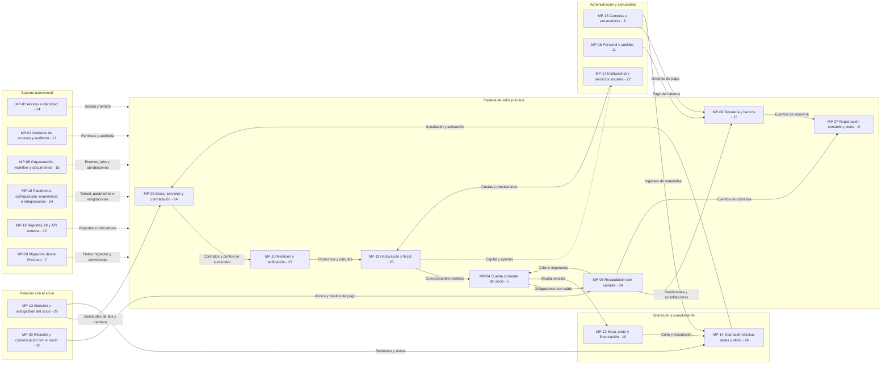

### 2.2 Mapa de nivel 0 de la versión 1.0

Reemplazado por el mapa de §2.1. Se conserva como referencia: agrupaba solo los procesos `P-XXX-nn` y mostraba los procesos del documento base (P1 a P10) como entradas y salidas de la cadena.

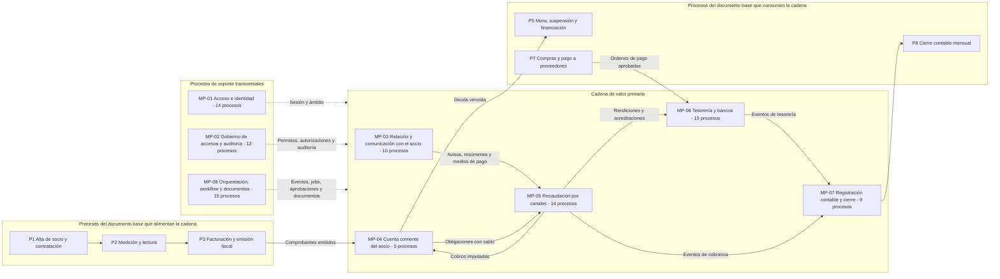

## 3. Mapas de nivel 1 por macroproceso

Cada mapa muestra los procesos del macroproceso y sus dependencias principales según los anexos (flecha continua: el resultado de uno dispara o habilita al otro; punteada: invocación o consumo de evento).

### 3.1 MP-01 Acceso e identidad

Ingreso de personal, socios y empleados: pre-login, autenticación, segundo factor, ámbito, sesiones y recuperación.

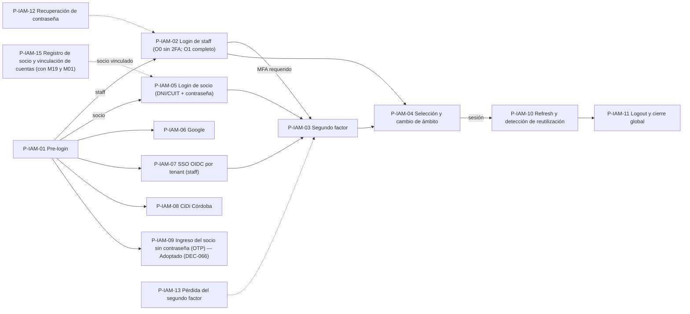

### 3.2 MP-02 Gobierno de accesos y auditoría

Alta y baja de usuarios, permiso efectivo, autorizaciones de supervisor, soporte, clientes API, auditoría y concurrencia.

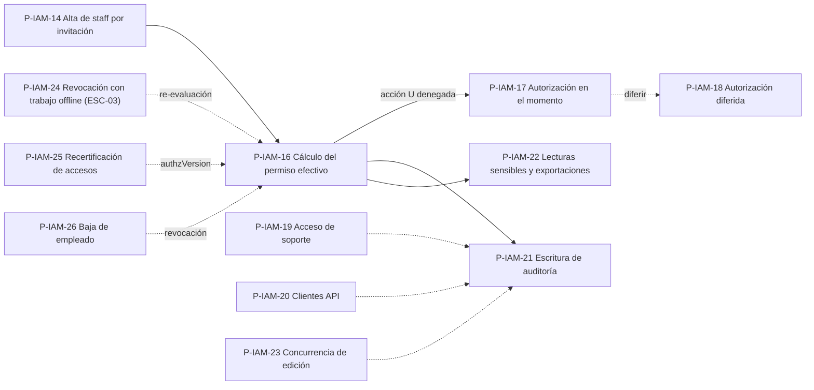

### 3.3 MP-03 Relación y comunicación con el socio

Muro, comentarios y moderación, boletines, encuestas, motor de comunicaciones, campañas, cortes y mensajes entrantes.

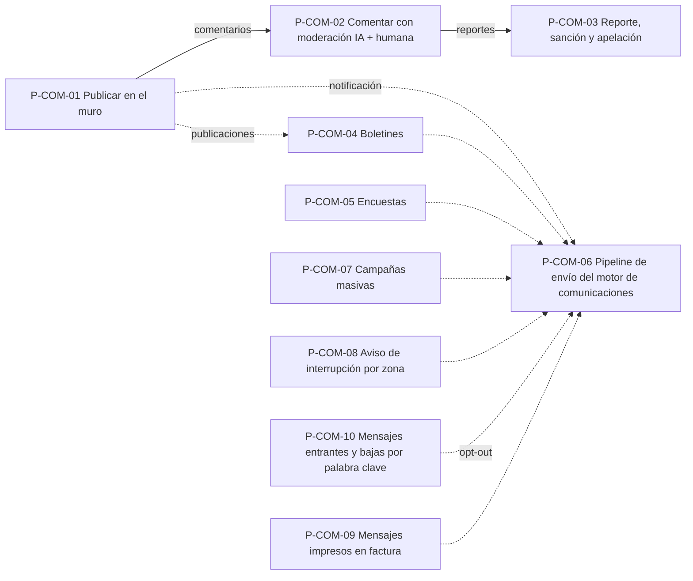

### 3.4 MP-04 Cuenta corriente del socio

Registro de obligaciones, motor de imputación, aplicación de créditos, resumen de cuenta e integridad del auxiliar.

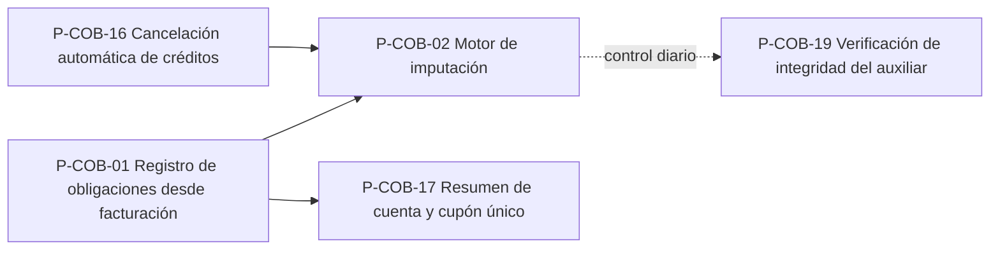

### 3.5 MP-05 Recaudación por canales

Caja, anulación, cierre y rendición, entes, débito automático, pagos online, contracargos, devoluciones, no identificados, conciliación, cobrador y terceros.

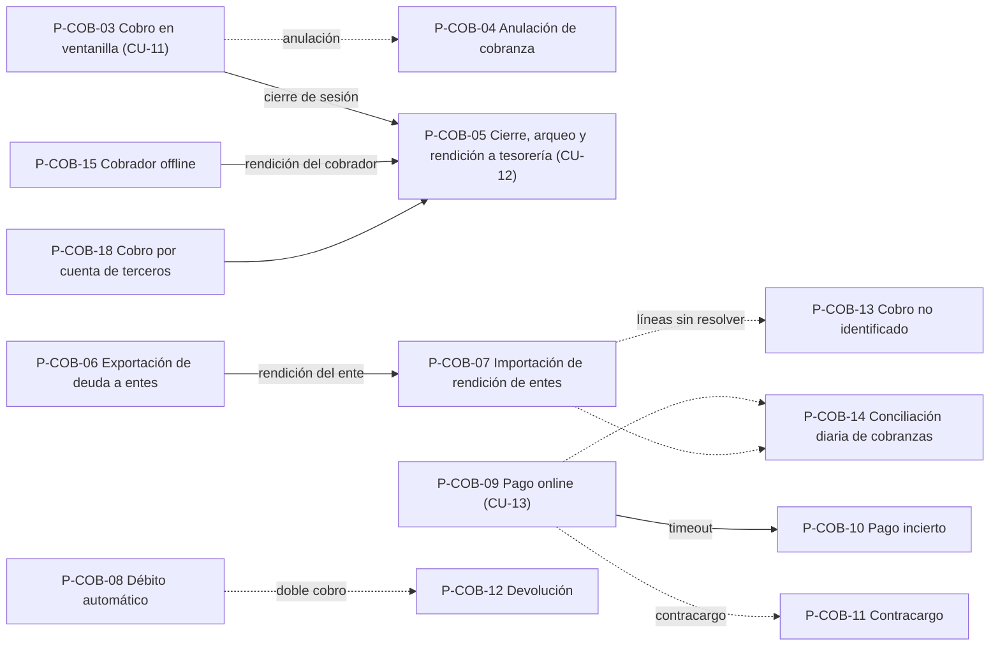

### 3.6 MP-06 Tesorería y bancos

Rendición y depósito, extractos y conciliación, Interbanking, pagos, valores, cupones, retenciones, cajas, cotizaciones, flujo de fondos, compromisos, haberes y cierre.

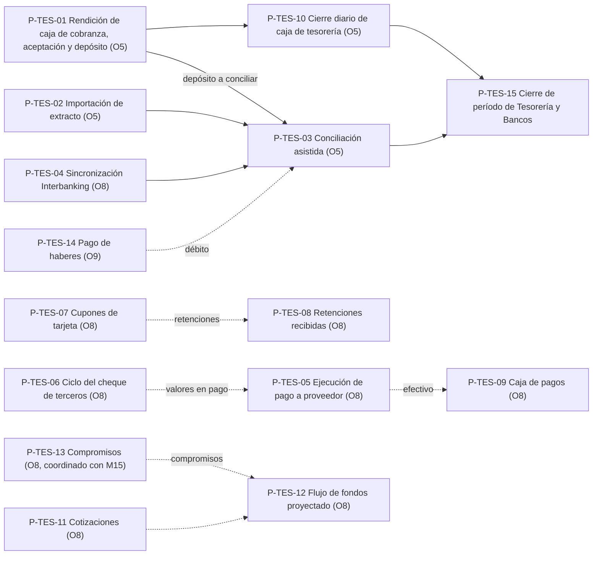

### 3.7 MP-07 Registración contable y cierre

Contabilización por evento y por lote, reproceso, cierres mensual y de ejercicio, ajuste por inflación, distribución de costos, conciliaciones y simulación.

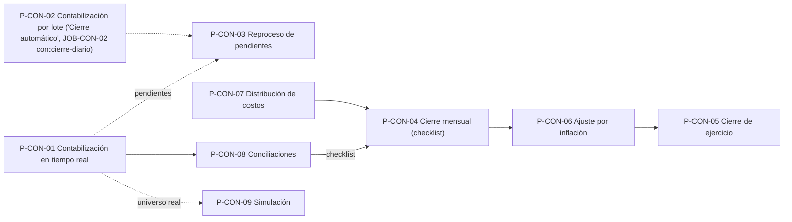

### 3.8 MP-08 Orquestación, workflow y documentos

Bus de eventos, jobs por tenant, corridas masivas, operaciones sensibles, aprobaciones, trámites, tareas, documentos, firma, retención, expediente, mesa de entradas y bandeja.

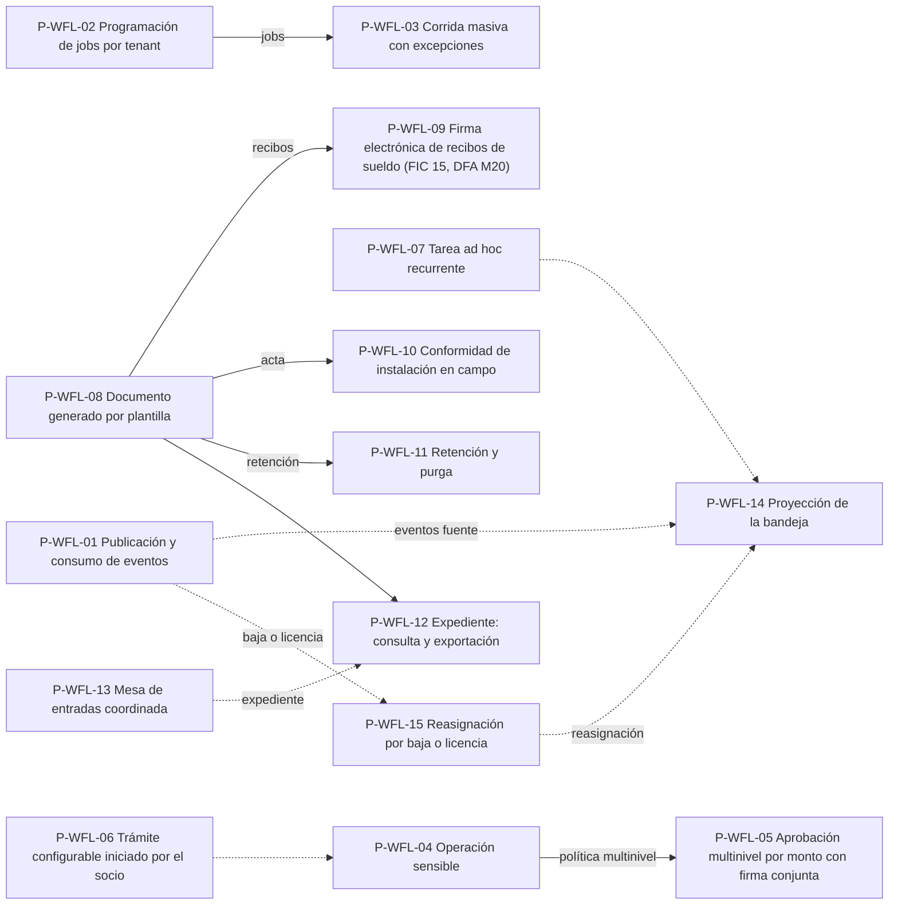

Los mapas de MP-09 a MP-20 (versión 1.1) muestran los procesos de cada macroproceso. Las dependencias se derivan del texto: una flecha continua indica que el proceso remite a otra subsección del mismo anexo ("sigue 9.4"); una punteada indica que un proceso publica un evento que el otro consume (se rotula con el EVT). Si el macroproceso supera 40 procesos, el mapa se parte por anexo.

### 3.9 MP-09 Socio, servicios y contratación

Personas, titulares, cuentas, inmuebles y relaciones (M01); catálogo, contratos y su ciclo de vida (M02); presupuestos, ventas y cargos (M11).

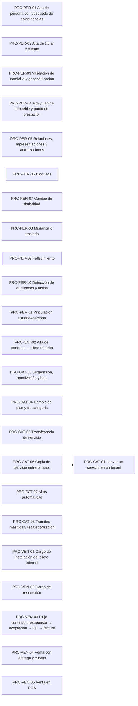

### 3.10 MP-10 Medición y tarificación

Ciclo de medición, lectura en campo, telemedición, estimación y autolectura (M03); actualización de tarifas, pipeline de cálculo, simulación, retroactivos y padrones (M04).

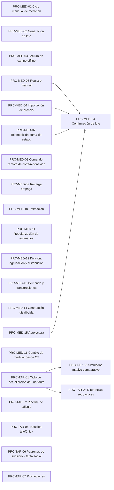

### 3.11 MP-11 Facturación y fiscal

Ciclo masivo, NC/ND, refacturación, distribución (M05); habilitación fiscal, CAE/CAEA, impuestos, retenciones, libros y regímenes (M06).

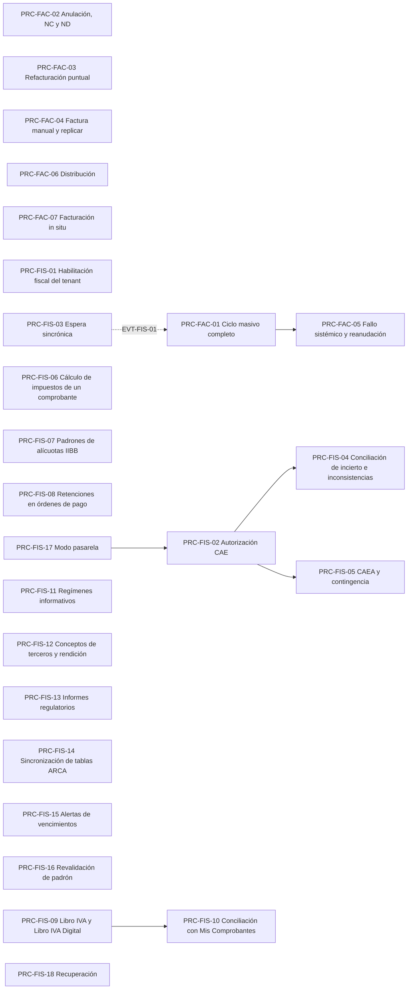

### 3.12 MP-12 Mora, corte y financiación

Recargos por vencimiento, intereses, evaluación de mora, instancias, corte y reconexión, suspensión y convenios (M08).

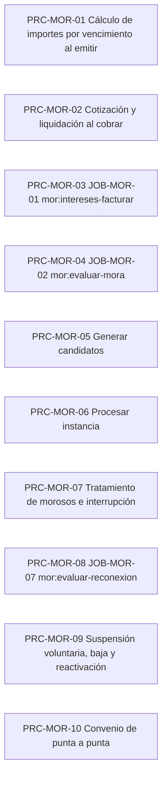

### 3.13 MP-13 Atención y autogestión del socio

Casos, solicitudes, reclamos, SLA, canales y turnero (M09); portal y PWA del socio: registro, contratación, pagos, bajas, gestiones y tótem (M19).

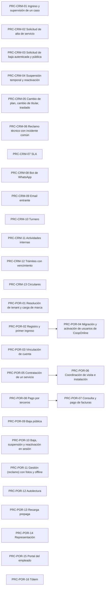

### 3.14 MP-14 Operación técnica, redes y stock

Altas técnicas, órdenes de trabajo, campo offline, corte y reconexión, interrupciones, CDR, aprovisionamiento (M10); ingresos, comodatos, consumos, inventario, amortización y RMA (M13).

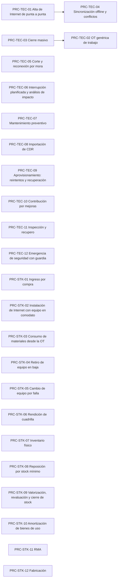

### 3.15 MP-15 Compras y proveedores

Circuito de compra, órdenes de pago con retención, facturas anticipadas, Mis Comprobantes, lectura con IA y portal de proveedores (M12).

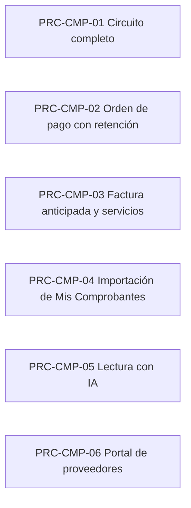

### 3.16 MP-16 Personal y sueldos

Alta de empleado, configuración, aumentos, novedades, licencias, liquidaciones, Ganancias, pago de haberes, egreso e importación (M16).

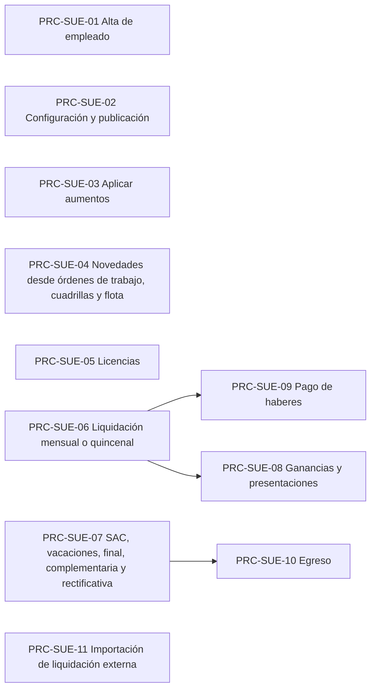

### 3.17 MP-17 Institucional y servicios sociales

Asociados, capital, excedentes, asambleas y consejo (M17); grupo familiar, prestaciones, sepelio, cementerio, traslados, vivienda y flota (M18).

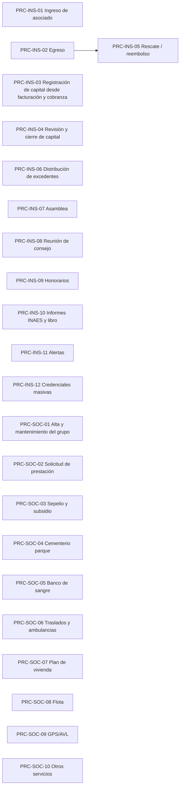

### 3.18 MP-18 Plataforma, configuración, experiencia e integraciones

Alta y ciclo de vida del tenant, soporte, backups y despliegue (T01); marca y diccionario (T03); parámetros, tablas maestras y geocodificación (T04); llamadas, webhooks, archivos y contingencias de integración (T06).

**T01** (11 procesos)

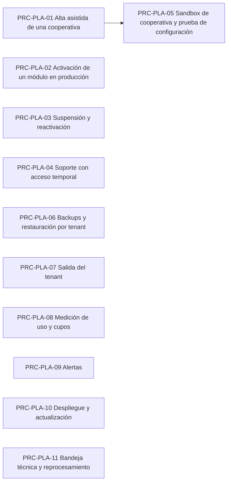

**T03** (9 procesos)

```mermaid
flowchart LR
  PRCUXD01["PRC-UXD-01 Arranque de cualquier app"]
  PRCUXD02["PRC-UXD-02 Resolución de un recurso de marca"]
  PRCUXD03["PRC-UXD-03 Edición y publicación de marca"]
  PRCUXD04["PRC-UXD-04 Resolución de texto del diccionario"]
  PRCUXD05["PRC-UXD-05 Edición y publicación del diccionario"]
  PRCUXD06["PRC-UXD-06 Alta de tenant"]
  PRCUXD07["PRC-UXD-07 Importación de Excel genérica"]
  PRCUXD08["PRC-UXD-08 Cola offline"]
  PRCUXD09["PRC-UXD-09 Mapa del sitio filtrado"]
```

**T04** (17 procesos)

```mermaid
flowchart LR
  PRCCFG01["PRC-CFG-01 Sincronización del registro de parámetros"]
  PRCCFG02["PRC-CFG-02 Lectura de configuración"]
  PRCCFG03["PRC-CFG-03 Publicación de una versión"]
  PRCCFG04["PRC-CFG-04 Cambio retroactivo"]
  PRCCFG05["PRC-CFG-05 Copia de configuración desde otro tenant"]
  PRCCFG06["PRC-CFG-06 Edición de tabla maestra e importación"]
  PRCCFG07["PRC-CFG-07 Unificación de duplicados"]
  PRCCFG08["PRC-CFG-08 Actualización y adopción de tablas de plataforma"]
  PRCCFG09["PRC-CFG-09 Geocodificación de una dirección"]
  PRCCFG10["PRC-CFG-10 Ingesta de calendarios, índices y padrones"]
  PRCCFG11["PRC-CFG-11 Migración del catálogo VARIABLE"]
  PRCCFG12["PRC-CFG-12 Completitud del perfil de servicio"]
  PRCCFG13["PRC-CFG-13 Aplicación de semilla demo"]
  PRCCFG14["PRC-CFG-14 Invalidación de caché y vigencias programadas"]
  PRCCFG15["PRC-CFG-15 Control nocturno de integridad"]
  PRCCFG16["PRC-CFG-16 Alta de la entidad jurídica por defecto"]
  PRCCFG17["PRC-CFG-17 Resolución de la entidad jurídica de un documento"]
  PRCCFG03 --> PRCCFG12
  PRCCFG05 --> PRCCFG03
```

**T06** (17 procesos)

```mermaid
flowchart LR
  PRCINT01["PRC-INT-01 Llamada saliente estándar"]
  PRCINT02["PRC-INT-02 Resolución de resultado incierto"]
  PRCINT03["PRC-INT-03 Webhook entrante"]
  PRCINT04["PRC-INT-04 Publicación de deuda y rendición por archivo"]
  PRCINT05["PRC-INT-05 Conciliación"]
  PRCINT06["PRC-INT-06 Recuperación de pendientes"]
  PRCINT07["PRC-INT-07 Salud y monitoreo"]
  PRCINT08["PRC-INT-08 Vencimientos"]
  PRCINT09["PRC-INT-09 Rotación de credenciales"]
  PRCINT10["PRC-INT-10 Renovación de tokens"]
  PRCINT11["PRC-INT-11 Contingencia"]
  PRCINT12["PRC-INT-12 Reemplazo manual"]
  PRCINT13["PRC-INT-13 Mensajería saliente"]
  PRCINT14["PRC-INT-14 Agente local"]
  PRCINT15["PRC-INT-15 Purga y archivo de bitácora"]
  PRCINT16["PRC-INT-16 Buzón SFTP (JOB-INT-16 int:leer-buzon-sftp) y entrega SFTP"]
  PRCINT17["PRC-INT-17 Sincronización de parámetros ARCA"]
  PRCINT01 --> PRCINT02
```

### 3.19 MP-19 Reportes, BI y API externa

Reportes, exportaciones, programación, indicadores, almacén analítico, IA analítica, API externa, webhooks salientes y datos abiertos (T10).

```mermaid
flowchart LR
  PRCBIA01["PRC-BIA-01 Ejecución de un reporte"]
  PRCBIA02["PRC-BIA-02 Exportación"]
  PRCBIA03["PRC-BIA-03 Programación y entrega"]
  PRCBIA04["PRC-BIA-04 Indicadores, snapshots y alertas"]
  PRCBIA05["PRC-BIA-05 Almacén analítico"]
  PRCBIA06["PRC-BIA-06 IA analítica"]
  PRCBIA07["PRC-BIA-07 API externa: alta de cliente y llamada"]
  PRCBIA08["PRC-BIA-08 Extracción incremental"]
  PRCBIA09["PRC-BIA-09 Webhooks salientes"]
  PRCBIA10["PRC-BIA-10 Benchmark"]
  PRCBIA11["PRC-BIA-11 Datos abiertos"]
  PRCBIA12["PRC-BIA-12 Salida del tenant"]
```

### 3.20 MP-20 Migración desde ProCoop

Pipeline ETL, corrida paralela, by-pass y convivencia, conciliación, corte definitivo, anonimización y rollback (T07).

```mermaid
flowchart LR
  PRCMIG01["PRC-MIG-01 Herramienta de migración"]
  PRCMIG02["PRC-MIG-02 Corrida paralela y facturación comparada"]
  PRCMIG03["PRC-MIG-03 By-pass y convivencia"]
  PRCMIG04["PRC-MIG-04 Conciliación de saldos, deuda, stock y contabilidad"]
  PRCMIG05["PRC-MIG-05 Corte definitivo"]
  PRCMIG06["PRC-MIG-06 Anonimización para ambientes de prueba"]
  PRCMIG07["PRC-MIG-07 Rollback"]
```

## 4. Inventario de procesos

Incluye los 341 procesos del universo. La columna Anexo vincula cada proceso a su subsección de origen; para los `P-XXX-nn` es la subsección que ya tenía ese identificador (no se duplicó). Origen de pasos: "curado" para los P-XXX-nn (datos revisados a mano), y "numerados", "prosa" o "tabla" para los PRC según cómo los describe el anexo.

| Proceso | Nombre | Anexo | Macroproceso | Parte | Nodos | Pasos | Origen | Módulos | Relación con P1 a P10 |
|---|---|---|---|---|---:|---:|---|---|---|
| PRC-PER-01 | Alta de persona con búsqueda de coincidencias (CU-03, RF-PER-001..003) | M01 §9.1 | MP-09 | [04j](04j-procesos-socio-contratacion.md#1-prc-per-01-alta-de-persona-con-búsqueda-de-coincidencias-cu-03-rf-per-001003) | 10 | 6 | numerados | M01 | P1 |
| PRC-PER-02 | Alta de titular y cuenta (RF-PER-040, RF-PER-055) | M01 §9.2 | MP-09 | [04j](04j-procesos-socio-contratacion.md#2-prc-per-02-alta-de-titular-y-cuenta-rf-per-040-rf-per-055) | 8 | 5 | numerados | M01 | P1 |
| PRC-PER-03 | Validación de domicilio y geocodificación (BASE §77; CU-GEO-01) | M01 §9.3 | MP-09 | [04j](04j-procesos-socio-contratacion.md#3-prc-per-03-validación-de-domicilio-y-geocodificación-base-77-cu-geo-01) | 8 | 5 | numerados | M01 | P1 |
| PRC-PER-04 | Alta y uso de inmueble y punto de prestación (RF-PER-086..098) | M01 §9.4 | MP-09 | [04j](04j-procesos-socio-contratacion.md#4-prc-per-04-alta-y-uso-de-inmueble-y-punto-de-prestación-rf-per-086098) | 5 | 3 | numerados | M01 | P1 |
| PRC-PER-05 | Relaciones, representaciones y autorizaciones (AGR-007; RF-PER-099..108) | M01 §9.5 | MP-09 | [04j](04j-procesos-socio-contratacion.md#5-prc-per-05-relaciones-representaciones-y-autorizaciones-agr-007-rf-per-099108) | 9 | 5 | numerados | M01 | P1 |
| PRC-PER-06 | Bloqueos (RF-PER-124..128) | M01 §9.6 | MP-09 | [04j](04j-procesos-socio-contratacion.md#6-prc-per-06-bloqueos-rf-per-124128) | 6 | 4 | numerados | M01 | P1 |
| PRC-PER-07 | Cambio de titularidad (BASE §4; CU-TIT-01; RF-PER-132..141) | M01 §9.7 | MP-09 | [04j](04j-procesos-socio-contratacion.md#7-prc-per-07-cambio-de-titularidad-base-4-cu-tit-01-rf-per-132141) | 14 | 9 | numerados | M01, M02, T11 | P1 |
| PRC-PER-08 | Mudanza o traslado (CU-04) | M01 §9.8 | MP-09 | [04j](04j-procesos-socio-contratacion.md#8-prc-per-08-mudanza-o-traslado-cu-04) | 6 | 3 | numerados | M01, M10 | P1 |
| PRC-PER-09 | Fallecimiento (RF-PER-009; PA-PER-08) | M01 §9.9 | MP-09 | [04j](04j-procesos-socio-contratacion.md#9-prc-per-09-fallecimiento-rf-per-009-pa-per-08) | 9 | 4 | numerados | M01 | P1 |
| PRC-PER-10 | Detección de duplicados y fusión (RF-PER-155..158) | M01 §9.10 | MP-09 | [04j](04j-procesos-socio-contratacion.md#10-prc-per-10-detección-de-duplicados-y-fusión-rf-per-155158) | 8 | 5 | numerados | M01 | P1 |
| PRC-PER-11 | Vinculación usuario–persona (REG-001; DEC-043) | M01 §9.11 | MP-09 | [04j](04j-procesos-socio-contratacion.md#11-prc-per-11-vinculación-usuariopersona-reg-001-dec-043) | 7 | 4 | numerados | M01 | P1 |
| PRC-CAT-01 | Lanzar un servicio en un tenant (CU-05, CU-CAT-01) | M02 §9.1 | MP-09 | [04j](04j-procesos-socio-contratacion.md#12-prc-cat-01-lanzar-un-servicio-en-un-tenant-cu-05-cu-cat-01) | 10 | 7 | numerados | M02, T01, T11 | P1 |
| PRC-CAT-02 | Alta de contrato — piloto Internet (CU-PRO-01, CU-SOL-01 en lo que toca al contrato) | M02 §9.2 | MP-09 | [04j](04j-procesos-socio-contratacion.md#13-prc-cat-02-alta-de-contrato--piloto-internet-cu-pro-01-cu-sol-01-en-lo-que-toca-al-contrato) | 10 | 6 | numerados | M02, M05, M09, M10, T02 | P1 |
| PRC-CAT-03 | Suspensión, reactivación y baja (CU-CIC-01 en lo que toca al contrato) | M02 §9.3 | MP-09 | [04j](04j-procesos-socio-contratacion.md#14-prc-cat-03-suspensión-reactivación-y-baja-cu-cic-01-en-lo-que-toca-al-contrato) | 6 | 3 | numerados | M02, M08, M09 | P1 |
| PRC-CAT-04 | Cambio de plan y de categoría | M02 §9.4 | MP-09 | [04j](04j-procesos-socio-contratacion.md#15-prc-cat-04-cambio-de-plan-y-de-categoría) | 8 | 5 | numerados | M02, M09 | P1 |
| PRC-CAT-05 | Transferencia de servicio (RN-06 §7) | M02 §9.5 | MP-09 | [04j](04j-procesos-socio-contratacion.md#16-prc-cat-05-transferencia-de-servicio-rn-06-7) | 7 | 5 | numerados | M02 | P1 |
| PRC-CAT-06 | Copia de servicio entre tenants (CU-COP-01) | M02 §9.6 | MP-09 | [04j](04j-procesos-socio-contratacion.md#17-prc-cat-06-copia-de-servicio-entre-tenants-cu-cop-01) | 8 | 6 | numerados | M02, T11 | P1 |
| PRC-CAT-07 | Altas automáticas (RN-06 §3.5) | M02 §9.7 | MP-09 | [04j](04j-procesos-socio-contratacion.md#18-prc-cat-07-altas-automáticas-rn-06-35) | 7 | 4 | numerados | M01, M02, M10 | P1 |
| PRC-CAT-08 | Trámites masivos y recategorización | M02 §9.8 | MP-09 | [04j](04j-procesos-socio-contratacion.md#19-prc-cat-08-trámites-masivos-y-recategorización) | 6 | 4 | numerados | M02, T11 | P1 |
| PRC-MED-01 | Ciclo mensual de medición (vista general) | M03 §9.1 | MP-10 | [04k](04k-procesos-socio-contratacion-y-medicion-tarifas.md#5-prc-med-01-ciclo-mensual-de-medición-vista-general) | 17 | 13 | numerados | M03, M04, M05, T11 | P2 |
| PRC-MED-02 | Generación de lote (JOB-MED-01 `med:generar-lotes`) | M03 §9.2 | MP-10 | [04k](04k-procesos-socio-contratacion-y-medicion-tarifas.md#6-prc-med-02-generación-de-lote-job-med-01-medgenerar-lotes) | 10 | 7 | numerados | M03 | P2 |
| PRC-MED-03 | Lectura en campo offline (pwa-campo) | M03 §9.3 | MP-10 | [04k](04k-procesos-socio-contratacion-y-medicion-tarifas.md#7-prc-med-03-lectura-en-campo-offline-pwa-campo) | 10 | 8 | numerados | M03 | P2 |
| PRC-MED-04 | Confirmación de lote (JOB-MED-03 `med:confirmar-lote`) | M03 §9.4 | MP-10 | [04k](04k-procesos-socio-contratacion-y-medicion-tarifas.md#8-prc-med-04-confirmación-de-lote-job-med-03-medconfirmar-lote) | 13 | 9 | numerados | M03 | P2 |
| PRC-MED-05 | Registro manual (PAN-MED-09) | M03 §9.5 | MP-10 | [04k](04k-procesos-socio-contratacion-y-medicion-tarifas.md#9-prc-med-05-registro-manual-pan-med-09) | 5 | 3 | numerados | M03 | P2 |
| PRC-MED-06 | Importación de archivo (PAN-MED-10, JOB-MED-04 `med:importar-lecturas`) | M03 §9.6 | MP-10 | [04k](04k-procesos-socio-contratacion-y-medicion-tarifas.md#10-prc-med-06-importación-de-archivo-pan-med-10-job-med-04-medimportar-lecturas) | 7 | 5 | numerados | M03 | P2 |
| PRC-MED-07 | Telemedición: toma de estado (JOB-MED-10 `med:toma-estado`) | M03 §9.7 | MP-10 | [04k](04k-procesos-socio-contratacion-y-medicion-tarifas.md#11-prc-med-07-telemedición-toma-de-estado-job-med-10-medtoma-estado) | 8 | 6 | numerados | M03, T06 | P2 |
| PRC-MED-08 | Comando remoto de corte/reconexión | M03 §9.8 | MP-10 | [04k](04k-procesos-socio-contratacion-y-medicion-tarifas.md#12-prc-med-08-comando-remoto-de-cortereconexión) | 8 | 5 | numerados | M03, M08 | P2 |
| PRC-MED-09 | Recarga prepaga | M03 §9.9 | MP-10 | [04k](04k-procesos-socio-contratacion-y-medicion-tarifas.md#13-prc-med-09-recarga-prepaga) | 10 | 6 | numerados | M03, M07 | P2 |
| PRC-MED-10 | Estimación (JOB-MED-05 `med:estimar`) | M03 §9.10 | MP-10 | [04k](04k-procesos-socio-contratacion-y-medicion-tarifas.md#14-prc-med-10-estimación-job-med-05-medestimar) | 9 | 5 | numerados | M03 | P2 |
| PRC-MED-11 | Regularización de estimados (JOB-MED-08 `med:regularizar-estimados`) | M03 §9.11 | MP-10 | [04k](04k-procesos-socio-contratacion-y-medicion-tarifas.md#15-prc-med-11-regularización-de-estimados-job-med-08-medregularizar-estimados) | 7 | 4 | numerados | M03, T11 | P2 |
| PRC-MED-12 | División, agrupación y distribución (JOB-MED-06 `med:dividir-consumos`, JOB-MED-07 `med:distribuir-consumos`) | M03 §9.12 | MP-10 | [04k](04k-procesos-socio-contratacion-y-medicion-tarifas.md#16-prc-med-12-división-agrupación-y-distribución-job-med-06-meddividir-consumos-job-med-07-meddistribuir-consumos) | 4 | 2 | numerados | M03 | P2 |
| PRC-MED-13 | Demanda y transgresiones (JOB-MED-09 `med:detectar-transgresiones`) | M03 §9.13 | MP-10 | [04k](04k-procesos-socio-contratacion-y-medicion-tarifas.md#17-prc-med-13-demanda-y-transgresiones-job-med-09-meddetectar-transgresiones) | 6 | 3 | prosa | M03 | P2 |
| PRC-MED-14 | Generación distribuida (JOB-MED-15 `med:balance-inyeccion`) | M03 §9.14 | MP-10 | [04k](04k-procesos-socio-contratacion-y-medicion-tarifas.md#18-prc-med-14-generación-distribuida-job-med-15-medbalance-inyeccion) | 4 | 1 | prosa | M03 | P2 |
| PRC-MED-15 | Autolectura | M03 §9.15 | MP-10 | [04k](04k-procesos-socio-contratacion-y-medicion-tarifas.md#19-prc-med-15-autolectura) | 8 | 4 | numerados | M03 | P2 |
| PRC-MED-16 | Cambio de medidor desde OT (M10) | M03 §9.16 | MP-10 | [04l](04l-procesos-medicion-tarifas-y-facturacion-fiscal.md#1-prc-med-16-cambio-de-medidor-desde-ot-m10) | 13 | 6 | numerados | M03, M10 | P2 |
| PRC-TAR-01 | Ciclo de actualización de una tarifa (DFA flujo 5; RN-TAR-064) | M04 §9.1 | MP-10 | [04l](04l-procesos-medicion-tarifas-y-facturacion-fiscal.md#2-prc-tar-01-ciclo-de-actualización-de-una-tarifa-dfa-flujo-5-rn-tar-064) | 10 | 8 | numerados | M04, T11 | P3 |
| PRC-TAR-02 | Pipeline de cálculo (motor puro y determinista) | M04 §9.2 | MP-10 | [04l](04l-procesos-medicion-tarifas-y-facturacion-fiscal.md#3-prc-tar-02-pipeline-de-cálculo-motor-puro-y-determinista) | 24 | 22 | tabla | M04 | P3 |
| PRC-TAR-03 | Simulador masivo comparativo (JOB-TAR-02 `tar:simular-masivo`) | M04 §9.6 | MP-10 | [04l](04l-procesos-medicion-tarifas-y-facturacion-fiscal.md#4-prc-tar-03-simulador-masivo-comparativo-job-tar-02-tarsimular-masivo) | 7 | 5 | numerados | M04 | P3 |
| PRC-TAR-04 | Diferencias retroactivas (JOB-TAR-06 `tar:diferencias-retroactivas`) | M04 §9.7 | MP-10 | [04l](04l-procesos-medicion-tarifas-y-facturacion-fiscal.md#5-prc-tar-04-diferencias-retroactivas-job-tar-06-tardiferencias-retroactivas) | 7 | 5 | prosa | M04, T11 | P3 |
| PRC-TAR-05 | Tasación telefónica (JOB-TAR-09 `tar:tasar-llamadas`, JOB-TAR-10 `tar:retasar`) | M04 §9.8 | MP-10 | [04l](04l-procesos-medicion-tarifas-y-facturacion-fiscal.md#6-prc-tar-05-tasación-telefónica-job-tar-09-tartasar-llamadas-job-tar-10-tarretasar) | 7 | 4 | numerados | M04, M10 | P3 |
| PRC-TAR-06 | Padrones de subsidio y tarifa social (JOB-TAR-04 `tar:importar-padron`, JOB-TAR-05 `tar:recategorizar`) | M04 §9.9 | MP-10 | [04l](04l-procesos-medicion-tarifas-y-facturacion-fiscal.md#7-prc-tar-06-padrones-de-subsidio-y-tarifa-social-job-tar-04-tarimportar-padron-job-tar-05-tarrecategorizar) | 8 | 6 | numerados | M04 | P3 |
| PRC-TAR-07 | Promociones | M04 §9.10 | MP-10 | [04l](04l-procesos-medicion-tarifas-y-facturacion-fiscal.md#8-prc-tar-07-promociones) | 9 | 7 | prosa | M04 | P3 |
| PRC-FAC-01 | Ciclo masivo completo (CU-LOT-01, CU-FAC-01) | M05 §9.1 | MP-11 | [04l](04l-procesos-medicion-tarifas-y-facturacion-fiscal.md#9-prc-fac-01-ciclo-masivo-completo-cu-lot-01-cu-fac-01) | 17 | 12 | numerados | M05, M06, T11 | P3 |
| PRC-FAC-02 | Anulación, NC y ND (CU-FAC-04) | M05 §9.3 | MP-11 | [04l](04l-procesos-medicion-tarifas-y-facturacion-fiscal.md#10-prc-fac-02-anulación-nc-y-nd-cu-fac-04) | 7 | 4 | numerados | M05, T11 | P3 |
| PRC-FAC-03 | Refacturación puntual (CU-FAC-05) | M05 §9.4 | MP-11 | [04l](04l-procesos-medicion-tarifas-y-facturacion-fiscal.md#11-prc-fac-03-refacturación-puntual-cu-fac-05) | 4 | 2 | prosa | M05 | P3 |
| PRC-FAC-04 | Factura manual y replicar (CU-FAC-06) | M05 §9.5 | MP-11 | [04l](04l-procesos-medicion-tarifas-y-facturacion-fiscal.md#12-prc-fac-04-factura-manual-y-replicar-cu-fac-06) | 6 | 3 | prosa | M05 | P3 |
| PRC-FAC-05 | Fallo sistémico y reanudación (AGR-015) | M05 §9.6 | MP-11 | [04l](04l-procesos-medicion-tarifas-y-facturacion-fiscal.md#13-prc-fac-05-fallo-sistémico-y-reanudación-agr-015) | 6 | 3 | prosa | M05 | P3 |
| PRC-FAC-06 | Distribución (CU-FAC-07) | M05 §9.7 | MP-11 | [04l](04l-procesos-medicion-tarifas-y-facturacion-fiscal.md#14-prc-fac-06-distribución-cu-fac-07) | 7 | 4 | numerados | M05 | P3 |
| PRC-FAC-07 | Facturación in situ (O7, PA-FAC-14) | M05 §9.8 | MP-11 | [04l](04l-procesos-medicion-tarifas-y-facturacion-fiscal.md#15-prc-fac-07-facturación-in-situ-o7-pa-fac-14) | 4 | 2 | prosa | M05 | P3 |
| PRC-FIS-01 | Habilitación fiscal del tenant (alta en ARCA) | M06 §9.1 | MP-11 | [04l](04l-procesos-medicion-tarifas-y-facturacion-fiscal.md#16-prc-fis-01-habilitación-fiscal-del-tenant-alta-en-arca) | 8 | 6 | numerados | M06 | P3 |
| PRC-FIS-02 | Autorización CAE (JOB-FIS-01 `fis:autorizar-cola`) | M06 §9.2 | MP-11 | [04l](04l-procesos-medicion-tarifas-y-facturacion-fiscal.md#17-prc-fis-02-autorización-cae-job-fis-01-fisautorizar-cola) | 17 | 12 | numerados | M05, M06 | P3 |
| PRC-FIS-03 | Espera sincrónica (venta mostrador y cobranza con factura) | M06 §9.3 | MP-11 | [04l](04l-procesos-medicion-tarifas-y-facturacion-fiscal.md#18-prc-fis-03-espera-sincrónica-venta-mostrador-y-cobranza-con-factura) | 7 | 3 | numerados | M06, M11 | P3 |
| PRC-FIS-04 | Conciliación de incierto e inconsistencias (JOB-FIS-04 `fis:conciliar-incierto`, JOB-FIS-05 `fis:conciliar-arca`) | M06 §9.4 | MP-11 | [04l](04l-procesos-medicion-tarifas-y-facturacion-fiscal.md#19-prc-fis-04-conciliación-de-incierto-e-inconsistencias-job-fis-04-fisconciliar-incierto-job-fis-05-fisconciliar-arca) | 10 | 5 | numerados | M06 | P3 |
| PRC-FIS-05 | CAEA y contingencia (JOB-FIS-06 `fis:solicitar-caea`, JOB-FIS-07 `fis:informar-caea`) | M06 §9.5 | MP-11 | [04m](04m-procesos-facturacion-fiscal-y-mora-financiacion.md#1-prc-fis-05-caea-y-contingencia-job-fis-06-fissolicitar-caea-job-fis-07-fisinformar-caea) | 6 | 4 | numerados | M06 | P3 |
| PRC-FIS-06 | Cálculo de impuestos de un comprobante (servicio síncrono `fis.service.calculateTaxes`, antes `fis.taxEngine.calculate`) | M06 §9.6 | MP-11 | [04m](04m-procesos-facturacion-fiscal-y-mora-financiacion.md#2-prc-fis-06-cálculo-de-impuestos-de-un-comprobante-servicio-síncrono-fisservicecalculatetaxes-antes-fistaxenginecalculate) | 9 | 7 | numerados | M04, M06 | P3 |
| PRC-FIS-07 | Padrones de alícuotas IIBB (JOB-FIS-08 `fis:importar-padron`) | M06 §9.7 | MP-11 | [04m](04m-procesos-facturacion-fiscal-y-mora-financiacion.md#3-prc-fis-07-padrones-de-alícuotas-iibb-job-fis-08-fisimportar-padron) | 7 | 5 | numerados | M06, T11 | P3 |
| PRC-FIS-08 | Retenciones en órdenes de pago (servicio `fis.service.calculateWithholdings`, antes `fis.withholding.calculate`) | M06 §9.8 | MP-11 | [04m](04m-procesos-facturacion-fiscal-y-mora-financiacion.md#4-prc-fis-08-retenciones-en-órdenes-de-pago-servicio-fisservicecalculatewithholdings-antes-fiswithholdingcalculate) | 8 | 6 | numerados | M06, M12 | P3 |
| PRC-FIS-09 | Libro IVA y Libro IVA Digital (JOB-FIS-10 `fis:generar-libro-iva`, JOB-FIS-11 `fis:generar-lid`) | M06 §9.9 | MP-11 | [04m](04m-procesos-facturacion-fiscal-y-mora-financiacion.md#5-prc-fis-09-libro-iva-y-libro-iva-digital-job-fis-10-fisgenerar-libro-iva-job-fis-11-fisgenerar-lid) | 7 | 5 | numerados | M06 | P3 |
| PRC-FIS-10 | Conciliación con Mis Comprobantes (JOB-FIS-12 `fis:conciliar-mis-comprobantes`) | M06 §9.10 | MP-11 | [04m](04m-procesos-facturacion-fiscal-y-mora-financiacion.md#6-prc-fis-10-conciliación-con-mis-comprobantes-job-fis-12-fisconciliar-mis-comprobantes) | 6 | 4 | numerados | M06 | P3 |
| PRC-FIS-11 | Regímenes informativos (JOB-FIS-13 `fis:generar-regimen`) | M06 §9.11 | MP-11 | [04m](04m-procesos-facturacion-fiscal-y-mora-financiacion.md#7-prc-fis-11-regímenes-informativos-job-fis-13-fisgenerar-regimen) | 8 | 4 | numerados | M06, T11 | P3 |
| PRC-FIS-12 | Conceptos de terceros y rendición (JOB-FIS-15 `fis:rendicion-terceros`) | M06 §9.12 | MP-11 | [04m](04m-procesos-facturacion-fiscal-y-mora-financiacion.md#8-prc-fis-12-conceptos-de-terceros-y-rendición-job-fis-15-fisrendicion-terceros) | 6 | 4 | numerados | M05, M06, M07 | P3 |
| PRC-FIS-13 | Informes regulatorios (JOB-FIS-16 `fis:generar-informe-regulatorio`) | M06 §9.13 | MP-11 | [04m](04m-procesos-facturacion-fiscal-y-mora-financiacion.md#9-prc-fis-13-informes-regulatorios-job-fis-16-fisgenerar-informe-regulatorio) | 5 | 3 | numerados | M06 | P3 |
| PRC-FIS-14 | Sincronización de tablas ARCA (JOB-FIS-17 `fis:sincronizar-parametros-arca`, plataforma) | M06 §9.14 | MP-11 | [04m](04m-procesos-facturacion-fiscal-y-mora-financiacion.md#10-prc-fis-14-sincronización-de-tablas-arca-job-fis-17-fissincronizar-parametros-arca-plataforma) | 4 | 1 | prosa | M06 | P3 |
| PRC-FIS-15 | Alertas de vencimientos (JOB-FIS-18 `fis:alertas-credenciales`, JOB-FIS-14) | M06 §9.15 | MP-11 | [04m](04m-procesos-facturacion-fiscal-y-mora-financiacion.md#11-prc-fis-15-alertas-de-vencimientos-job-fis-18-fisalertas-credenciales-job-fis-14) | 4 | 1 | prosa | M06 | P3 |
| PRC-FIS-16 | Revalidación de padrón (JOB-FIS-19 `fis:revalidar-condicion`) | M06 §9.16 | MP-11 | [04m](04m-procesos-facturacion-fiscal-y-mora-financiacion.md#12-prc-fis-16-revalidación-de-padrón-job-fis-19-fisrevalidar-condicion) | 5 | 2 | prosa | M06 | P3 |
| PRC-FIS-17 | Modo pasarela (JOB-FIS-20 `fis:pasarela-importar`) | M06 §9.17 | MP-11 | [04m](04m-procesos-facturacion-fiscal-y-mora-financiacion.md#13-prc-fis-17-modo-pasarela-job-fis-20-fispasarela-importar) | 6 | 4 | numerados | M06 | P3 |
| PRC-FIS-18 | Recuperación (ESC-04) | M06 §9.18 | MP-11 | [04m](04m-procesos-facturacion-fiscal-y-mora-financiacion.md#14-prc-fis-18-recuperación-esc-04) | 4 | 2 | prosa | M06 | P3 |
| P-COB-01 | Registro de obligaciones desde facturación | M07 §9.1 | MP-04 | [04b](04b-procesos-cuenta-corriente-cobranza.md#1-p-cob-01-registro-de-obligaciones-desde-facturación) | 19 | 9 | curado | M05, M07, M08 | P3, P4 |
| P-COB-02 | Motor de imputación | M07 §9.2 | MP-04 | [04b](04b-procesos-cuenta-corriente-cobranza.md#2-p-cob-02-motor-de-imputación) | 17 | 8 | curado | M07, M08 | P4, P5 |
| P-COB-03 | Cobro en ventanilla (CU-11) | M07 §9.3 | MP-05 | [04b](04b-procesos-cuenta-corriente-cobranza.md#3-p-cob-03-cobro-en-ventanilla-cu-11) | 19 | 9 | curado | M05, M06, M07, T09 | P4 |
| P-COB-04 | Anulación de cobranza | M07 §9.4 | MP-05 | [04b](04b-procesos-cuenta-corriente-cobranza.md#4-p-cob-04-anulación-de-cobranza) | 12 | 4 | curado | M05, M07, M08, M14 | P4 |
| P-COB-05 | Cierre, arqueo y rendición a tesorería (CU-12) | M07 §9.5 | MP-05 | [04b](04b-procesos-cuenta-corriente-cobranza.md#5-p-cob-05-cierre-arqueo-y-rendición-a-tesorería-cu-12) | 20 | 7 | curado | M07, M14, M15 | P4 |
| P-COB-06 | Exportación de deuda a entes | M07 §9.6 | MP-05 | [04b](04b-procesos-cuenta-corriente-cobranza.md#6-p-cob-06-exportación-de-deuda-a-entes) | 16 | 7 | curado | M07, M08, T06 | P4 |
| P-COB-07 | Importación de rendición de entes | M07 §9.7 | MP-05 | [04b](04b-procesos-cuenta-corriente-cobranza.md#7-p-cob-07-importación-de-rendición-de-entes) | 15 | 7 | curado | M07, M14, T06 | P4 |
| P-COB-08 | Débito automático | M07 §9.8 | MP-05 | [04b](04b-procesos-cuenta-corriente-cobranza.md#8-p-cob-08-débito-automático) | 16 | 5 | curado | M07, T06 | P4 |
| P-COB-09 | Pago online (CU-13) | M07 §9.9 | MP-05 | [04b](04b-procesos-cuenta-corriente-cobranza.md#9-p-cob-09-pago-online-cu-13) | 18 | 7 | curado | M07, T06 | P4 |
| P-COB-10 | Pago incierto | M07 §9.10 | MP-05 | [04b](04b-procesos-cuenta-corriente-cobranza.md#10-p-cob-10-pago-incierto) | 12 | 5 | curado | M07, T06 | P4 |
| P-COB-11 | Contracargo | M07 §9.11 | MP-05 | [04c](04c-procesos-cobranza-excepciones-controles.md#1-p-cob-11-contracargo) | 15 | 6 | curado | M05, M07, M08, T06 | P4 |
| P-COB-12 | Devolución | M07 §9.12 | MP-05 | [04c](04c-procesos-cobranza-excepciones-controles.md#2-p-cob-12-devolución) | 16 | 5 | curado | M05, M07, M09, M14, T11 | P4 |
| P-COB-13 | Cobro no identificado | M07 §9.13 | MP-05 | [04c](04c-procesos-cobranza-excepciones-controles.md#3-p-cob-13-cobro-no-identificado) | 13 | 5 | curado | M07, M14, M15, T11 | P4 |
| P-COB-14 | Conciliación diaria de cobranzas | M07 §9.14 | MP-05 | [04c](04c-procesos-cobranza-excepciones-controles.md#4-p-cob-14-conciliación-diaria-de-cobranzas) | 12 | 4 | curado | M07, M14, T06 | P4 |
| P-COB-15 | Cobrador offline | M07 §9.15 | MP-05 | [04c](04c-procesos-cobranza-excepciones-controles.md#5-p-cob-15-cobrador-offline) | 14 | 5 | curado | M07 | P4 |
| P-COB-16 | Cancelación automática de créditos | M07 §9.16 | MP-04 | [04c](04c-procesos-cobranza-excepciones-controles.md#6-p-cob-16-cancelación-automática-de-créditos) | 10 | 5 | curado | M07 | P4 |
| P-COB-17 | Resumen de cuenta y cupón único | M07 §9.17 | MP-04 | [04c](04c-procesos-cobranza-excepciones-controles.md#7-p-cob-17-resumen-de-cuenta-y-cupón-único) | 9 | 4 | curado | M05, M07, T09 | P3, P4 |
| P-COB-18 | Cobro por cuenta de terceros | M07 §9.18 | MP-05 | [04c](04c-procesos-cobranza-excepciones-controles.md#8-p-cob-18-cobro-por-cuenta-de-terceros) | 11 | 6 | curado | M07, M14 | P4 |
| P-COB-19 | Verificación de integridad del auxiliar | M07 §9.19 | MP-04 | [04c](04c-procesos-cobranza-excepciones-controles.md#9-p-cob-19-verificación-de-integridad-del-auxiliar) | 14 | 6 | curado | M07, M15 | P4, P8 |
| PRC-MOR-01 | Cálculo de importes por vencimiento al emitir (O4) | M08 §9.1 | MP-12 | [04m](04m-procesos-facturacion-fiscal-y-mora-financiacion.md#15-prc-mor-01-cálculo-de-importes-por-vencimiento-al-emitir-o4) | 7 | 4 | numerados | M05, M08 | P5 |
| PRC-MOR-02 | Cotización y liquidación al cobrar (O5) | M08 §9.2 | MP-12 | [04m](04m-procesos-facturacion-fiscal-y-mora-financiacion.md#16-prc-mor-02-cotización-y-liquidación-al-cobrar-o5) | 10 | 6 | numerados | M07, M08 | P5 |
| PRC-MOR-03 | JOB-MOR-01 `mor:intereses-facturar` (O6) | M08 §9.3 | MP-12 | [04m](04m-procesos-facturacion-fiscal-y-mora-financiacion.md#17-prc-mor-03-job-mor-01-morintereses-facturar-o6) | 7 | 5 | numerados | M08 | P5 |
| PRC-MOR-04 | JOB-MOR-02 `mor:evaluar-mora` (diario, O6) | M08 §9.4 | MP-12 | [04m](04m-procesos-facturacion-fiscal-y-mora-financiacion.md#18-prc-mor-04-job-mor-02-morevaluar-mora-diario-o6) | 7 | 4 | numerados | M08 | P5 |
| PRC-MOR-05 | Generar candidatos (manual o JOB-MOR-03 `mor:generar-candidatos`) | M08 §9.5 | MP-12 | [04m](04m-procesos-facturacion-fiscal-y-mora-financiacion.md#19-prc-mor-05-generar-candidatos-manual-o-job-mor-03-morgenerar-candidatos) | 7 | 4 | numerados | M08 | P5 |
| PRC-MOR-06 | Procesar instancia (manual o JOB-MOR-04 `mor:procesar-instancia`) | M08 §9.6 | MP-12 | [04m](04m-procesos-facturacion-fiscal-y-mora-financiacion.md#20-prc-mor-06-procesar-instancia-manual-o-job-mor-04-morprocesar-instancia) | 10 | 6 | numerados | M08, T06, T09 | P5 |
| PRC-MOR-07 | Tratamiento de morosos e interrupción | M08 §9.7 | MP-12 | [04m](04m-procesos-facturacion-fiscal-y-mora-financiacion.md#21-prc-mor-07-tratamiento-de-morosos-e-interrupción) | 12 | 7 | numerados | M08, M10, T06 | P5 |
| PRC-MOR-08 | JOB-MOR-07 `mor:evaluar-reconexion` (por evento `cob.payment.confirmed`, `mor.agreement.activated`) | M08 §9.8 | MP-12 | [04n](04n-procesos-mora-financiacion-y-atencion-portal.md#1-prc-mor-08-job-mor-07-morevaluar-reconexion-por-evento-cobpaymentconfirmed-moragreementactivated) | 8 | 6 | numerados | M08 | P5 |
| PRC-MOR-09 | Suspensión voluntaria, baja y reactivación (BASE §53) | M08 §9.9 | MP-12 | [04n](04n-procesos-mora-financiacion-y-atencion-portal.md#2-prc-mor-09-suspensión-voluntaria-baja-y-reactivación-base-53) | 7 | 4 | numerados | M02, M08 | P5 |
| PRC-MOR-10 | Convenio de punta a punta | M08 §9.10 | MP-12 | [04n](04n-procesos-mora-financiacion-y-atencion-portal.md#3-prc-mor-10-convenio-de-punta-a-punta) | 11 | 9 | numerados | M05, M08 | P5 |
| PRC-CRM-01 | Ingreso y supervisión de un caso (circuito BASE §47) | M09 §9.1 | MP-13 | [04n](04n-procesos-mora-financiacion-y-atencion-portal.md#4-prc-crm-01-ingreso-y-supervisión-de-un-caso-circuito-base-47) | 16 | 13 | numerados | M09 | P6 |
| PRC-CRM-02 | Solicitud de alta de servicio (piloto Internet, CU-15, CU-SOL-01) | M09 §9.2 | MP-13 | [04n](04n-procesos-mora-financiacion-y-atencion-portal.md#5-prc-crm-02-solicitud-de-alta-de-servicio-piloto-internet-cu-15-cu-sol-01) | 12 | 8 | numerados | M02, M09, M10 | P6, P1 |
| PRC-CRM-03 | Solicitud de baja autenticada y pública (CIC-001, BASE §52.3) | M09 §9.3 | MP-13 | [04n](04n-procesos-mora-financiacion-y-atencion-portal.md#6-prc-crm-03-solicitud-de-baja-autenticada-y-pública-cic-001-base-523) | 9 | 6 | numerados | M02, M09 | P6 |
| PRC-CRM-04 | Suspensión temporal y reactivación (CU-CIC-01) | M09 §9.4 | MP-13 | [04n](04n-procesos-mora-financiacion-y-atencion-portal.md#7-prc-crm-04-suspensión-temporal-y-reactivación-cu-cic-01) | 7 | 4 | numerados | M02, M09 | P6 |
| PRC-CRM-05 | Cambio de plan, cambio de titular, traslado | M09 §9.5 | MP-13 | [04n](04n-procesos-mora-financiacion-y-atencion-portal.md#8-prc-crm-05-cambio-de-plan-cambio-de-titular-traslado) | 5 | 3 | numerados | M04, M09 | P6 |
| PRC-CRM-06 | Reclamo técnico con incidente común (CU-16, piloto Internet) | M09 §9.6 | MP-13 | [04n](04n-procesos-mora-financiacion-y-atencion-portal.md#9-prc-crm-06-reclamo-técnico-con-incidente-común-cu-16-piloto-internet) | 10 | 7 | numerados | M09, M10 | P6 |
| PRC-CRM-07 | SLA (JOB-CRM-01) | M09 §9.7 | MP-13 | [04n](04n-procesos-mora-financiacion-y-atencion-portal.md#10-prc-crm-07-sla-job-crm-01) | 8 | 4 | numerados | M09 | P6 |
| PRC-CRM-08 | Bot de WhatsApp (O6) | M09 §9.8 | MP-13 | [04n](04n-procesos-mora-financiacion-y-atencion-portal.md#11-prc-crm-08-bot-de-whatsapp-o6) | 8 | 5 | numerados | M09, T06 | P6 |
| PRC-CRM-09 | Email entrante (O6) | M09 §9.9 | MP-13 | [04n](04n-procesos-mora-financiacion-y-atencion-portal.md#12-prc-crm-09-email-entrante-o6) | 5 | 3 | prosa | M09 | P6 |
| PRC-CRM-10 | Turnero (O10) | M09 §9.10 | MP-13 | [04n](04n-procesos-mora-financiacion-y-atencion-portal.md#13-prc-crm-10-turnero-o10) | 8 | 6 | numerados | M09 | P6 |
| PRC-CRM-11 | Actividades internas (O10) | M09 §9.11 | MP-13 | [04n](04n-procesos-mora-financiacion-y-atencion-portal.md#14-prc-crm-11-actividades-internas-o10) | 5 | 3 | numerados | M09 | P6 |
| PRC-CRM-12 | Trámites con vencimiento (O7) | M09 §9.12 | MP-13 | [04n](04n-procesos-mora-financiacion-y-atencion-portal.md#15-prc-crm-12-trámites-con-vencimiento-o7) | 7 | 5 | prosa | M09 | P6 |
| PRC-CRM-13 | Circulares (O6) | M09 §9.13 | MP-13 | [04n](04n-procesos-mora-financiacion-y-atencion-portal.md#16-prc-crm-13-circulares-o6) | 6 | 4 | numerados | M09 | P6 |
| PRC-TEC-01 | Alta de Internet de punta a punta (piloto DEC-005, CU-AUT-01, CU-INS-01) | M10 §9.1 | MP-14 | [04o](04o-procesos-atencion-portal-y-tecnica-stock.md#14-prc-tec-01-alta-de-internet-de-punta-a-punta-piloto-dec-005-cu-aut-01-cu-ins-01) | 17 | 14 | numerados | M09, M10 | P6 |
| PRC-TEC-02 | OT genérica de trabajo (creación → cierre) | M10 §9.2 | MP-14 | [04o](04o-procesos-atencion-portal-y-tecnica-stock.md#15-prc-tec-02-ot-genérica-de-trabajo-creación--cierre) | 11 | 8 | numerados | M04, M10 | P6 |
| PRC-TEC-03 | Cierre masivo (JOB-TEC-03) | M10 §9.3 | MP-14 | [04o](04o-procesos-atencion-portal-y-tecnica-stock.md#16-prc-tec-03-cierre-masivo-job-tec-03) | 7 | 5 | prosa | M10 | P6 |
| PRC-TEC-04 | Sincronización offline y conflictos (AGR-025, ESC-03) | M10 §9.4 | MP-14 | [04o](04o-procesos-atencion-portal-y-tecnica-stock.md#17-prc-tec-04-sincronización-offline-y-conflictos-agr-025-esc-03) | 9 | 7 | numerados | M10 | P6 |
| PRC-TEC-05 | Corte y reconexión por mora (O6) | M10 §9.5 | MP-14 | [04o](04o-procesos-atencion-portal-y-tecnica-stock.md#18-prc-tec-05-corte-y-reconexión-por-mora-o6) | 11 | 5 | numerados | M08, M10 | P6 |
| PRC-TEC-06 | Interrupción planificada y análisis de impacto (O7) | M10 §9.6 | MP-14 | [04o](04o-procesos-atencion-portal-y-tecnica-stock.md#19-prc-tec-06-interrupción-planificada-y-análisis-de-impacto-o7) | 5 | 3 | numerados | M10 | P6 |
| PRC-TEC-07 | Mantenimiento preventivo (JOB-TEC-05) | M10 §9.7 | MP-14 | [04p](04p-procesos-tecnica-stock-y-compras.md#1-prc-tec-07-mantenimiento-preventivo-job-tec-05) | 5 | 2 | prosa | M10 | P6 |
| PRC-TEC-08 | Importación de CDR (O10) | M10 §9.8 | MP-14 | [04p](04p-procesos-tecnica-stock-y-compras.md#2-prc-tec-08-importación-de-cdr-o10) | 9 | 6 | numerados | M04, M05, M10 | P6 |
| PRC-TEC-09 | Aprovisionamiento: reintentos y recuperación (AGR-016, ESC-04) | M10 §9.9 | MP-14 | [04p](04p-procesos-tecnica-stock-y-compras.md#3-prc-tec-09-aprovisionamiento-reintentos-y-recuperación-agr-016-esc-04) | 5 | 3 | prosa | M10 | P6 |
| PRC-TEC-10 | Contribución por mejoras (O7) | M10 §9.10 | MP-14 | [04p](04p-procesos-tecnica-stock-y-compras.md#4-prc-tec-10-contribución-por-mejoras-o7) | 15 | 11 | prosa | M02, M05, M08, M10, T09 | P6 |
| PRC-TEC-11 | Inspección y recupero (O7) | M10 §9.11 | MP-14 | [04p](04p-procesos-tecnica-stock-y-compras.md#5-prc-tec-11-inspección-y-recupero-o7) | 11 | 9 | prosa | M03, M05, M10, T11 | P6 |
| PRC-TEC-12 | Emergencia de seguridad con guardia (HUE-GAS-05) | M10 §9.11.1 | MP-14 | [04p](04p-procesos-tecnica-stock-y-compras.md#6-prc-tec-12-emergencia-de-seguridad-con-guardia-hue-gas-05) | 10 | 5 | numerados | M09, M10 | P6 |
| PRC-VEN-01 | Cargo de instalación del piloto Internet (O4) | M11 §9.1 | MP-09 | [04j](04j-procesos-socio-contratacion.md#20-prc-ven-01-cargo-de-instalación-del-piloto-internet-o4) | 11 | 7 | numerados | M05, M07, M09, M10, M11 | P6 |
| PRC-VEN-02 | Cargo de reconexión (O6) | M11 §9.2 | MP-09 | [04k](04k-procesos-socio-contratacion-y-medicion-tarifas.md#1-prc-ven-02-cargo-de-reconexión-o6) | 6 | 4 | prosa | M08, M10, M11 | — |
| PRC-VEN-03 | Flujo continuo presupuesto → aceptación → OT → factura (O8) | M11 §9.3 | MP-09 | [04k](04k-procesos-socio-contratacion-y-medicion-tarifas.md#2-prc-ven-03-flujo-continuo-presupuesto--aceptación--ot--factura-o8) | 10 | 8 | numerados | M11, T09 | — |
| PRC-VEN-04 | Venta con entrega y cuotas (CU-23) | M11 §9.4 | MP-09 | [04k](04k-procesos-socio-contratacion-y-medicion-tarifas.md#3-prc-ven-04-venta-con-entrega-y-cuotas-cu-23) | 9 | 7 | prosa | M05, M11 | — |
| PRC-VEN-05 | Venta en POS | M11 §9.5 | MP-09 | [04k](04k-procesos-socio-contratacion-y-medicion-tarifas.md#4-prc-ven-05-venta-en-pos) | 9 | 7 | prosa | M05, M07, M11 | — |
| PRC-CMP-01 | Circuito completo (CU-19) | M12 §9.1 | MP-15 | [04p](04p-procesos-tecnica-stock-y-compras.md#19-prc-cmp-01-circuito-completo-cu-19) | 10 | 8 | numerados | M12, T11 | P7 |
| PRC-CMP-02 | Orden de pago con retención (CU-FIS-01) | M12 §9.2 | MP-15 | [04p](04p-procesos-tecnica-stock-y-compras.md#20-prc-cmp-02-orden-de-pago-con-retención-cu-fis-01) | 11 | 7 | prosa | M06, M12, M14 | P7 |
| PRC-CMP-03 | Factura anticipada y servicios | M12 §9.3 | MP-15 | [04q](04q-procesos-compras-y-sueldos.md#1-prc-cmp-03-factura-anticipada-y-servicios) | 5 | 3 | prosa | M12 | P7 |
| PRC-CMP-04 | Importación de Mis Comprobantes | M12 §9.4 | MP-15 | [04q](04q-procesos-compras-y-sueldos.md#2-prc-cmp-04-importación-de-mis-comprobantes) | 7 | 5 | prosa | M06, M12 | P7 |
| PRC-CMP-05 | Lectura con IA | M12 §9.5 | MP-15 | [04q](04q-procesos-compras-y-sueldos.md#3-prc-cmp-05-lectura-con-ia) | 7 | 5 | prosa | M12 | P7 |
| PRC-CMP-06 | Portal de proveedores | M12 §9.6 | MP-15 | [04q](04q-procesos-compras-y-sueldos.md#4-prc-cmp-06-portal-de-proveedores) | 6 | 4 | prosa | M12, T02 | P7 |
| PRC-STK-01 | Ingreso por compra (O8; en O3 por vale de entrada) | M13 §9.1 | MP-14 | [04p](04p-procesos-tecnica-stock-y-compras.md#7-prc-stk-01-ingreso-por-compra-o8-en-o3-por-vale-de-entrada) | 9 | 5 | numerados | M12, M13 | P6 |
| PRC-STK-02 | Instalación de Internet con equipo en comodato (O3, CU-INS-01, INS-004) | M13 §9.2 | MP-14 | [04p](04p-procesos-tecnica-stock-y-compras.md#8-prc-stk-02-instalación-de-internet-con-equipo-en-comodato-o3-cu-ins-01-ins-004) | 15 | 9 | numerados | M10, M13 | P6 |
| PRC-STK-03 | Consumo de materiales desde la OT (CU-20) | M13 §9.3 | MP-14 | [04p](04p-procesos-tecnica-stock-y-compras.md#9-prc-stk-03-consumo-de-materiales-desde-la-ot-cu-20) | 7 | 5 | prosa | M13 | P6 |
| PRC-STK-04 | Retiro de equipo en baja (Internet) | M13 §9.4 | MP-14 | [04p](04p-procesos-tecnica-stock-y-compras.md#10-prc-stk-04-retiro-de-equipo-en-baja-internet) | 8 | 4 | numerados | M02, M09, M13 | P6 |
| PRC-STK-05 | Cambio de equipo por falla | M13 §9.5 | MP-14 | [04p](04p-procesos-tecnica-stock-y-compras.md#11-prc-stk-05-cambio-de-equipo-por-falla) | 6 | 3 | prosa | M13 | P6 |
| PRC-STK-06 | Rendición de cuadrilla (JOB-STK-04 y manual) | M13 §9.6 | MP-14 | [04p](04p-procesos-tecnica-stock-y-compras.md#12-prc-stk-06-rendición-de-cuadrilla-job-stk-04-y-manual) | 5 | 3 | numerados | M13 | P6 |
| PRC-STK-07 | Inventario físico | M13 §9.7 | MP-14 | [04p](04p-procesos-tecnica-stock-y-compras.md#13-prc-stk-07-inventario-físico) | 7 | 4 | prosa | M13 | P6 |
| PRC-STK-08 | Reposición por stock mínimo (JOB-STK-03, diario) | M13 §9.8 | MP-14 | [04p](04p-procesos-tecnica-stock-y-compras.md#14-prc-stk-08-reposición-por-stock-mínimo-job-stk-03-diario) | 6 | 3 | prosa | M13 | P6 |
| PRC-STK-09 | Valorización, revaluación y cierre de stock | M13 §9.9 | MP-14 | [04p](04p-procesos-tecnica-stock-y-compras.md#15-prc-stk-09-valorización-revaluación-y-cierre-de-stock) | 5 | 3 | numerados | M13 | P6 |
| PRC-STK-10 | Amortización de bienes de uso (JOB-STK-07) | M13 §9.10 | MP-14 | [04p](04p-procesos-tecnica-stock-y-compras.md#16-prc-stk-10-amortización-de-bienes-de-uso-job-stk-07) | 8 | 5 | numerados | M13 | P6 |
| PRC-STK-11 | RMA | M13 §9.11 | MP-14 | [04p](04p-procesos-tecnica-stock-y-compras.md#17-prc-stk-11-rma) | 6 | 4 | prosa | M12, M13 | P6 |
| PRC-STK-12 | Fabricación (O10) | M13 §9.12 | MP-14 | [04p](04p-procesos-tecnica-stock-y-compras.md#18-prc-stk-12-fabricación-o10) | 11 | 9 | prosa | M13 | P6 |
| P-TES-01 | Rendición de caja de cobranza, aceptación y depósito (O5) | M14 §9.1 | MP-06 | [04d](04d-procesos-tesoreria.md#1-p-tes-01-rendición-de-caja-de-cobranza-aceptación-y-depósito-o5) | 21 | 9 | curado | M07, M14 | P4 |
| P-TES-02 | Importación de extracto (O5) | M14 §9.2 | MP-06 | [04d](04d-procesos-tesoreria.md#2-p-tes-02-importación-de-extracto-o5) | 12 | 4 | curado | M14 | P4 |
| P-TES-03 | Conciliación asistida (O5) | M14 §9.3 | MP-06 | [04d](04d-procesos-tesoreria.md#3-p-tes-03-conciliación-asistida-o5) | 15 | 5 | curado | M07, M14 | P4 |
| P-TES-04 | Sincronización Interbanking (O8) | M14 §9.4 | MP-06 | [04d](04d-procesos-tesoreria.md#4-p-tes-04-sincronización-interbanking-o8) | 12 | 4 | curado | M14, T06 | P4 |
| P-TES-05 | Ejecución de pago a proveedor (O8) | M14 §9.5 | MP-06 | [04d](04d-procesos-tesoreria.md#5-p-tes-05-ejecución-de-pago-a-proveedor-o8) | 18 | 8 | curado | M12, M14, M15 | P7 |
| P-TES-06 | Ciclo del cheque de terceros (O8) | M14 §9.6 | MP-06 | [04d](04d-procesos-tesoreria.md#6-p-tes-06-ciclo-del-cheque-de-terceros-o8) | 15 | 6 | curado | M05, M07, M12, M14 | P4, P7 |
| P-TES-07 | Cupones de tarjeta (O8) | M14 §9.7 | MP-06 | [04d](04d-procesos-tesoreria.md#7-p-tes-07-cupones-de-tarjeta-o8) | 15 | 7 | curado | M07, M12, M14 | P4 |
| P-TES-08 | Retenciones recibidas (O8) | M14 §9.8 | MP-06 | [04d](04d-procesos-tesoreria.md#8-p-tes-08-retenciones-recibidas-o8) | 15 | 7 | curado | M06, M07, M14 | P4 |
| P-TES-09 | Caja de pagos (O8) | M14 §9.9 | MP-06 | [04d](04d-procesos-tesoreria.md#9-p-tes-09-caja-de-pagos-o8) | 11 | 6 | curado | M14 | P7 |
| P-TES-10 | Cierre diario de caja de tesorería (O5) | M14 §9.10 | MP-06 | [04d](04d-procesos-tesoreria.md#10-p-tes-10-cierre-diario-de-caja-de-tesorería-o5) | 13 | 5 | curado | M14 | P4 |
| P-TES-11 | Cotizaciones (O8) | M14 §9.11 | MP-06 | [04d](04d-procesos-tesoreria.md#11-p-tes-11-cotizaciones-o8) | 9 | 4 | curado | M14, T06 | — |
| P-TES-12 | Flujo de fondos proyectado (O8) | M14 §9.12 | MP-06 | [04d](04d-procesos-tesoreria.md#12-p-tes-12-flujo-de-fondos-proyectado-o8) | 11 | 4 | curado | M06, M07, M12, M14, M16 | — |
| P-TES-13 | Compromisos (O8, coordinado con M15) | M14 §9.13 | MP-06 | [04d](04d-procesos-tesoreria.md#13-p-tes-13-compromisos-o8-coordinado-con-m15) | 15 | 4 | curado | M12, M14, M15 | P7 |
| P-TES-14 | Pago de haberes (O9) | M14 §9.14 | MP-06 | [04d](04d-procesos-tesoreria.md#14-p-tes-14-pago-de-haberes-o9) | 13 | 5 | curado | M14, M16 | — |
| P-TES-15 | Cierre de período de Tesorería y Bancos | M14 §9.15 | MP-06 | [04d](04d-procesos-tesoreria.md#15-p-tes-15-cierre-de-período-de-tesorería-y-bancos) | 16 | 5 | curado | M14, M15 | P8 |
| P-CON-01 | Contabilización en tiempo real (JOB-CON-01 `con:contabilizar-evento`) | M15 §9.2 | MP-07 | [04e](04e-procesos-contabilidad.md#1-p-con-01-contabilización-en-tiempo-real-job-con-01-concontabilizar-evento) | 19 | 8 | curado | M05, M07, M12, M13, M14, M15 | P8 |
| P-CON-02 | Contabilización por lote ("Cierre automático", JOB-CON-02 `con:cierre-diario`) | M15 §9.3 | MP-07 | [04e](04e-procesos-contabilidad.md#2-p-con-02-contabilización-por-lote-cierre-automático-job-con-02-concierre-diario) | 13 | 7 | curado | M15 | P8 |
| P-CON-03 | Reproceso de pendientes (JOB-CON-03 `con:reprocesar-pendientes`) | M15 §9.4 | MP-07 | [04e](04e-procesos-contabilidad.md#3-p-con-03-reproceso-de-pendientes-job-con-03-conreprocesar-pendientes) | 9 | 4 | curado | M15 | P8 |
| P-CON-04 | Cierre mensual (checklist) | M15 §9.5 | MP-07 | [04e](04e-procesos-contabilidad.md#4-p-con-04-cierre-mensual-checklist) | 18 | 5 | curado | M15, T11 | P8 |
| P-CON-05 | Cierre de ejercicio (JOB-CON-05 `con:cierre-ejercicio`) | M15 §9.6 | MP-07 | [04e](04e-procesos-contabilidad.md#5-p-con-05-cierre-de-ejercicio-job-con-05-concierre-ejercicio) | 14 | 6 | curado | M15 | P8 |
| P-CON-06 | Ajuste por inflación (JOB-CON-06 `con:ajuste-inflacion`) | M15 §9.7 | MP-07 | [04e](04e-procesos-contabilidad.md#6-p-con-06-ajuste-por-inflación-job-con-06-conajuste-inflacion) | 11 | 5 | curado | M13, M15 | P8 |
| P-CON-07 | Distribución de costos (JOB-CON-07 `con:distribuir-costos`) | M15 §9.8 | MP-07 | [04e](04e-procesos-contabilidad.md#7-p-con-07-distribución-de-costos-job-con-07-condistribuir-costos) | 9 | 5 | curado | M15 | P8 |
| P-CON-08 | Conciliaciones (JOB-CON-08 `con:conciliar`) | M15 §9.9 | MP-07 | [04e](04e-procesos-contabilidad.md#8-p-con-08-conciliaciones-job-con-08-conconciliar) | 10 | 5 | curado | M06, M07, M12, M13, M14, M15, M16, M17 | P8 |
| P-CON-09 | Simulación (JOB-CON-09 `con:simular-escenario`) | M15 §9.10 | MP-07 | [04e](04e-procesos-contabilidad.md#9-p-con-09-simulación-job-con-09-consimular-escenario) | 11 | 6 | curado | M15 | — |
| PRC-SUE-01 | Alta de empleado | M16 §9.1 | MP-16 | [04q](04q-procesos-compras-y-sueldos.md#5-prc-sue-01-alta-de-empleado) | 6 | 4 | numerados | M16 | — |
| PRC-SUE-02 | Configuración y publicación (AGR-009) | M16 §9.2 | MP-16 | [04q](04q-procesos-compras-y-sueldos.md#6-prc-sue-02-configuración-y-publicación-agr-009) | 6 | 4 | numerados | M16, T11 | — |
| PRC-SUE-03 | Aplicar aumentos | M16 §9.3 | MP-16 | [04q](04q-procesos-compras-y-sueldos.md#7-prc-sue-03-aplicar-aumentos) | 6 | 4 | numerados | M16 | — |
| PRC-SUE-04 | Novedades desde órdenes de trabajo, cuadrillas y flota (CU-104 paso 1) | M16 §9.4 | MP-16 | [04q](04q-procesos-compras-y-sueldos.md#8-prc-sue-04-novedades-desde-órdenes-de-trabajo-cuadrillas-y-flota-cu-104-paso-1) | 7 | 4 | numerados | M10, M16, M18 | — |
| PRC-SUE-05 | Licencias | M16 §9.5 | MP-16 | [04q](04q-procesos-compras-y-sueldos.md#9-prc-sue-05-licencias) | 5 | 3 | numerados | M16 | — |
| PRC-SUE-06 | Liquidación mensual o quincenal (CU-104 pasos 2 y 3) | M16 §9.6 | MP-16 | [04q](04q-procesos-compras-y-sueldos.md#10-prc-sue-06-liquidación-mensual-o-quincenal-cu-104-pasos-2-y-3) | 10 | 7 | numerados | M16, T11 | — |
| PRC-SUE-07 | SAC, vacaciones, final, complementaria y rectificativa | M16 §9.7 | MP-16 | [04q](04q-procesos-compras-y-sueldos.md#11-prc-sue-07-sac-vacaciones-final-complementaria-y-rectificativa) | 7 | 5 | numerados | M16 | — |
| PRC-SUE-08 | Ganancias y presentaciones | M16 §9.8 | MP-16 | [04q](04q-procesos-compras-y-sueldos.md#12-prc-sue-08-ganancias-y-presentaciones) | 8 | 6 | numerados | M16 | — |
| PRC-SUE-09 | Pago de haberes (CU-104 paso 4) | M16 §9.9 | MP-16 | [04q](04q-procesos-compras-y-sueldos.md#13-prc-sue-09-pago-de-haberes-cu-104-paso-4) | 9 | 6 | numerados | M14, M16 | — |
| PRC-SUE-10 | Egreso | M16 §9.10 | MP-16 | [04q](04q-procesos-compras-y-sueldos.md#14-prc-sue-10-egreso) | 6 | 3 | numerados | M16 | — |
| PRC-SUE-11 | Importación de liquidación externa (CU-28, O8) | M16 §9.11 | MP-16 | [04q](04q-procesos-compras-y-sueldos.md#15-prc-sue-11-importación-de-liquidación-externa-cu-28-o8) | 7 | 3 | numerados | M16, T11 | — |
| PRC-INS-01 | Ingreso de asociado | M17 §9.1 | MP-17 | [04q](04q-procesos-compras-y-sueldos.md#16-prc-ins-01-ingreso-de-asociado) | 8 | 5 | numerados | M17 | — |
| PRC-INS-02 | Egreso | M17 §9.2 | MP-17 | [04q](04q-procesos-compras-y-sueldos.md#17-prc-ins-02-egreso) | 9 | 5 | numerados | M05, M17 | — |
| PRC-INS-03 | Registración de capital desde facturación y cobranza (O5 si se habilita) | M17 §9.3 | MP-17 | [04q](04q-procesos-compras-y-sueldos.md#18-prc-ins-03-registración-de-capital-desde-facturación-y-cobranza-o5-si-se-habilita) | 13 | 7 | numerados | M05, M07, M08, M17 | — |
| PRC-INS-04 | Revisión y cierre de capital | M17 §9.4 | MP-17 | [04q](04q-procesos-compras-y-sueldos.md#19-prc-ins-04-revisión-y-cierre-de-capital) | 5 | 3 | numerados | M17 | — |
| PRC-INS-05 | Rescate / reembolso | M17 §9.5 | MP-17 | [04q](04q-procesos-compras-y-sueldos.md#20-prc-ins-05-rescate--reembolso) | 7 | 5 | numerados | M17, T11 | — |
| PRC-INS-06 | Distribución de excedentes | M17 §9.6 | MP-17 | [04q](04q-procesos-compras-y-sueldos.md#21-prc-ins-06-distribución-de-excedentes) | 8 | 5 | numerados | M15, M17 | — |
| PRC-INS-07 | Asamblea | M17 §9.7 | MP-17 | [04r](04r-procesos-institucional-social-y-plataforma-integraciones.md#1-prc-ins-07-asamblea) | 12 | 10 | numerados | M17, T09 | — |
| PRC-INS-08 | Reunión de consejo | M17 §9.8 | MP-17 | [04r](04r-procesos-institucional-social-y-plataforma-integraciones.md#2-prc-ins-08-reunión-de-consejo) | 7 | 4 | prosa | M17 | — |
| PRC-INS-09 | Honorarios | M17 §9.9 | MP-17 | [04r](04r-procesos-institucional-social-y-plataforma-integraciones.md#3-prc-ins-09-honorarios) | 6 | 3 | prosa | M17 | — |
| PRC-INS-10 | Informes INAES y libro | M17 §9.10 | MP-17 | [04r](04r-procesos-institucional-social-y-plataforma-integraciones.md#4-prc-ins-10-informes-inaes-y-libro) | 4 | 2 | prosa | M17 | — |
| PRC-INS-11 | Alertas | M17 §9.11 | MP-17 | [04r](04r-procesos-institucional-social-y-plataforma-integraciones.md#5-prc-ins-11-alertas) | 3 | 1 | prosa | M17 | — |
| PRC-INS-12 | Credenciales masivas | M17 §9.12 | MP-17 | [04r](04r-procesos-institucional-social-y-plataforma-integraciones.md#6-prc-ins-12-credenciales-masivas) | 4 | 2 | prosa | M17 | — |
| PRC-SOC-01 | Alta y mantenimiento del grupo | M18 §9.1 | MP-17 | [04r](04r-procesos-institucional-social-y-plataforma-integraciones.md#7-prc-soc-01-alta-y-mantenimiento-del-grupo) | 9 | 6 | numerados | M18 | P9 |
| PRC-SOC-02 | Solicitud de prestación (CU-24) | M18 §9.2 | MP-17 | [04r](04r-procesos-institucional-social-y-plataforma-integraciones.md#8-prc-soc-02-solicitud-de-prestación-cu-24) | 7 | 5 | numerados | M18 | P9 |
| PRC-SOC-03 | Sepelio y subsidio | M18 §9.3 | MP-17 | [04r](04r-procesos-institucional-social-y-plataforma-integraciones.md#9-prc-soc-03-sepelio-y-subsidio) | 6 | 3 | numerados | M01, M18 | P9 |
| PRC-SOC-04 | Cementerio parque (CU-ESP-CEM) | M18 §9.4 | MP-17 | [04r](04r-procesos-institucional-social-y-plataforma-integraciones.md#10-prc-soc-04-cementerio-parque-cu-esp-cem) | 7 | 5 | numerados | M18 | P9 |
| PRC-SOC-05 | Banco de sangre (CU-ESP-SAN) | M18 §9.5 | MP-17 | [04r](04r-procesos-institucional-social-y-plataforma-integraciones.md#11-prc-soc-05-banco-de-sangre-cu-esp-san) | 7 | 5 | prosa | M18 | P9 |
| PRC-SOC-06 | Traslados y ambulancias | M18 §9.6 | MP-17 | [04r](04r-procesos-institucional-social-y-plataforma-integraciones.md#12-prc-soc-06-traslados-y-ambulancias) | 6 | 4 | numerados | M18 | P9 |
| PRC-SOC-07 | Plan de vivienda | M18 §9.7 | MP-17 | [04r](04r-procesos-institucional-social-y-plataforma-integraciones.md#13-prc-soc-07-plan-de-vivienda) | 10 | 7 | numerados | M05, M07, M18 | P9 |
| PRC-SOC-08 | Flota | M18 §9.8 | MP-17 | [04r](04r-procesos-institucional-social-y-plataforma-integraciones.md#14-prc-soc-08-flota) | 8 | 5 | numerados | M12, M18 | P9 |
| PRC-SOC-09 | GPS/AVL | M18 §9.9 | MP-17 | [04r](04r-procesos-institucional-social-y-plataforma-integraciones.md#15-prc-soc-09-gpsavl) | 10 | 5 | prosa | M18, T06 | P9 |
| PRC-SOC-10 | Otros servicios | M18 §9.10 | MP-17 | [04r](04r-procesos-institucional-social-y-plataforma-integraciones.md#16-prc-soc-10-otros-servicios) | 4 | 2 | prosa | M18 | P9 |
| PRC-POR-01 | Resolución de tenant y carga de marca (landing y PWA) | M19 §9.1 | MP-13 | [04n](04n-procesos-mora-financiacion-y-atencion-portal.md#17-prc-por-01-resolución-de-tenant-y-carga-de-marca-landing-y-pwa) | 7 | 4 | numerados | M19 | — |
| PRC-POR-02 | Registro y primer ingreso (O2) | M19 §9.2 | MP-13 | [04n](04n-procesos-mora-financiacion-y-atencion-portal.md#18-prc-por-02-registro-y-primer-ingreso-o2) | 9 | 5 | numerados | M19, T02 | — |
| PRC-POR-03 | Vinculación de cuenta (O2) | M19 §9.3 | MP-13 | [04n](04n-procesos-mora-financiacion-y-atencion-portal.md#19-prc-por-03-vinculación-de-cuenta-o2) | 13 | 7 | numerados | M19 | — |
| PRC-POR-04 | Migración y activación de usuarios de CoopOnline (O6 piloto, O11 repetible) | M19 §9.4 | MP-13 | [04o](04o-procesos-atencion-portal-y-tecnica-stock.md#1-prc-por-04-migración-y-activación-de-usuarios-de-cooponline-o6-piloto-o11-repetible) | 11 | 9 | numerados | M19 | — |
| PRC-POR-05 | Contratación de un servicio (piloto Internet, O2–O3) | M19 §9.5 | MP-13 | [04o](04o-procesos-atencion-portal-y-tecnica-stock.md#2-prc-por-05-contratación-de-un-servicio-piloto-internet-o2o3) | 13 | 9 | numerados | M02, M09, M19 | P1 |
| PRC-POR-06 | Coordinación de visita e instalación (O3) | M19 §9.6 | MP-13 | [04o](04o-procesos-atencion-portal-y-tecnica-stock.md#3-prc-por-06-coordinación-de-visita-e-instalación-o3) | 13 | 8 | numerados | M10, M19, T09 | P6 |
| PRC-POR-07 | Consulta y pago de facturas (O4–O5) | M19 §9.7 | MP-13 | [04o](04o-procesos-atencion-portal-y-tecnica-stock.md#4-prc-por-07-consulta-y-pago-de-facturas-o4o5) | 13 | 9 | numerados | M07, M19 | P4 |
| PRC-POR-08 | Pago por terceros (O5) | M19 §9.8 | MP-13 | [04o](04o-procesos-atencion-portal-y-tecnica-stock.md#5-prc-por-08-pago-por-terceros-o5) | 4 | 2 | numerados | M19 | P4 |
| PRC-POR-09 | Baja pública (O2) | M19 §9.9 | MP-13 | [04o](04o-procesos-atencion-portal-y-tecnica-stock.md#6-prc-por-09-baja-pública-o2) | 10 | 8 | numerados | M19 | — |
| PRC-POR-10 | Baja, suspensión y reactivación en sesión (O2/O6) | M19 §9.10 | MP-13 | [04o](04o-procesos-atencion-portal-y-tecnica-stock.md#7-prc-por-10-baja-suspensión-y-reactivación-en-sesión-o2o6) | 7 | 4 | numerados | M02, M19 | — |
| PRC-POR-11 | Gestión (reclamo) con fotos y offline (O2) | M19 §9.11 | MP-13 | [04o](04o-procesos-atencion-portal-y-tecnica-stock.md#8-prc-por-11-gestión-reclamo-con-fotos-y-offline-o2) | 6 | 4 | numerados | M19 | P6 |
| PRC-POR-12 | Autolectura (O7) | M19 §9.12 | MP-13 | [04o](04o-procesos-atencion-portal-y-tecnica-stock.md#9-prc-por-12-autolectura-o7) | 6 | 4 | numerados | M03, M19 | P2 |
| PRC-POR-13 | Recarga prepaga (O7) | M19 §9.13 | MP-13 | [04o](04o-procesos-atencion-portal-y-tecnica-stock.md#10-prc-por-13-recarga-prepaga-o7) | 5 | 3 | numerados | M19 | — |
| PRC-POR-14 | Representación (O5) | M19 §9.14 | MP-13 | [04o](04o-procesos-atencion-portal-y-tecnica-stock.md#11-prc-por-14-representación-o5) | 6 | 4 | numerados | M19 | — |
| PRC-POR-15 | Portal del empleado (O9) | M19 §9.15 | MP-13 | [04o](04o-procesos-atencion-portal-y-tecnica-stock.md#12-prc-por-15-portal-del-empleado-o9) | 6 | 4 | numerados | M19 | — |
| PRC-POR-16 | Tótem (O10, PA-POR-06) | M19 §9.16 | MP-13 | [04o](04o-procesos-atencion-portal-y-tecnica-stock.md#13-prc-por-16-tótem-o10-pa-por-06) | 5 | 3 | numerados | M19 | — |
| PRC-PLA-01 | Alta asistida de una cooperativa (CU-PLA-01) | T01 §9.1 | MP-18 | [04r](04r-procesos-institucional-social-y-plataforma-integraciones.md#17-prc-pla-01-alta-asistida-de-una-cooperativa-cu-pla-01) | 12 | 9 | numerados | T01 | — |
| PRC-PLA-02 | Activación de un módulo en producción (CU-PLA-03) | T01 §9.3 | MP-18 | [04r](04r-procesos-institucional-social-y-plataforma-integraciones.md#18-prc-pla-02-activación-de-un-módulo-en-producción-cu-pla-03) | 8 | 5 | numerados | T01 | — |
| PRC-PLA-03 | Suspensión y reactivación (CU-PLA-05) | T01 §9.4 | MP-18 | [04r](04r-procesos-institucional-social-y-plataforma-integraciones.md#19-prc-pla-03-suspensión-y-reactivación-cu-pla-05) | 9 | 5 | numerados | T01, T11 | — |
| PRC-PLA-04 | Soporte con acceso temporal (CU-PLA-06) | T01 §9.5 | MP-18 | [04r](04r-procesos-institucional-social-y-plataforma-integraciones.md#20-prc-pla-04-soporte-con-acceso-temporal-cu-pla-06) | 11 | 8 | numerados | T01, T11 | — |
| PRC-PLA-05 | Sandbox de cooperativa y prueba de configuración (CU-PLA-07) | T01 §9.6 | MP-18 | [04r](04r-procesos-institucional-social-y-plataforma-integraciones.md#21-prc-pla-05-sandbox-de-cooperativa-y-prueba-de-configuración-cu-pla-07) | 7 | 5 | numerados | T01 | — |
| PRC-PLA-06 | Backups y restauración por tenant (CU-PLA-08, AGR-019, ESC-04) | T01 §9.7 | MP-18 | [04s](04s-procesos-plataforma-integraciones.md#1-prc-pla-06-backups-y-restauración-por-tenant-cu-pla-08-agr-019-esc-04) | 12 | 10 | numerados | T01 | — |
| PRC-PLA-07 | Salida del tenant (CU-PLA-09) | T01 §9.8 | MP-18 | [04s](04s-procesos-plataforma-integraciones.md#2-prc-pla-07-salida-del-tenant-cu-pla-09) | 6 | 4 | numerados | T01 | — |
| PRC-PLA-08 | Medición de uso y cupos | T01 §9.9 | MP-18 | [04s](04s-procesos-plataforma-integraciones.md#3-prc-pla-08-medición-de-uso-y-cupos) | 6 | 4 | prosa | T01 | — |
| PRC-PLA-09 | Alertas | T01 §9.10 | MP-18 | [04s](04s-procesos-plataforma-integraciones.md#4-prc-pla-09-alertas) | 6 | 4 | prosa | T01, T09 | — |
| PRC-PLA-10 | Despliegue y actualización (CU-PLA-10) | T01 §9.11 | MP-18 | [04s](04s-procesos-plataforma-integraciones.md#5-prc-pla-10-despliegue-y-actualización-cu-pla-10) | 7 | 5 | numerados | T01, T11 | — |
| PRC-PLA-11 | Bandeja técnica y reprocesamiento | T01 §9.12 | MP-18 | [04s](04s-procesos-plataforma-integraciones.md#6-prc-pla-11-bandeja-técnica-y-reprocesamiento) | 5 | 3 | prosa | T01 | — |
| P-IAM-01 | Pre-login | T02 §9 | MP-01 | [04f](04f-procesos-identidad-acceso.md#1-p-iam-01-pre-login) | 11 | 4 | curado | T01, T02 | — |
| P-IAM-02 | Login de staff (O0 sin 2FA; O1 completo) | T02 §9 | MP-01 | [04f](04f-procesos-identidad-acceso.md#2-p-iam-02-login-de-staff-o0-sin-2fa-o1-completo) | 16 | 6 | curado | T02, T09 | — |
| P-IAM-03 | Segundo factor | T02 §9 | MP-01 | [04f](04f-procesos-identidad-acceso.md#3-p-iam-03-segundo-factor) | 16 | 5 | curado | T02, T09 | — |
| P-IAM-04 | Selección y cambio de ámbito | T02 §9 | MP-01 | [04f](04f-procesos-identidad-acceso.md#4-p-iam-04-selección-y-cambio-de-ámbito) | 15 | 5 | curado | T02 | — |
| P-IAM-05 | Login de socio (DNI/CUIT + contraseña) | T02 §9 | MP-01 | [04f](04f-procesos-identidad-acceso.md#5-p-iam-05-login-de-socio-dnicuit--contraseña) | 12 | 4 | curado | M01, T02 | — |
| P-IAM-06 | Google | T02 §9 | MP-01 | [04f](04f-procesos-identidad-acceso.md#6-p-iam-06-google) | 15 | 4 | curado | T02, T09 | — |
| P-IAM-07 | SSO OIDC por tenant (staff) | T02 §9 | MP-01 | [04f](04f-procesos-identidad-acceso.md#7-p-iam-07-sso-oidc-por-tenant-staff) | 14 | 4 | curado | T02 | — |
| P-IAM-08 | CiDi Córdoba | T02 §9 | MP-01 | [04f](04f-procesos-identidad-acceso.md#8-p-iam-08-cidi-córdoba) | 14 | 4 | curado | M01, T02, T06 | — |
| P-IAM-09 | Ingreso del socio sin contraseña (OTP) — Adoptado (DEC-066) | T02 §9 | MP-01 | [04f](04f-procesos-identidad-acceso.md#9-p-iam-09-ingreso-del-socio-sin-contraseña-otp--adoptado-dec-066) | 10 | 2 | curado | T02, T09 | — |
| P-IAM-10 | Refresh y detección de reutilización | T02 §9 | MP-01 | [04f](04f-procesos-identidad-acceso.md#10-p-iam-10-refresh-y-detección-de-reutilización) | 13 | 4 | curado | T02, T09 | — |
| P-IAM-11 | Logout y cierre global | T02 §9 | MP-01 | [04f](04f-procesos-identidad-acceso.md#11-p-iam-11-logout-y-cierre-global) | 9 | 3 | curado | T02 | — |
| P-IAM-12 | Recuperación de contraseña | T02 §9 | MP-01 | [04f](04f-procesos-identidad-acceso.md#12-p-iam-12-recuperación-de-contraseña) | 13 | 3 | curado | T02, T09 | P10 |
| P-IAM-13 | Pérdida del segundo factor | T02 §9 | MP-01 | [04f](04f-procesos-identidad-acceso.md#13-p-iam-13-pérdida-del-segundo-factor) | 16 | 2 | curado | T02, T09, T11 | — |
| P-IAM-14 | Alta de staff por invitación | T02 §9 | MP-02 | [04g](04g-procesos-gobierno-accesos-auditoria.md#1-p-iam-14-alta-de-staff-por-invitación) | 16 | 4 | curado | T02, T09 | P10 |
| P-IAM-15 | Registro de socio y vinculación de cuentas (con M19 y M01) | T02 §9 | MP-01 | [04g](04g-procesos-gobierno-accesos-auditoria.md#2-p-iam-15-registro-de-socio-y-vinculación-de-cuentas-con-m19-y-m01) | 21 | 4 | curado | M01, M19, T02 | P1 |
| P-IAM-16 | Cálculo del permiso efectivo | T02 §9 | MP-02 | [04g](04g-procesos-gobierno-accesos-auditoria.md#3-p-iam-16-cálculo-del-permiso-efectivo) | 14 | 4 | curado | T02 | — |
| P-IAM-17 | Autorización en el momento | T02 §9 | MP-02 | [04g](04g-procesos-gobierno-accesos-auditoria.md#4-p-iam-17-autorización-en-el-momento) | 17 | 5 | curado | T02, T09 | P4 |
| P-IAM-18 | Autorización diferida | T02 §9 | MP-02 | [04g](04g-procesos-gobierno-accesos-auditoria.md#5-p-iam-18-autorización-diferida) | 18 | 5 | curado | T02, T09 | P4 |
| P-IAM-19 | Acceso de soporte | T02 §9 | MP-02 | [04g](04g-procesos-gobierno-accesos-auditoria.md#6-p-iam-19-acceso-de-soporte) | 17 | 5 | curado | T02 | — |
| P-IAM-20 | Clientes API | T02 §9 | MP-02 | [04g](04g-procesos-gobierno-accesos-auditoria.md#7-p-iam-20-clientes-api) | 15 | 5 | curado | T02 | — |
| P-IAM-21 | Escritura de auditoría | T02 §9 | MP-02 | [04g](04g-procesos-gobierno-accesos-auditoria.md#8-p-iam-21-escritura-de-auditoría) | 14 | 4 | curado | T02 | — |
| P-IAM-22 | Lecturas sensibles y exportaciones | T02 §9 | MP-02 | [04g](04g-procesos-gobierno-accesos-auditoria.md#9-p-iam-22-lecturas-sensibles-y-exportaciones) | 11 | 2 | curado | T01, T02 | — |
| P-IAM-23 | Concurrencia de edición | T02 §9 | MP-02 | [04g](04g-procesos-gobierno-accesos-auditoria.md#10-p-iam-23-concurrencia-de-edición) | 10 | 2 | curado | T02 | — |
| P-IAM-24 | Revocación con trabajo offline (ESC-03) | T02 §9 | MP-02 | [04g](04g-procesos-gobierno-accesos-auditoria.md#11-p-iam-24-revocación-con-trabajo-offline-esc-03) | 16 | 3 | curado | T02 | P2, P6 |
| P-IAM-25 | Recertificación de accesos | T02 §9 | MP-02 | [04g](04g-procesos-gobierno-accesos-auditoria.md#12-p-iam-25-recertificación-de-accesos) | 10 | 3 | curado | T02, T09 | — |
| P-IAM-26 | Baja de empleado | T02 §9 | MP-02 | [04g](04g-procesos-gobierno-accesos-auditoria.md#13-p-iam-26-baja-de-empleado) | 10 | 5 | curado | M16, T02, T11 | — |
| PRC-UXD-01 | Arranque de cualquier app (branding runtime) | T03 §9.1 | MP-18 | [04s](04s-procesos-plataforma-integraciones.md#7-prc-uxd-01-arranque-de-cualquier-app-branding-runtime) | 10 | 8 | numerados | T03 | — |
| PRC-UXD-02 | Resolución de un recurso de marca | T03 §9.2 | MP-18 | [04s](04s-procesos-plataforma-integraciones.md#8-prc-uxd-02-resolución-de-un-recurso-de-marca) | 7 | 5 | prosa | T03 | — |
| PRC-UXD-03 | Edición y publicación de marca (CU-MAR-01, CU-UXD-01) | T03 §9.3 | MP-18 | [04s](04s-procesos-plataforma-integraciones.md#9-prc-uxd-03-edición-y-publicación-de-marca-cu-mar-01-cu-uxd-01) | 8 | 6 | numerados | T03 | — |
| PRC-UXD-04 | Resolución de texto del diccionario (runtime) | T03 §9.4 | MP-18 | [04s](04s-procesos-plataforma-integraciones.md#10-prc-uxd-04-resolución-de-texto-del-diccionario-runtime) | 6 | 3 | numerados | T03 | — |
| PRC-UXD-05 | Edición y publicación del diccionario (CU-DIC-01) | T03 §9.5 | MP-18 | [04s](04s-procesos-plataforma-integraciones.md#11-prc-uxd-05-edición-y-publicación-del-diccionario-cu-dic-01) | 7 | 5 | numerados | T03 | — |
| PRC-UXD-06 | Alta de tenant (paso de experiencia, coordinado con T01) | T03 §9.6 | MP-18 | [04s](04s-procesos-plataforma-integraciones.md#12-prc-uxd-06-alta-de-tenant-paso-de-experiencia-coordinado-con-t01) | 8 | 4 | numerados | T01, T03 | — |
| PRC-UXD-07 | Importación de Excel genérica (`ExcelImportWizard`) | T03 §9.8 | MP-18 | [04s](04s-procesos-plataforma-integraciones.md#13-prc-uxd-07-importación-de-excel-genérica-excelimportwizard) | 5 | 3 | numerados | T03 | — |
| PRC-UXD-08 | Cola offline (PWA campo y encuestas) | T03 §9.9 | MP-18 | [04s](04s-procesos-plataforma-integraciones.md#14-prc-uxd-08-cola-offline-pwa-campo-y-encuestas) | 7 | 5 | prosa | T03 | — |
| PRC-UXD-09 | Mapa del sitio filtrado | T03 §9.10 | MP-18 | [04s](04s-procesos-plataforma-integraciones.md#15-prc-uxd-09-mapa-del-sitio-filtrado) | 4 | 2 | prosa | T03 | — |
| PRC-CFG-01 | Sincronización del registro de parámetros (JOB-CFG-01 `cfg:sincronizar-registro`) | T04 §9.1 | MP-18 | [04s](04s-procesos-plataforma-integraciones.md#16-prc-cfg-01-sincronización-del-registro-de-parámetros-job-cfg-01-cfgsincronizar-registro) | 8 | 5 | numerados | T04 | — |
| PRC-CFG-02 | Lectura de configuración | T04 §9.2 | MP-18 | [04s](04s-procesos-plataforma-integraciones.md#17-prc-cfg-02-lectura-de-configuración) | 11 | 7 | numerados | T04 | — |
| PRC-CFG-03 | Publicación de una versión (CU-CFG-01) | T04 §9.3 | MP-18 | [04s](04s-procesos-plataforma-integraciones.md#18-prc-cfg-03-publicación-de-una-versión-cu-cfg-01) | 14 | 10 | numerados | T04 | — |
| PRC-CFG-04 | Cambio retroactivo (AGR-010) | T04 §9.4 | MP-18 | [04s](04s-procesos-plataforma-integraciones.md#19-prc-cfg-04-cambio-retroactivo-agr-010) | 9 | 6 | numerados | T04 | — |
| PRC-CFG-05 | Copia de configuración desde otro tenant (consumido por M02, BASE §81) | T04 §9.5 | MP-18 | [04s](04s-procesos-plataforma-integraciones.md#20-prc-cfg-05-copia-de-configuración-desde-otro-tenant-consumido-por-m02-base-81) | 7 | 5 | numerados | M02, T04 | — |
| PRC-CFG-06 | Edición de tabla maestra e importación (CU-CFG-03, CU-CFG-04) | T04 §9.6 | MP-18 | [04s](04s-procesos-plataforma-integraciones.md#21-prc-cfg-06-edición-de-tabla-maestra-e-importación-cu-cfg-03-cu-cfg-04) | 7 | 4 | numerados | T04 | — |
| PRC-CFG-07 | Unificación de duplicados (CU-CFG-05) | T04 §9.7 | MP-18 | [04t](04t-procesos-plataforma-integraciones-2.md#1-prc-cfg-07-unificación-de-duplicados-cu-cfg-05) | 7 | 5 | numerados | T04 | — |
| PRC-CFG-08 | Actualización y adopción de tablas de plataforma (CU-CFG-06) | T04 §9.8 | MP-18 | [04t](04t-procesos-plataforma-integraciones-2.md#2-prc-cfg-08-actualización-y-adopción-de-tablas-de-plataforma-cu-cfg-06) | 8 | 5 | numerados | T04 | — |
| PRC-CFG-09 | Geocodificación de una dirección (CU-GEO-01) | T04 §9.9 | MP-18 | [04t](04t-procesos-plataforma-integraciones-2.md#3-prc-cfg-09-geocodificación-de-una-dirección-cu-geo-01) | 10 | 7 | numerados | M01, T04 | — |
| PRC-CFG-10 | Ingesta de calendarios, índices y padrones | T04 §9.10 | MP-18 | [04t](04t-procesos-plataforma-integraciones-2.md#4-prc-cfg-10-ingesta-de-calendarios-índices-y-padrones) | 6 | 4 | tabla | T04 | — |
| PRC-CFG-11 | Migración del catálogo `VARIABLE` (JOB-CFG-10 `cfg:migrar-variables`) | T04 §9.11 | MP-18 | [04t](04t-procesos-plataforma-integraciones-2.md#5-prc-cfg-11-migración-del-catálogo-variable-job-cfg-10-cfgmigrar-variables) | 8 | 6 | numerados | T04, T07 | — |
| PRC-CFG-12 | Completitud del perfil de servicio (BASE §84, §93) | T04 §9.12 | MP-18 | [04t](04t-procesos-plataforma-integraciones-2.md#6-prc-cfg-12-completitud-del-perfil-de-servicio-base-84-93) | 6 | 4 | numerados | T04 | — |
| PRC-CFG-13 | Aplicación de semilla demo (JOB-CFG-11 `cfg:aplicar-semilla`) | T04 §9.13 | MP-18 | [04t](04t-procesos-plataforma-integraciones-2.md#7-prc-cfg-13-aplicación-de-semilla-demo-job-cfg-11-cfgaplicar-semilla) | 6 | 4 | numerados | T04 | — |
| PRC-CFG-14 | Invalidación de caché y vigencias programadas (JOB-CFG-12 `cfg:activar-vigencias`) | T04 §9.14 | MP-18 | [04t](04t-procesos-plataforma-integraciones-2.md#8-prc-cfg-14-invalidación-de-caché-y-vigencias-programadas-job-cfg-12-cfgactivar-vigencias) | 5 | 1 | prosa | T04 | — |
| PRC-CFG-15 | Control nocturno de integridad (JOB-CFG-13 `cfg:verificar-integridad`) | T04 §9.15 | MP-18 | [04t](04t-procesos-plataforma-integraciones-2.md#9-prc-cfg-15-control-nocturno-de-integridad-job-cfg-13-cfgverificar-integridad) | 5 | 2 | prosa | T04 | — |
| PRC-CFG-16 | Alta de la entidad jurídica por defecto (consumo de `pla.tenant.created`) | T04 §9.16 | MP-18 | [04t](04t-procesos-plataforma-integraciones-2.md#10-prc-cfg-16-alta-de-la-entidad-jurídica-por-defecto-consumo-de-platenantcreated) | 8 | 4 | numerados | T01, T04 | — |
| PRC-CFG-17 | Resolución de la entidad jurídica de un documento (RF-CFG-137) | T04 §9.17 | MP-18 | [04t](04t-procesos-plataforma-integraciones-2.md#11-prc-cfg-17-resolución-de-la-entidad-jurídica-de-un-documento-rf-cfg-137) | 5 | 3 | prosa | T04 | — |
| PRC-INT-01 | Llamada saliente estándar (JOB-INT-01 `int:ejecutar-operacion`) | T06 §9.1 | MP-18 | [04t](04t-procesos-plataforma-integraciones-2.md#12-prc-int-01-llamada-saliente-estándar-job-int-01-intejecutar-operacion) | 10 | 7 | numerados | T06 | — |
| PRC-INT-02 | Resolución de resultado incierto (JOB-INT-02 `int:resolver-incierto`) | T06 §9.2 | MP-18 | [04t](04t-procesos-plataforma-integraciones-2.md#13-prc-int-02-resolución-de-resultado-incierto-job-int-02-intresolver-incierto) | 9 | 4 | numerados | T06 | — |
| PRC-INT-03 | Webhook entrante (JOB-INT-03 `int:procesar-webhook`) | T06 §9.3 | MP-18 | [04t](04t-procesos-plataforma-integraciones-2.md#14-prc-int-03-webhook-entrante-job-int-03-intprocesar-webhook) | 8 | 5 | numerados | T06 | — |
| PRC-INT-04 | Publicación de deuda y rendición por archivo (JOB-INT-04 `int:generar-archivo`, JOB-INT-05 `int:procesar-archivo-entrante`) | T06 §9.4 | MP-18 | [04t](04t-procesos-plataforma-integraciones-2.md#15-prc-int-04-publicación-de-deuda-y-rendición-por-archivo-job-int-04-intgenerar-archivo-job-int-05-intprocesar-archivo-entrante) | 20 | 16 | prosa | M07, T06 | — |
| PRC-INT-05 | Conciliación (JOB-INT-06 `int:conciliar`) | T06 §9.5 | MP-18 | [04t](04t-procesos-plataforma-integraciones-2.md#16-prc-int-05-conciliación-job-int-06-intconciliar) | 9 | 6 | prosa | T06 | — |
| PRC-INT-06 | Recuperación de pendientes (JOB-INT-07 `int:recuperar-pendientes`) | T06 §9.6 | MP-18 | [04t](04t-procesos-plataforma-integraciones-2.md#17-prc-int-06-recuperación-de-pendientes-job-int-07-intrecuperar-pendientes) | 4 | 2 | prosa | T06 | — |
| PRC-INT-07 | Salud y monitoreo (JOB-INT-08 `int:health-check`) | T06 §9.7 | MP-18 | [04t](04t-procesos-plataforma-integraciones-2.md#18-prc-int-07-salud-y-monitoreo-job-int-08-inthealth-check) | 5 | 3 | prosa | T06 | — |
| PRC-INT-08 | Vencimientos (JOB-INT-09 `int:alertar-vencimientos`) | T06 §9.8 | MP-18 | [04t](04t-procesos-plataforma-integraciones-2.md#19-prc-int-08-vencimientos-job-int-09-intalertar-vencimientos) | 7 | 4 | prosa | T06 | — |
| PRC-INT-09 | Rotación de credenciales (JOB-INT-10 `int:rotar-credencial`) | T06 §9.9 | MP-18 | [04t](04t-procesos-plataforma-integraciones-2.md#20-prc-int-09-rotación-de-credenciales-job-int-10-introtar-credencial) | 6 | 4 | prosa | T06 | — |
| PRC-INT-10 | Renovación de tokens (JOB-INT-11 `int:refrescar-tokens`) | T06 §9.10 | MP-18 | [04t](04t-procesos-plataforma-integraciones-2.md#21-prc-int-10-renovación-de-tokens-job-int-11-intrefrescar-tokens) | 3 | 1 | prosa | T06 | — |
| PRC-INT-11 | Contingencia (JOB-INT-12 `int:cerrar-contingencia`) | T06 §9.11 | MP-18 | [04u](04u-procesos-plataforma-integraciones-y-reportes-bi.md#1-prc-int-11-contingencia-job-int-12-intcerrar-contingencia) | 5 | 3 | prosa | T06 | — |
| PRC-INT-12 | Reemplazo manual | T06 §9.12 | MP-18 | [04u](04u-procesos-plataforma-integraciones-y-reportes-bi.md#2-prc-int-12-reemplazo-manual) | 6 | 4 | prosa | T06, T11 | — |
| PRC-INT-13 | Mensajería saliente (JOB-INT-13 `int:entregar-mensaje`) | T06 §9.13 | MP-18 | [04u](04u-procesos-plataforma-integraciones-y-reportes-bi.md#3-prc-int-13-mensajería-saliente-job-int-13-intentregar-mensaje) | 7 | 5 | prosa | T06, T09 | — |
| PRC-INT-14 | Agente local (JOB-INT-14 `int:despachar-comando-agente`) | T06 §9.14 | MP-18 | [04u](04u-procesos-plataforma-integraciones-y-reportes-bi.md#4-prc-int-14-agente-local-job-int-14-intdespachar-comando-agente) | 6 | 4 | prosa | T06 | — |
| PRC-INT-15 | Purga y archivo de bitácora (JOB-INT-15 `int:purgar-bitacora`) | T06 §9.15 | MP-18 | [04u](04u-procesos-plataforma-integraciones-y-reportes-bi.md#5-prc-int-15-purga-y-archivo-de-bitácora-job-int-15-intpurgar-bitacora) | 5 | 2 | prosa | T06 | — |
| PRC-INT-16 | Buzón SFTP (JOB-INT-16 `int:leer-buzon-sftp`) y entrega SFTP (JOB-INT-17 `int:entregar-sftp`) | T06 §9.16 | MP-18 | [04u](04u-procesos-plataforma-integraciones-y-reportes-bi.md#6-prc-int-16-buzón-sftp-job-int-16-intleer-buzon-sftp-y-entrega-sftp-job-int-17-intentregar-sftp) | 5 | 3 | prosa | T06 | — |
| PRC-INT-17 | Sincronización de parámetros ARCA (JOB-INT-18 `int:sincronizar-parametros-arca`) | T06 §9.17 | MP-18 | [04u](04u-procesos-plataforma-integraciones-y-reportes-bi.md#7-prc-int-17-sincronización-de-parámetros-arca-job-int-18-intsincronizar-parametros-arca) | 7 | 3 | prosa | M06, T06 | — |
| PRC-MIG-01 | Herramienta de migración (pipeline ETL) | T07 §9.3 | MP-20 | [04u](04u-procesos-plataforma-integraciones-y-reportes-bi.md#20-prc-mig-01-herramienta-de-migración-pipeline-etl) | 13 | 11 | numerados | T07 | P10 |
| PRC-MIG-02 | Corrida paralela y facturación comparada (BASE FAC-012, DFA §33) | T07 §9.6 | MP-20 | [04u](04u-procesos-plataforma-integraciones-y-reportes-bi.md#21-prc-mig-02-corrida-paralela-y-facturación-comparada-base-fac-012-dfa-33) | 12 | 10 | numerados | M05, T07, T11 | P10 |
| PRC-MIG-03 | By-pass y convivencia | T07 §9.7 | MP-20 | [04v](04v-procesos-migracion.md#1-prc-mig-03-by-pass-y-convivencia) | 7 | 5 | tabla | T07 | P10 |
| PRC-MIG-04 | Conciliación de saldos, deuda, stock y contabilidad | T07 §9.8 | MP-20 | [04v](04v-procesos-migracion.md#2-prc-mig-04-conciliación-de-saldos-deuda-stock-y-contabilidad) | 10 | 8 | numerados | T07 | P10 |
| PRC-MIG-05 | Corte definitivo | T07 §9.9 | MP-20 | [04v](04v-procesos-migracion.md#3-prc-mig-05-corte-definitivo) | 22 | 20 | prosa | T07 | P10 |
| PRC-MIG-06 | Anonimización para ambientes de prueba | T07 §9.10 | MP-20 | [04v](04v-procesos-migracion.md#4-prc-mig-06-anonimización-para-ambientes-de-prueba) | 7 | 5 | numerados | T07 | P10 |
| PRC-MIG-07 | Rollback (plan de retorno) | T07 §9.11 | MP-20 | [04v](04v-procesos-migracion.md#5-prc-mig-07-rollback-plan-de-retorno) | 6 | 4 | numerados | T07 | P10 |
| P-COM-01 | Publicar en el muro | T09 §9.1 | MP-03 | [04h](04h-procesos-comunicaciones-comunidad.md#1-p-com-01-publicar-en-el-muro) | 21 | 8 | curado | M19, T09, T11 | — |
| P-COM-02 | Comentar con moderación IA + humana | T09 §9.2 | MP-03 | [04h](04h-procesos-comunicaciones-comunidad.md#2-p-com-02-comentar-con-moderación-ia--humana) | 22 | 9 | curado | M09, T06, T09 | — |
| P-COM-03 | Reporte, sanción y apelación | T09 §9.3 | MP-03 | [04h](04h-procesos-comunicaciones-comunidad.md#3-p-com-03-reporte-sanción-y-apelación) | 19 | 6 | curado | T09 | — |
| P-COM-04 | Boletines | T09 §9.4 | MP-03 | [04h](04h-procesos-comunicaciones-comunidad.md#4-p-com-04-boletines) | 17 | 6 | curado | T09 | — |
| P-COM-05 | Encuestas | T09 §9.5 | MP-03 | [04h](04h-procesos-comunicaciones-comunidad.md#5-p-com-05-encuestas) | 22 | 8 | curado | M09, M10, T09 | P1, P6 |
| P-COM-06 | Pipeline de envío del motor de comunicaciones | T09 §9.7 | MP-03 | [04h](04h-procesos-comunicaciones-comunidad.md#6-p-com-06-pipeline-de-envío-del-motor-de-comunicaciones) | 34 | 13 | curado | M01, T06, T09, T11 | P3, P5 |
| P-COM-07 | Campañas masivas | T09 §9.8 | MP-03 | [04h](04h-procesos-comunicaciones-comunidad.md#7-p-com-07-campañas-masivas) | 18 | 8 | curado | T09, T11 | — |
| P-COM-08 | Aviso de interrupción por zona | T09 §9.9 | MP-03 | [04h](04h-procesos-comunicaciones-comunidad.md#8-p-com-08-aviso-de-interrupción-por-zona) | 18 | 6 | curado | M09, M10, M19, T09 | P6 |
| P-COM-09 | Mensajes impresos en factura | T09 §9.10 | MP-03 | [04h](04h-procesos-comunicaciones-comunidad.md#9-p-com-09-mensajes-impresos-en-factura) | 12 | 3 | curado | M05, T09 | P3 |
| P-COM-10 | Mensajes entrantes y bajas por palabra clave | T09 §9.11 | MP-03 | [04h](04h-procesos-comunicaciones-comunidad.md#10-p-com-10-mensajes-entrantes-y-bajas-por-palabra-clave) | 10 | 3 | curado | M09, T06, T09 | — |
| PRC-BIA-01 | Ejecución de un reporte (interactivo) | T10 §9.1 | MP-19 | [04u](04u-procesos-plataforma-integraciones-y-reportes-bi.md#8-prc-bia-01-ejecución-de-un-reporte-interactivo) | 10 | 8 | numerados | T10 | — |
| PRC-BIA-02 | Exportación | T10 §9.2 | MP-19 | [04u](04u-procesos-plataforma-integraciones-y-reportes-bi.md#9-prc-bia-02-exportación) | 8 | 5 | numerados | T10 | — |
| PRC-BIA-03 | Programación y entrega | T10 §9.3 | MP-19 | [04u](04u-procesos-plataforma-integraciones-y-reportes-bi.md#10-prc-bia-03-programación-y-entrega) | 9 | 6 | numerados | M05, M07, M08, M15, T10 | — |
| PRC-BIA-04 | Indicadores, snapshots y alertas | T10 §9.4 | MP-19 | [04u](04u-procesos-plataforma-integraciones-y-reportes-bi.md#11-prc-bia-04-indicadores-snapshots-y-alertas) | 6 | 4 | numerados | T10 | — |
| PRC-BIA-05 | Almacén analítico (O11) | T10 §9.5 | MP-19 | [04u](04u-procesos-plataforma-integraciones-y-reportes-bi.md#12-prc-bia-05-almacén-analítico-o11) | 9 | 7 | numerados | T10 | — |
| PRC-BIA-06 | IA analítica (O11) | T10 §9.6 | MP-19 | [04u](04u-procesos-plataforma-integraciones-y-reportes-bi.md#13-prc-bia-06-ia-analítica-o11) | 9 | 7 | numerados | T10 | — |
| PRC-BIA-07 | API externa: alta de cliente y llamada | T10 §9.7 | MP-19 | [04u](04u-procesos-plataforma-integraciones-y-reportes-bi.md#14-prc-bia-07-api-externa-alta-de-cliente-y-llamada) | 7 | 5 | numerados | T10, T11 | — |
| PRC-BIA-08 | Extracción incremental | T10 §9.8 | MP-19 | [04u](04u-procesos-plataforma-integraciones-y-reportes-bi.md#15-prc-bia-08-extracción-incremental) | 5 | 3 | numerados | T10 | — |
| PRC-BIA-09 | Webhooks salientes (O11) | T10 §9.9 | MP-19 | [04u](04u-procesos-plataforma-integraciones-y-reportes-bi.md#16-prc-bia-09-webhooks-salientes-o11) | 5 | 3 | numerados | T10 | — |
| PRC-BIA-10 | Benchmark (O11, si PA-BIA-05 = A) | T10 §9.10 | MP-19 | [04u](04u-procesos-plataforma-integraciones-y-reportes-bi.md#17-prc-bia-10-benchmark-o11-si-pa-bia-05--a) | 5 | 3 | numerados | T10 | — |
| PRC-BIA-11 | Datos abiertos (O11) | T10 §9.11 | MP-19 | [04u](04u-procesos-plataforma-integraciones-y-reportes-bi.md#18-prc-bia-11-datos-abiertos-o11) | 4 | 2 | numerados | T10, T11 | — |
| PRC-BIA-12 | Salida del tenant (MER-020) | T10 §9.12 | MP-19 | [04u](04u-procesos-plataforma-integraciones-y-reportes-bi.md#19-prc-bia-12-salida-del-tenant-mer-020) | 4 | 2 | prosa | T01, T10 | — |
| P-WFL-01 | Publicación y consumo de eventos | T11 §9.1 | MP-08 | [04i](04i-procesos-workflow-documentos.md#1-p-wfl-01-publicación-y-consumo-de-eventos) | 22 | 6 | curado | T01, T11 | — |
| P-WFL-02 | Programación de jobs por tenant | T11 §9.2 | MP-08 | [04i](04i-procesos-workflow-documentos.md#2-p-wfl-02-programación-de-jobs-por-tenant) | 18 | 5 | curado | T01, T11 | — |
| P-WFL-03 | Corrida masiva con excepciones (BASE §69, CU-LOT-01) | T11 §9.3 | MP-08 | [04i](04i-procesos-workflow-documentos.md#3-p-wfl-03-corrida-masiva-con-excepciones-base-69-cu-lot-01) | 17 | 8 | curado | M06, T06, T11 | P3 |
| P-WFL-04 | Operación sensible (MER-012) | T11 §9.4 | MP-08 | [04i](04i-procesos-workflow-documentos.md#4-p-wfl-04-operación-sensible-mer-012) | 25 | 7 | curado | M07, T09, T11 | P4, P7 |
| P-WFL-05 | Aprobación multinivel por monto con firma conjunta | T11 §9.5 | MP-08 | [04i](04i-procesos-workflow-documentos.md#5-p-wfl-05-aprobación-multinivel-por-monto-con-firma-conjunta) | 17 | 5 | curado | M12, M14, T06, T11 | P7 |
| P-WFL-06 | Trámite configurable iniciado por el socio | T11 §9.6 | MP-08 | [04i](04i-procesos-workflow-documentos.md#6-p-wfl-06-trámite-configurable-iniciado-por-el-socio) | 21 | 7 | curado | M04, M09, T11 | — |
| P-WFL-07 | Tarea ad hoc recurrente (BASE §26) | T11 §9.7 | MP-08 | [04i](04i-procesos-workflow-documentos.md#7-p-wfl-07-tarea-ad-hoc-recurrente-base-26) | 13 | 4 | curado | T11 | — |
| P-WFL-08 | Documento generado por plantilla | T11 §9.8 | MP-08 | [04i](04i-procesos-workflow-documentos.md#8-p-wfl-08-documento-generado-por-plantilla) | 16 | 5 | curado | T01, T11 | P3 |
| P-WFL-09 | Firma electrónica de recibos de sueldo (FIC 15, DFA M20) | T11 §9.9 | MP-08 | [04i](04i-procesos-workflow-documentos.md#9-p-wfl-09-firma-electrónica-de-recibos-de-sueldo-fic-15-dfa-m20) | 20 | 5 | curado | M16, T06, T11 | — |
| P-WFL-10 | Conformidad de instalación en campo (BASE §73, DFA M14) | T11 §9.10 | MP-08 | [04i](04i-procesos-workflow-documentos.md#10-p-wfl-10-conformidad-de-instalación-en-campo-base-73-dfa-m14) | 13 | 4 | curado | M10, T11 | P1, P6 |
| P-WFL-11 | Retención y purga | T11 §9.11 | MP-08 | [04i](04i-procesos-workflow-documentos.md#11-p-wfl-11-retención-y-purga) | 16 | 4 | curado | T01, T11 | — |
| P-WFL-12 | Expediente: consulta y exportación | T11 §9.12 | MP-08 | [04i](04i-procesos-workflow-documentos.md#12-p-wfl-12-expediente-consulta-y-exportación) | 9 | 2 | curado | T01, T11 | — |
| P-WFL-13 | Mesa de entradas coordinada (MER-016, DFA M21) | T11 §9.13 | MP-08 | [04i](04i-procesos-workflow-documentos.md#13-p-wfl-13-mesa-de-entradas-coordinada-mer-016-dfa-m21) | 11 | 4 | curado | M09, T11 | — |
| P-WFL-14 | Proyección de la bandeja | T11 §9.14 | MP-08 | [04i](04i-procesos-workflow-documentos.md#14-p-wfl-14-proyección-de-la-bandeja) | 11 | 4 | curado | M03, M09, M10, T11 | — |
| P-WFL-15 | Reasignación por baja o licencia | T11 §9.15 | MP-08 | [04i](04i-procesos-workflow-documentos.md#15-p-wfl-15-reasignación-por-baja-o-licencia) | 12 | 5 | curado | M16, T02, T11 | — |

## 5. Vínculo con los procesos del documento base

Los diez procesos de [`04-procesos-bpmn.md`](04-procesos-bpmn.md) son transversales: cada uno recorre varios módulos. La tabla indica qué procesos del universo detallan un tramo de cada uno (para los PRC, la relación se asigna por el módulo dueño y, en M09, M11 y M19, por el tema del título).

| Proceso base | Procesos P-XXX-nn | Procesos PRC |
|---|---|---|
| P1 Alta de socio y contratación de servicio | P-IAM-15, P-COM-05, P-WFL-10 | PRC-PER-01, PRC-PER-02, PRC-PER-03, PRC-PER-04, PRC-PER-05, PRC-PER-06, PRC-PER-07, PRC-PER-08, PRC-PER-09, PRC-PER-10, PRC-PER-11, PRC-CAT-01, PRC-CAT-02, PRC-CAT-03, PRC-CAT-04, PRC-CAT-05, PRC-CAT-06, PRC-CAT-07, PRC-CAT-08, PRC-CRM-02, PRC-POR-05 |
| P2 Ciclo de medición y lectura | P-IAM-24 | PRC-MED-01, PRC-MED-02, PRC-MED-03, PRC-MED-04, PRC-MED-05, PRC-MED-06, PRC-MED-07, PRC-MED-08, PRC-MED-09, PRC-MED-10, PRC-MED-11, PRC-MED-12, PRC-MED-13, PRC-MED-14, PRC-MED-15, PRC-MED-16, PRC-POR-12 |
| P3 Facturación periódica y emisión fiscal | P-COB-01, P-COB-17, P-COM-06, P-COM-09, P-WFL-03, P-WFL-08 | PRC-TAR-01, PRC-TAR-02, PRC-TAR-03, PRC-TAR-04, PRC-TAR-05, PRC-TAR-06, PRC-TAR-07, PRC-FAC-01, PRC-FAC-02, PRC-FAC-03, PRC-FAC-04, PRC-FAC-05, PRC-FAC-06, PRC-FAC-07, PRC-FIS-01, PRC-FIS-02, PRC-FIS-03, PRC-FIS-04, PRC-FIS-05, PRC-FIS-06, PRC-FIS-07, PRC-FIS-08, PRC-FIS-09, PRC-FIS-10, PRC-FIS-11, PRC-FIS-12, PRC-FIS-13, PRC-FIS-14, PRC-FIS-15, PRC-FIS-16, PRC-FIS-17, PRC-FIS-18 |
| P4 Cobranza: caja, pasarelas, débito, rendición y depósito | P-COB-01, P-COB-02, P-COB-03, P-COB-04, P-COB-05, P-COB-06, P-COB-07, P-COB-08, P-COB-09, P-COB-10, P-COB-11, P-COB-12, P-COB-13, P-COB-14, P-COB-15, P-COB-16, P-COB-17, P-COB-18, P-COB-19, P-TES-01, P-TES-02, P-TES-03, P-TES-04, P-TES-06, P-TES-07, P-TES-08, P-TES-10, P-IAM-17, P-IAM-18, P-WFL-04 | PRC-POR-07, PRC-POR-08 |
| P5 Mora, aviso, suspensión o restricción, rehabilitación y financiación | P-COB-02, P-COM-06 | PRC-MOR-01, PRC-MOR-02, PRC-MOR-03, PRC-MOR-04, PRC-MOR-05, PRC-MOR-06, PRC-MOR-07, PRC-MOR-08, PRC-MOR-09, PRC-MOR-10 |
| P6 Reclamo y orden de trabajo | P-IAM-24, P-COM-05, P-COM-08, P-WFL-10 | PRC-CRM-01, PRC-CRM-02, PRC-CRM-03, PRC-CRM-04, PRC-CRM-05, PRC-CRM-06, PRC-CRM-07, PRC-CRM-08, PRC-CRM-09, PRC-CRM-10, PRC-CRM-11, PRC-CRM-12, PRC-CRM-13, PRC-TEC-01, PRC-TEC-02, PRC-TEC-03, PRC-TEC-04, PRC-TEC-05, PRC-TEC-06, PRC-TEC-07, PRC-TEC-08, PRC-TEC-09, PRC-TEC-10, PRC-TEC-11, PRC-TEC-12, PRC-VEN-01, PRC-STK-01, PRC-STK-02, PRC-STK-03, PRC-STK-04, PRC-STK-05, PRC-STK-06, PRC-STK-07, PRC-STK-08, PRC-STK-09, PRC-STK-10, PRC-STK-11, PRC-STK-12, PRC-POR-06, PRC-POR-11 |
| P7 Compras y pago a proveedores | P-TES-05, P-TES-06, P-TES-09, P-TES-13, P-WFL-04, P-WFL-05 | PRC-CMP-01, PRC-CMP-02, PRC-CMP-03, PRC-CMP-04, PRC-CMP-05, PRC-CMP-06 |
| P8 Cierre contable mensual | P-COB-19, P-TES-15, P-CON-01, P-CON-02, P-CON-03, P-CON-04, P-CON-05, P-CON-06, P-CON-07, P-CON-08 | — |
| P9 Servicio social de sepelio: alta, carencia y prestación | — | PRC-SOC-01, PRC-SOC-02, PRC-SOC-03, PRC-SOC-04, PRC-SOC-05, PRC-SOC-06, PRC-SOC-07, PRC-SOC-08, PRC-SOC-09, PRC-SOC-10 |
| P10 Migración y corte por etapas desde ProCoop | P-IAM-12, P-IAM-14 | PRC-MIG-01, PRC-MIG-02, PRC-MIG-03, PRC-MIG-04, PRC-MIG-05, PRC-MIG-06, PRC-MIG-07 |

## 6. Subsecciones de la sección 9 excluidas

No son procesos: no describen una secuencia de actividades con actores, sino catálogos, políticas transversales o material de referencia. Su contenido no se pierde: se cita desde los procesos que lo usan.

| Anexo | Subsección | Título | Motivo de la exclusión |
|---|---|---|---|
| M01 | §9.12 | Jobs | Catálogo de jobs del módulo en forma de tabla (programación, frecuencia y recuperación), sin flujo propio; cada job se cita en la ficha de los procesos que lo ejecutan. |
| M02 | §9.9 | Jobs | Catálogo de jobs del módulo en forma de tabla (programación, frecuencia y recuperación), sin flujo propio; cada job se cita en la ficha de los procesos que lo ejecutan. |
| M03 | §9.17 | Recuperación y reintentos | Política transversal de reintentos y recuperación de todos los jobs del módulo, sin flujo propio; se aplica como excepción en cada proceso del anexo. |
| M04 | §9.3 | Algoritmos con ejemplos numéricos (datos ficticios) | Ejemplos numéricos de los algoritmos del motor (material de referencia, sin actores ni secuencia). |
| M04 | §9.4 | Lenguaje de fórmulas GFL (GoodApps Formula Language) y sandbox | Especificación del lenguaje de fórmulas GFL y de su sandbox (gramática y funciones), no un flujo. |
| M04 | §9.5 | Explicabilidad por renglón | Contenido obligatorio de la explicación por renglón (requisito de salida del cálculo), sin secuencia de actividades. |
| M04 | §9.11 | Catálogo de errores y advertencias del motor | Catálogo de errores y advertencias del motor (tabla de códigos). |
| M04 | §9.12 | Calendario y días (AGR-017) | Reglas de calendario y cómputo de días (AGR-017), no un flujo. |
| M05 | §9.2 | Ejemplo ESC-02 (lote con excepciones) | Ejemplo numérico ESC-02 del ciclo masivo de §9.1; se cita como caso de prueba en el proceso de §9.1. |
| M05 | §9.9 | Jobs | Catálogo de jobs del módulo en forma de tabla (programación, frecuencia y recuperación), sin flujo propio; cada job se cita en la ficha de los procesos que lo ejecutan. |
| M07 | §9.20 | Jobs | Catálogo de jobs del módulo en forma de tabla (programación, frecuencia y recuperación), sin flujo propio; cada job se cita en la ficha de los procesos que lo ejecutan. |
| M08 | §9.11 | Otros jobs | Catálogo de jobs del módulo en forma de tabla (programación, frecuencia y recuperación), sin flujo propio; cada job se cita en la ficha de los procesos que lo ejecutan. |
| M09 | §9.14 | Recuperación y reintentos | Política transversal de reintentos y recuperación de todos los jobs del módulo, sin flujo propio; se aplica como excepción en cada proceso del anexo. |
| M10 | §9.12 | Jobs | Catálogo de jobs del módulo en forma de tabla (programación, frecuencia y recuperación), sin flujo propio; cada job se cita en la ficha de los procesos que lo ejecutan. |
| M11 | §9.6 | Jobs | Catálogo de jobs del módulo en forma de tabla (programación, frecuencia y recuperación), sin flujo propio; cada job se cita en la ficha de los procesos que lo ejecutan. |
| M12 | §9.7 | Jobs | Catálogo de jobs del módulo en forma de tabla (programación, frecuencia y recuperación), sin flujo propio; cada job se cita en la ficha de los procesos que lo ejecutan. |
| M13 | §9.13 | Recuperación y reintentos (AGR-016) | Política transversal de reintentos y recuperación de todos los jobs del módulo, sin flujo propio; se aplica como excepción en cada proceso del anexo. |
| M14 | §9.16 | Reintentos, cancelación y recuperación (todos los jobs) | Política transversal de reintentos y recuperación de todos los jobs del módulo, sin flujo propio; se aplica como excepción en cada proceso del anexo. |
| M15 | §9.1 | Matriz evento económico → asiento tipo | Matriz evento económico → asiento tipo (catálogo contable de 141 filas), insumo de P-CON-01 y P-CON-02. |
| M15 | §9.11 | Otros procesos | Tabla de los jobs JOB-CON-10 a JOB-CON-23 (nombre, frecuencia y efecto), sin pasos ni actores; aunque se titula "Otros procesos", es un catálogo de jobs y cada uno se cita en la ficha de los procesos que lo usan. |
| M16 | §9.12 | Jobs batch y su recuperación | Política común de los jobs batch (progreso, idempotencia, reintentos) con remisión a la tabla de §12; se aplica como excepción en cada proceso de M16. |
| M19 | §9.17 | Jobs del módulo | Catálogo de jobs del módulo en forma de tabla (programación, frecuencia y recuperación), sin flujo propio; cada job se cita en la ficha de los procesos que lo ejecutan. |
| T01 | §9.2 | Habilitación por capacidad: checklists | Checklists de habilitación por capacidad (tabla de requisitos que consume el proceso de §9.3). |
| T03 | §9.7 | Login (UX) | Remite a los pasos de §10.4 y fija reglas de presentación del error; el flujo de ingreso está diagramado en P-IAM-02 y P-IAM-05. |
| T07 | §9.1 | Estrategia general | Estrategia general de la migración (tabla de decisiones de enfoque), marco de los procesos de §9.3 en adelante. |
| T07 | §9.2 | Fases (aplican a cada cooperativa y a cada dominio) | Fases de la migración (tabla por fase con entradas y salidas), marco de los procesos de §9.3 en adelante. |
| T07 | §9.4 | Tratamiento de datos históricos | Criterios de tratamiento de datos históricos por dominio (tabla), sin secuencia de actividades. |
| T07 | §9.5 | Calidad de datos | Reglas de calidad de datos (tabla de controles), que aplica el paso de validación de §9.3. |
| T09 | §9.6 | Catálogo de notificaciones transaccionales | Catálogo de notificaciones transaccionales (196 filas), insumo del motor de P-COM-06. |
| T09 | §9.12 | Jobs del módulo | Catálogo de jobs del módulo en forma de tabla (programación, frecuencia y recuperación), sin flujo propio; cada job se cita en la ficha de los procesos que lo ejecutan. |
| T10 | §9.13 | Jobs | Catálogo de jobs del módulo en forma de tabla (programación, frecuencia y recuperación), sin flujo propio; cada job se cita en la ficha de los procesos que lo ejecutan. |
| T11 | §9.16 | Jobs propios de T11 | Catálogo de jobs del módulo en forma de tabla (programación, frecuencia y recuperación), sin flujo propio; cada job se cita en la ficha de los procesos que lo ejecutan. |

## 7. Cobertura del mapa

| Universo | Método de conteo | Incluidos (diagramados) | Excluidos con motivo | Sin cubrir |
|---|---|---|---|---|
| 373 subsecciones §9 de 28 anexos | `prc_lib.extraer_subsecciones` (encabezados `###` dentro de `## 9`) | 341 procesos (94 P-XXX-nn + 247 PRC) | 32 (sección 6) | 0 |

Cobertura sobre las subsecciones de proceso: 341 de 341 (100 %).
