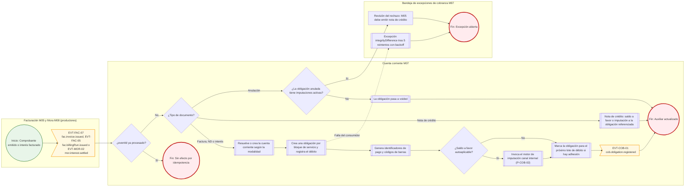
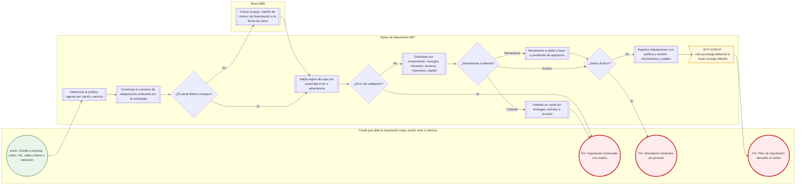
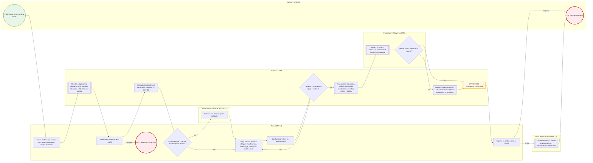
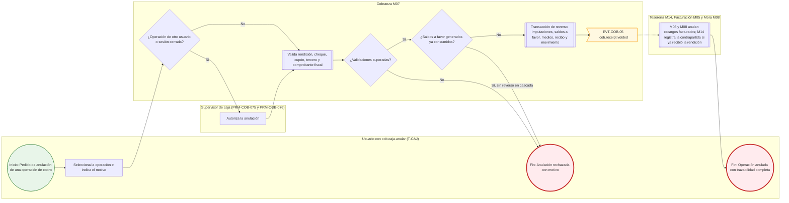
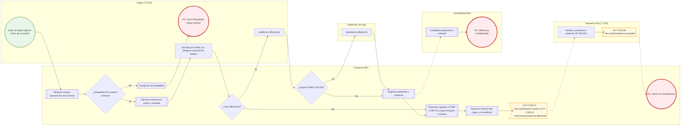
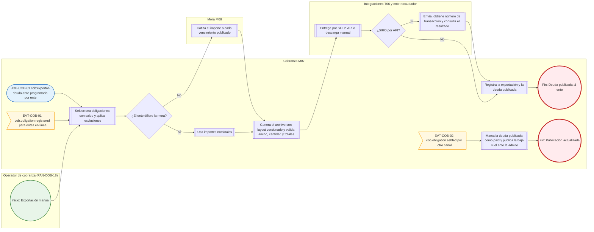
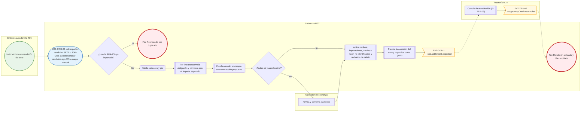
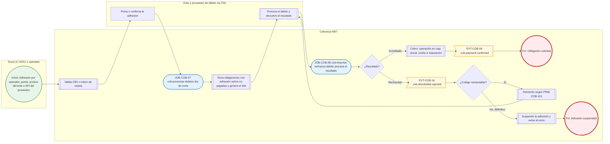
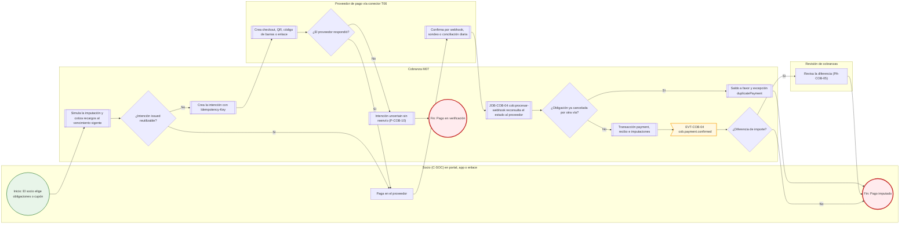
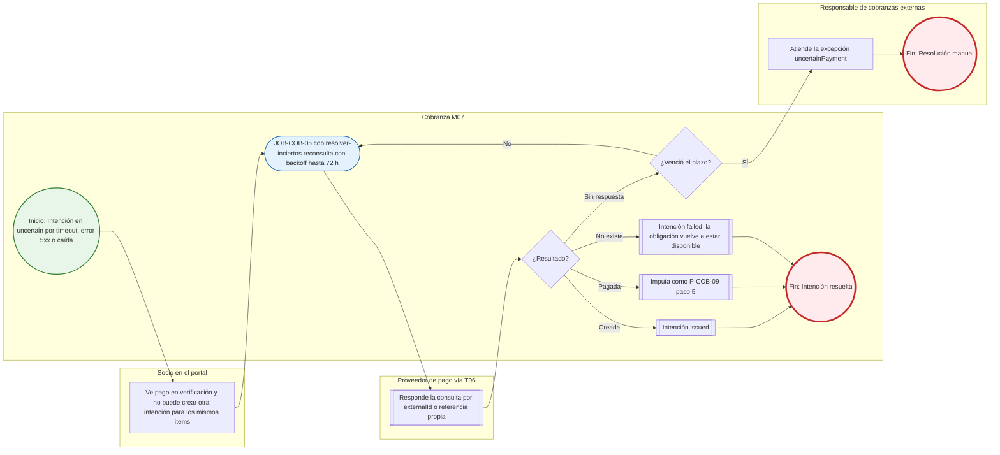

# GoodApps Cooperativas

## Procesos de negocio — Cuenta corriente y cobranza (M07, P-COB-01 a P-COB-10)

**Entregable de Análisis y Diseño Detallado — Artefacto 2.1 (Procesos de negocio BPMN). Parte de [`04-procesos-bpmn.md`](04-procesos-bpmn.md).**

| Dato | Valor |
|---|---|
| Documento | Diagramas BPMN, pasos, situación actual en ProCoop y excepciones de los procesos P-COB-01 a P-COB-10 |
| Carácter | Derivado de la especificación vigente; no la reemplaza. Ante diferencias prevalecen la maestra `00`, los anexos, T05, T11 y el registro de decisiones `01` |
| Generación | Script `_trabajo/generar_bpmn.py` (extrae pasos, eventos, jobs y RF/RN de los anexos) más datos revisados a mano en `_trabajo/bpmn_datos_*.py` |
| Versión | 1.1 (regenerada contra la especificación corregida) |
| Fecha | 05-11-2026 |

**Cómo leer cada proceso.** La notación es la de [`04-procesos-bpmn.md` §3](04-procesos-bpmn.md#3-notación-equivalencia-mermaid--bpmn) (carriles, eventos de inicio y fin, tareas de usuario y de servicio, compuertas XOR y AND, eventos de dominio como banderas, temporizadores y jobs como estadios). La tabla de pasos reproduce la actividad del anexo; en la columna RF/RN, los identificadores sin prefijo son los que el anexo cita en el paso y los marcados "asoc." son reglas o requisitos del mismo anexo que comparten parámetro, permiso, evento o tema con el paso (asociación generada por el script y revisada). Los eventos se nombran con su ID del catálogo de T11 §12.

## Índice de procesos de esta parte

1. [P-COB-01 Registro de obligaciones desde facturación](#1-p-cob-01-registro-de-obligaciones-desde-facturación)
2. [P-COB-02 Motor de imputación](#2-p-cob-02-motor-de-imputación)
3. [P-COB-03 Cobro en ventanilla (CU-11)](#3-p-cob-03-cobro-en-ventanilla-cu-11)
4. [P-COB-04 Anulación de cobranza](#4-p-cob-04-anulación-de-cobranza)
5. [P-COB-05 Cierre, arqueo y rendición a tesorería (CU-12)](#5-p-cob-05-cierre-arqueo-y-rendición-a-tesorería-cu-12)
6. [P-COB-06 Exportación de deuda a entes](#6-p-cob-06-exportación-de-deuda-a-entes)
7. [P-COB-07 Importación de rendición de entes](#7-p-cob-07-importación-de-rendición-de-entes)
8. [P-COB-08 Débito automático](#8-p-cob-08-débito-automático)
9. [P-COB-09 Pago online (CU-13)](#9-p-cob-09-pago-online-cu-13)
10. [P-COB-10 Pago incierto](#10-p-cob-10-pago-incierto)

---

## 1. P-COB-01 Registro de obligaciones desde facturación

| Campo | Contenido |
|---|---|
| Fuente | M07 §9.1, `M07-COB-cuenta-corriente-cobranza.md` (línea 2062) |
| Macroproceso | MP-04 Cuenta corriente del socio |
| Disparador | Comprobante emitido o interés facturado |
| Resultado | Sin efecto por idempotencia; Auxiliar actualizado; Excepción abierta |
| Carriles | Facturación M05 y Mora M08 (productores); Cuenta corriente M07; Bandeja de excepciones de cobranza M07 |
| Roles de T02 | Solo actores del sistema (sin rol humano) |
| Módulos involucrados | M05 Facturación, M07 Cuenta corriente y cobranza, M08 Mora |
| Eventos (T11 §12) | EVT-FAC-05 `fac.billingRun.issued`; EVT-MOR-02 `mor.interest.settled`; EVT-FAC-08 `fac.invoice.annulled`; EVT-FAC-07 `fac.invoice.issued`; EVT-COB-01 `cob.obligation.registered`; EVT-FAC-11 `fac.debitNote.issued`; EVT-MOR-03 `mor.deferredInterest.created`; EVT-FAC-10 `fac.creditNote.issued` |
| Jobs | — |
| Relación con 04-procesos-bpmn.md | P3 Facturación periódica y emisión fiscal ([§7](04-procesos-bpmn.md#7-p3--facturación-periódica-y-emisión-fiscal)); P4 Cobranza: caja, pasarelas, débito, rendición y depósito ([§8](04-procesos-bpmn.md#8-p4--cobranza-caja-pasarelas-débito-rendición-y-depósito)) |

**Pasos del proceso** (actividad tomada del anexo; la columna RF/RN distingue lo citado en el paso de lo asociado por parámetro, permiso, evento o tema compartido).

| Paso | Carril | Actividad | RF/RN que aplican | EVT / JOB / PAN |
|---|---|---|---|---|
| 1 | Cuenta corriente M07 | Consumir `fac.invoice.issued`, `fac.debitNote.issued`, `fac.billingRun.issued` (EVT-FAC-05; lote: un evento por comprobante) y `mor.interest.settled` / `mor.deferredInterest.created` (EVT-MOR-02/03; M08: intereses facturados aparte, débitos de reversión) con su `eventId`. | asoc.: RF-COB-104, RF-COB-001 | EVT-FAC-05, EVT-MOR-02, EVT-FAC-07, EVT-FAC-11, EVT-MOR-03 |
| 2 | Cuenta corriente M07 | Si el `eventId` ya se procesó, terminar (idempotencia del consumidor). | asoc.: RF-COB-001 | — |
| 3 | Cuenta corriente M07 | Resolver la cuenta corriente según la modalidad (separada por servicio o unificada por grupo de facturación) y crearla si no existe. | asoc.: RF-COB-021 | — |
| 4 | Cuenta corriente M07 | Por cada bloque de servicio del comprobante crear una obligación con vencimientos, importes por vencimiento y componentes; registrar el débito en `ledgerEntries`. | asoc.: RF-COB-001 | — |
| 5 | Cuenta corriente M07 | Generar identificadores de pago (`paymentReferences`) y códigos de barras por formato habilitado; si un código no es representable (RN-COB-148) registrar el motivo y no dejarlo vacío. | RN-COB-148 | — |
| 6 | Cuenta corriente M07 | Si hay saldos a favor aplicables automáticamente y está configurado "aplicar en la próxima factura", invocar el motor de imputación (canal `internal`). | — | — |
| 7 | Cuenta corriente M07 | Si la cuenta tiene adhesión de débito activa y el tipo no está excluido, marcar la obligación para el próximo lote. | — | — |
| 8 | Cuenta corriente M07 | Publicar `cob.obligation.registered`. | — | EVT-COB-01 |
| 9 | Cuenta corriente M07 | `fac.creditNote.issued`: crear un saldo a favor o imputar la NC a la obligación referenciada (RN-COB-037). `fac.invoice.annulled` (EVT-FAC-08): si la obligación no tiene imputaciones activas pasa a `voided`; si las tiene, el evento se rechaza a una excepción (M05 no debe anular comprobantes cobrados sin NC). | RN-COB-037 | EVT-FAC-08, EVT-FAC-10 |

**Situación actual en ProCoop (nota de cambio).** En ProCoop la factura agrupada es un comprobante único con saldo propio y el saldo es un campo que cada proceso edita (CTR-COB-01, CTR-COB-03). GoodApps registra una obligación por bloque de servicio y deriva el saldo de las imputaciones; el campo `openAmount` es una proyección no editable.

**Excepciones**

| Excepción | Tratamiento |
|---|---|
| El mismo evento llega dos veces | El consumidor reconoce el `eventId` y termina sin efecto (idempotencia). |
| Código de barras no representable en un formato (RN-COB-148) | Se registra el motivo; el código no queda vacío. |
| Anulación (EVT-FAC-08) de un comprobante con imputaciones activas | El evento se rechaza a una excepción: M05 no debe anular comprobantes cobrados sin nota de crédito. |
| Falla al procesar el evento | Cola de reintentos (5 intentos, backoff exponencial) y luego excepción `integrityDifference` en `collectionExceptions`. |

---

## 2. P-COB-02 Motor de imputación

| Campo | Contenido |
|---|---|
| Fuente | M07 §9.2, `M07-COB-cuenta-corriente-cobranza.md` (línea 2076) |
| Macroproceso | MP-04 Cuenta corriente del socio |
| Disparador | Crédito a imputar: cobro, NC, saldo a favor o retención |
| Resultado | Imputación rechazada con motivo; Simulación mostrada sin persistir; Plan de imputación devuelto al recibo |
| Carriles | Canal que pide la imputación (caja, portal, ente o interno); Motor de imputación M07; Mora M08 |
| Roles de T02 | Solo actores del sistema (sin rol humano) |
| Módulos involucrados | M07 Cuenta corriente y cobranza, M08 Mora |
| Eventos (T11 §12) | EVT-COB-07 `cob.surcharge.deferred` |
| Jobs | — |
| Relación con 04-procesos-bpmn.md | P4 Cobranza: caja, pasarelas, débito, rendición y depósito ([§8](04-procesos-bpmn.md#8-p4--cobranza-caja-pasarelas-débito-rendición-y-depósito)); P5 Mora, aviso, suspensión o restricción, rehabilitación y financiación ([§9](04-procesos-bpmn.md#9-p5--mora-aviso-suspensión-o-restricción-rehabilitación-y-financiación)) |

**Pasos del proceso** (actividad tomada del anexo; la columna RF/RN distingue lo citado en el paso de lo asociado por parámetro, permiso, evento o tema compartido).

| Paso | Carril | Actividad | RF/RN que aplican | EVT / JOB / PAN |
|---|---|---|---|---|
| 1 | Motor de imputación M07 | Determinar la política vigente para el canal y servicio (o la de la cuenta). | — | — |
| 2 | Motor de imputación M07 | Construir el universo: obligaciones con saldo > 0 de la cuenta, no bloqueadas, no en convenio (salvo cuotas del convenio), ordenadas por la estrategia. | — | — |
| 3 | Mora M08 | Para cada obligación pedir a M08 la cotización (`mor.surcharge.quote`: recargo entre vencimientos, interés de mora, interés de financiación) a la fecha de cobro, salvo que el canal difiera recargos. | asoc.: RF-COB-033, RN-COB-025 | — |
| 4 | Motor de imputación M07 | Validar reglas de caja (deuda notificada completa, más antiguas primero, por servicio, cuotas en orden, cupón completo, entrega mínima) con severidad error o advertencia. | asoc.: RF-COB-034 | — |
| 5 | Motor de imputación M07 | Distribuir el importe por componente en el orden configurado (recargos → intereses → terceros → impuestos → capital por defecto). | — | — |
| 6 | Motor de imputación M07 | Remanente: saldo a favor o pendiente de aplicación (PRM-COB-030); faltante en canal sin entregas: rechazo o revisión según el canal. | asoc.: RN-COB-030, RN-COB-038 | — |
| 7 | Motor de imputación M07 | Registrar imputaciones con la política y versión aplicada, movimientos, saldos proyectados y, si hubo recargo diferido, publicar `cob.surcharge.deferred` para que M08 lo facture. | asoc.: RN-COB-051, RN-COB-154 | EVT-COB-07 |
| 8 | Motor de imputación M07 | Devolver el plan de imputación para el recibo. | — | — |

**Situación actual en ProCoop (nota de cambio).** ProCoop no reparte un pago parcial entre los servicios de un comprobante e imputa según la configuración y el criterio del cajero (CTR-COB-02; análisis de brechas §3.10). GoodApps usa un motor con política configurable y orden por componente (DEC-048), y el recargo puede cobrarse en el acto o diferirse por canal (CTR-COB-13).

**Excepciones**

| Excepción | Tratamiento |
|---|---|
| Obligación bloqueada o incluida en un convenio | Queda fuera del universo, salvo las cuotas del propio convenio. |
| Regla de caja incumplida | Con severidad error se rechaza; con advertencia continúa y la advertencia queda visible. |
| Faltante en un canal que no admite entregas parciales | Rechazo o revisión según el canal. |
| Canal que difiere recargos | No se cotiza en el acto; el recargo diferido se publica a M08 para facturarlo después. |

---

## 3. P-COB-03 Cobro en ventanilla (CU-11)

| Campo | Contenido |
|---|---|
| Fuente | M07 §9.3, `M07-COB-cuenta-corriente-cobranza.md` (línea 2090) |
| Macroproceso | MP-05 Recaudación por canales |
| Disparador | Socio se presenta a pagar |
| Resultado | Recibo entregado; Cancelado sin persistir |
| Carriles | Socio en ventanilla; Cajero (T-CAJ); Supervisor autorizante (P-IAM-17); Cobranza M07; Facturación M05 y Fiscal M06; Motor de comunicaciones T09 |
| Roles de T02 | T-CAJ Cajero |
| Módulos involucrados | M05 Facturación, M06 Fiscal, M07 Cuenta corriente y cobranza, T09 Comunicaciones |
| Eventos (T11 §12) | EVT-COB-04 `cob.payment.confirmed` |
| Jobs | JOB-COB-15 `cob:reparar-pendientes` |
| Relación con 04-procesos-bpmn.md | P4 Cobranza: caja, pasarelas, débito, rendición y depósito ([§8](04-procesos-bpmn.md#8-p4--cobranza-caja-pasarelas-débito-rendición-y-depósito)) |

**Pasos del proceso** (actividad tomada del anexo; la columna RF/RN distingue lo citado en el paso de lo asociado por parámetro, permiso, evento o tema compartido).

| Paso | Carril | Actividad | RF/RN que aplican | EVT / JOB / PAN |
|---|---|---|---|---|
| 1 | Cajero | Cajero con sesión abierta busca al titular (número de cuenta, documento, nombre, código de barras o identificador de pago). | — | — |
| 2 | Cobranza M07 | Se muestran obligaciones de la cuenta, aviso de deuda en otras cuentas (PRM-COB-051), bloqueos, estado de servicio desconectado, saldo a favor y alerta de notificaciones (PRM-COB-052). | asoc.: RN-COB-049 | — |
| 3 | Cajero | El cajero selecciona obligaciones o cupón; el sistema simula la imputación y muestra recargos e intereses (PAN-COB-10). | — | PAN-COB-10 |
| 4 | Cajero | Si el cobro es parcial requiere `cob.caja.cobrarParcial` y el motivo; si se modifica el recargo requiere `cob.caja.cambiarRecargo` y queda auditado. | asoc.: RF-COB-062 | — |
| 5 | Cajero | El cajero carga medios (efectivo, cheque, transferencia, tarjeta, QR del puesto, retención, saldo a favor); se calculan recargos por tarjeta, vuelto y descuentos. | asoc.: RF-COB-065 | — |
| 6 | Cobranza M07 | Confirmación con `Idempotency-Key` generado en el cliente; validaciones de integridad exacta (Σ medios − vuelto = Σ recibos). | — | — |
| 7 | Cobranza M07 | Transacción: operación, recibo(s) (uno por cuenta o uno por cupón según PRM-COB-065 / V2 2719, y siempre al menos uno por entidad jurídica, RF-COB-193; cada recibo toma su número de `fac.service.nextNumber` de M05 con la entidad y el punto de venta del recibo, RF-COB-087, RF-FAC-179), imputaciones, medios, movimientos, saldos, outbox. | RF-COB-087, RF-COB-193, RF-FAC-179; asoc.: RN-COB-152 | — |
| 8 | Facturación M05 y Fiscal M06 | Comprobante fiscal (si el recibo requiere CAE o hay factura de recargo): espera síncrona configurable (PRM-COB-066); si no llega, la operación queda `pendingFiscal` y el job JOB-COB-15 la completa. | asoc.: RN-COB-062 | JOB-COB-15 |
| 9 | Cobranza M07 | Impresión (perfil de impresora T06), envío por correo o WhatsApp por el motor de comunicaciones de T09 (comando `com.communications.emit`, API-COM-75; antes atribuido a "M10" por error), `cob.payment.confirmed`. | asoc.: RN-COB-157, RF-COB-176 | EVT-COB-04 |

**Situación actual en ProCoop (nota de cambio).** La tarea del cajero se mantiene (apertura de caja, cobranza local e informes; análisis de brechas §3.10). Cambian: los descuentos en caja pasan a ser bonificaciones documentadas facturadas por M05 (CTR-COB-19), el recibo por cuenta o por cupón es configurable (CTR-COB-20, PRM-COB-065) y siempre hay un recibo por entidad jurídica (CTR-COB-23).

**Excepciones**

| Excepción | Tratamiento |
|---|---|
| Doble clic o reintento de red con la misma clave | Devuelve el mismo recibo; no se duplica el cobro. |
| Cancelación antes de confirmar | No se persiste nada. |
| La autorización fiscal no llega en la espera configurada (PRM-COB-066) | La operación queda `pendingFiscal` y JOB-COB-15 la completa. |
| El cobro abarca deuda de varias entidades jurídicas | Se emite al menos un recibo por entidad, con la numeración de cada una (RF-COB-193, DEC-087). |
| Cobro parcial o cambio de recargo sin la capability | Autorización de supervisor en el momento (P-IAM-17) con motivo auditado. |

---

## 4. P-COB-04 Anulación de cobranza

| Campo | Contenido |
|---|---|
| Fuente | M07 §9.4, `M07-COB-cuenta-corriente-cobranza.md` (línea 2104) |
| Macroproceso | MP-05 Recaudación por canales |
| Disparador | Pedido de anulación de una operación de cobro |
| Resultado | Anulación rechazada con motivo; Operación anulada con trazabilidad completa |
| Carriles | Usuario con cob.caja.anular (T-CAJ); Supervisor de caja (PRM-COB-075 y PRM-COB-076); Cobranza M07; Tesorería M14, Facturación M05 y Mora M08 |
| Roles de T02 | T-CAJ Cajero |
| Módulos involucrados | M05 Facturación, M07 Cuenta corriente y cobranza, M08 Mora, M14 Tesorería |
| Eventos (T11 §12) | EVT-COB-05 `cob.receipt.voided` |
| Jobs | — |
| Relación con 04-procesos-bpmn.md | P4 Cobranza: caja, pasarelas, débito, rendición y depósito ([§8](04-procesos-bpmn.md#8-p4--cobranza-caja-pasarelas-débito-rendición-y-depósito)) |

**Pasos del proceso** (actividad tomada del anexo; la columna RF/RN distingue lo citado en el paso de lo asociado por parámetro, permiso, evento o tema compartido).

| Paso | Carril | Actividad | RF/RN que aplican | EVT / JOB / PAN |
|---|---|---|---|---|
| 1 | Usuario con cob.caja.anular | Usuario con `cob.caja.anular` selecciona la operación; si es de otro usuario o la sesión está cerrada, se requiere supervisor (PRM-COB-075/076). | asoc.: RN-COB-073 | — |
| 2 | Cobranza M07 | Validaciones: rendición de tesorería no recibida (si fue recibida, se anula con contrapartida en M14), cheque no depositado, cupón de tarjeta no presentado, tercero no rendido, comprobante fiscal anulable (si no, NC por M05). | asoc.: RF-COB-177 | — |
| 3 | Cobranza M07 | Transacción: reverso de imputaciones (saldos restituidos), reverso de saldos a favor generados (si ya se consumieron, se rechaza salvo reverso en cascada autorizado), medios `voided`, recibo `voided`, movimiento de reverso; los recargos facturados se anulan por M05/M08 mediante evento. | — | — |
| 4 | Cobranza M07 | `cob.receipt.voided`; ProCoop borraba registros (CTR-COB-04): aquí todo queda. | — | EVT-COB-05 |

**Situación actual en ProCoop (nota de cambio).** La anulación de ProCoop borra registros y guarda un histórico (CTR-COB-04). En GoodApps nada se borra: la anulación es un reverso vinculado y el recibo queda `voided`.

**Excepciones**

| Excepción | Tratamiento |
|---|---|
| La rendición ya fue recibida por tesorería | Se anula con contrapartida en M14. |
| Comprobante fiscal no anulable | La corrección se hace con nota de crédito de M05. |
| Saldo a favor generado por el cobro ya consumido | Se rechaza, salvo reverso en cascada autorizado. |
| Cheque depositado, cupón presentado o tercero rendido | La validación impide anular. |
| Política de operación sensible configurada para `cob.receipt.void` | La anulación sigue el patrón de operación con aprobación de T11 (P-WFL-04, ejemplo CU-29). |

---

## 5. P-COB-05 Cierre, arqueo y rendición a tesorería (CU-12)

| Campo | Contenido |
|---|---|
| Fuente | M07 §9.5, `M07-COB-cuenta-corriente-cobranza.md` (línea 2111) |
| Macroproceso | MP-05 Recaudación por canales |
| Disparador | El cajero pide el cierre de su sesión |
| Resultado | Cierre bloqueado hasta resolver; Diferencia contabilizada; Sesión en handedOver |
| Carriles | Cajero (T-CAJ); Supervisor de caja; Cobranza M07; Contabilidad M15; Tesorería M14 (T-TES) |
| Roles de T02 | T-CAJ Cajero, T-TES Tesorero / Financiero (MT-006) |
| Módulos involucrados | M07 Cuenta corriente y cobranza, M14 Tesorería, M15 Contabilidad |
| Eventos (T11 §12) | EVT-TES-08 `tes.cashRemittance.accepted`; EVT-COB-12 `cob.cashSession.closed`; EVT-COB-13 `cob.treasuryHandover.delivered` |
| Jobs | — |
| Relación con 04-procesos-bpmn.md | P4 Cobranza: caja, pasarelas, débito, rendición y depósito ([§8](04-procesos-bpmn.md#8-p4--cobranza-caja-pasarelas-débito-rendición-y-depósito)) |

**Pasos del proceso** (actividad tomada del anexo; la columna RF/RN distingue lo citado en el paso de lo asociado por parámetro, permiso, evento o tema compartido).

| Paso | Carril | Actividad | RF/RN que aplican | EVT / JOB / PAN |
|---|---|---|---|---|
| 1 | Cajero | Cajero pide cierre: se bloquean nuevas operaciones de la sesión. | — | — |
| 2 | Cobranza M07 | Verificación de integridad de la sesión (operaciones = medios = recibos); con diferencias no se permite cerrar (RN-COB-060). | RN-COB-060 | — |
| 3 | Cajero | Cálculo del teórico por medio y moneda; el cajero declara por medio (PA-COB-08), con desglose opcional de billetes. | asoc.: RN-COB-064, RF-COB-080 | — |
| 4 | Cajero | Diferencias: justificación obligatoria; si superan PRM-COB-034, aprobación de supervisor; se registra quebranto o sobrante (evento a M15). | asoc.: RN-COB-066, RF-COB-081 | — |
| 5 | Cobranza M07 | Cupones de tarjeta: presentación automática al cierre si PRM-COB-071; cheques pasan a cartera (M14). | asoc.: RN-COB-068 | — |
| 6 | Cobranza M07 | Se genera el informe de presentación del cajero y la rendición (`treasuryHandovers`), `cob.cashSession.closed` y `cob.treasuryHandover.delivered`. | — | EVT-COB-12, EVT-COB-13 |
| 7 | Tesorería M14 | Tesorería (M14) recibe y confirma: `tes.cashRemittance.accepted` (EVT-TES-08) cambia la sesión a `handedOver`. | — | EVT-TES-08 |

**Situación actual en ProCoop (nota de cambio).** En ProCoop el arqueo es solo de efectivo (CTR-COB-05), se permite cerrar varios días juntos (CTR-COB-17) y el cierre de caja vive en Tesorería, que transfiere los fondos en el mismo acto (CTR-TES-14). En GoodApps M07 cierra y arquea por medio de pago y Tesorería acepta u observa por separado (PA-TES-06); entrega y recepción quedan como dos registros vinculados (CTR-TES-25).

**Excepciones**

| Excepción | Tratamiento |
|---|---|
| Diferencias de integridad (operaciones, medios y recibos no cuadran) | No se permite cerrar (RN-COB-060). |
| Diferencia de arqueo sobre el umbral PRM-COB-034 | Aprobación de supervisor; el quebranto o sobrante se informa a M15. |
| Cierre de varias sesiones a la vez | Solo con PRM-COB-070 activo; agrupa sesiones del mismo cajero con `closeGroupId`. |
| Tesorería observa la rendición | Vuelve a M07 para corregir (P-TES-01, paso 5). |

---

## 6. P-COB-06 Exportación de deuda a entes

| Campo | Contenido |
|---|---|
| Fuente | M07 §9.6, `M07-COB-cuenta-corriente-cobranza.md` (línea 2123) |
| Macroproceso | MP-05 Recaudación por canales |
| Disparador | Exportación manual |
| Resultado | Deuda publicada al ente; Publicación actualizada |
| Carriles | Operador de cobranza (PAN-COB-18); Cobranza M07; Mora M08; Integraciones T06 y ente recaudador |
| Roles de T02 | Solo actores del sistema (sin rol humano) |
| Módulos involucrados | M07 Cuenta corriente y cobranza, M08 Mora, T06 Integraciones |
| Eventos (T11 §12) | EVT-COB-01 `cob.obligation.registered`; EVT-COB-02 `cob.obligation.settled` |
| Jobs | JOB-COB-01 `cob:exportar-deuda-ente` |
| Relación con 04-procesos-bpmn.md | P4 Cobranza: caja, pasarelas, débito, rendición y depósito ([§8](04-procesos-bpmn.md#8-p4--cobranza-caja-pasarelas-débito-rendición-y-depósito)) |

**Pasos del proceso** (actividad tomada del anexo; la columna RF/RN distingue lo citado en el paso de lo asociado por parámetro, permiso, evento o tema compartido).

| Paso | Carril | Actividad | RF/RN que aplican | EVT / JOB / PAN |
|---|---|---|---|---|
| 1 | Cobranza M07 | Disparador: manual (PAN-COB-18), programado (JOB-COB-01) o por evento (`cob.obligation.registered` para entes en línea como SIRO por API). | — | PAN-COB-18, JOB-COB-01, EVT-COB-01 |
| 2 | Cobranza M07 | Selección: obligaciones con saldo según origen (todas las facturas impagas o solo período, PRM-COB-081), excluidas las adheridas a débito si se configura, las ya informadas (PRM-COB-085), las de vencimiento máximo superado y las bloqueadas. | asoc.: RN-COB-081, RF-COB-101 | — |
| 3 | Mora M08 | Cálculo de importes por vencimiento a publicar: si el ente difiere mora, importes nominales; si no, cotización de M08 a cada vencimiento publicado; días extra en el último vencimiento (PRM-COB-084). | asoc.: RN-COB-084 | — |
| 4 | Cobranza M07 | Generación con el layout versionado (encabezado, detalle, pie, archivo de control); validaciones de ancho; cantidad y totales. | asoc.: RF-COB-099 | — |
| 5 | Integraciones T06 y ente recaudador | Entrega por T06 (SFTP, API o descarga manual); para SIRO por API: envío, número de transacción, consulta de resultado y confirmación automática o manual. | — | — |
| 6 | Cobranza M07 | Registro en `agencyDebtExports` y `agencyPublishedDebts` (índice Red Link incremental desde PRM-COB-083). | asoc.: RN-COB-083 | — |
| 7 | Cobranza M07 | Actualización: al cancelarse una obligación por otro canal, `cob.obligation.settled` marca la deuda publicada como `paid` y, si el ente lo soporta, se publica la baja en la próxima actualización. | asoc.: RF-COB-078 | EVT-COB-02 |

**Situación actual en ProCoop (nota de cambio).** ProCoop tiene interfaces de cobranza programadas por cooperativa (79 carpetas en el código) y un parámetro define el nombre del archivo (análisis de brechas §3.10; CTR-COB-15). GoodApps usa perfiles de layout versionados por ente, configurables sin desarrollo.

**Excepciones**

| Excepción | Tratamiento |
|---|---|
| Obligación ya informada, bloqueada, adherida a débito o con vencimiento máximo superado | Queda excluida de la selección (PRM-COB-081, PRM-COB-085). |
| Falla del envío | JOB-COB-01 reintenta 3 veces con espera de 5 minutos y alerta al responsable. |
| Validación de ancho o de totales fallida | No se entrega el archivo. |

---

## 7. P-COB-07 Importación de rendición de entes

| Campo | Contenido |
|---|---|
| Fuente | M07 §9.7, `M07-COB-cuenta-corriente-cobranza.md` (línea 2133) |
| Macroproceso | MP-05 Recaudación por canales |
| Disparador | Archivo de rendición del ente |
| Resultado | Rechazado por duplicado; Rendición aplicada y día conciliado |
| Carriles | Ente recaudador vía T06; Cobranza M07; Operador de cobranza; Tesorería M14 |
| Roles de T02 | Solo actores del sistema (sin rol humano) |
| Módulos involucrados | M07 Cuenta corriente y cobranza, M14 Tesorería, T06 Integraciones |
| Eventos (T11 §12) | EVT-TES-07 `tes.gatewayCredit.reconciled`; EVT-COB-11 `cob.settlement.expected` |
| Jobs | JOB-COB-02 `cob:importar-rendicion`; JOB-COB-03 `cob:sondear-rendicion-api` |
| Relación con 04-procesos-bpmn.md | P4 Cobranza: caja, pasarelas, débito, rendición y depósito ([§8](04-procesos-bpmn.md#8-p4--cobranza-caja-pasarelas-débito-rendición-y-depósito)) |

**Pasos del proceso** (actividad tomada del anexo; la columna RF/RN distingue lo citado en el paso de lo asociado por parámetro, permiso, evento o tema compartido).

| Paso | Carril | Actividad | RF/RN que aplican | EVT / JOB / PAN |
|---|---|---|---|---|
| 1 | Cobranza M07 | El archivo llega por SFTP (JOB-COB-02), API (JOB-COB-03) o carga manual; se calcula la huella SHA-256: si ya existe para el ente, se rechaza como duplicado. | — | JOB-COB-02, JOB-COB-03 |
| 2 | Cobranza M07 | Validaciones de cabecera (convenio del ente, fecha) y pie (cantidad con offset y total); diferencias de pie se registran como advertencia o error según el layout. | — | — |
| 3 | Cobranza M07 | Por línea: parseo según layout; resolución de la obligación (identificador autocontenido → alias → resolutor LAG → código de barras → intención); cálculo del importe esperado al vencimiento informado; comparación con tolerancia. | asoc.: RF-COB-100 | — |
| 4 | Cobranza M07 | Resultado por línea: `ok`, `warning` (importe distinto, vencimiento superado, ya pagada) o `error` (no encontrada, mal formada); propuesta de acción. | — | — |
| 5 | Operador de cobranza | Confirmación (manual o automática si todas las líneas son `ok` y PRM `autoConfirm`): operación en la caja virtual del ente, recibos tipo `agency`, imputaciones (sin recargo si difiere; con recargo diferido publicado a M08), saldos a favor por duplicado o excedente, no identificados para las no resueltas, rechazos de débito para líneas con código de rechazo. | — | — |
| 6 | Cobranza M07 | Comisión del ente (fija por ítem o porcentual con mínimo y máximo) calculada y publicada como gasto (M14/M15); `cob.settlement.expected` con neto, fecha de acreditación y cuenta bancaria según la registración configurada. | asoc.: RF-COB-098 | EVT-COB-11 |
| 7 | Tesorería M14 | Conciliación: M14 informa `tes.gatewayCredit.reconciled` (EVT-TES-07); la conciliación de cobranzas cierra el día. | — | EVT-TES-07 |

**Situación actual en ProCoop (nota de cambio).** La rendición LAG de ProCoop identifica por importe y elige la factura más reciente (CTR-COB-07) y rechaza los pagos cuyo importe no coincide (CTR-COB-12). GoodApps resuelve con un identificador autocontenido y un resolutor LAG transitorio hasta que venzan las facturas emitidas por ProCoop (DEC-050), y acepta la diferencia con revisión.

**Excepciones**

| Excepción | Tratamiento |
|---|---|
| Archivo ya importado | Se rechaza como duplicado por la huella. |
| Diferencias en el pie | Advertencia o error según el layout. |
| Línea que no se resuelve | Se registra como cobro no identificado (P-COB-13). |
| Línea con código de rechazo de débito | Se registra el rechazo del débito automático. |
| Caída a mitad de la confirmación | Se reanuda en las líneas no aplicadas; la confirmación es idempotente por línea. |

---

## 8. P-COB-08 Débito automático

| Campo | Contenido |
|---|---|
| Fuente | M07 §9.8, `M07-COB-cuenta-corriente-cobranza.md` (línea 2145) |
| Macroproceso | MP-05 Recaudación por canales |
| Disparador | Adhesión por operador, portal, archivo del ente o API del proveedor |
| Resultado | Obligación cobrada; Adhesión suspendida |
| Carriles | Socio (C-SOC) u operador; Cobranza M07; Ente o proveedor de débito vía T06 |
| Roles de T02 | C-SOC Socio titular |
| Módulos involucrados | M07 Cuenta corriente y cobranza, T06 Integraciones |
| Eventos (T11 §12) | EVT-COB-04 `cob.payment.confirmed`; EVT-COB-16 `cob.directDebit.rejected` |
| Jobs | JOB-COB-07 `cob:presentar-debitos`; JOB-COB-08 `cob:importar-rechazos-debito` |
| Relación con 04-procesos-bpmn.md | P4 Cobranza: caja, pasarelas, débito, rendición y depósito ([§8](04-procesos-bpmn.md#8-p4--cobranza-caja-pasarelas-débito-rendición-y-depósito)) |

**Pasos del proceso** (actividad tomada del anexo; la columna RF/RN distingue lo citado en el paso de lo asociado por parámetro, permiso, evento o tema compartido).

| Paso | Carril | Actividad | RF/RN que aplican | EVT / JOB / PAN |
|---|---|---|---|---|
| 1 | Socio | Adhesiones: alta por operador, portal (socio), archivo de novedades del ente o API del proveedor (Pagos360 CBU/tarjeta); validación de CBU (dígitos verificadores) o token de tarjeta; firma o confirmación del proveedor. | asoc.: RF-COB-119 | — |
| 2 | Cobranza M07 | Presentación (JOB-COB-07): por cada ente/conector, en el día de corte, se toman obligaciones de cuentas con adhesión activa no excluidas, con saldo y vencimiento en la ventana; se genera el lote (archivo o solicitudes API) por el importe del primer vencimiento o el vigente a la fecha de débito. | asoc.: RF-COB-136, RN-COB-101 | JOB-COB-07 |
| 3 | Cobranza M07 | Resultado (JOB-COB-08): acreditados → cobro (operación en caja virtual del conector, recibo, imputación); rechazados → código del catálogo; reintento según política (PRM-COB-101) si el código es reintentable; definitivos (cuenta cerrada, baja) suspenden la adhesión y avisan al socio. | asoc.: RN-COB-104 | JOB-COB-08 |
| 4 | Cobranza M07 | Pago voluntario anterior: si la obligación se pagó por otro canal antes de la presentación, se excluye; si se cobró dos veces, el segundo cobro genera saldo a favor y, si el socio lo pide, devolución (P-COB-12). | asoc.: RN-COB-108, RF-COB-126 | — |
| 5 | Cobranza M07 | Morosidad de tarjetas (Naranja, Visa): el archivo de morosidad registra novedades sin generar cobros. | — | — |

**Situación actual en ProCoop (nota de cambio).** El anexo no describe el débito automático actual de ProCoop más allá de los formatos por ente; las credenciales de los proveedores, que ProCoop guarda en parámetros, pasan a la bóveda de T06 (CTR-COB-08).

**Excepciones**

| Excepción | Tratamiento |
|---|---|
| La obligación se pagó por otro canal antes de la presentación | Se excluye del lote. |
| La obligación se cobró dos veces | El segundo cobro genera saldo a favor y, si el socio lo pide, devolución (P-COB-12). |
| Rechazo definitivo (cuenta cerrada o baja) | Suspende la adhesión y avisa al socio. |
| Archivo de morosidad de tarjetas | Registra novedades sin generar cobros. |

---

## 9. P-COB-09 Pago online (CU-13)

| Campo | Contenido |
|---|---|
| Fuente | M07 §9.9, `M07-COB-cuenta-corriente-cobranza.md` (línea 2153) |
| Macroproceso | MP-05 Recaudación por canales |
| Disparador | El socio elige obligaciones o cupón |
| Resultado | Pago en verificación; Pago imputado |
| Carriles | Socio (C-SOC) en portal, app o enlace; Cobranza M07; Proveedor de pago vía conector T06; Revisión de cobranzas |
| Roles de T02 | C-SOC Socio titular |
| Módulos involucrados | M07 Cuenta corriente y cobranza, T06 Integraciones |
| Eventos (T11 §12) | EVT-COB-04 `cob.payment.confirmed` |
| Jobs | JOB-COB-04 `cob:procesar-webhook`; JOB-COB-05 `cob:resolver-inciertos`; JOB-COB-06 `cob:conciliar-pasarelas-diario` |
| Relación con 04-procesos-bpmn.md | P4 Cobranza: caja, pasarelas, débito, rendición y depósito ([§8](04-procesos-bpmn.md#8-p4--cobranza-caja-pasarelas-débito-rendición-y-depósito)) |

**Pasos del proceso** (actividad tomada del anexo; la columna RF/RN distingue lo citado en el paso de lo asociado por parámetro, permiso, evento o tema compartido).

| Paso | Carril | Actividad | RF/RN que aplican | EVT / JOB / PAN |
|---|---|---|---|---|
| 1 | Socio | El socio (portal, app o link) elige obligaciones o cupón; se simula la imputación y se cotizan recargos al vencimiento vigente. | — | — |
| 2 | Cobranza M07 | Reutilización: si existe una intención `issued` para los mismos ítems e importes dentro de la ventana (PRM-COB-112), se devuelve; si no, se crea con `Idempotency-Key`. | asoc.: RN-COB-117 | — |
| 3 | Proveedor de pago vía conector T06 | El conector crea la intención en el proveedor (checkout, QR, código de barras, link) y guarda `externalId` y referencias; si no responde, la intención pasa a `uncertain` y no se reenvía (P-COB-10). | — | — |
| 4 | Cobranza M07 | Confirmación por tres vías: webhook (`/api/v1/ext/cob/webhooks/{connector}/{tenantSlug}`: firma o token, registro del evento, deduplicación, respuesta 200 inmediata y procesamiento asíncrono JOB-COB-04 que reconsulta el estado al proveedor antes de imputar), polling con backoff para proveedores sin webhook (JOB-COB-05) y conciliación diaria (JOB-COB-06). | asoc.: RN-COB-130, RF-COB-167 | JOB-COB-04, JOB-COB-05, JOB-COB-06 |
| 5 | Cobranza M07 | Imputación: transacción `payment` → operación en la caja virtual del conector → recibo → imputaciones → `cob.payment.confirmed`; comisión real o estimada (PRM-COB-118) registrada en la transacción. | asoc.: RN-COB-157, RF-COB-176 | EVT-COB-04 |
| 6 | Cobranza M07 | Diferencia de importe (pago de 2° vencimiento con importe del 1°, recargo distinto): se acepta, se imputa y la diferencia va a revisión (PA-COB-05). | asoc.: RN-COB-116, RF-COB-148 | — |
| 7 | Cobranza M07 | Pago de una obligación ya cancelada por otra vía: saldo a favor + excepción `duplicatePayment`. | — | — |

**Situación actual en ProCoop (nota de cambio).** ProvinciaNet confía en lo que informa el portal (CTR-COB-09), el webhook pasa por un intermediario externo (CTR-COB-11) y las ventanas de reutilización difieren (CTR-COB-16). GoodApps reconsulta siempre al proveedor, recibe el webhook en un endpoint propio por tenant (DEC-003) y difiere el interés de mora a la próxima factura según el canal (DEC-051).

**Excepciones**

| Excepción | Tratamiento |
|---|---|
| El proveedor no responde al crear la intención | La intención queda `uncertain` y no se reenvía (P-COB-10). |
| Webhook repetido | Se deduplica; siempre se reconsulta el estado antes de imputar. |
| Pago del segundo vencimiento con el importe del primero o recargo distinto | Se acepta, se imputa y la diferencia va a revisión (PA-COB-05). |
| Pago de una obligación ya cancelada | Saldo a favor y excepción `duplicatePayment`. |
| Proveedor sin webhook | Sondeo con backoff (JOB-COB-05) y conciliación diaria (JOB-COB-06). |

---

## 10. P-COB-10 Pago incierto

| Campo | Contenido |
|---|---|
| Fuente | M07 §9.10, `M07-COB-cuenta-corriente-cobranza.md` (línea 2163) |
| Macroproceso | MP-05 Recaudación por canales |
| Disparador | Intención en uncertain por timeout, error 5xx o caída |
| Resultado | Intención resuelta; Resolución manual |
| Carriles | Cobranza M07; Socio en el portal; Proveedor de pago vía T06; Responsable de cobranzas externas |
| Roles de T02 | Solo actores del sistema (sin rol humano) |
| Módulos involucrados | M07 Cuenta corriente y cobranza, T06 Integraciones |
| Eventos (T11 §12) | — |
| Jobs | JOB-COB-05 `cob:resolver-inciertos` |
| Relación con 04-procesos-bpmn.md | P4 Cobranza: caja, pasarelas, débito, rendición y depósito ([§8](04-procesos-bpmn.md#8-p4--cobranza-caja-pasarelas-débito-rendición-y-depósito)) |

**Pasos del proceso** (actividad tomada del anexo; la columna RF/RN distingue lo citado en el paso de lo asociado por parámetro, permiso, evento o tema compartido).

| Paso | Carril | Actividad | RF/RN que aplican | EVT / JOB / PAN |
|---|---|---|---|---|
| 1 | Cobranza M07 | Intención en `uncertain` (timeout, error 5xx, caída). | — | — |
| 2 | Cobranza M07 | JOB-COB-05 reconsulta por `externalId` o por referencia propia con backoff (1, 5, 15, 60 min, luego cada 6 h hasta 72 h). | — | JOB-COB-05 |
| 3 | Cobranza M07 | Si el proveedor confirma la creación → `issued`; si informa pago → P-COB-09 paso 5; si no existe → `failed` y la obligación vuelve a estar disponible. | — | — |
| 4 | Socio en el portal | Mientras está incierta, el portal muestra "pago en verificación" y bloquea crear otra intención para los mismos ítems. | — | — |
| 5 | Responsable de cobranzas externas | Vencido el plazo sin resolución, excepción `uncertainPayment` para el responsable de cobranzas externas. | — | — |

**Situación actual en ProCoop (nota de cambio).** El anexo no describe un tratamiento de pagos inciertos en ProCoop. El proceso deriva del reemplazo de la confirmación sin verificación del proveedor (CTR-COB-09).

**Excepciones**

| Excepción | Tratamiento |
|---|---|
| El proveedor sigue sin responder | Reconsultas a 1, 5, 15 y 60 minutos y luego cada 6 horas hasta 72 horas. |
| El socio intenta pagar de nuevo los mismos ítems | El portal bloquea crear otra intención mientras la anterior está incierta. |
| Vence el plazo sin resolución | Excepción `uncertainPayment` para el responsable de cobranzas externas. |

---

## Inconsistencias detectadas en la especificación (esta parte)

No se detectaron inconsistencias en los procesos de esta parte.

**Resueltas en la especificación vigente.** Observaciones de la versión anterior de esta parte que la corrección de la especificación (05-11-2026) ya resolvió; se conservan como registro y el diagrama sigue el texto corregido.

| Proceso | Observación anterior | Resolución en la especificación |
|---|---|---|
| P-COB-03 | El anexo encarga a "M10" el envío o la entrega por correo, WhatsApp o canales del grupo; M10 es Técnica y campo. El motor de comunicaciones es T09 (P-COM-06); en el diagrama se usa T09. | M07 §9 atribuye ahora el envío al motor de comunicaciones de T09 con el comando `com.communications.emit` (API-COM-75) y anota que "M10" era un error; el diagrama ya usaba T09. |

## Cobertura de esta parte

| Universo de la parte | Diagramados | Pendientes |
|---|---|---|
| 10 (P-COB-01 a P-COB-10) | 10 | 0 |
