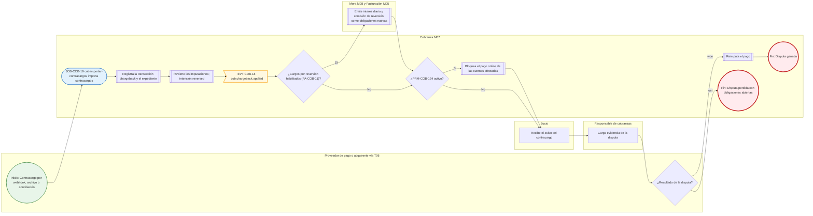
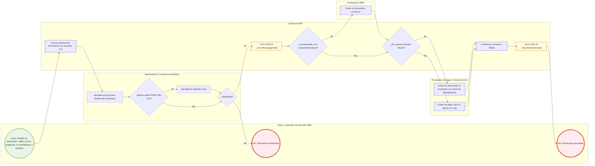
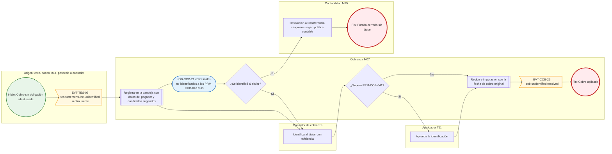
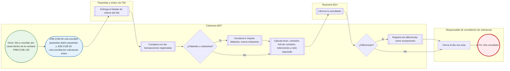
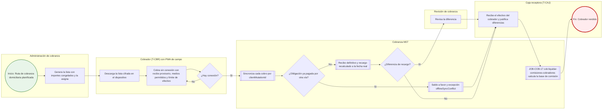
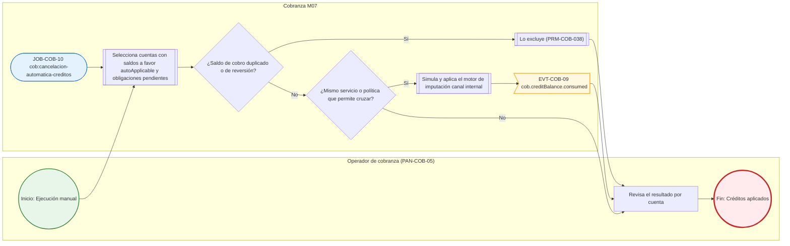
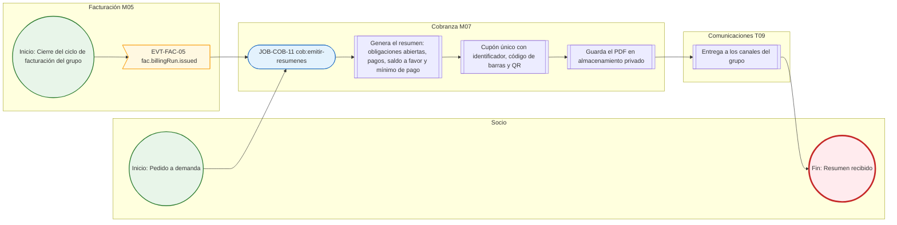
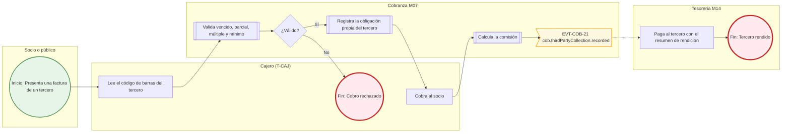
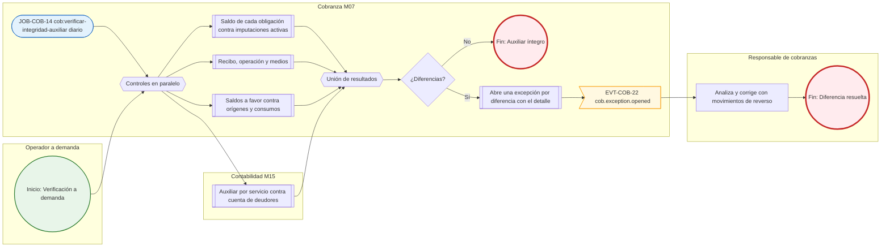

# GoodApps Cooperativas

## Procesos de negocio — Cobranza: excepciones, controles y canales complementarios (M07, P-COB-11 a P-COB-19)

**Entregable de Análisis y Diseño Detallado — Artefacto 2.1 (Procesos de negocio BPMN). Parte de [`04-procesos-bpmn.md`](04-procesos-bpmn.md).**

| Dato | Valor |
|---|---|
| Documento | Diagramas BPMN, pasos, situación actual en ProCoop y excepciones de los procesos P-COB-11 a P-COB-19 |
| Carácter | Derivado de la especificación vigente; no la reemplaza. Ante diferencias prevalecen la maestra `00`, los anexos, T05, T11 y el registro de decisiones `01` |
| Generación | Script `_trabajo/generar_bpmn.py` (extrae pasos, eventos, jobs y RF/RN de los anexos) más datos revisados a mano en `_trabajo/bpmn_datos_*.py` |
| Versión | 1.1 (regenerada contra la especificación corregida) |
| Fecha | 05-11-2026 |

**Cómo leer cada proceso.** La notación es la de [`04-procesos-bpmn.md` §3](04-procesos-bpmn.md#3-notación-equivalencia-mermaid--bpmn) (carriles, eventos de inicio y fin, tareas de usuario y de servicio, compuertas XOR y AND, eventos de dominio como banderas, temporizadores y jobs como estadios). La tabla de pasos reproduce la actividad del anexo; en la columna RF/RN, los identificadores sin prefijo son los que el anexo cita en el paso y los marcados "asoc." son reglas o requisitos del mismo anexo que comparten parámetro, permiso, evento o tema con el paso (asociación generada por el script y revisada). Los eventos se nombran con su ID del catálogo de T11 §12.

## Índice de procesos de esta parte

1. [P-COB-11 Contracargo](#1-p-cob-11-contracargo)
2. [P-COB-12 Devolución](#2-p-cob-12-devolución)
3. [P-COB-13 Cobro no identificado](#3-p-cob-13-cobro-no-identificado)
4. [P-COB-14 Conciliación diaria de cobranzas](#4-p-cob-14-conciliación-diaria-de-cobranzas)
5. [P-COB-15 Cobrador offline](#5-p-cob-15-cobrador-offline)
6. [P-COB-16 Cancelación automática de créditos](#6-p-cob-16-cancelación-automática-de-créditos)
7. [P-COB-17 Resumen de cuenta y cupón único](#7-p-cob-17-resumen-de-cuenta-y-cupón-único)
8. [P-COB-18 Cobro por cuenta de terceros](#8-p-cob-18-cobro-por-cuenta-de-terceros)
9. [P-COB-19 Verificación de integridad del auxiliar](#9-p-cob-19-verificación-de-integridad-del-auxiliar)

---

## 1. P-COB-11 Contracargo

| Campo | Contenido |
|---|---|
| Fuente | M07 §9.11, `M07-COB-cuenta-corriente-cobranza.md` (línea 2171) |
| Macroproceso | MP-05 Recaudación por canales |
| Disparador | Contracargo por webhook, archivo o conciliación |
| Resultado | Disputa ganada; Disputa perdida con obligaciones abiertas |
| Carriles | Proveedor de pago o adquirente vía T06; Cobranza M07; Mora M08 y Facturación M05; Socio; Responsable de cobranzas |
| Roles de T02 | Solo actores del sistema (sin rol humano) |
| Módulos involucrados | M05 Facturación, M07 Cuenta corriente y cobranza, M08 Mora, T06 Integraciones |
| Eventos (T11 §12) | EVT-COB-18 `cob.chargeback.applied` |
| Jobs | JOB-COB-19 `cob:importar-contracargos` |
| Relación con 04-procesos-bpmn.md | P4 Cobranza: caja, pasarelas, débito, rendición y depósito ([§8](04-procesos-bpmn.md#8-p4--cobranza-caja-pasarelas-débito-rendición-y-depósito)) |

**Pasos del proceso** (actividad tomada del anexo; la columna RF/RN distingue lo citado en el paso de lo asociado por parámetro, permiso, evento o tema compartido).

| Paso | Carril | Actividad | RF/RN que aplican | EVT / JOB / PAN |
|---|---|---|---|---|
| 1 | Proveedor de pago o adquirente vía T06 | Ingreso por webhook, importación de contracargos (JOB-COB-19) o conciliación. | — | JOB-COB-19 |
| 2 | Cobranza M07 | Se registra la transacción `chargeback` y el expediente `chargebacks`. | — | — |
| 3 | Cobranza M07 | Reverso de las imputaciones del pago (las obligaciones vuelven a tener saldo), intención `reversed`. | — | — |
| 4 | Mora M08 y Facturación M05 | Opcional (PA-COB-11): cargo por interés diario de reversión y comisión de reversión como obligaciones nuevas emitidas por M08/M05. | asoc.: RN-COB-133, RF-COB-159 | — |
| 5 | Cobranza M07 | Bloqueo de pago online de las cuentas afectadas si PRM-COB-124; aviso al socio y al responsable. | — | — |
| 6 | Responsable de cobranzas | Disputa: carga de evidencia; resultado `won` (reimputa) o `lost`. | — | — |

**Situación actual en ProCoop (nota de cambio).** No relevada en el anexo ni en T07 o en el análisis de brechas (`15-analisis-brechas-procoop.md`).

**Excepciones**

| Excepción | Tratamiento |
|---|---|
| Disputa perdida | Las obligaciones vuelven a tener saldo y siguen el ciclo de mora. |
| Cargos por reversión no habilitados (PA-COB-11) | Solo se revierte el pago, sin cargos nuevos. |
| Cuenta con contracargos y PRM-COB-124 activo | Se bloquea el pago online y se avisa al socio y al responsable. |

---

## 2. P-COB-12 Devolución

| Campo | Contenido |
|---|---|
| Fuente | M07 §9.12, `M07-COB-cuenta-corriente-cobranza.md` (línea 2180) |
| Macroproceso | MP-05 Recaudación por canales |
| Disparador | Pedido de devolución: saldo a favor, duplicado, no identificado o reclamo |
| Resultado | Devolución rechazada; Devolución ejecutada |
| Carriles | Socio u operador de atención M09; Aprobadores T11 (persona distinta); Facturación M05; Proveedor de pago o Tesorería M14; Cobranza M07 |
| Roles de T02 | Solo actores del sistema (sin rol humano) |
| Módulos involucrados | M05 Facturación, M07 Cuenta corriente y cobranza, M09 Atención, M14 Tesorería, T11 Workflow, eventos y documentos |
| Eventos (T11 §12) | EVT-COB-27 `cob.refund.approved`; EVT-COB-19 `cob.refund.executed` |
| Jobs | — |
| Relación con 04-procesos-bpmn.md | P4 Cobranza: caja, pasarelas, débito, rendición y depósito ([§8](04-procesos-bpmn.md#8-p4--cobranza-caja-pasarelas-débito-rendición-y-depósito)) |

**Pasos del proceso** (actividad tomada del anexo; la columna RF/RN distingue lo citado en el paso de lo asociado por parámetro, permiso, evento o tema compartido).

| Paso | Carril | Actividad | RF/RN que aplican | EVT / JOB / PAN |
|---|---|---|---|---|
| 1 | Socio u operador de atención M09 | Solicitud desde saldo a favor, cobro duplicado, no identificado o reclamo (M09). | — | — |
| 2 | Aprobadores T11 | Workflow T11: aprobación por persona distinta; montos sobre PRM-COB-120 requieren segundo nivel. | — | — |
| 3 | Facturación M05 | Documento correctivo por M05 cuando la devolución corresponde a un comprobante fiscal. | asoc.: RF-COB-157 | — |
| 4 | Proveedor de pago o Tesorería M14 | Ejecución: si el conector declara `refund`, orden al proveedor con clave de idempotencia; si no, orden de pago a M14 (transferencia) o egreso en caja. | asoc.: RN-COB-132 | — |
| 5 | Cobranza M07 | Confirmación y conciliación del débito; `cob.refund.executed`. | — | EVT-COB-19 |

**Situación actual en ProCoop (nota de cambio).** ProCoop convierte un pago duplicado en anticipo automático (CTR-COB-06). En GoodApps el duplicado queda como saldo a favor no automático con excepción, y su devolución pasa por este proceso con aprobación.

**Excepciones**

| Excepción | Tratamiento |
|---|---|
| El aprobador es el mismo solicitante | No se admite: la aprobación exige persona distinta. |
| Monto sobre PRM-COB-120 | Requiere segundo nivel de aprobación. |
| Conector sin devolución automática | Orden de pago a M14 (transferencia) o egreso en caja. |

---

## 3. P-COB-13 Cobro no identificado

| Campo | Contenido |
|---|---|
| Fuente | M07 §9.13, `M07-COB-cuenta-corriente-cobranza.md` (línea 2188) |
| Macroproceso | MP-05 Recaudación por canales |
| Disparador | Cobro sin obligación identificada |
| Resultado | Cobro aplicado; Partida cerrada sin titular |
| Carriles | Origen: ente, banco M14, pasarela o cobrador; Cobranza M07; Operador de cobranza; Aprobador T11; Contabilidad M15 |
| Roles de T02 | Solo actores del sistema (sin rol humano) |
| Módulos involucrados | M07 Cuenta corriente y cobranza, M14 Tesorería, M15 Contabilidad, T11 Workflow, eventos y documentos |
| Eventos (T11 §12) | EVT-TES-06 `tes.statementLine.unidentified`; EVT-COB-26 `cob.unidentified.resolved` |
| Jobs | JOB-COB-21 `cob:escalar-no-identificados` |
| Relación con 04-procesos-bpmn.md | P4 Cobranza: caja, pasarelas, débito, rendición y depósito ([§8](04-procesos-bpmn.md#8-p4--cobranza-caja-pasarelas-débito-rendición-y-depósito)) |

**Pasos del proceso** (actividad tomada del anexo; la columna RF/RN distingue lo citado en el paso de lo asociado por parámetro, permiso, evento o tema compartido).

| Paso | Carril | Actividad | RF/RN que aplican | EVT / JOB / PAN |
|---|---|---|---|---|
| 1 | Origen: ente, banco M14, pasarela o cobrador | Origen: línea de rendición no resuelta, transferencia bancaria sin referencia (M14 `tes.statementLine.unidentified`, EVT-TES-06), pago de pasarela sin obligación, cobrador. | — | EVT-TES-06 |
| 2 | Cobranza M07 | Registro en la bandeja con datos del pagador y candidatos sugeridos (importe, nombre, CUIT, referencia). | asoc.: RF-COB-046, RN-COB-145 | — |
| 3 | Operador de cobranza | Identificación por operador con evidencia; si supera PRM-COB-041 requiere aprobación. | asoc.: RN-COB-042 | — |
| 4 | Cobranza M07 | Aplicación: recibo y imputación con fecha de cobro original (no la de identificación) para el cálculo de recargos. | — | — |
| 5 | Cobranza M07 | Escalamiento a los PRM-COB-043 días (JOB-COB-21); sin titular, devolución o transferencia a ingresos según política contable (M15). | asoc.: RN-COB-043 | JOB-COB-21 |

**Situación actual en ProCoop (nota de cambio).** El QR estático de ProCoop identifica por fecha e importe (CTR-COB-10). GoodApps exige referencia única y manda las coincidencias ambiguas a esta bandeja.

**Excepciones**

| Excepción | Tratamiento |
|---|---|
| Identificación sobre el umbral PRM-COB-041 | Requiere aprobación. |
| Sin identificar a los PRM-COB-043 días | Escalamiento (JOB-COB-21); sin titular, devolución o transferencia a ingresos según M15. |
| Cálculo de recargos | Usa la fecha de cobro original, no la de identificación. |

---

## 4. P-COB-14 Conciliación diaria de cobranzas

| Campo | Contenido |
|---|---|
| Fuente | M07 §9.14, `M07-COB-cuenta-corriente-cobranza.md` (línea 2196) |
| Macroproceso | MP-05 Recaudación por canales |
| Disparador | Día a conciliar por canal dentro de la ventana PRM-COB-125 |
| Resultado | Día conciliado |
| Carriles | Cobranza M07; Pasarelas y entes vía T06; Tesorería M14; Responsable de conciliación de cobranzas |
| Roles de T02 | Solo actores del sistema (sin rol humano) |
| Módulos involucrados | M07 Cuenta corriente y cobranza, M14 Tesorería, T06 Integraciones |
| Eventos (T11 §12) | — |
| Jobs | JOB-COB-06 `cob:conciliar-pasarelas-diario`; JOB-COB-20 `cob:conciliacion-cobranzas` |
| Relación con 04-procesos-bpmn.md | P4 Cobranza: caja, pasarelas, débito, rendición y depósito ([§8](04-procesos-bpmn.md#8-p4--cobranza-caja-pasarelas-débito-rendición-y-depósito)) |

**Pasos del proceso** (actividad tomada del anexo; la columna RF/RN distingue lo citado en el paso de lo asociado por parámetro, permiso, evento o tema compartido).

| Paso | Carril | Actividad | RF/RN que aplican | EVT / JOB / PAN |
|---|---|---|---|---|
| 1 | Cobranza M07 | JOB-COB-06 (pasarelas) y JOB-COB-20 (entes) por canal y día, con ventana de PRM-COB-125 días hacia atrás. | — | JOB-COB-06, JOB-COB-20 |
| 2 | Cobranza M07 | Pasarelas: listado de cobros del proveedor vs. `gatewayTransactions`; faltantes se incorporan (y se imputan), sobrantes se marcan. | — | — |
| 3 | Cobranza M07 | Bruto, comisión, IVA de comisión, retenciones y neto esperado; acreditado según M14. | asoc.: RN-COB-136 | — |
| 4 | Responsable de conciliación de cobranzas | Diferencias a `collectionExceptions`; el responsable cierra el día con acta. | — | — |

**Situación actual en ProCoop (nota de cambio).** En ProCoop la conciliación de pasarelas y entes requiere trabajo manual; en GoodApps Tesorería revisa diferencias en lugar de cruzar archivos (análisis de brechas §3.10).

**Excepciones**

| Excepción | Tratamiento |
|---|---|
| Cobro del proveedor que no está registrado | Se incorpora y se imputa. |
| Registro local que el proveedor no informa | Se marca como sobrante para análisis. |
| Neto acreditado distinto del esperado | Diferencia en `collectionExceptions` hasta el cierre del día con acta. |

---

## 5. P-COB-15 Cobrador offline

| Campo | Contenido |
|---|---|
| Fuente | M07 §9.15, `M07-COB-cuenta-corriente-cobranza.md` (línea 2203) |
| Macroproceso | MP-05 Recaudación por canales |
| Disparador | Ruta de cobranza domiciliaria planificada |
| Resultado | Cobrador rendido |
| Carriles | Administración de cobranza; Cobrador (T-CBR) con PWA de campo; Cobranza M07; Revisión de cobranza; Caja receptora (T-CAJ) |
| Roles de T02 | T-CAJ Cajero, T-CBR Cobrador (campo) |
| Módulos involucrados | M07 Cuenta corriente y cobranza |
| Eventos (T11 §12) | — |
| Jobs | JOB-COB-17 `cob:liquidar-comisiones-cobradores` |
| Relación con 04-procesos-bpmn.md | P4 Cobranza: caja, pasarelas, débito, rendición y depósito ([§8](04-procesos-bpmn.md#8-p4--cobranza-caja-pasarelas-débito-rendición-y-depósito)) |

**Pasos del proceso** (actividad tomada del anexo; la columna RF/RN distingue lo citado en el paso de lo asociado por parámetro, permiso, evento o tema compartido).

| Paso | Carril | Actividad | RF/RN que aplican | EVT / JOB / PAN |
|---|---|---|---|---|
| 1 | Administración de cobranza | Administración genera la lista de cobro con importes congelados a la fecha prevista y la asigna. | — | — |
| 2 | Cobrador | La PWA del cobrador descarga la lista (cifrada en el dispositivo) y opera sin conexión: recibo provisorio con serie del dispositivo, medios permitidos, límite de efectivo. | asoc.: RF-COB-092, RN-COB-140 | — |
| 3 | Cobranza M07 | Al reconectar, la cola IndexedDB sincroniza cada cobro con su `clientMutationId` (idempotente): se emite el recibo definitivo y se recalcula el recargo a la fecha real; diferencias a revisión. | asoc.: RN-COB-141, RF-COB-092 | — |
| 4 | Cobranza M07 | Conflictos (obligación ya pagada por otra vía): saldo a favor y excepción `offlineSyncConflict`. | — | — |
| 5 | Caja receptora | Rendición del cobrador: entrega del efectivo en caja, diferencia justificada, base de comisión (JOB-COB-17). | — | JOB-COB-17 |

**Situación actual en ProCoop (nota de cambio).** La cobranza domiciliaria se mantiene; el cobrador pasa a trabajar en la PWA de campo con cartera y rendición (análisis de brechas §3.10).

**Excepciones**

| Excepción | Tratamiento |
|---|---|
| La obligación se pagó por otra vía mientras el cobrador estaba sin conexión | Saldo a favor y excepción `offlineSyncConflict`. |
| Recargo distinto al recalcular a la fecha real | La diferencia va a revisión. |
| Sincronización repetida | Idempotente por `clientMutationId`; no duplica recibos. |
| Revocación de permisos del cobrador con cobros pendientes de sincronizar | Se aplica P-IAM-24: las operaciones con evidencia quedan para revisión del supervisor. |

---

## 6. P-COB-16 Cancelación automática de créditos

| Campo | Contenido |
|---|---|
| Fuente | M07 §9.16, `M07-COB-cuenta-corriente-cobranza.md` (línea 2211) |
| Macroproceso | MP-04 Cuenta corriente del socio |
| Disparador | Ejecución manual |
| Resultado | Créditos aplicados |
| Carriles | Operador de cobranza (PAN-COB-05); Cobranza M07 |
| Roles de T02 | Solo actores del sistema (sin rol humano) |
| Módulos involucrados | M07 Cuenta corriente y cobranza |
| Eventos (T11 §12) | EVT-COB-09 `cob.creditBalance.consumed` |
| Jobs | JOB-COB-10 `cob:cancelacion-automatica-creditos` |
| Relación con 04-procesos-bpmn.md | P4 Cobranza: caja, pasarelas, débito, rendición y depósito ([§8](04-procesos-bpmn.md#8-p4--cobranza-caja-pasarelas-débito-rendición-y-depósito)) |

**Pasos del proceso** (actividad tomada del anexo; la columna RF/RN distingue lo citado en el paso de lo asociado por parámetro, permiso, evento o tema compartido).

| Paso | Carril | Actividad | RF/RN que aplican | EVT / JOB / PAN |
|---|---|---|---|---|
| 1 | Cobranza M07 | JOB-COB-10 `cob:cancelacion-automatica-creditos` programado o ejecución manual desde PAN-COB-05. | — | JOB-COB-10, PAN-COB-05 |
| 2 | Cobranza M07 | Para cada cuenta con saldos a favor `autoApplicable` y obligaciones pendientes del mismo servicio (o de otro, con política) simula la imputación. | — | — |
| 3 | Cobranza M07 | Aplica el motor de imputación (P-COB-02) con canal `internal`. | — | — |
| 4 | Cobranza M07 | Los saldos de cobros duplicados y de reversiones nunca se aplican automáticamente (PRM-COB-038). | — | — |
| 5 | Operador de cobranza | Revisa el resultado por cuenta con detalle. | — | — |

**Situación actual en ProCoop (nota de cambio).** En ProCoop los saldos a favor se aplican entre servicios y los duplicados se convierten en anticipo automático (CTR-COB-06). En GoodApps la aplicación automática es solo dentro del mismo servicio; entre servicios requiere elección o autorización (DEC-049).

**Excepciones**

| Excepción | Tratamiento |
|---|---|
| Saldo de un servicio y deuda de otro sin política que lo permita | No se aplica; la afectación cruzada está deshabilitada por defecto (CTR-COB-14, PA-COB-03). |
| Saldo originado en un cobro duplicado o en una reversión | Nunca se aplica automáticamente. |

---

## 7. P-COB-17 Resumen de cuenta y cupón único

| Campo | Contenido |
|---|---|
| Fuente | M07 §9.17, `M07-COB-cuenta-corriente-cobranza.md` (línea 2215) |
| Macroproceso | MP-04 Cuenta corriente del socio |
| Disparador | Cierre del ciclo de facturación del grupo; Pedido a demanda |
| Resultado | Resumen recibido |
| Carriles | Facturación M05; Socio; Cobranza M07; Comunicaciones T09 |
| Roles de T02 | Solo actores del sistema (sin rol humano) |
| Módulos involucrados | M05 Facturación, M07 Cuenta corriente y cobranza, T09 Comunicaciones |
| Eventos (T11 §12) | EVT-FAC-05 `fac.billingRun.issued` |
| Jobs | JOB-COB-11 `cob:emitir-resumenes` |
| Relación con 04-procesos-bpmn.md | P3 Facturación periódica y emisión fiscal ([§7](04-procesos-bpmn.md#7-p3--facturación-periódica-y-emisión-fiscal)); P4 Cobranza: caja, pasarelas, débito, rendición y depósito ([§8](04-procesos-bpmn.md#8-p4--cobranza-caja-pasarelas-débito-rendición-y-depósito)) |

**Pasos del proceso** (actividad tomada del anexo; la columna RF/RN distingue lo citado en el paso de lo asociado por parámetro, permiso, evento o tema compartido).

| Paso | Carril | Actividad | RF/RN que aplican | EVT / JOB / PAN |
|---|---|---|---|---|
| 1 | Cobranza M07 | JOB-COB-11 `cob:emitir-resumenes` se ejecuta al cierre del ciclo de facturación del grupo o a demanda. | — | JOB-COB-11 |
| 2 | Cobranza M07 | Genera `accountStatements` con obligaciones abiertas por servicio, pagos del período, saldo a favor y mínimo de pago. | — | — |
| 3 | Cobranza M07 | Arma el cupón único con identificador, código de barras y QR, y guarda el PDF en almacenamiento privado. | — | — |
| 4 | Comunicaciones T09 | Entrega el resumen a los canales del grupo por el motor de comunicaciones de T09 (comando `com.communications.emit`, API-COM-75). | — | — |

**Situación actual en ProCoop (nota de cambio).** El código de pago impreso de ProCoop usa la clave del suministro; GoodApps imprime un identificador autocontenido y sigue resolviendo la clave de ProCoop hasta que vencen sus facturas (DEC-050; análisis de brechas §3.10).

**Excepciones**

| Excepción | Tratamiento |
|---|---|
| El canal del grupo falla | El motor de comunicaciones usa el canal alternativo del tipo (P-COM-06, paso 11). |
| Código del cupón no representable en un formato | Se registra el motivo, como en P-COB-01 (RN-COB-148). |

---

## 8. P-COB-18 Cobro por cuenta de terceros

| Campo | Contenido |
|---|---|
| Fuente | M07 §9.18, `M07-COB-cuenta-corriente-cobranza.md` (línea 2219) |
| Macroproceso | MP-05 Recaudación por canales |
| Disparador | Presenta una factura de un tercero |
| Resultado | Cobro rechazado; Tercero rendido |
| Carriles | Socio o público; Cajero (T-CAJ); Cobranza M07; Tesorería M14 |
| Roles de T02 | T-CAJ Cajero |
| Módulos involucrados | M07 Cuenta corriente y cobranza, M14 Tesorería |
| Eventos (T11 §12) | EVT-COB-21 `cob.thirdPartyCollection.recorded` |
| Jobs | — |
| Relación con 04-procesos-bpmn.md | P4 Cobranza: caja, pasarelas, débito, rendición y depósito ([§8](04-procesos-bpmn.md#8-p4--cobranza-caja-pasarelas-débito-rendición-y-depósito)) |

**Pasos del proceso** (actividad tomada del anexo; la columna RF/RN distingue lo citado en el paso de lo asociado por parámetro, permiso, evento o tema compartido).

| Paso | Carril | Actividad | RF/RN que aplican | EVT / JOB / PAN |
|---|---|---|---|---|
| 1 | Cajero | Lectura del código de barras del tercero. | — | — |
| 2 | Cobranza M07 | Validación: vencido, parcial, múltiple y mínimo. | — | — |
| 3 | Cobranza M07 | Registro de la obligación propia del tercero. | — | — |
| 4 | Cajero | Cobro y cálculo de la comisión. | — | — |
| 5 | Tesorería M14 | Resumen de rendición al tercero; M14 paga. | — | — |
| 6 | Cobranza M07 | La anulación queda bloqueada si ya se rindió. | — | — |

**Situación actual en ProCoop (nota de cambio).** No relevada en el anexo ni en T07 o en el análisis de brechas (`15-analisis-brechas-procoop.md`).

**Excepciones**

| Excepción | Tratamiento |
|---|---|
| Código vencido, parcial o múltiple no admitido por el tercero | La validación rechaza el cobro. |
| Anulación de un cobro ya rendido al tercero | Bloqueada. |

---

## 9. P-COB-19 Verificación de integridad del auxiliar

| Campo | Contenido |
|---|---|
| Fuente | M07 §9.19, `M07-COB-cuenta-corriente-cobranza.md` (línea 2223) |
| Macroproceso | MP-04 Cuenta corriente del socio |
| Disparador | Verificación a demanda |
| Resultado | Auxiliar íntegro; Diferencia resuelta |
| Carriles | Operador a demanda; Cobranza M07; Contabilidad M15; Responsable de cobranzas |
| Roles de T02 | Solo actores del sistema (sin rol humano) |
| Módulos involucrados | M07 Cuenta corriente y cobranza, M15 Contabilidad |
| Eventos (T11 §12) | EVT-COB-22 `cob.exception.opened` |
| Jobs | JOB-COB-14 `cob:verificar-integridad-auxiliar` |
| Relación con 04-procesos-bpmn.md | P4 Cobranza: caja, pasarelas, débito, rendición y depósito ([§8](04-procesos-bpmn.md#8-p4--cobranza-caja-pasarelas-débito-rendición-y-depósito)); P8 Cierre contable mensual ([§12](04-procesos-bpmn.md#12-p8--cierre-contable-mensual)) |

**Pasos del proceso** (actividad tomada del anexo; la columna RF/RN distingue lo citado en el paso de lo asociado por parámetro, permiso, evento o tema compartido).

| Paso | Carril | Actividad | RF/RN que aplican | EVT / JOB / PAN |
|---|---|---|---|---|
| 1 | Cobranza M07 | JOB-COB-14 `cob:verificar-integridad-auxiliar` se ejecuta a diario y bajo demanda. | asoc.: RF-COB-016 | JOB-COB-14 |
| 2 | Cobranza M07 | (a) Por obligación: `amount − Σ allocations activas = openAmount`. | asoc.: RN-COB-002 | — |
| 3 | Cobranza M07 | (b) Recibo = Σ ítems; (c) operación = Σ medios − vuelto; (d) cada medio con su registro. | — | — |
| 4 | Contabilidad M15 | (e) Σ auxiliar por servicio = cuenta de deudores de M15, cuando M15 esté en servicio. | — | — |
| 5 | Cobranza M07 | (f) Saldos a favor = Σ orígenes − Σ consumos. | — | — |
| 6 | Responsable de cobranzas | Cada diferencia abre una excepción con el detalle; el sistema nunca corrige solo. | — | — |

**Situación actual en ProCoop (nota de cambio).** En ProCoop el saldo es un campo que cada proceso edita (CTR-COB-03). En GoodApps el saldo es una proyección y este job verifica que coincida con las imputaciones.

**Excepciones**

| Excepción | Tratamiento |
|---|---|
| M15 todavía no está en servicio en el tenant | El control (e) contra la cuenta de deudores no se ejecuta. |
| Se detecta una diferencia | Se abre una excepción; el sistema no corrige solo y la corrección es un movimiento de reverso (RN-COB-003). |

---

## Inconsistencias detectadas en la especificación (esta parte)

No se detectaron inconsistencias en los procesos de esta parte.

**Resueltas en la especificación vigente.** Observaciones de la versión anterior de esta parte que la corrección de la especificación (05-11-2026) ya resolvió; se conservan como registro y el diagrama sigue el texto corregido.

| Proceso | Observación anterior | Resolución en la especificación |
|---|---|---|
| P-COB-17 | El anexo encarga a "M10" la entrega del resumen a los canales del grupo; M10 es Técnica y campo. El motor de comunicaciones es T09 (P-COM-06); en el diagrama se usa T09. | M07 §9 atribuye ahora la entrega del resumen al motor de comunicaciones de T09 con el comando `com.communications.emit` (API-COM-75) y anota que "M10" era un error; el diagrama ya usaba T09. |

## Cobertura de esta parte

| Universo de la parte | Diagramados | Pendientes |
|---|---|---|
| 9 (P-COB-11 a P-COB-19) | 9 | 0 |
