# GoodApps Cooperativas

## Procesos de negocio — Tesorería y bancos (M14)

**Entregable de Análisis y Diseño Detallado — Artefacto 2.1 (Procesos de negocio BPMN). Parte de [`04-procesos-bpmn.md`](04-procesos-bpmn.md).**

| Dato | Valor |
|---|---|
| Documento | Diagramas BPMN, pasos, situación actual en ProCoop y excepciones de los procesos P-TES-01 a P-TES-15 |
| Carácter | Derivado de la especificación vigente; no la reemplaza. Ante diferencias prevalecen la maestra `00`, los anexos, T05, T11 y el registro de decisiones `01` |
| Generación | Script `_trabajo/generar_bpmn.py` (extrae pasos, eventos, jobs y RF/RN de los anexos) más datos revisados a mano en `_trabajo/bpmn_datos_*.py` |
| Versión | 1.1 (regenerada contra la especificación corregida) |
| Fecha | 05-11-2026 |

**Cómo leer cada proceso.** La notación es la de [`04-procesos-bpmn.md` §3](04-procesos-bpmn.md#3-notación-equivalencia-mermaid--bpmn) (carriles, eventos de inicio y fin, tareas de usuario y de servicio, compuertas XOR y AND, eventos de dominio como banderas, temporizadores y jobs como estadios). La tabla de pasos reproduce la actividad del anexo; en la columna RF/RN, los identificadores sin prefijo son los que el anexo cita en el paso y los marcados "asoc." son reglas o requisitos del mismo anexo que comparten parámetro, permiso, evento o tema con el paso (asociación generada por el script y revisada). Los eventos se nombran con su ID del catálogo de T11 §12.

## Índice de procesos de esta parte

1. [P-TES-01 Rendición de caja de cobranza, aceptación y depósito (O5)](#1-p-tes-01-rendición-de-caja-de-cobranza-aceptación-y-depósito-o5)
2. [P-TES-02 Importación de extracto (O5)](#2-p-tes-02-importación-de-extracto-o5)
3. [P-TES-03 Conciliación asistida (O5)](#3-p-tes-03-conciliación-asistida-o5)
4. [P-TES-04 Sincronización Interbanking (O8)](#4-p-tes-04-sincronización-interbanking-o8)
5. [P-TES-05 Ejecución de pago a proveedor (O8)](#5-p-tes-05-ejecución-de-pago-a-proveedor-o8)
6. [P-TES-06 Ciclo del cheque de terceros (O8)](#6-p-tes-06-ciclo-del-cheque-de-terceros-o8)
7. [P-TES-07 Cupones de tarjeta (O8)](#7-p-tes-07-cupones-de-tarjeta-o8)
8. [P-TES-08 Retenciones recibidas (O8)](#8-p-tes-08-retenciones-recibidas-o8)
9. [P-TES-09 Caja de pagos (O8)](#9-p-tes-09-caja-de-pagos-o8)
10. [P-TES-10 Cierre diario de caja de tesorería (O5)](#10-p-tes-10-cierre-diario-de-caja-de-tesorería-o5)
11. [P-TES-11 Cotizaciones (O8)](#11-p-tes-11-cotizaciones-o8)
12. [P-TES-12 Flujo de fondos proyectado (O8)](#12-p-tes-12-flujo-de-fondos-proyectado-o8)
13. [P-TES-13 Compromisos (O8, coordinado con M15)](#13-p-tes-13-compromisos-o8-coordinado-con-m15)
14. [P-TES-14 Pago de haberes (O9)](#14-p-tes-14-pago-de-haberes-o9)
15. [P-TES-15 Cierre de período de Tesorería y Bancos](#15-p-tes-15-cierre-de-período-de-tesorería-y-bancos)

---

## 1. P-TES-01 Rendición de caja de cobranza, aceptación y depósito (O5)

| Campo | Contenido |
|---|---|
| Fuente | M14 §9.1, `M14-TES-tesoreria-bancos.md` (línea 1669); ola O5 |
| Macroproceso | MP-06 Tesorería y bancos |
| Disparador | Caja de cobranza cerrada y arqueada por M07 |
| Resultado | Rendición en cero aceptada; Fondos depositados y conciliados |
| Carriles | Cobranza M07; Tesorería M14; Auxiliar o tesorero (T-TES) distinto del cajero; Aprobador de diferencias (PRM-TES-062); Banco |
| Roles de T02 | T-TES Tesorero / Financiero (MT-006) |
| Módulos involucrados | M07 Cuenta corriente y cobranza, M14 Tesorería |
| Eventos (T11 §12) | EVT-COB-12 `cob.cashSession.closed`; EVT-TES-08 `tes.cashRemittance.accepted`; EVT-TES-09 `tes.deposit.registered` |
| Jobs | — |
| Relación con 04-procesos-bpmn.md | P4 Cobranza: caja, pasarelas, débito, rendición y depósito ([§8](04-procesos-bpmn.md#8-p4--cobranza-caja-pasarelas-débito-rendición-y-depósito)) |

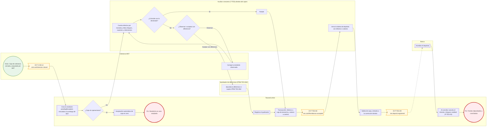

**Pasos del proceso** (actividad tomada del anexo; la columna RF/RN distingue lo citado en el paso de lo asociado por parámetro, permiso, evento o tema compartido).

| Paso | Carril | Actividad | RF/RN que aplican | EVT / JOB / PAN |
|---|---|---|---|---|
| 1 | Cobranza M07 | M07 cierra la caja del cajero (arqueo propio) y publica `cob.cashSession.closed` con declarado, teórico y detalle. | — | EVT-COB-12 |
| 2 | Tesorería M14 | TES consume el evento y crea `cashRemittances` en `pendingReception` (clave `cashSessionId`; un reenvío no crea otra), vinculada a la entrega `treasuryHandoverId` de M07 (CTR-DAT-64). | asoc.: RF-TES-126 | — |
| 3 | Auxiliar o tesorero | El auxiliar/tesorero (distinto del cajero) abre PAN-TES-28, cuenta efectivo por moneda (denominaciones opcionales), tilda cada cheque, cupón y retención recibidos. | — | PAN-TES-28 |
| 4 | Auxiliar o tesorero | Si coincide: Aceptar → en una transacción: movimiento `remittanceCash` a la caja de tesorería; valores `received → inPortfolio` (`remittanceChecks`); cupones `collected → inTreasury` (`remittanceCards`) y autopresentación de débito; retenciones `received → inPortfolio` (`remittanceWithholdings`) y autopresentación si PRM-TES-014; transferencias recibidas (`remittanceTransfers`) registradas en la cuenta bancaria destino como ingreso pendiente de conciliación. Evento `tes.cashRemittance.accepted`. | asoc.: RF-TES-128, RN-TES-019 | EVT-TES-08 |
| 5 | Auxiliar o tesorero | Si difiere: Observar (vuelve a M07) o Aceptar con diferencia (requiere aprobación si supera PRM-TES-062) → quebranto `shortageIn/Out`. | asoc.: RN-TES-049 | — |
| 6 | Tesorería M14 | Caja sin operaciones: aceptación automática "caja en cero". | — | — |
| 7 | Auxiliar o tesorero | Depósito: el tesorero arma la boleta (PAN-TES-17) con efectivo y/o valores → movimiento de salida de la caja de tesorería y de entrada a la cuenta de tránsito; el banco no suma disponible. | asoc.: RF-TES-132 | PAN-TES-17 |
| 8 | Tesorería M14 | Al conciliar la acreditación (P-TES-03), el tránsito se cancela, el banco suma y los cheques pasan a `credited`. | — | — |
| 9 | Tesorería M14 | Recuperación: si el paso 4 falla a mitad, la transacción se revierte completa; el evento consumido se reintenta (idempotente). Casos no recuperables → bandeja técnica (RF-TES-188). | RF-TES-188 | — |

**Situación actual en ProCoop (nota de cambio).** En ProCoop el cierre de caja de cobranza vive en Tesorería y transfiere los fondos en el mismo acto (CTR-TES-14), e incluso registra capital social según P2543 (CTR-TES-15). En GoodApps M07 cierra y arquea, Tesorería acepta u observa (doble control, PA-TES-06) y la entrega y la recepción quedan vinculadas (CTR-TES-25). Rendición, depósito y conciliación están en O5; valores, cupones, retenciones e Interbanking en O8 (DEC-059).

**Excepciones**

| Excepción | Tratamiento |
|---|---|
| Reenvío del evento de cierre | No crea otra rendición: la clave es `cashSessionId`. |
| Falla a mitad de la aceptación | La transacción se revierte completa y el evento se reintenta; los casos no recuperables van a la bandeja técnica (RF-TES-188). |
| Diferencia sobre PRM-TES-062 | Aceptar con diferencia requiere aprobación; se registra el quebranto. |
| Transferencias recibidas en la caja | Se registran en la cuenta bancaria destino como ingreso pendiente de conciliación. |

---

## 2. P-TES-02 Importación de extracto (O5)

| Campo | Contenido |
|---|---|
| Fuente | M14 §9.2, `M14-TES-tesoreria-bancos.md` (línea 1681); ola O5 |
| Macroproceso | MP-06 Tesorería y bancos |
| Disparador | Extracto bancario disponible |
| Resultado | Importación descartada; Rechazada por duplicada; Conciliación automática en curso (P-TES-03) |
| Carriles | Tesorero (T-TES); Tesorería M14 |
| Roles de T02 | T-TES Tesorero / Financiero (MT-006) |
| Módulos involucrados | M14 Tesorería |
| Eventos (T11 §12) | EVT-TES-04 `tes.statement.imported` |
| Jobs | JOB-TES-02 `tes:importar-extracto`; JOB-TES-03 `tes:conciliar-automatico` |
| Relación con 04-procesos-bpmn.md | P4 Cobranza: caja, pasarelas, débito, rendición y depósito ([§8](04-procesos-bpmn.md#8-p4--cobranza-caja-pasarelas-débito-rendición-y-depósito)) |

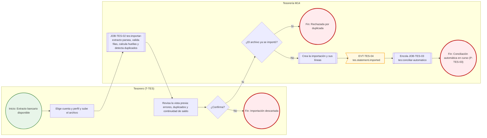

**Pasos del proceso** (actividad tomada del anexo; la columna RF/RN distingue lo citado en el paso de lo asociado por parámetro, permiso, evento o tema compartido).

| Paso | Carril | Actividad | RF/RN que aplican | EVT / JOB / PAN |
|---|---|---|---|---|
| 1 | Tesorero | Usuario elige cuenta y perfil, sube el archivo (almacenamiento privado, hash). | — | — |
| 2 | Tesorería M14 | `JOB-TES-02 tes:importar-extracto` parsea, valida filas, calcula huellas y detecta duplicados; muestra vista previa con errores, duplicados y continuidad de saldo. | — | JOB-TES-02 |
| 3 | Tesorero | Confirmación → crea `bankStatementImports` y líneas; si el mismo hash ya se importó, rechaza. | — | — |
| 4 | Tesorería M14 | Encola `JOB-TES-03 tes:conciliar-automatico` para la cuenta. | — | JOB-TES-03 |

**Situación actual en ProCoop (nota de cambio).** La conciliación de ProCoop es una marca por movimiento, sin cabecera ni saldo de extracto (CTR-TES-06). GoodApps importa el extracto como documento con huella y continuidad de saldo.

**Excepciones**

| Excepción | Tratamiento |
|---|---|
| El mismo archivo ya se importó | Se rechaza por hash. |
| Cancelación del job de importación | La importación queda `rejected` sin líneas parciales (M14 §9.16). |
| Filas con error | Se muestran en la vista previa antes de confirmar. |

---

## 3. P-TES-03 Conciliación asistida (O5)

| Campo | Contenido |
|---|---|
| Fuente | M14 §9.3, `M14-TES-tesoreria-bancos.md` (línea 1688); ola O5 |
| Macroproceso | MP-06 Tesorería y bancos |
| Disparador | Extracto importado o sincronizado |
| Resultado | Cuenta conciliada al corte; Partidas pendientes a explicar |
| Carriles | Tesorería M14; Tesorero (T-TES); Cobranza M07 |
| Roles de T02 | T-TES Tesorero / Financiero (MT-006) |
| Módulos involucrados | M07 Cuenta corriente y cobranza, M14 Tesorería |
| Eventos (T11 §12) | EVT-TES-07 `tes.gatewayCredit.reconciled`; EVT-TES-05 `tes.reconciliation.closed` |
| Jobs | JOB-TES-03 `tes:conciliar-automatico` |
| Relación con 04-procesos-bpmn.md | P4 Cobranza: caja, pasarelas, débito, rendición y depósito ([§8](04-procesos-bpmn.md#8-p4--cobranza-caja-pasarelas-débito-rendición-y-depósito)) |

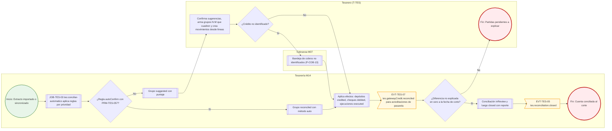

**Pasos del proceso** (actividad tomada del anexo; la columna RF/RN distingue lo citado en el paso de lo asociado por parámetro, permiso, evento o tema compartido).

| Paso | Carril | Actividad | RF/RN que aplican | EVT / JOB / PAN |
|---|---|---|---|---|
| 1 | Tesorería M14 | `tes:conciliar-automatico` aplica reglas por prioridad: (a) 1:1 por referencia exacta (número de cheque, transferencia, boleta, id de rendición de pasarela) e importe; (b) 1:1 importe exacto y fecha ± tolerancia (PRM-TES-056) con contraparte coincidente; (c) N:1 lote de pago/archivo contra débito total; (d) reglas del tenant (`reconciliationRules`) con acción `suggestCategory`/`createMovement`. | asoc.: RF-TES-037, RF-TES-015 | JOB-TES-03 |
| 2 | Tesorería M14 | Resultado: grupos `suggested` con puntaje; los de reglas `autoConfirm` (si PRM-TES-057) quedan `reconciled` con método `auto`. | — | — |
| 3 | Tesorero | Usuario en PAN-TES-09: confirma sugerencias, arma grupos N:M manuales (debe cuadrar), crea movimientos desde líneas (gastos, intereses, débitos), envía créditos no identificados a M07. | — | PAN-TES-09 |
| 4 | Tesorería M14 | Al cumplirse fecha de corte: calcula partidas pendientes y diferencia no explicada; si es cero, pasa a `inReview` y luego `closed` con reporte. | asoc.: RF-TES-036 | — |
| 5 | Tesorería M14 | Efectos de conciliar: depósitos → `credited`; cheques propios → `debited`; ejecuciones → `executed`; archivos → `debited`; liquidaciones de tarjeta → `credited`; acreditación de pasarela → evento `tes.gatewayCredit.reconciled` a M07. | — | EVT-TES-07 |

**Situación actual en ProCoop (nota de cambio).** La documentación de ProCoop se contradice sobre si existe conciliación automática por reglas (CTR-TES-01); su conciliación es una marca por movimiento (CTR-TES-06) y los grupos N:M no validan que cuadren (CTR-TES-12). GoodApps concilia con reglas por prioridad, cabecera, fecha de corte y partidas pendientes.

**Excepciones**

| Excepción | Tratamiento |
|---|---|
| Grupo N:M manual que no cuadra | No se admite: debe cuadrar o explicar la diferencia en el acto (CTR-TES-12). |
| Crédito bancario sin identificar | Se envía a M07 como cobro no identificado. |
| Diferencia no explicada a la fecha de corte | La conciliación no pasa a revisión hasta explicarla. |

---

## 4. P-TES-04 Sincronización Interbanking (O8)

| Campo | Contenido |
|---|---|
| Fuente | M14 §9.4, `M14-TES-tesoreria-bancos.md` (línea 1696); ola O8 |
| Macroproceso | MP-06 Tesorería y bancos |
| Disparador | Conexión Interbanking activa |
| Resultado | Sincronización pendiente; Movimientos sincronizados |
| Carriles | Tesorería M14; Integraciones T06 y bóveda; Interbanking; Tesorero (T-TES) |
| Roles de T02 | T-TES Tesorero / Financiero (MT-006) |
| Módulos involucrados | M14 Tesorería, T06 Integraciones |
| Eventos (T11 §12) | — |
| Jobs | JOB-TES-04 `tes:sincronizar-interbanking` |
| Relación con 04-procesos-bpmn.md | P4 Cobranza: caja, pasarelas, débito, rendición y depósito ([§8](04-procesos-bpmn.md#8-p4--cobranza-caja-pasarelas-débito-rendición-y-depósito)) |

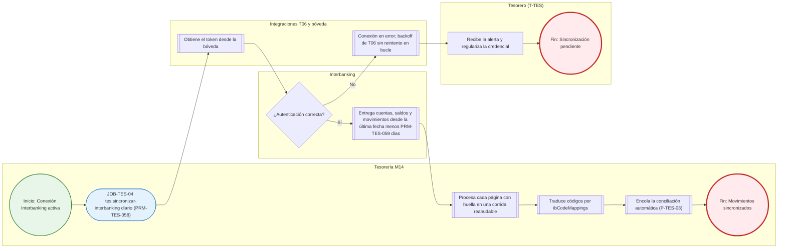

**Pasos del proceso** (actividad tomada del anexo; la columna RF/RN distingue lo citado en el paso de lo asociado por parámetro, permiso, evento o tema compartido).

| Paso | Carril | Actividad | RF/RN que aplican | EVT / JOB / PAN |
|---|---|---|---|---|
| 1 | Tesorería M14 | `JOB-TES-04 tes:sincronizar-interbanking` diario (PRM-TES-058) por tenant con conexión activa: obtiene token (T06, bóveda), lista cuentas, consulta saldos (`interbankingBalanceSnapshots`) y descarga movimientos de días anteriores desde la última fecha sincronizada − PRM-TES-059 días, paginando. | — | JOB-TES-04 |
| 2 | Tesorería M14 | Cada página se procesa de forma idempotente (huella); el progreso queda en `interbankingSyncRuns` y la corrida es reanudable. | — | — |
| 3 | Tesorería M14 | Las líneas nuevas se traducen por `ibCodeMappings`; luego se encola la conciliación automática. | — | — |
| 4 | Tesorero | Errores de autenticación: alerta al tesorero y estado `error` de la conexión; no se reintenta en bucle (backoff T06). | asoc.: RF-TES-060 | — |

**Situación actual en ProCoop (nota de cambio).** ProCoop guarda las credenciales y el token de Interbanking en una tabla sin cifrar (CTR-TES-09). En GoodApps van a la bóveda por tenant y el token no se persiste en datos de negocio.

**Excepciones**

| Excepción | Tratamiento |
|---|---|
| Error de autenticación | Alerta al tesorero y estado `error` de la conexión; no se reintenta en bucle. |
| Caída durante la descarga | La corrida se reanuda; cada página es idempotente por huella. |
| Restauración de datos (ESC-04) | `tes:reconciliar-externos` (JOB-TES-13) compara con el banco y nunca reenvía lo ya transmitido. |

---

## 5. P-TES-05 Ejecución de pago a proveedor (O8)

| Campo | Contenido |
|---|---|
| Fuente | M14 §9.5, `M14-TES-tesoreria-bancos.md` (línea 1703); ola O8 |
| Macroproceso | MP-06 Tesorería y bancos |
| Disparador | Orden de pago aprobada |
| Resultado | Proveedor pagado; Asiento registrado |
| Carriles | Compras M12; Tesorería M14; Tesorero (T-TES); Firmantes según regla; Banco; Contabilidad M15 |
| Roles de T02 | T-TES Tesorero / Financiero (MT-006) |
| Módulos involucrados | M12 Compras, M14 Tesorería, M15 Contabilidad |
| Eventos (T11 §12) | EVT-CMP-11 `cmp.paymentOrder.approved`; EVT-TES-15 `tes.paymentExecution.signed`, `tes.paymentExecution.executed` |
| Jobs | JOB-TES-05 `tes:generar-archivo-pago` |
| Relación con 04-procesos-bpmn.md | P7 Compras y pago a proveedores ([§11](04-procesos-bpmn.md#11-p7--compras-y-pago-a-proveedores)) |

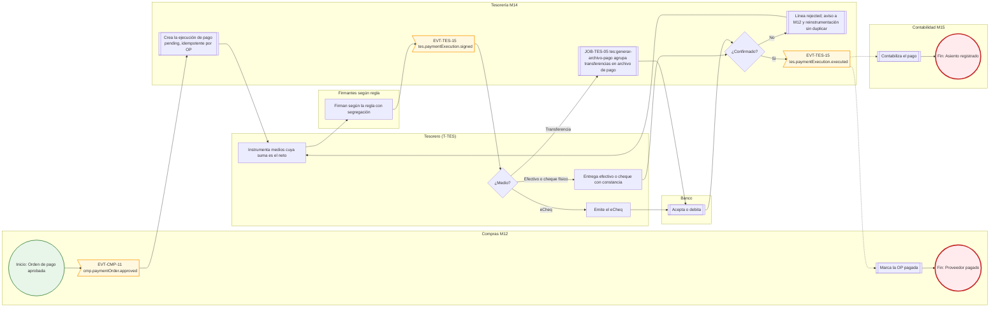

**Pasos del proceso** (actividad tomada del anexo; la columna RF/RN distingue lo citado en el paso de lo asociado por parámetro, permiso, evento o tema compartido).

| Paso | Carril | Actividad | RF/RN que aplican | EVT / JOB / PAN |
|---|---|---|---|---|
| 1 | Compras M12 | M12 aprueba la OP y publica `cmp.paymentOrder.approved` (neto, retenciones, proveedor, CBU validado, vencimiento). | asoc.: RF-TES-113 | EVT-CMP-11 |
| 2 | Tesorería M14 | TES crea `paymentExecutions` `pending` (idempotente por OP). | — | — |
| 3 | Tesorero | Tesorero instrumenta medios (PAN-TES-26): efectivo (caja de pagos abierta, dentro de tope, o salida pendiente), valores de cartera habilitados, cheque propio/eCheq (número disponible), transferencia (cuenta habilitada, CBU del proveedor), VEP. Σ = neto. | asoc.: RF-TES-107 | PAN-TES-26 |
| 4 | Firmantes según regla | Firma: firmantes según regla (PAN-TES-27 o PWA); segregación. | — | PAN-TES-27 |
| 5 | Tesorero | Entrega/envío: efectivo y cheques físicos se entregan con constancia; transferencias se agrupan en `paymentFiles` (`JOB-TES-05 tes:generar-archivo-pago`); eCheq se emite (manual con registro del id o adaptador). | asoc.: RF-TES-119 | JOB-TES-05 |
| 6 | Tesorería M14 | Confirmación: débito conciliado o aceptación del banco → `executed`; evento a M12 (`tes.paymentExecution.executed`) que marca la OP pagada; evento contable a M15. | — | EVT-TES-15 |
| 7 | Tesorería M14 | Rechazo de línea: `rejected`, aviso a M12 y reinstrumentación sin duplicar. | — | — |
| 8 | Tesorería M14 | Anulación: ver §8.9; M12 repone saldos. | — | — |

**Situación actual en ProCoop (nota de cambio).** En ProCoop la firma y la entrega son atributos de la OP de Compras, se hacen en forma masiva sin validar permisos ni registrar usuario (CTR-TES-08, CTR-TES-21) y la caja de cobranza puede entregar efectivo a proveedores (CTR-TES-22). En GoodApps M12 aprueba la obligación y TES firma y ejecuta, con N firmantes por monto y segregación.

**Excepciones**

| Excepción | Tratamiento |
|---|---|
| Rechazo de una línea de transferencia | Queda `rejected`, se avisa a M12 y se reinstrumenta sin duplicar. |
| Pago en efectivo sin caja de pagos abierta o sobre el tope | Queda como salida pendiente (P-TES-09). |
| Firmante que registró el CBU del proveedor | La segregación de T02 lo excluye (P-WFL-05). |
| Anulación de la ejecución | Según M14 §8.9; M12 repone los saldos. |

---

## 6. P-TES-06 Ciclo del cheque de terceros (O8)

| Campo | Contenido |
|---|---|
| Fuente | M14 §9.6, `M14-TES-tesoreria-bancos.md` (línea 1714); ola O8 |
| Macroproceso | MP-06 Tesorería y bancos |
| Disparador | Cheque de tercero recibido |
| Resultado | Cheque cobrado por el proveedor; Cheque acreditado; Rechazo regularizado |
| Carriles | Caja M07 o Tesorería (recepción); Tesorería M14; Banco; Proveedor; Cobranza M07 y Facturación M05; Compras M12 |
| Roles de T02 | Solo actores del sistema (sin rol humano) |
| Módulos involucrados | M05 Facturación, M07 Cuenta corriente y cobranza, M12 Compras, M14 Tesorería |
| Eventos (T11 §12) | EVT-TES-10 `tes.thirdPartyCheck.rejected` |
| Jobs | — |
| Relación con 04-procesos-bpmn.md | P4 Cobranza: caja, pasarelas, débito, rendición y depósito ([§8](04-procesos-bpmn.md#8-p4--cobranza-caja-pasarelas-débito-rendición-y-depósito)); P7 Compras y pago a proveedores ([§11](04-procesos-bpmn.md#11-p7--compras-y-pago-a-proveedores)) |

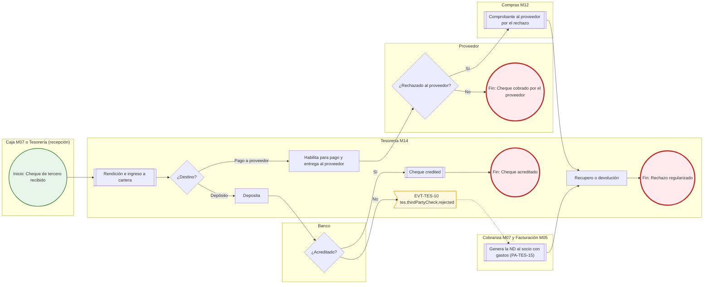

**Pasos del proceso** (actividad tomada del anexo; la columna RF/RN distingue lo citado en el paso de lo asociado por parámetro, permiso, evento o tema compartido).

| Paso | Carril | Actividad | RF/RN que aplican | EVT / JOB / PAN |
|---|---|---|---|---|
| 1 | Caja M07 o Tesorería | Recepción del cheque en M07 o en tesorería; cada paso registra `checkEvents` y su movimiento. | — | — |
| 2 | Tesorería M14 | Rendición a tesorería e ingreso a cartera. | — | — |
| 3 | Tesorería M14 | Desde cartera: habilitación para pago y entrega a proveedor, o depósito y acreditación. | — | — |
| 4 | Banco | Rechazo del cheque depositado (tipos 59 y 60): se publica `tes.thirdPartyCheck.rejected` y M07 genera la ND al socio con gastos según PA-TES-15. | asoc.: RF-TES-069 | EVT-TES-10 |
| 5 | Compras M12 | Rechazo del cheque entregado (tipo 72): TES solicita a M12 el comprobante al proveedor (concepto P2384, gasto P2517). | asoc.: RN-TES-033, RF-TES-070 | — |
| 6 | Tesorería M14 | Recupero o devolución del cheque rechazado. | — | — |

**Situación actual en ProCoop (nota de cambio).** En ProCoop el control de duplicados de cheques solo aplica si el cheque está en cartera (CTR-TES-11) y Tesorería genera directamente deuda del socio ante un rechazo (CTR-TES-23). En GoodApps TES publica el rechazo y M07 o M05 generan el documento.

**Excepciones**

| Excepción | Tratamiento |
|---|---|
| Cheque depositado rechazado | Tipos 59 y 60; M07 genera la ND al socio con gastos configurables y revisión previa (PA-TES-15, asumida, DEC-072). |
| Cheque entregado a proveedor rechazado | Tipo 72; M12 emite el comprobante al proveedor. |
| Alta de un cheque con banco, sucursal, cuenta y número repetidos | Se impide siempre, salvo cheque anulado (RN-TES-028). |

---

## 7. P-TES-07 Cupones de tarjeta (O8)

| Campo | Contenido |
|---|---|
| Fuente | M14 §9.7, `M14-TES-tesoreria-bancos.md` (línea 1718); ola O8 |
| Macroproceso | MP-06 Tesorería y bancos |
| Disparador | Cobro con tarjeta en caja |
| Resultado | Rechazo trasladado al socio; Cupón acreditado |
| Carriles | Cajero (T-CAJ) en M07; Tesorería M14; Procesador de tarjetas; Tesorero (T-TES); Compras M12; Cobranza M07 |
| Roles de T02 | T-CAJ Cajero, T-TES Tesorero / Financiero (MT-006) |
| Módulos involucrados | M07 Cuenta corriente y cobranza, M12 Compras, M14 Tesorería |
| Eventos (T11 §12) | EVT-TES-13 `tes.cardVoucher.presented`, `tes.cardSettlement.recorded`, `tes.cardVoucher.rejected` |
| Jobs | JOB-TES-12 `tes:importar-liquidaciones-tarjeta` |
| Relación con 04-procesos-bpmn.md | P4 Cobranza: caja, pasarelas, débito, rendición y depósito ([§8](04-procesos-bpmn.md#8-p4--cobranza-caja-pasarelas-débito-rendición-y-depósito)) |

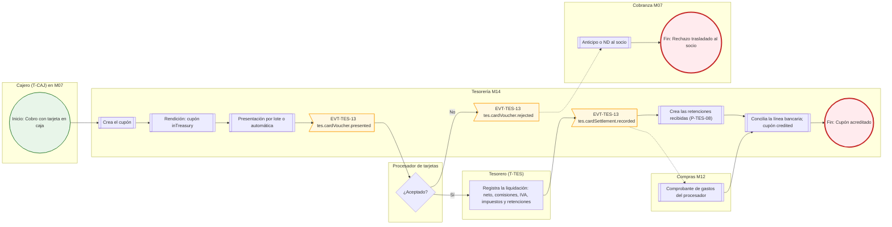

**Pasos del proceso** (actividad tomada del anexo; la columna RF/RN distingue lo citado en el paso de lo asociado por parámetro, permiso, evento o tema compartido).

| Paso | Carril | Actividad | RF/RN que aplican | EVT / JOB / PAN |
|---|---|---|---|---|
| 1 | Cajero | Cobro en caja: M07 crea `cardVouchers` a través del servicio de TES. | — | — |
| 2 | Tesorería M14 | Rendición: el cupón pasa a `inTreasury`. | — | — |
| 3 | Tesorería M14 | Presentación por lote o automática (débito). | — | — |
| 4 | Tesorero | Liquidación: el tesorero, o JOB-TES-12 `tes:importar-liquidaciones-tarjeta` (Extensión), registra neto, comisiones, IVA, impuestos y retenciones. | asoc.: RF-TES-100, RF-TES-095 | JOB-TES-12 |
| 5 | Tesorería M14 | TES crea las retenciones recibidas y solicita a M12 el comprobante de gastos del procesador. | asoc.: RF-TES-095 | — |
| 6 | Tesorería M14 | La línea bancaria se concilia y el cupón pasa a `credited`. | — | — |
| 7 | Cobranza M07 | Rechazo: evento a M07, que genera anticipo o ND. | — | — |

**Situación actual en ProCoop (nota de cambio).** ProCoop mantiene los planes de tarjeta duplicados entre cobranza y tesorería (CTR-TES-24). En GoodApps `cardPlans` es de M07 y TES gestiona el ciclo del cupón.

**Excepciones**

| Excepción | Tratamiento |
|---|---|
| Cupón rechazado por el procesador | Evento a M07, que genera anticipo o ND. |
| Liquidación importada de forma automática | JOB-TES-12 es una Extensión; sin ella el tesorero carga la liquidación. |

---

## 8. P-TES-08 Retenciones recibidas (O8)

| Campo | Contenido |
|---|---|
| Fuente | M14 §9.8, `M14-TES-tesoreria-bancos.md` (línea 1722); ola O8 |
| Macroproceso | MP-06 Tesorería y bancos |
| Disparador | Retención recibida |
| Resultado | Retención computada; Retención fuera de cartera; Anulación rechazada |
| Carriles | Cobranza M07, tarjeta o tesorería; Tesorería M14; Tesorero (T-TES); Fiscal M06 |
| Roles de T02 | T-TES Tesorero / Financiero (MT-006) |
| Módulos involucrados | M06 Fiscal, M07 Cuenta corriente y cobranza, M14 Tesorería |
| Eventos (T11 §12) | EVT-TES-14 `tes.receivedWithholding.registered`, `tes.receivedWithholding.presented`, `tes.receivedWithholding.presentationVoided` |
| Jobs | — |
| Relación con 04-procesos-bpmn.md | P4 Cobranza: caja, pasarelas, débito, rendición y depósito ([§8](04-procesos-bpmn.md#8-p4--cobranza-caja-pasarelas-débito-rendición-y-depósito)) |

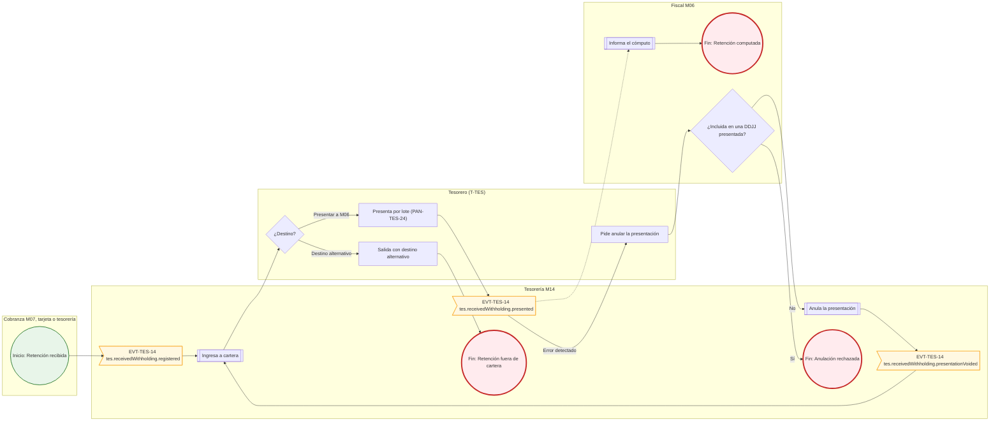

**Pasos del proceso** (actividad tomada del anexo; la columna RF/RN distingue lo citado en el paso de lo asociado por parámetro, permiso, evento o tema compartido).

| Paso | Carril | Actividad | RF/RN que aplican | EVT / JOB / PAN |
|---|---|---|---|---|
| 1 | Cobranza M07, tarjeta o tesorería | Registro de la retención recibida en cobranza, tarjeta o tesorería. | — | — |
| 2 | Tesorería M14 | Ingreso a cartera. | — | — |
| 3 | Tesorero | Presentación por lote (PAN-TES-24) con transacción y control de versión. | asoc.: RN-TES-046 | PAN-TES-24 |
| 4 | Tesorería M14 | Publica `tes.receivedWithholding.presented` a M06. | — | EVT-TES-14 |
| 5 | Fiscal M06 | M06 informa el cómputo. | — | — |
| 6 | Tesorero | Salida con destino alternativo (`withholdingOut`). | — | — |
| 7 | Tesorería M14 | Anulación de la presentación solo si M06 no la incluyó en una DDJJ presentada. | — | — |

**Situación actual en ProCoop (nota de cambio).** "Presentar" retenciones en ProCoop solo es sacarlas de la cartera (CTR-TES-16). En GoodApps TES registra la presentación a M06 y M06 informa el cómputo.

**Excepciones**

| Excepción | Tratamiento |
|---|---|
| Anular una presentación ya incluida por M06 en una DDJJ presentada | No se permite. |
| Presentación concurrente del mismo lote | Control de versión en la transacción. |

---

## 9. P-TES-09 Caja de pagos (O8)

| Campo | Contenido |
|---|---|
| Fuente | M14 §9.9, `M14-TES-tesoreria-bancos.md` (línea 1726); ola O8 |
| Macroproceso | MP-06 Tesorería y bancos |
| Disparador | Inicio del día del tenant |
| Resultado | Caja de pagos cerrada |
| Carriles | Tesorería M14; Responsable de caja de pagos (T-TES); Caja de tesorería |
| Roles de T02 | T-TES Tesorero / Financiero (MT-006) |
| Módulos involucrados | M14 Tesorería |
| Eventos (T11 §12) | — |
| Jobs | JOB-TES-07 `tes:abrir-caja-pagos` |
| Relación con 04-procesos-bpmn.md | P7 Compras y pago a proveedores ([§11](04-procesos-bpmn.md#11-p7--compras-y-pago-a-proveedores)) |

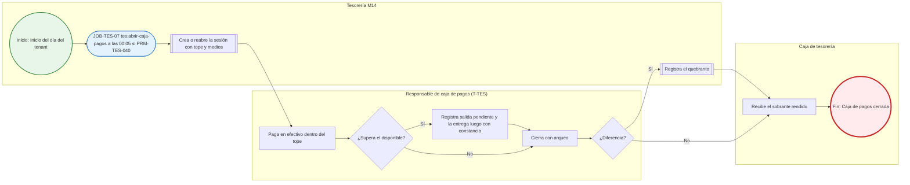

**Pasos del proceso** (actividad tomada del anexo; la columna RF/RN distingue lo citado en el paso de lo asociado por parámetro, permiso, evento o tema compartido).

| Paso | Carril | Actividad | RF/RN que aplican | EVT / JOB / PAN |
|---|---|---|---|---|
| 1 | Tesorería M14 | JOB-TES-07 `tes:abrir-caja-pagos` (si PRM-TES-040) a las 00:05 del tenant crea o reabre la sesión del día con tope y medios. | — | JOB-TES-07 |
| 2 | Responsable de caja de pagos | Los pagos en efectivo reducen el disponible. | — | — |
| 3 | Responsable de caja de pagos | Las salidas pendientes se entregan luego con constancia. | — | — |
| 4 | Responsable de caja de pagos | Cierre con arqueo. | — | — |
| 5 | Tesorería M14 | La diferencia se registra como quebranto. | — | — |
| 6 | Caja de tesorería | El sobrante se rinde a la caja de tesorería. | — | — |

**Situación actual en ProCoop (nota de cambio).** ProCoop permite que la caja de cobranza entregue efectivo de pagos a proveedores (CTR-TES-22). En GoodApps, por defecto, los pagos en efectivo salen de la caja de pagos.

**Excepciones**

| Excepción | Tratamiento |
|---|---|
| Pago que supera el disponible | Se registra como salida pendiente y se entrega después con constancia. |
| Diferencia de arqueo | Quebranto. |

---

## 10. P-TES-10 Cierre diario de caja de tesorería (O5)

| Campo | Contenido |
|---|---|
| Fuente | M14 §9.10, `M14-TES-tesoreria-bancos.md` (línea 1730); ola O5 |
| Macroproceso | MP-06 Tesorería y bancos |
| Disparador | Fin del día |
| Resultado | Caja cerrada; Sin pendientes |
| Carriles | Tesorero (T-TES); Aprobador de quebrantos; Tesorería M14 |
| Roles de T02 | T-TES Tesorero / Financiero (MT-006) |
| Módulos involucrados | M14 Tesorería |
| Eventos (T11 §12) | EVT-TES-18 `tes.cashClosing.closed` |
| Jobs | JOB-TES-08 `tes:verificar-cajas-abiertas` |
| Relación con 04-procesos-bpmn.md | P4 Cobranza: caja, pasarelas, débito, rendición y depósito ([§8](04-procesos-bpmn.md#8-p4--cobranza-caja-pasarelas-débito-rendición-y-depósito)) |

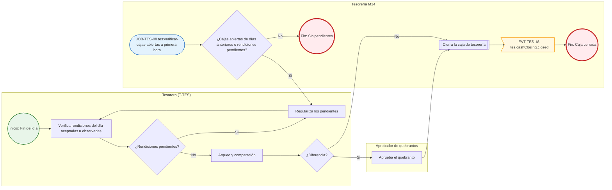

**Pasos del proceso** (actividad tomada del anexo; la columna RF/RN distingue lo citado en el paso de lo asociado por parámetro, permiso, evento o tema compartido).

| Paso | Carril | Actividad | RF/RN que aplican | EVT / JOB / PAN |
|---|---|---|---|---|
| 1 | Tesorero | Al fin del día verifica que las rendiciones del día estén aceptadas u observadas. | — | — |
| 2 | Tesorero | Arqueo y comparación con el teórico. | — | — |
| 3 | Aprobador de quebrantos | Quebranto con aprobación. | — | — |
| 4 | Tesorería M14 | Cierre de la caja de tesorería. | — | — |
| 5 | Tesorería M14 | JOB-TES-08 `tes:verificar-cajas-abiertas` alerta a primera hora sobre cajas abiertas de días anteriores (cobranza, pagos y tesorería) y rendiciones pendientes (PRM-TES-067). | asoc.: RF-TES-135 | JOB-TES-08 |

**Situación actual en ProCoop (nota de cambio).** ProCoop usa dos libros (`TESORE` y `RESBAN`) para tesorería y bancos (CTR-TES-05). GoodApps usa una sola colección de movimientos con vistas de libro de bancos y de tesorería.

**Excepciones**

| Excepción | Tratamiento |
|---|---|
| Caja abierta de un día anterior | JOB-TES-08 alerta a primera hora. |
| Quebranto | Requiere aprobación antes del cierre. |

---

## 11. P-TES-11 Cotizaciones (O8)

| Campo | Contenido |
|---|---|
| Fuente | M14 §9.11, `M14-TES-tesoreria-bancos.md` (línea 1734); ola O8 |
| Macroproceso | MP-06 Tesorería y bancos |
| Disparador | Día hábil o pedido a demanda |
| Resultado | Cotizaciones vigentes |
| Carriles | Tesorería M14; Fuente de cotizaciones vía T06; Tesorero (T-TES); Aprobador de la carga manual |
| Roles de T02 | T-TES Tesorero / Financiero (MT-006) |
| Módulos involucrados | M14 Tesorería, T06 Integraciones |
| Eventos (T11 §12) | EVT-TES-19 `tes.exchangeRate.published` |
| Jobs | JOB-TES-09 `tes:actualizar-cotizaciones` |
| Relación con 04-procesos-bpmn.md | — |

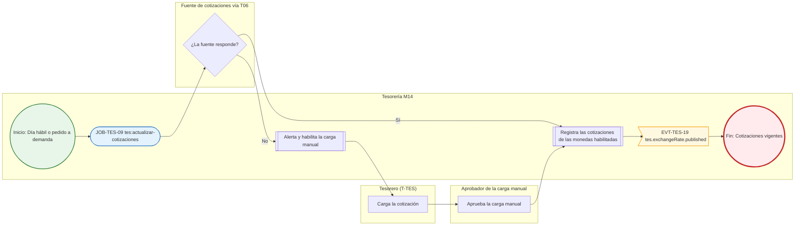

**Pasos del proceso** (actividad tomada del anexo; la columna RF/RN distingue lo citado en el paso de lo asociado por parámetro, permiso, evento o tema compartido).

| Paso | Carril | Actividad | RF/RN que aplican | EVT / JOB / PAN |
|---|---|---|---|---|
| 1 | Tesorería M14 | JOB-TES-09 `tes:actualizar-cotizaciones` diario y a demanda obtiene de la fuente configurada (PA-TES-09) las cotizaciones de las monedas habilitadas. | asoc.: RF-TES-142 | JOB-TES-09 |
| 2 | Tesorería M14 | Si la fuente falla, alerta y habilita la carga manual. | — | — |
| 3 | Tesorero | El tesorero carga la cotización. | — | — |
| 4 | Aprobador de la carga manual | La carga manual requiere aprobación. | — | — |

**Situación actual en ProCoop (nota de cambio).** No relevada en el anexo ni en T07 o en el análisis de brechas (`15-analisis-brechas-procoop.md`).

**Excepciones**

| Excepción | Tratamiento |
|---|---|
| La fuente configurada no responde | Alerta y carga manual con aprobación. |
| Falla de la fuente de cotizaciones | PA-TES-09 (asumida, DEC-072): fuente ARCA diaria por defecto (PRM-TES-068); si falla, alerta y carga manual con aprobación como respaldo. |

---

## 12. P-TES-12 Flujo de fondos proyectado (O8)

| Campo | Contenido |
|---|---|
| Fuente | M14 §9.12, `M14-TES-tesoreria-bancos.md` (línea 1738); ola O8 |
| Macroproceso | MP-06 Tesorería y bancos |
| Disparador | Noche o pedido a demanda |
| Resultado | Proyección disponible |
| Carriles | Tesorería M14; Módulos fuente: M07, M12, M06, M16 y previsiones; Tesorero (T-TES) |
| Roles de T02 | T-TES Tesorero / Financiero (MT-006) |
| Módulos involucrados | M06 Fiscal, M07 Cuenta corriente y cobranza, M12 Compras, M14 Tesorería, M16 Sueldos |
| Eventos (T11 §12) | EVT-TES-21 `tes.cashFlow.alertRaised` |
| Jobs | JOB-TES-10 `tes:proyectar-flujo`; JOB-TES-11 `tes:alertas-vencimientos` |
| Relación con 04-procesos-bpmn.md | — |

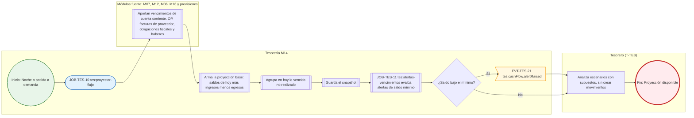

**Pasos del proceso** (actividad tomada del anexo; la columna RF/RN distingue lo citado en el paso de lo asociado por parámetro, permiso, evento o tema compartido).

| Paso | Carril | Actividad | RF/RN que aplican | EVT / JOB / PAN |
|---|---|---|---|---|
| 1 | Tesorería M14 | `JOB-TES-10 tes:proyectar-flujo` nocturno (y a demanda) arma la proyección base: saldos operativos de hoy + ingresos (vencimientos de cuenta corriente de M07 por fecha con curva de cobrabilidad, acreditaciones pendientes, depósitos a acreditar, valores en cartera por fecha de pago, cupones presentados por fecha estimada, previsiones de ingreso) − egresos (OP aprobadas por fecha programada, facturas de proveedor con saldo por vencimiento, cheques propios y eCheq no debitados por fecha de pago, obligaciones fiscales de M06, lotes de haberes de M16, previsiones de egreso, compromisos activos por fecha esperada). | asoc.: RF-TES-147, RF-TES-146 | JOB-TES-10 |
| 2 | Tesorería M14 | Lo vencido y no realizado se agrupa en hoy. | — | — |
| 3 | Tesorería M14 | Guarda snapshot; evalúa alertas de saldo mínimo (`JOB-TES-11`). | — | JOB-TES-11 |
| 4 | Tesorero | Escenarios: copia de la base con supuestos; nunca crea movimientos. | asoc.: RF-TES-151 | — |

**Situación actual en ProCoop (nota de cambio).** Los informes de disponibilidad y previsión de ProCoop mezclan importes en cartera, no depositados o no acreditados (CTR-TES-13). GoodApps separa disponible, en tránsito y proyectado.

**Excepciones**

| Excepción | Tratamiento |
|---|---|
| Partidas vencidas y no realizadas | Se agrupan en el día de hoy. |
| Escenario con supuestos | Es una copia de la base; nunca crea movimientos. |

---

## 13. P-TES-13 Compromisos (O8, coordinado con M15)

| Campo | Contenido |
|---|---|
| Fuente | M14 §9.13, `M14-TES-tesoreria-bancos.md` (línea 1745); ola O8 |
| Macroproceso | MP-06 Tesorería y bancos |
| Disparador | Orden de compra aprobada |
| Resultado | Comprometido registrado; Compromiso actualizado |
| Carriles | Compras M12; Tesorería M14; Contabilidad M15 (presupuesto) |
| Roles de T02 | Solo actores del sistema (sin rol humano) |
| Módulos involucrados | M12 Compras, M14 Tesorería, M15 Contabilidad |
| Eventos (T11 §12) | EVT-CMP-04 `cmp.purchaseOrder.approved`; EVT-TES-20 `tes.commitment.created`, `tes.commitment.consumed`, `tes.commitment.released`; EVT-CMP-08 `cmp.supplierInvoice.registered`; EVT-TES-15 `tes.paymentExecution.executed`; EVT-CMP-05 `cmp.purchaseOrder.cancelled` |
| Jobs | — |
| Relación con 04-procesos-bpmn.md | P7 Compras y pago a proveedores ([§11](04-procesos-bpmn.md#11-p7--compras-y-pago-a-proveedores)) |

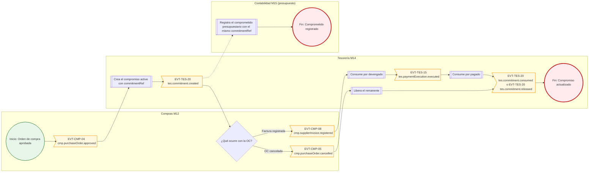

**Pasos del proceso** (actividad tomada del anexo; la columna RF/RN distingue lo citado en el paso de lo asociado por parámetro, permiso, evento o tema compartido).

| Paso | Carril | Actividad | RF/RN que aplican | EVT / JOB / PAN |
|---|---|---|---|---|
| 1 | Tesorería M14 | `cmp.purchaseOrder.approved` crea `fundCommitments` en `active` con `commitmentRef`, el mismo identificador que usa M15 para el comprometido presupuestario. | — | EVT-CMP-04 |
| 2 | Tesorería M14 | `cmp.supplierInvoice.registered` consume el compromiso por devengado. | — | EVT-CMP-08 |
| 3 | Tesorería M14 | `tes.paymentExecution.executed` lo consume por pagado. | — | EVT-TES-15 |
| 4 | Tesorería M14 | `cmp.purchaseOrder.cancelled` libera el remanente. | — | EVT-CMP-05 |

**Situación actual en ProCoop (nota de cambio).** Presupuesto y compromisos no forman parte del núcleo contable temprano: se incluyen en O8 porque todo ProCoop está en alcance (DEC-007, CTR-CON-12).

**Excepciones**

| Excepción | Tratamiento |
|---|---|
| Orden de compra cancelada con parte devengada | Solo se libera el remanente. |

---

## 14. P-TES-14 Pago de haberes (O9)

| Campo | Contenido |
|---|---|
| Fuente | M14 §9.14, `M14-TES-tesoreria-bancos.md` (línea 1749); ola O9 |
| Macroproceso | MP-06 Tesorería y bancos |
| Disparador | Liquidación de sueldos aprobada |
| Resultado | Haberes pagados |
| Carriles | Sueldos M16; Tesorería M14; Tesorero (T-TES); Banco |
| Roles de T02 | T-TES Tesorero / Financiero (MT-006) |
| Módulos involucrados | M14 Tesorería, M16 Sueldos |
| Eventos (T11 §12) | EVT-SUE-17 `sue.paymentRequest.created`; EVT-TES-17 `tes.payrollPayment.confirmed` |
| Jobs | JOB-TES-05 `tes:generar-archivo-pago` |
| Relación con 04-procesos-bpmn.md | — |

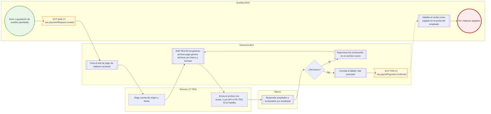

**Pasos del proceso** (actividad tomada del anexo; la columna RF/RN distingue lo citado en el paso de lo asociado por parámetro, permiso, evento o tema compartido).

| Paso | Carril | Actividad | RF/RN que aplican | EVT / JOB / PAN |
|---|---|---|---|---|
| 1 | Sueldos M16 | M16 aprueba la liquidación y publica `sue.paymentRequest.created` (EVT-SUE-17; ítems con cuentas y porcentajes). | — | EVT-SUE-17 |
| 2 | Tesorero | TES crea `payrollPaymentBatches` (`received`); el tesorero elige cuenta de origen y fecha (modificable si PRM-TES-079) y genera archivos por banco/formato (`JOB-TES-05`). | — | JOB-TES-05 |
| 3 | Tesorero | Envío (manual con acuse o API si PA-TES-02 lo habilita) → `sent`. | — | — |
| 4 | Banco | Respuesta/rechazos por empleado; reproceso de rechazados en nuevo archivo. | asoc.: RF-TES-163 | — |
| 5 | Tesorería M14 | Conciliación del débito → `executed`; evento `tes.payrollPayment.confirmed` por empleado a M16 (que habilita el recibo como pagado en el portal del empleado). | — | EVT-TES-17 |

**Situación actual en ProCoop (nota de cambio).** ProCoop paga sueldos creando una factura de compra al empleado como proveedor y una OP estándar (CTR-TES-20); anular esa OP borra las facturas de sueldo (CTR-TES-19). GoodApps genera lotes de acreditación por banco, concilia el débito y revierte con vínculo.

**Excepciones**

| Excepción | Tratamiento |
|---|---|
| Rechazo de la acreditación de un empleado | Se reprocesa en un archivo nuevo. |
| Cambio de la fecha de transferencia | Solo si PRM-TES-079 lo permite y con período abierto (CTR-TES-17). |
| M16 anula la liquidación antes del envío | El lote pasa a `voided` desde `received` o `fileGenerated`. |

---

## 15. P-TES-15 Cierre de período de Tesorería y Bancos

| Campo | Contenido |
|---|---|
| Fuente | M14 §9.15, `M14-TES-tesoreria-bancos.md` (línea 1757) |
| Macroproceso | MP-06 Tesorería y bancos |
| Disparador | Fin del período |
| Resultado | Cierre rechazado con pendientes; Período cerrado; Período reabierto |
| Carriles | Tesorero (T-TES); Tesorería M14; Contabilidad M15 |
| Roles de T02 | T-TES Tesorero / Financiero (MT-006) |
| Módulos involucrados | M14 Tesorería, M15 Contabilidad |
| Eventos (T11 §12) | EVT-TES-22 `tes.period.closed`, `tes.period.reopened` |
| Jobs | — |
| Relación con 04-procesos-bpmn.md | P8 Cierre contable mensual ([§12](04-procesos-bpmn.md#12-p8--cierre-contable-mensual)) |

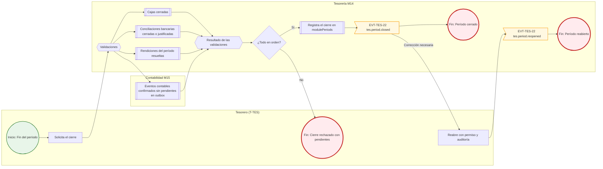

**Pasos del proceso** (actividad tomada del anexo; la columna RF/RN distingue lo citado en el paso de lo asociado por parámetro, permiso, evento o tema compartido).

| Paso | Carril | Actividad | RF/RN que aplican | EVT / JOB / PAN |
|---|---|---|---|---|
| 1 | Tesorero | Solicita el cierre del período de Tesorería y Bancos. | — | — |
| 2 | Tesorería M14 | Valida cajas cerradas (RF-TES-139), conciliaciones de todas las cuentas bancarias cerradas hasta la fecha o justificadas y rendiciones del período resueltas. | RF-TES-139 | — |
| 3 | Contabilidad M15 | Verifica que M15 haya confirmado los eventos contables, sin pendientes en outbox. | — | — |
| 4 | Tesorería M14 | Registra el cierre en `modulePeriods` (`tes.bancos`, `tes.tesoreria`). | — | — |
| 5 | Tesorero | Reapertura con permiso y auditoría. | — | — |

**Situación actual en ProCoop (nota de cambio).** ProCoop contabiliza tesorería en lote con el cierre automático por rango de fechas (CTR-TES-07). En GoodApps el asiento es en línea por evento y el cierre de período exige que M15 haya confirmado todos los eventos.

**Excepciones**

| Excepción | Tratamiento |
|---|---|
| Cuenta bancaria sin conciliación cerrada | Se exige justificación para cerrar. |
| Eventos contables pendientes en outbox | No se cierra hasta que M15 los confirme. |

---

## Inconsistencias detectadas en la especificación (esta parte)

No se detectaron inconsistencias en los procesos de esta parte.

## Cobertura de esta parte

| Universo de la parte | Diagramados | Pendientes |
|---|---|---|
| 15 (P-TES-01 a P-TES-15) | 15 | 0 |
