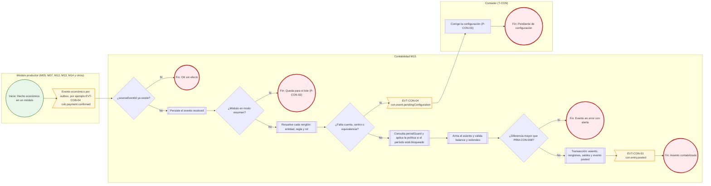
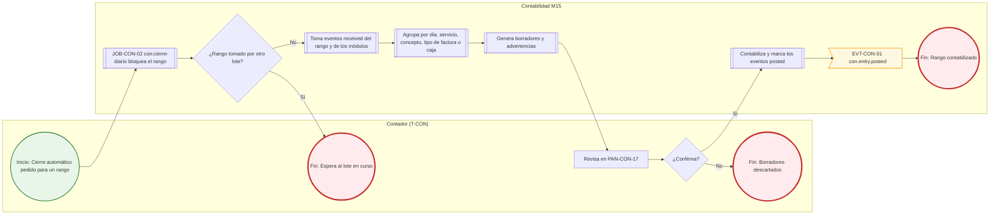
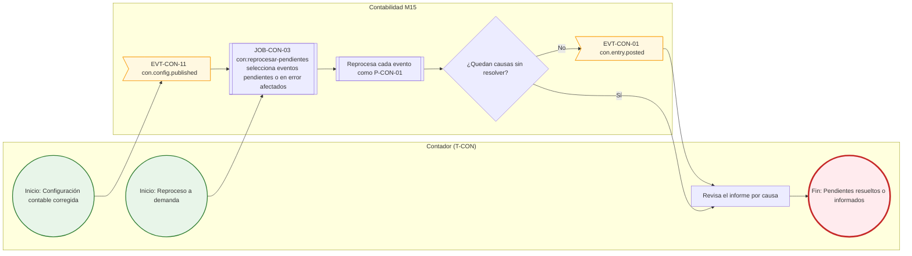
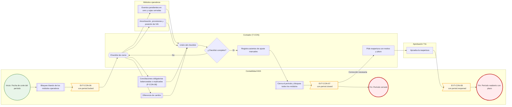
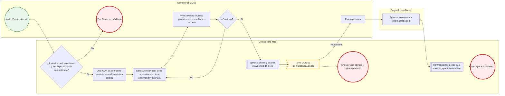
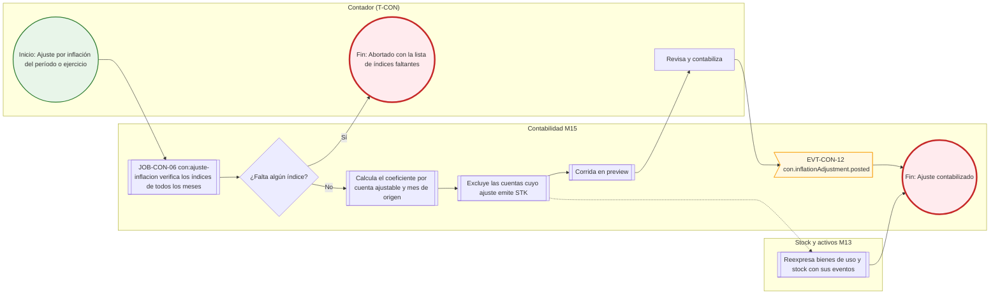
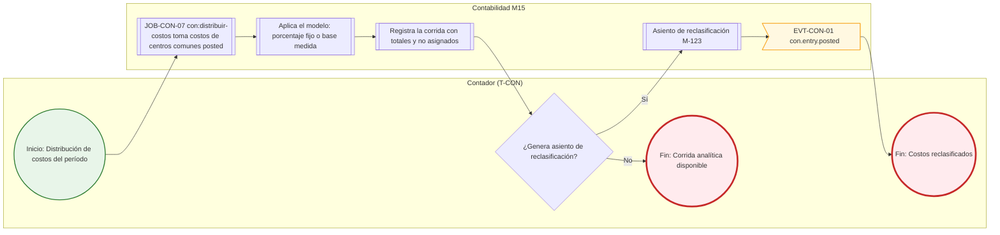
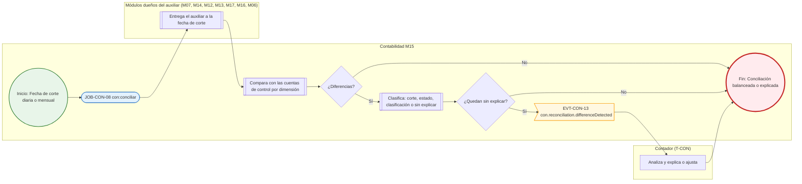
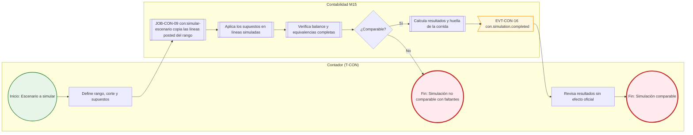

# GoodApps Cooperativas

## Procesos de negocio — Contabilidad (M15)

**Entregable de Análisis y Diseño Detallado — Artefacto 2.1 (Procesos de negocio BPMN). Parte de [`04-procesos-bpmn.md`](04-procesos-bpmn.md).**

| Dato | Valor |
|---|---|
| Documento | Diagramas BPMN, pasos, situación actual en ProCoop y excepciones de los procesos P-CON-01 a P-CON-09 |
| Carácter | Derivado de la especificación vigente; no la reemplaza. Ante diferencias prevalecen la maestra `00`, los anexos, T05, T11 y el registro de decisiones `01` |
| Generación | Script `_trabajo/generar_bpmn.py` (extrae pasos, eventos, jobs y RF/RN de los anexos) más datos revisados a mano en `_trabajo/bpmn_datos_*.py` |
| Versión | 1.1 (regenerada contra la especificación corregida) |
| Fecha | 05-11-2026 |

**Cómo leer cada proceso.** La notación es la de [`04-procesos-bpmn.md` §3](04-procesos-bpmn.md#3-notación-equivalencia-mermaid--bpmn) (carriles, eventos de inicio y fin, tareas de usuario y de servicio, compuertas XOR y AND, eventos de dominio como banderas, temporizadores y jobs como estadios). La tabla de pasos reproduce la actividad del anexo; en la columna RF/RN, los identificadores sin prefijo son los que el anexo cita en el paso y los marcados "asoc." son reglas o requisitos del mismo anexo que comparten parámetro, permiso, evento o tema con el paso (asociación generada por el script y revisada). Los eventos se nombran con su ID del catálogo de T11 §12.

## Índice de procesos de esta parte

1. [P-CON-01 Contabilización en tiempo real (JOB-CON-01 `con:contabilizar-evento`)](#1-p-con-01-contabilización-en-tiempo-real-job-con-01-concontabilizar-evento)
2. [P-CON-02 Contabilización por lote ("Cierre automático", JOB-CON-02 `con:cierre-diario`)](#2-p-con-02-contabilización-por-lote-cierre-automático-job-con-02-concierre-diario)
3. [P-CON-03 Reproceso de pendientes (JOB-CON-03 `con:reprocesar-pendientes`)](#3-p-con-03-reproceso-de-pendientes-job-con-03-conreprocesar-pendientes)
4. [P-CON-04 Cierre mensual (checklist)](#4-p-con-04-cierre-mensual-checklist)
5. [P-CON-05 Cierre de ejercicio (JOB-CON-05 `con:cierre-ejercicio`)](#5-p-con-05-cierre-de-ejercicio-job-con-05-concierre-ejercicio)
6. [P-CON-06 Ajuste por inflación (JOB-CON-06 `con:ajuste-inflacion`)](#6-p-con-06-ajuste-por-inflación-job-con-06-conajuste-inflacion)
7. [P-CON-07 Distribución de costos (JOB-CON-07 `con:distribuir-costos`)](#7-p-con-07-distribución-de-costos-job-con-07-condistribuir-costos)
8. [P-CON-08 Conciliaciones (JOB-CON-08 `con:conciliar`)](#8-p-con-08-conciliaciones-job-con-08-conconciliar)
9. [P-CON-09 Simulación (JOB-CON-09 `con:simular-escenario`)](#9-p-con-09-simulación-job-con-09-consimular-escenario)

---

## 1. P-CON-01 Contabilización en tiempo real (JOB-CON-01 `con:contabilizar-evento`)

| Campo | Contenido |
|---|---|
| Fuente | M15 §9.2, `M15-CON-contabilidad.md` (línea 1588) |
| Macroproceso | MP-07 Registración contable y cierre |
| Disparador | Hecho económico en un módulo |
| Resultado | OK sin efecto; Queda para el lote (P-CON-02); Pendiente de configuración; Evento en error con alerta; Asiento contabilizado |
| Carriles | Módulo productor (M05, M07, M12, M13, M14 y otros); Contabilidad M15; Contador (T-CON) |
| Roles de T02 | T-CON Contador / Contable (MT-006) |
| Módulos involucrados | M05 Facturación, M07 Cuenta corriente y cobranza, M12 Compras, M13 Stock, M14 Tesorería, M15 Contabilidad |
| Eventos (T11 §12) | EVT-CON-04 `con.event.pendingConfiguration`; EVT-COB-04 `cob.payment.confirmed`; EVT-CON-01 `con.entry.posted` |
| Jobs | — |
| Relación con 04-procesos-bpmn.md | P8 Cierre contable mensual ([§12](04-procesos-bpmn.md#12-p8--cierre-contable-mensual)) |

**Pasos del proceso** (actividad tomada del anexo; la columna RF/RN distingue lo citado en el paso de lo asociado por parámetro, permiso, evento o tema compartido).

| Paso | Carril | Actividad | RF/RN que aplican | EVT / JOB / PAN |
|---|---|---|---|---|
| 1 | Contabilidad M15 | El consumidor outbox recibe el evento; verifica `tenantId` y contrato; si `sourceEventId` existe, responde OK sin efecto (RN-CON-011). | RN-CON-011; asoc.: RF-CON-153 | — |
| 2 | Contabilidad M15 | Persiste en `accountingEvents` (`received`). | asoc.: RF-CON-051 | — |
| 3 | Contabilidad M15 | Determina el modo del módulo (`postingModes`); si es resumen, deja el evento en `received` para el lote. | — | — |
| 4 | Contabilidad M15 | Resuelve cada renglón por la cascada (entidad → regla → rol). Si falta cuenta, centro obligatorio o equivalencia: `pendingConfiguration` con `issues[]`; emite `con.event.pendingConfiguration` (EVT-CON-04); fin. | — | EVT-CON-04 |
| 5 | Contabilidad M15 | Consulta `periodGuard` para la fecha contable; si el período del módulo está bloqueado, aplica la política del módulo (fecha del primer día abierto con nota, o `error`). | asoc.: RN-CON-081, RF-CON-030 | — |
| 6 | Contabilidad M15 | Arma el asiento, valida balance y tolerancia de redondeo (diferencia ≤ PRM-CON-008 a `rol:billingRounding`/`rol:cashCloseRounding`, si no `error`). | asoc.: RN-CON-002 | — |
| 7 | Contabilidad M15 | En una transacción: inserta `journalEntries` y `journalLines`, actualiza `ledgerBalances`, marca el evento `posted`, escribe outbox `con.entry.posted`. | asoc.: RN-CON-112 | EVT-CON-01 |
| 8 | Contabilidad M15 | Reintentos con backoff exponencial (5 intentos); luego `error` y alerta. Reanudable. | — | — |

**Situación actual en ProCoop (nota de cambio).** ProCoop contabiliza en lote con el cierre automático (CTR-CON-01, CTR-TES-07). GoodApps contabiliza en tiempo real por evento con modo resumen configurable (DEC-009). Durante la convivencia la contabilidad oficial sigue en ProCoop y GoodApps contabiliza en un plan no oficial que concilia contra ProCoop (DEC-069).

**Excepciones**

| Excepción | Tratamiento |
|---|---|
| Evento repetido | Responde OK sin efecto (RN-CON-011). |
| Período del módulo bloqueado | Fecha del primer día abierto con nota, o error, según la política del módulo. |
| Falla técnica | 5 reintentos con backoff exponencial; luego `error` y alerta. Reanudable. |
| Evento que revierte otro (`reversesEventId`) | Si el período del original está abierto y la política lo permite, anula; si no, contraasiento con la fecha del evento. |

---

## 2. P-CON-02 Contabilización por lote ("Cierre automático", JOB-CON-02 `con:cierre-diario`)

| Campo | Contenido |
|---|---|
| Fuente | M15 §9.3, `M15-CON-contabilidad.md` (línea 1601) |
| Macroproceso | MP-07 Registración contable y cierre |
| Disparador | Cierre automático pedido para un rango |
| Resultado | Espera al lote en curso; Borradores descartados; Rango contabilizado |
| Carriles | Contador (T-CON); Contabilidad M15 |
| Roles de T02 | T-CON Contador / Contable (MT-006) |
| Módulos involucrados | M15 Contabilidad |
| Eventos (T11 §12) | EVT-CON-01 `con.entry.posted` |
| Jobs | JOB-CON-02 `con:cierre-diario` |
| Relación con 04-procesos-bpmn.md | P8 Cierre contable mensual ([§12](04-procesos-bpmn.md#12-p8--cierre-contable-mensual)) |

**Pasos del proceso** (actividad tomada del anexo; la columna RF/RN distingue lo citado en el paso de lo asociado por parámetro, permiso, evento o tema compartido).

| Paso | Carril | Actividad | RF/RN que aplican | EVT / JOB / PAN |
|---|---|---|---|---|
| 1 | Contador | Inicia el cierre automático (reemplaza `frmCierreDiario`) con rango de fechas, módulos en el orden de ProCoop y opciones de detalle, agrupación y valuación. | asoc.: RF-CON-062 | — |
| 2 | Contabilidad M15 | JOB-CON-02 `con:cierre-diario` bloquea el rango contra otro lote concurrente. | — | JOB-CON-02 |
| 3 | Contabilidad M15 | Toma los eventos `received` del rango y de los módulos elegidos. | — | — |
| 4 | Contabilidad M15 | Agrupa según `groupBy` (por día, servicio, concepto, tipo de factura o caja). | — | — |
| 5 | Contabilidad M15 | Genera borradores (`preview`) y advertencias (cajas abiertas, eventos pendientes de configuración). | — | — |
| 6 | Contador | Revisa en PAN-CON-17 y confirma o descarta. | — | PAN-CON-17 |
| 7 | Contabilidad M15 | Al confirmar, contabiliza los borradores y marca los eventos `posted`; re-ejecutar un rango ya contabilizado no duplica (RN-CON-011). | RN-CON-011 | — |

**Situación actual en ProCoop (nota de cambio).** Reemplaza el cierre diario de ProCoop (`frmCierreDiario`) y conserva su orden de módulos como opción; en GoodApps el lote es un modo configurable e idempotente, no la única forma de contabilizar (CTR-CON-01).

**Excepciones**

| Excepción | Tratamiento |
|---|---|
| Rango ya contabilizado | Re-ejecutar no duplica (RN-CON-011). |
| Cajas abiertas o eventos pendientes de configuración | Se muestran como advertencias en la vista previa. |
| Caída durante la contabilización | El job es reanudable por evento. |

---

## 3. P-CON-03 Reproceso de pendientes (JOB-CON-03 `con:reprocesar-pendientes`)

| Campo | Contenido |
|---|---|
| Fuente | M15 §9.4, `M15-CON-contabilidad.md` (línea 1605) |
| Macroproceso | MP-07 Registración contable y cierre |
| Disparador | Configuración contable corregida; Reproceso a demanda |
| Resultado | Pendientes resueltos o informados |
| Carriles | Contador (T-CON); Contabilidad M15 |
| Roles de T02 | T-CON Contador / Contable (MT-006) |
| Módulos involucrados | M15 Contabilidad |
| Eventos (T11 §12) | EVT-CON-11 `con.config.published`; EVT-CON-01 `con.entry.posted` |
| Jobs | JOB-CON-03 `con:reprocesar-pendientes` |
| Relación con 04-procesos-bpmn.md | P8 Cierre contable mensual ([§12](04-procesos-bpmn.md#12-p8--cierre-contable-mensual)) |

**Pasos del proceso** (actividad tomada del anexo; la columna RF/RN distingue lo citado en el paso de lo asociado por parámetro, permiso, evento o tema compartido).

| Paso | Carril | Actividad | RF/RN que aplican | EVT / JOB / PAN |
|---|---|---|---|---|
| 1 | Contador | Publica una versión de configuración contable (T04) o pide el reproceso a demanda. | asoc.: RF-CON-001 | — |
| 2 | Contabilidad M15 | JOB-CON-03 `con:reprocesar-pendientes` toma los eventos `pendingConfiguration` o `error` cuyas `issues` referencian lo corregido. | — | JOB-CON-03 |
| 3 | Contabilidad M15 | Los reprocesa con la cascada de P-CON-01. | — | — |
| 4 | Contador | Recibe el informe de resultado por causa. | — | — |

**Situación actual en ProCoop (nota de cambio).** No relevada en el anexo ni en T07 o en el análisis de brechas (`15-analisis-brechas-procoop.md`).

**Excepciones**

| Excepción | Tratamiento |
|---|---|
| Evento cuya causa no fue corregida | Sigue pendiente y figura en el informe por causa. |

---

## 4. P-CON-04 Cierre mensual (checklist)

| Campo | Contenido |
|---|---|
| Fuente | M15 §9.5, `M15-CON-contabilidad.md` (línea 1609) |
| Macroproceso | MP-07 Registración contable y cierre |
| Disparador | Fecha de corte del período |
| Resultado | Período cerrado; Período reabierto con plazo |
| Carriles | Contabilidad M15; Contador (T-CON); Módulos operativos; Aprobación T11 |
| Roles de T02 | T-CON Contador / Contable (MT-006) |
| Módulos involucrados | M15 Contabilidad, T11 Workflow, eventos y documentos |
| Eventos (T11 §12) | EVT-CON-06 `con.period.locked`; EVT-CON-07 `con.period.closed`; EVT-CON-08 `con.period.reopened` |
| Jobs | — |
| Relación con 04-procesos-bpmn.md | P8 Cierre contable mensual ([§12](04-procesos-bpmn.md#12-p8--cierre-contable-mensual)) |

**Pasos del proceso** (actividad tomada del anexo; la columna RF/RN distingue lo citado en el paso de lo asociado por parámetro, permiso, evento o tema compartido).

| Paso | Carril | Actividad | RF/RN que aplican | EVT / JOB / PAN |
|---|---|---|---|---|
| 1 | Contabilidad M15 | Bloqueo blando de módulos operativos (`softLocked`) a la fecha de corte. | — | — |
| 2 | Contador | Checklist: eventos pendientes = 0; cajas cerradas (PRM-CON-013); corrida de amortización contabilizada (STK); provisiones (SAC, incobrables, ingresos no facturados) corridas; posición IVA; conciliaciones obligatorias (`memberReceivables`, `cashBanks`, `suppliers`, `vat`) en `balanced` o `explained`; diferencia de cambio. | asoc.: RF-CON-031, RN-CON-086 | — |
| 3 | Contador | Asientos de ajuste manuales (solo contador). | — | — |
| 4 | Contabilidad M15 | Cierre del período (`closed`): todos los `moduleLocks` a la fecha; emite `con.period.closed`. | — | EVT-CON-07 |
| 5 | Contador | Reapertura (`con.periodos.reabrir`) con motivo, aprobación T11 y plazo; emite `con.period.reopened`. | asoc.: RN-CON-082 | EVT-CON-08 |

**Situación actual en ProCoop (nota de cambio).** El análisis del documento base no relevó un checklist formal de cierre mensual en ProCoop (04-procesos-bpmn §16.1). GoodApps bloquea por módulo con `periodGuard` y reapertura autorizada (CTR-CON-03).

**Excepciones**

| Excepción | Tratamiento |
|---|---|
| Checklist incompleto | No se cierra el período. |
| Error detectado en un período cerrado | Reapertura con `con.periodos.reabrir`, motivo, aprobación T11 y plazo; o contraasiento (RN-CON-013). |
| Asientos de ajuste | Solo los registra el contador. |

---

## 5. P-CON-05 Cierre de ejercicio (JOB-CON-05 `con:cierre-ejercicio`)

| Campo | Contenido |
|---|---|
| Fuente | M15 §9.6, `M15-CON-contabilidad.md` (línea 1617) |
| Macroproceso | MP-07 Registración contable y cierre |
| Disparador | Fin del ejercicio |
| Resultado | Cierre no habilitado; Ejercicio cerrado y siguiente abierto; Ejercicio reabierto |
| Carriles | Contador (T-CON); Contabilidad M15; Segundo aprobador |
| Roles de T02 | T-CON Contador / Contable (MT-006) |
| Módulos involucrados | M15 Contabilidad |
| Eventos (T11 §12) | EVT-CON-09 `con.fiscalYear.closed` |
| Jobs | JOB-CON-05 `con:cierre-ejercicio` |
| Relación con 04-procesos-bpmn.md | P8 Cierre contable mensual ([§12](04-procesos-bpmn.md#12-p8--cierre-contable-mensual)) |

**Pasos del proceso** (actividad tomada del anexo; la columna RF/RN distingue lo citado en el paso de lo asociado por parámetro, permiso, evento o tema compartido).

| Paso | Carril | Actividad | RF/RN que aplican | EVT / JOB / PAN |
|---|---|---|---|---|
| 1 | Contabilidad M15 | Precondición: todos los períodos `closed`, ajuste por inflación contabilizado si corresponde. | — | — |
| 2 | Contabilidad M15 | Ejercicio a `closing`. | — | — |
| 3 | Contabilidad M15 | Genera en borrador cierre de resultados (M-120, con `resultTargets`), cierre patrimonial (M-121) y apertura del ejercicio siguiente (M-122), con fechas último/primer día. | asoc.: RN-CON-083, RF-CON-132 | — |
| 4 | Contador | Vista previa con sumas y saldos post cierre (todas las cuentas de resultado en cero). | — | — |
| 5 | Contador | Confirmación por `con.ejercicios.cerrar`; ejercicio a `closed`; guarda `closingEntries`; emite `con.fiscalYear.closed`. | — | EVT-CON-09 |
| 6 | Contador | Reapertura (`con.ejercicios.reabrir`): doble aprobación; contraasientos de los tres; `reopened`. | asoc.: RN-CON-082 | — |

**Situación actual en ProCoop (nota de cambio).** No relevada en el anexo ni en T07 o en el análisis de brechas (`15-analisis-brechas-procoop.md`).

**Excepciones**

| Excepción | Tratamiento |
|---|---|
| Período sin cerrar o ajuste por inflación pendiente | No se habilita el cierre. |
| Reapertura del ejercicio | Doble aprobación y contraasientos de cierre de resultados, cierre patrimonial y apertura. |

---

## 6. P-CON-06 Ajuste por inflación (JOB-CON-06 `con:ajuste-inflacion`)

| Campo | Contenido |
|---|---|
| Fuente | M15 §9.7, `M15-CON-contabilidad.md` (línea 1626) |
| Macroproceso | MP-07 Registración contable y cierre |
| Disparador | Ajuste por inflación del período o ejercicio |
| Resultado | Abortado con la lista de índices faltantes; Ajuste contabilizado |
| Carriles | Contador (T-CON); Contabilidad M15; Stock y activos M13 |
| Roles de T02 | T-CON Contador / Contable (MT-006) |
| Módulos involucrados | M13 Stock, M15 Contabilidad |
| Eventos (T11 §12) | EVT-CON-12 `con.inflationAdjustment.posted` |
| Jobs | JOB-CON-06 `con:ajuste-inflacion` |
| Relación con 04-procesos-bpmn.md | P8 Cierre contable mensual ([§12](04-procesos-bpmn.md#12-p8--cierre-contable-mensual)) |

**Pasos del proceso** (actividad tomada del anexo; la columna RF/RN distingue lo citado en el paso de lo asociado por parámetro, permiso, evento o tema compartido).

| Paso | Carril | Actividad | RF/RN que aplican | EVT / JOB / PAN |
|---|---|---|---|---|
| 1 | Contabilidad M15 | JOB-CON-06 `con:ajuste-inflacion` verifica los índices de todos los meses involucrados; si falta uno, aborta con la lista. | — | JOB-CON-06 |
| 2 | Contabilidad M15 | Calcula el coeficiente por cuenta ajustable y mes de origen, o saldo de apertura. | — | — |
| 3 | Contabilidad M15 | Genera `inflationAdjustmentRuns` en `preview`; excluye las cuentas cuyo ajuste emite STK. | — | — |
| 4 | Contador | El contador revisa y contabiliza (asiento tipo M-119). | — | — |
| 5 | Stock y activos M13 | El bien de uso y el stock se reexpresan con sus eventos de STK (M-68, M-73), sin duplicar. | — | — |

**Situación actual en ProCoop (nota de cambio).** No relevada en el anexo ni en T07 o en el análisis de brechas (`15-analisis-brechas-procoop.md`).

**Excepciones**

| Excepción | Tratamiento |
|---|---|
| Falta el índice de un mes | El job aborta y lista los meses faltantes. |
| Cuentas de bienes de uso y stock | Las ajusta M13 con sus eventos; el job las excluye para no duplicar. |

---

## 7. P-CON-07 Distribución de costos (JOB-CON-07 `con:distribuir-costos`)

| Campo | Contenido |
|---|---|
| Fuente | M15 §9.8, `M15-CON-contabilidad.md` (línea 1630) |
| Macroproceso | MP-07 Registración contable y cierre |
| Disparador | Distribución de costos del período |
| Resultado | Corrida analítica disponible; Costos reclasificados |
| Carriles | Contador (T-CON); Contabilidad M15 |
| Roles de T02 | T-CON Contador / Contable (MT-006) |
| Módulos involucrados | M15 Contabilidad |
| Eventos (T11 §12) | EVT-CON-01 `con.entry.posted` |
| Jobs | JOB-CON-07 `con:distribuir-costos` |
| Relación con 04-procesos-bpmn.md | P8 Cierre contable mensual ([§12](04-procesos-bpmn.md#12-p8--cierre-contable-mensual)) |

**Pasos del proceso** (actividad tomada del anexo; la columna RF/RN distingue lo citado en el paso de lo asociado por parámetro, permiso, evento o tema compartido).

| Paso | Carril | Actividad | RF/RN que aplican | EVT / JOB / PAN |
|---|---|---|---|---|
| 1 | Contabilidad M15 | JOB-CON-07 `con:distribuir-costos` toma los costos de los centros comunes del período, solo de asientos `posted`. | — | JOB-CON-07 |
| 2 | Contabilidad M15 | Aplica modelos o drivers: porcentaje fijo o base medida (suministros activos, kWh, m³, horas, metros de red). | asoc.: RF-CON-088 | — |
| 3 | Contabilidad M15 | Escribe `costDistributionRuns` con totales y no asignados. | — | — |
| 4 | Contador | Opcionalmente genera el asiento de reclasificación (M-123). | — | — |
| 5 | Contador | Ejemplo CU-CON-01: comunes por 4.000 con DIST-DEMO-25-75 se reparten en Agua 1.000 e Internet 3.000. | asoc.: RF-CON-090, RN-CON-077 | — |

**Situación actual en ProCoop (nota de cambio).** La distribución analítica de comunes de BASE §75 se resuelve con reparto en el renglón más corridas analíticas con reclasificación opcional, sin duplicar el gasto (CTR-CON-16).

**Excepciones**

| Excepción | Tratamiento |
|---|---|
| Costo sin base de reparto | Queda como no asignado en la corrida. |

---

## 8. P-CON-08 Conciliaciones (JOB-CON-08 `con:conciliar`)

| Campo | Contenido |
|---|---|
| Fuente | M15 §9.9, `M15-CON-contabilidad.md` (línea 1634) |
| Macroproceso | MP-07 Registración contable y cierre |
| Disparador | Fecha de corte diaria o mensual |
| Resultado | Conciliación balanceada o explicada |
| Carriles | Contabilidad M15; Módulos dueños del auxiliar (M07, M14, M12, M13, M17, M16, M06); Contador (T-CON) |
| Roles de T02 | T-CON Contador / Contable (MT-006) |
| Módulos involucrados | M06 Fiscal, M07 Cuenta corriente y cobranza, M12 Compras, M13 Stock, M14 Tesorería, M15 Contabilidad, M16 Sueldos, M17 Institucional |
| Eventos (T11 §12) | EVT-CON-13 `con.reconciliation.differenceDetected` |
| Jobs | JOB-CON-08 `con:conciliar` |
| Relación con 04-procesos-bpmn.md | P8 Cierre contable mensual ([§12](04-procesos-bpmn.md#12-p8--cierre-contable-mensual)) |

**Pasos del proceso** (actividad tomada del anexo; la columna RF/RN distingue lo citado en el paso de lo asociado por parámetro, permiso, evento o tema compartido).

| Paso | Carril | Actividad | RF/RN que aplican | EVT / JOB / PAN |
|---|---|---|---|---|
| 1 | Contabilidad M15 | JOB-CON-08 `con:conciliar` programado: diario para deudores y bancos; mensual para el resto. | — | JOB-CON-08 |
| 2 | Módulos dueños del auxiliar | Entrega el auxiliar del módulo dueño a la fecha de corte por API de solo lectura (COB, TES, CMP, STK, INS, SUE, FIS). | — | — |
| 3 | Contabilidad M15 | Compara con el saldo contable de las cuentas de control por la dimensión elegida. | — | — |
| 4 | Contabilidad M15 | Clasifica las diferencias: corte, estado, clasificación o sin explicar. | — | — |
| 5 | Contabilidad M15 | Emite `con.reconciliation.differenceDetected` si hay diferencias sin explicar. | — | EVT-CON-13 |

**Situación actual en ProCoop (nota de cambio).** No relevada en el anexo ni en T07 o en el análisis de brechas (`15-analisis-brechas-procoop.md`).

**Excepciones**

| Excepción | Tratamiento |
|---|---|
| Diferencia sin explicar | Se emite EVT-CON-13 y el contador la analiza; bloquea el checklist de cierre (P-CON-04). |

---

## 9. P-CON-09 Simulación (JOB-CON-09 `con:simular-escenario`)

| Campo | Contenido |
|---|---|
| Fuente | M15 §9.10, `M15-CON-contabilidad.md` (línea 1638) |
| Macroproceso | MP-07 Registración contable y cierre |
| Disparador | Escenario a simular |
| Resultado | Simulación no comparable con faltantes; Simulación comparable |
| Carriles | Contador (T-CON); Contabilidad M15 |
| Roles de T02 | T-CON Contador / Contable (MT-006) |
| Módulos involucrados | M15 Contabilidad |
| Eventos (T11 §12) | EVT-CON-16 `con.simulation.completed` |
| Jobs | JOB-CON-09 `con:simular-escenario` |
| Relación con 04-procesos-bpmn.md | — |

**Pasos del proceso** (actividad tomada del anexo; la columna RF/RN distingue lo citado en el paso de lo asociado por parámetro, permiso, evento o tema compartido).

| Paso | Carril | Actividad | RF/RN que aplican | EVT / JOB / PAN |
|---|---|---|---|---|
| 1 | Contador | Define el rango, el corte y los supuestos: equivalencias de plan, distribución alternativa, variaciones de tarifa o de costos. | — | — |
| 2 | Contabilidad M15 | JOB-CON-09 `con:simular-escenario` copia el universo real: líneas `posted` del rango y corte. | — | JOB-CON-09 |
| 3 | Contabilidad M15 | Aplica los supuestos y escribe `simulatedJournalLines`. | asoc.: RF-CON-109 | — |
| 4 | Contabilidad M15 | Verifica balance y equivalencias completas (`comparable`) y calcula `results` y `runHash`. | — | — |
| 5 | Contabilidad M15 | No escribe en colecciones oficiales ni emite `con.entry.*`. | — | — |
| 6 | Contador | Ejemplo CU-ERP-01: tarifa +10 % sobre 38.000 da 41.800. | — | — |

**Situación actual en ProCoop (nota de cambio).** No relevada en el anexo ni en T07 o en el análisis de brechas (`15-analisis-brechas-procoop.md`).

**Excepciones**

| Excepción | Tratamiento |
|---|---|
| Equivalencias de plan incompletas | La simulación no es comparable. |
| Cualquier resultado | Nunca escribe en colecciones oficiales ni emite eventos `con.entry.*`. |

---

## Inconsistencias detectadas en la especificación (esta parte)

No se detectaron inconsistencias en los procesos de esta parte.

## Cobertura de esta parte

| Universo de la parte | Diagramados | Pendientes |
|---|---|---|
| 9 (P-CON-01 a P-CON-09) | 9 | 0 |
