# GoodApps Cooperativas

## Procesos de negocio — Identidad y acceso (T02, P-IAM-01 a P-IAM-13)

**Entregable de Análisis y Diseño Detallado — Artefacto 2.1 (Procesos de negocio BPMN). Parte de [`04-procesos-bpmn.md`](04-procesos-bpmn.md).**

| Dato | Valor |
|---|---|
| Documento | Diagramas BPMN, pasos, situación actual en ProCoop y excepciones de los procesos P-IAM-01 a P-IAM-13 |
| Carácter | Derivado de la especificación vigente; no la reemplaza. Ante diferencias prevalecen la maestra `00`, los anexos, T05, T11 y el registro de decisiones `01` |
| Generación | Script `_trabajo/generar_bpmn.py` (extrae pasos, eventos, jobs y RF/RN de los anexos) más datos revisados a mano en `_trabajo/bpmn_datos_*.py` |
| Versión | 1.1 (regenerada contra la especificación corregida) |
| Fecha | 05-11-2026 |

**Cómo leer cada proceso.** La notación es la de [`04-procesos-bpmn.md` §3](04-procesos-bpmn.md#3-notación-equivalencia-mermaid--bpmn) (carriles, eventos de inicio y fin, tareas de usuario y de servicio, compuertas XOR y AND, eventos de dominio como banderas, temporizadores y jobs como estadios). La tabla de pasos reproduce la actividad del anexo; en la columna RF/RN, los identificadores sin prefijo son los que el anexo cita en el paso y los marcados "asoc." son reglas o requisitos del mismo anexo que comparten parámetro, permiso, evento o tema con el paso (asociación generada por el script y revisada). Los eventos se nombran con su ID del catálogo de T11 §12.

## Índice de procesos de esta parte

1. [P-IAM-01 Pre-login](#1-p-iam-01-pre-login)
2. [P-IAM-02 Login de staff (O0 sin 2FA; O1 completo)](#2-p-iam-02-login-de-staff-o0-sin-2fa-o1-completo)
3. [P-IAM-03 Segundo factor](#3-p-iam-03-segundo-factor)
4. [P-IAM-04 Selección y cambio de ámbito](#4-p-iam-04-selección-y-cambio-de-ámbito)
5. [P-IAM-05 Login de socio (DNI/CUIT + contraseña)](#5-p-iam-05-login-de-socio-dnicuit--contraseña)
6. [P-IAM-06 Google](#6-p-iam-06-google)
7. [P-IAM-07 SSO OIDC por tenant (staff)](#7-p-iam-07-sso-oidc-por-tenant-staff)
8. [P-IAM-08 CiDi Córdoba](#8-p-iam-08-cidi-córdoba)
9. [P-IAM-09 Ingreso del socio sin contraseña (OTP) — Adoptado (DEC-066)](#9-p-iam-09-ingreso-del-socio-sin-contraseña-otp--adoptado-dec-066)
10. [P-IAM-10 Refresh y detección de reutilización](#10-p-iam-10-refresh-y-detección-de-reutilización)
11. [P-IAM-11 Logout y cierre global](#11-p-iam-11-logout-y-cierre-global)
12. [P-IAM-12 Recuperación de contraseña](#12-p-iam-12-recuperación-de-contraseña)
13. [P-IAM-13 Pérdida del segundo factor](#13-p-iam-13-pérdida-del-segundo-factor)

---

## 1. P-IAM-01 Pre-login

| Campo | Contenido |
|---|---|
| Fuente | T02 §9, `T02-IAM-identidad-roles-auditoria.md` (línea 3927) |
| Macroproceso | MP-01 Acceso e identidad |
| Disparador | Abre la aplicación |
| Resultado | Respuesta 404 genérica; Pantalla de ingreso del tenant |
| Carriles | Usuario (staff o socio); Cliente web o PWA; Identidad T02; Plataforma T01 |
| Roles de T02 | Solo actores del sistema (sin rol humano) |
| Módulos involucrados | T01 Plataforma, T02 Identidad y roles |
| Eventos (T11 §12) | — |
| Jobs | — |
| Relación con 04-procesos-bpmn.md | — |

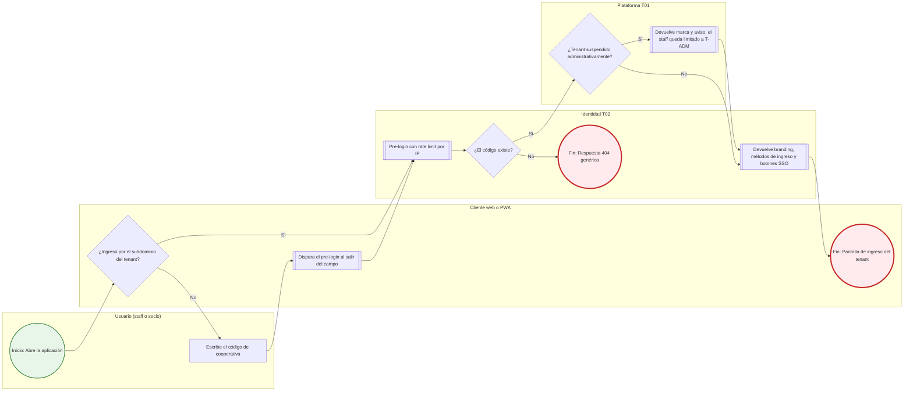

**Pasos del proceso** (actividad tomada del anexo; la columna RF/RN distingue lo citado en el paso de lo asociado por parámetro, permiso, evento o tema compartido).

| Paso | Carril | Actividad | RF/RN que aplican | EVT / JOB / PAN |
|---|---|---|---|---|
| 1 | Cliente web o PWA | El cliente determina el tenant: subdominio (`lagunalarga.<dominio>`) o, en el dominio genérico, el usuario escribe el código de cooperativa (al salir del campo se dispara el pre-login). | asoc.: RF-IAM-020 | — |
| 2 | Identidad T02 | `POST /api/auth/pre-login` `{ tenantSlug \| tenantCode, app }` → `{ tenantPublicId, branding, loginMethods: { staff: [...], portal: [...] }, ssoButtons: [...], helpTextsKeys }`. Rate limit por IP. | — | — |
| 3 | Plataforma T01 | Si el tenant está suspendido administrativamente (T01), se devuelve marca y aviso; el login de staff queda limitado a T-ADM según T01; el portal muestra el aviso configurado. | — | — |
| 4 | Identidad T02 | Código inexistente → 404 genérico. | — | — |

**Situación actual en ProCoop (nota de cambio).** ProCoop usa una base por cooperativa; GoodApps comparte la base con `tenantId` y resuelve el tenant en el pre-login (CTR-IAM-01, DEC-002). La identidad es común a todas las cooperativas, con pertenencias privadas (CTR-IAM-19).

**Excepciones**

| Excepción | Tratamiento |
|---|---|
| Código de cooperativa inexistente | Respuesta 404 genérica, sin revelar qué tenants existen. |
| Ráfaga de consultas desde una IP | Rate limit por IP en el pre-login. |
| Tenant suspendido (T01) | Se muestra el aviso configurado; solo T-ADM puede ingresar como staff. |

---

## 2. P-IAM-02 Login de staff (O0 sin 2FA; O1 completo)

| Campo | Contenido |
|---|---|
| Fuente | T02 §9, `T02-IAM-identidad-roles-auditoria.md` (línea 3934); ola O0 |
| Macroproceso | MP-01 Acceso e identidad |
| Disparador | Ingresa alias o correo y contraseña |
| Resultado | Ingreso rechazado; Sesión de staff emitida |
| Carriles | Usuario staff; Identidad T02; Comunicaciones T09 |
| Roles de T02 | Solo actores del sistema (sin rol humano) |
| Módulos involucrados | T02 Identidad y roles, T09 Comunicaciones |
| Eventos (T11 §12) | EVT-IAM-07 `iam.login.failed`; EVT-IAM-02 `iam.identity.locked`; EVT-IAM-06 `iam.session.started` |
| Jobs | — |
| Relación con 04-procesos-bpmn.md | — |

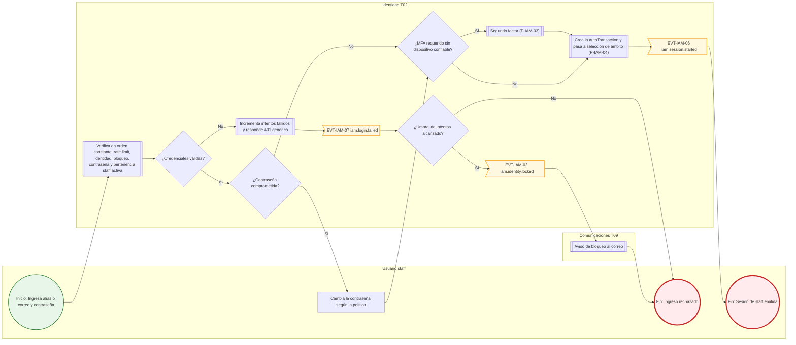

**Pasos del proceso** (actividad tomada del anexo; la columna RF/RN distingue lo citado en el paso de lo asociado por parámetro, permiso, evento o tema compartido).

| Paso | Carril | Actividad | RF/RN que aplican | EVT / JOB / PAN |
|---|---|---|---|---|
| 1 | Usuario staff | `POST /api/auth/login` `{ tenantPublicId, identifier, password, remember }`. `identifier` = alias (busca `memberships.staff.username` en el tenant) o correo (busca `identities.primaryEmail`). | — | — |
| 2 | Identidad T02 | Verificaciones en orden constante: rate limit → identidad existe (si no, se ejecuta un hash ficticio para igualar tiempo) → no bloqueada → contraseña → pertenencia staff `active` en el tenant. | — | — |
| 3 | Identidad T02 | Fallo: `failedLoginCount++`, `auditAccess.loginFailure`, respuesta genérica 401 `invalid_credentials`. Al alcanzar el umbral: `locked` + aviso al correo. | — | — |
| 4 | Identidad T02 | Éxito sin MFA requerido y sin franja que lo impida: se crea `authTransaction` → selección de ámbito (P-IAM-04) → sesión. | — | — |
| 5 | Identidad T02 | MFA requerido: si hay `trustedDevice` válido para la identidad, se omite; si no, P-IAM-03. | — | — |
| 6 | Usuario staff | Contraseña comprometida (`passwordCompromised`): tras autenticar, obliga a cambiarla antes de emitir sesión. | — | — |

**Situación actual en ProCoop (nota de cambio).** ProCoop distingue usuario inexistente de contraseña incorrecta (CTR-IAM-03), guarda contraseñas reversibles y bloquea el ingreso por horario (CTR-IAM-22); el análisis de brechas (§3.2) señala contraseñas reversibles, permisos por formulario, autorización como función de menú y credenciales guardadas en tablas. GoodApps usa mensajes genéricos, argon2id (CTR-IAM-08), una sesión por dispositivo y ámbito (CTR-IAM-06) y registra cada intento en `auditAccess`.

**Excepciones**

| Excepción | Tratamiento |
|---|---|
| Identidad inexistente | Se ejecuta un hash ficticio para igualar el tiempo de respuesta; el mensaje es el mismo que con contraseña incorrecta. |
| Identidad bloqueada por intentos | Respuesta genérica y aviso al correo; el desbloqueo sigue la política de T02. |
| Ingreso fuera de la franja horaria del perfil | La franja se evalúa por perfil y pantalla; fuera de franja aplica PA-IAM-05 (asumida, DEC-072): se bloquea la operación y un supervisor puede autorizarla en el momento; el comportamiento se parametriza con PRM-IAM-030 (CTR-IAM-22). |
| Contraseña marcada como comprometida | Debe cambiarla antes de que se emita la sesión. |

---

## 3. P-IAM-03 Segundo factor

| Campo | Contenido |
|---|---|
| Fuente | T02 §9, `T02-IAM-identidad-roles-auditoria.md` (línea 3943) |
| Macroproceso | MP-01 Acceso e identidad |
| Disparador | Primer factor aprobado y MFA requerido |
| Resultado | Factor satisfecho; sigue P-IAM-04 |
| Carriles | Usuario autenticado (staff o socio); Identidad T02; Comunicaciones T09 |
| Roles de T02 | Solo actores del sistema (sin rol humano) |
| Módulos involucrados | T02 Identidad y roles, T09 Comunicaciones |
| Eventos (T11 §12) | EVT-IAM-08 `iam.mfa.enrolled` |
| Jobs | — |
| Relación con 04-procesos-bpmn.md | — |

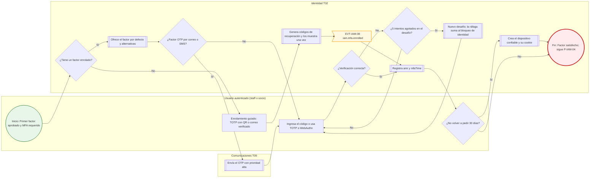

**Pasos del proceso** (actividad tomada del anexo; la columna RF/RN distingue lo citado en el paso de lo asociado por parámetro, permiso, evento o tema compartido).

| Paso | Carril | Actividad | RF/RN que aplican | EVT / JOB / PAN |
|---|---|---|---|---|
| 1 | Identidad T02 | Se ofrece el factor por defecto y alternativas (`emailOtp`, `smsOtp`, `totp`, `webauthn`, `recoveryCodes`). | — | — |
| 2 | Comunicaciones T09 | OTP: `otpChallenges` con hash; envío por T09 (prioridad alta, sin colas masivas); reenvío con espera. | — | — |
| 3 | Usuario autenticado | Verificación correcta → `amr += otp\|totp\|webauthn`, `mfaTime = now`; opción "no volver a pedir 30 días" crea `trustedDevices` y cookie. | — | — |
| 4 | Identidad T02 | Fallos: 5 intentos por desafío; luego nuevo desafío; ráfagas cuentan para el bloqueo de identidad. | — | — |
| 5 | Usuario autenticado | Sin factor enrolado y MFA obligatorio: enrolamiento guiado (TOTP con QR o correo verificado) antes de emitir sesión; se generan códigos de recuperación y se muestran una vez. | — | — |

**Situación actual en ProCoop (nota de cambio).** No relevada en el anexo ni en T07 o en el análisis de brechas (`15-analisis-brechas-procoop.md`).

**Excepciones**

| Excepción | Tratamiento |
|---|---|
| Cinco intentos fallidos en un desafío | Se genera un nuevo desafío; las ráfagas cuentan para el bloqueo de la identidad. |
| Reenvío de OTP | Se permite con espera entre envíos. |
| Sin factor enrolado y MFA obligatorio | Enrolamiento guiado antes de emitir la sesión; los códigos de recuperación se muestran una sola vez. |
| Pérdida del factor | Recuperación por P-IAM-13. |

---

## 4. P-IAM-04 Selección y cambio de ámbito

| Campo | Contenido |
|---|---|
| Fuente | T02 §9, `T02-IAM-identidad-roles-auditoria.md` (línea 3951) |
| Macroproceso | MP-01 Acceso e identidad |
| Disparador | authTransaction resuelta; Usuario con sesión pide cambiar de ámbito |
| Resultado | Usuario operando en el ámbito |
| Carriles | Usuario; Identidad T02; Cliente web o PWA |
| Roles de T02 | Solo actores del sistema (sin rol humano) |
| Módulos involucrados | T02 Identidad y roles |
| Eventos (T11 §12) | EVT-IAM-06 `iam.session.started` |
| Jobs | — |
| Relación con 04-procesos-bpmn.md | — |

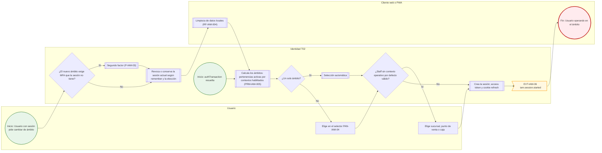

**Pasos del proceso** (actividad tomada del anexo; la columna RF/RN distingue lo citado en el paso de lo asociado por parámetro, permiso, evento o tema compartido).

| Paso | Carril | Actividad | RF/RN que aplican | EVT / JOB / PAN |
|---|---|---|---|---|
| 1 | Identidad T02 | Con la `authTransaction` resuelta, el servidor calcula los ámbitos disponibles: pertenencias `active` de la identidad × contextos habilitados. Para el pre-login de un tenant, se priorizan sus contextos; los demás tenants solo se listan si `PRM-IAM-005 = true` (por defecto se listan solo tras login en el dominio genérico). | asoc.: RF-IAM-010, RF-IAM-020 | — |
| 2 | Identidad T02 | Un ámbito → selección automática. Varios → selector (PAN-IAM-04). | — | PAN-IAM-04 |
| 3 | Identidad T02 | `POST /api/auth/scope` `{ transactionId, membershipId, context, operatingContext? }` → crea `sessions`, devuelve access token + cookie refresh. | — | — |
| 4 | Usuario | Staff: si el alcance permite más de una sucursal/PV/caja y no hay valores por defecto válidos, se pide el contexto operativo. | asoc.: RF-IAM-009 | — |
| 5 | Usuario | Cambio de ámbito con sesión vigente: `POST /api/auth/switch-scope` requiere sesión válida; revoca la sesión actual (o la conserva si `remember` y el usuario elige "mantener"), emite una nueva; el cliente ejecuta la limpieza de RF-IAM-004. Si el nuevo ámbito exige MFA y la sesión no lo tiene, P-IAM-03. | RF-IAM-004 | — |

**Situación actual en ProCoop (nota de cambio).** ProCoop guarda un único refresh por usuario y no contempla varias cooperativas por identidad; GoodApps crea `sessions` por dispositivo y ámbito (CTR-IAM-06) con identidad común y pertenencias privadas (CTR-IAM-19).

**Excepciones**

| Excepción | Tratamiento |
|---|---|
| Pertenencias en otros tenants | Solo se listan si PRM-IAM-005 lo habilita; por defecto, solo tras ingresar por el dominio genérico. |
| Cambio de ámbito sin sesión válida | Se rechaza; requiere sesión vigente. |
| Datos del ámbito anterior en el dispositivo | El cliente ejecuta la limpieza de RF-IAM-004 antes de operar en el nuevo ámbito. |

---

## 5. P-IAM-05 Login de socio (DNI/CUIT + contraseña)

| Campo | Contenido |
|---|---|
| Fuente | T02 §9, `T02-IAM-identidad-roles-auditoria.md` (línea 3959) |
| Macroproceso | MP-01 Acceso e identidad |
| Disparador | Ingresa al portal por el subdominio de su cooperativa |
| Resultado | Respuesta genérica igual a contraseña incorrecta; Landing según el estado del socio (RF-IAM-039) |
| Carriles | Socio (C-SOC); PWA del socio; Personas M01; Identidad T02 |
| Roles de T02 | C-SOC Socio titular |
| Módulos involucrados | M01 Personas, T02 Identidad y roles |
| Eventos (T11 §12) | EVT-IAM-06 `iam.session.started` |
| Jobs | — |
| Relación con 04-procesos-bpmn.md | — |

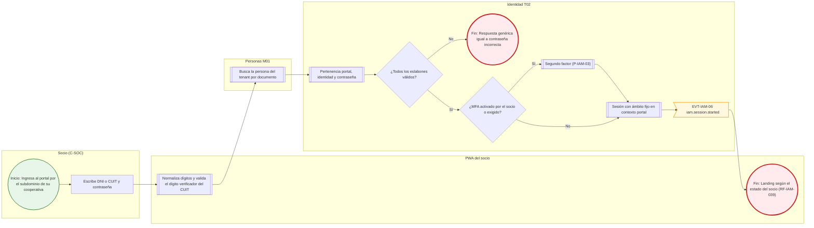

**Pasos del proceso** (actividad tomada del anexo; la columna RF/RN distingue lo citado en el paso de lo asociado por parámetro, permiso, evento o tema compartido).

| Paso | Carril | Actividad | RF/RN que aplican | EVT / JOB / PAN |
|---|---|---|---|---|
| 1 | PWA del socio | Pre-login del tenant (subdominio). Campo "DNI o CUIT" con ayuda de formato; normaliza dígitos y valida dígito verificador de CUIT. | — | — |
| 2 | Personas M01 | Servidor: `per.personas.findByDocument(tenantId, doc)` (servicio de M01) → persona → `memberships` con `portal.personId` → identidad → contraseña. Cualquier eslabón ausente = misma respuesta que contraseña incorrecta. | — | — |
| 3 | Identidad T02 | MFA opcional (si el socio lo activó o la política lo exige) → P-IAM-03. | — | — |
| 4 | Identidad T02 | Ámbito fijo (tenant del pre-login, contexto `portal`). Landing según estado (RF-IAM-039). | RF-IAM-039 | — |

**Situación actual en ProCoop (nota de cambio).** En ProCoop el socio ingresa con código de socio más clave o suministro; GoodApps usa DNI o CUIT más contraseña y deja el número de socio o suministro solo como prueba de vinculación (CTR-IAM-10).

**Excepciones**

| Excepción | Tratamiento |
|---|---|
| Documento sin persona, sin pertenencia o sin identidad | Misma respuesta que contraseña incorrecta (anti-enumeración). |
| CUIT con dígito verificador inválido | Error de formato específico en el cliente. |
| Socio sin cuenta en el portal | Registro y vinculación por P-IAM-15. |

---

## 6. P-IAM-06 Google

| Campo | Contenido |
|---|---|
| Fuente | T02 §9, `T02-IAM-identidad-roles-auditoria.md` (línea 3966) |
| Macroproceso | MP-01 Acceso e identidad |
| Disparador | Pulsa Ingresar con Google |
| Resultado | Sesión emitida; Vinculación pendiente de confirmar; Visitante registrado (C-VIS) |
| Carriles | Usuario (staff o socio); Identidad T02; Google (proveedor externo); Comunicaciones T09 |
| Roles de T02 | Solo actores del sistema (sin rol humano) |
| Módulos involucrados | T02 Identidad y roles, T09 Comunicaciones |
| Eventos (T11 §12) | EVT-IAM-01 `iam.identity.created` |
| Jobs | — |
| Relación con 04-procesos-bpmn.md | — |

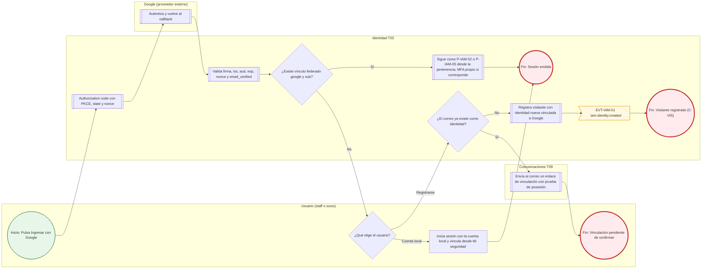

**Pasos del proceso** (actividad tomada del anexo; la columna RF/RN distingue lo citado en el paso de lo asociado por parámetro, permiso, evento o tema compartido).

| Paso | Carril | Actividad | RF/RN que aplican | EVT / JOB / PAN |
|---|---|---|---|---|
| 1 | Usuario | Botón "Ingresar con Google" → authorization code + PKCE + `state` + `nonce`. | — | — |
| 2 | Identidad T02 | Callback: validar firma, `iss`, `aud`, `exp`, `nonce` y `email_verified` [SEG4]; buscar `federatedLinks{google, sub}`. | — | — |
| 3 | Identidad T02 | Vínculo existente → identidad → seguir como P-IAM-02/05 desde el paso de pertenencia (MFA propio si corresponde, RF-IAM-029). | RF-IAM-029 | — |
| 4 | Identidad T02 | Sin vínculo: no se busca por correo para fusionar. Se ofrece (a) iniciar sesión con la cuenta local y vincular desde "Mi seguridad", o (b) registrarse como visitante en el tenant con identidad nueva vinculada a Google; si el correo ya existe como identidad, se envía al correo un enlace para vincular con prueba de posesión (sin revelar en pantalla que existe). | — | — |

**Situación actual en ProCoop (nota de cambio).** No relevada en el anexo ni en T07 o en el análisis de brechas (`15-analisis-brechas-procoop.md`).

**Excepciones**

| Excepción | Tratamiento |
|---|---|
| Token de Google inválido o correo no verificado | Se rechaza el ingreso. |
| Correo coincidente con una identidad existente | No se fusiona por correo; se envía un enlace con prueba de posesión, sin revelar en pantalla que la identidad existe. |
| Identidad con MFA propio | El ingreso con Google no lo reemplaza (RF-IAM-029). |

---

## 7. P-IAM-07 SSO OIDC por tenant (staff)

| Campo | Contenido |
|---|---|
| Fuente | T02 §9, `T02-IAM-identidad-roles-auditoria.md` (línea 3973) |
| Macroproceso | MP-01 Acceso e identidad |
| Disparador | La cooperativa usa un proveedor de identidad corporativo |
| Resultado | Rechazo genérico (PA-IAM-15); Sesión de staff |
| Carriles | Administrador del tenant (T-ADM); Usuario staff; IdP OIDC del tenant; Identidad T02 |
| Roles de T02 | T-ADM Administrador de la cooperativa |
| Módulos involucrados | T02 Identidad y roles |
| Eventos (T11 §12) | EVT-IAM-13 `iam.idp.activated` |
| Jobs | — |
| Relación con 04-procesos-bpmn.md | — |

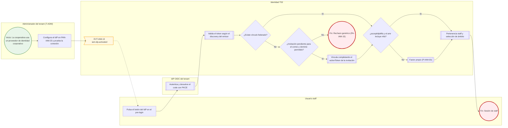

**Pasos del proceso** (actividad tomada del anexo; la columna RF/RN distingue lo citado en el paso de lo asociado por parámetro, permiso, evento o tema compartido).

| Paso | Carril | Actividad | RF/RN que aplican | EVT / JOB / PAN |
|---|---|---|---|---|
| 1 | Administrador del tenant | El T-ADM configura el IdP (PAN-IAM-23), prueba la conexión y lo activa. | — | PAN-IAM-23 |
| 2 | Usuario staff | Login: botón del IdP en el pre-login → code + PKCE → validación de token según discovery del emisor. | — | — |
| 3 | Identidad T02 | Vínculo `federatedLinks{oidcTenant, iss, sub, scopeTenantId}` existente → pertenencia staff. Si no existe: solo se vincula si hay invitación pendiente para el correo del claim y el dominio está en `allowedEmailDomains`; se completa con el `actionToken` de invitación. Sin invitación → rechazo genérico (PA-IAM-15). | asoc.: RF-IAM-028 | — |
| 4 | Identidad T02 | MFA: si `acceptIdpMfa` y el `amr` del IdP incluye `mfa`, se considera satisfecho; si no, factor propio. | — | — |

**Situación actual en ProCoop (nota de cambio).** DFA M1 proponía OpenIddict sobre .NET; el servidor de autenticación es propio en Node con librerías OIDC estándar y las mismas capacidades (CTR-IAM-02, DEC-001).

**Excepciones**

| Excepción | Tratamiento |
|---|---|
| Usuario del IdP sin invitación | Rechazo genérico; no se crean pertenencias automáticamente (PA-IAM-15). |
| Dominio del correo fuera de allowedEmailDomains | No se vincula. |
| IdP que no informa MFA | Se pide el factor propio de GoodApps. |

---

## 8. P-IAM-08 CiDi Córdoba

| Campo | Contenido |
|---|---|
| Fuente | T02 §9, `T02-IAM-identidad-roles-auditoria.md` (línea 3980) |
| Macroproceso | MP-01 Acceso e identidad |
| Disparador | Elige ingresar con CiDi |
| Resultado | Opción no disponible; Socio ingresado con CiDi; Registro no admitido |
| Carriles | Socio o visitante (C-SOC, C-VIS); Identidad T02; Integraciones T06; CiDi Córdoba; Personas M01 |
| Roles de T02 | C-SOC Socio titular, C-VIS Visitante registrado |
| Módulos involucrados | M01 Personas, T02 Identidad y roles, T06 Integraciones |
| Eventos (T11 §12) | EVT-IAM-15 `iam.portal.accountLinked` |
| Jobs | — |
| Relación con 04-procesos-bpmn.md | — |

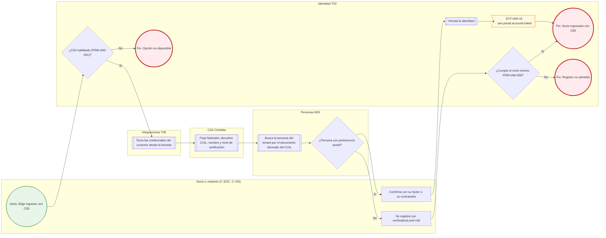

**Pasos del proceso** (actividad tomada del anexo; la columna RF/RN distingue lo citado en el paso de lo asociado por parámetro, permiso, evento o tema compartido).

| Paso | Carril | Actividad | RF/RN que aplican | EVT / JOB / PAN |
|---|---|---|---|---|
| 1 | Identidad T02 | Habilitado por `PRM-IAM-051` y configuración en `identityProviderConfigs{type: cidi}` (credenciales en bóveda T06). | — | — |
| 2 | CiDi Córdoba | Flujo federado según el protocolo vigente de CiDi [VERIFICAR en ficha T06]; se obtiene CUIL, nombre y nivel de verificación. | asoc.: RF-IAM-027 | — |
| 3 | Personas M01 | Vínculo: se busca persona del tenant por documento derivado del CUIL; si existe y tiene pertenencia portal, se vincula previa confirmación con factor del socio o con su contraseña; si no tiene pertenencia, se ofrece registro con `verificationLevel = cidi` (nivel mínimo `PRM-IAM-058`). | — | — |
| 4 | Integraciones T06 | Nunca se usan contraseñas fijas en encabezados para consultar datos de CiDi (reemplazo de RN-10 §13 `clsTramitesWEB.cs:371`). | RN-10 | — |

**Situación actual en ProCoop (nota de cambio).** El relevamiento de ProCoop (RN-10 §13) muestra consultas a CiDi con una contraseña fija en encabezados; GoodApps usa credenciales en la bóveda de T06. Además, el análisis de brechas (§3.2) señala contraseñas reversibles, permisos por formulario, autorización como función de menú y credenciales guardadas en tablas.

**Excepciones**

| Excepción | Tratamiento |
|---|---|
| Protocolo de CiDi no confirmado | El anexo lo deja marcado [VERIFICAR en ficha T06]. |
| Persona con pertenencia portal | Solo se vincula tras confirmar con un factor del socio o su contraseña. |
| Consulta de datos a CiDi | Nunca con contraseñas fijas en encabezados; credenciales en la bóveda de T06. |

---

## 9. P-IAM-09 Ingreso del socio sin contraseña (OTP) — Adoptado (DEC-066)

| Campo | Contenido |
|---|---|
| Fuente | T02 §9, `T02-IAM-identidad-roles-auditoria.md` (línea 3987) |
| Macroproceso | MP-01 Acceso e identidad |
| Disparador | Elige Recibir un código |
| Resultado | Respuesta genérica; Socio en el portal |
| Carriles | Socio (C-SOC); Identidad T02; Comunicaciones T09 |
| Roles de T02 | C-SOC Socio titular |
| Módulos involucrados | T02 Identidad y roles, T09 Comunicaciones |
| Eventos (T11 §12) | EVT-IAM-06 `iam.session.started` |
| Jobs | — |
| Relación con 04-procesos-bpmn.md | — |

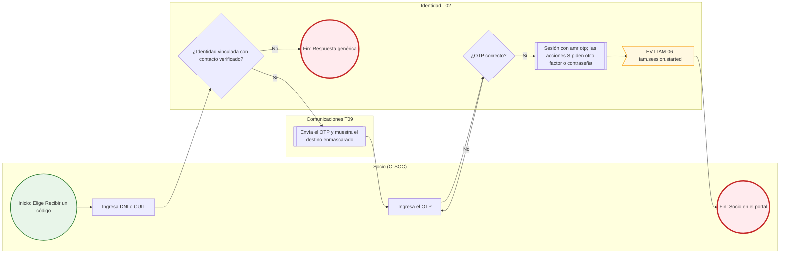

**Pasos del proceso** (actividad tomada del anexo; la columna RF/RN distingue lo citado en el paso de lo asociado por parámetro, permiso, evento o tema compartido).

| Paso | Carril | Actividad | RF/RN que aplican | EVT / JOB / PAN |
|---|---|---|---|---|
| 1 | Socio | Socio elige "Recibir un código"; ingresa DNI/CUIT; se envía OTP al correo/teléfono verificado de la identidad vinculada, mostrando solo destino enmascarado si existe; si no existe, respuesta genérica. | — | — |
| 2 | Identidad T02 | OTP correcto → sesión con `amr = [otp]` (cuenta como un factor; las acciones S piden un segundo factor distinto o contraseña). | — | — |

**Situación actual en ProCoop (nota de cambio).** Proceso adoptado por DEC-066; no tiene equivalente descrito en ProCoop.

**Excepciones**

| Excepción | Tratamiento |
|---|---|
| Documento sin identidad o sin contacto verificado | Respuesta genérica, sin revelar si existe. |
| OTP incorrecto reiterado | Aplican los límites de intentos de P-IAM-03. |
| Acción sensible (S) con sesión por OTP | Se pide un segundo factor distinto o la contraseña. |

---

## 10. P-IAM-10 Refresh y detección de reutilización

| Campo | Contenido |
|---|---|
| Fuente | T02 §9, `T02-IAM-identidad-roles-auditoria.md` (línea 3992) |
| Macroproceso | MP-01 Acceso e identidad |
| Disparador | Access token vencido |
| Resultado | Sesión cerrada; debe volver a ingresar; Nuevo access token |
| Carriles | Cliente web o PWA; Identidad T02; Comunicaciones T09 |
| Roles de T02 | Solo actores del sistema (sin rol humano) |
| Módulos involucrados | T02 Identidad y roles, T09 Comunicaciones |
| Eventos (T11 §12) | EVT-IAM-14 `iam.securityAlert.raised`; EVT-IAM-06 `iam.session.revoked` |
| Jobs | — |
| Relación con 04-procesos-bpmn.md | — |

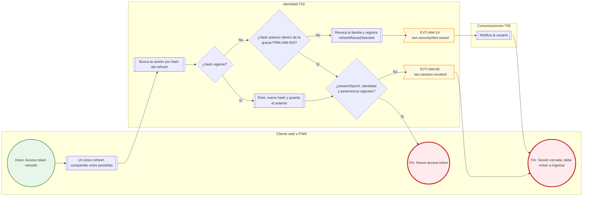

**Pasos del proceso** (actividad tomada del anexo; la columna RF/RN distingue lo citado en el paso de lo asociado por parámetro, permiso, evento o tema compartido).

| Paso | Carril | Actividad | RF/RN que aplican | EVT / JOB / PAN |
|---|---|---|---|---|
| 1 | Cliente web o PWA | Access vencido → cliente llama `POST /api/auth/refresh` (cookie). Un único refresh compartido entre pestañas (BroadcastChannel / lock de pestañas). | — | — |
| 2 | Identidad T02 | Servidor busca `sessions` por hash: vigente → rota (nuevo hash, guarda anterior en `previousHashes` con gracia `PRM-IAM-003` s) → nuevo access. | asoc.: RN-IAM-017 | — |
| 3 | Identidad T02 | Hash en `previousHashes` fuera de gracia o desconocido de una familia existente → revoca familia, `auditAccess.refreshReuseDetected`, `securityAlerts` severidad alta, notifica al usuario. | — | — |
| 4 | Identidad T02 | Verifica `sessionEpoch` y estado de identidad/pertenencia antes de emitir. | asoc.: RN-IAM-018, RF-IAM-035 | — |

**Situación actual en ProCoop (nota de cambio).** En el sistema de referencia los tokens quedan accesibles por JavaScript (localStorage o sessionStorage) y hay un refresh por usuario; GoodApps guarda el refresh en cookie HttpOnly, el access en memoria (CTR-IAM-07) y una sesión por dispositivo (CTR-IAM-06).

**Excepciones**

| Excepción | Tratamiento |
|---|---|
| Reutilización de un refresh fuera de gracia | Se revoca toda la familia de sesiones, alerta de severidad alta y aviso al usuario. |
| Varias pestañas refrescando a la vez | Un único refresh compartido (BroadcastChannel o lock de pestañas). |
| Identidad o pertenencia suspendida | No se emite access token. |

---

## 11. P-IAM-11 Logout y cierre global

| Campo | Contenido |
|---|---|
| Fuente | T02 §9, `T02-IAM-identidad-roles-auditoria.md` (línea 3999) |
| Macroproceso | MP-01 Acceso e identidad |
| Disparador | Usuario con sesión |
| Resultado | Sesiones cerradas |
| Carriles | Usuario; Identidad T02 |
| Roles de T02 | Solo actores del sistema (sin rol humano) |
| Módulos involucrados | T02 Identidad y roles |
| Eventos (T11 §12) | EVT-IAM-06 `iam.session.revoked` |
| Jobs | — |
| Relación con 04-procesos-bpmn.md | — |

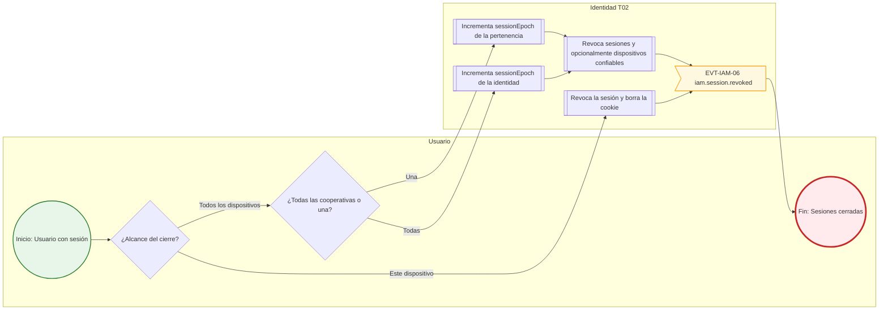

**Pasos del proceso** (actividad tomada del anexo; la columna RF/RN distingue lo citado en el paso de lo asociado por parámetro, permiso, evento o tema compartido).

| Paso | Carril | Actividad | RF/RN que aplican | EVT / JOB / PAN |
|---|---|---|---|---|
| 1 | Usuario | Cierra sesión: se revoca la sesión actual y se borra la cookie. | — | — |
| 2 | Usuario | Elige "Cerrar sesión en todos los dispositivos": incrementa `sessionEpoch` de la identidad (todas las cooperativas) o de la pertenencia (solo un tenant). | asoc.: RN-IAM-018, RF-IAM-035 | — |
| 3 | Identidad T02 | Revoca las `sessions` y, opcionalmente, los `trustedDevices`. | — | — |

**Situación actual en ProCoop (nota de cambio).** ProCoop maneja una sesión por usuario; GoodApps permite varias sesiones por dispositivo y ámbito y su cierre global (CTR-IAM-06).

**Excepciones**

| Excepción | Tratamiento |
|---|---|
| Access token aún vigente en otro dispositivo | Deja de servir al verificarse sessionEpoch en el siguiente refresh (P-IAM-10). |
| Dispositivos confiables | Se revocan solo si el usuario lo elige. |

---

## 12. P-IAM-12 Recuperación de contraseña

| Campo | Contenido |
|---|---|
| Fuente | T02 §9, `T02-IAM-identidad-roles-auditoria.md` (línea 4004) |
| Macroproceso | MP-01 Acceso e identidad |
| Disparador | Olvidó la contraseña |
| Resultado | Sin envío; Debe pedir un nuevo enlace; Contraseña restablecida; MFA sigue activo |
| Carriles | Usuario; Identidad T02; Comunicaciones T09 |
| Roles de T02 | Solo actores del sistema (sin rol humano) |
| Módulos involucrados | T02 Identidad y roles, T09 Comunicaciones |
| Eventos (T11 §12) | EVT-IAM-09 `iam.password.resetCompleted` |
| Jobs | — |
| Relación con 04-procesos-bpmn.md | P10 Migración y corte por etapas desde ProCoop ([§14](04-procesos-bpmn.md#14-p10--migración-y-corte-por-etapas-desde-procoop)) |

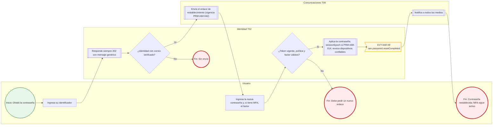

**Pasos del proceso** (actividad tomada del anexo; la columna RF/RN distingue lo citado en el paso de lo asociado por parámetro, permiso, evento o tema compartido).

| Paso | Carril | Actividad | RF/RN que aplican | EVT / JOB / PAN |
|---|---|---|---|---|
| 1 | Usuario | `POST /api/auth/password/forgot` `{ tenantPublicId, identifier }` → siempre 202 con mensaje genérico. | — | — |
| 2 | Identidad T02 | Si existe identidad con correo verificado: `actionTokens.passwordReset` (vigencia `PRM-IAM-042` min) enviado al correo; si tiene MFA, el formulario de nueva contraseña exige además el factor. | — | — |
| 3 | Usuario | `POST /api/auth/password/reset` `{ token, newPassword, mfaCode? }` → aplica política (RF-IAM-040), `passwordChangedAt`, `sessionEpoch++` si `PRM-IAM-014`, revoca dispositivos confiables, notifica a todos los medios, `auditAccess.passwordResetCompleted`. MFA sigue activo. | RF-IAM-040; asoc.: RF-IAM-032 | — |

**Situación actual en ProCoop (nota de cambio).** Las contraseñas de ProCoop son reversibles y no se migran: cada usuario activa su cuenta con una contraseña nueva (CTR-IAM-09); no hay claves por defecto (CTR-IAM-14). Este proceso, junto con la invitación de P-IAM-14, es el que usa la activación en el corte (P10).

**Excepciones**

| Excepción | Tratamiento |
|---|---|
| Identificador inexistente | Misma respuesta 202; no se revela si existe. |
| Token vencido o ya usado | Se pide un nuevo enlace. |
| Contraseña que no cumple la política | Se rechaza según RF-IAM-040. |

---

## 13. P-IAM-13 Pérdida del segundo factor

| Campo | Contenido |
|---|---|
| Fuente | T02 §9, `T02-IAM-identidad-roles-auditoria.md` (línea 4010) |
| Macroproceso | MP-01 Acceso e identidad |
| Disparador | Perdió el segundo factor |
| Resultado | Factor reemplazado; Recuperación rechazada |
| Carriles | Usuario sin segundo factor; Administrador (T-ADM, T-USR o P-SEC); Expediente T11; Identidad T02; Comunicaciones T09 |
| Roles de T02 | P-SEC Seguridad y auditoría de plataforma, T-ADM Administrador de la cooperativa, T-USR Administrador de usuarios y seguridad (opcional) |
| Módulos involucrados | T02 Identidad y roles, T09 Comunicaciones, T11 Workflow, eventos y documentos |
| Eventos (T11 §12) | EVT-IAM-08 `iam.mfa.enrolled`, `iam.mfa.removed` |
| Jobs | — |
| Relación con 04-procesos-bpmn.md | — |

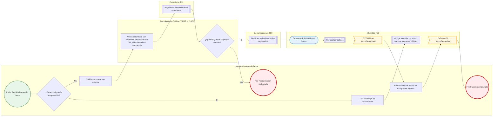

**Pasos del proceso** (actividad tomada del anexo; la columna RF/RN distingue lo citado en el paso de lo asociado por parámetro, permiso, evento o tema compartido).

| Paso | Carril | Actividad | RF/RN que aplican | EVT / JOB / PAN |
|---|---|---|---|---|
| 1 | Usuario sin segundo factor | Con código de recuperación: lo usa en lugar del factor; se obliga a enrolar un factor nuevo y regenerar códigos. | — | — |
| 2 | Administrador | Sin códigos: el usuario solicita recuperación asistida; un T-ADM/T-USR (o P-SEC para usuarios de plataforma/T-ADM sin otro administrador) verifica identidad con evidencia (presencial con DNI, videollamada, constancia), registra la evidencia en el expediente (T11) y aprueba; se aplica espera `PRM-IAM-033` horas con notificaciones a todos los medios registrados; luego se revocan factores y el usuario enrola uno nuevo en su siguiente ingreso. El aprobador no puede ser el propio usuario. | asoc.: RF-IAM-031 | — |

**Situación actual en ProCoop (nota de cambio).** No relevada en el anexo ni en T07 o en el análisis de brechas (`15-analisis-brechas-procoop.md`).

**Excepciones**

| Excepción | Tratamiento |
|---|---|
| El aprobador es el propio usuario | No se admite. |
| T-ADM sin otro administrador en el tenant | Aprueba P-SEC. |
| Reclamo del titular durante la espera | Las notificaciones a todos los medios permiten detener una recuperación no solicitada antes de revocar los factores. |

---

## Inconsistencias detectadas en la especificación (esta parte)

No se detectaron inconsistencias en los procesos de esta parte.

## Cobertura de esta parte

| Universo de la parte | Diagramados | Pendientes |
|---|---|---|
| 13 (P-IAM-01 a P-IAM-13) | 13 | 0 |
