# GoodApps Cooperativas

## Procesos de negocio — Gobierno de accesos y auditoría (T02, P-IAM-14 a P-IAM-26)

**Entregable de Análisis y Diseño Detallado — Artefacto 2.1 (Procesos de negocio BPMN). Parte de [`04-procesos-bpmn.md`](04-procesos-bpmn.md).**

| Dato | Valor |
|---|---|
| Documento | Diagramas BPMN, pasos, situación actual en ProCoop y excepciones de los procesos P-IAM-14 a P-IAM-26 |
| Carácter | Derivado de la especificación vigente; no la reemplaza. Ante diferencias prevalecen la maestra `00`, los anexos, T05, T11 y el registro de decisiones `01` |
| Generación | Script `_trabajo/generar_bpmn.py` (extrae pasos, eventos, jobs y RF/RN de los anexos) más datos revisados a mano en `_trabajo/bpmn_datos_*.py` |
| Versión | 1.1 (regenerada contra la especificación corregida) |
| Fecha | 05-11-2026 |

**Cómo leer cada proceso.** La notación es la de [`04-procesos-bpmn.md` §3](04-procesos-bpmn.md#3-notación-equivalencia-mermaid--bpmn) (carriles, eventos de inicio y fin, tareas de usuario y de servicio, compuertas XOR y AND, eventos de dominio como banderas, temporizadores y jobs como estadios). La tabla de pasos reproduce la actividad del anexo; en la columna RF/RN, los identificadores sin prefijo son los que el anexo cita en el paso y los marcados "asoc." son reglas o requisitos del mismo anexo que comparten parámetro, permiso, evento o tema con el paso (asociación generada por el script y revisada). Los eventos se nombran con su ID del catálogo de T11 §12.

## Índice de procesos de esta parte

1. [P-IAM-14 Alta de staff por invitación](#1-p-iam-14-alta-de-staff-por-invitación)
2. [P-IAM-15 Registro de socio y vinculación de cuentas (con M19 y M01)](#2-p-iam-15-registro-de-socio-y-vinculación-de-cuentas-con-m19-y-m01)
3. [P-IAM-16 Cálculo del permiso efectivo](#3-p-iam-16-cálculo-del-permiso-efectivo)
4. [P-IAM-17 Autorización en el momento](#4-p-iam-17-autorización-en-el-momento)
5. [P-IAM-18 Autorización diferida](#5-p-iam-18-autorización-diferida)
6. [P-IAM-19 Acceso de soporte](#6-p-iam-19-acceso-de-soporte)
7. [P-IAM-20 Clientes API](#7-p-iam-20-clientes-api)
8. [P-IAM-21 Escritura de auditoría](#8-p-iam-21-escritura-de-auditoría)
9. [P-IAM-22 Lecturas sensibles y exportaciones](#9-p-iam-22-lecturas-sensibles-y-exportaciones)
10. [P-IAM-23 Concurrencia de edición](#10-p-iam-23-concurrencia-de-edición)
11. [P-IAM-24 Revocación con trabajo offline (ESC-03)](#11-p-iam-24-revocación-con-trabajo-offline-esc-03)
12. [P-IAM-25 Recertificación de accesos](#12-p-iam-25-recertificación-de-accesos)
13. [P-IAM-26 Baja de empleado](#13-p-iam-26-baja-de-empleado)

---

## 1. P-IAM-14 Alta de staff por invitación

| Campo | Contenido |
|---|---|
| Fuente | T02 §9, `T02-IAM-identidad-roles-auditoria.md` (línea 4015) |
| Macroproceso | MP-02 Gobierno de accesos y auditoría |
| Disparador | Ingreso de personal al sistema |
| Resultado | Pertenencia staff activa |
| Carriles | Administrador de usuarios (T-ADM o T-USR); Identidad T02; Comunicaciones T09; Persona invitada |
| Roles de T02 | T-ADM Administrador de la cooperativa, T-USR Administrador de usuarios y seguridad (opcional) |
| Módulos involucrados | T02 Identidad y roles, T09 Comunicaciones |
| Eventos (T11 §12) | EVT-IAM-03 `iam.membership.invited`, `iam.membership.activated` |
| Jobs | JOB-IAM-09 `iam:enviar-invitaciones` |
| Relación con 04-procesos-bpmn.md | P10 Migración y corte por etapas desde ProCoop ([§14](04-procesos-bpmn.md#14-p10--migración-y-corte-por-etapas-desde-procoop)) |

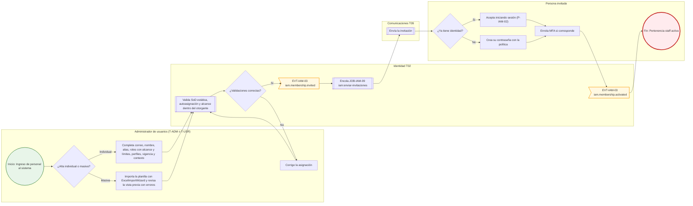

**Pasos del proceso** (actividad tomada del anexo; la columna RF/RN distingue lo citado en el paso de lo asociado por parámetro, permiso, evento o tema compartido).

| Paso | Carril | Actividad | RF/RN que aplican | EVT / JOB / PAN |
|---|---|---|---|---|
| 1 | Administrador de usuarios | T-ADM/T-USR completa: correo, nombre, alias, legajo (opcional), roles con alcance y límites, perfiles, vigencia, contexto operativo por defecto. | asoc.: RF-IAM-009 | — |
| 2 | Identidad T02 | Validaciones: SoD estática, autoasignación, alcance ⊆ alcance del otorgante. | — | — |
| 3 | Persona invitada | Envío de invitación; el invitado acepta (P-IAM-02 si ya tiene identidad; si no, crea contraseña con política) y enrola MFA si corresponde. | — | — |
| 4 | Administrador de usuarios | Importación masiva: ExcelImportWizard con columnas (correo, nombre, alias, rol, sucursales, perfiles); preview con errores; confirmar genera invitaciones por job `iam:enviar-invitaciones`. | asoc.: RF-IAM-078 | JOB-IAM-09 |

**Situación actual en ProCoop (nota de cambio).** En ProCoop existe un superusuario que saltea permisos (CTR-IAM-05), claves por defecto (CTR-IAM-14) y una tabla de usuarios por base; GoodApps representa al usuario como `memberships.staff` (CTR-IAM-16), sin bypass y con SoD. Las contraseñas no migran: el personal se incorpora por invitación (CTR-IAM-09).

**Excepciones**

| Excepción | Tratamiento |
|---|---|
| Conflicto de SoD estática | La asignación se rechaza hasta corregirla. |
| Autoasignación o alcance mayor al del otorgante | Se rechaza. |
| Filas con error en la importación masiva | Se muestran en la vista previa; solo se confirman las válidas. |
| Invitación no aceptada | Vence según la vigencia de la invitación. |

---

## 2. P-IAM-15 Registro de socio y vinculación de cuentas (con M19 y M01)

| Campo | Contenido |
|---|---|
| Fuente | T02 §9, `T02-IAM-identidad-roles-auditoria.md` (línea 4022) |
| Macroproceso | MP-01 Acceso e identidad |
| Disparador | Quiere usar el portal |
| Resultado | Vinculación bloqueada; Socio vinculado; Representación pendiente |
| Carriles | Visitante o socio (C-VIS, C-SOC); Identidad T02; Portal M19; Operador de atención (T-ATE); Personas M01 |
| Roles de T02 | C-SOC Socio titular, C-VIS Visitante registrado, T-ATE Comercial / Atención al socio |
| Módulos involucrados | M01 Personas, M19 Portal, T02 Identidad y roles |
| Eventos (T11 §12) | EVT-IAM-01 `iam.identity.created`; EVT-IAM-14 `iam.securityAlert.raised`; EVT-IAM-15 `iam.portal.accountLinked` |
| Jobs | — |
| Relación con 04-procesos-bpmn.md | P1 Alta de socio y contratación de servicio ([§5](04-procesos-bpmn.md#5-p1--alta-de-socio-y-contratación-de-servicio)) |

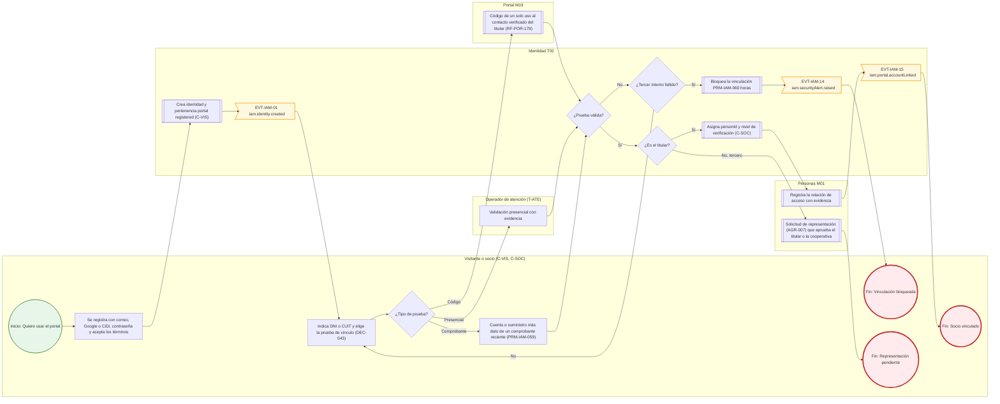

**Pasos del proceso** (actividad tomada del anexo; la columna RF/RN distingue lo citado en el paso de lo asociado por parámetro, permiso, evento o tema compartido).

| Paso | Carril | Actividad | RF/RN que aplican | EVT / JOB / PAN |
|---|---|---|---|---|
| 1 | Visitante o socio | Registro: correo (o Google/CiDi), contraseña, aceptación de términos (versión) → identidad + pertenencia portal `registered` (C-VIS). | — | — |
| 2 | Visitante o socio | Vinculación: el socio indica DNI/CUIT + prueba según DEC-043 (verificación del vínculo usuario-titular; PA-IAM-12): número de cuenta/suministro + dato de un comprobante de los últimos `PRM-IAM-059` meses (código de factura + documento), o código de un solo uso enviado al contacto verificado del titular en M01 (RF-POR-179 de M19), o validación presencial en la cooperativa registrada por un operador con evidencia; los intentos son limitados (paso 4). | RF-POR-179; asoc.: RF-IAM-048 | — |
| 3 | Identidad T02 | Prueba válida y persona titular → `portal.personId`, `verificationLevel`, C-SOC; M01 registra la relación de acceso con evidencia. Prueba válida sobre cuenta de un tercero → solicitud de representación (M01, AGR-007) que aprueba el titular o la cooperativa. | asoc.: RN-IAM-028, RN-IAM-025 | — |
| 4 | Identidad T02 | Tres pruebas fallidas → bloqueo de vinculación `PRM-IAM-060` horas y alerta. | — | — |

**Situación actual en ProCoop (nota de cambio).** En ProCoop el socio se identifica con código de socio más clave o suministro (CTR-IAM-10); GoodApps separa la identidad común (CTR-IAM-19) de la vinculación con el titular, que exige prueba (DEC-043).

**Excepciones**

| Excepción | Tratamiento |
|---|---|
| Tres pruebas fallidas | Bloqueo de vinculación por PRM-IAM-060 horas y alerta. |
| Cuenta de un tercero | No se vincula directamente: se genera una solicitud de representación (M01, AGR-007). |
| Validación presencial | La registra un operador con evidencia (PA-IAM-12). |

---

## 3. P-IAM-16 Cálculo del permiso efectivo

| Campo | Contenido |
|---|---|
| Fuente | T02 §9, `T02-IAM-identidad-roles-auditoria.md` (línea 4029) |
| Macroproceso | MP-02 Gobierno de accesos y auditoría |
| Disparador | Pedido a una API protegida; Inicio o cambio de sesión del cliente |
| Resultado | Respuesta 401; Respuesta 403 con motivo; Acción ejecutada y auditada (P-IAM-21); Menú según permisos |
| Carriles | Cliente web o PWA; Servicio de dominio del módulo; Identidad T02 |
| Roles de T02 | Solo actores del sistema (sin rol humano) |
| Módulos involucrados | T02 Identidad y roles |
| Eventos (T11 §12) | — |
| Jobs | — |
| Relación con 04-procesos-bpmn.md | — |

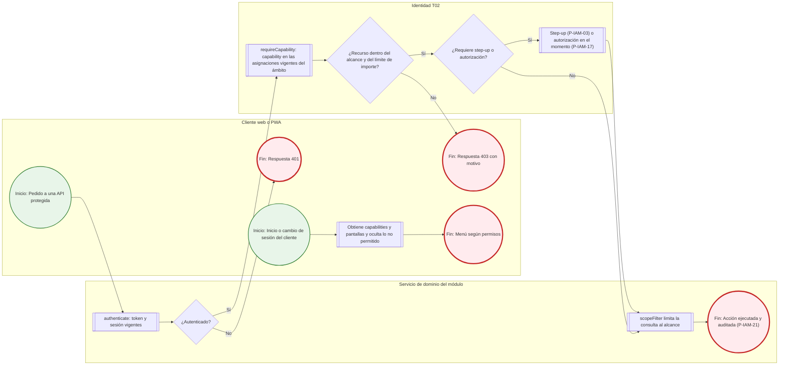

**Pasos del proceso** (actividad tomada del anexo; la columna RF/RN distingue lo citado en el paso de lo asociado por parámetro, permiso, evento o tema compartido).

| Paso | Carril | Actividad | RF/RN que aplican | EVT / JOB / PAN |
|---|---|---|---|---|
| 1 | Servicio de dominio del módulo | Middleware `authenticate`: valida token y sesión (pasos 1 y 2 de RN-IAM-020). | RN-IAM-020 | — |
| 2 | Identidad T02 | `requireCapability(c, { resourceLoader?, amountFrom?, stepUp? })`: evalúa capability, alcance, importe y step-up (pasos 3 a 11 de RN-IAM-020). | RN-IAM-020 | — |
| 3 | Servicio de dominio del módulo | Helper `scopeFilter(c)`: limita las consultas al alcance de la asignación. | — | — |
| 4 | Cliente web o PWA | `can()` en el cliente vía `GET /api/auth/me/permissions`: capabilities y pantallas, sin alcances detallados. | — | — |

**Situación actual en ProCoop (nota de cambio).** En ProCoop el rol equivale a pantallas, un nivel especial saltea permisos y el alcance es global (CTR-IAM-11, CTR-IAM-05, CTR-IAM-04); el análisis de brechas (§3.2) señala contraseñas reversibles, permisos por formulario, autorización como función de menú y credenciales guardadas en tablas. GoodApps separa perfiles (pantallas) de roles (acciones) y liga el alcance a la asignación.

**Excepciones**

| Excepción | Tratamiento |
|---|---|
| Capability concedida en otra asignación con otro alcance | El alcance se toma de la asignación que concede la capability, no de la unión global (CTR-IAM-04). |
| Cliente con permisos desactualizados | El servidor siempre decide; el cliente solo oculta opciones. |

---

## 4. P-IAM-17 Autorización en el momento

| Campo | Contenido |
|---|---|
| Fuente | T02 §9, `T02-IAM-identidad-roles-auditoria.md` (línea 4033) |
| Macroproceso | MP-02 Gobierno de accesos y auditoría |
| Disparador | Intenta una acción que requiere autorización (U) |
| Resultado | Acción no autorizada; Acción ejecutada; auditoría con ambos actores y sin sesión del supervisor |
| Carriles | Operador solicitante; Supervisor elegible; Cliente web o PWA; Identidad T02; Comunicaciones T09 |
| Roles de T02 | Solo actores del sistema (sin rol humano) |
| Módulos involucrados | T02 Identidad y roles, T09 Comunicaciones |
| Eventos (T11 §12) | EVT-IAM-10 `iam.authorization.requested`, `iam.authorization.granted`, `iam.authorization.consumed` |
| Jobs | — |
| Relación con 04-procesos-bpmn.md | P4 Cobranza: caja, pasarelas, débito, rendición y depósito ([§8](04-procesos-bpmn.md#8-p4--cobranza-caja-pasarelas-débito-rendición-y-depósito)) |

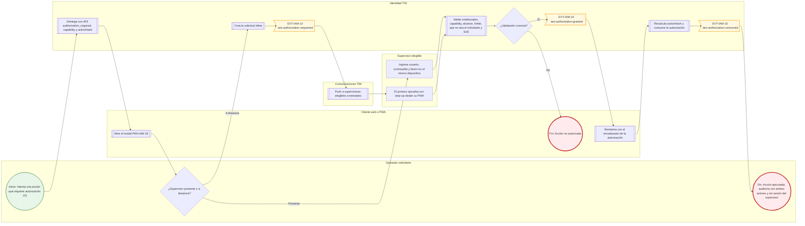

**Pasos del proceso** (actividad tomada del anexo; la columna RF/RN distingue lo citado en el paso de lo asociado por parámetro, permiso, evento o tema compartido).

| Paso | Carril | Actividad | RF/RN que aplican | EVT / JOB / PAN |
|---|---|---|---|---|
| 1 | Identidad T02 | Acción U denegada → respuesta 403 `authorization_required` con `{ capability, reasonType, actionHash, summary }`. | — | — |
| 2 | Cliente web o PWA | El cliente abre el modal PAN-IAM-16: (a) "Supervisor presente": el supervisor ingresa usuario + contraseña + factor en el mismo dispositivo; o (b) "Pedir a un supervisor": se crea solicitud `inline` y se notifica por push a supervisores elegibles conectados; el primero que aprueba con step-up desde su PWA la resuelve. | asoc.: RF-IAM-092 | PAN-IAM-16 |
| 3 | Identidad T02 | Servidor valida al supervisor (credenciales, capability, alcance, límite, ≠ solicitante, SoD) y emite `authorizationRequests` `approved` con vigencia corta. | asoc.: RF-IAM-093 | — |
| 4 | Cliente web o PWA | El cliente reintenta la acción con header `X-Authorization-Request: <id>`; el servidor recalcula `actionHash`, consume la autorización y ejecuta; auditoría con ambos actores. | — | — |
| 5 | Identidad T02 | La sesión del supervisor en el dispositivo del solicitante no se crea: su autenticación solo produce la aprobación. | — | — |

**Situación actual en ProCoop (nota de cambio).** En ProCoop el supervisor se autentica en la terminal del cajero y queda abierta su sesión, con autoaprobación posible (CTR-IAM-20, CTR-WFL-10); el análisis de brechas (§3.2) la describe como una función de menú. GoodApps la conserva como aprobación de un solo uso ligada a la acción, sin abrir la sesión del supervisor.

**Excepciones**

| Excepción | Tratamiento |
|---|---|
| El supervisor es el solicitante o viola SoD | Se rechaza (autoaprobación prohibida). |
| La acción cambió entre la aprobación y el reintento | El actionHash no coincide y la autorización no se consume. |
| Autorización vencida | La vigencia es corta; hay que pedirla de nuevo o diferirla (P-IAM-18). |

---

## 5. P-IAM-18 Autorización diferida

| Campo | Contenido |
|---|---|
| Fuente | T02 §9, `T02-IAM-identidad-roles-auditoria.md` (línea 4041) |
| Macroproceso | MP-02 Gobierno de accesos y auditoría |
| Disparador | Acción U denegada (P-IAM-17 paso 1) |
| Resultado | Solicitud rechazada; Acción ejecutada; Solicitud vencida |
| Carriles | Solicitante; Aprobador elegible; Identidad T02; Comunicaciones T09; Sistema (S-SYS) |
| Roles de T02 | S-SYS Sistema / worker |
| Módulos involucrados | T02 Identidad y roles, T09 Comunicaciones |
| Eventos (T11 §12) | EVT-IAM-10 `iam.authorization.requested`, `iam.authorization.granted`, `iam.authorization.rejected`, `iam.authorization.expired`, `iam.authorization.consumed` |
| Jobs | JOB-IAM-01 `iam:expirar-autorizaciones` |
| Relación con 04-procesos-bpmn.md | P4 Cobranza: caja, pasarelas, débito, rendición y depósito ([§8](04-procesos-bpmn.md#8-p4--cobranza-caja-pasarelas-débito-rendición-y-depósito)) |

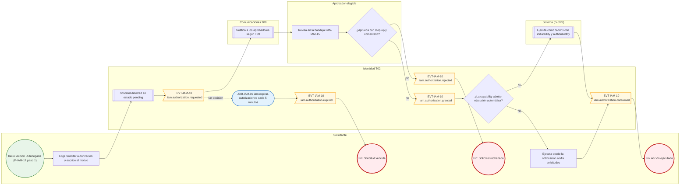

**Pasos del proceso** (actividad tomada del anexo; la columna RF/RN distingue lo citado en el paso de lo asociado por parámetro, permiso, evento o tema compartido).

| Paso | Carril | Actividad | RF/RN que aplican | EVT / JOB / PAN |
|---|---|---|---|---|
| 1 | Solicitante | Igual que P-IAM-17.1, el usuario elige "Solicitar autorización" con motivo → `deferred` `pending`. | — | — |
| 2 | Aprobador elegible | Bandeja PAN-IAM-15 de aprobadores (tiempo real); notificación según T09. | asoc.: RF-IAM-093 | PAN-IAM-15 |
| 3 | Aprobador elegible | Aprobación/rechazo con step-up y comentario. | — | — |
| 4 | Solicitante | Si la acción es diferible (p. ej., anulación de recibo), el solicitante la ejecuta desde la notificación o la bandeja de "Mis solicitudes"; si la acción admite ejecución automática (configurado por capability), el sistema la ejecuta como `S-SYS` con `initiatedBy` = solicitante y `authorizedBy` = aprobador. | asoc.: RF-IAM-115, RF-IAM-093 | — |
| 5 | Identidad T02 | Job `iam:expirar-autorizaciones` cada 5 minutos. | — | JOB-IAM-01 |

**Situación actual en ProCoop (nota de cambio).** La autorización de ProCoop es en la misma terminal (CTR-WFL-10); la diferida de un solo paso es de T02 y la multipaso de T11 (CTR-WFL-20).

**Excepciones**

| Excepción | Tratamiento |
|---|---|
| Sin decisión en plazo | El job la vence y se avisa al solicitante. |
| Aprobación multipaso, por monto o comité | No es de T02: la cubre T11 (P-WFL-04, P-WFL-05); la bandeja muestra ambas (CTR-WFL-20). |

---

## 6. P-IAM-19 Acceso de soporte

| Campo | Contenido |
|---|---|
| Fuente | T02 §9, `T02-IAM-identidad-roles-auditoria.md` (línea 4049) |
| Macroproceso | MP-02 Gobierno de accesos y auditoría |
| Disparador | Ticket de soporte que requiere entrar al tenant |
| Resultado | Acceso rechazado; Acceso de soporte cerrado |
| Carriles | Agente de soporte (P-SOP1, P-SOP2); Supervisor de plataforma (P-SUP); Seguridad de plataforma (P-SEC); Administrador del tenant (T-ADM); Identidad T02 |
| Roles de T02 | P-SEC Seguridad y auditoría de plataforma, P-SOP1 Soporte plataforma nivel 1, P-SOP2 Soporte plataforma nivel 2 / ingeniería, P-SUP Superadministrador de plataforma, T-ADM Administrador de la cooperativa |
| Módulos involucrados | T02 Identidad y roles |
| Eventos (T11 §12) | EVT-IAM-11 `iam.supportAccess.requested`, `iam.supportAccess.granted`, `iam.supportAccess.started`, `iam.supportAccess.ended` |
| Jobs | JOB-IAM-02 `iam:expirar-accesos-soporte` |
| Relación con 04-procesos-bpmn.md | — |

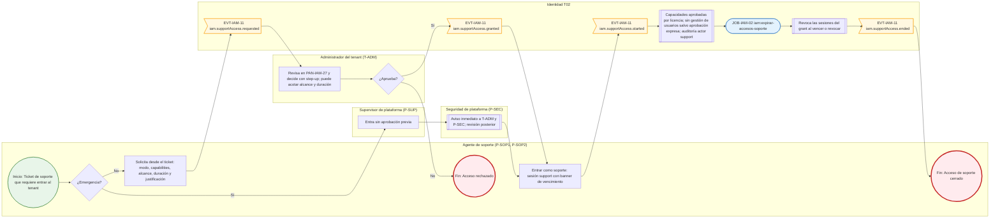

**Pasos del proceso** (actividad tomada del anexo; la columna RF/RN distingue lo citado en el paso de lo asociado por parámetro, permiso, evento o tema compartido).

| Paso | Carril | Actividad | RF/RN que aplican | EVT / JOB / PAN |
|---|---|---|---|---|
| 1 | Agente de soporte | P-SOP1/P-SOP2 solicita desde el ticket (T01): modo, capabilities, alcance, duración, justificación. | — | — |
| 2 | Administrador del tenant | T-ADM recibe la solicitud (PAN-IAM-27 en su tenant) y aprueba/rechaza con step-up; puede acotar alcance y duración. | asoc.: RF-IAM-112 | PAN-IAM-27 |
| 3 | Agente de soporte | El agente inicia "Entrar como soporte": sesión `ctx = support` con banner permanente "Acceso de soporte – vence 17:30"; capacidades = las aprobadas ∩ licencia del tenant; nunca `iam.*` de gestión de usuarios salvo que se apruebe expresamente. | — | — |
| 4 | Identidad T02 | Cada acción se audita con `actor.type = support`, agente, tenant, grant. Al vencer o revocar, `sessions` del grant se revocan. | — | — |
| 5 | Supervisor de plataforma | Emergencia (P-SUP): sin aprobación previa, aviso inmediato a T-ADM y P-SEC, revisión posterior. | asoc.: RN-IAM-051, RF-IAM-112 | — |

**Situación actual en ProCoop (nota de cambio).** Los `TICKETS` de ProCoop son soporte del proveedor de software y pasan a `supportCases` de T01 (CTR-WFL-19); el anexo no describe cómo accede hoy el soporte a los datos de la cooperativa.

**Excepciones**

| Excepción | Tratamiento |
|---|---|
| Pedido de capabilities de gestión de usuarios | Solo con aprobación expresa del T-ADM. |
| Revocación anticipada por el T-ADM | Se revocan las sesiones del grant. |
| Acceso de emergencia | Sin aprobación previa, con aviso inmediato y revisión posterior. |

---

## 7. P-IAM-20 Clientes API

| Campo | Contenido |
|---|---|
| Fuente | T02 §9, `T02-IAM-identidad-roles-auditoria.md` (línea 4057) |
| Macroproceso | MP-02 Gobierno de accesos y auditoría |
| Disparador | Una integración externa necesita acceso |
| Resultado | Respuesta 401, 403 o 429; Respuesta de la API; Credencial anterior revocada |
| Carriles | Administrador del tenant (T-ADM); Sistema externo (S-API); Identidad T02 |
| Roles de T02 | S-API Cliente API (integración externa), T-ADM Administrador de la cooperativa |
| Módulos involucrados | T02 Identidad y roles |
| Eventos (T11 §12) | EVT-IAM-12 `iam.apiClient.created`, `iam.apiClient.credentialRotated` |
| Jobs | — |
| Relación con 04-procesos-bpmn.md | — |

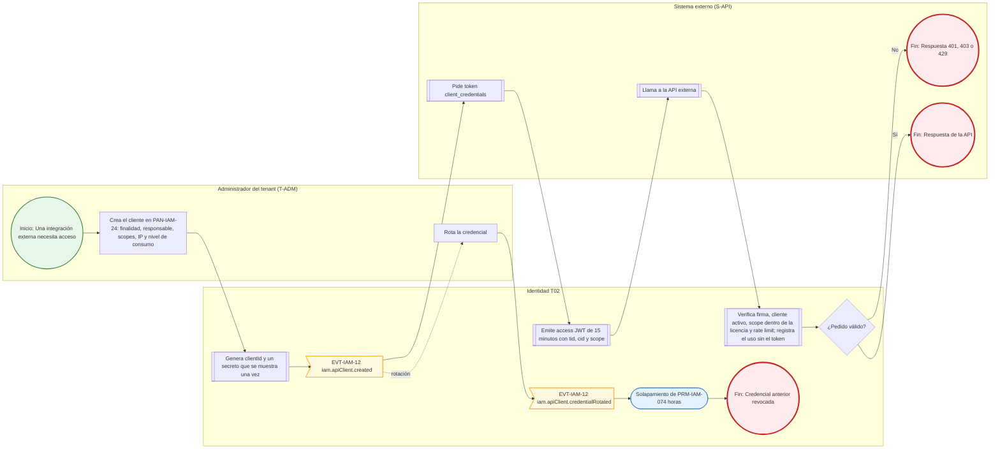

**Pasos del proceso** (actividad tomada del anexo; la columna RF/RN distingue lo citado en el paso de lo asociado por parámetro, permiso, evento o tema compartido).

| Paso | Carril | Actividad | RF/RN que aplican | EVT / JOB / PAN |
|---|---|---|---|---|
| 1 | Administrador del tenant | T-ADM crea cliente (PAN-IAM-24): nombre, finalidad, responsable, scopes, IP permitidas, nivel de consumo. | asoc.: RF-IAM-113 | PAN-IAM-24 |
| 2 | Identidad T02 | Se genera credencial: `clientId` + secreto mostrado una vez (copiar/descargar). | — | — |
| 3 | Sistema externo | Token: `POST /api/v1/ext/oauth/token` (`client_credentials`) → access JWT 15 min con `tid`, `cid`, `scope`. | — | — |
| 4 | Identidad T02 | Cada request: verificación de firma, cliente activo, scope ⊆ licencia, rate limit, registro de uso (sin token). | — | — |
| 5 | Administrador del tenant | Rotación: nueva credencial, solapamiento `PRM-IAM-074` h, revocación de la anterior. | asoc.: RF-IAM-113 | — |

**Situación actual en ProCoop (nota de cambio).** No relevada en el anexo ni en T07 o en el análisis de brechas (`15-analisis-brechas-procoop.md`).

**Excepciones**

| Excepción | Tratamiento |
|---|---|
| IP no permitida o scope fuera de la licencia | Se rechaza el pedido. |
| Pérdida del secreto | No se puede volver a mostrar: se rota la credencial. |
| Responsable dado de baja | Los clientes pasan al T-ADM (P-IAM-26). |

---

## 8. P-IAM-21 Escritura de auditoría

| Campo | Contenido |
|---|---|
| Fuente | T02 §9, `T02-IAM-identidad-roles-auditoria.md` (línea 4065) |
| Macroproceso | MP-02 Gobierno de accesos y auditoría |
| Disparador | Comando de negocio; Job o proceso masivo |
| Resultado | Comando rechazado y auditado; Cambio, auditoría y evento atómicos; Detalle recuperable conservado |
| Carriles | Servicio de dominio del módulo; Persistencia (plugin auditable); Auditoría T02; Jobs y procesos masivos |
| Roles de T02 | Solo actores del sistema (sin rol humano) |
| Módulos involucrados | T02 Identidad y roles |
| Eventos (T11 §12) | — |
| Jobs | — |
| Relación con 04-procesos-bpmn.md | — |

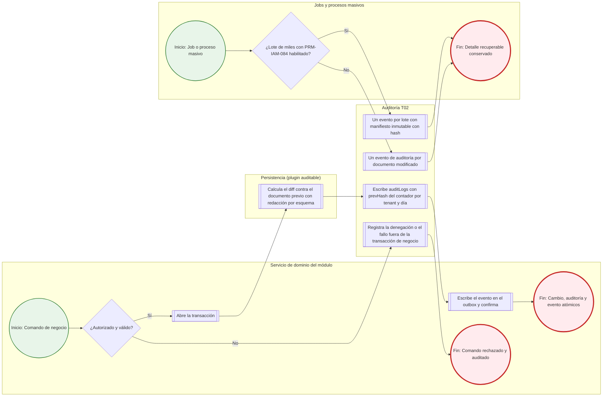

**Pasos del proceso** (actividad tomada del anexo; la columna RF/RN distingue lo citado en el paso de lo asociado por parámetro, permiso, evento o tema compartido).

| Paso | Carril | Actividad | RF/RN que aplican | EVT / JOB / PAN |
|---|---|---|---|---|
| 1 | Persistencia | Plugin Mongoose `auditable` en cada colección de negocio: en `save`/`updateOne`/`findOneAndUpdate` calcula el diff sobre el documento previo (cargado en la misma transacción) con redacción por esquema. | — | — |
| 2 | Servicio de dominio del módulo | El servicio de dominio abre transacción (`withTransaction`), escribe el cambio, escribe `auditLogs` (con `prevHash` del último de la partición obtenido de un contador por tenant/día) y el evento en outbox; commit. | — | — |
| 3 | Auditoría T02 | Denegaciones y fallos se registran fuera de la transacción de negocio (con `result = denied\|failed`). | — | — |
| 4 | Jobs y procesos masivos | Jobs y procesos masivos registran un evento por documento modificado o, para lotes de miles, un evento por lote con referencia a manifiesto inmutable (archivo con hash) si `PRM-IAM-084` lo habilita; nunca se pierde el detalle recuperable. | — | — |

**Situación actual en ProCoop (nota de cambio).** ProCoop borra o pasa a histórico la auditoría de mensajes por parámetro (CTR-IAM-21) y su auditoría se concentra en el logueo (análisis de brechas §3.2). GoodApps registra cambios con diff y cadena de hash, sin purga por job, y separa `auditAccess`, `auditReads`, `auditMessages` y `auditAi` (CTR-IAM-16).

**Excepciones**

| Excepción | Tratamiento |
|---|---|
| Falla de la transacción | No queda cambio sin auditoría ni auditoría sin cambio: todo se revierte. |
| Ruptura de la cadena de hash | La detecta la verificación de integridad (EVT-IAM-16). |
| Pedido de borrado de auditoría | No hay purga por job; la retención la fija T08 (CTR-IAM-21). |

---

## 9. P-IAM-22 Lecturas sensibles y exportaciones

| Campo | Contenido |
|---|---|
| Fuente | T02 §9, `T02-IAM-identidad-roles-auditoria.md` (línea 4072) |
| Macroproceso | MP-02 Gobierno de accesos y auditoría |
| Disparador | Consulta datos sensibles o pide una exportación |
| Resultado | Datos mostrados; Exportación descargada |
| Carriles | Usuario autorizado; Servicio del módulo; Archivos T01; Auditoría T02 |
| Roles de T02 | Solo actores del sistema (sin rol humano) |
| Módulos involucrados | T01 Plataforma, T02 Identidad y roles |
| Eventos (T11 §12) | — |
| Jobs | — |
| Relación con 04-procesos-bpmn.md | — |

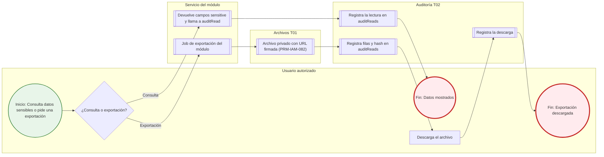

**Pasos del proceso** (actividad tomada del anexo; la columna RF/RN distingue lo citado en el paso de lo asociado por parámetro, permiso, evento o tema compartido).

| Paso | Carril | Actividad | RF/RN que aplican | EVT / JOB / PAN |
|---|---|---|---|---|
| 1 | Servicio del módulo | Los servicios que devuelven campos `sensitive` o registros de categorías sensibles llaman `auditRead()`. | — | — |
| 2 | Servicio del módulo | Exportaciones: job `<mod>:exportar` → archivo privado → URL firmada (`PRM-IAM-082` min) → `auditReads` con filas y hash; descarga registrada. | asoc.: RN-IAM-065 | — |

**Situación actual en ProCoop (nota de cambio).** ProCoop tiene auditoría de información (`INFO_AUD`) y la BASE dejaba la auditoría de lecturas como opcional; GoodApps audita la lectura de categorías sensibles, informes y exportaciones (CTR-IAM-12).

**Excepciones**

| Excepción | Tratamiento |
|---|---|
| URL vencida | La descarga se rechaza; se genera una nueva exportación. |
| Ampliar la auditoría de lecturas a otras categorías | PA-IAM-07 (asumida, DEC-072) fija el alcance: datos sensibles, informes, exportaciones, descargas masivas y búsquedas amplias; otra categoría exige ampliar esa definición. |

---

## 10. P-IAM-23 Concurrencia de edición

| Campo | Contenido |
|---|---|
| Fuente | T02 §9, `T02-IAM-identidad-roles-auditoria.md` (línea 4077) |
| Macroproceso | MP-02 Gobierno de accesos y auditoría |
| Disparador | Abre una ficha en modo edición |
| Resultado | Espera o coordina; Cambio guardado |
| Carriles | Usuario que edita; Otro usuario; Identidad T02; Servicio del módulo |
| Roles de T02 | Solo actores del sistema (sin rol humano) |
| Módulos involucrados | T02 Identidad y roles |
| Eventos (T11 §12) | — |
| Jobs | — |
| Relación con 04-procesos-bpmn.md | — |

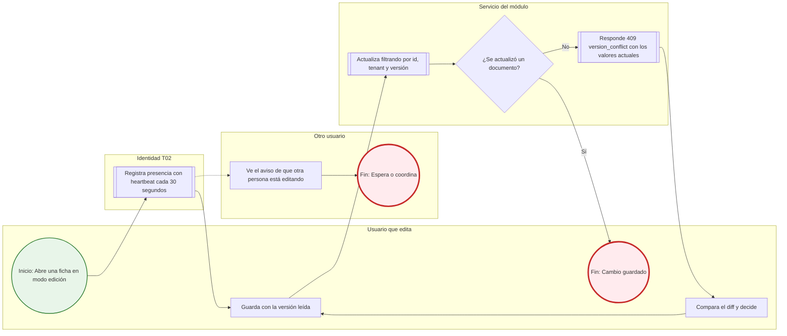

**Pasos del proceso** (actividad tomada del anexo; la columna RF/RN distingue lo citado en el paso de lo asociado por parámetro, permiso, evento o tema compartido).

| Paso | Carril | Actividad | RF/RN que aplican | EVT / JOB / PAN |
|---|---|---|---|---|
| 1 | Usuario que edita | Al abrir una ficha en modo edición: `PUT /api/admin/iam/presence` (heartbeat 30 s); otros usuarios ven el aviso. | — | — |
| 2 | Servicio del módulo | Al guardar: el cuerpo incluye `version`; el servicio actualiza con `{ _id, tenantId, version }` como filtro; 0 documentos → 409 `version_conflict` con valores actuales para el diff. | — | — |

**Situación actual en ProCoop (nota de cambio).** No relevada en el anexo ni en T07 o en el análisis de brechas (`15-analisis-brechas-procoop.md`).

**Excepciones**

| Excepción | Tratamiento |
|---|---|
| Dos usuarios guardan la misma versión | El segundo recibe 409 con los valores actuales para comparar. |
| Heartbeat interrumpido | La presencia caduca y el aviso desaparece para los demás. |

---

## 11. P-IAM-24 Revocación con trabajo offline (ESC-03)

| Campo | Contenido |
|---|---|
| Fuente | T02 §9, `T02-IAM-identidad-roles-auditoria.md` (línea 4082) |
| Macroproceso | MP-02 Gobierno de accesos y auditoría |
| Disparador | Captura operaciones sin conexión |
| Resultado | Cola sincronizada; Operación rechazada con motivo visible |
| Carriles | Técnico de campo (T-TEC); PWA de campo; Identidad T02; Módulo dueño de la operación; Supervisor del técnico |
| Roles de T02 | T-TEC Técnico (campo) |
| Módulos involucrados | T02 Identidad y roles |
| Eventos (T11 §12) | — |
| Jobs | — |
| Relación con 04-procesos-bpmn.md | P2 Ciclo de medición y lectura ([§6](04-procesos-bpmn.md#6-p2--ciclo-de-medición-y-lectura)); P6 Reclamo y orden de trabajo ([§10](04-procesos-bpmn.md#10-p6--reclamo-y-orden-de-trabajo)) |

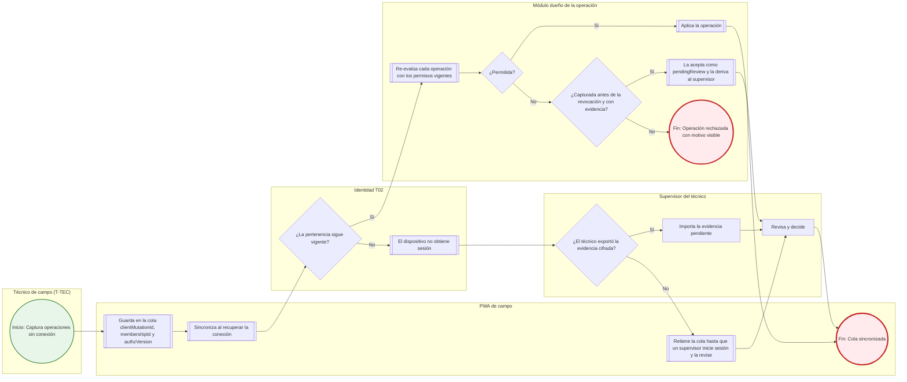

**Pasos del proceso** (actividad tomada del anexo; la columna RF/RN distingue lo citado en el paso de lo asociado por parámetro, permiso, evento o tema compartido).

| Paso | Carril | Actividad | RF/RN que aplican | EVT / JOB / PAN |
|---|---|---|---|---|
| 1 | PWA de campo | La PWA de campo guarda en la cola el `clientMutationId`, el `membershipId` y el `authzVersion` con que se capturó cada operación. | asoc.: RF-IAM-073, RF-IAM-038 | — |
| 2 | Módulo dueño de la operación | Al sincronizar: si la sesión sigue válida, se re-evalúa cada operación con los permisos vigentes; las operaciones capturadas antes de una revocación y con evidencia (firma, foto, GPS) se aceptan como `pendingReview` (no se pierden) y se derivan al supervisor; nunca se descartan en silencio. | — | — |
| 3 | Supervisor del técnico | Si la pertenencia fue revocada, el dispositivo no obtiene sesión; el supervisor puede importar la evidencia pendiente que el técnico exporte cifrada, o la cola queda retenida en el dispositivo hasta que un supervisor inicie sesión en él para revisarla. | — | — |

**Situación actual en ProCoop (nota de cambio).** No relevada en el anexo ni en T07 o en el análisis de brechas (`15-analisis-brechas-procoop.md`).

**Excepciones**

| Excepción | Tratamiento |
|---|---|
| Permiso revocado durante el trabajo offline (ESC-03) | Las operaciones previas con evidencia no se pierden: quedan en revisión del supervisor. |
| Pertenencia revocada | Sin sesión en el dispositivo; la evidencia se importa cifrada o se revisa en el dispositivo. |
| Operación descartada | Nunca en silencio: queda registrada con motivo. |

---

## 12. P-IAM-25 Recertificación de accesos

| Campo | Contenido |
|---|---|
| Fuente | T02 §9, `T02-IAM-identidad-roles-auditoria.md` (línea 4088) |
| Macroproceso | MP-02 Gobierno de accesos y auditoría |
| Disparador | Comienza el período de recertificación |
| Resultado | Recertificación cerrada |
| Carriles | Identidad T02; Revisor de accesos; Comunicaciones T09 |
| Roles de T02 | Solo actores del sistema (sin rol humano) |
| Módulos involucrados | T02 Identidad y roles, T09 Comunicaciones |
| Eventos (T11 §12) | — |
| Jobs | JOB-IAM-06 `iam:recertificacion` |
| Relación con 04-procesos-bpmn.md | — |

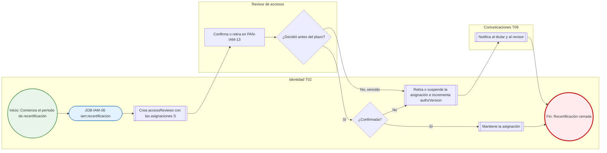

**Pasos del proceso** (actividad tomada del anexo; la columna RF/RN distingue lo citado en el paso de lo asociado por parámetro, permiso, evento o tema compartido).

| Paso | Carril | Actividad | RF/RN que aplican | EVT / JOB / PAN |
|---|---|---|---|---|
| 1 | Identidad T02 | El job `iam:recertificacion` (JOB-IAM-06) crea `accessReviews` por período con las asignaciones S. | — | JOB-IAM-06 |
| 2 | Revisor de accesos | El revisor confirma o retira cada asignación en PAN-IAM-13 (pestaña Recertificación). | — | PAN-IAM-13 |
| 3 | Identidad T02 | Vencido el plazo, las asignaciones no confirmadas se suspenden (`authzVersion++`) y se notifica. | — | — |

**Situación actual en ProCoop (nota de cambio).** No relevada en el anexo ni en T07 o en el análisis de brechas (`15-analisis-brechas-procoop.md`).

**Excepciones**

| Excepción | Tratamiento |
|---|---|
| Revisor que no responde | Al vencer el plazo, la asignación se suspende (no se mantiene por omisión). |
| Sesiones abiertas con la asignación retirada | El cambio de authzVersion obliga a recalcular permisos. |

---

## 13. P-IAM-26 Baja de empleado

| Campo | Contenido |
|---|---|
| Fuente | T02 §9, `T02-IAM-identidad-roles-auditoria.md` (línea 4092) |
| Macroproceso | MP-02 Gobierno de accesos y auditoría |
| Disparador | Empleado dado de baja en Sueldos; Baja manual de un usuario staff |
| Resultado | Acceso staff cerrado; recibos accesibles |
| Carriles | Sueldos M16; Administrador del tenant (T-ADM); Identidad T02; Workflow T11 |
| Roles de T02 | T-ADM Administrador de la cooperativa |
| Módulos involucrados | M16 Sueldos, T02 Identidad y roles, T11 Workflow, eventos y documentos |
| Eventos (T11 §12) | EVT-SUE-03 `sue.employee.terminated`; EVT-IAM-03 `iam.membership.revoked` |
| Jobs | JOB-WFL-29 `wfl:reasignar-huerfanos` |
| Relación con 04-procesos-bpmn.md | — |

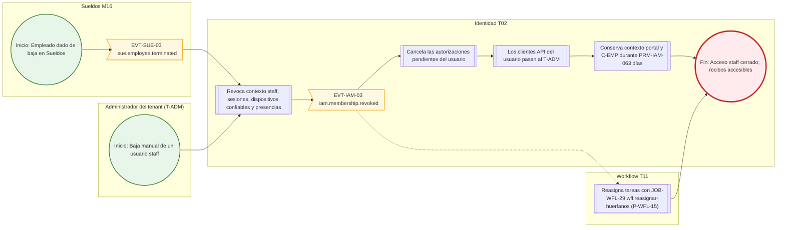

**Pasos del proceso** (actividad tomada del anexo; la columna RF/RN distingue lo citado en el paso de lo asociado por parámetro, permiso, evento o tema compartido).

| Paso | Carril | Actividad | RF/RN que aplican | EVT / JOB / PAN |
|---|---|---|---|---|
| 1 | Sueldos M16 | Llega el evento `sue.employee.terminated` (EVT-SUE-03) o el T-ADM ejecuta la baja manual. | asoc.: RF-IAM-077 | EVT-SUE-03 |
| 2 | Identidad T02 | Revoca el contexto staff, las sesiones, los dispositivos confiables y las presencias; cancela las autorizaciones pendientes del usuario. | asoc.: RF-IAM-077 | — |
| 3 | Workflow T11 | Reasigna las tareas del usuario (T11, P-WFL-15). | — | — |
| 4 | Identidad T02 | Transfiere al T-ADM los clientes API de los que era responsable. | — | — |
| 5 | Identidad T02 | Conserva el contexto portal y C-EMP durante PRM-IAM-063 días para que acceda a sus recibos. | — | — |

**Situación actual en ProCoop (nota de cambio).** No relevada en el anexo ni en T07 o en el análisis de brechas (`15-analisis-brechas-procoop.md`).

**Excepciones**

| Excepción | Tratamiento |
|---|---|
| Empleado que también es socio | Conserva su pertenencia portal. |
| Baja revertida (reincorporación) | Requiere nueva invitación o reactivación de la pertenencia según T02. |

---

## Inconsistencias detectadas en la especificación (esta parte)

No se detectaron inconsistencias en los procesos de esta parte.

## Cobertura de esta parte

| Universo de la parte | Diagramados | Pendientes |
|---|---|---|
| 13 (P-IAM-14 a P-IAM-26) | 13 | 0 |
