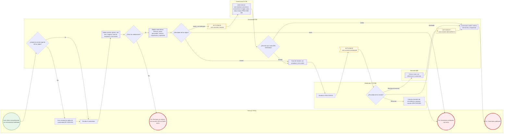
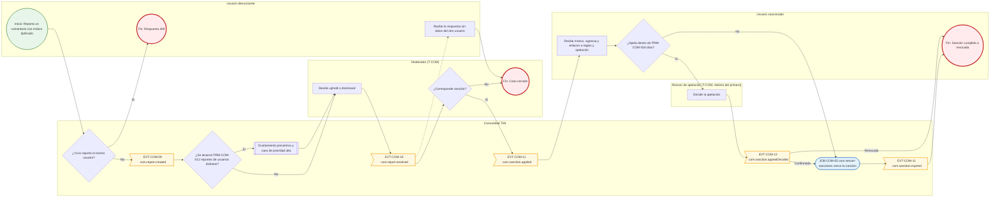
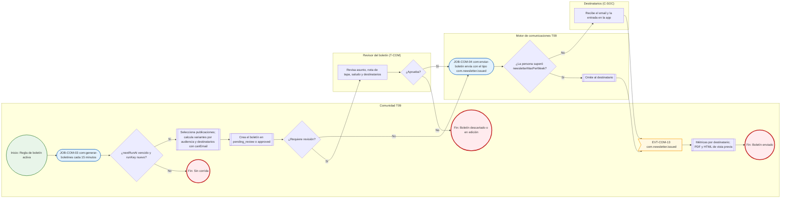
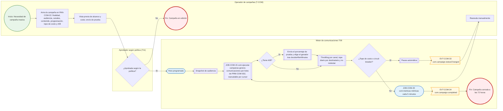
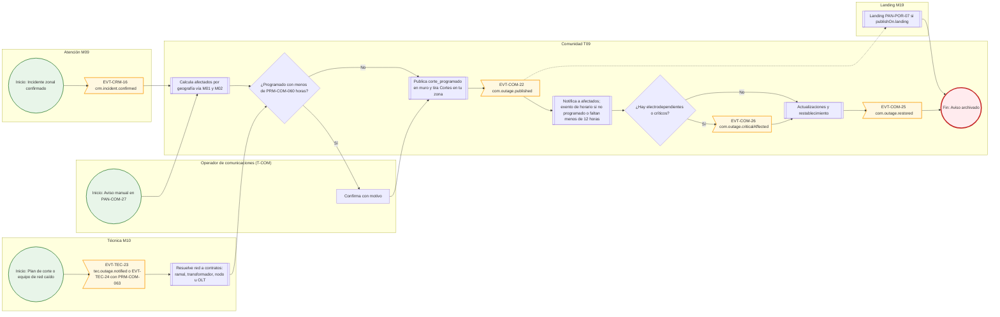
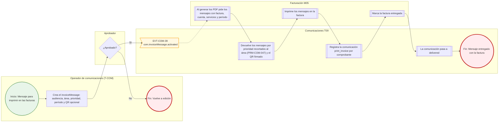
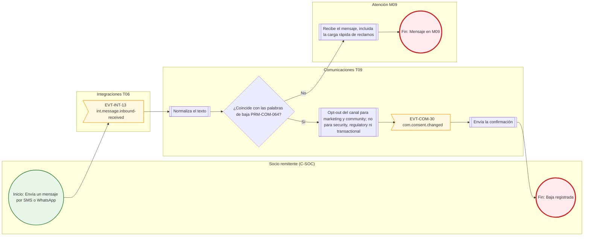

```mermaid
flowchart LR
  subgraph L_EDI["Editor de comunidad (T-COM)"]
    ni(("Inicio: Necesidad de publicar"))
    nt1["Crea la publicación en PAN-COM-02: tipo, contenido, medios, canales y audiencia"]
    nt3["Ve el aviso de audiencia ajustada (RF-COM-113)"]
    nt4["Vista previa celular y landing; vista previa de alcance por canal"]
    nf0(("Fin: Vuelve a borrador"))
  end
  subgraph L_COM["Comunidad T09"]
    nt2[["Al guardar normaliza la audiencia y la recorta al alcance del autor"]]
    ng1{"¿El recorte cambió la audiencia?"}
    ng2{"¿La política exige aprobación?"}
    ne0>"EVT-COM-02 com.post.reviewRequested"]
    ng4{"¿Inmediata o programada?"}
    nj1(["JOB-COM-01 com:publicar-programadas cada minuto"])
    nt7[["Snapshot de audiencia y publicación"]]
    ne1>"EVT-COM-01 com.post.published"]
    ng5{"¿Notificar?"}
    nt8[["Una comunicación por destinatario y canal con preferencias, no molestar y tope diario (P-COM-06)"]]
    nj2(["JOB-COM-02 com:expirar-publicaciones cada 5 minutos: expiración y desfijado"])
    nf1(("Fin: Publicación vigente hasta su expiración"))
  end
  subgraph L_WFL["Workflow T11"]
    nt5[["pending_review con aprobación (P-WFL-04)"]]
  end
  subgraph L_APR["Aprobador editorial"]
    nt6["Revisa diff y vista previa y decide"]
    ng3{"¿Aprobada?"}
  end
  subgraph L_POR["Landing M19"]
    nt9[["Invalida la caché de la landing"]]
  end
  ni --> nt1
  nt1 --> nt2
  nt2 --> ng1
  ng1 -->|"Sí"| nt3
  nt3 --> nt4
  ng1 -->|"No"| nt4
  nt4 --> ng2
  ng2 -->|"Sí"| ne0
  ne0 --> nt5
  nt5 --> nt6
  nt6 --> ng3
  ng3 -->|"No"| nf0
  ng3 -->|"Sí"| ng4
  ng2 -->|"No"| ng4
  ng4 -->|"Programada"| nj1
  nj1 --> nt7
  ng4 -->|"Inmediata"| nt7
  nt7 --> ne1
  ne1 --> ng5
  ng5 -->|"Sí"| nt8
  nt8 --> nj2
  ng5 -->|"No"| nj2
  ne1 -.-> nt9
  nt9 --> nj2
  nj2 --> nf1
  classDef inicio fill:#e8f5e9,stroke:#2e7d32,stroke-width:2px
  classDef fin fill:#ffebee,stroke:#c62828,stroke-width:4px
  classDef evento fill:#fff8e1,stroke:#f9a825
  classDef temporizador fill:#e3f2fd,stroke:#1565c0
  class ni inicio
  class nf0,nf1 fin
  class ne0,ne1 evento
  class nj1,nj2 temporizador
```

# GoodApps Cooperativas

## Procesos de negocio — Comunidad y comunicaciones (T09)

**Entregable de Análisis y Diseño Detallado — Artefacto 2.1 (Procesos de negocio BPMN). Parte de [`04-procesos-bpmn.md`](04-procesos-bpmn.md).**

| Dato | Valor |
|---|---|
| Documento | Diagramas BPMN, pasos, situación actual en ProCoop y excepciones de los procesos P-COM-01 a P-COM-10 |
| Carácter | Derivado de la especificación vigente; no la reemplaza. Ante diferencias prevalecen la maestra `00`, los anexos, T05, T11 y el registro de decisiones `01` |
| Generación | Script `_trabajo/generar_bpmn.py` (extrae pasos, eventos, jobs y RF/RN de los anexos) más datos revisados a mano en `_trabajo/bpmn_datos_*.py` |
| Versión | 1.1 (regenerada contra la especificación corregida) |
| Fecha | 05-11-2026 |

**Cómo leer cada proceso.** La notación es la de [`04-procesos-bpmn.md` §3](04-procesos-bpmn.md#3-notación-equivalencia-mermaid--bpmn) (carriles, eventos de inicio y fin, tareas de usuario y de servicio, compuertas XOR y AND, eventos de dominio como banderas, temporizadores y jobs como estadios). La tabla de pasos reproduce la actividad del anexo; en la columna RF/RN, los identificadores sin prefijo son los que el anexo cita en el paso y los marcados "asoc." son reglas o requisitos del mismo anexo que comparten parámetro, permiso, evento o tema con el paso (asociación generada por el script y revisada). Los eventos se nombran con su ID del catálogo de T11 §12.

## Índice de procesos de esta parte

1. [P-COM-01 Publicar en el muro](#1-p-com-01-publicar-en-el-muro)
2. [P-COM-02 Comentar con moderación IA + humana](#2-p-com-02-comentar-con-moderación-ia--humana)
3. [P-COM-03 Reporte, sanción y apelación](#3-p-com-03-reporte-sanción-y-apelación)
4. [P-COM-04 Boletines](#4-p-com-04-boletines)
5. [P-COM-05 Encuestas](#5-p-com-05-encuestas)
6. [P-COM-06 Pipeline de envío del motor de comunicaciones](#6-p-com-06-pipeline-de-envío-del-motor-de-comunicaciones)
7. [P-COM-07 Campañas masivas](#7-p-com-07-campañas-masivas)
8. [P-COM-08 Aviso de interrupción por zona](#8-p-com-08-aviso-de-interrupción-por-zona)
9. [P-COM-09 Mensajes impresos en factura](#9-p-com-09-mensajes-impresos-en-factura)
10. [P-COM-10 Mensajes entrantes y bajas por palabra clave](#10-p-com-10-mensajes-entrantes-y-bajas-por-palabra-clave)

---

## 1. P-COM-01 Publicar en el muro

| Campo | Contenido |
|---|---|
| Fuente | T09 §9.1, `T09-COM-comunidad-comunicaciones.md` (línea 1886) |
| Macroproceso | MP-03 Relación y comunicación con el socio |
| Disparador | Necesidad de publicar |
| Resultado | Vuelve a borrador; Publicación vigente hasta su expiración |
| Carriles | Editor de comunidad (T-COM); Comunidad T09; Workflow T11; Aprobador editorial; Landing M19 |
| Roles de T02 | T-COM Editor de comunidad / Moderador (USR-NOT-A) |
| Módulos involucrados | M19 Portal, T09 Comunicaciones, T11 Workflow, eventos y documentos |
| Eventos (T11 §12) | EVT-COM-02 `com.post.reviewRequested`; EVT-COM-01 `com.post.published` |
| Jobs | JOB-COM-01 `com:publicar-programadas`; JOB-COM-02 `com:expirar-publicaciones` |
| Relación con 04-procesos-bpmn.md | — |

**Pasos del proceso** (actividad tomada del anexo; la columna RF/RN distingue lo citado en el paso de lo asociado por parámetro, permiso, evento o tema compartido).

| Paso | Carril | Actividad | RF/RN que aplican | EVT / JOB / PAN |
|---|---|---|---|---|
| 1 | Editor de comunidad | El editor crea la publicación (PAN-COM-02): tipo, contenido, medios (subida a objeto privado con antivirus y validación de tipo/tamaño), canales, audiencia con `AudiencePicker`. | asoc.: RF-COM-118 | PAN-COM-02 |
| 2 | Comunidad T09 | Al guardar: `normalizeAudience` + `clampAudienceToGrant`; si el recorte cambió algo, aviso “Tu audiencia se ajustó a tu alcance: se quitaron Zona Sur y Sucursal Centro” (RF-COM-113). Detección de datos personales si `landing` (RF-COM-024). | RF-COM-024, RF-COM-113; asoc.: RF-COM-114, RN-COM-009 | — |
| 3 | Editor de comunidad | Vista previa celular/landing (RF-COM-008) y vista previa de alcance (RF-COM-115) con conteos por canal de notificación. | RF-COM-008, RF-COM-115 | — |
| 4 | Aprobador editorial | Si la política exige aprobación: `pending_review` + WFL; el aprobador ve diff y preview. | asoc.: RF-COM-007 | — |
| 5 | Comunidad T09 | Publicación inmediata o programada (JOB-COM-01 cada minuto; idempotente por `postId+scheduledAt`). | — | JOB-COM-01 |
| 6 | Comunidad T09 | Al publicar: snapshot de audiencia; `com.post.published`; si `notify`, se crea una comunicación por destinatario y canal habilitado con tipo `com.post.published` (finalidad `community`), respetando preferencias, horario de no molestar y tope diario (RN-COM-055). Las publicaciones `corte_programado` usan el tipo `com.outage.scheduled` (finalidad `service_outage`). | RN-COM-055; asoc.: RF-COM-190, RF-COM-170 | EVT-COM-01 |
| 7 | Landing M19 | Landing: invalidación de caché (M19 consume `com.post.published`). | — | EVT-COM-01 |
| 8 | Comunidad T09 | Expiración/desfijado: JOB-COM-02 (cada 5 min). | — | JOB-COM-02 |

**Situación actual en ProCoop (nota de cambio).** ProCoop no tiene muro, comentarios ni comunidad (análisis de brechas §3.12); la referencia es el producto CNX, adaptado: publica solo la cooperativa (CTR-COM-01, DEC-008) y con un solo selector de audiencia (CTR-COM-07).

**Excepciones**

| Excepción | Tratamiento |
|---|---|
| El alcance del autor cambió entre la programación y la publicación | Se recalcula el recorte; si la audiencia queda vacía, la publicación vuelve a `draft` con aviso al autor. |
| Datos personales en una publicación para la landing | Se detectan al guardar (RF-COM-024). |
| Fallas de notificación | No revierten la publicación. |
| Publicación de corte programado | Usa el tipo `com.outage.scheduled` con finalidad `service_outage` (P-COM-08). |

---

## 2. P-COM-02 Comentar con moderación IA + humana

| Campo | Contenido |
|---|---|
| Fuente | T09 §9.2, `T09-COM-comunidad-comunicaciones.md` (línea 1899) |
| Macroproceso | MP-03 Relación y comunicación con el socio |
| Disparador | Abre una publicación con comentarios habilitados |
| Resultado | Rechazo con motivo; con sanción, 403 con fecha de fin; Comentario publicado; Comentario rechazado con aviso |
| Carriles | Socio (C-SOC); Comunidad T09; Conector de IA T06; Moderador (T-COM); Atención M09 |
| Roles de T02 | C-SOC Socio titular, T-COM Editor de comunidad / Moderador (USR-NOT-A) |
| Módulos involucrados | M09 Atención, T06 Integraciones, T09 Comunicaciones |
| Eventos (T11 §12) | EVT-COM-05 `com.comment.created`; EVT-COM-07 `com.comment.moderated`; EVT-COM-37 `com.comment.derivedToCrm`; EVT-COM-10 `com.report.resolved` |
| Jobs | JOB-COM-24 `com:moderar-comentario` |
| Relación con 04-procesos-bpmn.md | — |

**Pasos del proceso** (actividad tomada del anexo; la columna RF/RN distingue lo citado en el paso de lo asociado por parámetro, permiso, evento o tema compartido).

| Paso | Carril | Actividad | RF/RN que aplican | EVT / JOB / PAN |
|---|---|---|---|---|
| 1 | Socio | El socio abre una publicación con `commentsEnabled`; si no aceptó la versión vigente de reglas de comunidad, se le muestran (RF-COM-055) y se registra `guidelineAcceptances`. | RF-COM-055; asoc.: RF-COM-032 | — |
| 2 | Comunidad T09 | Validaciones sincrónicas: sanción vigente (403 con fecha de fin), rate limit (PRM-COM-019), longitud, un nivel de respuesta, menciones permitidas (RN-COM-011). | RN-COM-011 | — |
| 3 | Comunidad T09 | Reglas automáticas (sincrónicas, <50 ms): términos, PII, enlaces, mayúsculas, repetición. Resultado `block` → `rejected`; `mask` → se enmascara en `textDisplayed`; `review` → fuerza revisión. | asoc.: RF-COM-041 | — |
| 4 | Conector de IA T06 | IA (asincrónica, job `com:moderar-comentario`, timeout PRM-COM-009, default 8 s): texto e imagen se envían al conector IA de T06 como dato, con instrucciones de sistema fijas y sin capacidad de acción (RF-COM-056); se guarda el resultado completo. | RF-COM-056 | JOB-COM-24 |
| 5 | Comunidad T09 | Decisión por modo (RN-COM-004). Mientras la IA no responde en `ai_assisted`, el comentario está `pending_review` (visible solo para el autor con la marca “En revisión”); si responde `low` en <8 s el autor ve su comentario publicado sin notar la espera. | RN-COM-004 | — |
| 6 | Comunidad T09 | Si va a revisión: caso con prioridad (alta si `high`, reportes ≥ umbral, o categoría `threat`/`hate`); SLA visible. | asoc.: RF-COM-045 | — |
| 7 | Moderador | El moderador decide en PAN-COM-04; si detecta reclamo de servicio, deriva a M09 (crea caso con referencia al comentario, el comentario puede quedar visible con respuesta institucional “Ya generamos tu reclamo N.º …”). | asoc.: RF-COM-044 | PAN-COM-04 |
| 8 | Comunidad T09 | Efectos: avisos al autor (`com.comment.moderated` / `com.comment.reply`), a denunciantes (`com.report.resolved`), menciones notificadas solo al quedar `visible`. | asoc.: RF-COM-037, RF-COM-047 | EVT-COM-07, EVT-COM-10 |
| 9 | Moderador | Reincidencia: al confirmar una infracción se calcula el escalón (RN-COM-006) y se propone sanción; la aplica una persona. | RN-COM-006; asoc.: RF-COM-049 | — |

**Situación actual en ProCoop (nota de cambio).** ProCoop no tiene muro, comentarios ni comunidad (análisis de brechas §3.12); la referencia es el producto CNX, adaptado: publica solo la cooperativa (CTR-COM-01, DEC-008); la moderación con IA y humana se aplica a comentarios e imágenes de comentarios (CTR-COM-02).

**Excepciones**

| Excepción | Tratamiento |
|---|---|
| La IA no responde en el modo ai_assisted | El comentario queda `pending_review`, visible solo para el autor con la marca "En revisión". |
| Contenido con instrucciones para la IA | La IA recibe el texto como dato, con instrucciones de sistema fijas y sin capacidad de acción (RF-COM-056). |
| Reclamo de servicio en un comentario | Se deriva a M09; el comentario puede quedar visible con respuesta institucional. |
| Reincidencia | El sistema propone la sanción; la aplica una persona (P-COM-03). |

---

## 3. P-COM-03 Reporte, sanción y apelación

| Campo | Contenido |
|---|---|
| Fuente | T09 §9.3, `T09-COM-comunidad-comunicaciones.md` (línea 1911) |
| Macroproceso | MP-03 Relación y comunicación con el socio |
| Disparador | Reporta un comentario con motivo tipificado |
| Resultado | Respuesta 409; Caso cerrado; Sanción cumplida o revocada |
| Carriles | Usuario denunciante; Comunidad T09; Moderador (T-COM); Usuario sancionado; Revisor de apelación (T-COM, distinto del primero) |
| Roles de T02 | T-COM Editor de comunidad / Moderador (USR-NOT-A) |
| Módulos involucrados | T09 Comunicaciones |
| Eventos (T11 §12) | EVT-COM-09 `com.report.created`; EVT-COM-10 `com.report.resolved`; EVT-COM-11 `com.sanction.applied`, `com.sanction.expired`; EVT-COM-12 `com.sanction.appealDecided` |
| Jobs | JOB-COM-05 `com:vencer-sanciones` |
| Relación con 04-procesos-bpmn.md | — |

**Pasos del proceso** (actividad tomada del anexo; la columna RF/RN distingue lo citado en el paso de lo asociado por parámetro, permiso, evento o tema compartido).

| Paso | Carril | Actividad | RF/RN que aplican | EVT / JOB / PAN |
|---|---|---|---|---|
| 1 | Usuario denunciante | Un usuario reporta un comentario (motivo tipificado). Reporte duplicado del mismo usuario → 409. | — | — |
| 2 | Comunidad T09 | Al alcanzar PRM-COM-012 reportes de usuarios distintos (sin contar al autor), ocultamiento preventivo (`hidden`) y caso `high`. | asoc.: RN-COM-005, RF-COM-046 | — |
| 3 | Moderador | Decisión: `upheld` (confirma infracción) o `dismissed`. Respuesta al denunciante sin datos del otro usuario. | — | — |
| 4 | Comunidad T09 | Sanción (si corresponde) con vigencia; el sancionado recibe `com.sanction.applied` con motivo, vigencia, enlace a reglas y a apelación. | asoc.: RF-COM-050 | EVT-COM-11 |
| 5 | Usuario sancionado | Apelación dentro de PRM-COM-018 días; revisor distinto; resultado notificado. | — | — |
| 6 | Comunidad T09 | JOB-COM-05 vence sanciones. | — | JOB-COM-05 |

**Situación actual en ProCoop (nota de cambio).** ProCoop no tiene muro, comentarios ni comunidad (análisis de brechas §3.12); la referencia es el producto CNX, adaptado: publica solo la cooperativa (CTR-COM-01, DEC-008).

**Excepciones**

| Excepción | Tratamiento |
|---|---|
| Reporte duplicado del mismo usuario | Respuesta 409. |
| Reportes del propio autor | No cuentan para el umbral PRM-COM-012. |
| Apelación fuera de plazo | No se admite. |
| Revisor de la apelación | Debe ser distinto de quien decidió. |

---

## 4. P-COM-04 Boletines

| Campo | Contenido |
|---|---|
| Fuente | T09 §9.4, `T09-COM-comunidad-comunicaciones.md` (línea 1920) |
| Macroproceso | MP-03 Relación y comunicación con el socio |
| Disparador | Regla de boletín activa |
| Resultado | Sin corrida; Boletín descartado o en edición; Boletín enviado |
| Carriles | Comunidad T09; Revisor del boletín (T-COM); Motor de comunicaciones T09; Destinatarios (C-SOC) |
| Roles de T02 | C-SOC Socio titular, T-COM Editor de comunidad / Moderador (USR-NOT-A) |
| Módulos involucrados | T09 Comunicaciones |
| Eventos (T11 §12) | EVT-COM-13 `com.newsletter.issued` |
| Jobs | JOB-COM-03 `com:generar-boletines`; JOB-COM-04 `com:enviar-boletin` |
| Relación con 04-procesos-bpmn.md | — |

**Pasos del proceso** (actividad tomada del anexo; la columna RF/RN distingue lo citado en el paso de lo asociado por parámetro, permiso, evento o tema compartido).

| Paso | Carril | Actividad | RF/RN que aplican | EVT / JOB / PAN |
|---|---|---|---|---|
| 1 | Comunidad T09 | JOB-COM-03 evalúa reglas activas (cada 15 min); por cada regla con `nextRunAt` vencido genera `runKey = ruleId + período` (idempotente). | — | JOB-COM-03 |
| 2 | Comunidad T09 | Selecciona publicaciones según criterio, tipos, antigüedad y repetidos; calcula variantes por audiencia (huella = conjunto de publicaciones visibles para cada destinatario) y destinatarios con `canEmail`. | asoc.: RF-COM-060 | — |
| 3 | Comunidad T09 | Crea el boletín en `pending_review` (o `approved`) y avisa al revisor. | — | — |
| 4 | Revisor del boletín | Revisión: asunto, nota de tapa (IA opcional marcada), saludo, agregar/quitar destinatarios; aprobación. | asoc.: RF-COM-062 | — |
| 5 | Motor de comunicaciones T09 | JOB-COM-04 envía por el motor (tipo `com.newsletter.issued`, finalidad `community`): email con tema del tenant + entrada en la app; respeta `newsletterMaxPerWeek` de cada persona. | — | JOB-COM-04, EVT-COM-13 |
| 6 | Comunidad T09 | Métricas por destinatario; PDF y HTML de vista previa. | — | — |

**Situación actual en ProCoop (nota de cambio).** ProCoop no tiene muro, comentarios ni comunidad (análisis de brechas §3.12); la referencia es el producto CNX, adaptado: publica solo la cooperativa (CTR-COM-01, DEC-008).

**Excepciones**

| Excepción | Tratamiento |
|---|---|
| Corrida repetida de la misma regla y período | No se duplica: `runKey = ruleId + período`. |
| Nota de tapa redactada con IA | Es opcional y queda marcada como tal. |
| Destinatario sin email habilitado | Se excluye al calcular destinatarios. |

---

## 5. P-COM-05 Encuestas

| Campo | Contenido |
|---|---|
| Fuente | T09 §9.5, `T09-COM-comunidad-comunicaciones.md` (línea 1929) |
| Macroproceso | MP-03 Relación y comunicación con el socio |
| Disparador | Encuesta manual; Instalación, reclamo cerrado, OT o atención presencial; Invitado externo abre el link o el QR |
| Resultado | Sin invitación; el proceso de origen sigue; Resultados agregados publicados según la visibilidad |
| Carriles | Editor de comunidad (T-COM); Módulo de origen (M09, M10); Comunidad T09; Socio o invitado externo (C-SOC, C-VIS); Atención M09 |
| Roles de T02 | C-SOC Socio titular, C-VIS Visitante registrado, T-COM Editor de comunidad / Moderador (USR-NOT-A) |
| Módulos involucrados | M09 Atención, M10 Técnica y campo, T09 Comunicaciones |
| Eventos (T11 §12) | EVT-TEC-16 `tec.installation.activationConfirmed`; EVT-TEC-17 `tec.survey.requested`; EVT-CRM-09 `crm.case.closed`; EVT-TEC-07 `tec.workOrder.closed`; EVT-CRM-20 `crm.queueTicket.issued`; EVT-CRM-25 `crm.survey.negativeReceived`; EVT-COM-14 `com.survey.published`, `com.survey.closed`; EVT-COM-15 `com.survey.responseSubmitted`; EVT-CRM-01 `crm.case.created` |
| Jobs | JOB-COM-08 `com:encuestas-periodicas`; JOB-COM-06 `com:recordatorios-encuestas`; JOB-COM-07 `com:cerrar-encuestas` |
| Relación con 04-procesos-bpmn.md | P1 Alta de socio y contratación de servicio ([§5](04-procesos-bpmn.md#5-p1--alta-de-socio-y-contratación-de-servicio)); P6 Reclamo y orden de trabajo ([§10](04-procesos-bpmn.md#10-p6--reclamo-y-orden-de-trabajo)) |

```mermaid
flowchart LR
  subgraph L_EDI["Editor de comunidad (T-COM)"]
    ni(("Inicio: Encuesta manual"))
    nt1["Arma la encuesta en PAN-COM-11 y la publica"]
  end
  subgraph L_ORI["Módulo de origen (M09, M10)"]
    ni2(("Inicio: Instalación, reclamo cerrado, OT o atención presencial"))
    ne1>"EVT-TEC-16, EVT-CRM-09, EVT-TEC-07 o EVT-CRM-20"]
  end
  subgraph L_COM["Comunidad T09"]
    ne0>"EVT-COM-14 com.survey.published"]
    nt2[["Snapshot de audiencia e invitaciones con muestreo (RN-COM-051)"]]
    nt3[["Busca encuestas con ese disparador y aplica anti-fatiga PRM-COM-044"]]
    ng1{"¿Corresponde invitar?"}
    nf0(("Fin: Sin invitación; el proceso de origen sigue"))
    ntm(["Retardo configurado"])
    nt4[["Comunicación de invitación por canal (P-COM-06)"]]
    nt6[["Valida en el servidor y calcula el puntaje"]]
    ne2>"EVT-COM-15 com.survey.responseSubmitted"]
    ng2{"¿Alerta crítica?"}
    nj1(["JOB-COM-06 com:recordatorios-encuestas recordatorios cada hora"])
    nj2(["JOB-COM-07 com:cerrar-encuestas cierre"])
    ne3>"EVT-COM-14 com.survey.closed"]
    nf1(("Fin: Resultados agregados publicados según la visibilidad"))
  end
  subgraph L_SOC["Socio o invitado externo (C-SOC, C-VIS)"]
    ni3(("Inicio: Invitado externo abre el link o el QR"))
    nt8[["Token firmado, guestKey, rate limit PRM-COM-042 y captcha"]]
    nt5["Responde con autoguardado y cola offline"]
  end
  subgraph L_CRM["Atención M09"]
    nt7[["Caso en M09 o tarea; emite EVT-CRM-25"]]
  end
  ni --> nt1
  nt1 --> ne0
  ne0 --> nt2
  nt2 --> nt4
  ni2 --> ne1
  ne1 --> nt3
  nt3 --> ng1
  ng1 -->|"No"| nf0
  ng1 -->|"Sí"| ntm
  ntm --> nt4
  nt4 --> nt5
  nt4 -.->|"sin respuesta"| nj1
  nj1 --> nt5
  ni3 --> nt8
  nt8 --> nt5
  nt5 --> nt6
  nt6 --> ne2
  ne2 --> ng2
  ng2 -->|"Sí"| nt7
  nt7 --> nj2
  ng2 -->|"No"| nj2
  nj2 --> ne3
  ne3 --> nf1
  classDef inicio fill:#e8f5e9,stroke:#2e7d32,stroke-width:2px
  classDef fin fill:#ffebee,stroke:#c62828,stroke-width:4px
  classDef evento fill:#fff8e1,stroke:#f9a825
  classDef temporizador fill:#e3f2fd,stroke:#1565c0
  class ni,ni2,ni3 inicio
  class nf0,nf1 fin
  class ne0,ne1,ne2,ne3 evento
  class ntm,nj1,nj2 temporizador
```

**Pasos del proceso** (actividad tomada del anexo; la columna RF/RN distingue lo citado en el paso de lo asociado por parámetro, permiso, evento o tema compartido).

| Paso | Carril | Actividad | RF/RN que aplican | EVT / JOB / PAN |
|---|---|---|---|---|
| 1 | Editor de comunidad | Publicación manual: arma la encuesta en el constructor (PAN-COM-11), valida y publica; snapshot de audiencia, invitaciones con muestreo (RN-COM-051), comunicación `com.survey.invited` por canal y banner si es obligatoria. | RN-COM-051 | PAN-COM-11 |
| 2 | Módulo de origen | Disparada por evento (RF-COM-084): EVT-TEC-16/EVT-TEC-17 (post-instalación), EVT-CRM-09 (post-reclamo), EVT-TEC-07 (post-OT), EVT-CRM-20 (post-atención presencial) o programada por JOB-COM-08. | RF-COM-084 | EVT-TEC-16, EVT-TEC-17, EVT-CRM-09, EVT-TEC-07, EVT-CRM-20, JOB-COM-08 |
| 3 | Comunidad T09 | El consumidor busca encuestas publicadas con ese disparador y filtros, aplica anti-fatiga (PRM-COM-044), crea la invitación con clave de idempotencia y programa la comunicación tras el retardo; nunca bloquea el proceso de origen (RF-COM-086). | RF-COM-086 | — |
| 4 | Socio o invitado externo | Responde con autoguardado del borrador y cola offline con `clientMutationId`; el servidor valida con la misma lógica condicional. | asoc.: RF-COM-083 | — |
| 5 | Comunidad T09 | Calcula el puntaje y las alertas críticas: crea caso en M09 o tarea según `criticalAlert.action`; M09 consume `com.survey.responseSubmitted` y emite `crm.survey.negativeReceived` (EVT-CRM-25). | asoc.: RF-COM-077 | EVT-CRM-25, EVT-COM-15 |
| 6 | Comunidad T09 | Recordatorios por JOB-COM-06 cada hora (`com.survey.reminder`). | — | JOB-COM-06 |
| 7 | Comunidad T09 | Cierre por JOB-COM-07: si `resultVisibility=on_close`, publica resultados agregados con tamaño mínimo de celda PRM-COM-041 en anónimas. | — | JOB-COM-07 |
| 8 | Socio o invitado externo | Encuesta externa: link y QR con token firmado, `guestKey`, rate limit por IP (PRM-COM-042) y captcha tras umbral. | asoc.: RN-COM-050, RF-COM-081 | — |

**Situación actual en ProCoop (nota de cambio).** No relevada en el anexo ni en T07 o en el análisis de brechas (`15-analisis-brechas-procoop.md`).

**Excepciones**

| Excepción | Tratamiento |
|---|---|
| La persona respondió otra encuesta hace menos de PRM-COM-044 días | No se la invita (anti-fatiga). |
| Evento disparador repetido | La invitación es idempotente por encuesta, sujeto y persona. |
| Falla del módulo de encuestas | Nunca bloquea el proceso de origen (RF-COM-086). |
| Resultados de encuestas anónimas con pocas respuestas | Se ocultan las celdas por debajo de PRM-COM-041. |

---

## 6. P-COM-06 Pipeline de envío del motor de comunicaciones

| Campo | Contenido |
|---|---|
| Fuente | T09 §9.7, `T09-COM-comunidad-comunicaciones.md` (línea 2179) |
| Macroproceso | MP-03 Relación y comunicación con el socio |
| Disparador | Evento del outbox, comando com.communications.emit o campaña |
| Resultado | Devuelve la comunicación existente; No se envía texto roto; Emisor informado del fallo; Comunicación entregada y registrada |
| Carriles | Módulo emisor o evento; Motor de comunicaciones T09; Personas M01; Integraciones T06; Proveedor de mensajería; Expediente T11 |
| Roles de T02 | Solo actores del sistema (sin rol humano) |
| Módulos involucrados | M01 Personas, T06 Integraciones, T09 Comunicaciones, T11 Workflow, eventos y documentos |
| Eventos (T11 §12) | EVT-INT-13 `int.message.sent`; EVT-COM-29 `com.communication.allChannelsFailed`; EVT-COM-27 `com.communication.failed`, `com.communication.statusChanged`; EVT-INT-02 `int.connection.blocked`; EVT-COM-28 `com.communication.milestoneReached` |
| Jobs | JOB-COM-34 `com:generar-comunicaciones`; JOB-COM-17 `com:constancias` |
| Relación con 04-procesos-bpmn.md | P3 Facturación periódica y emisión fiscal ([§7](04-procesos-bpmn.md#7-p3--facturación-periódica-y-emisión-fiscal)); P5 Mora, aviso, suspensión o restricción, rehabilitación y financiación ([§9](04-procesos-bpmn.md#9-p5--mora-aviso-suspensión-o-restricción-rehabilitación-y-financiación)) |

```mermaid
flowchart LR
  subgraph L_ORI["Módulo emisor o evento"]
    ni(("Inicio: Evento del outbox, comando com.communications.emit o campaña"))
    nt14["El emisor decide, por ejemplo tarea de canal alternativo"]
    nf3(("Fin: Emisor informado del fallo"))
  end
  subgraph L_COM["Motor de comunicaciones T09"]
    nj0[["JOB-COM-34 com:generar-comunicaciones mapea triggerEvents a tipos"]]
    ng0{"¿idempotencyKey existente?"}
    nf0(("Fin: Devuelve la comunicación existente"))
    nt2[["Resuelve el canal por intersección y registra exclusiones"]]
    nt3[["Render con plantilla vigente, variables, sanitización y adjuntos"]]
    ng1{"¿Error de render?"}
    nt4[["failed por policy y alerta al administrador de plantillas"]]
    nf1(("Fin: No se envía texto roto"))
    nt5[["Programa según ventana, no molestar y feriados"]]
    nt6[["Encola por canal y prioridad con throttling"]]
    nt9[["Reintento con backoff hasta maxAttempts"]]
    nt12[["Actualiza el estado y deduplica por providerEventId"]]
    ne3>"EVT-COM-27 com.communication.statusChanged"]
    ng3{"¿Fallo duro, vencida o no entregable?"}
    ng4{"¿Hay canal alternativo en fallbackOrder?"}
    nt13[["Nueva comunicación vinculada en el siguiente canal"]]
    ne4>"EVT-COM-29 com.communication.allChannelsFailed"]
    ne5>"EVT-COM-28 com.communication.milestoneReached"]
    ng5{"¿Tipo con evidenceRequired?"}
    nj1[["JOB-COM-17 com:constancias genera la constancia PDF con hash SHA-256"]]
    nt16[["Incrementa messagingUsage"]]
    nf2(("Fin: Comunicación entregada y registrada"))
  end
  subgraph L_PER["Personas M01"]
    nt1[["Contactos verificados según recipientRule; deduplica y agrupa"]]
  end
  subgraph L_INT["Integraciones T06"]
    nt7[["Envía por el conector con Idempotency-Key"]]
    ng2{"¿Resultado del envío?"}
    nt10[["Circuit breaker abierto: espera sin consumir intentos"]]
    ne1>"EVT-INT-02 int.connection.blocked"]
    nt11[["Recibe webhooks firmados de estado"]]
    ne2>"EVT-INT-13 int.message.sent"]
  end
  subgraph L_PRV["Proveedor de mensajería"]
    nt8[["Acepta y entrega"]]
  end
  subgraph L_WFL["Expediente T11"]
    nt15[["Adjunta la constancia al expediente del businessRef"]]
  end
  ni --> nj0
  nj0 --> ng0
  ng0 -->|"Sí"| nf0
  ng0 -->|"No"| nt1
  nt1 --> nt2
  nt2 --> nt3
  nt3 --> ng1
  ng1 -->|"Sí"| nt4
  nt4 --> nf1
  ng1 -->|"No"| nt5
  nt5 --> nt6
  nt6 --> nt7
  nt7 --> ng2
  ng2 -->|"Aceptado"| nt8
  nt8 --> nt11
  nt11 --> ne2
  ne2 --> nt12
  nt12 --> ne3
  ne3 --> ng3
  ng2 -->|"Falla soft o timeout"| nt9
  nt9 --> nt6
  ng2 -->|"Circuito abierto"| nt10
  nt10 --> ne1
  ne1 --> nt6
  ng3 -->|"Sí"| ng4
  ng4 -->|"Sí"| nt13
  nt13 --> nt3
  ng4 -->|"No"| ne4
  ne4 --> nt14
  nt14 --> nf3
  ng3 -->|"No"| ne5
  ne5 --> ng5
  ng5 -->|"Sí"| nj1
  nj1 --> nt15
  nt15 --> nt16
  ng5 -->|"No"| nt16
  nt16 --> nf2
  classDef inicio fill:#e8f5e9,stroke:#2e7d32,stroke-width:2px
  classDef fin fill:#ffebee,stroke:#c62828,stroke-width:4px
  classDef evento fill:#fff8e1,stroke:#f9a825
  classDef temporizador fill:#e3f2fd,stroke:#1565c0
  class ni inicio
  class nf0,nf1,nf3,nf2 fin
  class ne1,ne2,ne3,ne4,ne5 evento
```

**Pasos del proceso** (actividad tomada del anexo; la columna RF/RN distingue lo citado en el paso de lo asociado por parámetro, permiso, evento o tema compartido).

| Paso | Carril | Actividad | RF/RN que aplican | EVT / JOB / PAN |
|---|---|---|---|---|
| 1 | Módulo emisor o evento | Ingreso: (a) consumidor de eventos del outbox (JOB-COM-34 `com:generar-comunicaciones`; antes citado como `com:consumir-eventos`, HUE-SRV-06) que mapea `triggerEvents` → tipos; (b) comando sincrónico `POST /api/internal/com/communications` (`com.communications.emit`) para OTP, envíos manuales y circulares; (c) campañas/boletines/encuestas. | asoc.: RF-COM-181 | JOB-COM-34 |
| 2 | Motor de comunicaciones T09 | Resolución de destinatarios (RF-COM-139): por `recipientRule` del tipo, consulta a M01 los `contactPoints` verificados (o la lista de roles internos en T02); deduplicación por persona y dirección; agrupación (RF-COM-147). | RF-COM-139, RF-COM-147 | — |
| 3 | Motor de comunicaciones T09 | Idempotencia (RF-COM-145): `idempotencyKey`; si existe, se devuelve la comunicación existente (sin crear). | RF-COM-145 | — |
| 4 | Motor de comunicaciones T09 | Resolución de canal (RF-COM-140): intersección; registro de exclusión por motivo; alternativa. | RF-COM-140 | — |
| 5 | Motor de comunicaciones T09 | Render: plantilla publicada vigente por canal/idioma; variables del payload del evento + proveedores de variables del módulo dueño (consulta por API interna con `businessRef`); política de nulos; sanitización; acortador de enlaces; adjuntos por referencia (verificados). Error de render → `failed` con `failureClass=policy` y alerta al administrador de plantillas (no se envía texto roto). | asoc.: RF-COM-133, RF-COM-152 | — |
| 6 | Motor de comunicaciones T09 | Programación: ventana del tipo, horario de no molestar (tenant ∩ persona) salvo exentos; feriados; `scheduledFor`. | — | — |
| 7 | Motor de comunicaciones T09 | Encolado BullMQ por canal y prioridad (`critical` > `high` > `normal` > `low`); throttling por canal/proveedor/tenant (token bucket en Redis). | — | — |
| 8 | Integraciones T06 | Envío vía conector T06 (`int.operation`), con `Idempotency-Key` hacia el proveedor cuando lo soporta. | — | — |
| 9 | Motor de comunicaciones T09 | Reintentos: fallas `soft`/timeout con backoff exponencial (30 s, 2 min, 10 min, 1 h…) hasta `maxAttempts`; circuit breaker abierto → la comunicación espera (no consume intentos) y se avisa `int.connection.blocked`. | asoc.: RF-COM-142, RN-COM-016 | EVT-INT-02 |
| 10 | Integraciones T06 | Estados del proveedor: T06 recibe webhooks firmados → `int.message.*` (EVT-INT-13) → COM actualiza estado, deduplica por `providerEventId`, emite `com.communication.statusChanged` y, al alcanzar el hito, `com.communication.milestoneReached`. | asoc.: RF-COM-155, RF-COM-182 | EVT-INT-13, EVT-COM-27, EVT-COM-28 |
| 11 | Motor de comunicaciones T09 | Alternativa: fallo duro, `expired` o `undeliverable` en el canal → siguiente canal de `fallbackOrder` (nueva comunicación vinculada); sin alternativa → `com.communication.allChannelsFailed` (EVT-COM-29) al módulo emisor (que decide, ej. M08 crea tarea “canal alternativo”). Antes decía `com.communication.failed`, que es el estado de un intento/canal (EVT-COM-27) y no el agotamiento de alternativas. | asoc.: RF-COM-182, RF-COM-140 | EVT-COM-29, EVT-COM-27 |
| 12 | Motor de comunicaciones T09 | Constancia (RF-COM-146): para tipos con `evidenceRequired`, JOB-COM-17 genera PDF con contenido, destinatario, contacto, fechas y estados, hash SHA-256, y lo adjunta al expediente del `businessRef` (T11). | RF-COM-146 | JOB-COM-17 |
| 13 | Motor de comunicaciones T09 | Consumo: incremento de `messagingUsage` (segmentos/conversaciones/costo). | asoc.: RF-COM-154 | — |

**Situación actual en ProCoop (nota de cambio).** ProCoop envía SMS por módem GSM o por el gateway de su proveedor y WhatsApp por Trii (CTR-COM-13, CTR-COM-15, CTR-COM-14), con envíos que pueden quedar sin auditoría (CTR-COM-26); GoodApps envía solo por proveedores en la nube con el motor único de T09 (DEC-055, CTR-COM-22) y registra toda comunicación. Los estados de la comunicación siguen AGR-024 (CTR-COM-08).

**Excepciones**

| Excepción | Tratamiento |
|---|---|
| Ambiente no productivo o tenant sandbox (RN-COM-061) | El envío se reemplaza por el conector `capture`, que guarda el mensaje y simula estados; solo la lista blanca recibe el mensaje real. |
| Error de render | La comunicación queda `failed` con `failureClass=policy` y se alerta al administrador de plantillas. |
| Circuit breaker abierto | La comunicación espera sin consumir intentos y se avisa `int.connection.blocked`. |
| Webhook de estado duplicado | Se deduplica por `providerEventId`. |

---

## 7. P-COM-07 Campañas masivas

| Campo | Contenido |
|---|---|
| Fuente | T09 §9.8, `T09-COM-comunidad-comunicaciones.md` (línea 2197) |
| Macroproceso | MP-03 Relación y comunicación con el socio |
| Disparador | Necesidad de campaña masiva |
| Resultado | Campaña en edición; Campaña cerrada a las 72 horas |
| Carriles | Operador de campañas (T-COM); Aprobador según política (T11); Motor de comunicaciones T09 |
| Roles de T02 | T-COM Editor de comunidad / Moderador (USR-NOT-A) |
| Módulos involucrados | T09 Comunicaciones, T11 Workflow, eventos y documentos |
| Eventos (T11 §12) | EVT-COM-33 `com.campaign.statusChanged`; EVT-COM-34 `com.campaign.completed` |
| Jobs | JOB-COM-15 `com:ejecutar-campanas`; JOB-COM-20 `com:metricas` |
| Relación con 04-procesos-bpmn.md | — |

**Pasos del proceso** (actividad tomada del anexo; la columna RF/RN distingue lo citado en el paso de lo asociado por parámetro, permiso, evento o tema compartido).

| Paso | Carril | Actividad | RF/RN que aplican | EVT / JOB / PAN |
|---|---|---|---|---|
| 1 | Operador de campañas | Composer (PAN-COM-22): finalidad, audiencia, canales y orden, plantilla o contenido ad hoc, enlace, programación, ventana, throttling, tope de costo, A/B. | asoc.: RF-COM-190 | PAN-COM-22 |
| 2 | Operador de campañas | Vista previa de alcance y costo; envío de prueba a `testRecipients`. | asoc.: RF-COM-190 | — |
| 3 | Aprobador según política | Aprobación por política (WFL). | — | — |
| 4 | Motor de comunicaciones T09 | A la hora: snapshot de audiencia; generación de comunicaciones por lotes de PRM-COM-032 personas (lote de JOB-COM-15 `com:ejecutar-campanas`, antes citado como `com:campana-lote`; reanudable por cursor); A/B: primero el % de prueba, ganador tras `decideAfterMinutes`, luego el resto. | asoc.: RF-COM-194 | JOB-COM-15 |
| 5 | Motor de comunicaciones T09 | Throttling por canal y tope diario por destinatario (RN-COM-055); horario de no molestar difiere lotes al siguiente día hábil en ventana. | RN-COM-055 | — |
| 6 | Motor de comunicaciones T09 | Pausa automática por tope de costo o circuit breaker; reanudación manual. | — | — |
| 7 | Motor de comunicaciones T09 | Métricas en tiempo casi real (JOB-COM-20 cada 5 min) y cierre a las 72 h. | — | JOB-COM-20 |
| 8 | Motor de comunicaciones T09 | Recurrentes: cada corrida con `runKey` (RRULE), snapshot propio. | — | — |

**Situación actual en ProCoop (nota de cambio).** ProCoop envía SMS por módem GSM o por el gateway de su proveedor y WhatsApp por Trii (CTR-COM-13, CTR-COM-15, CTR-COM-14), con envíos que pueden quedar sin auditoría (CTR-COM-26); GoodApps envía solo por proveedores en la nube con el motor único de T09 (DEC-055, CTR-COM-22) y registra toda comunicación.

**Excepciones**

| Excepción | Tratamiento |
|---|---|
| Horario de no molestar | Los lotes se difieren al siguiente día hábil dentro de la ventana. |
| Tope de costo alcanzado o circuit breaker abierto | Pausa automática y reanudación manual. |
| Campaña recurrente | Cada corrida tiene `runKey` (RRULE) y snapshot propio. |
| Tope diario por destinatario (RN-COM-055) | Se respeta entre campañas y avisos. |

---

## 8. P-COM-08 Aviso de interrupción por zona

| Campo | Contenido |
|---|---|
| Fuente | T09 §9.9, `T09-COM-comunidad-comunicaciones.md` (línea 2208) |
| Macroproceso | MP-03 Relación y comunicación con el socio |
| Disparador | Aviso manual en PAN-COM-27; Plan de corte o equipo de red caído; Incidente zonal confirmado |
| Resultado | Aviso archivado |
| Carriles | Operador de comunicaciones (T-COM); Técnica M10; Atención M09; Comunidad T09; Landing M19 |
| Roles de T02 | T-COM Editor de comunidad / Moderador (USR-NOT-A) |
| Módulos involucrados | M09 Atención, M10 Técnica y campo, M19 Portal, T09 Comunicaciones |
| Eventos (T11 §12) | EVT-TEC-23 `tec.outage.notified`; EVT-CRM-16 `crm.incident.confirmed`; EVT-TEC-24 `tec.networkDevice.down`; EVT-COM-22 `com.outage.published`; EVT-COM-26 `com.outage.criticalAffected`; EVT-COM-25 `com.outage.restored` |
| Jobs | — |
| Relación con 04-procesos-bpmn.md | P6 Reclamo y orden de trabajo ([§10](04-procesos-bpmn.md#10-p6--reclamo-y-orden-de-trabajo)) |

**Pasos del proceso** (actividad tomada del anexo; la columna RF/RN distingue lo citado en el paso de lo asociado por parámetro, permiso, evento o tema compartido).

| Paso | Carril | Actividad | RF/RN que aplican | EVT / JOB / PAN |
|---|---|---|---|---|
| 1 | Operador de comunicaciones | Origen: manual (PAN-COM-27), EVT-TEC-23 `tec.outage.notified` (plan de corte de M10, con área por red), EVT-CRM-16 `crm.incident.confirmed` (incidente zonal), EVT-TEC-24 `tec.networkDevice.down` (si PRM-COM-063 habilita publicación automática de no programados). | asoc.: RF-COM-161 | PAN-COM-27, EVT-TEC-23, EVT-CRM-16, EVT-TEC-24 |
| 2 | Técnica M10 | Cálculo de afectados: M10 resuelve red → contratos (ramal/transformador/nodo/OLT) o COM por geografía (zona/localidad/calle-altura/polígono) vía M01/M02; se guarda `affected`. | asoc.: RF-COM-111, RF-COM-120 | — |
| 3 | Operador de comunicaciones | Validación de anticipación (programados): si < PRM-COM-060 h, advertencia y confirmación con motivo. | asoc.: RF-COM-162 | — |
| 4 | Comunidad T09 | Publicación: post `corte_programado` (muro + tira “Cortes en tu zona” + landing PAN-POR-07 si `publishOn.landing`) y notificación `com.outage.scheduled` a afectados (finalidad `service_outage`, exenta de horario si `kind=unscheduled` o faltan < 12 h). | asoc.: RF-COM-160 | PAN-POR-07 |
| 5 | Comunidad T09 | Electrodependientes/críticos: se envía al módulo dueño la lista (evento `com.outage.criticalAffected`) para gestión especial (llamado, visita) sin exponer la condición (RF-COM-163). | RF-COM-163 | EVT-COM-26 |
| 6 | Comunidad T09 | Actualizaciones y restablecimiento; archivo automático. | — | — |

**Situación actual en ProCoop (nota de cambio).** CTR-COM-12 reemplaza los nombres provisorios de eventos de corte por los oficiales de M10 y M09. ProCoop envía SMS por módem GSM o por el gateway de su proveedor y WhatsApp por Trii (CTR-COM-13, CTR-COM-15, CTR-COM-14), con envíos que pueden quedar sin auditoría (CTR-COM-26); GoodApps envía solo por proveedores en la nube con el motor único de T09 (DEC-055, CTR-COM-22) y registra toda comunicación.

**Excepciones**

| Excepción | Tratamiento |
|---|---|
| Aviso con poca anticipación | Advertencia y confirmación con motivo si faltan menos de PRM-COM-060 horas. |
| Corte no programado | Se publica automáticamente solo si PRM-COM-063 lo habilita. |
| Personas electrodependientes | El módulo dueño recibe la lista para gestión especial sin exponer la condición (RF-COM-163). |

---

## 9. P-COM-09 Mensajes impresos en factura

| Campo | Contenido |
|---|---|
| Fuente | T09 §9.10, `T09-COM-comunidad-comunicaciones.md` (línea 2217) |
| Macroproceso | MP-03 Relación y comunicación con el socio |
| Disparador | Mensaje para imprimir en las facturas |
| Resultado | Vuelve a edición; Mensaje entregado con la factura |
| Carriles | Operador de comunicaciones (T-COM); Aprobador; Comunicaciones T09; Facturación M05 |
| Roles de T02 | T-COM Editor de comunidad / Moderador (USR-NOT-A) |
| Módulos involucrados | M05 Facturación, T09 Comunicaciones |
| Eventos (T11 §12) | EVT-COM-39 `com.invoiceMessage.activated` |
| Jobs | — |
| Relación con 04-procesos-bpmn.md | P3 Facturación periódica y emisión fiscal ([§7](04-procesos-bpmn.md#7-p3--facturación-periódica-y-emisión-fiscal)) |

**Pasos del proceso** (actividad tomada del anexo; la columna RF/RN distingue lo citado en el paso de lo asociado por parámetro, permiso, evento o tema compartido).

| Paso | Carril | Actividad | RF/RN que aplican | EVT / JOB / PAN |
|---|---|---|---|---|
| 1 | Operador de comunicaciones | El operador crea un `invoiceMessage` (o campaña de canal `print_invoice`) con audiencia, área, prioridad, período y QR opcional; requiere aprobación. | asoc.: RF-COM-195 | — |
| 2 | Facturación M05 | Al generar PDFs, M05 llama `resolve` con `invoiceId`/cuenta/servicios/período; COM devuelve los mensajes aplicables ordenados por prioridad, recortados al espacio de cada área (PRM-COM-047) y el QR (enlace firmado a encuesta/beneficio/publicación). | asoc.: RF-COM-195 | — |
| 3 | Comunicaciones T09 | COM registra la comunicación `print_invoice` por comprobante (estado `delivered` cuando M05 marca la factura entregada). | — | — |

**Situación actual en ProCoop (nota de cambio).** No relevada en el anexo ni en T07 o en el análisis de brechas (`15-analisis-brechas-procoop.md`).

**Excepciones**

| Excepción | Tratamiento |
|---|---|
| Más mensajes que espacio en el área | Se recortan por prioridad (PRM-COM-047). |
| Período del mensaje vencido | No se devuelve al generar el PDF. |

---

## 10. P-COM-10 Mensajes entrantes y bajas por palabra clave

| Campo | Contenido |
|---|---|
| Fuente | T09 §9.11, `T09-COM-comunidad-comunicaciones.md` (línea 2223) |
| Macroproceso | MP-03 Relación y comunicación con el socio |
| Disparador | Envía un mensaje por SMS o WhatsApp |
| Resultado | Baja registrada; Mensaje en M09 |
| Carriles | Socio remitente (C-SOC); Integraciones T06; Comunicaciones T09; Atención M09 |
| Roles de T02 | C-SOC Socio titular |
| Módulos involucrados | M09 Atención, T06 Integraciones, T09 Comunicaciones |
| Eventos (T11 §12) | EVT-INT-13 `int.message.inboundReceived`, `int.message.inbound-received`; EVT-COM-30 `com.consent.changed`; EVT-CRM-17 `crm.message.received` |
| Jobs | — |
| Relación con 04-procesos-bpmn.md | — |

**Pasos del proceso** (actividad tomada del anexo; la columna RF/RN distingue lo citado en el paso de lo asociado por parámetro, permiso, evento o tema compartido).

| Paso | Carril | Actividad | RF/RN que aplican | EVT / JOB / PAN |
|---|---|---|---|---|
| 1 | Integraciones T06 | T06 recibe el mensaje entrante (`int.message.inboundReceived`, EVT-INT-13; antes `int.message.inbound-received`, renombrado por T11 §12.3 el 5-11-2026). | — | EVT-INT-13 |
| 2 | Comunicaciones T09 | COM normaliza el texto; si coincide con palabras de baja de PRM-COM-064 (`BAJA`, `STOP`, `NO`, `CANCELAR`), registra opt-out del canal para `marketing` y `community` (no para `security`/`regulatory`/`transactional`), envía confirmación y emite `com.consent.changed`. | asoc.: RF-COM-171, RN-COM-054 | EVT-COM-30 |
| 3 | Atención M09 | El resto se enruta a M09 (`crm.message.received`), incluida la carga rápida de reclamos por SMS, que es funcionalidad de M09: no tiene parámetro V2 y se habilita con un canal `crmChannels` de M09 con `kind = sms` activo (PA-COM-19, Asumida DEC-072; antes "sin parámetro V2 asignado [VERIFICAR en RN-07]"). Antes se atribuía a V2 2812; según CTR-COM-21, V2 2812 es el remitente SMS (PRM-COM-P1-003, PRM-COM-025). | RN-07; asoc.: RF-COM-156, RN-COM-020 | EVT-CRM-17 |

**Situación actual en ProCoop (nota de cambio).** ProCoop recibe y envía SMS por módem GSM (CTR-COM-13) y no gestiona preferencias de canal (análisis de brechas §3.12); GoodApps recibe por el conector de T06 y registra el consentimiento.

**Excepciones**

| Excepción | Tratamiento |
|---|---|
| Palabra de baja en un canal con comunicaciones regulatorias | La baja no alcanza a `security`, `regulatory` ni `transactional`. |
| Mensaje que no es baja | Se enruta a M09. |

---

## Inconsistencias detectadas en la especificación (esta parte)

No se detectaron inconsistencias en los procesos de esta parte.

**Resueltas en la especificación vigente.** Observaciones de la versión anterior de esta parte que la corrección de la especificación (05-11-2026) ya resolvió; se conservan como registro y el diagrama sigue el texto corregido.

| Proceso | Observación anterior | Resolución en la especificación |
|---|---|---|
| P-COM-06 | El paso 11 emite `com.communication.failed` al módulo emisor cuando no queda canal alternativo; el catálogo de T11 §12 tiene además EVT-COM-29 `com.communication.allChannelsFailed`, que parece corresponder a ese caso. Conviene confirmar cuál consume el emisor. | T09 §9.7 paso 11 emite ahora EVT-COM-29 `com.communication.allChannelsFailed` al agotar las alternativas y aclara que `com.communication.failed` (EVT-COM-27) es el fallo de un intento o canal. El diagrama dibuja EVT-COM-29 (antes EVT-COM-27). |
| P-COM-10 | El paso 3 atribuye la carga rápida de reclamos por SMS al parámetro V2 2812, pero CTR-COM-21 del mismo anexo resolvió que 2812 es el remitente SMS (PRM-COM-P1-003) y que la carga rápida no tiene parámetro V2 asignado; el texto de §9.11 no se actualizó. | T09 §9.11 paso 3 ya no cita V2 2812: la carga rápida es funcionalidad de M09 sin parámetro V2 asignado, con un [VERIFICAR] abierto contra el relevamiento RN-07 (CTR-COM-21). |

## Cobertura de esta parte

| Universo de la parte | Diagramados | Pendientes |
|---|---|---|
| 10 (P-COM-01 a P-COM-10) | 10 | 0 |
