# GoodApps Cooperativas

## Procesos de negocio — Workflow, eventos y documentos (T11)

**Entregable de Análisis y Diseño Detallado — Artefacto 2.1 (Procesos de negocio BPMN). Parte de [`04-procesos-bpmn.md`](04-procesos-bpmn.md).**

| Dato | Valor |
|---|---|
| Documento | Diagramas BPMN, pasos, situación actual en ProCoop y excepciones de los procesos P-WFL-01 a P-WFL-15 |
| Carácter | Derivado de la especificación vigente; no la reemplaza. Ante diferencias prevalecen la maestra `00`, los anexos, T05, T11 y el registro de decisiones `01` |
| Generación | Script `_trabajo/generar_bpmn.py` (extrae pasos, eventos, jobs y RF/RN de los anexos) más datos revisados a mano en `_trabajo/bpmn_datos_*.py` |
| Versión | 1.1 (regenerada contra la especificación corregida) |
| Fecha | 05-11-2026 |

**Cómo leer cada proceso.** La notación es la de [`04-procesos-bpmn.md` §3](04-procesos-bpmn.md#3-notación-equivalencia-mermaid--bpmn) (carriles, eventos de inicio y fin, tareas de usuario y de servicio, compuertas XOR y AND, eventos de dominio como banderas, temporizadores y jobs como estadios). La tabla de pasos reproduce la actividad del anexo; en la columna RF/RN, los identificadores sin prefijo son los que el anexo cita en el paso y los marcados "asoc." son reglas o requisitos del mismo anexo que comparten parámetro, permiso, evento o tema con el paso (asociación generada por el script y revisada). Los eventos se nombran con su ID del catálogo de T11 §12.

## Índice de procesos de esta parte

1. [P-WFL-01 Publicación y consumo de eventos](#1-p-wfl-01-publicación-y-consumo-de-eventos)
2. [P-WFL-02 Programación de jobs por tenant](#2-p-wfl-02-programación-de-jobs-por-tenant)
3. [P-WFL-03 Corrida masiva con excepciones (BASE §69, CU-LOT-01)](#3-p-wfl-03-corrida-masiva-con-excepciones-base-69-cu-lot-01)
4. [P-WFL-04 Operación sensible (MER-012)](#4-p-wfl-04-operación-sensible-mer-012)
5. [P-WFL-05 Aprobación multinivel por monto con firma conjunta](#5-p-wfl-05-aprobación-multinivel-por-monto-con-firma-conjunta)
6. [P-WFL-06 Trámite configurable iniciado por el socio](#6-p-wfl-06-trámite-configurable-iniciado-por-el-socio)
7. [P-WFL-07 Tarea ad hoc recurrente (BASE §26)](#7-p-wfl-07-tarea-ad-hoc-recurrente-base-26)
8. [P-WFL-08 Documento generado por plantilla](#8-p-wfl-08-documento-generado-por-plantilla)
9. [P-WFL-09 Firma electrónica de recibos de sueldo (FIC 15, DFA M20)](#9-p-wfl-09-firma-electrónica-de-recibos-de-sueldo-fic-15-dfa-m20)
10. [P-WFL-10 Conformidad de instalación en campo (BASE §73, DFA M14)](#10-p-wfl-10-conformidad-de-instalación-en-campo-base-73-dfa-m14)
11. [P-WFL-11 Retención y purga](#11-p-wfl-11-retención-y-purga)
12. [P-WFL-12 Expediente: consulta y exportación](#12-p-wfl-12-expediente-consulta-y-exportación)
13. [P-WFL-13 Mesa de entradas coordinada (MER-016, DFA M21)](#13-p-wfl-13-mesa-de-entradas-coordinada-mer-016-dfa-m21)
14. [P-WFL-14 Proyección de la bandeja](#14-p-wfl-14-proyección-de-la-bandeja)
15. [P-WFL-15 Reasignación por baja o licencia](#15-p-wfl-15-reasignación-por-baja-o-licencia)

---

## 1. P-WFL-01 Publicación y consumo de eventos

| Campo | Contenido |
|---|---|
| Fuente | T11 §9.1, `T11-WFL-workflow-eventos-documentos.md` (línea 1863) |
| Macroproceso | MP-08 Orquestación, workflow y documentos |
| Disparador | Cambio de negocio |
| Resultado | No se encola; Termina sin efecto; Evento consumido; Queda en deadLetters para soporte técnico |
| Carriles | Módulo productor; Plataforma T01 (outbox y relay); Módulo consumidor; Workflow T11; Responsable de la bandeja operativa |
| Roles de T02 | Solo actores del sistema (sin rol humano) |
| Módulos involucrados | T01 Plataforma, T11 Workflow, eventos y documentos |
| Eventos (T11 §12) | EVT-PLA-14 `pla.restore.requested`; EVT-WFL-046 `wfl.operationalInbox.itemOpened` |
| Jobs | JOB-PLA-01 `pla:outbox-relay` |
| Relación con 04-procesos-bpmn.md | — |

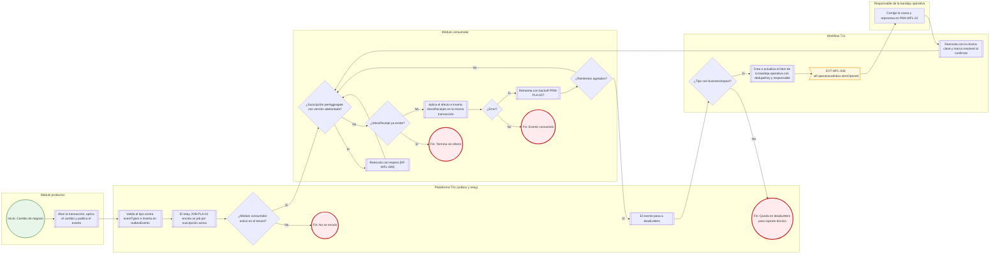

**Pasos del proceso** (actividad tomada del anexo; la columna RF/RN distingue lo citado en el paso de lo asociado por parámetro, permiso, evento o tema compartido).

| Paso | Carril | Actividad | RF/RN que aplican | EVT / JOB / PAN |
|---|---|---|---|---|
| 1 | Módulo productor | El servicio del módulo productor abre la transacción, aplica el cambio y llama a `publish(event, { session })`. T01 valida el tipo contra `eventTypes` (RF-WFL-002/003) e inserta en `outboxEvents`. | RF-WFL-002; asoc.: RF-WFL-004 | — |
| 2 | Plataforma T01 | El relay de T01 (JOB-PLA-01) encola un job en la cola del consumidor por cada suscripción activa (`eventSubscriptions`) con `jobId = <eventId>:<consumer>`. No encola si el módulo consumidor no está activo en el tenant. | asoc.: RF-WFL-007 | JOB-PLA-01 |
| 3 | Módulo consumidor | El handler corre con el contexto del evento. Si la suscripción es `perAggregate`, verifica que `aggregateVersion` sea la siguiente esperada; si es mayor, reencola con espera (RF-WFL-009). | RF-WFL-009; asoc.: RF-WFL-002 | — |
| 4 | Módulo consumidor | Aplica el efecto e inserta `inboxReceipts` en la misma transacción. Si ya existía, termina sin efecto. | asoc.: RF-WFL-008 | — |
| 5 | Workflow T11 | Ante un error, reintenta con backoff (PRM-PLA-027). Agotados los reintentos, el evento va a `deadLetters` (T01). Si el tipo tiene `businessImpact`, T11 crea u actualiza `operationalInboxItems` con `dedupeKey = <type>:<consumer>:<aggregateId>` y responsable (RN-WFL-004). | RN-WFL-004; asoc.: RF-WFL-010 | — |
| 6 | Responsable de la bandeja operativa | Desde la bandeja operativa (PAN-WFL-22), el usuario corrige la causa y reprocesa. T11 reencola por la API de T01 con la misma clave y marca `resolved` cuando el consumidor confirma. | asoc.: RF-WFL-011, RF-WFL-009 | PAN-WFL-22 |

**Situación actual en ProCoop (nota de cambio).** Las tareas en segundo plano de ProCoop corren en un servicio de Windows, temporizadores y colas de Azure para ARCA; pasan a jobs BullMQ con outbox (CTR-WFL-08, DEC-006). La propiedad del outbox se reparte entre T01 (mecánica) y T11 (contrato) (CTR-WFL-01).

**Excepciones**

| Excepción | Tratamiento |
|---|---|
| Caída del relay | Los eventos `pending` se entregan al volver (sondeo de respaldo). |
| Restauración del tenant (EVT-PLA-14) | Los consumidores con `restoreHooks` reconcilian. |
| Evento ya entregado | No se vuelve a entregar salvo replay explícito. |
| Entrega duplicada | El `inboxReceipt` hace que termine sin efecto. |

---

## 2. P-WFL-02 Programación de jobs por tenant

| Campo | Contenido |
|---|---|
| Fuente | T11 §9.2, `T11-WFL-workflow-eventos-documentos.md` (línea 1874) |
| Macroproceso | MP-08 Orquestación, workflow y documentos |
| Disparador | Despliegue de una versión; Activación o desactivación de un módulo en el tenant; Necesidad de cambiar una programación |
| Resultado | Job encolado; Reprogramación rechazada; Programación vigente |
| Carriles | Plataforma T01; Workflow T11; Administrador del tenant (T-ADM) |
| Roles de T02 | T-ADM Administrador de la cooperativa |
| Módulos involucrados | T01 Plataforma, T11 Workflow, eventos y documentos |
| Eventos (T11 §12) | EVT-PLA-06 `pla.capability.activated`; EVT-PLA-07 `pla.capability.deactivated`; EVT-WFL-047 `wfl.jobSchedule.changed` |
| Jobs | — |
| Relación con 04-procesos-bpmn.md | — |

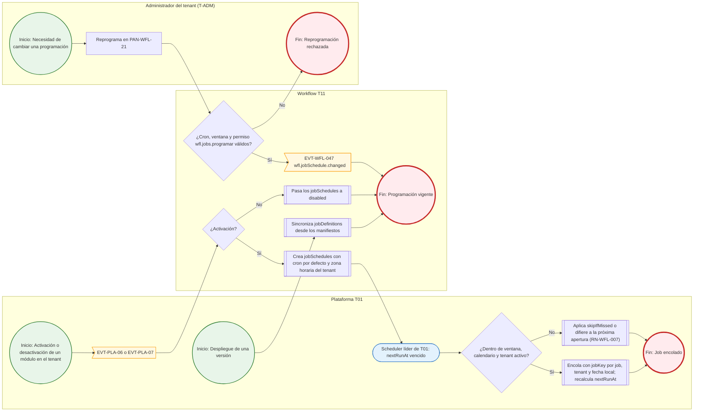

**Pasos del proceso** (actividad tomada del anexo; la columna RF/RN distingue lo citado en el paso de lo asociado por parámetro, permiso, evento o tema compartido).

| Paso | Carril | Actividad | RF/RN que aplican | EVT / JOB / PAN |
|---|---|---|---|---|
| 1 | Workflow T11 | Al desplegar, `jobDefinitions` se sincroniza desde los manifiestos. | asoc.: RF-WFL-020 | — |
| 2 | Workflow T11 | Al activar un módulo en un tenant (EVT-PLA-06), T11 crea `jobSchedules` con `defaultCron`, `timezone` del tenant y `status = active`. Al desactivarlo (EVT-PLA-07), pasan a `disabled`. | asoc.: RF-WFL-022 | EVT-PLA-06, EVT-PLA-07 |
| 3 | Plataforma T01 | El scheduler líder de T01 lee `jobSchedules` con `nextRunAt <= now`, verifica la ventana, el calendario y el estado del tenant, encola el job con `jobKey = <job>:<tenantId>:<fechaLocal>` y recalcula `nextRunAt` en la zona del tenant. | asoc.: RF-WFL-022 | — |
| 4 | Plataforma T01 | Si el disparo quedó fuera de ventana (caída, mantenimiento), aplica `skipIfMissed` o difiere a la próxima apertura (RN-WFL-007). | RN-WFL-007 | — |
| 5 | Administrador del tenant | Reprogramar (PAN-WFL-21) valida el cron, la ventana y el permiso `wfl.jobs.programar`, audita el cambio y emite EVT-WFL-047. | asoc.: RF-WFL-023 | PAN-WFL-21, EVT-WFL-047 |

**Situación actual en ProCoop (nota de cambio).** ProCoop programa tareas con un servicio de Windows y temporizadores; GoodApps usa `jobSchedules` por tenant y zona horaria sobre BullMQ (CTR-WFL-08).

**Excepciones**

| Excepción | Tratamiento |
|---|---|
| Disparo perdido por caída o mantenimiento | Se aplica `skipIfMissed` o se difiere a la próxima apertura de ventana (RN-WFL-007). |
| Doble disparo del mismo job y día | La `jobKey` por job, tenant y fecha local lo evita. |
| Cambio de programación | Se audita y emite EVT-WFL-047. |

---

## 3. P-WFL-03 Corrida masiva con excepciones (BASE §69, CU-LOT-01)

| Campo | Contenido |
|---|---|
| Fuente | T11 §9.3, `T11-WFL-workflow-eventos-documentos.md` (línea 1882) |
| Macroproceso | MP-08 Orquestación, workflow y documentos |
| Disparador | Necesidad de un proceso masivo |
| Resultado | Corrida no ejecutada; Corrida cerrada |
| Carriles | Módulo dueño de la corrida; Corridas masivas T11; Aprobadores; Responsables de excepciones (T-FAC, T-ATE u otros) |
| Roles de T02 | T-ATE Comercial / Atención al socio, T-FAC Facturación |
| Módulos involucrados | M06 Fiscal, T06 Integraciones, T11 Workflow, eventos y documentos |
| Eventos (T11 §12) | EVT-WFL-048 `wfl.bulkRun.completed`; EVT-FIS-21 `fis.authorization.globalFailure`; EVT-INT-04 `int.circuit.opened` |
| Jobs | — |
| Relación con 04-procesos-bpmn.md | P3 Facturación periódica y emisión fiscal ([§7](04-procesos-bpmn.md#7-p3--facturación-periódica-y-emisión-fiscal)) |

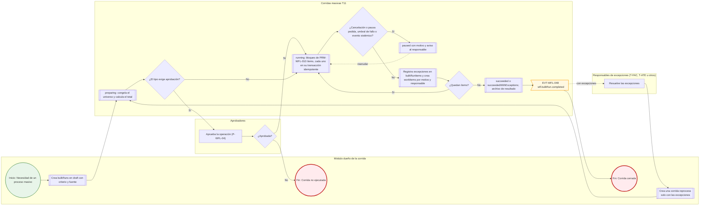

**Pasos del proceso** (actividad tomada del anexo; la columna RF/RN distingue lo citado en el paso de lo asociado por parámetro, permiso, evento o tema compartido).

| Paso | Carril | Actividad | RF/RN que aplican | EVT / JOB / PAN |
|---|---|---|---|---|
| 1 | Módulo dueño de la corrida | El módulo dueño crea `bulkRuns` en `draft` con criterio y fuente. | asoc.: RF-WFL-026 | — |
| 2 | Corridas masivas T11 | `preparing`: el job congela el universo (lista de ids y versión) y calcula `total`. | — | — |
| 3 | Aprobadores | Si el tipo exige aprobación (por ejemplo, `fac.billingRun.approveEmission`), se crea la operación y se espera `approved`. | — | — |
| 4 | Corridas masivas T11 | `running`: procesa en bloques de PRM-WFL-010 ítems. Cada ítem va en su transacción con idempotencia `<run>:<item>`; actualiza el progreso cada bloque y revisa `cancelRequested` y `pauseRequested`. | — | — |
| 5 | Corridas masivas T11 | Las excepciones se registran en `bulkRunItems` con `reasonCode`, `ownerModule` y `ownerRole`, y crean `workItems` agrupados por motivo y responsable. | asoc.: RF-WFL-130, RF-WFL-012 | — |
| 6 | Corridas masivas T11 | Umbral de fallo global (RN-WFL-011) o evento sistémico (`fis.authorization.globalFailure`, `int.circuit.opened`): `paused` con motivo; aviso al responsable. | RN-WFL-011; asoc.: RF-WFL-027 | EVT-FIS-21, EVT-INT-04 |
| 7 | Corridas masivas T11 | Fin: `succeeded` o `succeededWithExceptions`; archivo de resultado; EVT-WFL-048. | — | EVT-WFL-048 |
| 8 | Módulo dueño de la corrida | Reproceso: tras resolver las excepciones, se crea una corrida `reprocess` solo con ellas. Los ya procesados no se tocan. | asoc.: RF-WFL-028 | — |

**Situación actual en ProCoop (nota de cambio).** ProCoop no tiene motor de workflow (análisis de brechas §3.18).

**Excepciones**

| Excepción | Tratamiento |
|---|---|
| Umbral de fallo global (RN-WFL-011) | La corrida pasa a `paused` con motivo. |
| Evento sistémico (`fis.authorization.globalFailure`, `int.circuit.opened`) | Pausa automática y aviso al responsable. |
| Reproceso | Solo incluye las excepciones resueltas; los ítems ya procesados no se tocan (ejemplo CU-LOT-01: LOT-2026-00012 con 2 fallas reprocesadas en LOT-2026-00013). |

---

## 4. P-WFL-04 Operación sensible (MER-012)

| Campo | Contenido |
|---|---|
| Fuente | T11 §9.4, `T11-WFL-workflow-eventos-documentos.md` (línea 1895) |
| Macroproceso | MP-08 Orquestación, workflow y documentos |
| Disparador | Inicia una acción sensible, por ejemplo anular un recibo |
| Resultado | Operación rechazada; la entidad no cambió; Operación fallida en la bandeja operativa; Acción aplicada |
| Carriles | Usuario solicitante (por ejemplo T-CAJ); Módulo dueño; Workflow T11; Comunicaciones T09; Aprobadores (por ejemplo T-TES) |
| Roles de T02 | T-CAJ Cajero, T-TES Tesorero / Financiero (MT-006) |
| Módulos involucrados | M07 Cuenta corriente y cobranza, T09 Comunicaciones, T11 Workflow, eventos y documentos |
| Eventos (T11 §12) | EVT-WFL-001 `wfl.operation.submitted`; EVT-WFL-007 `wfl.approval.requested`; EVT-WFL-004 `wfl.operation.completed`; EVT-WFL-002 `wfl.operation.rejected`; EVT-COB-05 `cob.receipt.voided` |
| Jobs | JOB-WFL-01 `wfl:ejecutar-operacion`; JOB-WFL-02 `wfl:reparar-operaciones`; JOB-WFL-03 `wfl:conciliar-inciertas` |
| Relación con 04-procesos-bpmn.md | P4 Cobranza: caja, pasarelas, débito, rendición y depósito ([§8](04-procesos-bpmn.md#8-p4--cobranza-caja-pasarelas-débito-rendición-y-depósito)); P7 Compras y pago a proveedores ([§11](04-procesos-bpmn.md#11-p7--compras-y-pago-a-proveedores)) |

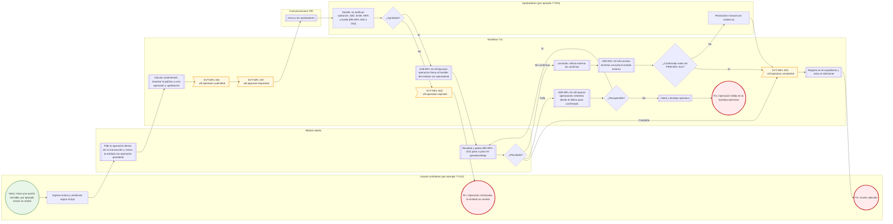

**Pasos del proceso** (actividad tomada del anexo; la columna RF/RN distingue lo citado en el paso de lo asociado por parámetro, permiso, evento o tema compartido).

| Paso | Carril | Actividad | RF/RN que aplican | EVT / JOB / PAN |
|---|---|---|---|---|
| 1 | Usuario solicitante | El usuario inicia la acción en la pantalla del módulo (por ejemplo, "Anular recibo"). La pantalla pide motivo y evidencia según el tipo. | — | — |
| 2 | Módulo dueño | El módulo llama a `wfl.operations.request` dentro de su transacción. T11 calcula `contentHash`, resuelve la política (regla según importe y riesgo), crea `operations` y `approvalRequests` y emite EVT-WFL-001 y EVT-WFL-007. El módulo marca la entidad como "con operación pendiente" (lectura) sin cambiar su estado de negocio. | — | EVT-WFL-001, EVT-WFL-007 |
| 3 | Aprobadores | Los aprobadores reciben `workItems` y aviso (T09). Cada decisión verifica `authorize()`, SoD, límite, MFA y huella (RN-WFL-040 a 043). | RN-WFL-040; asoc.: RF-WFL-130, RF-WFL-012 | — |
| 4 | Workflow T11 | Con `approved`, se encola `wfl:ejecutar-operacion` en la cola declarada por el tipo. El worker llama al handler del módulo con `operationId` como clave; el handler revalida y aplica (RN-WFL-024). | RN-WFL-024; asoc.: RF-WFL-043, RN-WFL-021 | JOB-WFL-01 |
| 5 | Workflow T11 | Si son varios pasos, cada uno se registra en `operationSteps` y se confirma de a uno. Ante una falla, `wfl:reparar-operaciones` reintenta desde el último confirmado; si no se puede, `failed` y bandeja operativa. | asoc.: RF-WFL-044 | JOB-WFL-02 |
| 6 | Workflow T11 | Con un efecto externo sin confirmar, el estado es `uncertain` y `wfl:conciliar-inciertas` consulta. Vencido PRM-WFL-012, la resolución es manual con evidencia. | asoc.: RF-WFL-046, RN-WFL-022 | JOB-WFL-03 |
| 7 | Workflow T11 | Al completar se emite EVT-WFL-004, se registra en el expediente del sujeto y se avisa al solicitante. | — | EVT-WFL-004 |

**Situación actual en ProCoop (nota de cambio).** En ProCoop el supervisor autoriza con su usuario y clave en la terminal del solicitante y la autoaprobación es posible (CTR-WFL-10). Ejemplo CU-29: la anulación de un recibo de ARS 18.450,00 exige un paso de T-TES distinto del cajero.

**Excepciones**

| Excepción | Tratamiento |
|---|---|
| La entidad cambió entre el pedido y la ejecución | El handler revalida (RN-WFL-024) y la huella `contentHash` invalida aprobaciones sobre otro contenido. |
| Autoaprobación | Prohibida (RN-WFL-040). |
| Efecto externo sin confirmar | Estado `uncertain`; vencido PRM-WFL-012, resolución manual con evidencia. |

---

## 5. P-WFL-05 Aprobación multinivel por monto con firma conjunta

| Campo | Contenido |
|---|---|
| Fuente | T11 §9.5, `T11-WFL-workflow-eventos-documentos.md` (línea 1907) |
| Macroproceso | MP-08 Orquestación, workflow y documentos |
| Disparador | OP de ARS 3.200.000 lista para aprobar |
| Resultado | OP rechazada o vencida; OP pagada |
| Carriles | Compras M12; Workflow T11; Responsable de compras (T-CMP); Gerencia (T-GER); Firmantes vigentes de M14; Tesorería M14; Firma digital T06 |
| Roles de T02 | T-CMP Compras, T-GER Gerente |
| Módulos involucrados | M12 Compras, M14 Tesorería, T06 Integraciones, T11 Workflow, eventos y documentos |
| Eventos (T11 §12) | EVT-WFL-010 `wfl.approval.decided`; EVT-CMP-11 `cmp.paymentOrder.approved` |
| Jobs | — |
| Relación con 04-procesos-bpmn.md | P7 Compras y pago a proveedores ([§11](04-procesos-bpmn.md#11-p7--compras-y-pago-a-proveedores)) |

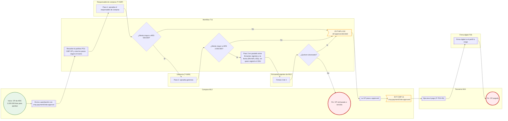

**Pasos del proceso** (actividad tomada del anexo; la columna RF/RN distingue lo citado en el paso de lo asociado por parámetro, permiso, evento o tema compartido).

| Paso | Carril | Actividad | RF/RN que aplican | EVT / JOB / PAN |
|---|---|---|---|---|
| 1 | Compras M12 | M12 envía la OP `OP-2026-000210` de ARS 3.200.000 a aprobación con `cmp.paymentOrder.approve`. | — | — |
| 2 | Workflow T11 | La política `POL-CMP-OP` tiene estas reglas: - hasta ARS 500.000: responsable de compras; - de ARS 500.000 a 2.000.000: responsable de compras y luego gerencia; - más de ARS 2.000.000: responsable de compras, luego gerencia y luego firma conjunta de 2 de 3 firmantes vigentes de M14. | — | — |
| 3 | Workflow T11 | T11 crea 3 pasos. Activa el paso 1; al aprobarse, el paso 2; al aprobarse, el paso 3 en paralelo con quórum 2 entre los firmantes vigentes a la fecha (RN-WFL-050). | RN-WFL-050 | — |
| 4 | Workflow T11 | Si el tesorero que registró el CBU es firmante, la SoD de T02 (`cmp.proveedores.datosBancarios.editar` ≠ quien paga) lo excluye. | — | — |
| 5 | Compras M12 | Con quórum, `wfl.approval.decided` (`approved`). M12 pasa la OP a `approved` y publica `cmp.paymentOrder.approved`. M14 ejecuta y, si el perfil lo exige, firma digital por T06. | — | EVT-WFL-010, EVT-CMP-11 |

**Situación actual en ProCoop (nota de cambio).** La autorización de ProCoop es puntual y en la misma terminal (CTR-WFL-10); los circuitos multipaso, por monto y con comité son de T11 (RF-IAM-096).

**Excepciones**

| Excepción | Tratamiento |
|---|---|
| Tesorero que registró el CBU del proveedor es firmante | La SoD de T02 lo excluye del paso de firma. |
| Firmante sin vigencia a la fecha | No cuenta para el quórum (RN-WFL-050). |
| Rechazo en cualquier paso | La OP no se aprueba. |

---

## 6. P-WFL-06 Trámite configurable iniciado por el socio

| Campo | Contenido |
|---|---|
| Fuente | T11 §9.6, `T11-WFL-workflow-eventos-documentos.md` (línea 1918) |
| Macroproceso | MP-08 Orquestación, workflow y documentos |
| Disparador | Elige Solicitud de tarifa social en Mis trámites |
| Resultado | Trámite rechazado con aviso; Tarifa social vigente; Beneficio vencido |
| Carriles | Socio (C-SOC); Workflow T11; Atención M09; Atención Comercial (T-ATE); Supervisor comercial (T-SAT); Tarifas M04 |
| Roles de T02 | C-SOC Socio titular, T-ATE Comercial / Atención al socio, T-SAT Supervisor de atención |
| Módulos involucrados | M04 Tarifas, M09 Atención, T11 Workflow, eventos y documentos |
| Eventos (T11 §12) | EVT-WFL-014 `wfl.instance.started`; EVT-WFL-019 `wfl.form.submitted`; EVT-TAR-014 `tar.enrollment.changed`; EVT-WFL-016 `wfl.instance.completed` |
| Jobs | — |
| Relación con 04-procesos-bpmn.md | — |

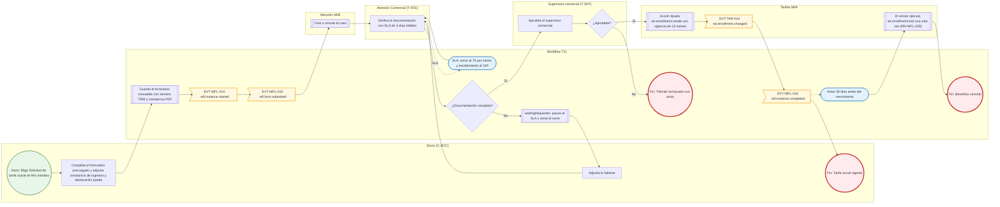

**Pasos del proceso** (actividad tomada del anexo; la columna RF/RN distingue lo citado en el paso de lo asociado por parámetro, permiso, evento o tema compartido).

| Paso | Carril | Actividad | RF/RN que aplican | EVT / JOB / PAN |
|---|---|---|---|---|
| 1 | Socio | El socio elige en "Mis trámites" la opción "Solicitud de tarifa social" (`WF-TAR-TARIFA-SOCIAL`). El formulario precarga los datos validados (RN-WFL-036) y pide la constancia de ingresos (tipo documental `DOC-INC-CONST`) y la declaración jurada. | RN-WFL-036 | — |
| 2 | Workflow T11 | Envío: `formSubmissions` inmutable, número `TRM-2026-000318` y constancia PDF (plantilla `TPL-CRM-02`). Se emite EVT-WFL-014 y EVT-WFL-019. M09 crea o vincula el caso, según la definición. | asoc.: RF-WFL-095 | EVT-WFL-014, EVT-WFL-019 |
| 3 | Atención Comercial | Nodo "Verificar documentación", asignado al área "Atención Comercial". El SLA es de 3 días hábiles. Al 75 % se avisa al responsable; al 100 % se escala al supervisor. | — | — |
| 4 | Socio | Si falta documentación, la instancia pasa a `waitingRequester` (pausa el SLA) y el socio recibe el aviso. Al adjuntar, se reanuda. | asoc.: RF-WFL-078 | — |
| 5 | Supervisor comercial | Nodo de aprobación del supervisor comercial. | — | — |
| 6 | Tarifas M04 | Acción tipada `tar.enrollment.create` (M04) con vigencia y vencimiento a 12 meses. Se espera el evento `tar.enrollment.changed`. | asoc.: RF-WFL-073 | EVT-TAR-014 |
| 7 | Workflow T11 | Fin `completed`. Al vencer el trámite, la acción `tar.enrollment.end` se ejecuta una sola vez (RN-WFL-035) y se avisa 30 días antes. | RN-WFL-035; asoc.: RF-WFL-075 | — |

**Situación actual en ProCoop (nota de cambio).** En ProCoop los trámites ejecutan scripts SQL configurables por tipo (`TRAMITES_ACCIONES`), que se eliminan (RN-MIG-048, análisis de brechas §3.18); GoodApps usa acciones tipadas del `actionCatalog` que llaman a la API del módulo dueño (CTR-WFL-09).

**Excepciones**

| Excepción | Tratamiento |
|---|---|
| Falta documentación | La instancia pasa a `waitingRequester` y el SLA se pausa hasta que el socio adjunta. |
| SLA vencido | Al 100 % se escala al supervisor. |
| Vencimiento del beneficio | La acción de fin se ejecuta una sola vez (RN-WFL-035). |

---

## 7. P-WFL-07 Tarea ad hoc recurrente (BASE §26)

| Campo | Contenido |
|---|---|
| Fuente | T11 §9.7, `T11-WFL-workflow-eventos-documentos.md` (línea 1928) |
| Macroproceso | MP-08 Orquestación, workflow y documentos |
| Disparador | Necesidad de un control periódico |
| Resultado | Ocurrencia cerrada |
| Carriles | Supervisor del área; Workflow T11; Área Atención Comercial (T-ATE) |
| Roles de T02 | T-ATE Comercial / Atención al socio |
| Módulos involucrados | T11 Workflow, eventos y documentos |
| Eventos (T11 §12) | EVT-WFL-023 `wfl.task.created`; EVT-WFL-026 `wfl.task.overdue`; EVT-WFL-025 `wfl.task.completed` |
| Jobs | JOB-WFL-10 `wfl:generar-tareas-recurrentes`; JOB-WFL-09 `wfl:recordatorios-tareas` |
| Relación con 04-procesos-bpmn.md | — |

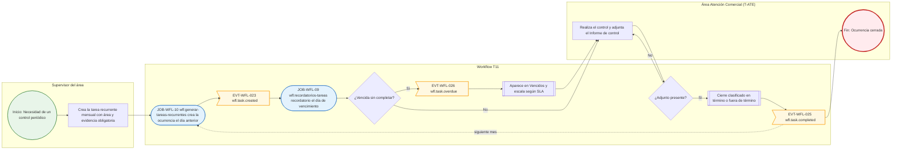

**Pasos del proceso** (actividad tomada del anexo; la columna RF/RN distingue lo citado en el paso de lo asociado por parámetro, permiso, evento o tema compartido).

| Paso | Carril | Actividad | RF/RN que aplican | EVT / JOB / PAN |
|---|---|---|---|---|
| 1 | Supervisor del área | El supervisor crea TAR-001 "Revisar padrón de tarifa social": - recurrencia `FREQ=MONTHLY;BYMONTHDAY=5`, en la zona del tenant; - asignada al área "Atención Comercial"; - evidencia obligatoria: un documento de tipo "Informe de control". | asoc.: RF-WFL-138 | — |
| 2 | Workflow T11 | `wfl:generar-tareas-recurrentes` crea cada ocurrencia el día anterior (`recurrence.seriesId` + `occurrenceDate`, única). | — | JOB-WFL-10 |
| 3 | Workflow T11 | Recordatorio el día de vencimiento (`wfl:recordatorios-tareas`). Si vence, aparece en "Vencidos" y escala según SLA. | — | JOB-WFL-09 |
| 4 | Área Atención Comercial | Completar exige el adjunto. El cierre se clasifica "en término" o "fuera de término". | — | — |

**Situación actual en ProCoop (nota de cambio).** ProCoop tiene actividades sin escalamiento y errores conocidos en su calendario (CTR-WFL-16); se corrigen y se migran con la corrección. El correo interno `PROMAIL` se reemplaza por comentarios y menciones (CTR-WFL-18).

**Excepciones**

| Excepción | Tratamiento |
|---|---|
| Ocurrencia duplicada | Es única por `recurrence.seriesId` y `occurrenceDate`. |
| Completar sin el adjunto | No se admite. |

---

## 8. P-WFL-08 Documento generado por plantilla

| Campo | Contenido |
|---|---|
| Fuente | T11 §9.8, `T11-WFL-workflow-eventos-documentos.md` (línea 1938) |
| Macroproceso | MP-08 Orquestación, workflow y documentos |
| Disparador | Documento a emitir |
| Resultado | Devuelve el mismo documento; Render rechazado; Documento accepted e inmutable |
| Carriles | Módulo dueño del documento; Plantillas y documentos T11; Archivos T01 |
| Roles de T02 | Solo actores del sistema (sin rol humano) |
| Módulos involucrados | T01 Plataforma, T11 Workflow, eventos y documentos |
| Eventos (T11 §12) | EVT-WFL-038 `wfl.render.failed`; EVT-WFL-037 `wfl.render.completed` |
| Jobs | JOB-WFL-11 `wfl:renderizar-documento`; JOB-WFL-12 `wfl:renderizar-lote` |
| Relación con 04-procesos-bpmn.md | P3 Facturación periódica y emisión fiscal ([§7](04-procesos-bpmn.md#7-p3--facturación-periódica-y-emisión-fiscal)) |

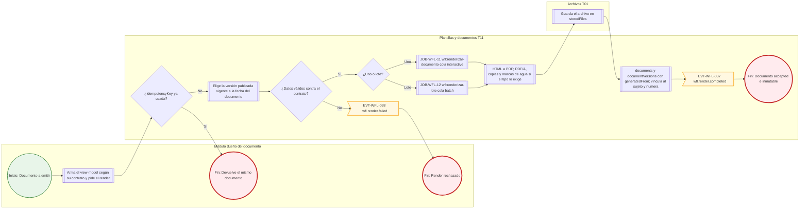

**Pasos del proceso** (actividad tomada del anexo; la columna RF/RN distingue lo citado en el paso de lo asociado por parámetro, permiso, evento o tema compartido).

| Paso | Carril | Actividad | RF/RN que aplican | EVT / JOB / PAN |
|---|---|---|---|---|
| 1 | Módulo dueño del documento | El módulo dueño arma el view-model según su contrato (por ejemplo, `fac.invoice.v3`) y llama a `wfl.templates.render`. | — | — |
| 2 | Plantillas y documentos T11 | T11 elige la versión publicada vigente a la fecha del documento, valida los datos contra el contrato y renderiza HTML → PDF (cola `interactive` si es uno; `batch` si es lote). Aplica PDF/A si el tipo lo exige, copias y marcas de agua. | — | — |
| 3 | Plantillas y documentos T11 | Guarda `storedFiles` (T01), `documents` y `documentVersions` con `generatedFrom`. Vincula al sujeto y numera si el tipo lo exige. | asoc.: RF-WFL-150 | — |
| 4 | Plantillas y documentos T11 | Idempotencia `renderRequests.idempotencyKey`: un reintento devuelve el mismo documento. | — | — |
| 5 | Plantillas y documentos T11 | Documento emitido: queda `accepted` e inmutable (RN-WFL-065). La reimpresión agrega una marca y un registro, pero no un documento nuevo. | RN-WFL-065 | — |

**Situación actual en ProCoop (nota de cambio).** ProCoop numera con `max + 1` y tablas de último número (CTR-WFL-14) y guarda archivos en una carpeta pública con sobrescritura por nombre (CTR-WFL-13); GoodApps usa contador atómico y repositorio privado con versionado inmutable.

**Excepciones**

| Excepción | Tratamiento |
|---|---|
| Reintento del mismo pedido | Devuelve el mismo documento por `renderRequests.idempotencyKey`. |
| Reimpresión | Agrega una marca y un registro, no un documento nuevo (RN-WFL-065). |

---

## 9. P-WFL-09 Firma electrónica de recibos de sueldo (FIC 15, DFA M20)

| Campo | Contenido |
|---|---|
| Fuente | T11 §9.9, `T11-WFL-workflow-eventos-documentos.md` (línea 1946) |
| Macroproceso | MP-08 Orquestación, workflow y documentos |
| Disparador | Recibos de sueldo emitidos |
| Resultado | Recibo firmado; Rechazo gestionado |
| Carriles | Sueldos M16; Firma T11; Proveedor de firma digital T06; Empleado (C-EMP); RRHH (T-RRHH) |
| Roles de T02 | C-EMP Empleado en portal, T-RRHH RRHH / Liquidador |
| Módulos involucrados | M16 Sueldos, T06 Integraciones, T11 Workflow, eventos y documentos |
| Eventos (T11 §12) | EVT-WFL-041 `wfl.signature.requested`, `wfl.signature.participantSigned`; EVT-WFL-042 `wfl.signature.completed`; EVT-SUE-15 `sue.payslip.acknowledged`; EVT-WFL-043 `wfl.signature.rejected` |
| Jobs | JOB-SUE-03 `sue:emitir-recibos-pdf`; JOB-WFL-18 `wfl:consultar-estado-firma`; JOB-WFL-19 `wfl:vencer-firmas`; JOB-SUE-04 `sue:firmar-recibos-empleador`; JOB-WFL-17 `wfl:enviar-a-firma`; JOB-SUE-06 `sue:consultar-estado-firma`; JOB-SUE-19 `sue:recordatorios-firma` |
| Relación con 04-procesos-bpmn.md | — |

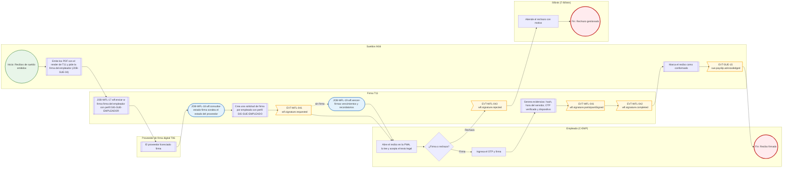

**Pasos del proceso** (actividad tomada del anexo; la columna RF/RN distingue lo citado en el paso de lo asociado por parámetro, permiso, evento o tema compartido).

| Paso | Carril | Actividad | RF/RN que aplican | EVT / JOB / PAN |
|---|---|---|---|---|
| 1 | Sueldos M16 | M16 emite los recibos (`sue:emitir-recibos-pdf` usa el render de T11) y pide a T11 la firma del empleador (JOB-SUE-04 llama a API-WFL-75; T11 la ejecuta con JOB-WFL-17). El perfil `SIG-SUE-EMPLEADOR` es firma digital con proveedor licenciado por T06 (DEC-078). | asoc.: RF-WFL-198 | JOB-SUE-04, JOB-WFL-17, JOB-SUE-03 |
| 2 | Firma T11 | Con la firma del empleador, T11 crea `signatureRequests` por empleado con el perfil `SIG-SUE-EMPLEADO` (electrónica, OTP por SMS o email). | — | — |
| 3 | Empleado | El empleado abre el recibo en la PWA, lo lee, acepta el texto legal, ingresa el OTP y firma. Se generan las evidencias (hash, hora del servidor, OTP verificado, dispositivo) y se emite EVT-WFL-041. | — | EVT-WFL-041 |
| 4 | Sueldos M16 | M16 recibe `wfl.signature.completed` y marca `sue.payslip.acknowledged`. Ante un rechazo con motivo, RRHH recibe una tarea. | — | EVT-WFL-042, EVT-SUE-15 |
| 5 | Firma T11 | `wfl:consultar-estado-firma` sondea los proveedores en firma digital. `wfl:vencer-firmas` aplica vencimientos y recordatorios. JOB-SUE-06 y JOB-SUE-19 de M16 se retiraron en favor de estos jobs (CTR-WFL-12). | — | JOB-SUE-06, JOB-SUE-19, JOB-WFL-18, JOB-WFL-19 |

**Situación actual en ProCoop (nota de cambio).** M16 tenía lógica de firma propia y la BASE preveía firma capturada en pantalla; DEC-078 centraliza la firma en T11 en tres niveles, con firma digital por proveedor licenciado para recibos de sueldo (CTR-WFL-12). El análisis de brechas (§3.18) registra la firma manuscrita actual.

**Excepciones**

| Excepción | Tratamiento |
|---|---|
| Rechazo del empleado con motivo | RRHH recibe una tarea. |
| Firma no realizada en plazo | JOB-WFL-19 aplica vencimientos y recordatorios. |
| Jobs propios de firma en M16 | JOB-SUE-06 y JOB-SUE-19 se retiraron en favor de los jobs de T11 (CTR-WFL-12). |

---

## 10. P-WFL-10 Conformidad de instalación en campo (BASE §73, DFA M14)

| Campo | Contenido |
|---|---|
| Fuente | T11 §9.10, `T11-WFL-workflow-eventos-documentos.md` (línea 1954) |
| Macroproceso | MP-08 Orquestación, workflow y documentos |
| Disparador | Instalación terminada |
| Resultado | Conformidad registrada; Negativa registrada |
| Carriles | Técnico de campo (T-TEC); PWA de campo con T11 local; Socio (C-SOC); Documentos T11; Técnica M10 |
| Roles de T02 | C-SOC Socio titular, T-TEC Técnico (campo) |
| Módulos involucrados | M10 Técnica y campo, T11 Workflow, eventos y documentos |
| Eventos (T11 §12) | EVT-TEC-15 `tec.conformity.signed`, `tec.conformity.refused` |
| Jobs | — |
| Relación con 04-procesos-bpmn.md | P1 Alta de socio y contratación de servicio ([§5](04-procesos-bpmn.md#5-p1--alta-de-socio-y-contratación-de-servicio)); P6 Reclamo y orden de trabajo ([§10](04-procesos-bpmn.md#10-p6--reclamo-y-orden-de-trabajo)) |

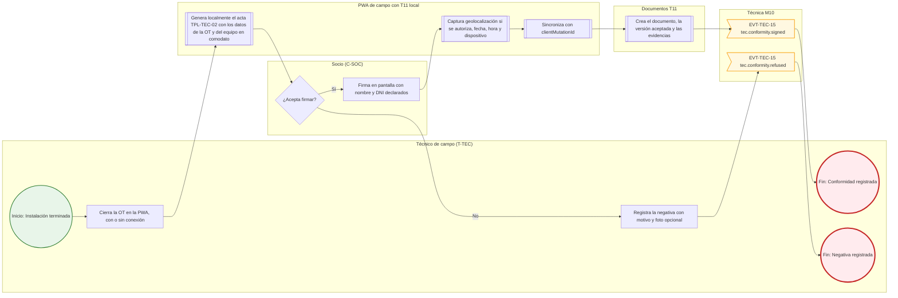

**Pasos del proceso** (actividad tomada del anexo; la columna RF/RN distingue lo citado en el paso de lo asociado por parámetro, permiso, evento o tema compartido).

| Paso | Carril | Actividad | RF/RN que aplican | EVT / JOB / PAN |
|---|---|---|---|---|
| 1 | Técnico de campo | El técnico cierra la OT en la PWA de campo (offline admitido). T11 genera el "Acta de conformidad de instalación" (`TPL-TEC-02`) localmente, con los datos de la OT y el equipo en comodato. | — | — |
| 2 | Socio | El socio firma en pantalla (manuscrita digitalizada) con nombre y DNI declarados. Se capturan geolocalización (si se autoriza), fecha y hora, y dispositivo. | asoc.: RF-WFL-196 | — |
| 3 | Documentos T11 | Al sincronizar (`clientMutationId`), se crean el documento, la versión aceptada y las evidencias. M10 publica `tec.conformity.signed`. | asoc.: RF-WFL-097 | EVT-TEC-15 |
| 4 | Técnico de campo | Si el socio se niega, se registra `tec.conformity.refused` con motivo y foto opcional. | — | EVT-TEC-15 |

**Situación actual en ProCoop (nota de cambio).** La conformidad en papel o manuscrita de ProCoop (análisis de brechas §3.18) se reemplaza por firma capturada en pantalla con evidencias (BASE §73, DEC-078).

**Excepciones**

| Excepción | Tratamiento |
|---|---|
| Sin conexión en el domicilio | El acta se genera y firma localmente; se sincroniza después con `clientMutationId`. |
| Socio que no autoriza la geolocalización | Se firma sin ese dato. |
| Negativa a firmar | Se registra con motivo y foto opcional. |

---

## 11. P-WFL-11 Retención y purga

| Campo | Contenido |
|---|---|
| Fuente | T11 §9.11, `T11-WFL-workflow-eventos-documentos.md` (línea 1961) |
| Macroproceso | MP-08 Orquestación, workflow y documentos |
| Disparador | Todos los días a las 03:00 hora del tenant |
| Resultado | Excluido de la purga; Sigue conservado; Solo se informa (RN-WFL-064); Documento purgado |
| Carriles | Documentos T11; Administrador del tenant (T-ADM); Archivos T01 |
| Roles de T02 | T-ADM Administrador de la cooperativa |
| Módulos involucrados | T01 Plataforma, T11 Workflow, eventos y documentos |
| Eventos (T11 §12) | EVT-WFL-032 `wfl.document.retentionExpired`, `wfl.document.purged` |
| Jobs | JOB-WFL-14 `wfl:aplicar-retencion`; JOB-WFL-15 `wfl:purgar-documentos` |
| Relación con 04-procesos-bpmn.md | — |

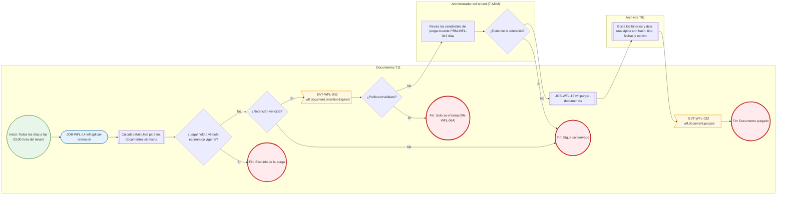

**Pasos del proceso** (actividad tomada del anexo; la columna RF/RN distingue lo citado en el paso de lo asociado por parámetro, permiso, evento o tema compartido).

| Paso | Carril | Actividad | RF/RN que aplican | EVT / JOB / PAN |
|---|---|---|---|---|
| 1 | Documentos T11 | `wfl:aplicar-retencion` (diario, 03:00 en la zona del tenant) calcula `retainUntil` para los documentos sin fecha y marca `retentionExpired` cuando vence. Excluye los que tienen legal hold o un vínculo económico vigente. | — | JOB-WFL-14 |
| 2 | Administrador del tenant | Los documentos vencidos quedan `PRM-WFL-043` días en "pendientes de purga", visibles para T-ADM, que puede extender la retención. | — | — |
| 3 | Documentos T11 | `wfl:purgar-documentos` borra los binarios por medio de T01, deja una lápida (hash, tipo, fechas, motivo) y emite EVT-WFL-032. | — | EVT-WFL-032, JOB-WFL-15 |
| 4 | Documentos T11 | Las políticas `toValidate` no purgan (RN-WFL-064): solo informan. | RN-WFL-064 | — |

**Situación actual en ProCoop (nota de cambio).** ProCoop borra archivos físicamente y los sobrescribe por nombre (CTR-WFL-13); GoodApps usa borrado lógico y purga solo por retención, con lápida.

**Excepciones**

| Excepción | Tratamiento |
|---|---|
| Documento con legal hold o vínculo económico vigente | No entra en la purga. |
| Política aún por validar (toValidate) | No purga; solo informa (RN-WFL-064). |

---

## 12. P-WFL-12 Expediente: consulta y exportación

| Campo | Contenido |
|---|---|
| Fuente | T11 §9.12, `T11-WFL-workflow-eventos-documentos.md` (línea 1968) |
| Macroproceso | MP-08 Orquestación, workflow y documentos |
| Disparador | Abre el expediente de un sujeto |
| Resultado | Consulta realizada; Expediente exportado y auditado |
| Carriles | Usuario con alcance sobre el sujeto; Expediente T11; Archivos T01 |
| Roles de T02 | Solo actores del sistema (sin rol humano) |
| Módulos involucrados | T01 Plataforma, T11 Workflow, eventos y documentos |
| Eventos (T11 §12) | EVT-WFL-045 `wfl.dossier.exported` |
| Jobs | JOB-WFL-16 `wfl:exportar-expediente` |
| Relación con 04-procesos-bpmn.md | — |

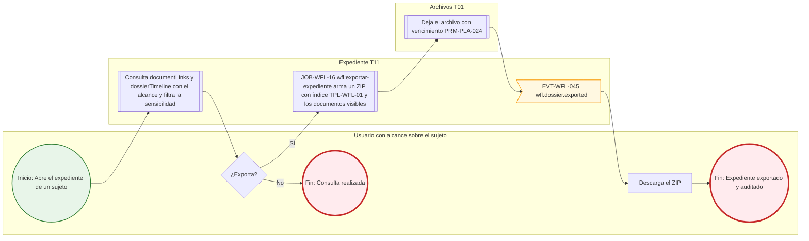

**Pasos del proceso** (actividad tomada del anexo; la columna RF/RN distingue lo citado en el paso de lo asociado por parámetro, permiso, evento o tema compartido).

| Paso | Carril | Actividad | RF/RN que aplican | EVT / JOB / PAN |
|---|---|---|---|---|
| 1 | Usuario con alcance sobre el sujeto | El usuario abre el expediente de un sujeto. T11 consulta `documentLinks` y `dossierTimeline` con el alcance del usuario y filtra la sensibilidad. | asoc.: RF-WFL-154 | — |
| 2 | Expediente T11 | Al exportar, se crea un job de clase `export` (`wfl:exportar-expediente`) que arma un ZIP con un PDF índice (plantilla `TPL-WFL-01`) y los documentos visibles. El job audita y deja el archivo con vencimiento (PRM-PLA-024). Se emite EVT-WFL-045. | asoc.: RF-WFL-213 | EVT-WFL-045, JOB-WFL-16 |

**Situación actual en ProCoop (nota de cambio).** No relevada en el anexo ni en T07 o en el análisis de brechas (`15-analisis-brechas-procoop.md`).

**Excepciones**

| Excepción | Tratamiento |
|---|---|
| Documentos fuera del alcance o de sensibilidad mayor | No se muestran ni se exportan. |
| Archivo vencido | Se genera una nueva exportación. |

---

## 13. P-WFL-13 Mesa de entradas coordinada (MER-016, DFA M21)

| Campo | Contenido |
|---|---|
| Fuente | T11 §9.13, `T11-WFL-workflow-eventos-documentos.md` (línea 1973) |
| Macroproceso | MP-08 Orquestación, workflow y documentos |
| Disparador | Ingresa documentación externa |
| Resultado | Expediente cerrado |
| Carriles | Operador de mesa de entradas de M09 (T-ATE); Expediente T11; Área destino del pase |
| Roles de T02 | T-ATE Comercial / Atención al socio |
| Módulos involucrados | M09 Atención, T11 Workflow, eventos y documentos |
| Eventos (T11 §12) | EVT-WFL-044 `wfl.dossier.opened`, `wfl.dossier.closed` |
| Jobs | — |
| Relación con 04-procesos-bpmn.md | — |

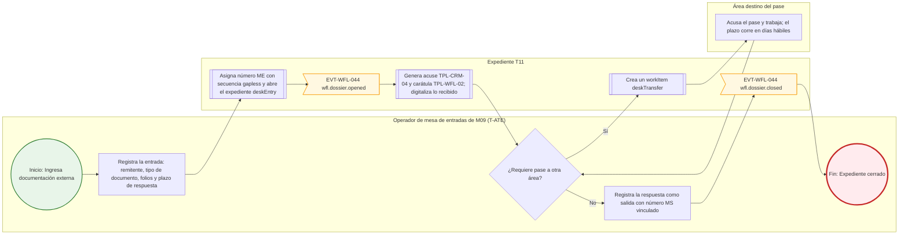

**Pasos del proceso** (actividad tomada del anexo; la columna RF/RN distingue lo citado en el paso de lo asociado por parámetro, permiso, evento o tema compartido).

| Paso | Carril | Actividad | RF/RN que aplican | EVT / JOB / PAN |
|---|---|---|---|---|
| 1 | Operador de mesa de entradas de M09 | El operador de M09 registra la entrada (`crmCases.kind = deskEntry`): remitente, tipo de documento, folios y plazo de respuesta. | — | — |
| 2 | Expediente T11 | T11 asigna el número `ME-2026-000045` (secuencia `gapless`), abre `dossiers` (kind `deskEntry`), genera el acuse (`TPL-CRM-04`) y la carátula (`TPL-WFL-02`) y digitaliza los documentos recibidos. | — | — |
| 3 | Área destino del pase | Cada pase a otra área crea un `workItem` de tipo `deskTransfer` que el área destino debe acusar; el plazo de respuesta corre en días hábiles. | asoc.: RF-WFL-221 | — |
| 4 | Operador de mesa de entradas de M09 | La respuesta se registra como salida con su número (`MS-2026-000019`) vinculado. Al cerrar, el expediente queda `closed`. | — | — |

**Situación actual en ProCoop (nota de cambio).** M09 cubre la mesa de entradas como caso; T11 aporta numeración, expediente, acuse, carátula y pases (CTR-WFL-21). La numeración `max + 1` de ProCoop se reemplaza por contador atómico (CTR-WFL-14).

**Excepciones**

| Excepción | Tratamiento |
|---|---|
| Pase no acusado por el área destino | El plazo corre en días hábiles y escala según SLA. |
| Numeración | Secuencia sin huecos (`gapless`). |

---

## 14. P-WFL-14 Proyección de la bandeja

| Campo | Contenido |
|---|---|
| Fuente | T11 §9.14, `T11-WFL-workflow-eventos-documentos.md` (línea 1980) |
| Macroproceso | MP-08 Orquestación, workflow y documentos |
| Disparador | Evento de una fuente de la bandeja |
| Resultado | Evento descartado; Bandeja y contadores exactos |
| Carriles | Módulos fuente; Bandeja T11; Usuario de la bandeja |
| Roles de T02 | Solo actores del sistema (sin rol humano) |
| Módulos involucrados | M03 Medición, M09 Atención, M10 Técnica y campo, T11 Workflow, eventos y documentos |
| Eventos (T11 §12) | EVT-CRM-04 `crm.case.assigned`; EVT-TEC-05 `tec.workOrder.statusChanged`; EVT-TEC-13 `tec.visit.statusChanged`; EVT-MED-28 `med.syncConflict.raised` |
| Jobs | JOB-WFL-06 `wfl:proyectar-bandeja`; JOB-WFL-07 `wfl:recalcular-vencimientos-bandeja`; JOB-WFL-08 `wfl:reconstruir-proyecciones` |
| Relación con 04-procesos-bpmn.md | — |

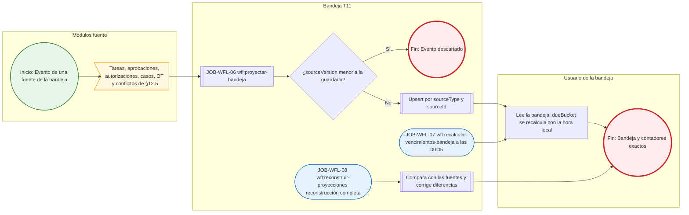

**Pasos del proceso** (actividad tomada del anexo; la columna RF/RN distingue lo citado en el paso de lo asociado por parámetro, permiso, evento o tema compartido).

| Paso | Carril | Actividad | RF/RN que aplican | EVT / JOB / PAN |
|---|---|---|---|---|
| 1 | Bandeja T11 | `wfl:proyectar-bandeja` consume los eventos de las fuentes (§12.5): `wfl.task.*`, `wfl.approval.*`, `iam.authorization.*`, `crm.case.assigned`/`statusChanged`, `tec.workOrder.statusChanged`, `tec.visit.statusChanged`, `fac.billingException.*`, `crm.activityOccurrence.*`, `tec.syncConflict.*`, `stk.fieldConflict.*`, `med.syncConflict.raised`, `wfl.signature.*` y `wfl.operationalInbox.*`. | — | JOB-WFL-06, EVT-CRM-04, EVT-TEC-05, EVT-TEC-13, EVT-MED-28 |
| 2 | Bandeja T11 | Hace un upsert por (`sourceType`, `sourceId`) y descarta los eventos con `sourceVersion` menor a la guardada. | — | — |
| 3 | Bandeja T11 | La lectura recalcula `dueBucket` con la hora local. `wfl:recalcular-vencimientos-bandeja` lo hace en bloque a las 00:05 para que los contadores sean exactos. | — | JOB-WFL-07 |
| 4 | Bandeja T11 | La reconstrucción completa (`wfl:reconstruir-proyecciones`) compara los resultados con las fuentes y corrige las diferencias. | asoc.: RF-WFL-012 | JOB-WFL-08 |

**Situación actual en ProCoop (nota de cambio).** ProCoop no tiene motor de workflow (análisis de brechas §3.18).

**Excepciones**

| Excepción | Tratamiento |
|---|---|
| Eventos fuera de orden | Se descartan los de `sourceVersion` menor a la guardada. |
| Proyección desalineada | La reconstrucción completa corrige las diferencias. |

---

## 15. P-WFL-15 Reasignación por baja o licencia

| Campo | Contenido |
|---|---|
| Fuente | T11 §9.15, `T11-WFL-workflow-eventos-documentos.md` (línea 1987) |
| Macroproceso | MP-08 Orquestación, workflow y documentos |
| Disparador | Pertenencia suspendida o revocada; Baja o licencia aprobada |
| Resultado | Trabajo sin huérfanos |
| Carriles | Identidad T02; Sueldos M16; Workflow T11; Supervisor del área |
| Roles de T02 | Solo actores del sistema (sin rol humano) |
| Módulos involucrados | M16 Sueldos, T02 Identidad y roles, T11 Workflow, eventos y documentos |
| Eventos (T11 §12) | EVT-IAM-03 `iam.membership.suspended`, `iam.membership.revoked`; EVT-SUE-03 `sue.employee.terminated`; EVT-SUE-08 `sue.leave.approved`; EVT-WFL-027 `wfl.workItem.reassigned` |
| Jobs | JOB-WFL-29 `wfl:reasignar-huerfanos` |
| Relación con 04-procesos-bpmn.md | — |

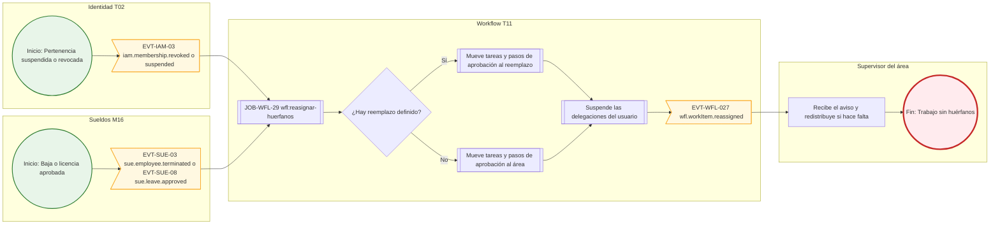

**Pasos del proceso** (actividad tomada del anexo; la columna RF/RN distingue lo citado en el paso de lo asociado por parámetro, permiso, evento o tema compartido).

| Paso | Carril | Actividad | RF/RN que aplican | EVT / JOB / PAN |
|---|---|---|---|---|
| 1 | Workflow T11 | Los eventos `iam.membership.suspended`/`revoked` (EVT-IAM-03), `sue.employee.terminated` (EVT-SUE-03) y `sue.leave.approved` (EVT-SUE-08, con vigencia) disparan `wfl:reasignar-huerfanos` (JOB-WFL-29). | asoc.: RN-WFL-037, RF-WFL-079 | EVT-IAM-03, EVT-SUE-03, EVT-SUE-08, JOB-WFL-29 |
| 2 | Workflow T11 | Mueve las tareas y los pasos de aprobación del usuario a su área o al reemplazo definido. | — | — |
| 3 | Workflow T11 | Suspende sus delegaciones. | — | — |
| 4 | Supervisor del área | Avisa al supervisor. | — | — |
| 5 | Workflow T11 | Publica EVT-WFL-027. | — | EVT-WFL-027 |

**Situación actual en ProCoop (nota de cambio).** No relevada en el anexo ni en T07 o en el análisis de brechas (`15-analisis-brechas-procoop.md`).

**Excepciones**

| Excepción | Tratamiento |
|---|---|
| Licencia con vigencia | La reasignación aplica durante la vigencia de `sue.leave.approved`. |
| Baja que dispara IAM y Sueldos a la vez | Llegan EVT-SUE-03 y EVT-IAM-03 (este último desde P-IAM-26); el anexo no indica cómo se evita la doble reasignación. |

---

## Inconsistencias detectadas en la especificación (esta parte)

No se detectaron inconsistencias en los procesos de esta parte.

## Cobertura de esta parte

| Universo de la parte | Diagramados | Pendientes |
|---|---|---|
| 15 (P-WFL-01 a P-WFL-15) | 15 | 0 |
