# GoodApps Cooperativas

## Procesos de negocio — Socio, servicios y contratación (M01, M02, M11)

**Entregable de Análisis y Diseño Detallado — Artefacto 2.1 (Procesos de negocio BPMN). Parte de [`04-procesos-bpmn.md`](04-procesos-bpmn.md).**

| Dato | Valor |
|---|---|
| Documento | Diagramas BPMN, pasos, situación actual en ProCoop y excepciones de los procesos PRC-PER-01 a PRC-VEN-01, derivados de la sección 9 de M01, M02, M11 |
| Carácter | Derivado de la especificación vigente; no la reemplaza. Ante diferencias prevalecen la maestra `00`, los anexos, T05, T11 y el registro de decisiones `01` |
| Generación | Script `_trabajo/generar_bpmn.py` con la ampliación `_trabajo/generar_prc.py` (derivación automática desde el texto de la sección 9 de cada anexo, `_trabajo/prc_auto.py`) |
| Versión | 1.1 (regenerada contra la especificación corregida) |
| Fecha | 05-11-2026 |

**Cómo leer cada proceso.** La notación es la de [`04-procesos-bpmn.md` §3](04-procesos-bpmn.md#3-notación-equivalencia-mermaid--bpmn) (carriles, eventos de inicio y fin, tareas de usuario y de servicio, compuertas XOR y AND, eventos de dominio como banderas, temporizadores y jobs como estadios). La tabla de pasos reproduce la actividad del anexo; en la columna RF/RN, los identificadores sin prefijo son los que el anexo cita en el paso y los marcados "asoc." son reglas o requisitos del mismo anexo que comparten parámetro, permiso, evento o tema con el paso (asociación generada por el script y revisada). Los eventos se nombran con su ID del catálogo de T11 §12.

**Derivación automática (v1.2).** Los procesos `PRC-<MOD>-nn` de esta parte se generaron con `_trabajo/generar_prc.py` y `_trabajo/prc_auto.py` a partir del texto de cada subsección §9.n del anexo, sin curaduría paso a paso (a diferencia de los 94 procesos `P-XXX-nn` de las partes 04b a 04i). Reglas: (1) los pasos son los numerados o viñetas del anexo; si la subsección es prosa, se parte por flechas o por oraciones; si es una tabla de pasos o de jobs, cada fila es un paso; (2) el carril de cada paso es el primer actor nombrado al comienzo del paso (rol de T02 §4, otro módulo, sistema externo, dispositivo o job); si no se nombra ninguno, el paso es del sistema del módulo dueño; (3) los pasos que empiezan con "Si …" se dibujan como compuerta XOR; (4) los eventos son los nombres del catálogo de T11 §12 citados en el paso (bandera entrante si el paso los consume, saliente si los publica); el temporizador aparece cuando el título nombra un job periódico; (5) las excepciones son las oraciones del anexo con condición o con palabras de falla, rechazo, vencimiento, duplicado o umbral, más la política de recuperación del anexo; (6) la nota ProCoop combina lo que dice el propio anexo, la fila `CTR-` del anexo que contrasta con ProCoop y la fila de `15-analisis-brechas-procoop.md` §3 de mayor afinidad; si ninguna alcanza el umbral, la nota lo dice y remite al contraste del dominio en esa sección. La revisión manual de una muestra está en `_trabajo/prc_revision.md`; ante diferencias, prevalece el texto del anexo citado en la ficha.

## Índice de procesos de esta parte

1. [PRC-PER-01 Alta de persona con búsqueda de coincidencias (CU-03, RF-PER-001..003)](#1-prc-per-01-alta-de-persona-con-búsqueda-de-coincidencias-cu-03-rf-per-001003)
2. [PRC-PER-02 Alta de titular y cuenta (RF-PER-040, RF-PER-055)](#2-prc-per-02-alta-de-titular-y-cuenta-rf-per-040-rf-per-055)
3. [PRC-PER-03 Validación de domicilio y geocodificación (BASE §77; CU-GEO-01)](#3-prc-per-03-validación-de-domicilio-y-geocodificación-base-77-cu-geo-01)
4. [PRC-PER-04 Alta y uso de inmueble y punto de prestación (RF-PER-086..098)](#4-prc-per-04-alta-y-uso-de-inmueble-y-punto-de-prestación-rf-per-086098)
5. [PRC-PER-05 Relaciones, representaciones y autorizaciones (AGR-007; RF-PER-099..108)](#5-prc-per-05-relaciones-representaciones-y-autorizaciones-agr-007-rf-per-099108)
6. [PRC-PER-06 Bloqueos (RF-PER-124..128)](#6-prc-per-06-bloqueos-rf-per-124128)
7. [PRC-PER-07 Cambio de titularidad (BASE §4; CU-TIT-01; RF-PER-132..141)](#7-prc-per-07-cambio-de-titularidad-base-4-cu-tit-01-rf-per-132141)
8. [PRC-PER-08 Mudanza o traslado (CU-04)](#8-prc-per-08-mudanza-o-traslado-cu-04)
9. [PRC-PER-09 Fallecimiento (RF-PER-009; PA-PER-08)](#9-prc-per-09-fallecimiento-rf-per-009-pa-per-08)
10. [PRC-PER-10 Detección de duplicados y fusión (RF-PER-155..158)](#10-prc-per-10-detección-de-duplicados-y-fusión-rf-per-155158)
11. [PRC-PER-11 Vinculación usuario–persona (REG-001; DEC-043)](#11-prc-per-11-vinculación-usuariopersona-reg-001-dec-043)
12. [PRC-CAT-01 Lanzar un servicio en un tenant (CU-05, CU-CAT-01)](#12-prc-cat-01-lanzar-un-servicio-en-un-tenant-cu-05-cu-cat-01)
13. [PRC-CAT-02 Alta de contrato — piloto Internet (CU-PRO-01, CU-SOL-01 en lo que toca al contrato)](#13-prc-cat-02-alta-de-contrato--piloto-internet-cu-pro-01-cu-sol-01-en-lo-que-toca-al-contrato)
14. [PRC-CAT-03 Suspensión, reactivación y baja (CU-CIC-01 en lo que toca al contrato)](#14-prc-cat-03-suspensión-reactivación-y-baja-cu-cic-01-en-lo-que-toca-al-contrato)
15. [PRC-CAT-04 Cambio de plan y de categoría](#15-prc-cat-04-cambio-de-plan-y-de-categoría)
16. [PRC-CAT-05 Transferencia de servicio (RN-06 §7)](#16-prc-cat-05-transferencia-de-servicio-rn-06-7)
17. [PRC-CAT-06 Copia de servicio entre tenants (CU-COP-01)](#17-prc-cat-06-copia-de-servicio-entre-tenants-cu-cop-01)
18. [PRC-CAT-07 Altas automáticas (RN-06 §3.5)](#18-prc-cat-07-altas-automáticas-rn-06-35)
19. [PRC-CAT-08 Trámites masivos y recategorización](#19-prc-cat-08-trámites-masivos-y-recategorización)
20. [PRC-VEN-01 Cargo de instalación del piloto Internet (O4)](#20-prc-ven-01-cargo-de-instalación-del-piloto-internet-o4)

---

## 1. PRC-PER-01 Alta de persona con búsqueda de coincidencias (CU-03, RF-PER-001..003)

| Campo | Contenido |
|---|---|
| Fuente | M01 §9.1, `M01-PER-personas-titulares-cuentas.md` (línea 1266) |
| Macroproceso | MP-09 Socio, servicios y contratación |
| Disparador | Alta de persona con búsqueda de coincidencias |
| Resultado | Asíncrono: JOB-PER-01 (ARCA) si hay CUIT/CUIL y la política lo… |
| Carriles | Comercial / Atención al socio (T-ATE); M01 Personas (sistema) |
| Roles de T02 | T-ATE Comercial / Atención al socio |
| Módulos involucrados | M01 Personas |
| Eventos (T11 §12) | EVT-PER-01 `per.person.created` |
| Jobs | JOB-PER-01 `per:verificar-cuit-arca`; JOB-PER-02 `per:geocodificar-domicilios` |
| Relación con 04-procesos-bpmn.md | P1 Alta de socio y contratación de servicio ([§5](04-procesos-bpmn.md#5-p1--alta-de-socio-y-contratación-de-servicio)) |

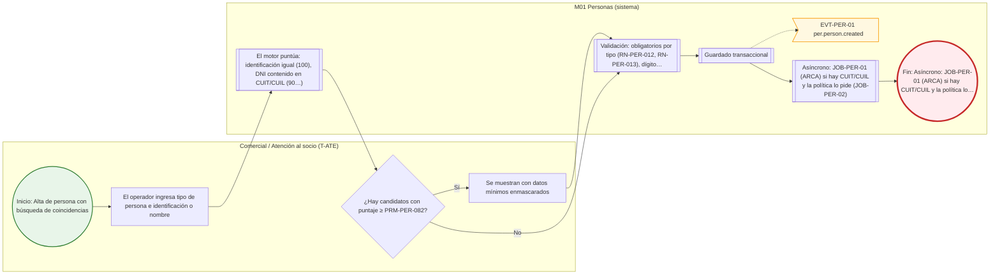

**Pasos del proceso** (actividad tomada del anexo; la columna RF/RN distingue lo citado en el paso de lo asociado por parámetro, permiso, evento o tema compartido).

| Paso | Carril | Actividad | RF/RN que aplican | EVT / JOB / PAN |
|---|---|---|---|---|
| 1 | Comercial / Atención al socio | El operador ingresa tipo de persona e identificación o nombre. La pantalla llama a `API-PER-03` (coincidencias) con lo escrito. | — | — |
| 2 | M01 Personas | El motor puntúa: identificación igual (100), DNI contenido en CUIT/CUIL (90, RN-PER-011), apellido y nombre fonético + fecha de nacimiento (70), contacto normalizado igual (50), mismo domicilio (20). Nunca consulta otros tenants (RN-PER-002). | RN-PER-002, RN-PER-011; asoc.: RF-PER-155 | — |
| 3 | Comercial / Atención al socio | Si hay candidatos con puntaje ≥ PRM-PER-082, se muestran con datos mínimos enmascarados; el operador elige "usar esta persona" o "es otra persona" con motivo (queda en `duplicateCases` como `dismissed`). | asoc.: RN-PER-113 | — |
| 4 | M01 Personas | Validación: obligatorios por tipo (RN-PER-012, RN-PER-013), dígito verificador (RN-PER-007), unicidad (RN-PER-005), política de contactos (RN-PER-019). | RN-PER-005, RN-PER-007, RN-PER-012, RN-PER-013, RN-PER-019 | — |
| 5 | M01 Personas | Guardado transaccional: `persons` + `personIdentifierIndex` + `perRevisions` revisión 1 + outbox `per.person.created`. | asoc.: RN-PER-111 | EVT-PER-01 |
| 6 | M01 Personas | Asíncrono: JOB-PER-01 (ARCA) si hay CUIT/CUIL y la política lo pide; JOB-PER-02 (geocodificación) si hay domicilio. | — | JOB-PER-01, JOB-PER-02 |

**Situación actual en ProCoop (nota de cambio).** Sin contraste específico para este proceso en el anexo (filas `CTR-` con ProCoop) ni en el análisis de brechas. El contraste del dominio está en `15-analisis-brechas-procoop.md` §3.4.

**Excepciones**

| Excepción | Tratamiento |
|---|---|
| Si hay candidatos con puntaje ≥ PRM-PER-082 | se muestran con datos mínimos enmascarados; el operador elige "usar esta persona" o "es otra persona" con motivo (queda en `duplicateCases` como `dismissed`) |
| Falla técnica en un paso automático, un job o una integración | Reintento idempotente y reanudable; lo no reparable pasa a la bandeja técnica con responsable (política de recuperación de T11 P-WFL-01 y T01 §9.12; AGR-016). |

---

## 2. PRC-PER-02 Alta de titular y cuenta (RF-PER-040, RF-PER-055)

| Campo | Contenido |
|---|---|
| Fuente | M01 §9.2, `M01-PER-personas-titulares-cuentas.md` (línea 1275) |
| Macroproceso | MP-09 Socio, servicios y contratación |
| Disparador | Alta de titular y cuenta |
| Resultado | Outbox: per.holder.created, per.account.created |
| Carriles | Comercial / Atención al socio (T-ATE); M01 Personas (sistema) |
| Roles de T02 | T-ATE Comercial / Atención al socio |
| Módulos involucrados | M01 Personas |
| Eventos (T11 §12) | EVT-PER-09 `per.holder.created`; EVT-PER-11 `per.account.created` |
| Jobs | — |
| Relación con 04-procesos-bpmn.md | P1 Alta de socio y contratación de servicio ([§5](04-procesos-bpmn.md#5-p1--alta-de-socio-y-contratación-de-servicio)) |

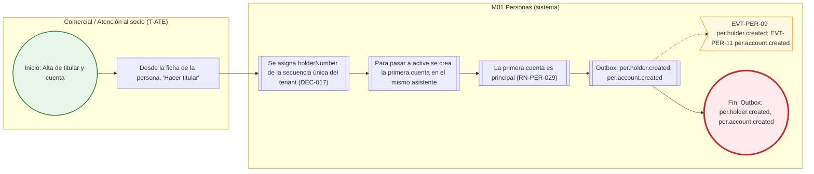

**Pasos del proceso** (actividad tomada del anexo; la columna RF/RN distingue lo citado en el paso de lo asociado por parámetro, permiso, evento o tema compartido).

| Paso | Carril | Actividad | RF/RN que aplican | EVT / JOB / PAN |
|---|---|---|---|---|
| 1 | Comercial / Atención al socio | Desde la ficha de la persona, "Hacer titular": se valida que no tenga otra titularidad abierta. | — | — |
| 2 | M01 Personas | Se asigna `holderNumber` de la secuencia única del tenant (DEC-017; manual con PRM-PER-004 solo en migración) y estado `applicant` o `active`. | asoc.: RF-PER-041, RN-PER-027 | — |
| 3 | M01 Personas | Para pasar a `active` se crea la primera cuenta en el mismo asistente: domicilio postal, condición IVA (si exige CUIT, se valida RN-PER-008), empresa postal, zona/sector/recorrido de reparto, distrito y sección, grupo contable y conjunto según políticas (RN-PER-052), contactos y factura electrónica (RN-PER-048). | RN-PER-008, RN-PER-048, RN-PER-052; asoc.: RF-PER-072, RF-PER-060 | — |
| 4 | M01 Personas | La primera cuenta es principal (RN-PER-029). Se crea nota de sistema "Nueva cuenta" (RN-PER-043). | RN-PER-029, RN-PER-043 | — |
| 5 | M01 Personas | Outbox: `per.holder.created`, `per.account.created`. M04 puede generar cargos de alta (RN-PER-126); M02 puede crear altas automáticas (RN-PER-125); M17 puede iniciar asociación si la política lo indica (RN-PER-038). | RN-PER-038, RN-PER-125, RN-PER-126; asoc.: RF-PER-172 | EVT-PER-09, EVT-PER-11 |

**Situación actual en ProCoop (nota de cambio).** Análisis de brechas (`15-analisis-brechas-procoop.md` §3.4, Personas): hoy Numeración de titulares propia de cada instalación; en GoodApps, secuencia única por cooperativa con atributo de tipo; número manual solo en la migración (brecha "Cambia"; fuente DEC-017).

**Excepciones**

| Excepción | Tratamiento |
|---|---|
| Falla técnica en un paso automático, un job o una integración | Reintento idempotente y reanudable; lo no reparable pasa a la bandeja técnica con responsable (política de recuperación de T11 P-WFL-01 y T01 §9.12; AGR-016). |

---

## 3. PRC-PER-03 Validación de domicilio y geocodificación (BASE §77; CU-GEO-01)

| Campo | Contenido |
|---|---|
| Fuente | M01 §9.3, `M01-PER-personas-titulares-cuentas.md` (línea 1283) |
| Macroproceso | MP-09 Socio, servicios y contratación |
| Disparador | Validación de domicilio y geocodificación |
| Resultado | Cada cambio deja un addressGeoEvents. |
| Carriles | M01 Personas (sistema); Comercial / Atención al socio (T-ATE) |
| Roles de T02 | T-ATE Comercial / Atención al socio |
| Módulos involucrados | M01 Personas |
| Eventos (T11 §12) | — |
| Jobs | JOB-PER-02 `per:geocodificar-domicilios` |
| Relación con 04-procesos-bpmn.md | P1 Alta de socio y contratación de servicio ([§5](04-procesos-bpmn.md#5-p1--alta-de-socio-y-contratación-de-servicio)) |

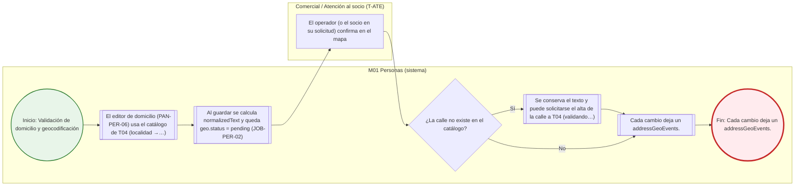

**Pasos del proceso** (actividad tomada del anexo; la columna RF/RN distingue lo citado en el paso de lo asociado por parámetro, permiso, evento o tema compartido).

| Paso | Carril | Actividad | RF/RN que aplican | EVT / JOB / PAN |
|---|---|---|---|---|
| 1 | M01 Personas | El editor de domicilio (PAN-PER-06) usa el catálogo de T04 (localidad → calles → barrio) y sugerencias del proveedor (PRM-PER-101). | — | PAN-PER-06 |
| 2 | M01 Personas | Al guardar se calcula `normalizedText` y queda `geo.status = pending`; JOB-PER-02 busca candidato y lo deja en `candidate` o `unavailable`. | — | JOB-PER-02 |
| 3 | Comercial / Atención al socio | El operador (o el socio en su solicitud) confirma en el mapa; la corrección manual exige motivo (RN-PER-068). | RN-PER-068 | — |
| 4 | M01 Personas | Si la calle no existe en el catálogo, se conserva el texto y puede solicitarse el alta de la calle a T04 (validando el permiso, V2 2309, PRM-PER-090); nunca se elige una calle homónima (RN-PER-069). | RN-PER-069 | — |
| 5 | M01 Personas | Cada cambio deja un `addressGeoEvents`. | — | — |

**Situación actual en ProCoop (nota de cambio).** Sin contraste específico para este proceso en el anexo (filas `CTR-` con ProCoop) ni en el análisis de brechas. El contraste del dominio está en `15-analisis-brechas-procoop.md` §3.4.

**Excepciones**

| Excepción | Tratamiento |
|---|---|
| Si la calle no existe en el catálogo | se conserva el texto y puede solicitarse el alta de la calle a T04 (validando el permiso, V2 2309, PRM-PER-090); nunca se elige una calle homónima (RN-PER-069) |
| Falla técnica en un paso automático, un job o una integración | Reintento idempotente y reanudable; lo no reparable pasa a la bandeja técnica con responsable (política de recuperación de T11 P-WFL-01 y T01 §9.12; AGR-016). |

---

## 4. PRC-PER-04 Alta y uso de inmueble y punto de prestación (RF-PER-086..098)

| Campo | Contenido |
|---|---|
| Fuente | M01 §9.4, `M01-PER-personas-titulares-cuentas.md` (línea 1291) |
| Macroproceso | MP-09 Socio, servicios y contratación |
| Disparador | Alta y uso de inmueble y punto de prestación |
| Resultado | Se valida deuda en el domicilio o en el mismo catastro… |
| Carriles | M01 Personas (sistema) |
| Roles de T02 | Solo actores del sistema (sin rol humano) |
| Módulos involucrados | M01 Personas |
| Eventos (T11 §12) | — |
| Jobs | — |
| Relación con 04-procesos-bpmn.md | P1 Alta de socio y contratación de servicio ([§5](04-procesos-bpmn.md#5-p1--alta-de-socio-y-contratación-de-servicio)) |

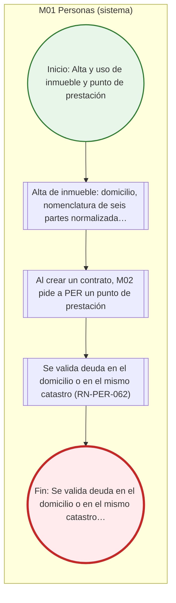

**Pasos del proceso** (actividad tomada del anexo; la columna RF/RN distingue lo citado en el paso de lo asociado por parámetro, permiso, evento o tema compartido).

| Paso | Carril | Actividad | RF/RN que aplican | EVT / JOB / PAN |
|---|---|---|---|---|
| 1 | M01 Personas | Alta de inmueble: domicilio, nomenclatura de seis partes normalizada (RN-PER-072), partida, frentes, superficies, coeficientes, unidades funcionales; se verifica unicidad de la nomenclatura activa (RN-PER-073). | RN-PER-072, RN-PER-073; asoc.: RN-PER-076, RF-PER-091 | — |
| 2 | M01 Personas | Al crear un contrato, M02 pide a PER un punto de prestación: se reutiliza uno existente en la misma dirección o se crea uno nuevo; se vincula el inmueble si el servicio lo exige (RN-PER-074). | RN-PER-074; asoc.: RF-PER-093 | — |
| 3 | M01 Personas | Se valida deuda en el domicilio o en el mismo catastro (RN-PER-062): resultado `none`, `warning` (sin revelar detalle a quien no tiene permiso) o `blocking` (solo si la política validada lo indica). | RN-PER-062 | — |

**Situación actual en ProCoop (nota de cambio).** CTR-PER-04: en ProCoop, Control legacy puede negar servicio por deuda ajena. Cambio adoptado: Advertencia sin revelar datos; bloqueo solo por política validada (PA-PER-03).

**Excepciones**

| Excepción | Tratamiento |
|---|---|
| Falla técnica en un paso automático, un job o una integración | Reintento idempotente y reanudable; lo no reparable pasa a la bandeja técnica con responsable (política de recuperación de T11 P-WFL-01 y T01 §9.12; AGR-016). |

---

## 5. PRC-PER-05 Relaciones, representaciones y autorizaciones (AGR-007; RF-PER-099..108)

| Campo | Contenido |
|---|---|
| Fuente | M01 §9.5, `M01-PER-personas-titulares-cuentas.md` (línea 1297) |
| Macroproceso | MP-09 Socio, servicios y contratación |
| Disparador | Relaciones, representaciones y autorizaciones |
| Resultado | JOB-PER-04 vence relaciones y avisa N días antes (PRM-PER-098). |
| Carriles | M01 Personas (sistema); Supervisor de atención (T-SAT) |
| Roles de T02 | T-SAT Supervisor de atención |
| Módulos involucrados | M01 Personas |
| Eventos (T11 §12) | EVT-PER-18 `per.relationship.granted` |
| Jobs | JOB-PER-04 `per:vencimientos` |
| Relación con 04-procesos-bpmn.md | P1 Alta de socio y contratación de servicio ([§5](04-procesos-bpmn.md#5-p1--alta-de-socio-y-contratación-de-servicio)) |

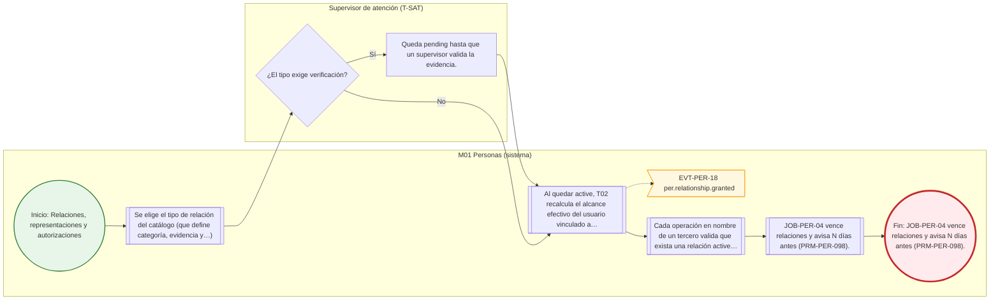

**Pasos del proceso** (actividad tomada del anexo; la columna RF/RN distingue lo citado en el paso de lo asociado por parámetro, permiso, evento o tema compartido).

| Paso | Carril | Actividad | RF/RN que aplican | EVT / JOB / PAN |
|---|---|---|---|---|
| 1 | M01 Personas | Se elige el tipo de relación del catálogo (que define categoría, evidencia y alcance por defecto), sujeto, destino, acciones y vigencia. | asoc.: RF-PER-099 | — |
| 2 | Supervisor de atención | Si el tipo exige verificación, queda `pending` hasta que un supervisor valida la evidencia. | — | — |
| 3 | M01 Personas | Al quedar `active`, T02 recalcula el alcance efectivo del usuario vinculado a esa persona (evento `per.relationship.granted`). | — | EVT-PER-18 |
| 4 | M01 Personas | Cada operación en nombre de un tercero valida que exista una relación `active` con la acción correspondiente (`API-PER-35`), y deja `onBehalfOf` en la historia. | — | — |
| 5 | M01 Personas | JOB-PER-04 vence relaciones y avisa N días antes (PRM-PER-098). | — | JOB-PER-04 |

**Situación actual en ProCoop (nota de cambio).** Sin contraste específico para este proceso en el anexo (filas `CTR-` con ProCoop) ni en el análisis de brechas. El contraste del dominio está en `15-analisis-brechas-procoop.md` §3.4.

**Excepciones**

| Excepción | Tratamiento |
|---|---|
| Si el tipo exige verificación | queda `pending` hasta que un supervisor valida la evidencia |
| Vencimiento | JOB-PER-04 vence relaciones y avisa N días antes (PRM-PER-098) |
| Falla técnica en un paso automático, un job o una integración | Reintento idempotente y reanudable; lo no reparable pasa a la bandeja técnica con responsable (política de recuperación de T11 P-WFL-01 y T01 §9.12; AGR-016). |

---

## 6. PRC-PER-06 Bloqueos (RF-PER-124..128)

| Campo | Contenido |
|---|---|
| Fuente | M01 §9.6, `M01-PER-personas-titulares-cuentas.md` (línea 1305) |
| Macroproceso | MP-09 Socio, servicios y contratación |
| Disparador | Bloqueos |
| Resultado | JOB-PER-04 vence bloqueos con validTo. |
| Carriles | Supervisor de atención (T-SAT); M01 Personas (sistema) |
| Roles de T02 | T-SAT Supervisor de atención |
| Módulos involucrados | M01 Personas |
| Eventos (T11 §12) | — |
| Jobs | JOB-PER-04 `per:vencimientos` |
| Relación con 04-procesos-bpmn.md | P1 Alta de socio y contratación de servicio ([§5](04-procesos-bpmn.md#5-p1--alta-de-socio-y-contratación-de-servicio)) |

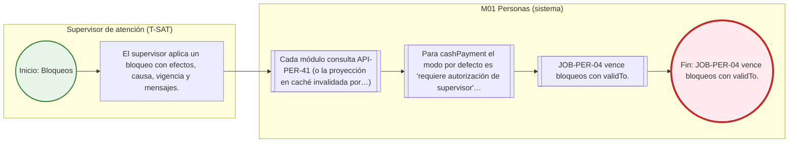

**Pasos del proceso** (actividad tomada del anexo; la columna RF/RN distingue lo citado en el paso de lo asociado por parámetro, permiso, evento o tema compartido).

| Paso | Carril | Actividad | RF/RN que aplican | EVT / JOB / PAN |
|---|---|---|---|---|
| 1 | Supervisor de atención | El supervisor aplica un bloqueo con efectos, causa, vigencia y mensajes. | — | — |
| 2 | M01 Personas | Cada módulo consulta `API-PER-41` (o la proyección en caché invalidada por eventos) antes de operar: M07 caja (`cashPayment`), M19/M07 pago web (`webPayment`, `webDebtPublication`), M05 emisión (`billing`), M02 contratación, baja y reconexión (`newContracts`, `cancellation`, `reconnection`), PER (transferencias y cambios de datos). | — | — |
| 3 | M01 Personas | Para `cashPayment` el modo por defecto es "requiere autorización de supervisor" (PA-PER-16). | — | — |
| 4 | M01 Personas | JOB-PER-04 vence bloqueos con `validTo`. | — | JOB-PER-04 |

**Situación actual en ProCoop (nota de cambio).** Sin contraste específico para este proceso en el anexo (filas `CTR-` con ProCoop) ni en el análisis de brechas. El contraste del dominio está en `15-analisis-brechas-procoop.md` §3.4.

**Excepciones**

| Excepción | Tratamiento |
|---|---|
| Bloqueo | El supervisor aplica un bloqueo con efectos, causa, vigencia y mensajes |
| Falla o error | Cada módulo consulta `API-PER-41` (o la proyección en caché invalidada por eventos) antes de operar: M07 caja (`cashPayment`), M19/M07 pago web (`webPayment`, `webDebtPublication`), M05 emisión (`billing`), M02 contratación, baja y reconexión (`newContracts`, `cancellation`, `reconnection`), PER (transferencias y cambios de datos) |
| Vencimiento | JOB-PER-04 vence bloqueos con `validTo` |
| Falla técnica en un paso automático, un job o una integración | Reintento idempotente y reanudable; lo no reparable pasa a la bandeja técnica con responsable (política de recuperación de T11 P-WFL-01 y T01 §9.12; AGR-016). |

---

## 7. PRC-PER-07 Cambio de titularidad (BASE §4; CU-TIT-01; RF-PER-132..141)

| Campo | Contenido |
|---|---|
| Fuente | M01 §9.7, `M01-PER-personas-titulares-cuentas.md` (línea 1312) |
| Macroproceso | MP-09 Socio, servicios y contratación |
| Disparador | Cambio de titularidad |
| Resultado | Se emite constancia (T11) y outbox per.transfer.executed… |
| Carriles | Comercial / Atención al socio (T-ATE); M01 Personas (sistema); Aprobador según política (T11 aprobaciones); T11 Workflow, eventos y documentos |
| Roles de T02 | T-ATE Comercial / Atención al socio |
| Módulos involucrados | M01 Personas, M02 Catálogo y contratos, T11 Workflow, eventos y documentos |
| Eventos (T11 §12) | EVT-CAT-17 `cat.contract.transferred`; EVT-PER-22 `per.transfer.executed`; EVT-PER-23 `per.ownership.changed` |
| Jobs | JOB-PER-07 `per:ejecutar-transferencia` |
| Relación con 04-procesos-bpmn.md | P1 Alta de socio y contratación de servicio ([§5](04-procesos-bpmn.md#5-p1--alta-de-socio-y-contratación-de-servicio)) |

```mermaid
flowchart LR
  subgraph L_LTATE["Comercial / Atención al socio (T-ATE)"]
    ni(("Inicio: Cambio de titularidad"))
    ns1["Atención inicia el asistente (PAN-PER-14) con origen (titular, cuenta…)"]
  end
  subgraph L_LSIS["M01 Personas (sistema)"]
    ns2[["Selección de ítems y opciones explícitas"]]
    ns3[["Simulación (API-PER-47)"]]
    ns4[["Validaciones: deuda (PRM-PER-075), destino de baja (PRM-PER-076), contratos…"]]
    ns6[["Ejecución idempotente (JOB-PER-07)"]]
    ne6>"EVT-CAT-17 cat.contract.transferred"]
    ns7[["La deuda anterior queda en el titular de origen (RN-PER-101)"]]
    nx9{"¿Un paso falla?"}
    ns9[["Se compensan los pasos hechos y la operación queda failed con tarea."]]
  end
  subgraph L_LAPR["Aprobador según política (T11 aprobaciones)"]
    ns5["Aprobación por workflow T11 si el tipo lo exige (PRM-PER-081)."]
  end
  subgraph L_LT11["T11 Workflow, eventos y documentos"]
    ns8[["Se emite constancia (T11) y outbox per.transfer.executed…"]]
    ne8>"EVT-PER-22 per.transfer.executed; EVT-PER-23 per.ownership.changed"]
    nf(("Fin: Se emite constancia (T11) y outbox per.transfer.executed…"))
  end
  ni --> ns1
  ns1 --> ns2
  ns2 --> ns3
  ns3 --> ns4
  ns4 --> ns5
  ns5 --> ns6
  ne6 -.-> ns6
  ns6 --> ns7
  ns7 --> ns8
  ns8 -.-> ne8
  ns8 --> nx9
  nx9 -->|"Sí"| ns9
  ns9 --> nf
  nx9 -->|"No"| nf
  classDef inicio fill:#e8f5e9,stroke:#2e7d32,stroke-width:2px
  classDef fin fill:#ffebee,stroke:#c62828,stroke-width:4px
  classDef evento fill:#fff8e1,stroke:#f9a825
  classDef temporizador fill:#e3f2fd,stroke:#1565c0
  class ni inicio
  class nf fin
  class ne6,ne8 evento
```

**Pasos del proceso** (actividad tomada del anexo; la columna RF/RN distingue lo citado en el paso de lo asociado por parámetro, permiso, evento o tema compartido).

| Paso | Carril | Actividad | RF/RN que aplican | EVT / JOB / PAN |
|---|---|---|---|---|
| 1 | Comercial / Atención al socio | Atención inicia el asistente (PAN-PER-14) con origen (titular, cuenta, contratos) y destino (titular existente o nuevo con búsqueda de coincidencias). | — | PAN-PER-14 |
| 2 | M01 Personas | Selección de ítems y opciones explícitas: fecha efectiva, mantener fecha original, conservar capital (M17), cerrar titular de origen, cuenta destino principal (V2 3195, PRM-PER-084), modo de adherentes (PRM-SOC-012 de M18; antes PRM-PER-072, HUECO-TRV-01), cobrar cargos de transferencia (PRM-PER-080). | asoc.: RN-PER-091, RF-PER-138 | — |
| 3 | M01 Personas | Simulación (`API-PER-47`): deuda de origen informativa (consultada a M07), cargos a generar (M04), cambio de IIBB (RN-PER-046), impacto en débito automático (M07), adherentes, grupos de facturación, bloqueos `transfer`, relaciones en otras cuentas (RN-PER-035), documentación exigida (requisitos con evento `transfer` o `succession`). | RN-PER-035, RN-PER-046; asoc.: RF-PER-135 | — |
| 4 | M01 Personas | Validaciones: deuda (PRM-PER-075), destino de baja (PRM-PER-076), contratos de baja (PRM-PER-079), bloqueos `transfer`. | asoc.: RN-PER-103, RN-PER-106 | — |
| 5 | Aprobador según política | Aprobación por workflow T11 si el tipo lo exige (PRM-PER-081). | — | — |
| 6 | M01 Personas | Ejecución idempotente (JOB-PER-07): para cada contrato, comando a M02 "cerrar por transferencia" y "crear contrato en cuenta destino con fecha efectiva" (clonado, PA-PER-07); M05 reasigna grupo de facturación en la cuenta destino; M07 traslada mandatos de débito solo si el destino lo acepta; M17 transfiere capital si se pidió; M18 trata los adherentes según PRM-SOC-012 al consumir `cat.contract.transferred` (HUECO-TRV-01; antes "PER mueve adherentes según modo") y PER registra historia de ambos titulares. | asoc.: RN-PER-104, RF-PER-133 | JOB-PER-07, EVT-CAT-17 |
| 7 | M01 Personas | La deuda anterior queda en el titular de origen (RN-PER-101). Si el nuevo titular asume la deuda, se deriva a M08 un convenio con su consentimiento. | RN-PER-101 | — |
| 8 | T11 Workflow, eventos y documentos | Se emite constancia (T11) y outbox `per.transfer.executed`, `per.ownership.changed`. | asoc.: RN-PER-107 | EVT-PER-22, EVT-PER-23 |
| 9 | M01 Personas | Si un paso falla, se compensan los pasos hechos y la operación queda `failed` con tarea. | — | — |

**Situación actual en ProCoop (nota de cambio).** Sin contraste específico para este proceso en el anexo (filas `CTR-` con ProCoop) ni en el análisis de brechas. El contraste del dominio está en `15-analisis-brechas-procoop.md` §3.4.

**Excepciones**

| Excepción | Tratamiento |
|---|---|
| Bloqueo | Simulación (`API-PER-47`): deuda de origen informativa (consultada a M07), cargos a generar (M04), cambio de IIBB (RN-PER-046), impacto en débito automático (M07), adherentes, grupos de facturación, bloqueos `transfer`, relaciones en otras cuentas (RN-PER-035), documentación exigida (requisitos con evento `transfer` o `succession`) |
| Bloqueo | Validaciones: deuda (PRM-PER-075), destino de baja (PRM-PER-076), contratos de baja (PRM-PER-079), bloqueos `transfer` |
| Si el nuevo titular asume la deuda | se deriva a M08 un convenio con su consentimiento |
| Si un paso falla | se compensan los pasos hechos y la operación queda `failed` con tarea |
| Falla técnica en un paso automático, un job o una integración | Reintento idempotente y reanudable; lo no reparable pasa a la bandeja técnica con responsable (política de recuperación de T11 P-WFL-01 y T01 §9.12; AGR-016). |

---

## 8. PRC-PER-08 Mudanza o traslado (CU-04)

| Campo | Contenido |
|---|---|
| Fuente | M01 §9.8, `M01-PER-personas-titulares-cuentas.md` (línea 1324) |
| Macroproceso | MP-09 Socio, servicios y contratación |
| Disparador | Mudanza o traslado |
| Resultado | La copia del domicilio de la cuenta a los contratos solo ocurre… |
| Carriles | M01 Personas (sistema) |
| Roles de T02 | Solo actores del sistema (sin rol humano) |
| Módulos involucrados | M01 Personas, M10 Técnica y campo |
| Eventos (T11 §12) | EVT-TEC-07 `tec.workOrder.closed`; EVT-PER-17 `per.servicePoint.relocated` |
| Jobs | — |
| Relación con 04-procesos-bpmn.md | P1 Alta de socio y contratación de servicio ([§5](04-procesos-bpmn.md#5-p1--alta-de-socio-y-contratación-de-servicio)) |

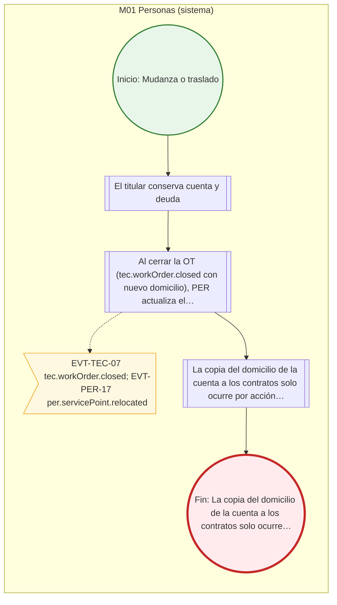

**Pasos del proceso** (actividad tomada del anexo; la columna RF/RN distingue lo citado en el paso de lo asociado por parámetro, permiso, evento o tema compartido).

| Paso | Carril | Actividad | RF/RN que aplican | EVT / JOB / PAN |
|---|---|---|---|---|
| 1 | M01 Personas | El titular conserva cuenta y deuda; se crea un nuevo punto de prestación (o se reutiliza) y M02 da de baja el contrato del punto anterior y alta en el nuevo, o M10 ejecuta un traslado técnico por OT. | asoc.: RN-PER-064, RF-PER-098 | — |
| 2 | M01 Personas | Al cerrar la OT (`tec.workOrder.closed` con nuevo domicilio), PER actualiza el punto y, si la OT lo indica, el domicilio de las personas adherentes (RN-PER-064). Publica `per.servicePoint.relocated`. | RN-PER-064; asoc.: RN-PER-125 | EVT-TEC-07, EVT-PER-17 |
| 3 | M01 Personas | La copia del domicilio de la cuenta a los contratos solo ocurre por acción explícita (RN-PER-063). | RN-PER-063 | — |

**Situación actual en ProCoop (nota de cambio).** CTR-PER-01: en ProCoop, ProCoop modela titular y cuenta; BASE habla de persona, asociado e inmueble sin cuenta explícita. Cambio adoptado: Se adoptan ambos: persona → titular → cuenta → grupo de facturación (M05) → contrato (M02) sobre punto de prestación e inmueble; asociado como relación de M17 (sección 2.3).

**Excepciones**

| Excepción | Tratamiento |
|---|---|
| Si la OT lo indica | el domicilio de las personas adherentes (RN-PER-064) |
| Falla técnica en un paso automático, un job o una integración | Reintento idempotente y reanudable; lo no reparable pasa a la bandeja técnica con responsable (política de recuperación de T11 P-WFL-01 y T01 §9.12; AGR-016). |

---

## 9. PRC-PER-09 Fallecimiento (RF-PER-009; PA-PER-08)

| Campo | Contenido |
|---|---|
| Fuente | M01 §9.9, `M01-PER-personas-titulares-cuentas.md` (línea 1330) |
| Macroproceso | MP-09 Socio, servicios y contratación |
| Disparador | Fallecimiento |
| Resultado | No corta servicios ni cambia deuda |
| Carriles | Supervisor de atención (T-SAT); M01 Personas (sistema) |
| Roles de T02 | T-SAT Supervisor de atención |
| Módulos involucrados | M01 Personas |
| Eventos (T11 §12) | EVT-PER-03 `per.person.deceased` |
| Jobs | — |
| Relación con 04-procesos-bpmn.md | P1 Alta de socio y contratación de servicio ([§5](04-procesos-bpmn.md#5-p1--alta-de-socio-y-contratación-de-servicio)) |

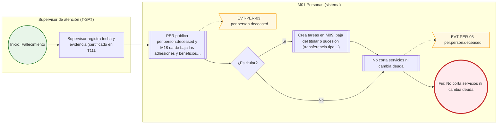

**Pasos del proceso** (actividad tomada del anexo; la columna RF/RN distingue lo citado en el paso de lo asociado por parámetro, permiso, evento o tema compartido).

| Paso | Carril | Actividad | RF/RN que aplican | EVT / JOB / PAN |
|---|---|---|---|---|
| 1 | Supervisor de atención | Supervisor registra fecha y evidencia (certificado en T11). | — | — |
| 2 | M01 Personas | PER publica `per.person.deceased` y M18 da de baja las adhesiones y beneficios de la persona con causa `death` (RN-SOC-011; HUECO-TRV-01; antes los daba de baja PER, incluida la adhesión completa del contrato si era su único adherente); PER revoca relaciones donde es sujeto o representado. | RN-SOC-011; asoc.: RN-PER-014, RF-PER-110 | EVT-PER-03 |
| 3 | M01 Personas | Si es titular, crea tareas en M09: baja del titular o sucesión (transferencia tipo `succession`), cambio de garante en cuentas donde es garante. | — | — |
| 4 | M01 Personas | No corta servicios ni cambia deuda. Publica `per.person.deceased`. | asoc.: RN-PER-014 | EVT-PER-03 |

**Situación actual en ProCoop (nota de cambio).** Sin contraste específico para este proceso en el anexo (filas `CTR-` con ProCoop) ni en el análisis de brechas. El contraste del dominio está en `15-analisis-brechas-procoop.md` §3.4.

**Excepciones**

| Excepción | Tratamiento |
|---|---|
| Si es titular | crea tareas en M09: baja del titular o sucesión (transferencia tipo `succession`), cambio de garante en cuentas donde es garante |
| Falla técnica en un paso automático, un job o una integración | Reintento idempotente y reanudable; lo no reparable pasa a la bandeja técnica con responsable (política de recuperación de T11 P-WFL-01 y T01 §9.12; AGR-016). |

---

## 10. PRC-PER-10 Detección de duplicados y fusión (RF-PER-155..158)

| Campo | Contenido |
|---|---|
| Fuente | M01 §9.10, `M01-PER-personas-titulares-cuentas.md` (línea 1337) |
| Macroproceso | MP-09 Socio, servicios y contratación |
| Disparador | Detección de duplicados y fusión |
| Resultado | Nunca se fusiona por coincidencia de DNI o correo sin esta… |
| Carriles | M01 Personas (sistema); Comercial / Atención al socio (T-ATE) |
| Roles de T02 | T-ATE Comercial / Atención al socio |
| Módulos involucrados | M01 Personas |
| Eventos (T11 §12) | EVT-PER-05 `per.person.mergeRequested` |
| Jobs | JOB-PER-03 `per:detectar-duplicados`; JOB-PER-08 `per:fusionar-personas` |
| Relación con 04-procesos-bpmn.md | P1 Alta de socio y contratación de servicio ([§5](04-procesos-bpmn.md#5-p1--alta-de-socio-y-contratación-de-servicio)) |

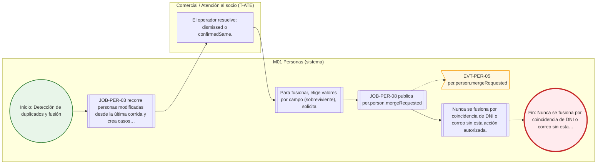

**Pasos del proceso** (actividad tomada del anexo; la columna RF/RN distingue lo citado en el paso de lo asociado por parámetro, permiso, evento o tema compartido).

| Paso | Carril | Actividad | RF/RN que aplican | EVT / JOB / PAN |
|---|---|---|---|---|
| 1 | M01 Personas | JOB-PER-03 recorre personas modificadas desde la última corrida y crea casos con puntaje. | — | JOB-PER-03 |
| 2 | Comercial / Atención al socio | El operador resuelve: `dismissed` o `confirmedSame`. | — | — |
| 3 | M01 Personas | Para fusionar, elige valores por campo (sobreviviente), solicita; otro usuario aprueba (PRM-PER-082). | — | — |
| 4 | M01 Personas | JOB-PER-08 publica `per.person.mergeRequested`; cada módulo reasigna sus referencias y confirma; PER registra cada referencia reasignada para poder revertir dentro del plazo (PRM-PER-099). | — | JOB-PER-08, EVT-PER-05 |
| 5 | M01 Personas | Nunca se fusiona por coincidencia de DNI o correo sin esta acción autorizada. | — | — |

**Situación actual en ProCoop (nota de cambio).** Sin contraste específico para este proceso en el anexo (filas `CTR-` con ProCoop) ni en el análisis de brechas. El contraste del dominio está en `15-analisis-brechas-procoop.md` §3.4.

**Excepciones**

| Excepción | Tratamiento |
|---|---|
| Falla técnica en un paso automático, un job o una integración | Reintento idempotente y reanudable; lo no reparable pasa a la bandeja técnica con responsable (política de recuperación de T11 P-WFL-01 y T01 §9.12; AGR-016). |

---

## 11. PRC-PER-11 Vinculación usuario–persona (REG-001; DEC-043)

| Campo | Contenido |
|---|---|
| Fuente | M01 §9.11, `M01-PER-personas-titulares-cuentas.md` (línea 1345) |
| Macroproceso | MP-09 Socio, servicios y contratación |
| Disparador | Vinculación usuario–persona |
| Resultado | Superada la prueba, personUserLinks.status = verified |
| Carriles | Visitante registrado (C-VIS); Comercial / Atención al socio (T-ATE); M01 Personas (sistema) |
| Roles de T02 | C-VIS Visitante registrado, T-ATE Comercial / Atención al socio |
| Módulos involucrados | M01 Personas |
| Eventos (T11 §12) | — |
| Jobs | — |
| Relación con 04-procesos-bpmn.md | P1 Alta de socio y contratación de servicio ([§5](04-procesos-bpmn.md#5-p1--alta-de-socio-y-contratación-de-servicio)) |

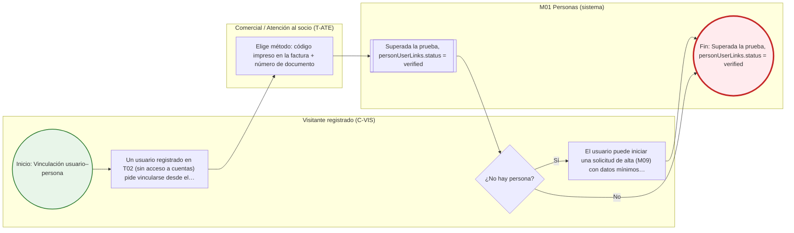

**Pasos del proceso** (actividad tomada del anexo; la columna RF/RN distingue lo citado en el paso de lo asociado por parámetro, permiso, evento o tema compartido).

| Paso | Carril | Actividad | RF/RN que aplican | EVT / JOB / PAN |
|---|---|---|---|---|
| 1 | Visitante registrado | Un usuario registrado en T02 (sin acceso a cuentas) pide vincularse desde el portal (PAN-PER-26). | — | PAN-PER-26 |
| 2 | Comercial / Atención al socio | Elige método: código impreso en la factura + número de documento; o número de cuenta + documento + código enviado al contacto registrado en la cuenta; o validación presencial. El código al contacto lo genera y envía M01 al correo o celular verificado del titular (RF-PER-173, API-PER-76) a pedido de M19 (RF-POR-179); M19 solo muestra el contacto enmascarado. | RF-PER-173, RF-POR-179 | — |
| 3 | M01 Personas | Superada la prueba, `personUserLinks.status = verified`; T02 recalcula cuentas visibles. Intentos limitados y auditados. | asoc.: RN-PER-120 | — |
| 4 | Visitante registrado | Si no hay persona, el usuario puede iniciar una solicitud de alta (M09) con datos mínimos (PA-PER-11). | — | — |

**Situación actual en ProCoop (nota de cambio).** Sin contraste específico para este proceso en el anexo (filas `CTR-` con ProCoop) ni en el análisis de brechas. El contraste del dominio está en `15-analisis-brechas-procoop.md` §3.4.

**Excepciones**

| Excepción | Tratamiento |
|---|---|
| Umbral o tolerancia superada | Superada la prueba, `personUserLinks.status = verified` |
| Si no hay persona | el usuario puede iniciar una solicitud de alta (M09) con datos mínimos (PA-PER-11) |
| Falla técnica en un paso automático, un job o una integración | Reintento idempotente y reanudable; lo no reparable pasa a la bandeja técnica con responsable (política de recuperación de T11 P-WFL-01 y T01 §9.12; AGR-016). |

---

## 12. PRC-CAT-01 Lanzar un servicio en un tenant (CU-05, CU-CAT-01)

| Campo | Contenido |
|---|---|
| Fuente | M02 §9.1, `M02-CAT-catalogo-servicios.md` (línea 1340) |
| Macroproceso | MP-09 Socio, servicios y contratación |
| Disparador | Lanzar un servicio en un tenant |
| Resultado | Publica con fecha efectiva |
| Carriles | T01 Plataforma; Administrador de la cooperativa (T-ADM); M02 Catálogo y contratos (sistema); Aprobador según política (T11 aprobaciones) |
| Roles de T02 | T-ADM Administrador de la cooperativa |
| Módulos involucrados | M02 Catálogo y contratos, T01 Plataforma, T11 Workflow, eventos y documentos |
| Eventos (T11 §12) | EVT-CAT-02 `cat.tenantService.published` |
| Jobs | — |
| Relación con 04-procesos-bpmn.md | P1 Alta de socio y contratación de servicio ([§5](04-procesos-bpmn.md#5-p1--alta-de-socio-y-contratación-de-servicio)) |

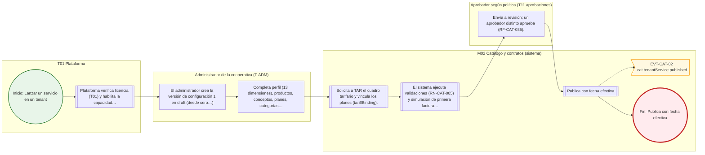

**Pasos del proceso** (actividad tomada del anexo; la columna RF/RN distingue lo citado en el paso de lo asociado por parámetro, permiso, evento o tema compartido).

| Paso | Carril | Actividad | RF/RN que aplican | EVT / JOB / PAN |
|---|---|---|---|---|
| 1 | T01 Plataforma | Plataforma verifica licencia (T01) y habilita la capacidad (`tenantServices.enablement=enabled`). | — | — |
| 2 | Administrador de la cooperativa | El administrador crea la versión de configuración 1 en `draft` (desde cero, plantilla o copia). | — | — |
| 3 | Administrador de la cooperativa | Completa perfil (13 dimensiones), productos, conceptos, planes, categorías, clases, propiedades, estados y mapeos. | — | — |
| 4 | M02 Catálogo y contratos | Solicita a TAR el cuadro tarifario y vincula los planes (`tariffBinding`). | — | — |
| 5 | M02 Catálogo y contratos | El sistema ejecuta validaciones (RN-CAT-005) y simulación de primera factura sin crear deuda (TAR/FAC en modo simulación). | RN-CAT-005 | — |
| 6 | Aprobador según política | Envía a revisión; un aprobador distinto aprueba (RF-CAT-035). | RF-CAT-035 | — |
| 7 | M02 Catálogo y contratos | Publica con fecha efectiva; `offerStatus=open`; evento `cat.tenantService.published`; landing y PWA muestran la oferta. | — | EVT-CAT-02 |

**Situación actual en ProCoop (nota de cambio).** Sin contraste específico para este proceso en el anexo (filas `CTR-` con ProCoop) ni en el análisis de brechas. El contraste del dominio está en `15-analisis-brechas-procoop.md` §3.5.

**Excepciones**

| Excepción | Tratamiento |
|---|---|
| Falla técnica en un paso automático, un job o una integración | Reintento idempotente y reanudable; lo no reparable pasa a la bandeja técnica con responsable (política de recuperación de T11 P-WFL-01 y T01 §9.12; AGR-016). |

---

## 13. PRC-CAT-02 Alta de contrato — piloto Internet (CU-PRO-01, CU-SOL-01 en lo que toca al contrato)

| Campo | Contenido |
|---|---|
| Fuente | M02 §9.2, `M02-CAT-catalogo-servicios.md` (línea 1350) |
| Macroproceso | MP-09 Socio, servicios y contratación |
| Disparador | Alta de contrato — piloto Internet |
| Resultado | FAC/TAR inician el devengamiento del abono desde la activación… |
| Carriles | M09 Atención; T02 Identidad y roles; M02 Catálogo y contratos (sistema); Técnico (campo) (T-TEC); M10 Técnica y campo; M05 Facturación |
| Roles de T02 | T-TEC Técnico (campo) |
| Módulos involucrados | M02 Catálogo y contratos, M05 Facturación, M09 Atención, M10 Técnica y campo, T02 Identidad y roles |
| Eventos (T11 §12) | EVT-CRM-13 `crm.commandRequest.requested`; EVT-TEC-16 `tec.installation.activationConfirmed`; EVT-CAT-09 `cat.contract.activated` |
| Jobs | — |
| Relación con 04-procesos-bpmn.md | P1 Alta de socio y contratación de servicio ([§5](04-procesos-bpmn.md#5-p1--alta-de-socio-y-contratación-de-servicio)) |

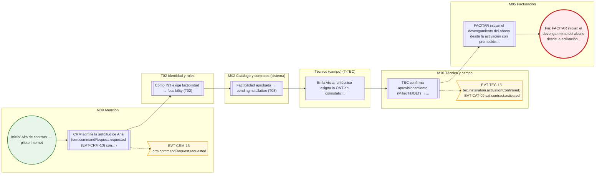

**Pasos del proceso** (actividad tomada del anexo; la columna RF/RN distingue lo citado en el paso de lo asociado por parámetro, permiso, evento o tema compartido).

| Paso | Carril | Actividad | RF/RN que aplican | EVT / JOB / PAN |
|---|---|---|---|---|
| 1 | M09 Atención | CRM admite la solicitud de Ana (`crm.commandRequest.requested` (EVT-CRM-13) con el comando `cat.contract.create`, titular, domicilio, plan elegido, aceptación de condiciones) → CAT crea contrato en `requested` (T01) (PA-CAT-01). | — | EVT-CRM-13 |
| 2 | T02 Identidad y roles | Como INT exige factibilidad → `feasibility` (T02); TEC evalúa cobertura. | — | — |
| 3 | M02 Catálogo y contratos | Factibilidad aprobada → `pendingInstallation` (T03); TEC agenda la visita (M10). | asoc.: RN-CAT-026, RF-CAT-091 | — |
| 4 | Técnico | En la visita, el técnico asigna la ONT en comodato (`contractEquipmentAssignments.assigned/delivered`, STK mueve la unidad), instala, prueba, toma conformidad firmada. | — | — |
| 5 | M10 Técnica y campo | TEC confirma aprovisionamiento (MikroTik/OLT) → `tec.installation.activationConfirmed` (EVT-TEC-16) → CAT activa (T06), registra `effectiveStart`, estado operativo "CONECTADO", genera conceptos por evento (instalación) y publica `cat.contract.activated`. | — | EVT-TEC-16, EVT-CAT-09 |
| 6 | M05 Facturación | FAC/TAR inician el devengamiento del abono desde la activación con promoción y prorrateo según condiciones (M04/M05). | — | — |

**Situación actual en ProCoop (nota de cambio).** Análisis de brechas (`15-analisis-brechas-procoop.md` §3.5, Catálogo): hoy Activación del servicio registrada manualmente; en GoodApps, activación por confirmación técnica de instalación y aprovisionamiento, con revisión posterior del supervisor (brecha "Cambia"; fuente DEC-033).

**Excepciones**

| Excepción | Tratamiento |
|---|---|
| Falla técnica en un paso automático, un job o una integración | Reintento idempotente y reanudable; lo no reparable pasa a la bandeja técnica con responsable (política de recuperación de T11 P-WFL-01 y T01 §9.12; AGR-016). |

---

## 14. PRC-CAT-03 Suspensión, reactivación y baja (CU-CIC-01 en lo que toca al contrato)

| Campo | Contenido |
|---|---|
| Fuente | M02 §9.3, `M02-CAT-catalogo-servicios.md` (línea 1359) |
| Macroproceso | MP-09 Socio, servicios y contratación |
| Disparador | Suspensión, reactivación y baja |
| Resultado | Baja: CRM recibe por cualquier canal (incluido botón público) →… |
| Carriles | M09 Atención; M08 Mora |
| Roles de T02 | Solo actores del sistema (sin rol humano) |
| Módulos involucrados | M02 Catálogo y contratos, M08 Mora, M09 Atención |
| Eventos (T11 §12) | EVT-MOR-12 `mor.interruption.approved` |
| Jobs | JOB-CAT-08 `cat:fin-suspension-voluntaria` |
| Relación con 04-procesos-bpmn.md | P1 Alta de socio y contratación de servicio ([§5](04-procesos-bpmn.md#5-p1--alta-de-socio-y-contratación-de-servicio)) |

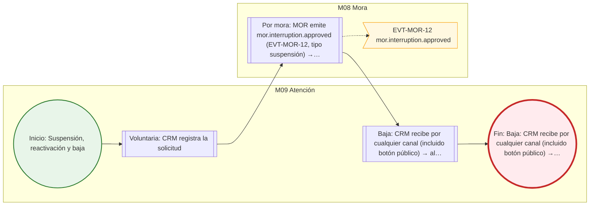

**Pasos del proceso** (actividad tomada del anexo; la columna RF/RN distingue lo citado en el paso de lo asociado por parámetro, permiso, evento o tema compartido).

| Paso | Carril | Actividad | RF/RN que aplican | EVT / JOB / PAN |
|---|---|---|---|---|
| 1 | M09 Atención | Voluntaria: CRM registra la solicitud; si el perfil la admite, al ejecutarse se envía `suspend{reason:voluntary}`; al vencer `expectedEndAt` el job `cat:fin-suspension-voluntaria` solicita la reactivación. | — | JOB-CAT-08 |
| 2 | M08 Mora | Por mora: MOR emite `mor.interruption.approved` (EVT-MOR-12, tipo suspensión) → CAT T08 (modo según servicio) → TEC ejecuta si `interrupted`. Pago y orden de MOR → T09/T10 o T11. | — | EVT-MOR-12 |
| 3 | M09 Atención | Baja: CRM recibe por cualquier canal (incluido botón público) → al ejecutarse, `requestTermination` (T12) → TEC desconecta y retira equipo → T14. La baja no espera la devolución del equipo; el pendiente queda en la bandeja. | — | — |

**Situación actual en ProCoop (nota de cambio).** Sin contraste específico para este proceso en el anexo (filas `CTR-` con ProCoop) ni en el análisis de brechas. El contraste del dominio está en `15-analisis-brechas-procoop.md` §3.5.

**Excepciones**

| Excepción | Tratamiento |
|---|---|
| Si el perfil la admite | al ejecutarse se envía `suspend(reason:voluntary)`; al vencer `expectedEndAt` el job `cat:fin-suspension-voluntaria` solicita la reactivación |
| Falla técnica en un paso automático, un job o una integración | Reintento idempotente y reanudable; lo no reparable pasa a la bandeja técnica con responsable (política de recuperación de T11 P-WFL-01 y T01 §9.12; AGR-016). |

---

## 15. PRC-CAT-04 Cambio de plan y de categoría

| Campo | Contenido |
|---|---|
| Fuente | M02 §9.4, `M02-CAT-catalogo-servicios.md` (línea 1365) |
| Macroproceso | MP-09 Socio, servicios y contratación |
| Disparador | Cambio de plan y de categoría |
| Resultado | Cambio de categoría: según categoryChangeMode inmediato… |
| Carriles | M09 Atención; M02 Catálogo y contratos (sistema) |
| Roles de T02 | Solo actores del sistema (sin rol humano) |
| Módulos involucrados | M02 Catálogo y contratos, M09 Atención |
| Eventos (T11 §12) | — |
| Jobs | — |
| Relación con 04-procesos-bpmn.md | P1 Alta de socio y contratación de servicio ([§5](04-procesos-bpmn.md#5-p1--alta-de-socio-y-contratación-de-servicio)) |

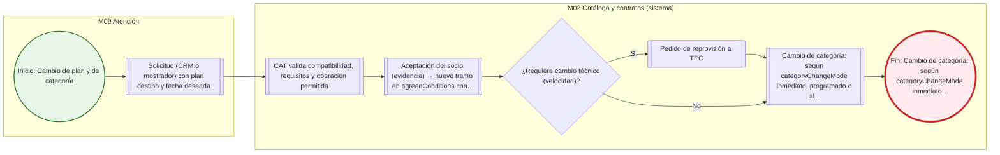

**Pasos del proceso** (actividad tomada del anexo; la columna RF/RN distingue lo citado en el paso de lo asociado por parámetro, permiso, evento o tema compartido).

| Paso | Carril | Actividad | RF/RN que aplican | EVT / JOB / PAN |
|---|---|---|---|---|
| 1 | M09 Atención | Solicitud (CRM o mostrador) con plan destino y fecha deseada. | — | — |
| 2 | M02 Catálogo y contratos | CAT valida compatibilidad, requisitos y operación permitida; calcula (vía TAR) el efecto sobre el período en curso y promociones (PA-CAT-15). | asoc.: RF-CAT-081 | — |
| 3 | M02 Catálogo y contratos | Aceptación del socio (evidencia) → nuevo tramo en `agreedConditions` con `validFrom`. | asoc.: RF-CAT-116 | — |
| 4 | M02 Catálogo y contratos | Si requiere cambio técnico (velocidad), pedido de reprovisión a TEC; el tramo rige desde la confirmación. | — | — |
| 5 | M02 Catálogo y contratos | Cambio de categoría: según `categoryChangeMode` inmediato, programado o al cerrar OT (V2 2330/2455); proporcional según día límite (V2 2755). | asoc.: RN-CAT-047 | — |

**Situación actual en ProCoop (nota de cambio).** Sin contraste específico para este proceso en el anexo (filas `CTR-` con ProCoop) ni en el análisis de brechas. El contraste del dominio está en `15-analisis-brechas-procoop.md` §3.5.

**Excepciones**

| Excepción | Tratamiento |
|---|---|
| Si requiere cambio técnico (velocidad) | pedido de reprovisión a TEC; el tramo rige desde la confirmación |
| Falla técnica en un paso automático, un job o una integración | Reintento idempotente y reanudable; lo no reparable pasa a la bandeja técnica con responsable (política de recuperación de T11 P-WFL-01 y T01 §9.12; AGR-016). |

---

## 16. PRC-CAT-05 Transferencia de servicio (RN-06 §7)

| Campo | Contenido |
|---|---|
| Fuente | M02 §9.5, `M02-CAT-catalogo-servicios.md` (línea 1373) |
| Macroproceso | MP-09 Socio, servicios y contratación |
| Disparador | Transferencia de servicio |
| Resultado | Genera conceptos por evento tipo 7 |
| Carriles | Supervisor de atención (T-SAT); M02 Catálogo y contratos (sistema) |
| Roles de T02 | T-SAT Supervisor de atención |
| Módulos involucrados | M02 Catálogo y contratos |
| Eventos (T11 §12) | — |
| Jobs | — |
| Relación con 04-procesos-bpmn.md | P1 Alta de socio y contratación de servicio ([§5](04-procesos-bpmn.md#5-p1--alta-de-socio-y-contratación-de-servicio)) |

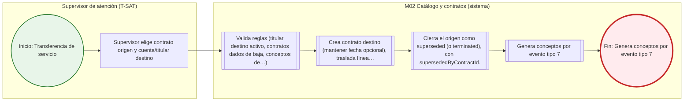

**Pasos del proceso** (actividad tomada del anexo; la columna RF/RN distingue lo citado en el paso de lo asociado por parámetro, permiso, evento o tema compartido).

| Paso | Carril | Actividad | RF/RN que aplican | EVT / JOB / PAN |
|---|---|---|---|---|
| 1 | Supervisor de atención | Supervisor elige contrato origen y cuenta/titular destino; el sistema muestra deuda del origen (que no se transfiere), adherentes y equipos. | — | — |
| 2 | M02 Catálogo y contratos | Valida reglas (titular destino activo, contratos dados de baja, conceptos de transferencia). | — | — |
| 3 | M02 Catálogo y contratos | Crea contrato destino (mantener fecha opcional), traslada línea, beneficiarios, vivienda, punto de suministro, propiedades; adherentes según modo. | asoc.: RF-CAT-084 | — |
| 4 | M02 Catálogo y contratos | Cierra el origen como `superseded` (o `terminated`), con `supersededByContractId`. | — | — |
| 5 | M02 Catálogo y contratos | Genera conceptos por evento tipo 7; sincroniza integraciones configuradas (ex AION). | — | — |

**Situación actual en ProCoop (nota de cambio).** Sin contraste específico para este proceso en el anexo (filas `CTR-` con ProCoop) ni en el análisis de brechas. El contraste del dominio está en `15-analisis-brechas-procoop.md` §3.5.

**Excepciones**

| Excepción | Tratamiento |
|---|---|
| Falla técnica en un paso automático, un job o una integración | Reintento idempotente y reanudable; lo no reparable pasa a la bandeja técnica con responsable (política de recuperación de T11 P-WFL-01 y T01 §9.12; AGR-016). |

---

## 17. PRC-CAT-06 Copia de servicio entre tenants (CU-COP-01)

| Campo | Contenido |
|---|---|
| Fuente | M02 §9.6, `M02-CAT-catalogo-servicios.md` (línea 1381) |
| Macroproceso | MP-09 Socio, servicios y contratación |
| Disparador | Copia de servicio entre tenants |
| Resultado | Aprueba y publica (9.1 pasos 6-7) |
| Carriles | Administrador de la cooperativa (T-ADM); M02 Catálogo y contratos (sistema); Aprobador según política (T11 aprobaciones) |
| Roles de T02 | T-ADM Administrador de la cooperativa |
| Módulos involucrados | M02 Catálogo y contratos, T11 Workflow, eventos y documentos |
| Eventos (T11 §12) | — |
| Jobs | JOB-CAT-03 `cat:copiar-servicio` |
| Relación con 04-procesos-bpmn.md | P1 Alta de socio y contratación de servicio ([§5](04-procesos-bpmn.md#5-p1--alta-de-socio-y-contratación-de-servicio)) |

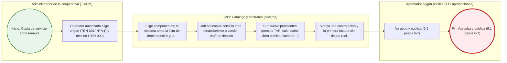

**Pasos del proceso** (actividad tomada del anexo; la columna RF/RN distingue lo citado en el paso de lo asociado por parámetro, permiso, evento o tema compartido).

| Paso | Carril | Actividad | RF/RN que aplican | EVT / JOB / PAN |
|---|---|---|---|---|
| 1 | Administrador de la cooperativa | Operador autorizado elige origen (TEN-001/INT/v1) y destino (TEN-002); el tenant origen autoriza la lectura (PA-CAT-07). | asoc.: RF-CAT-108 | — |
| 2 | M02 Catálogo y contratos | Elige componentes; el sistema arma la lista de dependencias y la clasificación copiar/conservar/mapear. | — | — |
| 3 | M02 Catálogo y contratos | Job `cat:copiar-servicio` crea `tenantService` o versión `draft` en destino; registra procedencia; excluye datos operativos y credenciales. | asoc.: RF-CAT-105 | JOB-CAT-03 |
| 4 | M02 Catálogo y contratos | B resuelve pendientes (precios TAR, calendario, área técnica, cuentas, cobertura, marca y lenguaje propios). | — | — |
| 5 | M02 Catálogo y contratos | Simula una contratación y la primera factura sin deuda real. | — | — |
| 6 | Aprobador según política | Aprueba y publica (9.1 pasos 6-7). Cambios posteriores en A no afectan a B. | — | — |

**Situación actual en ProCoop (nota de cambio).** Sin contraste específico para este proceso en el anexo (filas `CTR-` con ProCoop) ni en el análisis de brechas. El contraste del dominio está en `15-analisis-brechas-procoop.md` §3.5.

**Excepciones**

| Excepción | Tratamiento |
|---|---|
| Falla técnica en un paso automático, un job o una integración | Reintento idempotente y reanudable; lo no reparable pasa a la bandeja técnica con responsable (política de recuperación de T11 P-WFL-01 y T01 §9.12; AGR-016). |

---

## 18. PRC-CAT-07 Altas automáticas (RN-06 §3.5)

| Campo | Contenido |
|---|---|
| Fuente | M02 §9.7, `M02-CAT-catalogo-servicios.md` (línea 1390) |
| Macroproceso | MP-09 Socio, servicios y contratación |
| Disparador | Altas automáticas |
| Resultado | Para el evento baja, la regla puede proponer la baja de… |
| Carriles | M02 Catálogo y contratos (sistema); Administrador de la cooperativa (T-ADM) |
| Roles de T02 | T-ADM Administrador de la cooperativa |
| Módulos involucrados | M01 Personas, M02 Catálogo y contratos, M10 Técnica y campo |
| Eventos (T11 §12) | EVT-CAT-09 `cat.contract.activated`; EVT-PER-11 `per.account.created`; EVT-CAT-15 `cat.contract.terminated`; EVT-CAT-12 `cat.contract.reactivated`; EVT-CAT-19 `cat.contract.categoryChanged`; EVT-TEC-04 `tec.workOrder.created`; EVT-CAT-20 `cat.contract.addressChanged` |
| Jobs | JOB-CAT-01 `cat:altas-automaticas` |
| Relación con 04-procesos-bpmn.md | P1 Alta de socio y contratación de servicio ([§5](04-procesos-bpmn.md#5-p1--alta-de-socio-y-contratación-de-servicio)) |

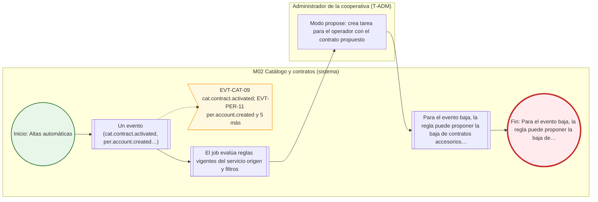

**Pasos del proceso** (actividad tomada del anexo; la columna RF/RN distingue lo citado en el paso de lo asociado por parámetro, permiso, evento o tema compartido).

| Paso | Carril | Actividad | RF/RN que aplican | EVT / JOB / PAN |
|---|---|---|---|---|
| 1 | M02 Catálogo y contratos | Un evento (`cat.contract.activated`, `per.account.created`, `cat.contract.terminated`, `cat.contract.reactivated`, `cat.contract.categoryChanged`, `tec.workOrder.created`, `cat.contract.addressChanged`) dispara `cat:altas-automaticas`. | — | EVT-CAT-09, EVT-PER-11, EVT-CAT-15, EVT-CAT-12, EVT-CAT-19, EVT-TEC-04, EVT-CAT-20, JOB-CAT-01 |
| 2 | M02 Catálogo y contratos | El job evalúa reglas vigentes del servicio origen y filtros; verifica no duplicado (RN-CAT-036). | RN-CAT-036 | — |
| 3 | Administrador de la cooperativa | Modo `propose`: crea tarea para el operador con el contrato propuesto. Modo `create`: crea el contrato destino (`requested` → `active` si no técnico) con grupo de facturación según regla y `origin.autoRuleId`. | — | — |
| 4 | M02 Catálogo y contratos | Para el evento baja, la regla puede proponer la baja de contratos accesorios (`parentContractId`). | asoc.: RN-CAT-076 | — |

**Situación actual en ProCoop (nota de cambio).** Sin contraste específico para este proceso en el anexo (filas `CTR-` con ProCoop) ni en el análisis de brechas. El contraste del dominio está en `15-analisis-brechas-procoop.md` §3.5.

**Excepciones**

| Excepción | Tratamiento |
|---|---|
| Duplicado | El job evalúa reglas vigentes del servicio origen y filtros; verifica no duplicado (RN-CAT-036) |
| Falla técnica en un paso automático, un job o una integración | Reintento idempotente y reanudable; lo no reparable pasa a la bandeja técnica con responsable (política de recuperación de T11 P-WFL-01 y T01 §9.12; AGR-016). |

---

## 19. PRC-CAT-08 Trámites masivos y recategorización

| Campo | Contenido |
|---|---|
| Fuente | M02 §9.8, `M02-CAT-catalogo-servicios.md` (línea 1397) |
| Macroproceso | MP-09 Socio, servicios y contratación |
| Disparador | Trámites masivos y recategorización |
| Resultado | Resultado por contrato |
| Carriles | Administrador de la cooperativa (T-ADM); M02 Catálogo y contratos (sistema); Aprobador según política (T11 aprobaciones) |
| Roles de T02 | T-ADM Administrador de la cooperativa |
| Módulos involucrados | M02 Catálogo y contratos, T11 Workflow, eventos y documentos |
| Eventos (T11 §12) | — |
| Jobs | JOB-CAT-02 `cat:tramite-masivo` |
| Relación con 04-procesos-bpmn.md | P1 Alta de socio y contratación de servicio ([§5](04-procesos-bpmn.md#5-p1--alta-de-socio-y-contratación-de-servicio)) |

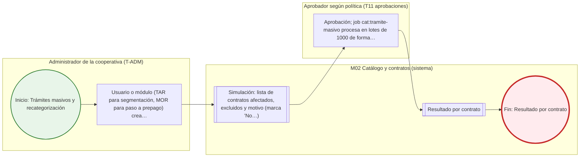

**Pasos del proceso** (actividad tomada del anexo; la columna RF/RN distingue lo citado en el paso de lo asociado por parámetro, permiso, evento o tema compartido).

| Paso | Carril | Actividad | RF/RN que aplican | EVT / JOB / PAN |
|---|---|---|---|---|
| 1 | Administrador de la cooperativa | Usuario o módulo (TAR para segmentación, MOR para paso a prepago) crea `bulkContractOperations` en `draft` con criterio. | — | — |
| 2 | M02 Catálogo y contratos | Simulación: lista de contratos afectados, excluidos y motivo (marca "No aplica recategorización", bajas > 60 días, validación de desconexión para bajas). | — | — |
| 3 | Aprobador según política | Aprobación; job `cat:tramite-masivo` procesa en lotes de 1000 de forma idempotente y reanudable; cada contrato genera historia y nota. | — | JOB-CAT-02 |
| 4 | M02 Catálogo y contratos | Resultado por contrato; reversión disponible según `revertibleUntil`. | — | — |

**Situación actual en ProCoop (nota de cambio).** Sin contraste específico para este proceso en el anexo (filas `CTR-` con ProCoop) ni en el análisis de brechas. El contraste del dominio está en `15-analisis-brechas-procoop.md` §3.5.

**Excepciones**

| Excepción | Tratamiento |
|---|---|
| Cancelación, anulación o reversión | Resultado por contrato; reversión disponible según `revertibleUntil` |
| Falla técnica en un paso automático, un job o una integración | Reintento idempotente y reanudable; lo no reparable pasa a la bandeja técnica con responsable (política de recuperación de T11 P-WFL-01 y T01 §9.12; AGR-016). |

---

## 20. PRC-VEN-01 Cargo de instalación del piloto Internet (O4)

| Campo | Contenido |
|---|---|
| Fuente | M11 §9.1, `M11-VEN-ventas-presupuestos.md` (línea 767); ola O4 |
| Macroproceso | MP-09 Socio, servicios y contratación |
| Disparador | Cargo de instalación del piloto Internet |
| Resultado | Una visita fallida no crea el cargo |
| Carriles | M09 Atención; M10 Técnica y campo; M11 Ventas (sistema); M07 Cuenta corriente y cobranza |
| Roles de T02 | Solo actores del sistema (sin rol humano) |
| Módulos involucrados | M05 Facturación, M07 Cuenta corriente y cobranza, M09 Atención, M10 Técnica y campo, M11 Ventas |
| Eventos (T11 §12) | EVT-TEC-07 `tec.workOrder.closed`; EVT-VEN-11 `ven.installmentPlan.created`; EVT-FAC-20 `fac.billableItem.billed`; EVT-FAC-07 `fac.invoice.issued` |
| Jobs | — |
| Relación con 04-procesos-bpmn.md | P6 Reclamo y orden de trabajo ([§10](04-procesos-bpmn.md#10-p6--reclamo-y-orden-de-trabajo)) |

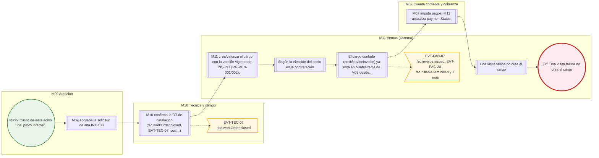

**Pasos del proceso** (actividad tomada del anexo; la columna RF/RN distingue lo citado en el paso de lo asociado por parámetro, permiso, evento o tema compartido).

| Paso | Carril | Actividad | RF/RN que aplican | EVT / JOB / PAN |
|---|---|---|---|---|
| 1 | M09 Atención | M09 aprueba la solicitud de alta INT-100; si el concepto INS-INT tiene disparador `requestApproved`, M11 crea el cargo `pending`; si es `installationConfirmed`, espera. | asoc.: RF-VEN-002 | — |
| 2 | M10 Técnica y campo | M10 confirma la OT de instalación (`tec.workOrder.closed`, EVT-TEC-07, con resultado exitoso y equipo instalado). | — | EVT-TEC-07 |
| 3 | M11 Ventas | M11 crea/valoriza el cargo con la versión vigente de INS-INT (RN-VEN-001/002). | RN-VEN-001 | — |
| 4 | M11 Ventas | Según la elección del socio en la contratación: contado → `nextServiceInvoice` (concepto vinculado a INT, incluido en la primera factura del ciclo); propio → pide factura inmediata a M05; financiado → genera cuotas con el plan (RF-VEN-081) y las marca `includeInServiceInvoice` si el concepto es vinculado y validado. | RF-VEN-081; asoc.: RF-VEN-005 | — |
| 5 | M11 Ventas | El cargo contado (`nextServiceInvoice`) ya está en `billableItems` de M05 desde el paso 4, creado por M11 con `fac.service.upsertBillableItem` (`sourceModule = VEN`, `sourceRef.id = chargeId`; CTR-DAT-38); las cuotas las proyecta M05 en `billableItems` al consumir EVT-VEN-11/12 (M05 §12.2). M05 toma ambos en la corrida, al emitir publica `fac.invoice.issued` y `fac.billableItem.billed` (EVT-FAC-20); M11 marca cargos y cuotas. Texto anterior: "M05, en la corrida, consulta `GET /api/admin/ven/billing-items?contract=…&period=…` y recibe ítems y cuotas a incluir" (reemplazado: M05 no consulta una cola de M11). | — | EVT-VEN-11, EVT-FAC-20, EVT-FAC-07 |
| 6 | M07 Cuenta corriente y cobranza | M07 imputa pagos; M11 actualiza `paymentStatus`. | — | — |
| 7 | M11 Ventas | Una visita fallida no crea el cargo; una sincronización repetida no lo duplica (BASE §73). | — | — |

**Situación actual en ProCoop (nota de cambio).** Sin contraste específico para este proceso en el anexo (filas `CTR-` con ProCoop) ni en el análisis de brechas. El contraste del dominio está en `15-analisis-brechas-procoop.md` §3.15.

**Excepciones**

| Excepción | Tratamiento |
|---|---|
| Si el concepto INS-INT tiene disparador `requestApproved` | M11 crea el cargo `pending`; si es `installationConfirmed`, espera |
| Duplicado | Una visita fallida no crea el cargo; una sincronización repetida no lo duplica (BASE §73) |
| Falla técnica en un paso automático, un job o una integración | Reintento idempotente y reanudable; lo no reparable pasa a la bandeja técnica con responsable (política de recuperación de T11 P-WFL-01 y T01 §9.12; AGR-016). |

---

## Inconsistencias detectadas en la especificación (esta parte)

No se detectaron inconsistencias en los procesos de esta parte.

## Cobertura de esta parte

| Universo de la parte | Diagramados | Con nota ProCoop específica | Pendientes |
|---|---|---|---|
| 20 (PRC-PER-01 a PRC-VEN-01) | 20 | 4 | 0 |
