# GoodApps Cooperativas

## Procesos de negocio — Socio, servicios y contratación y Medición y tarificación (M03, M11)

**Entregable de Análisis y Diseño Detallado — Artefacto 2.1 (Procesos de negocio BPMN). Parte de [`04-procesos-bpmn.md`](04-procesos-bpmn.md).**

| Dato | Valor |
|---|---|
| Documento | Diagramas BPMN, pasos, situación actual en ProCoop y excepciones de los procesos PRC-VEN-02 a PRC-MED-15, derivados de la sección 9 de M03, M11 |
| Carácter | Derivado de la especificación vigente; no la reemplaza. Ante diferencias prevalecen la maestra `00`, los anexos, T05, T11 y el registro de decisiones `01` |
| Generación | Script `_trabajo/generar_bpmn.py` con la ampliación `_trabajo/generar_prc.py` (derivación automática desde el texto de la sección 9 de cada anexo, `_trabajo/prc_auto.py`) |
| Versión | 1.1 (regenerada contra la especificación corregida) |
| Fecha | 05-11-2026 |

**Cómo leer cada proceso.** La notación es la de [`04-procesos-bpmn.md` §3](04-procesos-bpmn.md#3-notación-equivalencia-mermaid--bpmn) (carriles, eventos de inicio y fin, tareas de usuario y de servicio, compuertas XOR y AND, eventos de dominio como banderas, temporizadores y jobs como estadios). La tabla de pasos reproduce la actividad del anexo; en la columna RF/RN, los identificadores sin prefijo son los que el anexo cita en el paso y los marcados "asoc." son reglas o requisitos del mismo anexo que comparten parámetro, permiso, evento o tema con el paso (asociación generada por el script y revisada). Los eventos se nombran con su ID del catálogo de T11 §12.

**Derivación automática (v1.2).** Los procesos `PRC-<MOD>-nn` de esta parte se generaron con `_trabajo/generar_prc.py` y `_trabajo/prc_auto.py` a partir del texto de cada subsección §9.n del anexo, sin curaduría paso a paso (a diferencia de los 94 procesos `P-XXX-nn` de las partes 04b a 04i). Reglas: (1) los pasos son los numerados o viñetas del anexo; si la subsección es prosa, se parte por flechas o por oraciones; si es una tabla de pasos o de jobs, cada fila es un paso; (2) el carril de cada paso es el primer actor nombrado al comienzo del paso (rol de T02 §4, otro módulo, sistema externo, dispositivo o job); si no se nombra ninguno, el paso es del sistema del módulo dueño; (3) los pasos que empiezan con "Si …" se dibujan como compuerta XOR; (4) los eventos son los nombres del catálogo de T11 §12 citados en el paso (bandera entrante si el paso los consume, saliente si los publica); el temporizador aparece cuando el título nombra un job periódico; (5) las excepciones son las oraciones del anexo con condición o con palabras de falla, rechazo, vencimiento, duplicado o umbral, más la política de recuperación del anexo; (6) la nota ProCoop combina lo que dice el propio anexo, la fila `CTR-` del anexo que contrasta con ProCoop y la fila de `15-analisis-brechas-procoop.md` §3 de mayor afinidad; si ninguna alcanza el umbral, la nota lo dice y remite al contraste del dominio en esa sección. La revisión manual de una muestra está en `_trabajo/prc_revision.md`; ante diferencias, prevalece el texto del anexo citado en la ficha.

## Índice de procesos de esta parte

1. [PRC-VEN-02 Cargo de reconexión (O6)](#1-prc-ven-02-cargo-de-reconexión-o6)
2. [PRC-VEN-03 Flujo continuo presupuesto → aceptación → OT → factura (O8)](#2-prc-ven-03-flujo-continuo-presupuesto--aceptación--ot--factura-o8)
3. [PRC-VEN-04 Venta con entrega y cuotas (CU-23)](#3-prc-ven-04-venta-con-entrega-y-cuotas-cu-23)
4. [PRC-VEN-05 Venta en POS](#4-prc-ven-05-venta-en-pos)
5. [PRC-MED-01 Ciclo mensual de medición (vista general)](#5-prc-med-01-ciclo-mensual-de-medición-vista-general)
6. [PRC-MED-02 Generación de lote (JOB-MED-01 `med:generar-lotes`)](#6-prc-med-02-generación-de-lote-job-med-01-medgenerar-lotes)
7. [PRC-MED-03 Lectura en campo offline (pwa-campo)](#7-prc-med-03-lectura-en-campo-offline-pwa-campo)
8. [PRC-MED-04 Confirmación de lote (JOB-MED-03 `med:confirmar-lote`)](#8-prc-med-04-confirmación-de-lote-job-med-03-medconfirmar-lote)
9. [PRC-MED-05 Registro manual (PAN-MED-09)](#9-prc-med-05-registro-manual-pan-med-09)
10. [PRC-MED-06 Importación de archivo (PAN-MED-10, JOB-MED-04 `med:importar-lecturas`)](#10-prc-med-06-importación-de-archivo-pan-med-10-job-med-04-medimportar-lecturas)
11. [PRC-MED-07 Telemedición: toma de estado (JOB-MED-10 `med:toma-estado`)](#11-prc-med-07-telemedición-toma-de-estado-job-med-10-medtoma-estado)
12. [PRC-MED-08 Comando remoto de corte/reconexión](#12-prc-med-08-comando-remoto-de-cortereconexión)
13. [PRC-MED-09 Recarga prepaga](#13-prc-med-09-recarga-prepaga)
14. [PRC-MED-10 Estimación (JOB-MED-05 `med:estimar`)](#14-prc-med-10-estimación-job-med-05-medestimar)
15. [PRC-MED-11 Regularización de estimados (JOB-MED-08 `med:regularizar-estimados`)](#15-prc-med-11-regularización-de-estimados-job-med-08-medregularizar-estimados)
16. [PRC-MED-12 División, agrupación y distribución (JOB-MED-06 `med:dividir-consumos`, JOB-MED-07 `med:distribuir-consumos`)](#16-prc-med-12-división-agrupación-y-distribución-job-med-06-meddividir-consumos-job-med-07-meddistribuir-consumos)
17. [PRC-MED-13 Demanda y transgresiones (JOB-MED-09 `med:detectar-transgresiones`)](#17-prc-med-13-demanda-y-transgresiones-job-med-09-meddetectar-transgresiones)
18. [PRC-MED-14 Generación distribuida (JOB-MED-15 `med:balance-inyeccion`)](#18-prc-med-14-generación-distribuida-job-med-15-medbalance-inyeccion)
19. [PRC-MED-15 Autolectura](#19-prc-med-15-autolectura)

---

## 1. PRC-VEN-02 Cargo de reconexión (O6)

| Campo | Contenido |
|---|---|
| Fuente | M11 §9.2, `M11-VEN-ventas-presupuestos.md` (línea 777); ola O6 |
| Macroproceso | MP-09 Socio, servicios y contratación |
| Disparador | Cargo de reconexión |
| Resultado | Cargos a la próxima factura del servicio |
| Carriles | M08 Mora; M10 Técnica y campo; M11 Ventas (sistema) |
| Roles de T02 | Solo actores del sistema (sin rol humano) |
| Módulos involucrados | M08 Mora, M10 Técnica y campo, M11 Ventas |
| Eventos (T11 §12) | — |
| Jobs | — |
| Relación con 04-procesos-bpmn.md | — |

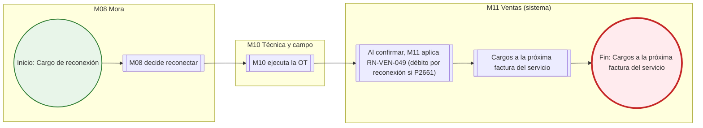

**Pasos del proceso** (actividad tomada del anexo; la columna RF/RN distingue lo citado en el paso de lo asociado por parámetro, permiso, evento o tema compartido).

| Paso | Carril | Actividad | RF/RN que aplican | EVT / JOB / PAN |
|---|---|---|---|---|
| 1 | M08 Mora | M08 decide reconectar | — | — |
| 2 | M10 Técnica y campo | M10 ejecuta la OT | — | — |
| 3 | M11 Ventas | al confirmar, M11 aplica RN-VEN-049 (débito por reconexión si P2661; crédito por días desconectados si P2483; cierre sin comprobante si P2907) | RN-VEN-049 | — |
| 4 | M11 Ventas | cargos a la próxima factura del servicio | — | — |

**Situación actual en ProCoop (nota de cambio).** Sin contraste específico para este proceso en el anexo (filas `CTR-` con ProCoop) ni en el análisis de brechas. El contraste del dominio está en `15-analisis-brechas-procoop.md` §3.15.

**Excepciones**

| Excepción | Tratamiento |
|---|---|
| Falla técnica en un paso automático, un job o una integración | Reintento idempotente y reanudable; lo no reparable pasa a la bandeja técnica con responsable (política de recuperación de T11 P-WFL-01 y T01 §9.12; AGR-016). |

---

## 2. PRC-VEN-03 Flujo continuo presupuesto → aceptación → OT → factura (O8)

| Campo | Contenido |
|---|---|
| Fuente | M11 §9.3, `M11-VEN-ventas-presupuestos.md` (línea 781); ola O8 |
| Macroproceso | MP-09 Socio, servicios y contratación |
| Disparador | Flujo continuo presupuesto → aceptación → OT → factura |
| Resultado | Se notifica al socio cada paso (T09) |
| Carriles | Comercial / Atención al socio (T-ATE); M11 Ventas (sistema); Socio titular (C-SOC); T09 Comunicaciones |
| Roles de T02 | C-SOC Socio titular, T-ATE Comercial / Atención al socio |
| Módulos involucrados | M11 Ventas, T09 Comunicaciones |
| Eventos (T11 §12) | — |
| Jobs | — |
| Relación con 04-procesos-bpmn.md | — |

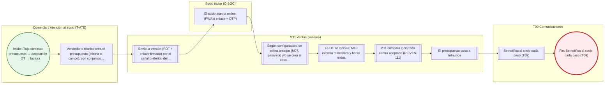

**Pasos del proceso** (actividad tomada del anexo; la columna RF/RN distingue lo citado en el paso de lo asociado por parámetro, permiso, evento o tema compartido).

| Paso | Carril | Actividad | RF/RN que aplican | EVT / JOB / PAN |
|---|---|---|---|---|
| 1 | Comercial / Atención al socio | Vendedor o técnico crea el presupuesto (oficina o campo), con conjuntos, flete y molde; valida cuenta (RN-VEN-013/014) y unicidad (RN-VEN-007). | RN-VEN-007, RN-VEN-013 | — |
| 2 | M11 Ventas | Envía la versión (PDF + enlace firmado) por el canal preferido del destinatario. | — | — |
| 3 | Socio titular | El socio acepta online (PWA o enlace + OTP); se guarda la evidencia. | — | — |
| 4 | M11 Ventas | Según configuración: se cobra anticipo (M07, pasarela) y/o se crea el caso CRM y la OT en M10 con materiales y mano de obra; se reservan materiales en M13. | — | — |
| 5 | M11 Ventas | La OT se ejecuta; M10 informa materiales y horas reales. | — | — |
| 6 | M11 Ventas | M11 compara ejecutado contra aceptado (RF-VEN-111); diferencias dentro de tolerancia se ajustan; fuera de tolerancia piden aprobación. | RF-VEN-111 | — |
| 7 | M11 Ventas | El presupuesto pasa a `toInvoice`; M11 crea la venta y pide la factura a M05 (contado o plan); aplica anticipos. | — | — |
| 8 | T09 Comunicaciones | Se notifica al socio cada paso (T09); todo queda en el expediente (T11). | — | — |

**Situación actual en ProCoop (nota de cambio).** Sin contraste específico para este proceso en el anexo (filas `CTR-` con ProCoop) ni en el análisis de brechas. El contraste del dominio está en `15-analisis-brechas-procoop.md` §3.15.

**Excepciones**

| Excepción | Tratamiento |
|---|---|
| Falla técnica en un paso automático, un job o una integración | Reintento idempotente y reanudable; lo no reparable pasa a la bandeja técnica con responsable (política de recuperación de T11 P-WFL-01 y T01 §9.12; AGR-016). |

---

## 3. PRC-VEN-04 Venta con entrega y cuotas (CU-23)

| Campo | Contenido |
|---|---|
| Fuente | M11 §9.4, `M11-VEN-ventas-presupuestos.md` (línea 792) |
| Macroproceso | MP-09 Socio, servicios y contratación |
| Disparador | Venta con entrega y cuotas |
| Resultado | Cobro en M07. Devolución |
| Carriles | M11 Ventas (sistema); M05 Facturación |
| Roles de T02 | Solo actores del sistema (sin rol humano) |
| Módulos involucrados | M05 Facturación, M11 Ventas |
| Eventos (T11 §12) | — |
| Jobs | — |
| Relación con 04-procesos-bpmn.md | — |

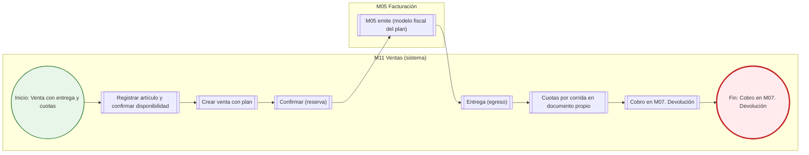

**Pasos del proceso** (actividad tomada del anexo; la columna RF/RN distingue lo citado en el paso de lo asociado por parámetro, permiso, evento o tema compartido).

| Paso | Carril | Actividad | RF/RN que aplican | EVT / JOB / PAN |
|---|---|---|---|---|
| 1 | M11 Ventas | Registrar artículo y confirmar disponibilidad | — | — |
| 2 | M11 Ventas | crear venta con plan | — | — |
| 3 | M11 Ventas | confirmar (reserva) | — | — |
| 4 | M05 Facturación | M05 emite (modelo fiscal del plan) | — | — |
| 5 | M11 Ventas | entrega (egreso) | — | — |
| 6 | M11 Ventas | cuotas por corrida en documento propio | — | — |
| 7 | M11 Ventas | cobro en M07. Devolución: RN-VEN-033 | RN-VEN-033 | — |

**Situación actual en ProCoop (nota de cambio).** Sin contraste específico para este proceso en el anexo (filas `CTR-` con ProCoop) ni en el análisis de brechas. El contraste del dominio está en `15-analisis-brechas-procoop.md` §3.15.

**Excepciones**

| Excepción | Tratamiento |
|---|---|
| Falla técnica en un paso automático, un job o una integración | Reintento idempotente y reanudable; lo no reparable pasa a la bandeja técnica con responsable (política de recuperación de T11 P-WFL-01 y T01 §9.12; AGR-016). |

---

## 4. PRC-VEN-05 Venta en POS

| Campo | Contenido |
|---|---|
| Fuente | M11 §9.5, `M11-VEN-ventas-presupuestos.md` (línea 796) |
| Macroproceso | MP-09 Socio, servicios y contratación |
| Disparador | Venta en POS |
| Resultado | Cierre con arqueo por medio |
| Carriles | M11 Ventas (sistema); M07 Cuenta corriente y cobranza; M05 Facturación; Comercial / Atención al socio (T-ATE) |
| Roles de T02 | T-ATE Comercial / Atención al socio |
| Módulos involucrados | M05 Facturación, M07 Cuenta corriente y cobranza, M11 Ventas |
| Eventos (T11 §12) | — |
| Jobs | — |
| Relación con 04-procesos-bpmn.md | — |

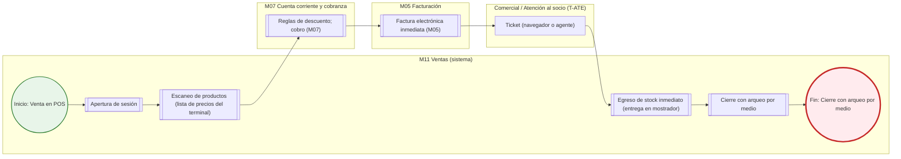

**Pasos del proceso** (actividad tomada del anexo; la columna RF/RN distingue lo citado en el paso de lo asociado por parámetro, permiso, evento o tema compartido).

| Paso | Carril | Actividad | RF/RN que aplican | EVT / JOB / PAN |
|---|---|---|---|---|
| 1 | M11 Ventas | Apertura de sesión | — | — |
| 2 | M11 Ventas | escaneo de productos (lista de precios del terminal) | — | — |
| 3 | M07 Cuenta corriente y cobranza | reglas de descuento; cobro (M07) | — | — |
| 4 | M05 Facturación | factura electrónica inmediata (M05) | — | — |
| 5 | Comercial / Atención al socio | ticket (navegador o agente) | — | — |
| 6 | M11 Ventas | egreso de stock inmediato (entrega en mostrador) | — | — |
| 7 | M11 Ventas | cierre con arqueo por medio | — | — |

**Situación actual en ProCoop (nota de cambio).** Sin contraste específico para este proceso en el anexo (filas `CTR-` con ProCoop) ni en el análisis de brechas. El contraste del dominio está en `15-analisis-brechas-procoop.md` §3.15.

**Excepciones**

| Excepción | Tratamiento |
|---|---|
| Falla técnica en un paso automático, un job o una integración | Reintento idempotente y reanudable; lo no reparable pasa a la bandeja técnica con responsable (política de recuperación de T11 P-WFL-01 y T01 §9.12; AGR-016). |

---

## 5. PRC-MED-01 Ciclo mensual de medición (vista general)

| Campo | Contenido |
|---|---|
| Fuente | M03 §9.1, `M03-MED-medicion-consumos.md` (línea 1296) |
| Macroproceso | MP-10 Medición y tarificación |
| Disparador | Ciclo mensual de medición |
| Resultado | Regularización de estimados (JOB-MED-08) al recibir lecturas… |
| Carriles | M03 Medición (sistema); Aprobador según política (T11 aprobaciones); M04 Tarifas; M05 Facturación |
| Roles de T02 | Solo actores del sistema (sin rol humano) |
| Módulos involucrados | M03 Medición, M04 Tarifas, M05 Facturación, T11 Workflow, eventos y documentos |
| Eventos (T11 §12) | EVT-MED-11 `med.consumption.approved`; EVT-FAC-07 `fac.invoice.issued` |
| Jobs | JOB-MED-01 `med:generar-lotes`; JOB-MED-03 `med:confirmar-lote`; JOB-MED-05 `med:estimar`; JOB-MED-06 `med:dividir-consumos`; JOB-MED-07 `med:distribuir-consumos`; JOB-MED-08 `med:regularizar-estimados` |
| Relación con 04-procesos-bpmn.md | P2 Ciclo de medición y lectura ([§6](04-procesos-bpmn.md#6-p2--ciclo-de-medición-y-lectura)) |

```mermaid
flowchart LR
  subgraph L_LSIS["M03 Medición (sistema)"]
    ni(("Inicio: Ciclo mensual de medición"))
    ns1[["Cronograma publicado por servicio y ciclo (PAN-MED-06)."]]
    ns2[["JOB-MED-01 med:generar-lotes crea los lotes de cada ruta en la fecha…"]]
    ns3[["Asignación y descarga a la app o exportación a archivo."]]
    ns4[["Captura en campo/telemedición/autolectura/carga manual/importación."]]
    ns5[["Sincronización (/sync) con idempotencia y conflictos."]]
    ns6[["Validación y confirmación del lote (JOB-MED-03)"]]
    ns7[["Bandeja de excepciones: decisión de cada caso (JOB-MED-05)"]]
    ns8[["División/agrupación (JOB-MED-06) y distribución (JOB-MED-07) cuando…"]]
    ns10[["Cierre del lote con acta."]]
    ns13[["Regularización de estimados (JOB-MED-08) al recibir lecturas reales…"]]
    nf(("Fin: Regularización de estimados (JOB-MED-08) al recibir lecturas…"))
  end
  subgraph L_LAPR["Aprobador según política (T11 aprobaciones)"]
    ns9["Aprobación (automática o manual) → med.consumption.approved."]
    ne9>"EVT-MED-11 med.consumption.approved"]
  end
  subgraph L_LM04["M04 Tarifas"]
    ns11[["M04/M05 toman los consumos aprobados del período (API-MED-60)"]]
  end
  subgraph L_LM05["M05 Facturación"]
    ns12[["Al emitir, M05 publica fac.invoice.issued → MED marca billed."]]
    ne12>"EVT-FAC-07 fac.invoice.issued"]
  end
  ni --> ns1
  ns1 --> ns2
  ns2 --> ns3
  ns3 --> ns4
  ns4 --> ns5
  ns5 --> ns6
  ns6 --> ns7
  ns7 --> ns8
  ns8 --> ns9
  ns9 -.-> ne9
  ns9 --> ns10
  ns10 --> ns11
  ns11 --> ns12
  ns12 -.-> ne12
  ns12 --> ns13
  ns13 --> nf
  classDef inicio fill:#e8f5e9,stroke:#2e7d32,stroke-width:2px
  classDef fin fill:#ffebee,stroke:#c62828,stroke-width:4px
  classDef evento fill:#fff8e1,stroke:#f9a825
  classDef temporizador fill:#e3f2fd,stroke:#1565c0
  class ni inicio
  class nf fin
  class ne9,ne12 evento
```

**Pasos del proceso** (actividad tomada del anexo; la columna RF/RN distingue lo citado en el paso de lo asociado por parámetro, permiso, evento o tema compartido).

| Paso | Carril | Actividad | RF/RN que aplican | EVT / JOB / PAN |
|---|---|---|---|---|
| 1 | M03 Medición | Cronograma publicado por servicio y ciclo (PAN-MED-06). | — | PAN-MED-06 |
| 2 | M03 Medición | JOB-MED-01 `med:generar-lotes` crea los lotes de cada ruta en la fecha planificada. | — | JOB-MED-01 |
| 3 | M03 Medición | Asignación y descarga a la app o exportación a archivo. | asoc.: RF-MED-033 | — |
| 4 | M03 Medición | Captura en campo/telemedición/autolectura/carga manual/importación. | — | — |
| 5 | M03 Medición | Sincronización (`/sync`) con idempotencia y conflictos. | — | — |
| 6 | M03 Medición | Validación y confirmación del lote (JOB-MED-03): lecturas validadas, consumos calculados, excepciones. | asoc.: RF-MED-036 | JOB-MED-03 |
| 7 | M03 Medición | Bandeja de excepciones: decisión de cada caso; estimaciones (JOB-MED-05) para no leídos. | — | JOB-MED-05 |
| 8 | M03 Medición | División/agrupación (JOB-MED-06) y distribución (JOB-MED-07) cuando corresponda. | — | JOB-MED-06, JOB-MED-07 |
| 9 | Aprobador según política | Aprobación (automática o manual) → `med.consumption.approved`. | — | EVT-MED-11 |
| 10 | M03 Medición | Cierre del lote con acta. | — | — |
| 11 | M04 Tarifas | M04/M05 toman los consumos aprobados del período (API-MED-60); los observados quedan fuera con causa. | — | — |
| 12 | M05 Facturación | Al emitir, M05 publica `fac.invoice.issued` → MED marca `billed`. | — | EVT-FAC-07 |
| 13 | M03 Medición | Regularización de estimados (JOB-MED-08) al recibir lecturas reales posteriores. | — | JOB-MED-08 |

**Situación actual en ProCoop (nota de cambio).** Análisis de brechas (`15-analisis-brechas-procoop.md` §3.6, Medición): hoy Autolectura no relevada; en GoodApps, autolectura del socio desde el portal y facturación in situ (brecha "Nuevo"; fuente M03; PRO-O7-05).

**Excepciones**

| Excepción | Tratamiento |
|---|---|
| Conflicto | Sincronización (`/sync`) con idempotencia y conflictos |
| Falla técnica en un paso automático, un job o una integración | Reintento idempotente y reanudable; lo no reparable pasa a la bandeja técnica con responsable (política de recuperación de M03 §9.17; AGR-016). |

---

## 6. PRC-MED-02 Generación de lote (JOB-MED-01 `med:generar-lotes`)

| Campo | Contenido |
|---|---|
| Fuente | M03 §9.2, `M03-MED-medicion-consumos.md` (línea 1314) |
| Macroproceso | MP-10 Medición y tarificación |
| Disparador | Generación de lote |
| Resultado | Emite med.readingBatch.generated. |
| Carriles | M03 Medición (sistema); Supervisor de consumos (BASE §39.6) (T-SCM) |
| Roles de T02 | T-SCM Supervisor de consumos (BASE §39.6) |
| Módulos involucrados | M03 Medición |
| Eventos (T11 §12) | EVT-MED-05 `med.readingBatch.generated` |
| Jobs | — |
| Relación con 04-procesos-bpmn.md | P2 Ciclo de medición y lectura ([§6](04-procesos-bpmn.md#6-p2--ciclo-de-medición-y-lectura)) |

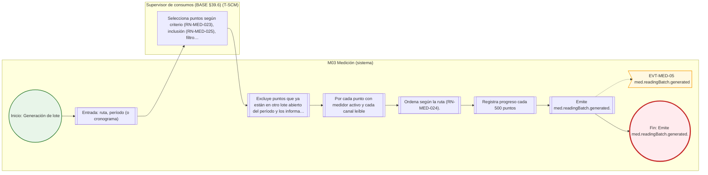

**Pasos del proceso** (actividad tomada del anexo; la columna RF/RN distingue lo citado en el paso de lo asociado por parámetro, permiso, evento o tema compartido).

| Paso | Carril | Actividad | RF/RN que aplican | EVT / JOB / PAN |
|---|---|---|---|---|
| 1 | M03 Medición | Entrada: ruta, período (o cronograma). Idempotente por `{routeId, period}`. | — | — |
| 2 | Supervisor de consumos | Selecciona puntos según criterio (RN-MED-023), inclusión (RN-MED-025), filtro de telemedidos (RN-MED-026), fecha de alta (RN-MED-032). | RN-MED-023, RN-MED-025, RN-MED-026, RN-MED-032; asoc.: RF-MED-025 | — |
| 3 | M03 Medición | Excluye puntos que ya están en otro lote abierto del período y los informa (RN-MED-028). | RN-MED-028 | — |
| 4 | M03 Medición | Por cada punto con medidor activo y cada canal leíble: toma la última lectura validada, calcula consumo de referencia y rango esperado (RN-MED-029/073), arma el snapshot con los campos habilitados (RN-MED-033), marca prioridad si el último fue estimado (RN-MED-030). | RN-MED-029, RN-MED-030, RN-MED-033 | — |
| 5 | M03 Medición | Ordena según la ruta (RN-MED-024). | RN-MED-024 | — |
| 6 | M03 Medición | Registra progreso cada 500 puntos; si se interrumpe, reanuda desde el último punto procesado. | — | — |
| 7 | M03 Medición | Emite `med.readingBatch.generated`. | — | EVT-MED-05 |

**Situación actual en ProCoop (nota de cambio).** Sin contraste específico para este proceso en el anexo (filas `CTR-` con ProCoop) ni en el análisis de brechas. El contraste del dominio está en `15-analisis-brechas-procoop.md` §3.6.

**Excepciones**

| Excepción | Tratamiento |
|---|---|
| Si se interrumpe | reanuda desde el último punto procesado |
| Falla técnica en un paso automático, un job o una integración | Reintento idempotente y reanudable; lo no reparable pasa a la bandeja técnica con responsable (política de recuperación de M03 §9.17; AGR-016). |

---

## 7. PRC-MED-03 Lectura en campo offline (pwa-campo)

| Campo | Contenido |
|---|---|
| Fuente | M03 §9.3, `M03-MED-medicion-consumos.md` (línea 1324) |
| Macroproceso | MP-10 Medición y tarificación |
| Disparador | Lectura en campo offline |
| Resultado | Al terminar, el lecturista cierra la jornada (alimenta…) |
| Carriles | Lecturista (campo) (T-LEC); M03 Medición (sistema) |
| Roles de T02 | T-LEC Lecturista (campo) |
| Módulos involucrados | M03 Medición |
| Eventos (T11 §12) | — |
| Jobs | — |
| Relación con 04-procesos-bpmn.md | P2 Ciclo de medición y lectura ([§6](04-procesos-bpmn.md#6-p2--ciclo-de-medición-y-lectura)) |

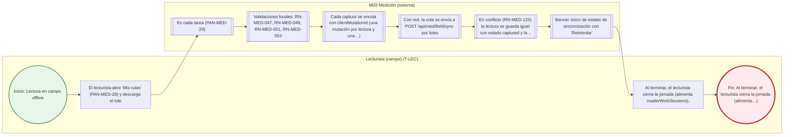

**Pasos del proceso** (actividad tomada del anexo; la columna RF/RN distingue lo citado en el paso de lo asociado por parámetro, permiso, evento o tema compartido).

| Paso | Carril | Actividad | RF/RN que aplican | EVT / JOB / PAN |
|---|---|---|---|---|
| 1 | Lecturista | El lecturista abre "Mis rutas" (PAN-MED-28) y descarga el lote: tareas, fotos de referencia opcionales, catálogo de observaciones; se guarda en IndexedDB con `taskVersion`. | — | PAN-MED-28 |
| 2 | M03 Medición | En cada tarea (PAN-MED-29): verifica dirección, número de medidor (lectura de código de barras/QR si existe), captura estado por registro, observación, resultado, fotos y GPS. | — | PAN-MED-29 |
| 3 | M03 Medición | Validaciones locales: RN-MED-047, RN-MED-049, RN-MED-051, RN-MED-053; si fuera de rango pide reingreso y foto; si la observación bloquea lectura, registra "no leído". | RN-MED-047, RN-MED-049, RN-MED-051, RN-MED-053 | — |
| 4 | M03 Medición | Cada captura se encola con `clientMutationId` (una mutación por lectura y una por foto). | asoc.: RF-MED-047 | — |
| 5 | M03 Medición | Con red, la cola se envía a `POST /api/med/field/sync` por lotes; el servidor responde por ítem (`accepted`, `duplicate`, `conflict`, `rejected` con causa). | — | — |
| 6 | M03 Medición | En conflicto (RN-MED-125) la lectura se guarda igual con estado `captured` y la tarea `conflict`; el supervisor decide en PAN-MED-34. | RN-MED-125; asoc.: RF-MED-048 | PAN-MED-34 |
| 7 | M03 Medición | Banner único de estado de sincronización con "Reintentar"; no se encolan login ni operaciones administrativas (CNX §3.7). | — | — |
| 8 | Lecturista | Al terminar, el lecturista cierra la jornada (alimenta `readerWorkSessions`). | — | — |

**Situación actual en ProCoop (nota de cambio).** Sin contraste específico para este proceso en el anexo (filas `CTR-` con ProCoop) ni en el análisis de brechas. El contraste del dominio está en `15-analisis-brechas-procoop.md` §3.6.

**Excepciones**

| Excepción | Tratamiento |
|---|---|
| Si fuera de rango pide reingreso y foto; si la observación bloquea lectura | registra "no leído" |
| Duplicado | Con red, la cola se envía a `POST /api/med/field/sync` por lotes; el servidor responde por ítem (`accepted`, `duplicate`, `conflict`, `rejected` con causa) |
| Conflicto | En conflicto (RN-MED-125) la lectura se guarda igual con estado `captured` y la tarea `conflict`; el supervisor decide en PAN-MED-34 |
| Reintento | Banner único de estado de sincronización con "Reintentar"; no se encolan login ni operaciones administrativas (CNX §3.7) |
| Falla técnica en un paso automático, un job o una integración | Reintento idempotente y reanudable; lo no reparable pasa a la bandeja técnica con responsable (política de recuperación de M03 §9.17; AGR-016). |

---

## 8. PRC-MED-04 Confirmación de lote (JOB-MED-03 `med:confirmar-lote`)

| Campo | Contenido |
|---|---|
| Fuente | M03 §9.4, `M03-MED-medicion-consumos.md` (línea 1335) |
| Macroproceso | MP-10 Medición y tarificación |
| Disparador | Confirmación de lote |
| Resultado | Emite med.readingBatch.confirmed con contadores. |
| Carriles | M03 Medición (sistema) |
| Roles de T02 | Solo actores del sistema (sin rol humano) |
| Módulos involucrados | M03 Medición |
| Eventos (T11 §12) | EVT-MED-10 `med.readingObservation.workOrderRequested`; EVT-MED-06 `med.readingBatch.confirmed` |
| Jobs | — |
| Relación con 04-procesos-bpmn.md | P2 Ciclo de medición y lectura ([§6](04-procesos-bpmn.md#6-p2--ciclo-de-medición-y-lectura)) |

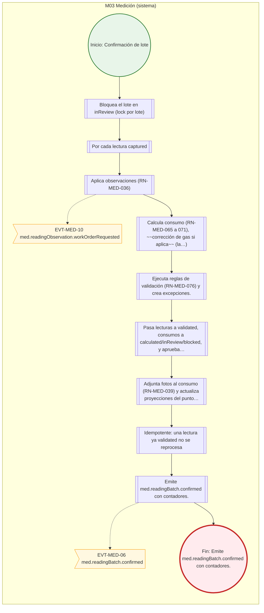

**Pasos del proceso** (actividad tomada del anexo; la columna RF/RN distingue lo citado en el paso de lo asociado por parámetro, permiso, evento o tema compartido).

| Paso | Carril | Actividad | RF/RN que aplican | EVT / JOB / PAN |
|---|---|---|---|---|
| 1 | M03 Medición | Bloquea el lote en `inReview` (lock por lote; otro intento devuelve 409). | — | — |
| 2 | M03 Medición | Por cada lectura `captured`: verificaciones RN-MED-035 (alta del servicio, medidor y canal vigentes, fecha y estado anterior coinciden con la última validada, versión). Si falla → `rejected` con causa y tarea `rejected`. | RN-MED-035 | — |
| 3 | M03 Medición | Aplica observaciones (RN-MED-036): pide OT a M10 (`med.readingObservation.workOrderRequested`), marca estimado o exige foto. | RN-MED-036 | EVT-MED-10 |
| 4 | M03 Medición | Calcula consumo (RN-MED-065 a 071), ~~corrección de gas si aplica~~ (la corrección de gas la aplica M04, DEC-085), testigo si aplica. | RN-MED-065; asoc.: RF-MED-063 | — |
| 5 | M03 Medición | Ejecuta reglas de validación (RN-MED-076) y crea excepciones. | RN-MED-076 | — |
| 6 | M03 Medición | Pasa lecturas a `validated`, consumos a `calculated`/`inReview`/`blocked`, y aprueba automáticamente los que correspondan (RN-MED-079). | RN-MED-079 | — |
| 7 | M03 Medición | Adjunta fotos al consumo (RN-MED-039) y actualiza proyecciones del punto (RN-MED-041). | RN-MED-039, RN-MED-041 | — |
| 8 | M03 Medición | Idempotente: una lectura ya `validated` no se reprocesa; reanudable por cursor. | — | — |
| 9 | M03 Medición | Emite `med.readingBatch.confirmed` con contadores. | — | EVT-MED-06 |

**Situación actual en ProCoop (nota de cambio).** CTR-MED-01: en ProCoop, En ProCoop los umbrales solo informan y ningún consumo anómalo se bloquea. La BASE exige que una inconsistencia relevante no se liquide. Cambio adoptado: Reglas de validación con severidad configurable (información, advertencia, bloqueante) y bandeja de excepciones; por defecto, lectura menor, falta de factor de gas e inyección sin contrato son bloqueantes (RN-MED-076 a 078). Análisis de brechas (`15-analisis-brechas-procoop.md` §3.6, Medición): hoy Corrección de volumen de gas en el circuito de consumos; en GoodApps, la corrección la aplica el motor tarifario con sus factores; medición entrega el volumen medido (brecha "Cambia"; fuente DEC-085).

**Excepciones**

| Excepción | Tratamiento |
|---|---|
| Bloqueo | Bloquea el lote en `inReview` (lock por lote; otro intento devuelve 409) |
| Si falla | `rejected` con causa y tarea `rejected` |
| Falla técnica en un paso automático, un job o una integración | Reintento idempotente y reanudable; lo no reparable pasa a la bandeja técnica con responsable (política de recuperación de M03 §9.17; AGR-016). |

---

## 9. PRC-MED-05 Registro manual (PAN-MED-09)

| Campo | Contenido |
|---|---|
| Fuente | M03 §9.5, `M03-MED-medicion-consumos.md` (línea 1347) |
| Macroproceso | MP-10 Medición y tarificación |
| Disparador | Registro manual |
| Resultado | Al presionar 'Correcto' se crea la lectura captured con origen… |
| Carriles | Supervisor de consumos (BASE §39.6) (T-SCM); M03 Medición (sistema) |
| Roles de T02 | T-SCM Supervisor de consumos (BASE §39.6) |
| Módulos involucrados | M03 Medición |
| Eventos (T11 §12) | — |
| Jobs | — |
| Relación con 04-procesos-bpmn.md | P2 Ciclo de medición y lectura ([§6](04-procesos-bpmn.md#6-p2--ciclo-de-medición-y-lectura)) |

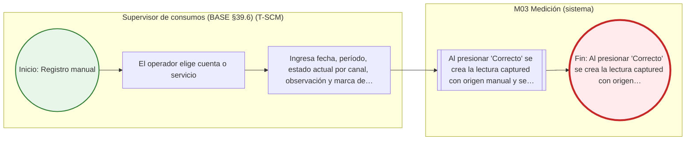

**Pasos del proceso** (actividad tomada del anexo; la columna RF/RN distingue lo citado en el paso de lo asociado por parámetro, permiso, evento o tema compartido).

| Paso | Carril | Actividad | RF/RN que aplican | EVT / JOB / PAN |
|---|---|---|---|---|
| 1 | Supervisor de consumos | El operador elige cuenta o servicio; el sistema muestra los canales con lectura anterior, consumo anterior y datos del servicio. | — | — |
| 2 | Supervisor de consumos | Ingresa fecha, período, estado actual por canal, observación y marca de estimado si corresponde. | — | — |
| 3 | M03 Medición | Al presionar "Correcto" se crea la lectura `captured` con origen `manual` y se ejecutan los pasos 2 a 7 de 9.4 para ese punto. | — | — |

**Situación actual en ProCoop (nota de cambio).** Sin contraste específico para este proceso en el anexo (filas `CTR-` con ProCoop) ni en el análisis de brechas. El contraste del dominio está en `15-analisis-brechas-procoop.md` §3.6.

**Excepciones**

| Excepción | Tratamiento |
|---|---|
| Falla técnica en un paso automático, un job o una integración | Reintento idempotente y reanudable; lo no reparable pasa a la bandeja técnica con responsable (política de recuperación de M03 §9.17; AGR-016). |

---

## 10. PRC-MED-06 Importación de archivo (PAN-MED-10, JOB-MED-04 `med:importar-lecturas`)

| Campo | Contenido |
|---|---|
| Fuente | M03 §9.6, `M03-MED-medicion-consumos.md` (línea 1353) |
| Macroproceso | MP-10 Medición y tarificación |
| Disparador | Importación de archivo |
| Resultado | Continúa con 9.4. |
| Carriles | M03 Medición (sistema) |
| Roles de T02 | Solo actores del sistema (sin rol humano) |
| Módulos involucrados | M03 Medición |
| Eventos (T11 §12) | — |
| Jobs | — |
| Relación con 04-procesos-bpmn.md | P2 Ciclo de medición y lectura ([§6](04-procesos-bpmn.md#6-p2--ciclo-de-medición-y-lectura)) |

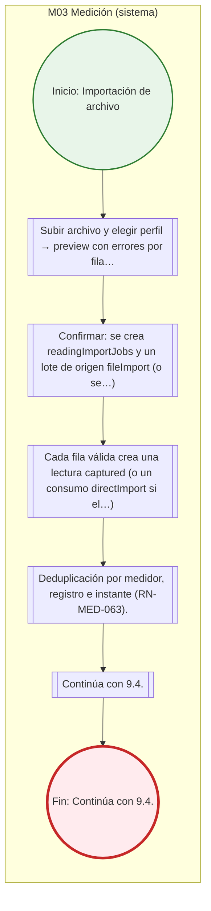

**Pasos del proceso** (actividad tomada del anexo; la columna RF/RN distingue lo citado en el paso de lo asociado por parámetro, permiso, evento o tema compartido).

| Paso | Carril | Actividad | RF/RN que aplican | EVT / JOB / PAN |
|---|---|---|---|---|
| 1 | M03 Medición | Subir archivo y elegir perfil → preview con errores por fila (ExcelImportWizard). | — | — |
| 2 | M03 Medición | Confirmar: se crea `readingImportJobs` y un lote de origen `fileImport` (o se asocia al lote exportado del período). | — | — |
| 3 | M03 Medición | Cada fila válida crea una lectura `captured` (o un consumo `directImport` si el perfil es de consumos, que exige aprobación previa). | — | — |
| 4 | M03 Medición | Deduplicación por medidor, registro e instante (RN-MED-063). | RN-MED-063 | — |
| 5 | M03 Medición | Continúa con 9.4. | — | — |

**Situación actual en ProCoop (nota de cambio).** Sin contraste específico para este proceso en el anexo (filas `CTR-` con ProCoop) ni en el análisis de brechas. El contraste del dominio está en `15-analisis-brechas-procoop.md` §3.6.

**Excepciones**

| Excepción | Tratamiento |
|---|---|
| Falla o error | Subir archivo y elegir perfil → preview con errores por fila (ExcelImportWizard) |
| Duplicado | Deduplicación por medidor, registro e instante (RN-MED-063) |
| Falla técnica en un paso automático, un job o una integración | Reintento idempotente y reanudable; lo no reparable pasa a la bandeja técnica con responsable (política de recuperación de M03 §9.17; AGR-016). |

---

## 11. PRC-MED-07 Telemedición: toma de estado (JOB-MED-10 `med:toma-estado`)

| Campo | Contenido |
|---|---|
| Fuente | M03 §9.7, `M03-MED-medicion-consumos.md` (línea 1361) |
| Macroproceso | MP-10 Medición y tarificación |
| Disparador | Telemedición: toma de estado |
| Resultado | Continúa con 9.4. También corre periódicamente (JOB-MED-11…) |
| Carriles | M03 Medición (sistema); T06 Integraciones |
| Roles de T02 | Solo actores del sistema (sin rol humano) |
| Módulos involucrados | M03 Medición, T06 Integraciones |
| Eventos (T11 §12) | — |
| Jobs | JOB-MED-11 `med:importar-ami` |
| Relación con 04-procesos-bpmn.md | P2 Ciclo de medición y lectura ([§6](04-procesos-bpmn.md#6-p2--ciclo-de-medición-y-lectura)) |

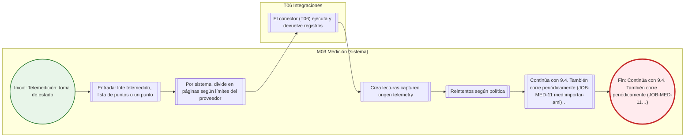

**Pasos del proceso** (actividad tomada del anexo; la columna RF/RN distingue lo citado en el paso de lo asociado por parámetro, permiso, evento o tema compartido).

| Paso | Carril | Actividad | RF/RN que aplican | EVT / JOB / PAN |
|---|---|---|---|---|
| 1 | M03 Medición | Entrada: lote telemedido, lista de puntos o un punto; agrupa por `meteringSystemId`. | — | — |
| 2 | M03 Medición | Por sistema, divide en páginas según límites del proveedor; por cada medidor crea `remoteMeterOperations` (`readNow`) con `idempotencyKey = tenant+point+period+attempt`. | — | — |
| 3 | T06 Integraciones | El conector (T06) ejecuta y devuelve registros; MED aplica `telemetryRegisterMappings` (máximo de hasta 3 registros, escala). | — | — |
| 4 | M03 Medición | Crea lecturas `captured` origen `telemetry`; si el punto es multicanal y ya existe lectura del período, pide confirmación (queda `captured` con advertencia). | — | — |
| 5 | M03 Medición | Reintentos según política; tras agotar, excepción `missingTelemetryReading` y la tarea pasa a estimación o lectura de campo según parámetro. | — | — |
| 6 | M03 Medición | Continúa con 9.4. También corre periódicamente (JOB-MED-11 `med:importar-ami`) para sistemas que publican lecturas por archivo o API de lote. | — | JOB-MED-11 |

**Situación actual en ProCoop (nota de cambio).** Sin contraste específico para este proceso en el anexo (filas `CTR-` con ProCoop) ni en el análisis de brechas. El contraste del dominio está en `15-analisis-brechas-procoop.md` §3.6.

**Excepciones**

| Excepción | Tratamiento |
|---|---|
| Si el punto es multicanal y ya existe lectura del período | pide confirmación (queda `captured` con advertencia) |
| Reintento | Reintentos según política; tras agotar, excepción `missingTelemetryReading` y la tarea pasa a estimación o lectura de campo según parámetro |
| Falla técnica en un paso automático, un job o una integración | Reintento idempotente y reanudable; lo no reparable pasa a la bandeja técnica con responsable (política de recuperación de M03 §9.17; AGR-016). |

---

## 12. PRC-MED-08 Comando remoto de corte/reconexión

| Campo | Contenido |
|---|---|
| Fuente | M03 §9.8, `M03-MED-medicion-consumos.md` (línea 1370) |
| Macroproceso | MP-10 Medición y tarificación |
| Disparador | Comando remoto de corte/reconexión |
| Resultado | Cancelación: si la orden de origen se anula antes del envío, la… |
| Carriles | M08 Mora; M03 Medición (sistema) |
| Roles de T02 | Solo actores del sistema (sin rol humano) |
| Módulos involucrados | M03 Medición, M08 Mora |
| Eventos (T11 §12) | EVT-MED-21 `med.remoteOperation.succeeded`; EVT-MED-22 `med.remoteOperation.failed` |
| Jobs | JOB-MED-12 `med:ejecutar-operaciones-remotas` |
| Relación con 04-procesos-bpmn.md | P2 Ciclo de medición y lectura ([§6](04-procesos-bpmn.md#6-p2--ciclo-de-medición-y-lectura)) |

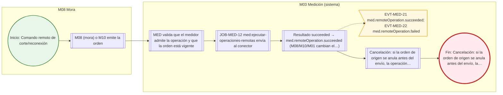

**Pasos del proceso** (actividad tomada del anexo; la columna RF/RN distingue lo citado en el paso de lo asociado por parámetro, permiso, evento o tema compartido).

| Paso | Carril | Actividad | RF/RN que aplican | EVT / JOB / PAN |
|---|---|---|---|---|
| 1 | M08 Mora | M08 (mora) o M10 emite la orden; invoca `POST /api/admin/med/remote-operations` (API-MED-50) con `Idempotency-Key` y la orden de origen. | — | — |
| 2 | M03 Medición | MED valida que el medidor admite la operación y que la orden está vigente; crea `remoteMeterOperations` `queued`. | — | — |
| 3 | M03 Medición | JOB-MED-12 `med:ejecutar-operaciones-remotas` envía al conector; registra intentos y log saneado. | — | JOB-MED-12 |
| 4 | M03 Medición | Resultado `succeeded` → `med.remoteOperation.succeeded` (M08/M10/M01 cambian el estado del servicio con la fecha confirmada); `failed`/`rejected` → `med.remoteOperation.failed` con causa (M10 puede emitir OT de corte físico); `unknown` → consulta de estado antes de reintentar. | — | EVT-MED-21, EVT-MED-22 |
| 5 | M03 Medición | Cancelación: si la orden de origen se anula antes del envío, la operación pasa a `cancelled`. | — | — |

**Situación actual en ProCoop (nota de cambio).** Sin contraste específico para este proceso en el anexo (filas `CTR-` con ProCoop) ni en el análisis de brechas. El contraste del dominio está en `15-analisis-brechas-procoop.md` §3.6.

**Excepciones**

| Excepción | Tratamiento |
|---|---|
| Resultado incierto o sin respuesta | `unknown` → consulta de estado antes de reintentar |
| Si la orden de origen se anula antes del envío | la operación pasa a `cancelled` |
| Falla técnica en un paso automático, un job o una integración | Reintento idempotente y reanudable; lo no reparable pasa a la bandeja técnica con responsable (política de recuperación de M03 §9.17; AGR-016). |

---

## 13. PRC-MED-09 Recarga prepaga

| Campo | Contenido |
|---|---|
| Fuente | M03 §9.9, `M03-MED-medicion-consumos.md` (línea 1378) |
| Macroproceso | MP-10 Medición y tarificación |
| Disparador | Recarga prepaga |
| Resultado | JOB-MED-14 med:conciliar-prepago diario compara topUpHistory… |
| Carriles | M03 Medición (sistema); M07 Cuenta corriente y cobranza |
| Roles de T02 | Solo actores del sistema (sin rol humano) |
| Módulos involucrados | M03 Medición, M07 Cuenta corriente y cobranza |
| Eventos (T11 §12) | EVT-COB-04 `cob.payment.confirmed` |
| Jobs | JOB-MED-13 `med:solicitar-credito-prepago`; JOB-MED-14 `med:conciliar-prepago` |
| Relación con 04-procesos-bpmn.md | P2 Ciclo de medición y lectura ([§6](04-procesos-bpmn.md#6-p2--ciclo-de-medición-y-lectura)) |

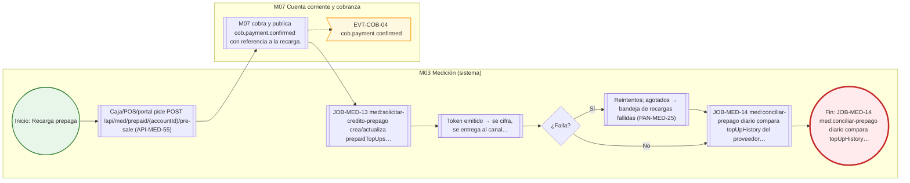

**Pasos del proceso** (actividad tomada del anexo; la columna RF/RN distingue lo citado en el paso de lo asociado por parámetro, permiso, evento o tema compartido).

| Paso | Carril | Actividad | RF/RN que aplican | EVT / JOB / PAN |
|---|---|---|---|---|
| 1 | M03 Medición | Caja/POS/portal pide `POST /api/med/prepaid/{accountId}/pre-sale` (API-MED-55): MED llama `validatePreSale` y devuelve resultado (y unidades estimadas por importe según M04). | — | — |
| 2 | M07 Cuenta corriente y cobranza | M07 cobra y publica `cob.payment.confirmed` con referencia a la recarga. | asoc.: RF-MED-115 | EVT-COB-04 |
| 3 | M03 Medición | JOB-MED-13 `med:solicitar-credito-prepago` crea/actualiza `prepaidTopUps` (`requested`) y llama `topUp` con `idempotencyKey`. | — | JOB-MED-13 |
| 4 | M03 Medición | Token emitido → se cifra, se entrega al canal (impresión/visualización/notificación) → `delivered`. Crédito en línea → `applied` tras `topUpStatus`. | — | — |
| 5 | M03 Medición | Falla → reintentos; agotados → bandeja de recargas fallidas (PAN-MED-25): reintentar o pedir devolución (M07). | — | PAN-MED-25 |
| 6 | M03 Medición | JOB-MED-14 `med:conciliar-prepago` diario compara `topUpHistory` del proveedor con recargas cobradas. | asoc.: RF-MED-116 | JOB-MED-14 |

**Situación actual en ProCoop (nota de cambio).** Análisis de brechas (`15-analisis-brechas-procoop.md` §3.6, Medición): hoy Energía prepaga con recargas, incluidas las online; en GoodApps, prepago en O7 con recarga por portal (brecha "Se mantiene"; fuente M03; DEC-088; brecha B-26).

**Excepciones**

| Excepción | Tratamiento |
|---|---|
| Falla o error | Falla → reintentos; agotados → bandeja de recargas fallidas (PAN-MED-25): reintentar o pedir devolución (M07) |
| Falla técnica en un paso automático, un job o una integración | Reintento idempotente y reanudable; lo no reparable pasa a la bandeja técnica con responsable (política de recuperación de M03 §9.17; AGR-016). |

---

## 14. PRC-MED-10 Estimación (JOB-MED-05 `med:estimar`)

| Campo | Contenido |
|---|---|
| Fuente | M03 §9.10, `M03-MED-medicion-consumos.md` (línea 1387) |
| Macroproceso | MP-10 Medición y tarificación |
| Disparador | Estimación |
| Resultado | Actualiza consecutiveEstimates |
| Carriles | M03 Medición (sistema) |
| Roles de T02 | Solo actores del sistema (sin rol humano) |
| Módulos involucrados | M03 Medición |
| Eventos (T11 §12) | EVT-MED-16 `med.point.inspectionRequested` |
| Jobs | — |
| Relación con 04-procesos-bpmn.md | P2 Ciclo de medición y lectura ([§6](04-procesos-bpmn.md#6-p2--ciclo-de-medición-y-lectura)) |

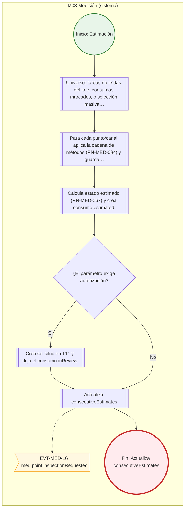

**Pasos del proceso** (actividad tomada del anexo; la columna RF/RN distingue lo citado en el paso de lo asociado por parámetro, permiso, evento o tema compartido).

| Paso | Carril | Actividad | RF/RN que aplican | EVT / JOB / PAN |
|---|---|---|---|---|
| 1 | M03 Medición | Universo: tareas no leídas del lote, consumos marcados, o selección masiva (PAN-MED-14). | — | PAN-MED-14 |
| 2 | M03 Medición | Para cada punto/canal aplica la cadena de métodos (RN-MED-084) y guarda método y base. | RN-MED-084 | — |
| 3 | M03 Medición | Calcula estado estimado (RN-MED-067) y crea consumo `estimated`. | RN-MED-067 | — |
| 4 | M03 Medición | Si el parámetro exige autorización, crea solicitud en T11 y deja el consumo `inReview`. | — | — |
| 5 | M03 Medición | Actualiza `consecutiveEstimates`; si supera el tope, emite `med.point.inspectionRequested` (RN-MED-090). | RN-MED-090; asoc.: RF-MED-081 | EVT-MED-16 |

**Situación actual en ProCoop (nota de cambio).** Sin contraste específico para este proceso en el anexo (filas `CTR-` con ProCoop) ni en el análisis de brechas. El contraste del dominio está en `15-analisis-brechas-procoop.md` §3.6.

**Excepciones**

| Excepción | Tratamiento |
|---|---|
| Si el parámetro exige autorización | crea solicitud en T11 y deja el consumo `inReview` |
| Si supera el tope | emite `med.point.inspectionRequested` (RN-MED-090) |
| Falla técnica en un paso automático, un job o una integración | Reintento idempotente y reanudable; lo no reparable pasa a la bandeja técnica con responsable (política de recuperación de M03 §9.17; AGR-016). |

---

## 15. PRC-MED-11 Regularización de estimados (JOB-MED-08 `med:regularizar-estimados`)

| Campo | Contenido |
|---|---|
| Fuente | M03 §9.11, `M03-MED-medicion-consumos.md` (línea 1395) |
| Macroproceso | MP-10 Medición y tarificación |
| Disparador | Regularización de estimados |
| Resultado | Aprobación (PAN-MED-15) |
| Carriles | M03 Medición (sistema); Aprobador según política (T11 aprobaciones) |
| Roles de T02 | Solo actores del sistema (sin rol humano) |
| Módulos involucrados | M03 Medición, T11 Workflow, eventos y documentos |
| Eventos (T11 §12) | EVT-MED-15 `med.consumptionAdjustment.approved` |
| Jobs | — |
| Relación con 04-procesos-bpmn.md | P2 Ciclo de medición y lectura ([§6](04-procesos-bpmn.md#6-p2--ciclo-de-medición-y-lectura)) |

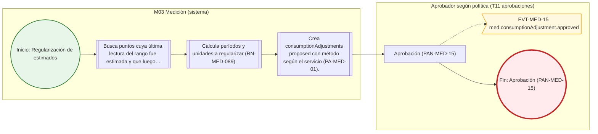

**Pasos del proceso** (actividad tomada del anexo; la columna RF/RN distingue lo citado en el paso de lo asociado por parámetro, permiso, evento o tema compartido).

| Paso | Carril | Actividad | RF/RN que aplican | EVT / JOB / PAN |
|---|---|---|---|---|
| 1 | M03 Medición | Busca puntos cuya última lectura del rango fue estimada y que luego recibieron lectura real (filtros opcionales: solo telemedidas, solo medidor actual). | asoc.: RN-MED-089 | — |
| 2 | M03 Medición | Calcula períodos y unidades a regularizar (RN-MED-089). | RN-MED-089 | — |
| 3 | M03 Medición | Crea `consumptionAdjustments` `proposed` con método según el servicio (PA-MED-01). | asoc.: RN-MED-089, RF-MED-079 | — |
| 4 | Aprobador según política | Aprobación (PAN-MED-15); al aprobar, `med.consumptionAdjustment.approved` → M04/M05 lo aplica en la próxima liquidación (compensación) o refactura (NC/ND). | asoc.: RF-MED-079, RN-MED-089 | PAN-MED-15, EVT-MED-15 |

**Situación actual en ProCoop (nota de cambio).** Sin contraste específico para este proceso en el anexo (filas `CTR-` con ProCoop) ni en el análisis de brechas. El contraste del dominio está en `15-analisis-brechas-procoop.md` §3.6.

**Excepciones**

| Excepción | Tratamiento |
|---|---|
| Falla técnica en un paso automático, un job o una integración | Reintento idempotente y reanudable; lo no reparable pasa a la bandeja técnica con responsable (política de recuperación de M03 §9.17; AGR-016). |

---

## 16. PRC-MED-12 División, agrupación y distribución (JOB-MED-06 `med:dividir-consumos`, JOB-MED-07 `med:distribuir-consumos`)

| Campo | Contenido |
|---|---|
| Fuente | M03 §9.12, `M03-MED-medicion-consumos.md` (línea 1402) |
| Macroproceso | MP-10 Medición y tarificación |
| Disparador | División, agrupación y distribución |
| Resultado | Distribución: por cada distribución vigente con padre aprobado… |
| Carriles | M03 Medición (sistema) |
| Roles de T02 | Solo actores del sistema (sin rol humano) |
| Módulos involucrados | M03 Medición |
| Eventos (T11 §12) | — |
| Jobs | — |
| Relación con 04-procesos-bpmn.md | P2 Ciclo de medición y lectura ([§6](04-procesos-bpmn.md#6-p2--ciclo-de-medición-y-lectura)) |

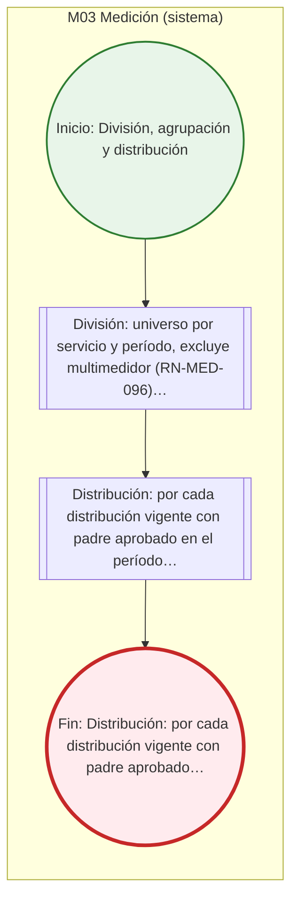

**Pasos del proceso** (actividad tomada del anexo; la columna RF/RN distingue lo citado en el paso de lo asociado por parámetro, permiso, evento o tema compartido).

| Paso | Carril | Actividad | RF/RN que aplican | EVT / JOB / PAN |
|---|---|---|---|---|
| 1 | M03 Medición | División: universo por servicio y período, excluye multimedidor (RN-MED-096), aplica el modo (RN-MED-091 a 095), conserva el original como `netQuantity`, preview e impresión antes de confirmar. | RN-MED-091, RN-MED-096; asoc.: RF-MED-084 | — |
| 2 | M03 Medición | Distribución: por cada distribución vigente con padre aprobado en el período, valida no duplicación (RN-MED-099) y tope (RN-MED-098), crea consumos de hijos y compensatorio del padre con `runId`; reversión por `runId`. | RN-MED-098, RN-MED-099 | — |

**Situación actual en ProCoop (nota de cambio).** Sin contraste específico para este proceso en el anexo (filas `CTR-` con ProCoop) ni en el análisis de brechas. El contraste del dominio está en `15-analisis-brechas-procoop.md` §3.6.

**Excepciones**

| Excepción | Tratamiento |
|---|---|
| Duplicado | Distribución: por cada distribución vigente con padre aprobado en el período, valida no duplicación (RN-MED-099) y tope (RN-MED-098), crea consumos de hijos y compensatorio del padre con `runId`; reversión por `runId` |
| Falla técnica en un paso automático, un job o una integración | Reintento idempotente y reanudable; lo no reparable pasa a la bandeja técnica con responsable (política de recuperación de M03 §9.17; AGR-016). |

---

## 17. PRC-MED-13 Demanda y transgresiones (JOB-MED-09 `med:detectar-transgresiones`)

| Campo | Contenido |
|---|---|
| Fuente | M03 §9.13, `M03-MED-medicion-consumos.md` (línea 1407) |
| Macroproceso | MP-10 Medición y tarificación |
| Disparador | Demanda y transgresiones |
| Resultado | Reset con aprobación (RN-MED-103) |
| Carriles | M03 Medición (sistema) |
| Roles de T02 | Solo actores del sistema (sin rol humano) |
| Módulos involucrados | M03 Medición |
| Eventos (T11 §12) | EVT-MED-18 `med.demand.transgressionDetected` |
| Jobs | — |
| Relación con 04-procesos-bpmn.md | P2 Ciclo de medición y lectura ([§6](04-procesos-bpmn.md#6-p2--ciclo-de-medición-y-lectura)) |

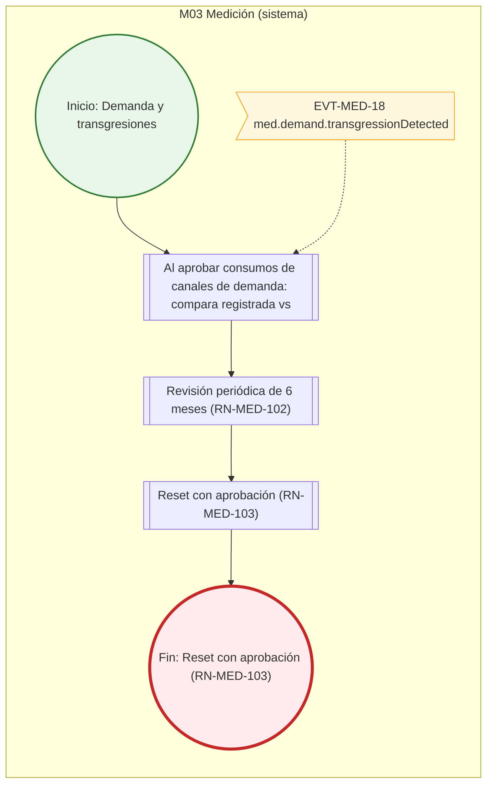

**Pasos del proceso** (actividad tomada del anexo; la columna RF/RN distingue lo citado en el paso de lo asociado por parámetro, permiso, evento o tema compartido).

| Paso | Carril | Actividad | RF/RN que aplican | EVT / JOB / PAN |
|---|---|---|---|---|
| 1 | M03 Medición | Al aprobar consumos de canales de demanda: compara registrada vs. contratada del período, crea `demandTransgressions`, actualiza declarada, emite `med.demand.transgressionDetected` | asoc.: RF-MED-093, RN-MED-102 | EVT-MED-18 |
| 2 | M03 Medición | Revisión periódica de 6 meses (RN-MED-102) | RN-MED-102 | — |
| 3 | M03 Medición | Reset con aprobación (RN-MED-103) | RN-MED-103 | — |

**Situación actual en ProCoop (nota de cambio).** Sin contraste específico para este proceso en el anexo (filas `CTR-` con ProCoop) ni en el análisis de brechas. El contraste del dominio está en `15-analisis-brechas-procoop.md` §3.6.

**Excepciones**

| Excepción | Tratamiento |
|---|---|
| Falla técnica en un paso automático, un job o una integración | Reintento idempotente y reanudable; lo no reparable pasa a la bandeja técnica con responsable (política de recuperación de M03 §9.17; AGR-016). |

---

## 18. PRC-MED-14 Generación distribuida (JOB-MED-15 `med:balance-inyeccion`)

| Campo | Contenido |
|---|---|
| Fuente | M03 §9.14, `M03-MED-medicion-consumos.md` (línea 1411) |
| Macroproceso | MP-10 Medición y tarificación |
| Disparador | Generación distribuida |
| Resultado | Calcula injectionBalances (demanda, inyección, neto, por banda)… |
| Carriles | M03 Medición (sistema) |
| Roles de T02 | Solo actores del sistema (sin rol humano) |
| Módulos involucrados | M03 Medición |
| Eventos (T11 §12) | EVT-MED-19 `med.injectionBalance.approved` |
| Jobs | — |
| Relación con 04-procesos-bpmn.md | P2 Ciclo de medición y lectura ([§6](04-procesos-bpmn.md#6-p2--ciclo-de-medición-y-lectura)) |

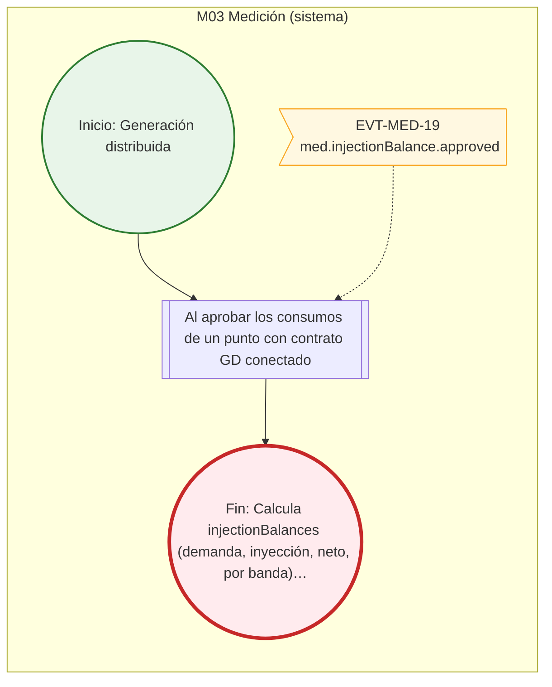

**Pasos del proceso** (actividad tomada del anexo; la columna RF/RN distingue lo citado en el paso de lo asociado por parámetro, permiso, evento o tema compartido).

| Paso | Carril | Actividad | RF/RN que aplican | EVT / JOB / PAN |
|---|---|---|---|---|
| 1 | M03 Medición | Al aprobar los consumos de un punto con contrato GD conectado: calcula `injectionBalances` (demanda, inyección, neto, por banda) y emite `med.injectionBalance.approved` para M04/M05/M07 | asoc.: RF-MED-064 | EVT-MED-19 |

**Situación actual en ProCoop (nota de cambio).** Sin contraste específico para este proceso en el anexo (filas `CTR-` con ProCoop) ni en el análisis de brechas. El contraste del dominio está en `15-analisis-brechas-procoop.md` §3.6.

**Excepciones**

| Excepción | Tratamiento |
|---|---|
| Falla técnica en un paso automático, un job o una integración | Reintento idempotente y reanudable; lo no reparable pasa a la bandeja técnica con responsable (política de recuperación de M03 §9.17; AGR-016). |

---

## 19. PRC-MED-15 Autolectura

| Campo | Contenido |
|---|---|
| Fuente | M03 §9.15, `M03-MED-medicion-consumos.md` (línea 1415) |
| Macroproceso | MP-10 Medición y tarificación |
| Disparador | Autolectura |
| Resultado | Resultado al socio: med.selfReading.accepted /… |
| Carriles | M03 Medición (sistema); Socio titular (C-SOC) |
| Roles de T02 | C-SOC Socio titular |
| Módulos involucrados | M03 Medición |
| Eventos (T11 §12) | EVT-MED-26 `med.selfReadingWindow.opened`; EVT-MED-27 `med.selfReading.accepted`, `med.selfReading.rejected` |
| Jobs | JOB-MED-16 `med:abrir-ventanas-autolectura` |
| Relación con 04-procesos-bpmn.md | P2 Ciclo de medición y lectura ([§6](04-procesos-bpmn.md#6-p2--ciclo-de-medición-y-lectura)) |

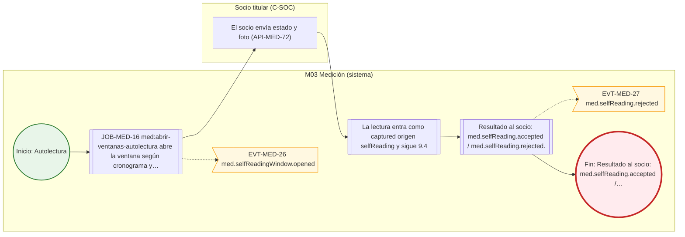

**Pasos del proceso** (actividad tomada del anexo; la columna RF/RN distingue lo citado en el paso de lo asociado por parámetro, permiso, evento o tema compartido).

| Paso | Carril | Actividad | RF/RN que aplican | EVT / JOB / PAN |
|---|---|---|---|---|
| 1 | M03 Medición | JOB-MED-16 `med:abrir-ventanas-autolectura` abre la ventana según cronograma y emite `med.selfReadingWindow.opened` (T09 notifica). | — | JOB-MED-16, EVT-MED-26 |
| 2 | Socio titular | El socio envía estado y foto (API-MED-72); validaciones RN-MED-056. | RN-MED-056 | — |
| 3 | M03 Medición | La lectura entra como `captured` origen `selfReading` y sigue 9.4. Si la política lo permite y queda dentro de rango, la tarea de la ruta se marca "resuelta por autolectura" (PA-MED-06). | asoc.: RF-MED-057, RN-MED-056 | — |
| 4 | M03 Medición | Resultado al socio: `med.selfReading.accepted` / `med.selfReading.rejected`. | — | EVT-MED-27 |

**Situación actual en ProCoop (nota de cambio).** Sin contraste específico para este proceso en el anexo (filas `CTR-` con ProCoop) ni en el análisis de brechas. El contraste del dominio está en `15-analisis-brechas-procoop.md` §3.6.

**Excepciones**

| Excepción | Tratamiento |
|---|---|
| Si la política lo permite y queda dentro de rango | la tarea de la ruta se marca "resuelta por autolectura" (PA-MED-06) |
| Falla técnica en un paso automático, un job o una integración | Reintento idempotente y reanudable; lo no reparable pasa a la bandeja técnica con responsable (política de recuperación de M03 §9.17; AGR-016). |

---

## Inconsistencias detectadas en la especificación (esta parte)

No se detectaron inconsistencias en los procesos de esta parte.

## Cobertura de esta parte

| Universo de la parte | Diagramados | Con nota ProCoop específica | Pendientes |
|---|---|---|---|
| 19 (PRC-VEN-02 a PRC-MED-15) | 19 | 3 | 0 |
