# GoodApps Cooperativas

## Procesos de negocio — Medición y tarificación y Facturación y fiscal (M03, M04, M05, M06)

**Entregable de Análisis y Diseño Detallado — Artefacto 2.1 (Procesos de negocio BPMN). Parte de [`04-procesos-bpmn.md`](04-procesos-bpmn.md).**

| Dato | Valor |
|---|---|
| Documento | Diagramas BPMN, pasos, situación actual en ProCoop y excepciones de los procesos PRC-MED-16 a PRC-FIS-04, derivados de la sección 9 de M03, M04, M05, M06 |
| Carácter | Derivado de la especificación vigente; no la reemplaza. Ante diferencias prevalecen la maestra `00`, los anexos, T05, T11 y el registro de decisiones `01` |
| Generación | Script `_trabajo/generar_bpmn.py` con la ampliación `_trabajo/generar_prc.py` (derivación automática desde el texto de la sección 9 de cada anexo, `_trabajo/prc_auto.py`) |
| Versión | 1.1 (regenerada contra la especificación corregida) |
| Fecha | 05-11-2026 |

**Cómo leer cada proceso.** La notación es la de [`04-procesos-bpmn.md` §3](04-procesos-bpmn.md#3-notación-equivalencia-mermaid--bpmn) (carriles, eventos de inicio y fin, tareas de usuario y de servicio, compuertas XOR y AND, eventos de dominio como banderas, temporizadores y jobs como estadios). La tabla de pasos reproduce la actividad del anexo; en la columna RF/RN, los identificadores sin prefijo son los que el anexo cita en el paso y los marcados "asoc." son reglas o requisitos del mismo anexo que comparten parámetro, permiso, evento o tema con el paso (asociación generada por el script y revisada). Los eventos se nombran con su ID del catálogo de T11 §12.

**Derivación automática (v1.2).** Los procesos `PRC-<MOD>-nn` de esta parte se generaron con `_trabajo/generar_prc.py` y `_trabajo/prc_auto.py` a partir del texto de cada subsección §9.n del anexo, sin curaduría paso a paso (a diferencia de los 94 procesos `P-XXX-nn` de las partes 04b a 04i). Reglas: (1) los pasos son los numerados o viñetas del anexo; si la subsección es prosa, se parte por flechas o por oraciones; si es una tabla de pasos o de jobs, cada fila es un paso; (2) el carril de cada paso es el primer actor nombrado al comienzo del paso (rol de T02 §4, otro módulo, sistema externo, dispositivo o job); si no se nombra ninguno, el paso es del sistema del módulo dueño; (3) los pasos que empiezan con "Si …" se dibujan como compuerta XOR; (4) los eventos son los nombres del catálogo de T11 §12 citados en el paso (bandera entrante si el paso los consume, saliente si los publica); el temporizador aparece cuando el título nombra un job periódico; (5) las excepciones son las oraciones del anexo con condición o con palabras de falla, rechazo, vencimiento, duplicado o umbral, más la política de recuperación del anexo; (6) la nota ProCoop combina lo que dice el propio anexo, la fila `CTR-` del anexo que contrasta con ProCoop y la fila de `15-analisis-brechas-procoop.md` §3 de mayor afinidad; si ninguna alcanza el umbral, la nota lo dice y remite al contraste del dominio en esa sección. La revisión manual de una muestra está en `_trabajo/prc_revision.md`; ante diferencias, prevalece el texto del anexo citado en la ficha.

## Índice de procesos de esta parte

1. [PRC-MED-16 Cambio de medidor desde OT (M10)](#1-prc-med-16-cambio-de-medidor-desde-ot-m10)
2. [PRC-TAR-01 Ciclo de actualización de una tarifa (DFA flujo 5; RN-TAR-064)](#2-prc-tar-01-ciclo-de-actualización-de-una-tarifa-dfa-flujo-5-rn-tar-064)
3. [PRC-TAR-02 Pipeline de cálculo (motor puro y determinista)](#3-prc-tar-02-pipeline-de-cálculo-motor-puro-y-determinista)
4. [PRC-TAR-03 Simulador masivo comparativo (JOB-TAR-02 `tar:simular-masivo`)](#4-prc-tar-03-simulador-masivo-comparativo-job-tar-02-tarsimular-masivo)
5. [PRC-TAR-04 Diferencias retroactivas (JOB-TAR-06 `tar:diferencias-retroactivas`)](#5-prc-tar-04-diferencias-retroactivas-job-tar-06-tardiferencias-retroactivas)
6. [PRC-TAR-05 Tasación telefónica (JOB-TAR-09 `tar:tasar-llamadas`, JOB-TAR-10 `tar:retasar`)](#6-prc-tar-05-tasación-telefónica-job-tar-09-tartasar-llamadas-job-tar-10-tarretasar)
7. [PRC-TAR-06 Padrones de subsidio y tarifa social (JOB-TAR-04 `tar:importar-padron`, JOB-TAR-05 `tar:recategorizar`)](#7-prc-tar-06-padrones-de-subsidio-y-tarifa-social-job-tar-04-tarimportar-padron-job-tar-05-tarrecategorizar)
8. [PRC-TAR-07 Promociones](#8-prc-tar-07-promociones)
9. [PRC-FAC-01 Ciclo masivo completo (CU-LOT-01, CU-FAC-01)](#9-prc-fac-01-ciclo-masivo-completo-cu-lot-01-cu-fac-01)
10. [PRC-FAC-02 Anulación, NC y ND (CU-FAC-04)](#10-prc-fac-02-anulación-nc-y-nd-cu-fac-04)
11. [PRC-FAC-03 Refacturación puntual (CU-FAC-05)](#11-prc-fac-03-refacturación-puntual-cu-fac-05)
12. [PRC-FAC-04 Factura manual y replicar (CU-FAC-06)](#12-prc-fac-04-factura-manual-y-replicar-cu-fac-06)
13. [PRC-FAC-05 Fallo sistémico y reanudación (AGR-015)](#13-prc-fac-05-fallo-sistémico-y-reanudación-agr-015)
14. [PRC-FAC-06 Distribución (CU-FAC-07)](#14-prc-fac-06-distribución-cu-fac-07)
15. [PRC-FAC-07 Facturación in situ (O7, PA-FAC-14)](#15-prc-fac-07-facturación-in-situ-o7-pa-fac-14)
16. [PRC-FIS-01 Habilitación fiscal del tenant (alta en ARCA)](#16-prc-fis-01-habilitación-fiscal-del-tenant-alta-en-arca)
17. [PRC-FIS-02 Autorización CAE (JOB-FIS-01 `fis:autorizar-cola`)](#17-prc-fis-02-autorización-cae-job-fis-01-fisautorizar-cola)
18. [PRC-FIS-03 Espera sincrónica (venta mostrador y cobranza con factura)](#18-prc-fis-03-espera-sincrónica-venta-mostrador-y-cobranza-con-factura)
19. [PRC-FIS-04 Conciliación de incierto e inconsistencias (JOB-FIS-04 `fis:conciliar-incierto`, JOB-FIS-05 `fis:conciliar-arca`)](#19-prc-fis-04-conciliación-de-incierto-e-inconsistencias-job-fis-04-fisconciliar-incierto-job-fis-05-fisconciliar-arca)

---

## 1. PRC-MED-16 Cambio de medidor desde OT (M10)

| Campo | Contenido |
|---|---|
| Fuente | M03 §9.16, `M03-MED-medicion-consumos.md` (línea 1422) |
| Macroproceso | MP-10 Medición y tarificación |
| Disparador | Cambio de medidor desde OT |
| Resultado | Emite med.meter.removed y med.meter.installed (M13 mueve stock). |
| Carriles | M10 Técnica y campo; M03 Medición (sistema) |
| Roles de T02 | Solo actores del sistema (sin rol humano) |
| Módulos involucrados | M03 Medición, M10 Técnica y campo |
| Eventos (T11 §12) | EVT-TEC-07 `tec.workOrder.closed`; EVT-MED-04 `med.installation.categoryChangeRequested`; EVT-MED-02 `med.meter.removed`; EVT-MED-01 `med.meter.installed` |
| Jobs | — |
| Relación con 04-procesos-bpmn.md | P2 Ciclo de medición y lectura ([§6](04-procesos-bpmn.md#6-p2--ciclo-de-medición-y-lectura)) |

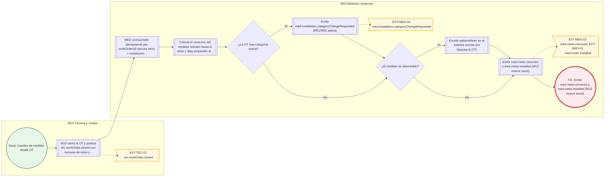

**Pasos del proceso** (actividad tomada del anexo; la columna RF/RN distingue lo citado en el paso de lo asociado por parámetro, permiso, evento o tema compartido).

| Paso | Carril | Actividad | RF/RN que aplican | EVT / JOB / PAN |
|---|---|---|---|---|
| 1 | M10 Técnica y campo | M10 cierra la OT y publica `tec.workOrder.closed` con lecturas de retiro y colocación, medidor nuevo, precintos y fotos. | — | EVT-TEC-07 |
| 2 | M03 Medición | MED (consumidor idempotente por `workOrderId`) ejecuta retiro + instalación (RF-MED-018) en una transacción, crea lecturas `captured` purpose `removal`/`installation` y las valida. | RF-MED-018 | — |
| 3 | M03 Medición | Calcula el consumo del medidor retirado hasta el retiro y deja preparado el tramo del nuevo (RN-MED-094). | RN-MED-094 | — |
| 4 | M03 Medición | Si la OT trae categoría nueva, emite `med.installation.categoryChangeRequested` (M01/M02 aplica). | — | EVT-MED-04 |
| 5 | M03 Medición | Si el medidor es telemedido, encola `replaceMeter` en el sistema remoto (no bloquea la OT). | — | — |
| 6 | M03 Medición | Emite `med.meter.removed` y `med.meter.installed` (M13 mueve stock). | — | EVT-MED-02, EVT-MED-01 |

**Situación actual en ProCoop (nota de cambio).** Sin contraste específico para este proceso en el anexo (filas `CTR-` con ProCoop) ni en el análisis de brechas. El contraste del dominio está en `15-analisis-brechas-procoop.md` §3.6.

**Excepciones**

| Excepción | Tratamiento |
|---|---|
| Si la OT trae categoría nueva | emite `med.installation.categoryChangeRequested` (M01/M02 aplica) |
| Si el medidor es telemedido | encola `replaceMeter` en el sistema remoto (no bloquea la OT) |
| Falla técnica en un paso automático, un job o una integración | Reintento idempotente y reanudable; lo no reparable pasa a la bandeja técnica con responsable (política de recuperación de M03 §9.17; AGR-016). |

---

## 2. PRC-TAR-01 Ciclo de actualización de una tarifa (DFA flujo 5; RN-TAR-064)

| Campo | Contenido |
|---|---|
| Fuente | M04 §9.1, `M04-TAR-tarifas-motor-calculo.md` (línea 1506) |
| Macroproceso | MP-10 Medición y tarificación |
| Disparador | Ciclo de actualización de una tarifa |
| Resultado | Comunicar (opcional): publicación del cuadro en landing/portal… |
| Carriles | Facturación (T-FAC); M04 Tarifas (sistema); T11 Workflow, eventos y documentos |
| Roles de T02 | T-FAC Facturación |
| Módulos involucrados | M04 Tarifas, T11 Workflow, eventos y documentos |
| Eventos (T11 §12) | — |
| Jobs | JOB-TAR-01 `tar:activar-versiones` |
| Relación con 04-procesos-bpmn.md | P3 Facturación periódica y emisión fiscal ([§7](04-procesos-bpmn.md#7-p3--facturación-periódica-y-emisión-fiscal)) |

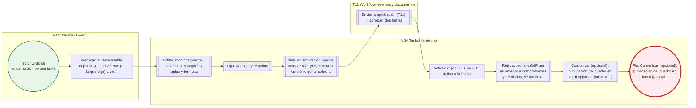

**Pasos del proceso** (actividad tomada del anexo; la columna RF/RN distingue lo citado en el paso de lo asociado por parámetro, permiso, evento o tema compartido).

| Paso | Carril | Actividad | RF/RN que aplican | EVT / JOB / PAN |
|---|---|---|---|---|
| 1 | Facturación | Preparar: el responsable copia la versión vigente (o la que elija) a un borrador (`POST /api/admin/tar/cuadros/:id/copiar`) o lanza una actualización masiva (porcentaje, importe fijo o fórmula sobre campos elegidos, con política de redondeo), o importa un archivo (ExcelImportWizard) con filas por clave natural. | asoc.: RF-TAR-016, RN-TAR-201 | — |
| 2 | M04 Tarifas | Editar: modifica precios, escalones, categorías, reglas y fórmulas; el editor valida en línea (escalones, referencias, tipos, fase) y muestra el diff contra la versión de origen. | asoc.: RF-TAR-069 | — |
| 3 | M04 Tarifas | Fijar vigencia y respaldo: `validFrom` (y opcional `validTo`), criterio de fecha de referencia, documentos normativos con PDF. | asoc.: RN-TAR-059 | — |
| 4 | M04 Tarifas | Simular: simulación masiva comparativa (9.6) contra la versión vigente sobre el universo exigido por PRM-TAR-005; resultado vinculado a la versión. | asoc.: RF-TAR-006, RN-TAR-214 | — |
| 5 | T11 Workflow, eventos y documentos | Enviar a aprobación (T11) → aprobar (dos firmas; tercera si corresponde) → publicar (programada o inmediata). | — | — |
| 6 | M04 Tarifas | Activar: el job JOB-TAR-01 activa a la fecha; la versión anterior queda `superseded` con `validTo`; los cálculos de períodos que crucen la vigencia aplican prorrateo automático (RN-TAR-049–058). | RN-TAR-049; asoc.: RN-TAR-059, RF-TAR-019 | JOB-TAR-01 |
| 7 | M04 Tarifas | Retroactivo: si `validFrom` es anterior a comprobantes ya emitidos, se calcula la diferencia (9.7), que requiere aprobación para generar ajustes en M05. | asoc.: RN-TAR-059 | — |
| 8 | M04 Tarifas | Comunicar (opcional): publicación del cuadro en landing/portal (pantalla pública sin login, sin capability; antes `public.cuadros.ver`) y novedad a socios (T09). | — | — |

**Situación actual en ProCoop (nota de cambio).** CTR-TAR-01: en ProCoop, cuadro = foto del pasado y tablas vivas = tarifa actual. BASE: versiones con vigencia y reproducibilidad. Cambio adoptado: Toda tarifa es versión con `validFrom/validTo`; sin tablas vivas. Análisis de brechas (`15-analisis-brechas-procoop.md` §3.7, Tarifas): hoy Tablas de trabajo para preparar cuadros y recalcular bonificaciones; en GoodApps, borrador de versión tarifaria (brecha "Se elimina"; fuente T07 §19.2).

**Excepciones**

| Excepción | Tratamiento |
|---|---|
| Si `validFrom` es anterior a comprobantes ya emitidos | se calcula la diferencia (9.7), que requiere aprobación para generar ajustes en M05 |
| Cancelación, anulación o reversión | Cancelación: un borrador o envío se retira sin efectos |
| Si la activación falla (job caído) | el job es idempotente por `scheduleId` y se reintenta; mientras tanto el cálculo usa la versión con `validFrom ≤ fecha de referencia` y estado `scheduled\|active` (la activación es un cambio de estado, la selección es por fecha) |
| Falla técnica en un paso automático, un job o una integración | Reintento idempotente y reanudable; lo no reparable pasa a la bandeja técnica con responsable (política de recuperación de T11 P-WFL-01 y T01 §9.12; AGR-016). |

---

## 3. PRC-TAR-02 Pipeline de cálculo (motor puro y determinista)

| Campo | Contenido |
|---|---|
| Fuente | M04 §9.2, `M04-TAR-tarifas-motor-calculo.md` (línea 1519) |
| Macroproceso | MP-10 Medición y tarificación |
| Disparador | Pipeline de cálculo |
| Resultado | P21 Cierre: Signo del total (negativo ⇒ informa a M05 para nota…) |
| Carriles | M04 Tarifas (sistema) |
| Roles de T02 | Solo actores del sistema (sin rol humano) |
| Módulos involucrados | M04 Tarifas |
| Eventos (T11 §12) | — |
| Jobs | — |
| Relación con 04-procesos-bpmn.md | P3 Facturación periódica y emisión fiscal ([§7](04-procesos-bpmn.md#7-p3--facturación-periódica-y-emisión-fiscal)) |

```mermaid
flowchart LR
  subgraph L_LSIS["M04 Tarifas (sistema)"]
    ni(("Inicio: Pipeline de cálculo"))
    ns1[["P00 Contexto e instantánea"]]
    ns2[["P01 Elegibilidad: Condición del contrato"]]
    ns3[["P02 Cantidad por estrategia"]]
    ns4[["P03 Correcciones de cantidad"]]
    ns5[["P04 Prorrateo entre versiones"]]
    ns6[["P05 Cargo fijo: Condiciones, importe (por días, por tramo, multicategoría…)"]]
    ns7[["P06 Cargo variable: Bloque o tramos/escalones por versión y fracción"]]
    ns8[["P07 Mínimo: Consumo mínimo por unidades faltantes (sobre consumo sin…)"]]
    ns9[["P08 Grandes consumos: Energía por franja, demanda (contratada, registrada…)"]]
    ns10[["P09 Prepaga: Escalón con consumo acumulado del mes, descuento de unidades ya…"]]
    ns11[["P10 Proporcional de alta/baja"]]
    ns12[["P11 Cargos del contrato"]]
    ns13[["P12 Reglas de fase servicio"]]
    ns14[["P13 Agrupación por comprobante"]]
    ns15[["P14 Franqueo: Renglón de envío postal si corresponde."]]
    ns16[["P15 Fiscal preliminar: Resuelve alícuota por renglón (cascada) e invoca…"]]
    ns17[["P16 Reglas de fase comprobante"]]
    ns18[["P17 Fiscal definitivo: Recalcula tributos solo de los renglones nuevos o…"]]
    ns19[["P18 Crédito por inyectada"]]
    ns20[["P19 Anticipos: Propuesta de aplicación de anticipos de M07."]]
    ns21[["P20 Redondeo: Redondeo de renglones (si no se hizo en P13) y del total (tipos…)"]]
    ns22[["P21 Cierre: Signo del total (negativo ⇒ informa a M05 para nota de crédito)…"]]
    nf(("Fin: P21 Cierre: Signo del total (negativo ⇒ informa a M05 para nota…)"))
  end
  ni --> ns1
  ns1 --> ns2
  ns2 --> ns3
  ns3 --> ns4
  ns4 --> ns5
  ns5 --> ns6
  ns6 --> ns7
  ns7 --> ns8
  ns8 --> ns9
  ns9 --> ns10
  ns10 --> ns11
  ns11 --> ns12
  ns12 --> ns13
  ns13 --> ns14
  ns14 --> ns15
  ns15 --> ns16
  ns16 --> ns17
  ns17 --> ns18
  ns18 --> ns19
  ns19 --> ns20
  ns20 --> ns21
  ns21 --> ns22
  ns22 --> nf
  classDef inicio fill:#e8f5e9,stroke:#2e7d32,stroke-width:2px
  classDef fin fill:#ffebee,stroke:#c62828,stroke-width:4px
  classDef evento fill:#fff8e1,stroke:#f9a825
  classDef temporizador fill:#e3f2fd,stroke:#1565c0
  class ni inicio
  class nf fin
```

**Pasos del proceso** (actividad tomada del anexo; la columna RF/RN distingue lo citado en el paso de lo asociado por parámetro, permiso, evento o tema compartido).

| Paso | Carril | Actividad | RF/RN que aplican | EVT / JOB / PAN |
|---|---|---|---|---|
| 1 | M04 Tarifas | P00 Contexto e instantánea: Resuelve cuenta, situación fiscal, contratos a liquidar (los "facturar con otros" al final), fecha de referencia por contrato (PRM-TAR-010), versiones aplicables de cuadro, configuración de servicio y reglas (hasta 3 por prorrateo); lee consumos, adherentes, llamadas, inmueble, inscripciones, grupos, promociones, precargados, saldos de redondeo y anticipos; calcula `inputHash`.; Reglas: RN-TAR-001, RN-TAR-003, RN-TAR-065, RN-TAR-131, RN-TAR-199, RN-TAR-200 | RN-TAR-001, RN-TAR-003, RN-TAR-065, RN-TAR-131, RN-TAR-199, RN-TAR-200; asoc.: RF-TAR-060, RF-TAR-020 | — |
| 2 | M04 Tarifas | P01 Elegibilidad: Condición del contrato; control de "una vez por período" en no medidos; categoría válida (consumo → contrato → forzada); versión existente y no ambigua (`TAR-E-SCH-NONE`, `TAR-E-SCH-AMBIGUOUS`).; Reglas: RN-TAR-004, RN-TAR-005, RN-TAR-013, RN-TAR-014, RN-TAR-017, RN-TAR-200 | RN-TAR-004, RN-TAR-005, RN-TAR-013, RN-TAR-014, RN-TAR-017, RN-TAR-200 | — |
| 3 | M04 Tarifas | P02 Cantidad por estrategia: Ejecuta la estrategia del `calcType`: consumos agrupados por tipo de energía/franja/concepto (incluye servicio relacionado y división), cantidad del contrato, adherentes que cuentan, llamadas tasadas, inmueble, cuotas de obra.; Reglas: RN-TAR-012, RN-TAR-015, RN-TAR-016, RN-TAR-176–180, 196–197 | RN-TAR-012, RN-TAR-015, RN-TAR-016, RN-TAR-176; asoc.: RF-TAR-020 | — |
| 4 | M04 Tarifas | P03 Correcciones de cantidad: Gas (volumen medido de M03 → factores → consumo corregido; DEC-085); bonificación de unidades; separación de inyectada (neto, sin inyectada); consumo del testigo para elegir tramo; factor por días.; Reglas: RN-TAR-034–036, 038, 042, 165 | RN-TAR-034; asoc.: RN-TAR-035, RN-TAR-229 | — |
| 5 | M04 Tarifas | P04 Prorrateo entre versiones: Detecta si hay prorrateo y calcula fracciones (hasta 3 versiones) según el método configurado.; Reglas: RN-TAR-049–058 | RN-TAR-049 | — |
| 6 | M04 Tarifas | P05 Cargo fijo: Condiciones, importe (por días, por tramo, multicategoría, moneda), prorrateo por versión, primer abono bonificado.; Reglas: RN-TAR-018–025 | RN-TAR-018 | — |
| 7 | M04 Tarifas | P06 Cargo variable: Bloque o tramos/escalones por versión y fracción; consumo cero con renglón trazable; neto negativo con escalones negativos.; Reglas: RN-TAR-026–033, 039, 042 | RN-TAR-026 | — |
| 8 | M04 Tarifas | P07 Mínimo: Consumo mínimo por unidades faltantes (sobre consumo sin inyectada) y factura mínima si la regla estándar está activa (PA-TAR-17).; Reglas: RN-TAR-037 | RN-TAR-037 | — |
| 9 | M04 Tarifas | P08 Grandes consumos: Energía por franja, demanda (contratada, registrada, adquirida, corregida, excedente), factor de potencia (recargo o bonificación), propuesta de actualización de contratada.; Reglas: RN-TAR-101–115 | RN-TAR-101; asoc.: RN-TAR-105, RF-TAR-044 | — |
| 10 | M04 Tarifas | P09 Prepaga: Escalón con consumo acumulado del mes, descuento de unidades ya liquidadas, recargo por cambio de tramo.; Reglas: RN-TAR-043 | RN-TAR-043; asoc.: RF-TAR-041 | — |
| 11 | M04 Tarifas | P10 Proporcional de alta/baja: Factor de alta/baja (mes vencido o adelantado), renglón extra del mes de alta.; Reglas: RN-TAR-046–048, 240 | RN-TAR-046 | — |
| 12 | M04 Tarifas | P11 Cargos del contrato: Cargos extraordinarios precargados, atraso de productos prestados, cargos por evento con disparador ocurrido y no cobrado, cuotas de obra, vivienda, productos por categoría.; Reglas: RN-TAR-007, RN-TAR-008, RN-TAR-068–077, 183, 222–223, 241 | RN-TAR-007, RN-TAR-008, RN-TAR-068 | — |
| 13 | M04 Tarifas | P12 Reglas de fase servicio: Evalúa reglas de la fase servicio en orden de prioridad: cargos, recargos, descuentos, beneficios, subsidios (régimen + inscripción), promociones asignadas, tributos de regla.; Reglas: RN-TAR-116–155, 172–173, 201–211, 242–245 | RN-TAR-116; asoc.: RF-TAR-030 | — |
| 14 | M04 Tarifas | P13 Agrupación por comprobante: Agrupa renglones por (cuenta, grupo de comprobante) y aplica el tipo forzado por categoría; reglas con "comprobante aparte" forman su grupo. La política de agrupación (separada/agrupada/multiservicio) la decide M05 (BASE §103) y TAR la recibe en la solicitud.; Reglas: RN-TAR-010, RN-TAR-122 | RN-TAR-010, RN-TAR-122 | — |
| 15 | M04 Tarifas | P14 Franqueo: Renglón de envío postal si corresponde.; Reglas: RN-TAR-156 | RN-TAR-156 | — |
| 16 | M04 Tarifas | P15 Fiscal preliminar: Resuelve alícuota por renglón (cascada) e invoca `fis.service.calculateTaxes` (antes `fis.calculateTaxes`) (M06).; Reglas: RN-TAR-166–171 | RN-TAR-166; asoc.: RN-TAR-167 | — |
| 17 | M04 Tarifas | P16 Reglas de fase comprobante: Reglas con fase `invoice`, incluido recargo proporcional y "una vez por cuenta en el lote".; Reglas: RN-TAR-121, RN-TAR-130, RN-TAR-139, RN-TAR-140 | RN-TAR-121, RN-TAR-130, RN-TAR-139, RN-TAR-140 | — |
| 18 | M04 Tarifas | P17 Fiscal definitivo: Recalcula tributos solo de los renglones nuevos o modificados (IVA fijo intacto).; Reglas: RN-TAR-168, RN-TAR-186 | RN-TAR-168, RN-TAR-186 | — |
| 19 | M04 Tarifas | P18 Crédito por inyectada: Si total < 0 y hubo inyectada: concepto de anticipo por el opuesto (modo compatibilidad) o registro en la cuenta de créditos (modo MER-001).; Reglas: RN-TAR-039, RN-TAR-198, RN-TAR-231 | RN-TAR-039, RN-TAR-198, RN-TAR-231 | — |
| 20 | M04 Tarifas | P19 Anticipos: Propuesta de aplicación de anticipos de M07.; Reglas: RN-TAR-157–158 | RN-TAR-157 | — |
| 21 | M04 Tarifas | P20 Redondeo: Redondeo de renglones (si no se hizo en P13) y del total (tipos 1/2/3), con propuesta de arrastre.; Reglas: RN-TAR-159–164 | RN-TAR-159 | — |
| 22 | M04 Tarifas | P21 Cierre: Signo del total (negativo ⇒ informa a M05 para nota de crédito), validaciones (sin renglones de cantidad 0, totales cuadrados), `resultHash`, efectos propuestos, persistencia en `calculations`.; Reglas: RN-TAR-175, RN-TAR-185 | RN-TAR-175, RN-TAR-185; asoc.: RF-TAR-091, RF-TAR-060 | — |

**Situación actual en ProCoop (nota de cambio).** Análisis de brechas (`15-analisis-brechas-procoop.md` §3.7, Tarifas): hoy Cuadros tarifarios, conceptos y perfiles de cálculo por servicio; en GoodApps, cuadros versionados con vigencias, reglas, beneficios y perfil tarifario del contrato (brecha "Se mantiene"; fuente M04; DFA Módulo 7; RN-01).

**Excepciones**

| Excepción | Tratamiento |
|---|---|
| Umbral o tolerancia superada | Reglas: RN-TAR-037 P08 Grandes consumos: Energía por franja, demanda (contratada, registrada, adquirida, corregida, excedente), factor de potencia (recargo o bonificación), propuesta de actualización de contratada |
| Vencimiento | Reglas: RN-TAR-043 P10 Proporcional de alta/baja: Factor de alta/baja (mes vencido o adelantado), renglón extra del mes de alta |
| Si total < 0 y hubo inyectada | concepto de anticipo por el opuesto (modo compatibilidad) o registro en la cuenta de créditos (modo MER-001) |
| Falla o error | Reglas: RN-TAR-175, RN-TAR-185 Un error en P00–P20 excluye la cuenta con su código y contexto; el lote sigue (RN-TAR-002, RN-TAR-126) salvo que se supere PRM-TAR-113 |
| Falla técnica en un paso automático, un job o una integración | Reintento idempotente y reanudable; lo no reparable pasa a la bandeja técnica con responsable (política de recuperación de T11 P-WFL-01 y T01 §9.12; AGR-016). |

---

## 4. PRC-TAR-03 Simulador masivo comparativo (JOB-TAR-02 `tar:simular-masivo`)

| Campo | Contenido |
|---|---|
| Fuente | M04 §9.6, `M04-TAR-tarifas-motor-calculo.md` (línea 1681) |
| Macroproceso | MP-10 Medición y tarificación |
| Disparador | Simulador masivo comparativo |
| Resultado | Cancelable; reanudable por bloque; resultados expiran según… |
| Carriles | Facturación (T-FAC); M04 Tarifas (sistema) |
| Roles de T02 | T-FAC Facturación |
| Módulos involucrados | M04 Tarifas |
| Eventos (T11 §12) | — |
| Jobs | — |
| Relación con 04-procesos-bpmn.md | P3 Facturación periódica y emisión fiscal ([§7](04-procesos-bpmn.md#7-p3--facturación-periódica-y-emisión-fiscal)) |

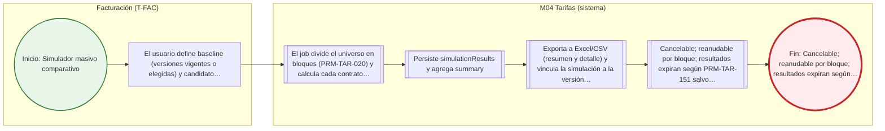

**Pasos del proceso** (actividad tomada del anexo; la columna RF/RN distingue lo citado en el paso de lo asociado por parámetro, permiso, evento o tema compartido).

| Paso | Carril | Actividad | RF/RN que aplican | EVT / JOB / PAN |
|---|---|---|---|---|
| 1 | Facturación | El usuario define baseline (versiones vigentes o elegidas) y candidato (versión en borrador o publicada; reglas; promociones), universo (servicios, categorías, zonas, grupos, regímenes, muestra N o %), período y fuente de cantidades (consumo real del período, de un período histórico o cantidad manual). | asoc.: RN-TAR-238 | — |
| 2 | M04 Tarifas | El job divide el universo en bloques (PRM-TAR-020) y calcula cada contrato dos veces (baseline y candidato) con el motor en modo `simulation` (sin efectos). | asoc.: RN-TAR-001 | — |
| 3 | M04 Tarifas | Persiste `simulationResults` y agrega `summary`: totales y variación % por servicio, categoría, grupo, régimen, concepto y tramo; distribución (percentiles 10/50/90), cuentas con variación > PRM-TAR-153; errores por código. | asoc.: RF-TAR-095, RF-TAR-093 | — |
| 4 | M04 Tarifas | Exporta a Excel/CSV (resumen y detalle) y vincula la simulación a la versión candidata (precondición de envío según PRM-TAR-005). | asoc.: RF-TAR-006 | — |
| 5 | M04 Tarifas | Cancelable; reanudable por bloque; resultados expiran según PRM-TAR-151 salvo los vinculados a versiones publicadas (se conservan como evidencia de aprobación). | — | — |

**Situación actual en ProCoop (nota de cambio).** El anexo indica: Simulación individual: misma lógica para una cuenta o contrato con cantidad ingresada, en línea (síncrona, ≤ 2 s), con explicación completa (reemplaza `SimularFactura`, frmFacturacionMensual en modo simulación y la simulación del editor de cargos).

**Excepciones**

| Excepción | Tratamiento |
|---|---|
| Falla o error | Persiste `simulationResults` y agrega `summary`: totales y variación % por servicio, categoría, grupo, régimen, concepto y tramo; distribución (percentiles 10/50/90), cuentas con variación > PRM-TAR-153; errores por código |
| Cancelación, anulación o reversión | Cancelable; reanudable por bloque; resultados expiran según PRM-TAR-151 salvo los vinculados a versiones publicadas (se conservan como evidencia de aprobación) |
| Falla técnica en un paso automático, un job o una integración | Reintento idempotente y reanudable; lo no reparable pasa a la bandeja técnica con responsable (política de recuperación de T11 P-WFL-01 y T01 §9.12; AGR-016). |

---

## 5. PRC-TAR-04 Diferencias retroactivas (JOB-TAR-06 `tar:diferencias-retroactivas`)

| Campo | Contenido |
|---|---|
| Fuente | M04 §9.7, `M04-TAR-tarifas-motor-calculo.md` (línea 1691) |
| Macroproceso | MP-10 Medición y tarificación |
| Disparador | Publicación de una versión con validFrom anterior a comprobantes… |
| Resultado | Umbral de diferencia mínima PRM-TAR-154 (por debajo no se…) |
| Carriles | M04 Tarifas (sistema); Aprobador según política (T11 aprobaciones) |
| Roles de T02 | Solo actores del sistema (sin rol humano) |
| Módulos involucrados | M04 Tarifas, T11 Workflow, eventos y documentos |
| Eventos (T11 §12) | — |
| Jobs | — |
| Relación con 04-procesos-bpmn.md | P3 Facturación periódica y emisión fiscal ([§7](04-procesos-bpmn.md#7-p3--facturación-periódica-y-emisión-fiscal)) |

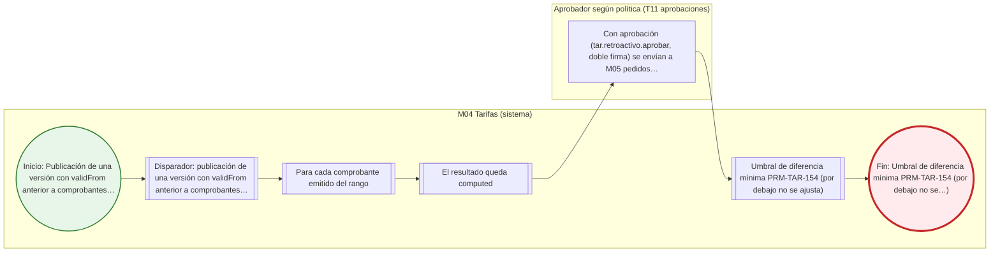

**Pasos del proceso** (actividad tomada del anexo; la columna RF/RN distingue lo citado en el paso de lo asociado por parámetro, permiso, evento o tema compartido).

| Paso | Carril | Actividad | RF/RN que aplican | EVT / JOB / PAN |
|---|---|---|---|---|
| 1 | M04 Tarifas | Disparador: publicación de una versión con `validFrom` anterior a comprobantes emitidos del alcance, alta/baja retroactiva de inscripción, o pedido manual (`tar.retroactivo.calcular`) | asoc.: RN-TAR-059, RF-TAR-008 | — |
| 2 | M04 Tarifas | Para cada comprobante emitido del rango: recalcula con las versiones corregidas usando la instantánea original (mismas cantidades) y compara por renglón | — | — |
| 3 | M04 Tarifas | El resultado queda `computed` | — | — |
| 4 | Aprobador según política | con aprobación (`tar.retroactivo.aprobar`, doble firma) se envían a M05 pedidos de nota de crédito/débito por la diferencia (nunca se reescribe el comprobante, ESC-02) | asoc.: RF-TAR-096, RN-TAR-237 | — |
| 5 | M04 Tarifas | Umbral de diferencia mínima PRM-TAR-154 (por debajo no se ajusta); PA-TAR-12 | — | — |

**Situación actual en ProCoop (nota de cambio).** Sin contraste específico para este proceso en el anexo (filas `CTR-` con ProCoop) ni en el análisis de brechas. El contraste del dominio está en `15-analisis-brechas-procoop.md` §3.7.

**Excepciones**

| Excepción | Tratamiento |
|---|---|
| Umbral o tolerancia superada | Disparador: publicación de una versión con `validFrom` anterior a comprobantes emitidos del alcance, alta/baja retroactiva de inscripción, o pedido manual (`tar.retroactivo.calcular`) Para cada comprobante emitido del rango: recalcula con las versiones corregidas usando la instantánea original (mismas cantidades) y compara por renglón El resultado queda `computed` con aprobación (`tar.retroactivo. |
| Falla técnica en un paso automático, un job o una integración | Reintento idempotente y reanudable; lo no reparable pasa a la bandeja técnica con responsable (política de recuperación de T11 P-WFL-01 y T01 §9.12; AGR-016). |

---

## 6. PRC-TAR-05 Tasación telefónica (JOB-TAR-09 `tar:tasar-llamadas`, JOB-TAR-10 `tar:retasar`)

| Campo | Contenido |
|---|---|
| Fuente | M04 §9.8, `M04-TAR-tarifas-motor-calculo.md` (línea 1695) |
| Macroproceso | MP-10 Medición y tarificación |
| Disparador | Tasación telefónica |
| Resultado | Retasación: para un rango y filtros, recalcula conservando los… |
| Carriles | M10 Técnica y campo; M04 Tarifas (sistema) |
| Roles de T02 | Solo actores del sistema (sin rol humano) |
| Módulos involucrados | M04 Tarifas, M10 Técnica y campo |
| Eventos (T11 §12) | EVT-TEC-27 `tec.cdr.attributed` |
| Jobs | — |
| Relación con 04-procesos-bpmn.md | P3 Facturación periódica y emisión fiscal ([§7](04-procesos-bpmn.md#7-p3--facturación-periódica-y-emisión-fiscal)) |

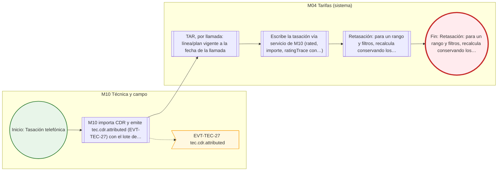

**Pasos del proceso** (actividad tomada del anexo; la columna RF/RN distingue lo citado en el paso de lo asociado por parámetro, permiso, evento o tema compartido).

| Paso | Carril | Actividad | RF/RN que aplican | EVT / JOB / PAN |
|---|---|---|---|---|
| 1 | M10 Técnica y campo | M10 importa CDR y emite `tec.cdr.attributed` (EVT-TEC-27) con el lote de llamadas. | — | EVT-TEC-27 |
| 2 | M04 Tarifas | TAR, por llamada: línea/plan vigente a la fecha de la llamada; destino por prefijo más largo (servicio de M10); tipo de llamada; partición en tramos por bandas horarias del día (1–7; feriado ⇒ bandas del domingo; cruce de medianoche); tipo de banda por plan+banda[+tipo] con fallback; importe = fracción inicial + fracciones siguientes × precio; descuentos y números gratuitos; prepago (tipo +10); si el CDR trae importe > 0, prevalece (RN-TAR-084–098). | RN-TAR-084; asoc.: RF-TAR-097, RN-TAR-088 | — |
| 3 | M04 Tarifas | Escribe la tasación vía servicio de M10 (`rated`, importe, `ratingTrace` con plan, tarifa, bandas, fracciones). | — | — |
| 4 | M04 Tarifas | Retasación: para un rango y filtros, recalcula conservando los identificadores de las llamadas (ProCoop borra y reinserta; CTR-TAR-24); solo llamadas no facturadas, salvo con diferencias retroactivas aprobadas. | asoc.: RN-TAR-096, RF-TAR-098 | — |

**Situación actual en ProCoop (nota de cambio).** El anexo indica: Retasación: para un rango y filtros, recalcula conservando los identificadores de las llamadas (ProCoop borra y reinserta;

**Excepciones**

| Excepción | Tratamiento |
|---|---|
| Si el CDR trae importe > 0 | prevalece (RN-TAR-084–098) |
| Falla técnica en un paso automático, un job o una integración | Reintento idempotente y reanudable; lo no reparable pasa a la bandeja técnica con responsable (política de recuperación de T11 P-WFL-01 y T01 §9.12; AGR-016). |

---

## 7. PRC-TAR-06 Padrones de subsidio y tarifa social (JOB-TAR-04 `tar:importar-padron`, JOB-TAR-05 `tar:recategorizar`)

| Campo | Contenido |
|---|---|
| Fuente | M04 §9.9, `M04-TAR-tarifas-motor-calculo.md` (línea 1702) |
| Macroproceso | MP-10 Medición y tarificación |
| Disparador | Padrones de subsidio y tarifa social |
| Resultado | Toda inscripción guarda origen (archivo, fila, fecha) y… |
| Carriles | M04 Tarifas (sistema) |
| Roles de T02 | Solo actores del sistema (sin rol humano) |
| Módulos involucrados | M04 Tarifas |
| Eventos (T11 §12) | — |
| Jobs | — |
| Relación con 04-procesos-bpmn.md | P3 Facturación periódica y emisión fiscal ([§7](04-procesos-bpmn.md#7-p3--facturación-periódica-y-emisión-fiscal)) |

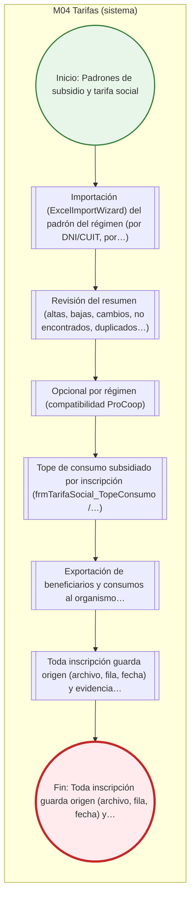

**Pasos del proceso** (actividad tomada del anexo; la columna RF/RN distingue lo citado en el paso de lo asociado por parámetro, permiso, evento o tema compartido).

| Paso | Carril | Actividad | RF/RN que aplican | EVT / JOB / PAN |
|---|---|---|---|---|
| 1 | M04 Tarifas | Importación (ExcelImportWizard) del padrón del régimen (por DNI/CUIT, por suministro o por NIS), validación y cruce (8.2). | — | — |
| 2 | M04 Tarifas | Revisión del resumen (altas, bajas, cambios, no encontrados, duplicados, conflictos de varias cuentas por persona) y confirmación ⇒ `subsidyEnrollments`. | — | — |
| 3 | M04 Tarifas | Opcional por régimen (compatibilidad ProCoop): recategorización a la categoría social con propuesta revisable y aplicación en M02 con fecha efectiva; restablecimiento masivo (frmTarifaSocial_Restablecer, frmSegmentacion_Restablecer). | asoc.: RF-TAR-080 | — |
| 4 | M04 Tarifas | Tope de consumo subsidiado por inscripción (frmTarifaSocial_TopeConsumo / _Confirmar_TopeConsumo). | asoc.: RF-TAR-080 | — |
| 5 | M04 Tarifas | Exportación de beneficiarios y consumos al organismo (frmTarifaSocial_Exportar) con formato del régimen (T06). | — | — |
| 6 | M04 Tarifas | Toda inscripción guarda origen (archivo, fila, fecha) y evidencia (RN-TAR-205). | RN-TAR-205 | — |

**Situación actual en ProCoop (nota de cambio).** El anexo indica: Opcional por régimen (compatibilidad ProCoop): recategorización a la categoría social con propuesta revisable y aplicación en M02 con fecha efectiva; restablecimiento masivo (frmTarifaSocial_Restablecer, frmSegmentacion_Restablecer).

**Excepciones**

| Excepción | Tratamiento |
|---|---|
| Duplicado | Revisión del resumen (altas, bajas, cambios, no encontrados, duplicados, conflictos de varias cuentas por persona) y confirmación ⇒ `subsidyEnrollments` |
| Falla técnica en un paso automático, un job o una integración | Reintento idempotente y reanudable; lo no reparable pasa a la bandeja técnica con responsable (política de recuperación de T11 P-WFL-01 y T01 §9.12; AGR-016). |

---

## 8. PRC-TAR-07 Promociones

| Campo | Contenido |
|---|---|
| Fuente | M04 §9.10, `M04-TAR-tarifas-motor-calculo.md` (línea 1711) |
| Macroproceso | MP-10 Medición y tarificación |
| Disparador | Promociones |
| Resultado | Finalización. Cambio de plan según onPlanChange |
| Carriles | M04 Tarifas (sistema) |
| Roles de T02 | Solo actores del sistema (sin rol humano) |
| Módulos involucrados | M04 Tarifas |
| Eventos (T11 §12) | — |
| Jobs | JOB-TAR-11 `tar:aviso-fin-promociones` |
| Relación con 04-procesos-bpmn.md | P3 Facturación periódica y emisión fiscal ([§7](04-procesos-bpmn.md#7-p3--facturación-periódica-y-emisión-fiscal)) |

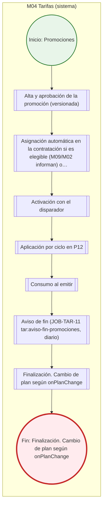

**Pasos del proceso** (actividad tomada del anexo; la columna RF/RN distingue lo citado en el paso de lo asociado por parámetro, permiso, evento o tema compartido).

| Paso | Carril | Actividad | RF/RN que aplican | EVT / JOB / PAN |
|---|---|---|---|---|
| 1 | M04 Tarifas | Alta y aprobación de la promoción (versionada) | — | — |
| 2 | M04 Tarifas | asignación automática en la contratación si es elegible (M09/M02 informan) o manual | — | — |
| 3 | M04 Tarifas | activación con el disparador | — | — |
| 4 | M04 Tarifas | aplicación por ciclo en P12 | — | — |
| 5 | M04 Tarifas | consumo al emitir | — | — |
| 6 | M04 Tarifas | aviso de fin (JOB-TAR-11 `tar:aviso-fin-promociones`, diario) | — | JOB-TAR-11 |
| 7 | M04 Tarifas | finalización. Cambio de plan según `onPlanChange`; anulación de comprobante revierte el ciclo (8.4) | asoc.: RN-TAR-243 | — |

**Situación actual en ProCoop (nota de cambio).** Sin contraste específico para este proceso en el anexo (filas `CTR-` con ProCoop) ni en el análisis de brechas. El contraste del dominio está en `15-analisis-brechas-procoop.md` §3.7.

**Excepciones**

| Excepción | Tratamiento |
|---|---|
| Cancelación, anulación o reversión | Cambio de plan según `onPlanChange`; anulación de comprobante revierte el ciclo (8.4) |
| Falla técnica en un paso automático, un job o una integración | Reintento idempotente y reanudable; lo no reparable pasa a la bandeja técnica con responsable (política de recuperación de T11 P-WFL-01 y T01 §9.12; AGR-016). |

---

## 9. PRC-FAC-01 Ciclo masivo completo (CU-LOT-01, CU-FAC-01)

| Campo | Contenido |
|---|---|
| Fuente | M05 §9.1, `M05-FAC-facturacion.md` (línea 1614) |
| Macroproceso | MP-11 Facturación y fiscal |
| Disparador | Ciclo masivo completo |
| Resultado | Cerrar (JOB-FAC-15): el responsable propone el acta |
| Carriles | M05 Facturación (sistema); Facturación (T-FAC); Aprobador según política (T11 aprobaciones); M06 Fiscal |
| Roles de T02 | T-FAC Facturación |
| Módulos involucrados | M05 Facturación, M06 Fiscal, T11 Workflow, eventos y documentos |
| Eventos (T11 §12) | EVT-FIS-01 `fis.invoice.authorized`; EVT-FIS-04 `fis.authorization.uncertain`; EVT-FAC-07 `fac.invoice.issued`; EVT-FAC-17 `fac.billingCycle.closed` |
| Jobs | JOB-FAC-17 `fac:programar-ciclos`; JOB-FAC-01 `fac:preparar-lote`; JOB-FAC-02 `fac:prefacturar-lote`; JOB-FAC-03 `fac:emitir-lote`; JOB-FAC-08 `fac:conciliar-inciertos`; JOB-FAC-04 `fac:generar-pdf`; JOB-FAC-05 `fac:generar-codigos`; JOB-FAC-06 `fac:distribuir-lote`; JOB-FAC-07 `fac:reprocesar-excepciones`; JOB-FAC-15 `fac:cerrar-ciclo` |
| Relación con 04-procesos-bpmn.md | P3 Facturación periódica y emisión fiscal ([§7](04-procesos-bpmn.md#7-p3--facturación-periódica-y-emisión-fiscal)) |

```mermaid
flowchart LR
  subgraph L_LSIS["M05 Facturación (sistema)"]
    ni(("Inicio: Ciclo masivo completo"))
    ns1[["Programar (JOB-FAC-17, diario)"]]
    ns2[["Preparar (JOB-FAC-01): el responsable revisa fechas, opciones y universo y…"]]
    ns3[["Prefacturar (JOB-FAC-02)"]]
    ns5[["Cambios de universo (ESC-05)"]]
    ns7[["Emitir (JOB-FAC-03): por bloques de PRM-FAC-035 casos, en una transacción por…"]]
    ne7>"EVT-FAC-07 fac.invoice.issued"]
    ns9[["Representar (JOB-FAC-04 y JOB-FAC-05)"]]
    ns10[["Distribuir (JOB-FAC-06)"]]
    ns11[["Reprocesar (JOB-FAC-07)"]]
    ns12[["Cerrar (JOB-FAC-15): el responsable propone el acta"]]
    ne12>"EVT-FAC-17 fac.billingCycle.closed"]
    nf(("Fin: Cerrar (JOB-FAC-15): el responsable propone el acta"))
  end
  subgraph L_LTFAC["Facturación (T-FAC)"]
    ns4["Revisar: el responsable y los correctores trabajan la bandeja de excepciones"]
  end
  subgraph L_LAPR["Aprobador según política (T11 aprobaciones)"]
    ns6["Aprobar: el aprobador (distinto del preparador si PRM-FAC-070) ve el resumen…"]
  end
  subgraph L_LM06["M06 Fiscal"]
    ns8[["Autorizar (M06): M06 consume la cola y responde con fis.invoice.authorized y…"]]
    ne8>"EVT-FIS-01 fis.invoice.authorized; EVT-FIS-04 fis.authorization.uncertain"]
  end
  ni --> ns1
  ns1 --> ns2
  ns2 --> ns3
  ns3 --> ns4
  ns4 --> ns5
  ns5 --> ns6
  ns6 --> ns7
  ns7 -.-> ne7
  ns7 --> ns8
  ne8 -.-> ns8
  ns8 --> ns9
  ns9 --> ns10
  ns10 --> ns11
  ns11 --> ns12
  ns12 -.-> ne12
  ns12 --> nf
  classDef inicio fill:#e8f5e9,stroke:#2e7d32,stroke-width:2px
  classDef fin fill:#ffebee,stroke:#c62828,stroke-width:4px
  classDef evento fill:#fff8e1,stroke:#f9a825
  classDef temporizador fill:#e3f2fd,stroke:#1565c0
  class ni inicio
  class nf fin
  class ne7,ne8,ne12 evento
```

**Pasos del proceso** (actividad tomada del anexo; la columna RF/RN distingue lo citado en el paso de lo asociado por parámetro, permiso, evento o tema compartido).

| Paso | Carril | Actividad | RF/RN que aplican | EVT / JOB / PAN |
|---|---|---|---|---|
| 1 | M05 Facturación | Programar (JOB-FAC-17, diario): para cada ciclo publicado cuya `runDate` llega, crea el lote `draft` con fechas resueltas por las expresiones del calendario y el calendario de feriados (T04). Notifica al responsable. | asoc.: RF-FAC-008 | JOB-FAC-17 |
| 2 | M05 Facturación | Preparar (JOB-FAC-01): el responsable revisa fechas, opciones y universo y pide "Preparar". El job toma el lock `lockKey` (si existe otro lote activo con la misma clave, error 409 `FAC_RUN_LOCKED`), ejecuta las validaciones RN-FAC-008 a RN-FAC-019 (consulta prerrequisitos a M06 y M17), resuelve el universo (criterios + lista explícita), aplica marcas "no facturar", bajas y reglas de elegibilidad (RN-FAC-020 a 030), toma la foto de consumos aprobados (M03), ítems facturables y cuotas, resuelve la modalidad de cada cuenta (RN-FAC-135), registra las dependencias entre servicios relacionados y ordena los servicios base antes que los dependientes (CLO después de AG; RN-FAC-155) y congela el universo como versión 1 con hash. Reserva `billableItems`. Elige la muestra de control con semilla registrada. Tras prefacturar, los casos que cumplen PRM-FAC-161 o traen `requiresReview` de M04 pasan a la cola de revisión previa (RF-FAC-174) antes de la aprobación de emisión. | RF-FAC-174, RN-FAC-008, RN-FAC-019, RN-FAC-020, RN-FAC-135, RN-FAC-155; asoc.: RN-FAC-154, RF-FAC-019 | JOB-FAC-01 |
| 3 | M05 Facturación | Prefacturar (JOB-FAC-02): por bloques, solicita a M04 el cálculo de cada caso (`POST` interno al servicio de cálculo con `ruleVersions` fijadas), resuelve tipo, letra y punto de venta (RN-FAC-043, RN-FAC-047), arma candidatos de comprobante y vencimientos con recargos de la trama (RN-FAC-058 a 068), compara contra el período anterior y genera excepciones por caso. No asigna números ni crea comprobantes. | RN-FAC-043, RN-FAC-047, RN-FAC-058; asoc.: RF-FAC-025 | JOB-FAC-02 |
| 4 | Facturación | Revisar: el responsable y los correctores trabajan la bandeja de excepciones; cada corrección se hace en el módulo dueño (M01, M02, M03, M04, M06) mediante el enlace de la excepción. Al resolverse, el caso puede re-prefacturarse dentro del mismo lote (si aún no se aprobó) o en un lote `reprocess` (si ya se emitió). | asoc.: RF-FAC-038, RF-FAC-036 | — |
| 5 | M05 Facturación | Cambios de universo (ESC-05): si entra una cuenta, sale otra o cambia una regla, el responsable congela la versión 2; el sistema muestra la diferencia y re-prefactura solo los casos afectados. | asoc.: RF-FAC-045, RF-FAC-019 | — |
| 6 | Aprobador según política | Aprobar: el aprobador (distinto del preparador si `PRM-FAC-070`) ve el resumen obligatorio y aprueba; si el total supera `PRM-FAC-072` se dispara el workflow T11. | asoc.: RF-FAC-043 | — |
| 7 | M05 Facturación | Emitir (JOB-FAC-03): por bloques de `PRM-FAC-035` casos, en una transacción por bloque: revalida que el caso siga apto (versión de consumo y de universo), incrementa numeradores, crea `invoices`, `billedPeriods`, `billingRunNumberRanges`, marca `billableItems` como `billed` y registra en outbox `fac.invoice.issued` y la solicitud de autorización a M06. Confirmado el bloque, persiste `progress.lastConfirmedBlock`. Un error individual aísla el caso; si la tasa de errores del bloque supera `PRM-FAC-033` % o hay un error sistémico, pausa el lote (§9.6). | asoc.: RF-FAC-051, RN-FAC-056 | JOB-FAC-03, EVT-FAC-07 |
| 8 | M06 Fiscal | Autorizar (M06): M06 consume la cola y responde con `fis.invoice.authorized` y `fis.authorization.*` (EVT-FIS-01 a EVT-FIS-04); FAC actualiza `invoices.fiscal` y el caso. Rechazos → excepción `FISCAL_REJECTED`. Sin respuesta → `uncertain` → JOB-FAC-08. | asoc.: RF-FAC-157 | EVT-FIS-01, EVT-FIS-04, JOB-FAC-08 |
| 9 | M05 Facturación | Representar (JOB-FAC-04 y JOB-FAC-05): al quedar autorizado (o al emitir si no requiere autorización), genera códigos de pago y PDF con QR fiscal y QR de pago (si corresponde). | — | JOB-FAC-04, JOB-FAC-05 |
| 10 | M05 Facturación | Distribuir (JOB-FAC-06): según preferencias de entrega: email y WhatsApp vía T09, publicación en portal y app, archivo de impresión ordenado por ruta y pieza (MER-008). Rebotes → papel. | asoc.: RF-FAC-154, RF-FAC-159 | JOB-FAC-06 |
| 11 | M05 Facturación | Reprocesar (JOB-FAC-07): casos con excepción resuelta pasan a un lote `reprocess` vinculado, que repite preparación, prefacturación y aprobación solo para ellos. | — | JOB-FAC-07 |
| 12 | M05 Facturación | Cerrar (JOB-FAC-15): el responsable propone el acta; el sistema calcula el cuadre; aprobador y contador aprueban; se genera el PDF del acta, los pendientes pasan a `carriedOver`, se propagan bloqueos (si `PRM-FAC-023`), se emite `fac.billingCycle.closed` (M17 registra capital si `PRM-FAC-061`). | asoc.: RN-FAC-143, RF-FAC-056 | JOB-FAC-15, EVT-FAC-17 |

**Situación actual en ProCoop (nota de cambio).** CTR-FAC-15: en ProCoop, importaciones dejan un número sin usar. Cambio adoptado: Se reserva el número dentro de la misma transacción de emisión. Análisis de brechas (`15-analisis-brechas-procoop.md` §3.8, Facturación): hoy Facturación masiva por lotes y administración de comprobantes; en GoodApps, ciclos, universos, lote congelado, prefacturación con excepciones y aprobación (brecha "Se mantiene"; fuente M05; DFA Módulo 8; RN-02).

**Excepciones**

| Excepción | Tratamiento |
|---|---|
| Falla o error | El job toma el lock `lockKey` (si existe otro lote activo con la misma clave, error 409 `FAC_RUN_LOCKED`), ejecuta las validaciones RN-FAC-008 a RN-FAC-019 (consulta prerrequisitos a M06 y M17), resuelve el universo (criterios + lista explícita), aplica marcas "no facturar", bajas y reglas de elegibilidad (RN-FAC-020 a 030), toma la foto de consumos aprobados (M03), ítems facturables y cuotas, res |
| Vencimiento | Prefacturar (JOB-FAC-02): por bloques, solicita a M04 el cálculo de cada caso (`POST` interno al servicio de cálculo con `ruleVersions` fijadas), resuelve tipo, letra y punto de venta (RN-FAC-043, RN-FAC-047), arma candidatos de comprobante y vencimientos con recargos de la trama (RN-FAC-058 a 068), compara contra el período anterior y genera excepciones por caso |
| Si entra una cuenta | sale otra o cambia una regla, el responsable congela la versión 2; el sistema muestra la diferencia y re-prefactura solo los casos afectados |
| Umbral o tolerancia superada | Aprobar: el aprobador (distinto del preparador si `PRM-FAC-070`) ve el resumen obligatorio y aprueba; si el total supera `PRM-FAC-072` se dispara el workflow T11 |
| Falla técnica en un paso automático, un job o una integración | Reintento idempotente y reanudable; lo no reparable pasa a la bandeja técnica con responsable (política de recuperación de T11 P-WFL-01 y T01 §9.12; AGR-016). |

---

## 10. PRC-FAC-02 Anulación, NC y ND (CU-FAC-04)

| Campo | Contenido |
|---|---|
| Fuente | M05 §9.3, `M05-FAC-facturacion.md` (línea 1633) |
| Macroproceso | MP-11 Facturación y fiscal |
| Disparador | Anulación, NC y ND |
| Resultado | JOB-FAC-09 ejecuta por comprobante en transacción |
| Carriles | Facturación (T-FAC); M05 Facturación (sistema); T11 Workflow, eventos y documentos |
| Roles de T02 | T-FAC Facturación |
| Módulos involucrados | M05 Facturación, T11 Workflow, eventos y documentos |
| Eventos (T11 §12) | — |
| Jobs | JOB-FAC-09 `fac:anular-masivo` |
| Relación con 04-procesos-bpmn.md | P3 Facturación periódica y emisión fiscal ([§7](04-procesos-bpmn.md#7-p3--facturación-periódica-y-emisión-fiscal)) |

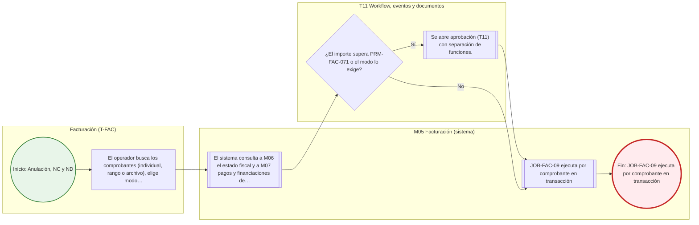

**Pasos del proceso** (actividad tomada del anexo; la columna RF/RN distingue lo citado en el paso de lo asociado por parámetro, permiso, evento o tema compartido).

| Paso | Carril | Actividad | RF/RN que aplican | EVT / JOB / PAN |
|---|---|---|---|---|
| 1 | Facturación | El operador busca los comprobantes (individual, rango o archivo), elige modo (`annul`, `reverse`, `partialCredit`, `debitAdjustment`) y opciones. | — | — |
| 2 | M05 Facturación | El sistema consulta a M06 el estado fiscal y a M07 pagos y financiaciones de cada comprobante; decide el camino permitido (RN-FAC-080 a 090) y muestra los excluidos con motivo. | RN-FAC-080 | — |
| 3 | T11 Workflow, eventos y documentos | Si el importe supera `PRM-FAC-071` o el modo lo exige, se abre aprobación (T11) con separación de funciones. | — | — |
| 4 | M05 Facturación | JOB-FAC-09 ejecuta por comprobante en transacción: emite NC/ND con relación, marca estado comercial del original, libera `billedPeriods` (si permite refacturar), revierte consumos (M03), stock (M11) y cuotas según opciones, y publica eventos. M06 autoriza la NC; M07 aplica la NC contra la obligación original. | asoc.: RF-FAC-051, RF-FAC-129 | JOB-FAC-09 |

**Situación actual en ProCoop (nota de cambio).** Sin contraste específico para este proceso en el anexo (filas `CTR-` con ProCoop) ni en el análisis de brechas. El contraste del dominio está en `15-analisis-brechas-procoop.md` §3.8.

**Excepciones**

| Excepción | Tratamiento |
|---|---|
| Cancelación, anulación o reversión | El operador busca los comprobantes (individual, rango o archivo), elige modo (`annul`, `reverse`, `partialCredit`, `debitAdjustment`) y opciones |
| Si el importe supera `PRM-FAC-071` o el modo lo exige | se abre aprobación (T11) con separación de funciones |
| Falla técnica en un paso automático, un job o una integración | Reintento idempotente y reanudable; lo no reparable pasa a la bandeja técnica con responsable (política de recuperación de T11 P-WFL-01 y T01 §9.12; AGR-016). |

---

## 11. PRC-FAC-03 Refacturación puntual (CU-FAC-05)

| Campo | Contenido |
|---|---|
| Fuente | M05 §9.4, `M05-FAC-facturacion.md` (línea 1640) |
| Macroproceso | MP-11 Facturación y fiscal |
| Disparador | Refacturación puntual |
| Resultado | Emitir. La NC y la nueva factura quedan relacionadas (rebill) |
| Carriles | Comercial / Atención al socio (T-ATE); M05 Facturación (sistema) |
| Roles de T02 | T-ATE Comercial / Atención al socio |
| Módulos involucrados | M05 Facturación |
| Eventos (T11 §12) | — |
| Jobs | — |
| Relación con 04-procesos-bpmn.md | P3 Facturación periódica y emisión fiscal ([§7](04-procesos-bpmn.md#7-p3--facturación-periódica-y-emisión-fiscal)) |

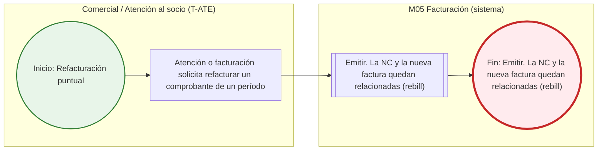

**Pasos del proceso** (actividad tomada del anexo; la columna RF/RN distingue lo citado en el paso de lo asociado por parámetro, permiso, evento o tema compartido).

| Paso | Carril | Actividad | RF/RN que aplican | EVT / JOB / PAN |
|---|---|---|---|---|
| 1 | Comercial / Atención al socio | Atención o facturación solicita refacturar un comprobante de un período: el sistema exige revertir primero (NC total o anulación si aún es anulable), libera el período en `billedPeriods`, crea un lote `rebill` de un caso con el universo congelado de esa cuenta, y sigue el mismo circuito prefacturar; aprobar | asoc.: RN-FAC-026, RF-FAC-021 | — |
| 2 | M05 Facturación | emitir. La NC y la nueva factura quedan relacionadas (`rebill`) | — | — |

**Situación actual en ProCoop (nota de cambio).** Sin contraste específico para este proceso en el anexo (filas `CTR-` con ProCoop) ni en el análisis de brechas. El contraste del dominio está en `15-analisis-brechas-procoop.md` §3.8.

**Excepciones**

| Excepción | Tratamiento |
|---|---|
| Cancelación, anulación o reversión | Atención o facturación solicita refacturar un comprobante de un período: el sistema exige revertir primero (NC total o anulación si aún es anulable), libera el período en `billedPeriods`, crea un lote `rebill` de un caso con el universo congelado de esa cuenta, y sigue el mismo circuito prefacturar; aprobar emitir |
| Falla técnica en un paso automático, un job o una integración | Reintento idempotente y reanudable; lo no reparable pasa a la bandeja técnica con responsable (política de recuperación de T11 P-WFL-01 y T01 §9.12; AGR-016). |

---

## 12. PRC-FAC-04 Factura manual y replicar (CU-FAC-06)

| Campo | Contenido |
|---|---|
| Fuente | M05 §9.5, `M05-FAC-facturacion.md` (línea 1644) |
| Macroproceso | MP-11 Facturación y fiscal |
| Disparador | Factura manual y replicar |
| Resultado | Al emitir, la transacción es la misma que en masiva… |
| Carriles | Facturación (T-FAC); M05 Facturación (sistema) |
| Roles de T02 | T-FAC Facturación |
| Módulos involucrados | M05 Facturación |
| Eventos (T11 §12) | — |
| Jobs | — |
| Relación con 04-procesos-bpmn.md | P3 Facturación periódica y emisión fiscal ([§7](04-procesos-bpmn.md#7-p3--facturación-periódica-y-emisión-fiscal)) |

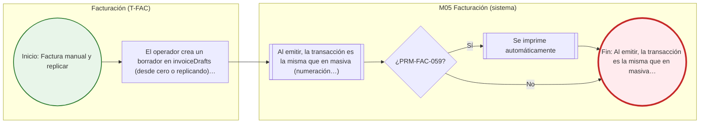

**Pasos del proceso** (actividad tomada del anexo; la columna RF/RN distingue lo citado en el paso de lo asociado por parámetro, permiso, evento o tema compartido).

| Paso | Carril | Actividad | RF/RN que aplican | EVT / JOB / PAN |
|---|---|---|---|---|
| 1 | Facturación | El operador crea un borrador en `invoiceDrafts` (desde cero o replicando), agrega renglones por tipo (servicio, producto, cuota, impuesto, anticipo, anticipo de producto), el sistema calcula con M04/M06 y valida (RN-FAC-045) | RN-FAC-045; asoc.: RF-FAC-126 | — |
| 2 | M05 Facturación | Al emitir, la transacción es la misma que en masiva (numeración, obligaciones, eventos) | — | — |
| 3 | M05 Facturación | Si `PRM-FAC-059`, se imprime automáticamente | — | — |

**Situación actual en ProCoop (nota de cambio).** Sin contraste específico para este proceso en el anexo (filas `CTR-` con ProCoop) ni en el análisis de brechas. El contraste del dominio está en `15-analisis-brechas-procoop.md` §3.8.

**Excepciones**

| Excepción | Tratamiento |
|---|---|
| Falla técnica en un paso automático, un job o una integración | Reintento idempotente y reanudable; lo no reparable pasa a la bandeja técnica con responsable (política de recuperación de T11 P-WFL-01 y T01 §9.12; AGR-016). |

---

## 13. PRC-FAC-05 Fallo sistémico y reanudación (AGR-015)

| Campo | Contenido |
|---|---|
| Fuente | M05 §9.6, `M05-FAC-facturacion.md` (línea 1648) |
| Macroproceso | MP-11 Facturación y fiscal |
| Disparador | Fallo sistémico y reanudación |
| Resultado | Como cada caso tiene idempotencyKey, un reintento del job no… |
| Carriles | M05 Facturación (sistema) |
| Roles de T02 | Solo actores del sistema (sin rol humano) |
| Módulos involucrados | M05 Facturación |
| Eventos (T11 §12) | — |
| Jobs | — |
| Relación con 04-procesos-bpmn.md | P3 Facturación periódica y emisión fiscal ([§7](04-procesos-bpmn.md#7-p3--facturación-periódica-y-emisión-fiscal)) |

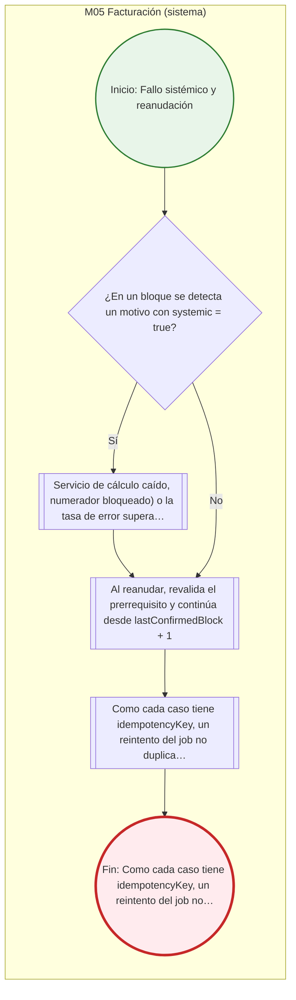

**Pasos del proceso** (actividad tomada del anexo; la columna RF/RN distingue lo citado en el paso de lo asociado por parámetro, permiso, evento o tema compartido).

| Paso | Carril | Actividad | RF/RN que aplican | EVT / JOB / PAN |
|---|---|---|---|---|
| 1 | M05 Facturación | Si en un bloque se detecta un motivo con `systemic = true` (credencial fiscal inválida, servicio de cálculo caído, numerador bloqueado) o la tasa de error supera `PRM-FAC-033` %, el job termina el bloque en curso, marca `paused` con `pause.code`, notifica al responsable y no crea excepciones por cliente | asoc.: RF-FAC-037, RF-FAC-035 | — |
| 2 | M05 Facturación | Al reanudar, revalida el prerrequisito y continúa desde `lastConfirmedBlock + 1` | — | — |
| 3 | M05 Facturación | Como cada caso tiene `idempotencyKey`, un reintento del job no duplica comprobantes | asoc.: RN-FAC-161 | — |

**Situación actual en ProCoop (nota de cambio).** Sin contraste específico para este proceso en el anexo (filas `CTR-` con ProCoop) ni en el análisis de brechas. El contraste del dominio está en `15-analisis-brechas-procoop.md` §3.8.

**Excepciones**

| Excepción | Tratamiento |
|---|---|
| Si en un bloque se detecta un motivo con `systemic = true` (credencial fiscal inválida | servicio de cálculo caído, numerador bloqueado) o la tasa de error supera `PRM-FAC-033` %, el job termina el bloque en curso, marca `paused` con `pause.code`, notifica al responsable y no crea excepciones por cliente Al reanudar, revalida el prerrequisito y continúa desde `lastConfirmedBlock + 1` Como cada caso tiene `idempotencyKey`, un reintento del job no duplica comprobantes |
| Falla técnica en un paso automático, un job o una integración | Reintento idempotente y reanudable; lo no reparable pasa a la bandeja técnica con responsable (política de recuperación de T11 P-WFL-01 y T01 §9.12; AGR-016). |

---

## 14. PRC-FAC-06 Distribución (CU-FAC-07)

| Campo | Contenido |
|---|---|
| Fuente | M05 §9.7, `M05-FAC-facturacion.md` (línea 1652) |
| Macroproceso | MP-11 Facturación y fiscal |
| Disparador | Distribución |
| Resultado | Portal y app: publica el comprobante al quedar autorizado… |
| Carriles | M05 Facturación (sistema) |
| Roles de T02 | Solo actores del sistema (sin rol humano) |
| Módulos involucrados | M05 Facturación |
| Eventos (T11 §12) | EVT-FAC-14 `fac.invoice.published`; EVT-FAC-07 `fac.invoice.issued` |
| Jobs | JOB-FAC-06 `fac:distribuir-lote` |
| Relación con 04-procesos-bpmn.md | P3 Facturación periódica y emisión fiscal ([§7](04-procesos-bpmn.md#7-p3--facturación-periódica-y-emisión-fiscal)) |

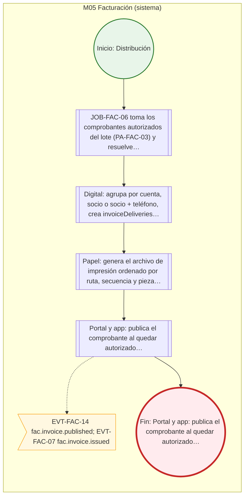

**Pasos del proceso** (actividad tomada del anexo; la columna RF/RN distingue lo citado en el paso de lo asociado por parámetro, permiso, evento o tema compartido).

| Paso | Carril | Actividad | RF/RN que aplican | EVT / JOB / PAN |
|---|---|---|---|---|
| 1 | M05 Facturación | JOB-FAC-06 toma los comprobantes autorizados del lote (PA-FAC-03) y resuelve canales por preferencia (RN-FAC-131 a 134). | RN-FAC-131; asoc.: RF-FAC-063 | JOB-FAC-06 |
| 2 | M05 Facturación | Digital: agrupa por cuenta, socio o socio + teléfono, crea `invoiceDeliveries` y solicita a T09 el envío con adjunto o enlace firmado; procesa callbacks de entrega, lectura, rebote. | — | — |
| 3 | M05 Facturación | Papel: genera el archivo de impresión ordenado por ruta, secuencia y pieza postal, con intercalado de imágenes y mensajes; el operador marca "impreso" y entrega a rutas; el repartidor registra entrega o devolución en pwa-empleado (offline con `clientMutationId`). | asoc.: RF-FAC-160, RF-FAC-159 | — |
| 4 | M05 Facturación | Portal y app: publica el comprobante al quedar autorizado (`fac.invoice.published` implícito en `fac.invoice.issued` + estado fiscal). | asoc.: RF-FAC-051, RF-FAC-156 | EVT-FAC-14, EVT-FAC-07 |

**Situación actual en ProCoop (nota de cambio).** Sin contraste específico para este proceso en el anexo (filas `CTR-` con ProCoop) ni en el análisis de brechas. El contraste del dominio está en `15-analisis-brechas-procoop.md` §3.8.

**Excepciones**

| Excepción | Tratamiento |
|---|---|
| Falla técnica en un paso automático, un job o una integración | Reintento idempotente y reanudable; lo no reparable pasa a la bandeja técnica con responsable (política de recuperación de T11 P-WFL-01 y T01 §9.12; AGR-016). |

---

## 15. PRC-FAC-07 Facturación in situ (O7, PA-FAC-14)

| Campo | Contenido |
|---|---|
| Fuente | M05 §9.8, `M05-FAC-facturacion.md` (línea 1659); ola O7 |
| Macroproceso | MP-11 Facturación y fiscal |
| Disparador | Facturación in situ |
| Resultado | Reemplaza frmEnvioPmovil |
| Carriles | Lecturista (campo) (T-LEC); M05 Facturación (sistema) |
| Roles de T02 | T-LEC Lecturista (campo) |
| Módulos involucrados | M05 Facturación |
| Eventos (T11 §12) | — |
| Jobs | — |
| Relación con 04-procesos-bpmn.md | P3 Facturación periódica y emisión fiscal ([§7](04-procesos-bpmn.md#7-p3--facturación-periódica-y-emisión-fiscal)) |

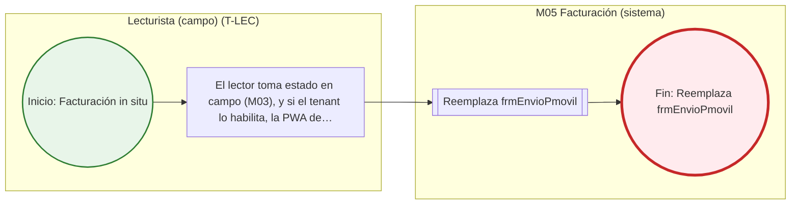

**Pasos del proceso** (actividad tomada del anexo; la columna RF/RN distingue lo citado en el paso de lo asociado por parámetro, permiso, evento o tema compartido).

| Paso | Carril | Actividad | RF/RN que aplican | EVT / JOB / PAN |
|---|---|---|---|---|
| 1 | Lecturista | El lector toma estado en campo (M03), y si el tenant lo habilita, la PWA de empleado emite comprobantes en un rango de numeración reservado por dispositivo (`numberSequences` con sub-rango) o como comprobantes internos que se autorizan al sincronizar | asoc.: RF-FAC-179, RF-FAC-170 | — |
| 2 | M05 Facturación | Reemplaza `frmEnvioPmovil` | — | — |

**Situación actual en ProCoop (nota de cambio).** El anexo indica: El lector toma estado en campo (M03), y si el tenant lo habilita, la PWA de empleado emite comprobantes en un rango de numeración reservado por dispositivo (`numberSequences` con sub-rango) o como comprobantes internos que se autorizan al sincronizar Reemplaza `frmEnvioPmovil` El lector toma estado en campo (M03), y si el tenant lo habilita, la PWA de empleado emite comprobantes en un rango de numeración reservado por dispositivo (`numberSequences` con sub-rango) o como comprobantes internos que se autorizan al sincronizar. Reemplaza `frmEnvioPmovil`.

**Excepciones**

| Excepción | Tratamiento |
|---|---|
| Falla técnica en un paso automático, un job o una integración | Reintento idempotente y reanudable; lo no reparable pasa a la bandeja técnica con responsable (política de recuperación de T11 P-WFL-01 y T01 §9.12; AGR-016). |

---

## 16. PRC-FIS-01 Habilitación fiscal del tenant (alta en ARCA)

| Campo | Contenido |
|---|---|
| Fuente | M06 §9.1, `M06-FIS-fiscal-impuestos.md` (línea 1644) |
| Macroproceso | MP-11 Facturación y fiscal |
| Disparador | Habilitación fiscal del tenant |
| Resultado | Con relevamiento aprobado y pruebas OK, el responsable activa… |
| Carriles | Contador / Contable (MT-006) (T-CON); M06 Fiscal (sistema) |
| Roles de T02 | T-CON Contador / Contable (MT-006) |
| Módulos involucrados | M06 Fiscal |
| Eventos (T11 §12) | — |
| Jobs | JOB-FIS-03 `fis:probar-conector` |
| Relación con 04-procesos-bpmn.md | P3 Facturación periódica y emisión fiscal ([§7](04-procesos-bpmn.md#7-p3--facturación-periódica-y-emisión-fiscal)) |

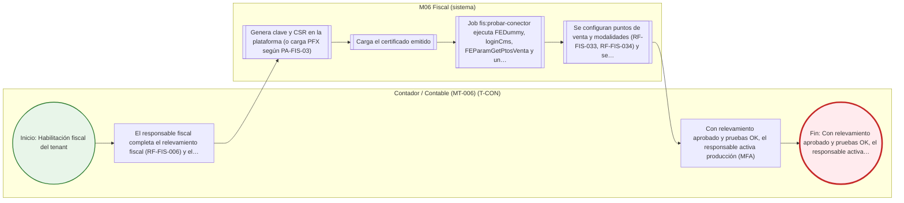

**Pasos del proceso** (actividad tomada del anexo; la columna RF/RN distingue lo citado en el paso de lo asociado por parámetro, permiso, evento o tema compartido).

| Paso | Carril | Actividad | RF/RN que aplican | EVT / JOB / PAN |
|---|---|---|---|---|
| 1 | Contador / Contable | El responsable fiscal completa el relevamiento fiscal (RF-FIS-006) y el perfil fiscal (RF-FIS-013, RF-FIS-014). | RF-FIS-006, RF-FIS-013, RF-FIS-014 | — |
| 2 | M06 Fiscal | Genera clave y CSR en la plataforma (o carga PFX según PA-FIS-03); da de alta el certificado en ARCA con el alias y delega los servicios `wsfe` y padrón al computador fiscal. | asoc.: RF-FIS-025 | — |
| 3 | M06 Fiscal | Carga el certificado emitido; el sistema extrae metadatos y lo deja en `testing` en homologación. | — | — |
| 4 | M06 Fiscal | Job `fis:probar-conector` ejecuta `FEDummy`, `loginCms`, `FEParamGetPtosVenta` y un `FECompUltimoAutorizado`; registra resultado. | asoc.: RF-FIS-037, RF-FIS-027 | JOB-FIS-03 |
| 5 | M06 Fiscal | Se configuran puntos de venta y modalidades (RF-FIS-033, RF-FIS-034) y se adoptan las tablas normativas iniciales (condiciones, alícuotas, tributos, jurisdicción Córdoba). | RF-FIS-033, RF-FIS-034 | — |
| 6 | Contador / Contable | Con relevamiento aprobado y pruebas OK, el responsable activa producción (MFA). Se repite el paso 4 en producción. | asoc.: RF-FIS-006 | — |

**Situación actual en ProCoop (nota de cambio).** Sin contraste específico para este proceso en el anexo (filas `CTR-` con ProCoop) ni en el análisis de brechas. El contraste del dominio está en `15-analisis-brechas-procoop.md` §3.9.

**Excepciones**

| Excepción | Tratamiento |
|---|---|
| Falla técnica en un paso automático, un job o una integración | Reintento idempotente y reanudable; lo no reparable pasa a la bandeja técnica con responsable (política de recuperación de T11 P-WFL-01 y T01 §9.12; AGR-016). |

---

## 17. PRC-FIS-02 Autorización CAE (JOB-FIS-01 `fis:autorizar-cola`)

| Campo | Contenido |
|---|---|
| Fuente | M06 §9.2, `M06-FIS-fiscal-impuestos.md` (línea 1653) |
| Macroproceso | MP-11 Facturación y fiscal |
| Disparador | Autorización CAE |
| Resultado | Reintentos: errores transitorios con *backoff* exponencial (1…) |
| Carriles | M06 Fiscal (sistema) |
| Roles de T02 | Solo actores del sistema (sin rol humano) |
| Módulos involucrados | M05 Facturación, M06 Fiscal |
| Eventos (T11 §12) | EVT-FAC-07 `fac.invoice.issued`; EVT-FAC-10 `fac.creditNote.issued`; EVT-FAC-11 `fac.debitNote.issued` |
| Jobs | JOB-FIS-02 `fis:renovar-ticket`; JOB-FIS-04 `fis:conciliar-incierto`; JOB-FIS-01 `fis:autorizar-cola` |
| Relación con 04-procesos-bpmn.md | P3 Facturación periódica y emisión fiscal ([§7](04-procesos-bpmn.md#7-p3--facturación-periódica-y-emisión-fiscal)) |

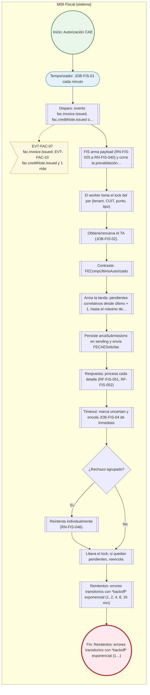

**Pasos del proceso** (actividad tomada del anexo; la columna RF/RN distingue lo citado en el paso de lo asociado por parámetro, permiso, evento o tema compartido).

| Paso | Carril | Actividad | RF/RN que aplican | EVT / JOB / PAN |
|---|---|---|---|---|
| 1 | M06 Fiscal | Disparo: evento `fac.invoice.issued`, `fac.creditNote.issued` o `fac.debitNote.issued` (o de M07/M11/M18) con `documentId`; también disparo manual o periódico (cada minuto) si `autoAuthorize`. | — | EVT-FAC-07, EVT-FAC-10, EVT-FAC-11 |
| 2 | M06 Fiscal | FIS arma `payload` (RN-FIS-025 a RN-FIS-040) y corre la prevalidación (RF-FIS-041, RF-FIS-042). Si falla → `detained` + bandeja. | RF-FIS-041, RF-FIS-042, RN-FIS-025, RN-FIS-040 | — |
| 3 | M06 Fiscal | El worker toma el lock del par (tenant, CUIT, punto, tipo). Si no lo obtiene, reprograma. | — | — |
| 4 | M06 Fiscal | Obtiene/renueva el TA (JOB-FIS-02). | — | JOB-FIS-02 |
| 5 | M06 Fiscal | Contraste: `FECompUltimoAutorizado`; si el último de ARCA ≥ primer número pendiente, ejecuta 9.4 antes de seguir. | asoc.: RF-FIS-037 | — |
| 6 | M06 Fiscal | Arma la tanda: pendientes correlativos desde último + 1, hasta el máximo de registros; si `PRM-FIS-012` está activo, agrupa B/C según RN-FIS-024. | RN-FIS-024 | — |
| 7 | M06 Fiscal | Persiste `arcaSubmissions` en `sending` y envía `FECAESolicitar`. | — | — |
| 8 | M06 Fiscal | Respuesta: procesa cada detalle (RF-FIS-051, RF-FIS-052). Emite eventos por comprobante. | RF-FIS-051, RF-FIS-052 | — |
| 9 | M06 Fiscal | Timeout: marca `uncertain` y encola JOB-FIS-04 de inmediato. No reenvía. | — | JOB-FIS-04 |
| 10 | M06 Fiscal | Rechazo agrupado: reintenta individualmente (RN-FIS-046). | RN-FIS-046; asoc.: RF-FIS-053 | — |
| 11 | M06 Fiscal | Libera el lock; si quedan pendientes, reencola. | — | — |
| 12 | M06 Fiscal | Reintentos: errores transitorios con *backoff* exponencial (1, 2, 4, 8, 16 min; máximo `PRM-FIS-027`), luego `detained` con causa "ARCA no disponible" y propuesta de contingencia (9.5). | — | — |

**Situación actual en ProCoop (nota de cambio).** Sin contraste específico para este proceso en el anexo (filas `CTR-` con ProCoop) ni en el análisis de brechas. El contraste del dominio está en `15-analisis-brechas-procoop.md` §3.9.

**Excepciones**

| Excepción | Tratamiento |
|---|---|
| Si falla | `detained` + bandeja |
| Si no lo obtiene | reprograma |
| Si el último de ARCA ≥ primer número pendiente | ejecuta 9.4 antes de seguir |
| Si `PRM-FIS-012` está activo | agrupa B/C según RN-FIS-024 |
| Falla técnica en un paso automático, un job o una integración | Reintento idempotente y reanudable; lo no reparable pasa a la bandeja técnica con responsable (política de recuperación de T11 P-WFL-01 y T01 §9.12; AGR-016). |

---

## 18. PRC-FIS-03 Espera sincrónica (venta mostrador y cobranza con factura)

| Campo | Contenido |
|---|---|
| Fuente | M06 §9.3, `M06-FIS-fiscal-impuestos.md` (línea 1668) |
| Macroproceso | MP-11 Facturación y fiscal |
| Disparador | Espera sincrónica |
| Resultado | FIS prioriza ese comprobante en la cola de su par. |
| Carriles | M11 Ventas; M06 Fiscal (sistema) |
| Roles de T02 | Solo actores del sistema (sin rol humano) |
| Módulos involucrados | M06 Fiscal, M11 Ventas |
| Eventos (T11 §12) | EVT-FIS-01 `fis.invoice.authorized` |
| Jobs | — |
| Relación con 04-procesos-bpmn.md | P3 Facturación periódica y emisión fiscal ([§7](04-procesos-bpmn.md#7-p3--facturación-periódica-y-emisión-fiscal)) |

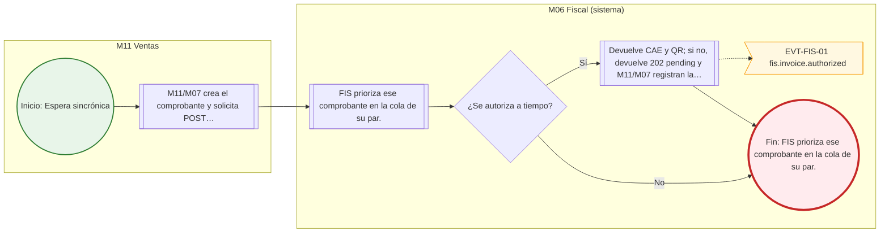

**Pasos del proceso** (actividad tomada del anexo; la columna RF/RN distingue lo citado en el paso de lo asociado por parámetro, permiso, evento o tema compartido).

| Paso | Carril | Actividad | RF/RN que aplican | EVT / JOB / PAN |
|---|---|---|---|---|
| 1 | M11 Ventas | M11/M07 crea el comprobante y solicita `POST /api/admin/fis/authorizations/{id}/await` con timeout `PRM-FIS-010` (por defecto 15 s). | — | — |
| 2 | M06 Fiscal | FIS prioriza ese comprobante en la cola de su par. | — | — |
| 3 | M06 Fiscal | Si se autoriza a tiempo, devuelve CAE y QR; si no, devuelve `202 pending` y M11/M07 registran la operación con el aviso `dict:fis.aviso.pendienteArca`, y el comprobante se entrega cuando llegue el evento `fis.invoice.authorized` (PA-FIS-11). | asoc.: RF-FIS-056 | EVT-FIS-01 |

**Situación actual en ProCoop (nota de cambio).** Sin contraste específico para este proceso en el anexo (filas `CTR-` con ProCoop) ni en el análisis de brechas. El contraste del dominio está en `15-analisis-brechas-procoop.md` §3.9.

**Excepciones**

| Excepción | Tratamiento |
|---|---|
| Resultado incierto o sin respuesta | M11/M07 crea el comprobante y solicita `POST /api/admin/fis/authorizations/(id)/await` con timeout `PRM-FIS-010` (por defecto 15 s) |
| Si no, devuelve `202 pending` y M11/M07 registran la operación con el aviso `dict:fis.aviso.pendienteArca` | y el comprobante se entrega cuando llegue el evento `fis.invoice.authorized` (PA-FIS-11) |
| Falla técnica en un paso automático, un job o una integración | Reintento idempotente y reanudable; lo no reparable pasa a la bandeja técnica con responsable (política de recuperación de T11 P-WFL-01 y T01 §9.12; AGR-016). |

---

## 19. PRC-FIS-04 Conciliación de incierto e inconsistencias (JOB-FIS-04 `fis:conciliar-incierto`, JOB-FIS-05 `fis:conciliar-arca`)

| Campo | Contenido |
|---|---|
| Fuente | M06 §9.4, `M06-FIS-fiscal-impuestos.md` (línea 1674) |
| Macroproceso | MP-11 Facturación y fiscal |
| Disparador | Conciliación de incierto e inconsistencias |
| Resultado | El job periódico (diario) recorre comprobantes autorizados del… |
| Carriles | M06 Fiscal (sistema) |
| Roles de T02 | Solo actores del sistema (sin rol humano) |
| Módulos involucrados | M06 Fiscal |
| Eventos (T11 §12) | — |
| Jobs | — |
| Relación con 04-procesos-bpmn.md | P3 Facturación periódica y emisión fiscal ([§7](04-procesos-bpmn.md#7-p3--facturación-periódica-y-emisión-fiscal)) |

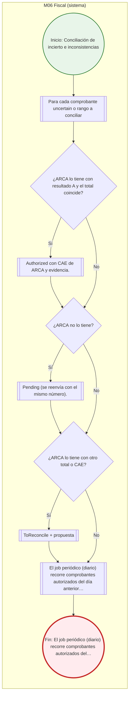

**Pasos del proceso** (actividad tomada del anexo; la columna RF/RN distingue lo citado en el paso de lo asociado por parámetro, permiso, evento o tema compartido).

| Paso | Carril | Actividad | RF/RN que aplican | EVT / JOB / PAN |
|---|---|---|---|---|
| 1 | M06 Fiscal | Para cada comprobante `uncertain` o rango a conciliar: `FECompConsultar`. | asoc.: RF-FIS-052, RF-FIS-037 | — |
| 2 | M06 Fiscal | Si ARCA lo tiene con resultado `A` y el total coincide (tolerancia `PRM-FIS-019`) → `authorized` con CAE de ARCA y evidencia. | asoc.: RN-FIS-048 | — |
| 3 | M06 Fiscal | Si ARCA no lo tiene → `pending` (se reenvía con el mismo número). | — | — |
| 4 | M06 Fiscal | Si ARCA lo tiene con otro total o CAE → `toReconcile` + propuesta; un humano aprueba (RF-FIS-059). | RF-FIS-059 | — |
| 5 | M06 Fiscal | El job periódico (diario) recorre comprobantes autorizados del día anterior por muestreo completo o total (`PRM-FIS-025`) e informa individuales y rangos. | — | — |

**Situación actual en ProCoop (nota de cambio).** Sin contraste específico para este proceso en el anexo (filas `CTR-` con ProCoop) ni en el análisis de brechas. El contraste del dominio está en `15-analisis-brechas-procoop.md` §3.9.

**Excepciones**

| Excepción | Tratamiento |
|---|---|
| Si ARCA lo tiene con resultado `A` y el total coincide (tolerancia `PRM-FIS-019`) | `authorized` con CAE de ARCA y evidencia |
| Si ARCA no lo tiene | `pending` (se reenvía con el mismo número) |
| Si ARCA lo tiene con otro total o CAE | `toReconcile` + propuesta; un humano aprueba (RF-FIS-059) |
| Falla técnica en un paso automático, un job o una integración | Reintento idempotente y reanudable; lo no reparable pasa a la bandeja técnica con responsable (política de recuperación de T11 P-WFL-01 y T01 §9.12; AGR-016). |

---

## Inconsistencias detectadas en la especificación (esta parte)

No se detectaron inconsistencias en los procesos de esta parte.

## Cobertura de esta parte

| Universo de la parte | Diagramados | Con nota ProCoop específica | Pendientes |
|---|---|---|---|
| 19 (PRC-MED-16 a PRC-FIS-04) | 19 | 7 | 0 |
